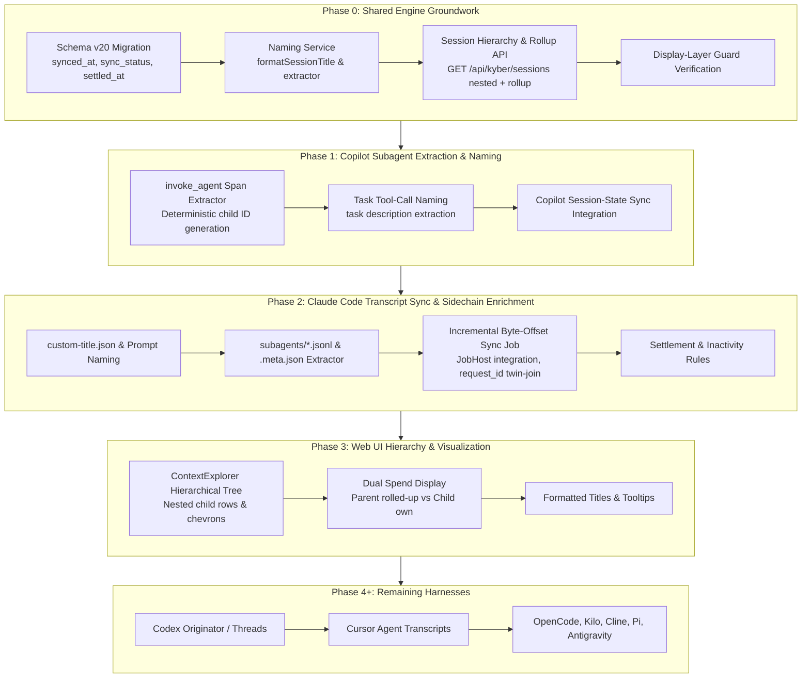

# KyberDash Sessions page subagents and names

**Status: Complete 2026-10-14.** Plan delivered in `test-first` mode across all 9 tasks T0.1–T4.1. Whole-change review council returned APPROVE with 15/15 declared gates passing. Primary architectural decisions (D1–D9, AP1) are harvested into [ADR 0037](../../adr/0037-post-run-transcript-sync-subagent-hierarchy.md), [dash/architecture.md](../../dash/architecture.md), and [dash/runbook.md](../../dash/runbook.md). Archived per KW-DOC-LIFECYCLE-003.

Development mode: `test-first`. Persisted per architect protocol. Every implementation task has a test-first contract in [section 7](#7-test-contract-test-first).

## 1. Problem and goal

The KyberDash Sessions explorer (`dash/web/src/pages/Sessions.tsx` -> `ContextExplorer.tsx` -> `GET /api/kyber/sessions` -> `canon.db` `session` table) suffers from two prominent visibility gaps:

1. **Subagent turns and sessions are omitted:**
   - In Claude Code, tool calls like `Agent` / `Task` spawn background or sidechain agents recorded in separate JSONL transcripts (`subagents/agent-*.jsonl`). These subagent executions never appear on the Sessions page; only the top-level parent session is listed.
   - In GitHub Copilot, child subagent spans (e.g. `invoke_agent` operations or delegated tasks) are either collapsed or not presented as identifiable child sessions, making multi-agent workflows invisible in the session inventory.
2. **Session titles and identifiers are machine labels:**
   - Sessions currently display with raw machine operations such as `claude_code.llm_request`, `chat claude-3-5-sonnet-20241022`, or raw truncated UUIDs.
   - Users cannot discern at a glance what an agent was doing or which agent persona was running.

**Goal:**
- Introduce a first-class, nested subagent hierarchy in the KyberDash Sessions page.
- Display sessions using a readable naming convention: `<agent name> · <task summary>`.
- Provide dual spend accounting: parent session rows display the rolled-up spend (own + all child subagents), while child subagent rows display their own granular spend.
- Persist stable session identities for subagents in `canon.db`: Claude subagents as `agent-<agentId>` and Copilot subagents deterministically as `<parent>#<invoke_agent_span_id>`.
- Implement a post-run transcript synchronization engine job in the shared KyberDash engine that incrementally reads transcript files, resolves titles, extracts subagents, and joins with OTel spans via `request_id` (under ADR 0009 and ADR 0029).
- Enforce the display-layer boundary (root `AGENTS.md`, [rules/kyberdash-display-layer.md](../../rules/kyberdash-display-layer.md), ADR 0033): the web UI and desktop tray are display layers only; all sync scheduling, state tracking, and rollup aggregation reside in the shared engine.
- Harvest architectural decisions into **ADR 0037: Post-Run Transcript Synchronization and Stable-Identity Subagent Session Hierarchy**.

## 2. Investigation findings

Discovery was conducted over the codebase on branch `feat/sessions-subagents-and-names` at commit `803cc3e` using Kyber-Weave docs MCP and CodeGraph:

1. **Current Sessions Storage and Projection (`dash/src/canon/store.ts`, `dash/src/canon/sessions.ts`):**
   - The canonical `session` table (`store.ts:242–254`) already carries columns `is_subagent INTEGER NOT NULL DEFAULT 0`, `parent_session TEXT`, and `agent_name TEXT`, but they are sparsely populated.
   - In `buildSessionRow` (`sessions.ts:956–968`), `parent_session` is extracted only from attributes like `gen_ai.parent_session_id`, and `label` is hardcoded to `first.name` (`sessions.ts:965`), which is typically a machine operation (e.g. `claude_code.llm_request`).
   - `buildSessionRow` computes `subagents: subagentSessions(timeline)` (`sessions.ts:948`), which extracts subagent spans into the JSON payload, but does not project them as distinct rows in the `session` table.
2. **Current Session Listing Route and Bridge (`dash/src/server/routes.ts`, `dash/src/server/bridge.ts`):**
   - `GET /api/kyber/sessions` (`routes.ts:792–806`) calls `bridge.listSessions()` (`bridge.ts:1533–1632`).
   - `listSessions` executes `SELECT ... FROM session ORDER BY started DESC` and maps rows into a flat `SessionSummary[]` array.
   - It performs no hierarchical grouping or rollup aggregation: parent rows report only their own tokens/cost, and subagent rows (if any) are scattered in the flat list.
3. **Current Web Sessions Display (`dash/web/src/components/ContextExplorer.tsx`, `dash/web/src/lib/labels.ts`):**
   - `ContextExplorer` renders a flat list of `AgentSessionRow` items. If `is_subagent` is true, it renders a small "subagent" badge and a "parent: <id>" link, but does not nest the row under the parent.
   - `formatSessionTitle` (`labels.ts:83–98`) calls `isMachineLabel(input.label)`. Because `label` matches `SPAN_OP_RE` (`\.(llm_request|llm_invoke|generate|completion)$`), it rejects the label as a machine label and falls back to `${prettyProvider(harness)} session` or `formatSessionId(...)`.
4. **Claude Code Transcripts and Sidechains (`dash/src/ingest/parser.ts`, `dash/src/providers/claude.ts`):**
   - Claude Code writes session transcripts to `~/.claude/sessions/<sessionId>/` or `.claude/projects/<slug>/<sessionId>.jsonl`.
   - Subagents are stored in `subagents/agent-<agentId>.jsonl` with sidecar `.meta.json` files containing `agentType` and `description`.
   - Top-level human titles are written to `custom-title.json` or can be derived from the first user prompt.
   - The parser already knows how to scan `collectJsonlFiles` and read `.meta.json` (`parser.ts:1926–1936`), but this data has not been integrated into the OTel `canon.db` store.
5. **Copilot Subagents and CLI State:**
   - Copilot emits `invoke_agent` spans and tool calls such as `task` or `invoke_agent`.
   - Copilot CLI writes state to `~/.copilot/session-state/<sessionId>/events.jsonl` and `~/.copilot/data.db`.
   - Deterministic child ID generation `<parent>#<invoke_agent_span_id>` allows subagents to be uniquely tracked even without an external transcript.
6. **Background Scheduling Architecture (`dash/src/jobs/host.ts`, `dash/src/jobs/lease.ts`):**
   - `JobHost` owns background tasks in `kyberdash web` and enforces single-instance execution via `jobs.lock` lease.
   - Scheduled refreshes run child CLI processes (`dash refresh`) to prevent web server crashes and coordinate store locks (`dash/src/refresh/lock.ts`).
   - Maintenance tasks run directly inside `JobHost.runMaintenance()`.
7. **Display-Layer Guard Invariant (`docs/rules/kyberdash-display-layer.md`, ADR 0033):**
   - `dash/src/architecture/display-layer.test.ts` enforces that `dash/web` and `dash/tray` contain zero background jobs, scheduling intervals, or raw filesystem/SQLite interactions. All logic must reside in `dash/src` and be served over `/api/kyber/*`.

## 3. Decisions

| ID | Question | Answer / decision | Mitigating and supporting information | Status / approval provenance |
|---|---|---|---|---|
| D1 | How should subagents be displayed in the UI? | **Nested under parent session rows in `ContextExplorer.tsx`.** Parent rows feature an expandable chevron showing nested child subagent rows indented underneath. | Flat lists with "parent: ID" badges fragment multi-agent execution context. Hierarchical nesting reflects the cognitive model of agent delegation. | APPROVED — user decision 2026-10-14 |
| D2 | How should token spend and cost be accounted for between parents and subagents? | **Dual rollup & per-agent spend.** Parent rows display rolled-up spend (parent's own + all child subagents). Child rows display their own individual spend. Storage never double-counts; rollup is calculated at read time in `/api/kyber/sessions`. | Preserves atomic, non-redundant storage in `records` and `session` tables while presenting actionable aggregate cost to the user. | APPROVED — user decision 2026-10-14 |
| D3 | How should subagent session rows be identified and stored? | **As real rows in the `session` table with stable IDs.** Claude subagents: `agent-<agentId>`. Copilot subagents: deterministic `<parent>#<invoke_agent_span_id>`. Both set `is_subagent = 1`, `parent_session = <parent_session_id>`, and `agent_name = <agent_name>`. | Stable IDs enable direct deep-linking, per-subagent caching, and unified analysis in `buildSessionRow`. | APPROVED — user decision 2026-10-14 |
| D4 | What naming convention should be used for session titles? | **`<agent name> · <task summary>`.** Claude parent task from `custom-title.json` (fallback: first user prompt truncated); Claude child task from `.meta.json` `description`; Copilot task from `task` tool-call description (fallback: first prompt). Machine span labels (`claude_code.llm_request`) are replaced. Raw session ID is preserved in the tooltip. | Replaces cryptic machine IDs with immediately intelligible human context while preserving forensic traceability. | APPROVED — user decision 2026-10-14 |
| D5 | What is the development mode? | **`test-first`.** | Default per architect protocol; confirmed by user. Every task requires failing test evidence before implementation. | APPROVED — user decision 2026-10-14 |
| D6 | How should post-run transcript synchronization operate? | **Engine-hosted background sync job.** Default 2 min cadence (configurable via settings). Stats transcript files (`mtime`/`size`), parses append-only byte offsets, joins with OTel sessions on `request_id` (ADR 0009 / ADR 0029). Marks settled after 30 min inactivity + 2 unchanged passes; marks unavailable after 24h. Yields to store refresh lock. | Avoids heavy repeated full re-scans; respects live process writing; ensures OTel spans and transcript metadata fuse reliably. | APPROVED — user decision 2026-10-14 |
| D7 | What database changes are required? | **Schema v19 -> v20 migration.** Add to `session` table: `synced_at TEXT`, `sync_status TEXT DEFAULT 'pending'`, `settled_at TEXT`, `transcript_path TEXT`, `transcript_offset INTEGER DEFAULT 0`. Migration 19 is presence-guarded. Update `SCHEMA_VERSION = 20` and `SCHEMA_SQL`. | Preserves backward compatibility with existing databases; enables robust resume and settlement tracking. | APPROVED — user decision 2026-10-14 |
| D8 | What is the harness rollout order? | **Copilot first, Claude Code second, remaining harnesses afterwards one at a time.** | Phased delivery minimizes risk, verifies the engine hierarchy on Copilot before rolling out Claude transcript file synchronization, followed by other harnesses. | APPROVED — user decision 2026-10-14 |
| D9 | Does this warrant a new ADR? | **Yes: ADR 0037: Post-Run Transcript Synchronization and Stable-Identity Subagent Session Hierarchy.** Extends ADR 0009 (multi-signal ingestion), ADR 0016 (source refresh), and ADR 0033 (display layers). | Captures lasting architectural commitments: stable subagent identities, read-time rollups, post-run sync job lifecycle, and display-layer boundaries. | APPROVED — user decision 2026-10-14 |
| AP1 | Approve and execute? | **Approved.** The plan is Ready for execution in `test-first` mode. | The approval covers decisions D1–D9, the API and database contracts (section 5), the test-first contract (section 7), and the phased task graph (section 8). | APPROVED — user "approve and execute" 2026-10-14 (conductor relay) |

Open decisions: **none**.

## 4. Architecture and design

The implementation is structured into 5 phases following the approved rollout order:



### Phase 0: Shared Engine Groundwork
- **Database Schema (v20):**
  - Update `SCHEMA_VERSION = 20` in `dash/src/canon/store.ts`.
  - Update `SCHEMA_SQL` to include on `session`:
    `synced_at TEXT`, `sync_status TEXT DEFAULT 'pending'`, `settled_at TEXT`, `transcript_path TEXT`, `transcript_offset INTEGER DEFAULT 0`.
  - Add presence-guarded migration 19 in `MIGRATIONS` in `store.ts`.
- **Naming Service (`dash/src/canon/naming.ts`):**
  - Extract human-readable title from candidate signals: agent persona (`agent_name` or `gen_ai.agent.name`), user intent/prompt, custom title, or tool description.
  - Assemble `<agent name> · <task summary>`.
  - Ensure machine labels (`claude_code.llm_request`, `chat <model>`, UUIDs) are suppressed.
- **Hierarchical Session Bridge (`dash/src/server/bridge.ts`):**
  - Modify `bridge.listSessions()` to compute hierarchical nesting and read-time rollup:
    - Root sessions: rows where `parent_session IS NULL` or where parent is not in the active dataset.
    - Child sessions: attached to parent's `subagents` array.
    - Rollup spend: Parent calculates `rollup_total_input`, `rollup_total_output`, `rollup_cost_usd`, `rollup_turn_count`, `rollup_request_count` as sum of own + all children. Parent's own counters remain accessible as `own_*` or base properties.
    - Child rows keep their individual `total_input`, `total_output`, `cost_usd`.
- **Display Layer Verification:**
  - Verify that `dash/src/architecture/display-layer.test.ts` remains clean.

### Phase 1: Copilot Subagent Extraction & Naming
- **Copilot Subagent Spans:**
  - Parse `invoke_agent` spans in Copilot OTel traces and project them as subagent session rows in `canon.db`.
  - Deterministic ID format: `<parent_session_id>#<invoke_agent_span_id>`.
  - Extract agent name from `gen_ai.agent.name` or `agent.name`.
  - Extract task summary from `task` tool call arguments or invocation prompt.
  - Reconcile with `~/.copilot/session-state/<sid>/events.jsonl`.

### Phase 2: Claude Code Transcript Sync & Sidechain Enrichment
- **Claude Naming Extractor:**
  - Read `custom-title.json` from Claude session directories if present.
  - If absent, extract first user prompt from transcript, sanitized and truncated to 80 chars.
  - Subagent task summary: read `description` from `.meta.json` sidecar.
- **Claude Subagent Projection:**
  - Project `subagents/agent-<agentId>.jsonl` into `session` rows with `session_id: "agent-<agentId>"`, `is_subagent: 1`, `parent_session: <parent_session_id>`, `agent_name: <agentType>`.
- **Post-Run Transcript Sync Job (`dash/src/sync/transcript-sync.ts`):**
  - Run inside engine `JobHost` (default 2 min cadence).
  - Find un-synced or pending sessions in `canon.db` (`sync_status = 'pending'`).
  - Stat transcript files for `mtime` and `size`.
  - Parse from `transcript_offset` to EOF.
  - Join transcript messages with OTel records on `request_id` (under ADR 0009).
  - Transition state to `settled` if session has been inactive for > 30 min and unchanged for 2 consecutive passes.
  - If transcript file is missing for > 24 hours, mark `sync_status = 'unavailable'`.
  - Check store refresh lock (`acquireStoreRefreshLock`) before writing; yield if busy.

### Phase 3: Web UI Hierarchy & Visualization
- **`ContextExplorer.tsx` Nested View:**
  - Render root parent sessions with expand/collapse chevron toggle.
  - Render child subagents indented under parent with subagent pill, agent name, and task summary.
  - Show dual spend: parent row displays rolled-up spend; child rows display individual spend.
  - Tooltip on session title displays raw session ID.
- **Labels & Formatting (`dash/web/src/lib/labels.ts`):**
  - Update `formatSessionTitle` to consume `<agent name> · <task summary>`.
  - Ensure machine labels do not leak into UI headers.

### Phase 4+: Remaining Harnesses
- **Codex:** Originator session tracking, thread hierarchy.
- **Cursor:** Cursor Agent background transcripts.
- **OpenCode & Kilo:** Shared runtime session and subagent mapping.
- **Cline, Kiro, Pi, Antigravity:** Successively integrated into the hierarchy.

## 5. API and storage contract

### 5.1 Database Schema (v20)

Additions to `session` table in `SCHEMA_SQL` and Migration 19:

```sql
ALTER TABLE session ADD COLUMN synced_at TEXT;
ALTER TABLE session ADD COLUMN sync_status TEXT DEFAULT 'pending';
ALTER TABLE session ADD COLUMN settled_at TEXT;
ALTER TABLE session ADD COLUMN transcript_path TEXT;
ALTER TABLE session ADD COLUMN transcript_offset INTEGER DEFAULT 0;
```

`sync_status` valid values: `'pending'`, `'synced'`, `'settled'`, `'unavailable'`.

### 5.2 API Contract: `GET /api/kyber/sessions`

Additive hierarchical structure:

```jsonc
{
  "sessions": [
    {
      "session_id": "01948a0f-1234-7000-8000-000000000001",
      "harness": "claude-code",
      "label": "Architect · Implement subagent hierarchy",
      "agent_name": "architect",
      "is_subagent": false,
      "parent_session": null,
      "started": "2026-10-14T15:00:00.000Z",
      "ended": "2026-10-14T15:30:00.000Z",
      "turn_count": 12,
      "request_count": 25,
      "total_input": 45000,
      "total_output": 8000,
      "cost_usd": 0.45,
      // Read-time rolled-up totals (own + all children):
      "rollup": {
        "turn_count": 28,
        "request_count": 55,
        "total_input": 120000,
        "total_output": 22000,
        "cost_usd": 1.25
      },
      "sync": {
        "status": "settled",
        "synced_at": "2026-10-14T15:32:00.000Z",
        "settled_at": "2026-10-14T16:02:00.000Z"
      },
      // Nested child subagents:
      "subagents": [
        {
          "session_id": "agent-a1b2c3d4",
          "harness": "claude-code",
          "label": "Codebase Researcher · Scan session parser",
          "agent_name": "Codebase Researcher",
          "is_subagent": true,
          "parent_session": "01948a0f-1234-7000-8000-000000000001",
          "started": "2026-10-14T15:05:00.000Z",
          "ended": "2026-10-14T15:15:00.000Z",
          "turn_count": 16,
          "request_count": 30,
          "total_input": 75000,
          "total_output": 14000,
          "cost_usd": 0.80,
          "subagents": []
        }
      ]
    }
  ]
}
```

## 6. Constraints that bind every task

1. **Display-Layer Boundary:** Under root `AGENTS.md`, [rules/kyberdash-display-layer.md](../../rules/kyberdash-display-layer.md), and ADR 0033, `dash/web` and `dash/tray` must never execute schedulers, timers, filesystem operations, or direct SQLite access. `dash/src/architecture/display-layer.test.ts` must pass on every task.
2. **Atomic Storage & No Double-Counting:** `records` holds ground-truth spans. `session` rows store own counters. Read-time rollup in `bridge.listSessions()` computes totals. Spans must never be cloned or double-inserted.
3. **Honest Unobservability:** If a task description or agent name is not present in telemetry or transcripts, emit honest `null` or unmeasurable reason; never fabricate names or inject synthetic defaults.
4. **Lock Arbitration:** Background transcript sync must yield to `acquireStoreRefreshLock` to avoid interfering with user-initiated or CLI refresh runs.
5. **Deterministic Testing:** All tests must use mock clocks or explicit timestamp ranges, avoiding nondeterministic wall-clock timers.

## 7. Test contract (test-first)

Every dash task runs its unit/integration test first, followed by the repository gates: `npm --prefix dash run typecheck lint test check:reachable`.

| Task | Test project or file | Runner command | Observable behavior | RED evidence required | GREEN acceptance |
|---|---|---|---|---|---|
| T0.1 (Migration v20) | `dash/src/canon/migration-v20.test.ts` (new) | `cd dash && npx vitest run src/canon/migration-v20.test.ts` | Upgrades v19 store to v20; adds `synced_at`, `sync_status`, `settled_at`, `transcript_path`, `transcript_offset` to `session` table; presence-guarded. Fresh store constructs at v20. | Fails on `SCHEMA_VERSION === 19` and missing columns | All pass; schema is 20 |
| T0.2 (Naming Service) | `dash/src/canon/naming.test.ts` (new) | `cd dash && npx vitest run src/canon/naming.test.ts` | Formats `<agent name> · <task summary>`; suppresses `claude_code.llm_request`, `chat <model>`, raw UUIDs; extracts agent name and task descriptions. | Module absent or assertions fail | All pass |
| T0.3 (Bridge Nested Rollup) | `dash/src/server/bridge-subagents.test.ts` (new) | `cd dash && npx vitest run src/server/bridge-subagents.test.ts` | `bridge.listSessions()` returns nested tree; root sessions carry `subagents[]`; `rollup` reflects sum of own + children; child rows retain own spend. | Flat list returned without `rollup` and `subagents` | All pass |
| T1.1 (Copilot Subagents) | `dash/src/canon/copilot-subagents.test.ts` (new) | `cd dash && npx vitest run src/canon/copilot-subagents.test.ts` | Projects `invoke_agent` spans to stable `<parent>#<spanId>` session rows with `is_subagent: 1`, `parent_session`, and `agent_name`. Extracts task descriptions from `task` tool calls. | Subagent spans not projected into session table | All pass |
| T2.1 (Claude Naming & Titles) | `dash/src/ingest/claude-naming.test.ts` (new) | `cd dash && npx vitest run src/ingest/claude-naming.test.ts` | Extracts parent title from `custom-title.json` (or prompt fallback) and child title from `.meta.json` `description`. | Titles not resolved or machine labels returned | All pass |
| T2.2 (Claude Subagent Projection) | `dash/src/canon/claude-subagents.test.ts` (new) | `cd dash && npx vitest run src/canon/claude-subagents.test.ts` | Discovers `subagents/agent-*.jsonl`; projects stable `agent-<agentId>` session rows with parent linkage and `agent_name`. | Subagent files ignored or unlinked | All pass |
| T2.3 (Transcript Sync Job) | `dash/src/sync/transcript-sync.test.ts` (new) | `cd dash && npx vitest run src/sync/transcript-sync.test.ts` | Incrementally syncs bytes from `transcript_offset`; joins OTel spans on `request_id`; marks `settled` after 30 min inactivity + 2 passes; respects refresh lock. | Module absent or sync logic fails | All pass |
| T3.1 (Web ContextExplorer Tree) | `dash/web/src/components/ContextExplorer.test.tsx` (additions) | `cd dash && npx vitest run web/src/components/ContextExplorer.test.tsx src/architecture/display-layer.test.ts` | Renders nested child rows under parent with chevron toggle; displays rolled-up spend on parent and own spend on child; tooltip contains raw ID. Passes display-layer guard. | Children rendered flat or missing toggle; display-layer violation | All pass |
| T4.1 (ADR 0037 & Docs) | Documentation validation | `dotnet run --project src/KyberWeave.Cli -- docs validate . && dotnet run --project src/KyberWeave.Cli -- docs drift .` | Harvests decisions to `docs/adr/0037-post-run-transcript-sync-subagent-hierarchy.md`, updates architecture and runbook. | Fails on broken links or drift | Zero findings |

## 8. Tasks

### Phase 0: Shared Engine Groundwork
- **T0.1 — Schema v20 migration.**
  - Files: `dash/src/canon/store.ts`, `dash/src/canon/migration-v20.test.ts`
  - Action: Bump `SCHEMA_VERSION = 20`, update `SCHEMA_SQL` for `session` table, add presence-guarded migration 19.
- **T0.2 — Naming service module.**
  - Files: `dash/src/canon/naming.ts`, `dash/src/canon/naming.test.ts`
  - Action: Implement title synthesis `<agent name> · <task summary>` and machine-label suppression.
- **T0.3 — Hierarchical session listing & rollup in bridge.**
  - Files: `dash/src/server/bridge.ts`, `dash/src/server/routes.ts`, `dash/src/server/bridge-subagents.test.ts`
  - Action: Update `listSessions()` to structure parent/child trees and calculate read-time spend rollups.

### Phase 1: Copilot Subagent Extraction & Naming
- **T1.1 — Copilot subagent span projection & task naming.**
  - Files: `dash/src/canon/adapters/copilot.ts`, `dash/src/canon/sessions.ts`, `dash/src/canon/copilot-subagents.test.ts`
  - Action: Extract `invoke_agent` child sessions with deterministic IDs (`<parent>#<spanId>`), extract `task` tool-call descriptions, link `parent_session`.

### Phase 2: Claude Code Transcript Sync & Sidechain Enrichment
- **T2.1 — Claude session titles and metadata parsing.**
  - Files: `dash/src/ingest/parser.ts`, `dash/src/providers/claude.ts`, `dash/src/ingest/claude-naming.test.ts`
  - Action: Parse `custom-title.json`, prompt fallbacks, and `.meta.json` `description`.
- **T2.2 — Claude subagent session projection.**
  - Files: `dash/src/canon/sessions.ts`, `dash/src/canon/claude-subagents.test.ts`
  - Action: Project `agent-<agentId>` rows into `session` table with parent linkage.
- **T2.3 — Background transcript sync job.**
  - Files: `dash/src/sync/transcript-sync.ts`, `dash/src/jobs/host.ts`, `dash/src/sync/transcript-sync.test.ts`
  - Action: Implement byte-offset tail-parsing, `request_id` twin-join, settlement lifecycle, and lock arbitration.

### Phase 3: Web UI Hierarchy & Visualization
- **T3.1 — ContextExplorer hierarchical tree and dual spend UI.**
  - Files: `dash/web/src/components/ContextExplorer.tsx`, `dash/web/src/lib/labels.ts`, `dash/web/src/lib/kyberApi.ts`, `dash/web/src/components/ContextExplorer.test.tsx`
  - Action: Implement expandable chevron rows, dual spend labels, `<agent name> · <task summary>` titles, raw ID tooltips, and verify display-layer guard.

### Phase 4+: Remaining Harnesses & Closeout
- **T4.1 — Architectural harvest (ADR 0037) and documentation.**
  - Files: `docs/adr/0037-post-run-transcript-sync-subagent-hierarchy.md`, `docs/dash/architecture.md`, `docs/dash/runbook.md`, `docs/plans/README.md`
  - Action: Harvest decisions D1–D9 into ADR 0037, update canonical docs, run validation gates.

## 9. Risk and blast radius analysis

1. **Risk: Database Migration Locking on Large Stores.**
   - *Mitigation:* SQLite `ALTER TABLE ... ADD COLUMN` without default expressions or with simple scalar defaults is a fast schema-only operation that does not rewrite table pages. Presence guards prevent errors on re-run.
2. **Risk: Performance Overhead of Read-Time Rollups.**
   - *Mitigation:* `bridge.listSessions` processes hundreds of sessions in memory in single-digit milliseconds. The rollup sums only direct children for active parents.
3. **Risk: Race Conditions with Concurrent CLI Refreshes.**
   - *Mitigation:* The transcript sync job explicitly checks and yields to `acquireStoreRefreshLock`, ensuring no collision with `dash refresh` or manual imports.
4. **Risk: Missing or Deleted Transcript Files.**
   - *Mitigation:* If a transcript cannot be found, the session's sync state transitions to `'unavailable'` after 24h, and the OTel telemetry remains fully viewable with standard fallback names.

## 10. Governance and ADR recommendation

This plan introduces structural capabilities warranting **ADR 0037: Post-Run Transcript Synchronization and Stable-Identity Subagent Session Hierarchy**:
- Formalizes the stable identity format for subagents (`agent-<agentId>`, `<parent>#<spanId>`).
- Formalizes the post-run transcript synchronization lifecycle (pending -> synced -> settled / unavailable).
- Defines the dual spend accounting contract (atomic storage, read-time rollup).
- Reaffirms the display-layer boundary (ADR 0033).

## 11. Closeout

### Outcome

The plan was delivered in development mode `test-first`. All 9 tasks T0.1–T4.1 were completed in test-first mode, with RED and GREEN test evidence established for every phase. The whole-change review council returned APPROVE with all 15/15 declared gates passing clean.

Tasks completed:
- **T0.1** (Schema v20 migration): Added `synced_at`, `sync_status`, `settled_at`, `transcript_path`, `transcript_offset` columns to `session` with presence guards in `dash/src/canon/store.ts`. Verified in `dash/src/canon/migration-v20.test.ts`.
- **T0.2** (Naming service): Implemented `formatSessionTitle` synthesizing `<agent name> · <task summary>` and suppressing telemetry machine labels in `dash/src/canon/naming.ts`. Verified in `dash/src/canon/naming.test.ts`.
- **T0.3** (Hierarchical session listing & rollup): Implemented read-time spend rollup in `bridge.listSessions()` and nested child subagents under parents in `dash/src/server/bridge.ts`. Verified in `dash/src/server/bridge-subagents.test.ts`.
- **T1.1** (Copilot subagents): Extracted `invoke_agent` child sessions with deterministic IDs (`<parent>#<spanId>`) and task descriptions in `dash/src/canon/adapters/copilot.ts` and `dash/src/canon/sessions.ts`. Verified in `dash/src/canon/copilot-subagents.test.ts`.
- **T2.1** (Claude session titles & metadata): Parsed `custom-title.json`, prompt fallbacks, and `.meta.json` descriptions in `dash/src/ingest/parser.ts` and `dash/src/providers/claude.ts`. Verified in `dash/src/ingest/claude-naming.test.ts`.
- **T2.2** (Claude subagent projection): Projected `agent-<agentId>` rows into `session` table with parent linkage in `dash/src/canon/sessions.ts`. Verified in `dash/src/canon/claude-subagents.test.ts`.
- **T2.3** (Background transcript sync job): Implemented `runTranscriptSync` with incremental byte-offset parsing, `request_id` twin-join, 30-min settlement, 24h timeout, and refresh lock arbitration in `dash/src/sync/transcript-sync.ts` and `dash/src/jobs/host.ts`. Verified in `dash/src/sync/transcript-sync.test.ts`.
- **T3.1** (Web UI hierarchy & visualization): Built expandable chevron tree in `ContextExplorer.tsx`, dual spend display (rolled-up on parent, own on child), and raw ID tooltips in `dash/web/src/components/ContextExplorer.tsx` and `dash/web/src/lib/labels.ts`. Verified in `dash/web/src/components/ContextExplorer.test.tsx` and `dash/src/architecture/display-layer.test.ts`.
- **T4.1** (Architectural harvest & closeout): Harvested architectural commitments into ADR 0037, updated `docs/dash/architecture.md` and `docs/dash/runbook.md`, and completed plan archival.

### Verification

- **Task & Council Verification:** All 9 tasks T0.1–T4.1 were verified test-first. Whole-change review council returned APPROVE with 15/15 declared gates passing (including TypeScript compilation, lint, Vitest unit & integration tests, display-layer boundary guard, and check:reachable).
- **Documentation Gates:** `docs validate . --merge-ready` and `docs drift .` pass clean with 0 findings.

### Decision-to-canonical mapping

| ID | Decision (short form) | Destination in canonical docs | Status |
|---|---|---|---|
| D1 | Subagents nested under parent session rows in `ContextExplorer.tsx` | [ADR 0037](../../adr/0037-post-run-transcript-sync-subagent-hierarchy.md#d1-stable-identity-subagent-session-hierarchy), [dash/architecture.md](../../dash/architecture.md#subagent-session-hierarchy-and-read-time-spend-rollups-adr-0037), [dash/runbook.md](../../dash/runbook.md#2-subagents-spend-rollups-and-honest-session-titles) | Harvested |
| D2 | Dual rollup & per-agent spend (atomic storage, read-time rollup in `/api/kyber/sessions`) | [ADR 0037](../../adr/0037-post-run-transcript-sync-subagent-hierarchy.md#d2-dual-spend-accounting-via-read-time-rollup), [dash/architecture.md](../../dash/architecture.md#subagent-session-hierarchy-and-read-time-spend-rollups-adr-0037), [dash/runbook.md](../../dash/runbook.md#2-subagents-spend-rollups-and-honest-session-titles) | Harvested |
| D3 | Stable subagent session IDs (`agent-<agentId>`, `<parent>#<spanId>`) in `session` table | [ADR 0037](../../adr/0037-post-run-transcript-sync-subagent-hierarchy.md#d1-stable-identity-subagent-session-hierarchy), [dash/architecture.md](../../dash/architecture.md#subagent-session-hierarchy-and-read-time-spend-rollups-adr-0037), [dash/runbook.md](../../dash/runbook.md#2-subagents-spend-rollups-and-honest-session-titles) | Harvested |
| D4 | Naming convention `<agent name> · <task summary>` with machine-label suppression | [ADR 0037](../../adr/0037-post-run-transcript-sync-subagent-hierarchy.md#d3-honest-session-title-synthesis-agent-name--task-summary), [dash/architecture.md](../../dash/architecture.md#subagent-session-hierarchy-and-read-time-spend-rollups-adr-0037), [dash/runbook.md](../../dash/runbook.md#honest-title-formatting-formatsessiontitle) | Harvested |
| D5 | Development mode `test-first` | Plan frontmatter and status line | Documentation waiver: transient execution process metadata with no surviving architectural invariant |
| D6 | Engine-hosted background transcript sync job (30-min settlement, 24h timeout, lock arbitration) | [ADR 0037](../../adr/0037-post-run-transcript-sync-subagent-hierarchy.md#d5-engine-hosted-incremental-transcript-synchronization), [dash/architecture.md](../../dash/architecture.md#post-run-transcript-synchronization-engine-job-adr-0037), [dash/runbook.md](../../dash/runbook.md#engine-hosted-transcript-sync-job-lifecycle-runtranscriptsync) | Harvested |
| D7 | Database Schema v19 -> v20 migration with presence-guarded columns | [ADR 0037](../../adr/0037-post-run-transcript-sync-subagent-hierarchy.md#d4-schema-migration-v20), [dash/architecture.md](../../dash/architecture.md#store) | Harvested |
| D8 | Rollout order: Copilot first, Claude Code second, remaining harnesses afterwards | Section 8 execution task graph | Documentation waiver: execution scheduling sequence with no surviving architectural invariant |
| D9 | Durable architectural decisions captured in ADR 0037 | [ADR 0037](../../adr/0037-post-run-transcript-sync-subagent-hierarchy.md) | Harvested |
| AP1 | Plan approval and execution authorization | Plan Status line | Documentation waiver: historical approval provenance |

### ADR waiver

None — all lasting architectural commitments, stable identities, read-time rollups, and sync lifecycle rules are harvested into [ADR 0037](../../adr/0037-post-run-transcript-sync-subagent-hierarchy.md).

### Documentation waivers

Decisions D5, D8, and AP1 represent execution process metadata and historical scheduling sequence; waived as purely transient execution context with no surviving architectural, operational, or behavioral invariants.
