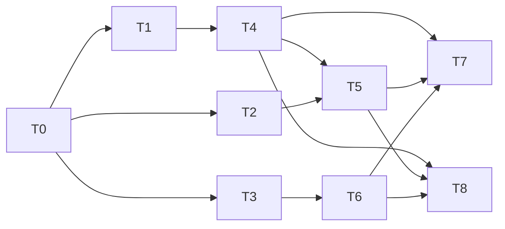

# Correlate Claude Code Desktop api_request_body Logs So System Prompt, Tools, and Skills Reach the Turn Inspector

**Status: Complete — `[NOT LIVE-VERIFIED]`.** Re-approved 2026-10-19 under autonomous mode (D25, `AUTONOMOUS_APPROVAL: approve-and-execute`) after the T0 re-run. T0 is complete (D18); D19–D21 revised the Test contract and D22–D24 corrected wording, the residual and counts. Implementation (T1–T6) and the canonical documentation (T7, closeout in §9) are in place. T8, the owner live check on the real Claude Desktop app, was **not performed**; the owner asked for archival before it. The plan is archived in `docs/archive/plans/` with that check recorded as open, and nothing in it claims live verification (§9.4).
Development mode: `test-first`.
Autonomy: `autonomous`.

---

## 1. Problem and Goal

### 1.1 Request

> "claude code from the desktop app is not providing a system prompt, tools, or skills. Error message: 'Showing truncated payload text — full content could not be loaded.' What do we need to do to collect and/or display the same information for Claude that we get for pi and copilot?"

### 1.2 Root cause (investigator, confirmed against source in this plan)

Claude Code's only source of system prompt and tool definitions over OTLP is the
`api_request_body` log event. Pi and Copilot put the content on the model-call span itself, so
they never need log correlation. For Claude Code Desktop (`service.name`
`claude-code-desktop`, v2.42304.2) the log never attaches to a record:

1. `target()` (`dash/src/canon/log-ingest.ts:190-202`) matches only the exact
   `(traceId, spanId)`. The desktop app stamps the log with the active **parent** context
   (`claude_code.interaction`, or `claude_code.tool.execution` when the request follows a tool
   call). Both of those are quarantined as non-model spans. Main-thread
   `claude_code.llm_request` records are children of the interaction; sub-agent
   `llm_request` records are children of `claude_code.tool.execution` and start about 115 ms
   after that span has ended (D22). The trace contains both, so the trace-scoped rule covers
   both.
2. The session-time fallback (`store.findBySessionTime`, `store.ts:2119-2130`) is dead because
   the receiver reads `attributes.session_id` (`receiver.ts:577` JSON, `:977` protobuf) while
   Claude Code sends `attributes['session.id']`, so `OtlpLog.sessionId` is always `null`.
3. The log is emitted when the request starts, but the `llm_request` span is exported only when
   it ends (after the response streams). The log therefore routinely arrives **before** its
   span, and `DEFAULT_PENDING_TTL_MS = 5_000` (`log-ingest.ts:30`) expires it into
   `quarantined_logs` ("identified log remained unmatched past pending expiry") long before a
   multi-second model call finishes.
4. With zero `system_prompt`/`tool_definitions` parts, `SessionInspectorDrawer.tsx:2989-3022`
   shows "Showing truncated payload text — full content could not be loaded."

Live store evidence (investigator, corrected by the T0 re-run / D24): `~/.kyberdash/canon.db`
holds 3,456 Claude Code Desktop `api_request_body` logs (all in `quarantined_logs`, 0 pending;
3,413 with a `traceId`, 43 context-free) and 3,599 `claude-code` `llm.invoke` records; the 400 newest `claude-code-desktop`
`llm.invoke` records carry only `conversation_history` parts. Log `traceId` matches records;
log `spanId` matches no record; `log.sessionId` is null; `attributes['session.id']` is set.

Skills: the Claude skill listing is read only from transcripts (`raw.skills_listed`,
`skills.ts:373 readClaudeListing`), and folder import is opt-in since issue #319, so an
OTLP-only desktop session has no listing source. `readSystemPromptListing`
(`skills.ts:429`) matches `<skill>` XML in the system prompt, which Claude Code does not use:
Claude Code Desktop lists skills in a `role: "system"` message entry ("The following skills
are available for use with the Skill tool:", a blank line, then `- name: description`), which
the body parser turns into a `conversation_history` part without recording the role (D14, D21).

### 1.3 Goal

1. Every Claude Code `api_request_body` log — CLI shape (exact span) and Desktop shape
   (interaction or tool-execution span, early arrival, or session only) — is consumed by
   exactly one `claude-code` `llm.invoke` record (D20 sets which body a record keeps), so the
   turn inspector shows the system prompt, and the tool definitions **where the sender
   exported them**. Desktop puts a `tools` array in only 7.8% of bodies (sub-agent calls);
   for a body with none, `tool_definitions` is declared not measurable with a reason saying
   the sender did not export them (D19), never shown as empty data.
2. The 3,456 already-quarantined bodies are relinked where a matching record still exists and
   is inside the content-retention window.
3. Claude skill listings are measurable from the request body when no transcript supplied them.
4. No behaviour change for any other harness's logs.

The UI needs no change once parts exist.

## 2. Decisions

| ID | Question | Answer / decision | Mitigating and supporting information | Status / approval provenance |
|---|---|---|---|---|
| D1 | Matching strategy for a Claude body log whose `spanId` is not a record | Keep exact `(traceId, spanId)` first. Then, for Claude logs only (`isClaudeLog`), **trace-scoped time containment**: candidates are `harness = 'claude-code'`, `op = 'llm.invoke'` records with the log's `traceId` that are not yet claimed (D2); pick the candidate whose `[timestamp − 2s, timestamp + durationMs + 2s]` contains the log timestamp, tie-break by smallest `|timestamp − log.timestamp|`. No candidate contains it → stay pending (never match an already-ended earlier call). | Alternatives: (a) parent-span `childrenOf` — rejected as the sole rule because a log stamped on `tool.execution` sits in a sibling subtree, so its parent's children are tool spans, not model calls; the trace already scopes the interaction. (b) `request_id`/`prompt.id` — rejected: `request_id` is server-assigned and only on the span (`twin-dedupe.ts:149`), and `prompt.id` is shared by every call in an interaction, so neither discriminates. (c) session-time nearest — rejected as primary: unbounded by turn, and nearest-start picks a finished earlier call. Containment follows from the sender: the body is logged inside the request's lifetime. Reuses the existing gate `harness + op` (B1). Cheap to reverse (one function); T0 validates containment on live data before RED and returns the plan to Draft if it fails. | autonomous: low-confidence, no authoritative source — **superseded by D11** (T0: 20.6% against the 95% gate) |
| D2 | One body per record: how is a record "claimed"? | A record that already carries a `system_prompt` or `tool_definitions` part is not a containment candidate. The exact-span path is unchanged (it may still overwrite, as today). | Prevents a second body (retry, sub-request) from overwriting the first. The interaction-prompt path writes only `conversation_history`, so it never claims. No schema change. | autonomous: low-confidence, no authoritative source — **superseded by D20** (T0: 50 records are the nearest match for two bodies) |
| D3 | Pending lifetime for Claude request-body logs | New `CLAUDE_REQUEST_BODY_PENDING_TTL_MS = 900_000` (15 min) applied inside `reconcileExpiredPending` to rows recognised as Claude request-body logs; every other log keeps `DEFAULT_PENDING_TTL_MS` (5 s). Pending logs are already retried on every span batch (`ingest.ts:490-492`). | The span is exported at call end; long thinking calls exceed a minute. 15 min bounds `pending_logs` growth while covering realistic calls; the backfill (D5) rescues anything later. Local to one constant. | autonomous: low-confidence, no authoritative source |
| D4 | Fix the `session.id` key, and what the session-time fallback may do | Receiver reads `session_id`, falling back to `session.id`, in both JSON and protobuf decoders. `target()`'s session-time fallback runs only for Claude logs (and still only lands on `llm.invoke`). | Correct identity on every log payload. Restricting the fallback keeps OpenCode logs (which also carry `session.id`, see `docs/todo/kyberdash-opencode-log-correlation.md`) on their current pend-then-quarantine path, so no other harness changes behaviour (Goal 4). | autonomous: low-confidence, no authoritative source — fallback scope **revised by D13** |
| D5 | Backfill of already-quarantined bodies | New engine `relinkQuarantinedClaudeLogs(store, { now })` in `dash/src/tools/backfill.ts`, run once at OTLP service start (`dash/src/otel/service.ts`) after the store opens. It walks `quarantined_logs` rows with `harness = 'claude-code'` above a stored rowid watermark (`metadata` key `claude_body_relink_watermark`), in log-timestamp order, runs the same matcher as the live path (D11/D13 with D2 claiming), and on a match enriches the record, deletes the quarantined row, and marks the log enriched. Unmatched rows stay. A target record older than the 14-day content-retention window is skipped (the row stays quarantined). | Same end state the live path produces for an enriched log (the live path never keeps an enriched log's payload). Watermark avoids re-parsing up to ~1 MB bodies on every start. Retention skip prevents relinking content that retention would immediately purge, which would lose the raw packet for nothing (ADR 0018, ADR 0035 keep raw evidence until a wipe). Lives in the shared `kyberdash web` service per ADR 0033. No schema change (uses existing `metadata`). | autonomous: low-confidence, no authoritative source |
| D6 | Skills from request bodies | Add a Claude request-body listing reader in `skills.ts`, consulted after `raw.skills_listed` (transcript wins) and before the existing not-measurable result: for Claude-family records, scan `conversation_history` parts for the Claude Code skill-listing reminder and parse `- name: description` entries into an initial listing. Exact marker text is fixed by T0 from a live body. Invoked-skill detection is unchanged. | Fills the OTLP-only gap without depending on opt-in folder import. Brittle to a sender wording change, so the reader returns `undefined` (falls through to not-measurable) on no match rather than guessing. Local to one reader. | autonomous: low-confidence, no authoritative source — marker and location **revised by D14** |
| D7 | Test fixtures that model the real Desktop shape | Keep the existing CLI-shape fixtures (`MODEL_SPAN_ID` on the log) as regressions. Add sanitized Desktop-shape fixtures built by T0 from the live store: quarantined interaction span, `llm_request` children, a `tool.execution` sibling subtree, a body log stamped with the interaction span and one stamped with the tool-execution span, log arriving before its span, `attributes['session.id']`, `service.name = claude-code-desktop`. All prompt/tool text replaced with synthetic text; only structure and timing are kept. | Prevents the current gap (tests pass on a shape the sender does not send). Sanitizing honours ADR 0014's consent boundary: no owner content enters the repo. | autonomous: covered by repository pattern (existing `dash/src/canon/fixtures/` synthetic fixtures) |
| D8 | Development mode | `test-first` (packet default; no opt-out supplied). | — | Packet-supplied, 2026-10-19 |
| D9 | ADR | No ADR — ADR waiver: refines the existing log-enrichment and quarantine architecture (ADR 0009, ADR 0035) with a correlation rule, a TTL constant, and an idempotent relink; no new boundary, dependency, or schema. Canonical docs are updated in T7. | — | autonomous: covered by docs/plans/README.md closeout policy |
| D10 | Approve and execute this plan (D1–D9, Test contract §4, tasks T0–T8)? | Approved: execute as written. | Conductor FINALIZE invocation carrying `AUTONOMOUS_APPROVAL: approve-and-execute` under resolved autonomy `autonomous`. The T0 containment gate still returns the plan to Draft if live data contradicts D1. D1–D7 approval is by this same gate. | autonomous: recommendation accepted, 2026-10-19 — **superseded by D17** (T0 gate failed; contract changed) |
| D11 | Revised matching rule (supersedes D1) | Exact `(traceId, spanId)` first. Then, for Claude logs with a `traceId`: candidates are `claude-code` `llm.invoke` records in the trace (a record that already holds a body stays a candidate; D20 decides which body it keeps) with `|timestamp − log.timestamp| ≤ 2 s` **and** `log.timestamp ≤ timestamp + durationMs` (no after-end pad, so a call that finished before the body was logged is never chosen). Pick the candidate with the nearest start. Two candidates at equal distance, or none → stay pending. | T0 on all 3,417 Desktop body logs: D1's containment window gave 704 (20.6%) exactly-one because the +2 s pad overlaps the next call (~3 s apart; candidate counts 0→52, 1→704, 2→1,946, 3+→1,015). Nearest start within 2 s gave 98.3% with no ties; bodies are logged 0–7 ms after the chosen call's start at p95 (max 717 ms) and never before it. Exact span match: 0/3,417; 3,373 (98.7%) are stamped with the interaction span. The end-of-call exclusion is new and is re-measured by the D12 gate. | autonomous: covered by T0 measurement 2026-10-19 (conductor-relayed) |
| D12 | Revised T0 gate (supersedes the D1 gate wording) | Re-run on the same snapshot under D11: (1) ≥ 95% of body logs that carry a `traceId` resolve to a **unique nearest** candidate; (2) zero logs resolve to a call whose `timestamp + durationMs` is before the log timestamp; (3) report the D13 session-scoped result for the context-free logs separately (not part of the 95%). Fail → STOP and return the plan to Draft. | "Exactly one candidate in the window" was the wrong measure once selection is nearest-start; uniqueness of the nearest is what the matcher depends on. | autonomous: covered by T0 measurement 2026-10-19 |
| D13 | Context-free logs (revises D4) | Receiver key fix stays (D4). 43 logs (1.3%) carry no `traceId`, `spanId` or `sessionId` field but do carry `attributes['session.id']`. After the key fix they get a `sessionId`; for Claude logs with no `traceId`, apply the D11 rule scoped by `session_id` instead of trace (same 2 s nearest start, same end-of-call exclusion, same tie → pending). Such a Claude log is **pended** rather than quarantined at once (today `traceId === null && spanId === null` quarantines immediately, `log-ingest.ts:230`), because its span arrives later. Non-Claude logs keep the current path. If D12 shows Desktop `llm.invoke` records carry no `session_id`, the 43 are explicitly out of scope: they quarantine with the existing reason and T7 documents the gap. | Covers the 43 without widening the fallback to other harnesses (Goal 4). Same matcher, different scope key, so no new selection logic. | autonomous: low-confidence, no authoritative source (record `session_id` presence measured by D12); the tool-invocation quarantine exemption is removed by D26 |
| D14 | Skill-listing source (revises D6) | The marker is `The following skills are available for use with the Skill tool:` then a blank line and `- name: description` entries, inside `messages[]` entries with `role: "system"`. `parseClaudeApiRequestBody` ignores role (`claude-code.ts:97-121`), so the text already lands as `conversation_history`; the D6 reader scans `conversation_history` parts (and `system_prompt`, defensively) for that marker. No parser bucket change. The 39 listing-bearing bodies truncated near 1 MB do not parse: they take the existing body-failure path (no parts, `not_measurable` naming `CLAUDE_CODE_OTEL_CONTENT_MAX_LENGTH`) and yield no listing; the reader never parses partial text. | 300/3,417 bodies (8.8%) carry the listing — it is sent when the listing is (re)issued, and the session-level listing merge in `skills.ts` carries it across that session's turns. Reclassifying system-role messages as `system_prompt` would change the parser contract for every Claude record and is out of scope. | autonomous: covered by T0 measurement 2026-10-19 — reader input **revised by D21** (role is not visible on parts) |
| D15 | Volume and attribution facts | 3,417 Desktop body logs (3,415 quarantined, 2 pending), all `service.name = claude-code-desktop`; supersedes the 3,352 count. Desktop model-call records are `harness = 'claude-code'`, `name = claude_code.llm_request`; none are `claude-desktop`, so the B1 gate in `enrichRecord` already admits them. | Closes two of the three §3 unverified items. | autonomous: covered by T0 measurement 2026-10-19 |
| D16 | Snapshot method for T0 and T8 evidence | Use `sqlite3 <db> ".backup <copy>"`; a plain `cp` of the live WAL database gave a corrupt copy. | Recorded so a later re-run does not repeat the failure. | autonomous: covered by T0 observation 2026-10-19 |
| D17 | Approval after the contract change | D10 is superseded: D11–D14 change the matching rule and the T0/T1/T2/T3 Test-contract rows, which is a scope change under the test-first contract. The plan is Draft until a new FINALIZE carrying `AUTONOMOUS_APPROVAL: approve-and-execute` is recorded here. | Test-first contract: changing an approved Test contract returns the plan to Draft and requires reapproval. | autonomous: recommendation accepted, 2026-10-19 — conductor FINALIZE carrying `AUTONOMOUS_APPROVAL: approve-and-execute` on the revised Draft (D11–D16, revised Test contract), after `docs validate .` and `docs drift .` reported no findings — **superseded by D25** |
| D18 | T0 re-run result | **Passed the D12 gate.** On a fresh `.backup` snapshot (since deleted): 3,413 trace-bearing logs, D11 unique nearest within 2 s with end-of-call exclusion 3,398 (99.56%), ties 0, no candidate 15; over all 3,456 including context-free 98.32%; 0 logs resolve to an already-ended call; body minus chosen start p50 1 ms, p95 7 ms, max 717 ms, never negative; exact `(traceId, spanId)` hits 0. D13: all 43 context-free logs carry `session.id`, every `claude-code` `llm.invoke` record carries `session_id` (3,599/3,599), and all 43 have a unique nearest candidate, so D13 is in scope (its out-of-scope branch does not apply). Fixtures delivered, uncommitted: `dash/src/otel/fixtures/claude-desktop/traces.otlp.json`, `logs.otlp.json`, `README.md` (send logs before traces to reproduce early arrival). T0 is complete; it is not re-run. | `dash` lint and `check:reachable` pass on the fixture files; typecheck and tests not run (no TypeScript changed). | autonomous: covered by T0 measurement 2026-10-19 (conductor-relayed) |
| D19 | Tool definitions are in 7.8% of bodies: scope of Goal 1 and the T1 assertion | `tool_definitions` parts are asserted only for bodies that carry a `tools` array (sub-agent shape). For a body that parses and has no `tools` array, `enrichRecord` declares `tool_definitions` `not_measurable` with the reason "This Claude Code request body carried no tools array, so the sender did not export tool definitions for this call." The `system_prompt` assertion stays for every parseable body that carries `system`. No UI change: the inspector already renders a not-measurable block with its reason. | 265 of the parseable bodies have `tools`; 92% have none, including every main-thread body. Declaring the absence follows the honest-unobservability rule (`docs/rules/honest-unobservability.md`) and the existing `declareBodyFailure` pattern; showing an empty block as data would claim the call had no tools. A later body for the same record that does carry `tools` clears the declaration (existing `clearSuppliedBuckets`). | autonomous: covered by repository rule (honest unobservability) and existing pattern |
| D20 | Two bodies nearest to one record (supersedes D2) | **The later body by log timestamp wins; both are consumed.** On a match to a record that already holds a body: if the new log's timestamp is later, its parts replace the body-derived parts (same per-bucket merge as today) and the claim is updated; if earlier, the log is marked enriched as superseded and its parts are not applied. Neither is pended or quarantined. The claim (`logId`, log timestamp, `request_body_id` when present) is stored in the record's `raw` under `kyber.claude_request_body`, written through a new store helper; no schema change. | T0: 50 records are the nearest match for two distinct bodies (different `request_body_id` and `body_length`, same `prompt.id`, 137–711 ms apart); under D2 the second of each would wait 15 min then quarantine, losing 50 bodies. Alternatives: first wins (loses the retried request, which is what the model actually answered); largest wins (body size is not evidence of which request ran); merge both (duplicates every system/tool part). The later request is the one sent last before the response, so it is the closer description of the call that produced the record's counters. Arrival order does not matter: comparison is by log timestamp. Cheap to reverse: one comparison in the matcher. | autonomous: low-confidence, no authoritative source |
| D21 | How the skills reader avoids false listings from user-quoted text (revises D14) | `parseClaudeApiRequestBody` records the message role on message-derived parts as a new optional `role?: 'system' \| 'user' \| 'assistant'` field on `ContentPart` (set only when the message has a string `role`). The skills reader considers only `conversation_history` parts with `role === 'system'`, plus `system_prompt` parts. Parts from bodies without roles, and all stored parts written before this change, carry no `role` and are ignored by the reader. Buckets do not change. | T0: the marker is in `role: "system"` messages in 262 bodies, only in a user message (quoted) in 4, and also in user or assistant messages in 3; without role, the reader would list skills for the 4 user-only bodies. Precedent: `ContentPart.server` is an optional field scoped to one bucket (`types.ts:131-132`); `role` follows it, is additive in the compressed `parts_json`, and older readers ignore it. Reclassifying system messages as `system_prompt` was rejected again (changes every Claude record's buckets, D14). | autonomous: covered by repository pattern (`ContentPart.server`) |
| D22 | Wording: sub-agent call placement | Corrected in §1.2: sub-agent `llm_request` records are children of `claude_code.tool.execution` and start about 115 ms after it ends; they are not siblings of the tool subtree. The trace-scoped rule is unaffected, and the T1 case wording now says so. | Wording only. | autonomous: covered by T0 observation 2026-10-19 |
| D23 | 15 trace-bearing logs (0.44%) with no candidate within 2 s | Accepted residual. They wait the 15-minute Claude TTL, then quarantine with the existing reason; the relink leaves them quarantined. T7 documents the residual and its size. No wider window: the nearest same-trace record is 3–53 s away, past the ~3 s call spacing, so widening would attach bodies to the wrong call. | The raw body stays in `quarantined_logs` as evidence (ADR 0035). | autonomous: low-confidence, no authoritative source |
| D24 | Counts (supersedes the counts in D14 and D15) | 3,456 body logs (all quarantined, 0 pending; 3,413 with a `traceId`, 43 context-free); 3,599 `claude-code` `llm.invoke` records; skill-listing marker in 308 bodies (269 parseable, 39 truncated); `tools` array in 265 parseable bodies. | Counts grow with use; the T8 check reports the counts on the day it runs. | autonomous: covered by T0 measurement 2026-10-19 |
| D25 | Approval after the second contract change | D17 is superseded. D19–D21 change the T1, T2 and T3 Test-contract rows and the T4/T6 task scope, which is a scope change under the test-first contract, not a refinement of the approved scope. The plan is Draft until a new FINALIZE carrying `AUTONOMOUS_APPROVAL: approve-and-execute` is recorded here. | Test-first contract: changing an approved Test contract returns the plan to Draft and requires reapproval. D22–D24 alone would have been refinements. | autonomous: recommendation accepted, 2026-10-19 — conductor FINALIZE carrying `AUTONOMOUS_APPROVAL: approve-and-execute` on the revised Draft (D18–D24, revised Test contract), after `docs validate .` and `docs drift .` reported no findings; the conductor also relayed a human "approved" reply from chat (conductor-relayed, not received directly by architect) |
| D26 | Code review F1: removed the tool.invoke exemption (disclosed deviation from the §4 "tests pass unmodified" contract) | A context-free Claude body that names a session always pends for the full 15-minute window (D3, D13). The exemption that quarantined it at once when its session's nearest record was a `tool.invoke` is removed; tool invocations are never candidates. The old `log-ingest.test.ts` test that encoded the pre-D13 behaviour was amended to expect pending. Disclosed with the other test edits in this row: two assertions in `log-ingest.test.ts` (lines 774 and 790) were reworked to the `partBuckets(...)` `not.toContain('system_prompt')` form, and the `role: 'user'` expectations in `ingest.test.ts` (lines 587 and 621) were edited for the message role D21 records on parts. The §4 contract said the tests pass unmodified; these edits are the deviation. | The 43 context-free bodies in the snapshot all had a unique nearest call under the session rule (D18), so none depended on the exemption. The 15-minute window bounds `pending_logs` growth (§6). The suites were not re-run by the docs pass. | autonomous: recommendation accepted, 2026-10-19 (code review F1 disposition, recorded in §9.5) |
| D27 | PR review round 1 (bot review, 8 comments) | Fixed: an empty `session_id` no longer shadows `session.id` (shared helper, both encodings). The D20 claim now records `suppliedBuckets`, and a later winner drops only those buckets, so span-sourced `tool_definitions` survive and an earlier body's `conversation_history` is replaced rather than stacked; a claim without the field keeps the wholesale `system_prompt`/`tool_definitions` drop. The D20 tie goes to the higher `logId`, and an unparseable claim timestamp counts as older than any valid body. The D11 end-of-call exclusion applies only to a finite `durationMs`. The relink isolates each log's failure (row stays quarantined, one warning with count and up to 10 ids), persists the watermark after every page, treats a non-finite record timestamp as expired, and requests the derived-session projection when it relinked anything. Candidate scoring reads id, start and duration only and loads the chosen call whole. | Each point was a concrete edge in the code as written, reproduced by a failing test first. The F3 'known limit' in §9.2 and §9.5 is fixed by this row. | autonomous: recommendation accepted, 2026-10-19 (PR review round 1) |

## 3. Investigation Findings

- `target()` and `ingestLogBatch` (`log-ingest.ts:190-243`), `enrichRecord` gate
  `harness === 'claude-code' && op === 'llm.invoke'` (`:152-188`), and
  `reconcileExpiredPending` (`:251-279`) read via CodeGraph.
- `store.childrenOf` (`store.ts:2022`), `findByTraceSpan` (`:2105`), `findBySessionTime`
  (`:2119`). `quarantine` keeps `raw_payload`; `quarantined_logs` keeps `payload`, `reason`,
  `harness` (`store.ts:310-332`). No relink/replay of `quarantined_logs` exists anywhere in
  `dash/src`.
- Receiver reads `attributes.session_id` at `receiver.ts:577` and `:977` (confirmed by grep).
- Pending logs are retried after every span batch (`ingest.ts:489-492`) and by the service's
  reconcile timer (`service.ts:229-230`, passes `DEFAULT_PENDING_TTL_MS`).
- `parseClaudeApiRequestBody` (`adapters/claude-code.ts:60-124`) already produces
  `system_prompt`, `tool_definitions`, `conversation_history`, `tool_result_content`; no parser
  change is needed for the prompt/tools buckets. It drops the message `role` (`:97-121`); D21
  adds it as an optional part field. `ContentPart` (`types.ts:126-135`) already has an
  optional bucket-scoped field, `server`, which D21 follows.
- `readListing` order (`skills.ts:361-371`): `raw.skills_listed` → Copilot → Antigravity →
  system-prompt `<skill>` XML → not measurable. Claude Code's listing format does not match the
  XML reader.
- `docs/dash/telemetry-inventory.md` lines 117-161 document the current Claude correlation
  contract and must be updated (T7).
- **T0 results (2026-10-19, conductor-relayed, `.backup` snapshot):** D1 containment failed
  (20.6% exactly-one); nearest start within 2 s is 98.3% unique; bodies follow the chosen
  call's start by 0–7 ms at p95, never precede it; 0/3,417 exact span matches, 98.7% stamped
  with the interaction span; 43 logs (1.3%) carry no trace, span or session field but do carry
  `session.id`; records are `harness = 'claude-code'`; the skill listing sits in `role: "system"`
  message entries in 300 bodies, 39 of them truncated near 1 MB. Recorded as D11–D16.
- **T0 re-run (2026-10-19, conductor-relayed):** passed the D12 gate; numbers in D18. New
  findings: `tools` arrays in only 7.8% of bodies (D19); 50 records nearest to two bodies (D20);
  the marker also appears in user/assistant text in 7 bodies (D21); sub-agent calls are
  children of `tool.execution` (D22); 15 trace-bearing logs with no candidate (D23); updated
  counts (D24). Nothing remains unverified before T1.

Discovery: codegraph 2, docs 4, direct reads 1 (`store.ts:300-350`, quarantine table columns
not returned by CodeGraph); targeted greps 9 to confirm single details (receiver
`session_id` lines, `readSystemPromptListing`, pending-log callers, quarantined_logs usage,
`request_id` usage, harness ids, plan status values, `ContentPart` fields). Self-gathered: no `research-agent` delegation; the decisions
rest on repository source, not external facts.

## 4. Test Contract (test-first)

Runner root: `/Users/dave/git/personal/claude/kyber-weave/dash`.

| Task | Test project or file | Runner command | Observable behavior | RED evidence required | GREEN acceptance |
|---|---|---|---|---|---|
| T0 | none — evidence task | `sqlite3 ~/.kyberdash/canon.db ".backup <scratch copy>"` (D16), then read-only queries on the copy | **Complete (D18).** Sanitized fixtures in `dash/src/otel/fixtures/claude-desktop/` and the evidence note | n/a — no-test task; replaced by the evidence note and fixture review | **Met:** 99.56% unique nearest of trace-bearing logs, 0 already-ended matches, D13 43/43 |
| T1 | `src/canon/log-ingest.test.ts`, `src/otel/receiver.test.ts`, `src/otel/claude-content.e2e.test.ts` | `npx vitest run src/canon/log-ingest.test.ts src/otel/receiver.test.ts src/otel/claude-content.e2e.test.ts` | Built on the T0 fixtures (logs sent before traces). (a) body stamped with the interaction span enriches the main-thread child with the nearest start within 2 s only; (b) body stamped with a `tool.execution` span enriches the sub-agent `llm.invoke` that is that span's child; (c) body arriving before its span stays pending past 5 s and enriches when the span lands; (d) no candidate → pending, quarantined only after 15 min (D23); (e) two bodies nearest to one record: the later log timestamp's parts are on the record whichever arrives first, the earlier is marked enriched, neither is pending or quarantined, and the claim is in `raw['kyber.claude_request_body']` (D20); (k) a parseable body with `system` but no `tools` gives `system_prompt` parts and a `tool_definitions` not-measurable reason naming the missing tools array; a body with `tools` gives `tool_definitions` parts and no such reason (D19); (f) an earlier call that started within 2 s but ended before the body is never chosen, the body waits for its own span; (g) two candidates equidistant from the body → pending, no match; (h) a Claude log with no trace or span id but `session.id` pends and enriches the session-scoped nearest call (D13); (i) existing CLI exact-span tests unchanged; (j) an OpenCode-shape log with `session.id` still pends/quarantines at 5 s and a context-free OpenCode log still quarantines at once; receiver: JSON and protobuf `session.id` populate `sessionId`, `session_id` wins when both present; e2e: Desktop-shape OTLP through receiver and store yields `system_prompt` parts on main-thread turns, `system_prompt` and `tool_definitions` parts on the sub-agent turn, and the not-measurable `tool_definitions` reason on main-thread turns | New cases fail on current code (a-h, k, receiver, e2e) with assertion failures naming missing parts / null sessionId / quarantined row | Same tests pass unmodified; full existing file suites still pass |
| T2 | `src/tools/backfill.relink.test.ts` (new) | `npx vitest run src/tools/backfill.relink.test.ts` | Seeded quarantined Claude bodies relink under D11, and context-free ones under D13 (parts present, row deleted, log id in `enriched_logs`); ambiguous (tie) and unmatched rows stay; a row whose nearest candidate ended before the log stays; two quarantined bodies nearest to one record both leave quarantine and the later one's parts are on the record (D20); records older than 14 days are skipped; a second run is a no-op via the watermark; non-Claude rows untouched | Fails: `relinkQuarantinedClaudeLogs` does not exist | Passes unmodified |
| T3 | `src/canon/skills.test.ts`, `src/canon/adapters/claude-code.test.ts` | `npx vitest run src/canon/skills.test.ts src/canon/adapters/claude-code.test.ts` | Parser: message-derived parts carry the message's `role`; a message with no string role yields parts with no `role`; buckets unchanged. Skills: a claude-code record with no `skills_listed`, enriched from a body whose `role: "system"` message carries the marker block, yields a measurable initial listing with names and descriptions; the marker only in a `user` message (quoted) yields no listing; marker in both system and user messages yields exactly the system listing; parts with no `role` are ignored; `skills_listed` still wins when present; no block → existing not-measurable reason; a truncated body (near 1 MB, unparseable) yields no listing and no partial parse (D21) | New cases fail: parts carry no role, listing is not measurable | Passes unmodified; existing skills and adapter suites pass |
| T4 | T1 files | as T1 | as T1 | consumes T1 RED | T1 GREEN |
| T5 | T2 file + `src/otel/service.test.ts` | `npx vitest run src/tools/backfill.relink.test.ts src/otel/service.test.ts` | as T2, plus the service calls the relink once at start | consumes T2 RED | T2 GREEN; service suite passes |
| T6 | T3 file | as T3 | as T3 | consumes T3 RED | T3 GREEN |
| T7 | none — documentation | `docs validate . --merge-ready`, `docs drift .` | Docs describe the shipped contract | n/a — documentation task | both checks zero findings |
| T8 | none — owner live gate | manual | After restart, quarantined Claude body count drops to the D23 residual order of magnitude; a recent desktop main-thread turn shows the system prompt and the "no tools array" reason; a sub-agent turn shows tool definitions; a session whose body carried the listing shows skills | n/a — manual verification | Owner confirms, or the plan records `[NOT LIVE-VERIFIED]` |

Assertions are on observable store state (parts, pending/quarantined/enriched rows,
measurability) and API output, never on internal call wiring. Weakening any assertion to reach
GREEN is a scope change that returns this plan to Draft.

## 5. Tasks

| ID | Objective | Files / symbols | Acceptance | Depends on | Required skills |
|---|---|---|---|---|---|
| T0 | **Complete (D18).** D12 gate re-run passed; fixtures delivered (uncommitted). T1–T3 may extend these fixtures (a second body for one record, a body with `tools`, a user-quoted marker) but must not weaken them | `dash/src/otel/fixtures/claude-desktop/traces.otlp.json`, `logs.otlp.json`, `README.md` | T0 row of §4 met | — | test-dev |
| T1 | RED tests for correlation, TTL, receiver key, e2e | `src/canon/log-ingest.test.ts`, `src/otel/receiver.test.ts`, `src/otel/claude-content.e2e.test.ts` | T1 row of §4 | T0 | test-dev |
| T2 | RED tests for relink backfill | `src/tools/backfill.relink.test.ts` (new) | T2 row | T0 | test-dev |
| T3 | RED tests for message roles on parts and the body-sourced Claude skill listing | `src/canon/skills.test.ts`, `src/canon/adapters/claude-code.test.ts` | T3 row | T0 | test-dev |
| T4 | Implement D3, D4, D11, D13, D19, D20: receiver `session.id` fallback; store lookups of `claude-code` `llm.invoke` records by trace and by session, and a helper to read/write `raw['kyber.claude_request_body']`; exported matcher in `log-ingest.ts` (exact → trace-scoped nearest start with end-of-call exclusion → session-scoped same rule for Claude logs without a trace; tie → pending); later-body-wins on a claimed record, earlier body marked enriched; `tool_definitions` not-measurable for a parseable body with no `tools`; Claude context-free logs pend instead of quarantining; `CLAUDE_REQUEST_BODY_PENDING_TTL_MS` in `reconcileExpiredPending` | `dash/src/otel/receiver.ts` (`:577`, `:977`), `dash/src/canon/store.ts`, `dash/src/canon/log-ingest.ts` (`target`, `enrichRecord`, `ingestLogBatch`, `reconcileExpiredPending`) | T1 GREEN | T1 | TypeScript |
| T5 | Implement D5 relink engine and service-start hook | `dash/src/tools/backfill.ts` (`relinkQuarantinedClaudeLogs`), `dash/src/otel/service.ts` | T2 GREEN; service suite passes | T2, T4 | TypeScript |
| T6 | Implement D21: optional `role` on `ContentPart`, set by `parseClaudeApiRequestBody` for message-derived parts; the skills reader over `role === 'system'` `conversation_history` parts and `system_prompt` parts | `dash/src/canon/types.ts` (`ContentPart`), `dash/src/canon/adapters/claude-code.ts` (`parseClaudeApiRequestBody`), `dash/src/canon/skills.ts` (`readListing`, new reader) | T3 GREEN | T3 | TypeScript |
| T7 | Closeout docs: correlation contract (D11, D13, D20), Claude TTL, relink, the D23 residual, tool definitions exported only in sub-agent bodies (D19), `ContentPart.role` (D21) in the canonical model, body-sourced skills, ADR waiver | `docs/dash/telemetry-inventory.md` (Claude content section, skills-by-harness), `docs/dash/architecture.md` (ingest layer log contract), `docs/dash/runbook.md` (relink on start, how to check quarantined count); this plan's closeout mapping and index row | T7 row | T4, T5, T6 | docs-dev, app-docs-standard |
| T8 | Owner live gate | running `kyberdash web` against `~/.kyberdash/canon.db` | T8 row | T4, T5, T6 | manual |

### Dependency graph

T1, T2, T3 run in parallel after T0; T4 and T6 run in parallel; T5 waits for T4 because it
calls T4's exported matcher.

## 6. Risks

- **Matching residual.** D11 measured 99.56% unique nearest on trace-bearing logs (D18); the
  15 with no candidate are an accepted residual (D23). Unmatched and tied logs stay pending
  then quarantined, never mis-attached.
- **Tool definitions stay mostly absent.** Desktop exports `tools` in 7.8% of bodies, so most
  turns show a not-measurable reason, not tools (D19). That is the sender's choice, and the
  reason says so.
- **Later-body-wins may pick a smaller request** if the second body of a pair is a side
  request rather than a retry. Both carry the same `prompt.id`; the rule is one comparison and
  cheap to change if T8 shows the wrong body on screen (D20).
- **Skill listings are sparse** (308 bodies, 39 truncated). A session whose only
  listing-bearing body was truncated shows no listing, with the existing truncation reason.
- **`pending_logs` growth** under the 15-min TTL during long sessions; `getPendingLogs` loads
  all rows each span batch. Bounded by TTL; T4 must not add per-log full-table scans
  (`claudeModelCallsInTrace` uses `trace_id`).
- **Wrong record chosen** in a trace with overlapping calls (parallel sub-agents). Nearest
  start with tie → pending; D18 measured 0 ties. T1 cases (e) and (g) cover it.
- **Relink start-up cost** on 3,456 large payloads on first run. Watermark limits it to one
  pass; T5 logs the elapsed time.
- **Skill-listing wording changes** in a future Claude Code release. Reader falls through to
  not-measurable; documented as harness-internal in T7.
- **Pre-existing host test failures** (`migration.test.ts` DROP COLUMN, Cursor date floor) may
  reappear in the full suite; disclose, do not fix here.

## 7. Out of Scope

- OpenCode log correlation (`docs/todo/kyberdash-opencode-log-correlation.md`).
- Any UI change to `SessionInspectorDrawer.tsx`.
- Invoked-skill detection changes.
- Reading `body_ref` file references (still refused, B3).
- Schema changes.

## 8. Verification Gates

From `dash/`: `npm run typecheck`, `npm run lint`, `npm test`, `npm run check:reachable`.
From the repository root: `dotnet run --project src/KyberWeave.Cli --no-build -c Release -- docs validate . --merge-ready`
and `dotnet run --project src/KyberWeave.Cli --no-build -c Release -- docs drift .`.
Each task has its own `task-reviewer`; the whole change gets a `code-reviewer` council before
push. `docs-dev` closeout (T7) harvests D1-D7 into the canonical docs listed in T5/T7 with an
ADR waiver (D9).

## 9. Closeout (T7)

The closeout ran on 2026-10-19 and archived the plan with T8 recorded as not performed:
`[NOT LIVE-VERIFIED]`. The `## Decisions` section (§2) is unchanged. The test suites and the
`docs validate` and `docs drift` commands were not run by this closeout (§9.1); §9.4 lists what
the archive record does and does not claim.

### 9.1 Acceptance criteria

| Task | Criterion (§4, §5) | Evidence | State |
|---|---|---|---|
| T0 | Containment gate and sanitized fixtures (D11–D18) | §3 T0 results; D18 | Met (plan record) |
| T1–T3 | RED tests in the named suites fail on pre-change code | Suites named in §4 | Not re-run by this closeout |
| T4–T6 | GREEN: the same tests pass unmodified; existing suites pass | Implemented, uncommitted (`git diff`). Three test edits are a disclosed deviation (D26). Review fixes are in §9.5. | Not re-run by this closeout |
| T7 | Docs describe the shipped contract; `docs validate` and `docs drift` report zero findings | §9.3 | Documentation done; the two checks not run here |
| T8 | Owner live check (§4 T8 row) | None. Not performed. Recorded as `[NOT LIVE-VERIFIED]` at owner request (§9.4). | Not performed (`[NOT LIVE-VERIFIED]`) |

This closeout had no shell, so the named test suites, the dash gates, and the `docs validate` and
`docs drift` commands were not executed by it. Their results are not claimed here. The orchestrator
runs them against the working tree; §9.4 item 2 lists the exact commands.

### 9.2 Closeout mapping

Every durable decision maps to a canonical destination. Anchors are in `docs/dash/`.

| Decision | Durable content | Canonical destination |
|---|---|---|
| D1, D11, D12 | Trace-scoped nearest start within 2 s, end-of-call exclusion, ties stay pending | [telemetry inventory: Claude request-body correlation](../../dash/telemetry-inventory.md#claude-request-body-correlation); [architecture: Claude request-body log correlation](../../dash/architecture.md#claude-request-body-log-correlation) |
| D2, D20 | One body per record; later body wins; claim under `raw['kyber.claude_request_body']` | Same two anchors |
| D3 | 15-minute pending lifetime for Claude request-body logs; 5 s for others | [architecture: Claude request-body log correlation](../../dash/architecture.md#claude-request-body-log-correlation) (pending lifetime) |
| D4 | Receiver reads `session_id`, falling back to `session.id` | [architecture: Ingest layer](../../dash/architecture.md#ingest-layer) (`OtlpReceiver` row) |
| D5 | Startup relink, watermark, 14-day skip | [runbook §2i](../../dash/runbook.md#2i-claude-request-body-relink-and-quarantined-count) |
| D6, D14, D21 | Skill listing read from system-role request-body messages; optional `ContentPart.role` | [telemetry inventory: tool definitions and skill listings](../../dash/telemetry-inventory.md#tool-definitions-and-skill-listings-from-request-bodies); [skill availability by harness](../../dash/telemetry-inventory.md#skill-availability-by-harness); [architecture: message role on content parts](../../dash/architecture.md#message-role-on-content-parts); [architecture: skills view known limits](../../dash/architecture.md#skills-view-contract) |
| D7 | Desktop sender shape: early arrival, interaction and tool-execution stamps, `session.id` | [telemetry inventory: Claude request-body correlation](../../dash/telemetry-inventory.md#claude-request-body-correlation). The sanitized fixtures stay test-scoped in `dash/src/otel/fixtures/claude-desktop/` and are not linked from canonical docs. |
| D8 | Development mode `test-first` | Documentation waiver: a process setting recorded in the plan header, with no surviving architectural, operational, or behavioural invariant |
| D9 | ADR decision | §9.3 |
| D10, D17, D25 | Approval history | Plan `## Decisions` section (preserved). Documentation waiver: approval provenance is governance history with no surviving behavioural invariant. |
| D13, D26 | Context-free bodies matched by session and pended for the full 15-minute window; a tool record never claims or shortens the wait (D26 removed the tool-invocation quarantine). D26's test edits are a governance record, documentation waiver: the behaviour is the D13 rule above. | [telemetry inventory: accepted residuals](../../dash/telemetry-inventory.md#accepted-residuals); [architecture: Claude request-body log correlation](../../dash/architecture.md#claude-request-body-log-correlation) |
| D15 | Desktop model-call records are harness `claude-code` | [telemetry inventory: Claude request-body correlation](../../dash/telemetry-inventory.md#claude-request-body-correlation) |
| D16 | `.backup` snapshot method for measurement | [runbook §2i](../../dash/runbook.md#2i-claude-request-body-relink-and-quarantined-count) (count procedure) |
| D18, D22, D24 | Measured match rate, sub-agent parentage, snapshot counts | [telemetry inventory: accepted residuals](../../dash/telemetry-inventory.md#accepted-residuals) (measured figures); [architecture: Claude request-body log correlation](../../dash/architecture.md#claude-request-body-log-correlation) (parentage) |
| D19 | `tools` only in sub-agent bodies; not-measurable reason otherwise | [telemetry inventory: tool definitions and skill listings](../../dash/telemetry-inventory.md#tool-definitions-and-skill-listings-from-request-bodies) |
| D23 | 0.44% trace-bearing residual, quarantined after TTL | [telemetry inventory: accepted residuals](../../dash/telemetry-inventory.md#accepted-residuals); [runbook §2i](../../dash/runbook.md#2i-claude-request-body-relink-and-quarantined-count) |
| D20 (review F3) | Later body without `tools` drops the earlier body's `system_prompt` and `tool_definitions`; span-sourced `tool_definitions` also dropped once a body is claimed (known limit) | [architecture: Claude request-body log correlation](../../dash/architecture.md#claude-request-body-log-correlation) (rule 5); [telemetry inventory: accepted residuals](../../dash/telemetry-inventory.md#accepted-residuals) |
| D5 (review F2, F4) | Relink pages bounded at 100 rows and 16 MiB; unreadable payloads skipped, kept in quarantine, one warning per pass | [runbook §2i](../../dash/runbook.md#2i-claude-request-body-relink-and-quarantined-count) (startup cost, watermark); [telemetry inventory: accepted residuals](../../dash/telemetry-inventory.md#accepted-residuals) |

### 9.3 ADR waiver and documentation updates

no ADR — ADR waiver: refines the existing log-enrichment and quarantine architecture (ADR 0009,
ADR 0035) with a correlation rule, a TTL constant, and an idempotent relink; no new boundary,
dependency, or schema.

Reasoning, checked at closeout against the ADR test (constrains future work, rejected alternatives
that are not self-evident, expensive to revisit):

- ADR 0009 decision 2 (enrichment on `(trace_id, span_id)`, falling back to `session_id` and a
  timestamp window) remains true as a principle and is not edited, because accepted ADRs are not
  edited. The detailed Claude rule (trace-scoped nearest start within 2 s, end-of-call exclusion,
  session scope for context-free bodies, 15-minute TTL for request bodies) is a refinement carried
  by [dash/architecture.md](../../dash/architecture.md#claude-request-body-log-correlation) and
  [dash/telemetry-inventory.md](../../dash/telemetry-inventory.md#claude-request-body-correlation).
- The two candidates for a record were D11 (nearest start) and D20 (later body wins). Both fail
  the third test. The plan records each as cheap to reverse: D11 is one matcher function, and D20
  is one timestamp comparison in the matcher. Reversing either changes no schema, no stored data
  format, and no other component, so neither needs an ADR to constrain future work.
- No new boundary, dependency, or schema: state lives in the existing `pending_logs`,
  `quarantined_logs`, `enriched_logs`, `records.raw`, and `metadata` tables (no migration).
- ADR 0035 (quarantine raw-packet evidence) is unchanged and still governs why quarantined bodies
  are kept as evidence (D23).

No ADR was written. Creating one would need the owner's approval under the ADR skill's rule, and
the reasoning above does not call for one.

Canonical documentation updated for T7:

- `docs/dash/telemetry-inventory.md`: the Claude Code outcome row; new sections Claude
  request-body correlation, tool definitions and skill listings from request bodies, and accepted
  residuals; the Claude Code and Claude Desktop skill rows and listing precedence; owner gate 1.
- `docs/dash/architecture.md`: the `OtlpReceiver` session key; new section Claude request-body log
  correlation with its flow diagram; message role on content parts; skills known limits; code refs.
- `docs/dash/runbook.md`: new section 2i (startup relink, watermark, checking the quarantined count,
  rebuilding derived rows); code refs.
- `docs/plans/README.md`: this plan's row moved from Active Plans to Archived Plans, with the
  Active Plans empty state restored.
- The owner-gate checklist for T8 is in `docs/dash/telemetry-inventory.md` (owner gate 1).
- Code comments that cite this plan's path now cite `docs/archive/plans/`; comment-only edits in
  `dash/src/canon/log-ingest.test.ts`, `dash/src/tools/backfill.relink.test.ts`,
  `dash/src/otel/claude-content.e2e.test.ts`, and `dash/src/otel/fixtures/claude-desktop/README.md`.

### 9.4 Lifecycle gate

The plan is archived with status `complete` and T8 recorded as not performed. This is the owner's
decision of 2026-10-19: archive now, without the owner live check.

Recorded as **`[NOT LIVE-VERIFIED]`**:

- T8, the owner live check on the real Claude Desktop app against `~/.kyberdash/canon.db`, was not
  performed. No live Claude Desktop request body has been observed after the fix, so the relink
  count, the Desktop system prompt, the sub-agent tool definitions, and the body-sourced skill
  listing are all unverified on the live store. The synthetic fixtures, the T0 measurement, and the
  suites are the only evidence.
- The owner checks to run after restarting the OTLP service (`kyberdash web` or `kyberdash otel`) are
  in [telemetry inventory, owner gate 1](../../dash/telemetry-inventory.md#remaining-ownerruntime-gates):
  the `Relinked N of M quarantined Claude request bodies in T ms` start-up line; a recent Desktop
  main-thread turn showing its system prompt and the "no tools array" reason; a sub-agent turn showing
  tool definitions; and a session whose body carried the skill listing showing it on the Skills view.
  If a result differs from the D11 and D20 rules or the 15-minute TTL, the matcher is the first place
  to look, and the rule (D11 or D20) is cheap to change in one function or comparison.

Not claimed by this record:

1. The named test suites and the dash gates (`npm --prefix dash run typecheck`, `lint`, `test`,
   `check:reachable`) were not run by this closeout. The orchestrator must run them on the working
   tree and confirm the T1–T6 acceptance rows of §4 before the archive is treated as verified.
2. `dotnet run --project src/KyberWeave.Cli --no-build -c Release -- docs validate . --merge-ready`
   and `docs validate .` and `docs drift .` were not run by this closeout. The plan is archived under
   `KW-DOC-LIFECYCLE-003`, so `--merge-ready` is expected to pass once the file is out of
   `docs/plans/`.
3. The `## Decisions` table (§2) is preserved unchanged. D9 and the ADR waiver in §9.3 are the only
   ADR decisions. No ADR was written.

### 9.5 Code review outcome

A `code-reviewer` council reviewed the whole uncommitted change before push (§8). Its verdict was
**APPROVE, medium risk**. It raised four findings, which are fixed in the working tree and reflected
in the canonical documentation. Fixing them changed behaviour and two test expectations (D26), so
the `dash` gates and the named suites must run again before §9.4 item 2 can close.

| Finding | Resolution | Where |
|---|---|---|
| F1: a context-free Claude body with a session id was quarantined at once when its session's nearest record was a `tool.invoke` | The exemption is removed. Every context-free body with a session id pends for the 15-minute window. The pre-D13 test was amended to expect pending (D26). | `dash/src/canon/log-ingest.ts` (`ingestLogBatch`); [telemetry inventory: accepted residuals](../../dash/telemetry-inventory.md#accepted-residuals); [architecture: context-free bodies](../../dash/architecture.md#claude-request-body-log-correlation) |
| F2: the relink read quarantined rows without a bound | Pages are bounded at 100 rows and 16 MiB of stored payload. A page always holds at least one row, so one oversized row cannot stall the cursor. | `dash/src/canon/store.ts` (`quarantinedLogsAfter`); `dash/src/tools/backfill.ts` (`relinkQuarantinedClaudeLogs`); [runbook §2i](../../dash/runbook.md#2i-claude-request-body-relink-and-quarantined-count) |
| F3: a later body with no `tools` array left an earlier body's `system_prompt` and `tool_definitions`, which hid the not-measurable reason | When a later body wins over a claimed record, its `system_prompt` and `tool_definitions` parts replace the earlier ones wholesale. Known limit: a span-sourced `tool_definitions` part is dropped too, because parts carry no source marker. | `dash/src/canon/log-ingest.ts` (`enrichRecord`); [architecture: one body per record](../../dash/architecture.md#claude-request-body-log-correlation); [telemetry inventory: accepted residuals](../../dash/telemetry-inventory.md#accepted-residuals) |
| F4: an unreadable quarantined payload could not be relinked | The row is skipped and stays in quarantine. The pass prints one warning per start with the count and up to ten log ids, never the payload. The watermark moves past the row, so later starts do not retry it. | `dash/src/canon/store.ts` (`quarantinedLogsAfter`); `dash/src/tools/backfill.ts`; [runbook §2i](../../dash/runbook.md#2i-claude-request-body-relink-and-quarantined-count) |

### 9.6 PR review round 1

A review bot's eight inline comments on the pull request changed the points listed in D27: the
`session_id` fallback, the D20 claim (`suppliedBuckets`, tie-break, corrupt timestamp), the D11
end-of-call exclusion for an unknown duration, per-log failure isolation, the per-page watermark, the
expired-on-unparseable-timestamp rule and the projection request in the startup relink, and
lightweight candidate scoring. The F3 known limit recorded in §9.2 and §9.5 no longer holds. The
canonical documentation describes the current behaviour.

Not done by this closeout: the owner live check (T8), which is recorded as `[NOT LIVE-VERIFIED]` in
§9.4. The `dash` gates and the named test suites were not run by the documentation pass, and their
results are not claimed here.
