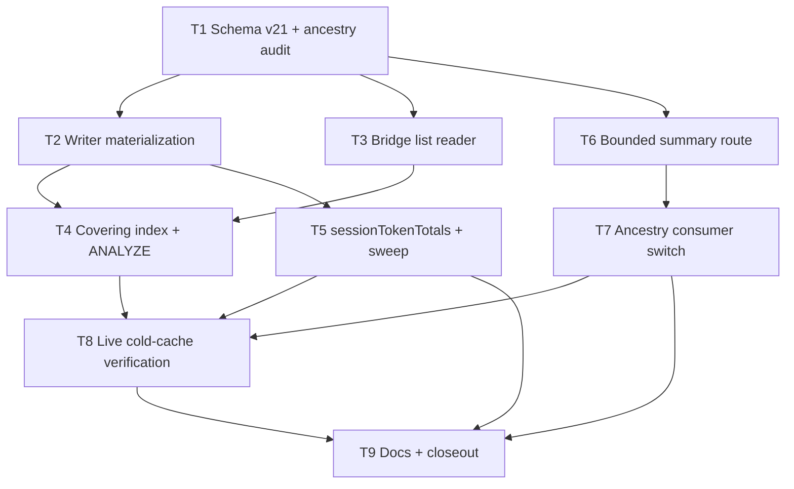

# KyberDash sessions list payload independence

**Status: Ready 2026-10-19 — approved for execution at the user's approve-and-execute gate.** The plan was amended earlier the same day after a follow-up measurement pass; the amendment added the covering index the measurement pass proved required (section 2, items 11–13) plus the planner-statistics step — the latter on that round's premise, since falsified on the actual build by the T4 measurement; the statistics are retained as hygiene, not as the index's unlock (§2 item 13, D13) — because the denormalization as originally written **misses both of its own performance targets** — `ALTER TABLE … ADD COLUMN` appends the new columns after `payload`. The approval covers D1–D18, the design in section 4 (the §4.5 covering index and §4.6 statistics included), the test contract in section 7, the task graph in section 6 (T1–T9), the acceptance criteria in section 1 — including the restated warm target (≤10 ms, replacing ≤5 ms, with the measured ~5.3–6.3 ms JS row-shaping floor as the stated reason) — the out-of-scope list in section 10, and the follow-up todos in section 12, with terminal tasks T8 (live verification) and T9 (docs/closeout).

Development mode: `test-first`. Autonomy: `autonomous` — the resolved value declared as **<autonomy>** in the repository root `AGENTS.md` Config Reg. Both persisted here per architect protocol; a missing development mode would default to `test-first`. Every implementation task has a Test-contract row in [section 7](#7-test-contract-test-first) created before implementation starts.

## 1. Problem and goal

`GET /api/kyber/sessions` takes **15.6–26.1 s cold** on the live dashboard (user-reported as "30 s+"), while every other list surface answers in milliseconds. The original diagnosis held that the cause is not a missing index or an N+1 — it is that the list query itself reads the entire payload store on every request. The amendment-round measurement (section 2, item 11) sharpened that: **denormalizing alone does not stop the payload read**, because `ALTER TABLE … ADD COLUMN` appends the new columns *after* `payload`, so reading them still walks the payload's overflow-page chain. A covering index over the denormalized columns (section 4.5) is what finally takes `payload` out of the read path — a missing index after all, one schema change deeper than the classic kind.

- `KyberBridge.listSessions` (`dash/src/server/bridge.ts:1600-1607`) runs `json_extract(payload,'$.summary')` and `json_array_length(json_extract(payload,'$.problems'))` over **every** session row with **no SQL LIMIT**. SQLite must materialize the whole `payload` TEXT value before any JSON function runs, so each request demand-pages the corpus: 334 rows, Σ payload ≈ 75.8–79.3 MB, one row 15.3 MB.
- `limit` is applied by `slice()` **after** the query (`bridge.ts:1742-1744`), so even `?limit=1` reads everything.
- The intermittency is the OS page cache for `canon.db` being routinely evicted by the machine's own multi-GB background I/O (refresh/import children, continuous OTLP receiver writes; 48 GB RAM, ~7.8 GB free). Cold → 15–26 s; warm → ~0.1 s.

**Goal — user-approved direction:** denormalize the list fields at projection time so the sessions list (and the context report that shares its reader) never reads `payload`. Concretely:

1. Add denormalized columns to `session`, written by the single payload writer (`upsertSession`) in the same upsert that writes `payload`, with a presence-guarded migration and **no backfill** — a lazy reader fallback covers legacy rows.
2. Convert `bridge.listSessions` (and `buildContextReport` through it) to read only those columns; remove the `$.problems` full-scan expression from the primary path.
3. **Add a covering index over the denormalized columns plus migration-time `ANALYZE`** (sections 4.5–4.6) — the index is measured-required: without it the converted reader still walks `payload`'s overflow chain (plan-as-written measured 17.6–18.6 ms warm and the same cold payload walk). The amendment round further held that without fresh `sqlite_stat1` rows the planner refuses the index even when it exists — **falsified on the actual build by the T4 measurement (§2 item 13): the index alone flips the plan to the covering scan; `ANALYZE` is retained as hygiene (§4.6), not as the index's unlock.**
4. Cover secondary hotspot A at schema-design level: the new columns must also serve an additive bounded route so the ancestry consumer's ≤200 B need stops costing a 15.3 MB fetch, while the passthrough detail route and its ASAD contract stay intact.

Measured baselines → targets (supplied diagnosis, section 2, plus the amendment-round measurement pass — section 2, items 11–13):

| Signal | Today (live / snapshot) | Plan as originally written (denorm, no index) — measured | Amended design (denorm + `session_denorm_idx` + `ANALYZE`) — measured | Target |
|---|---|---|---|---|
| Sessions list, cold (page cache evicted) | 15.585–26.126 s live / 981 ms snapshot (idle disk) | **✗ same ~19.5K-page payload walk** — the new columns sit after `payload` in the row | **✓ 14.1 ms** (verified eviction; 211 index pages / 864 KB) | **< 1 s** |
| Sessions list, warm | 63–99 ms diagnosis / 58–78 ms snapshot | **✗ 17.6–18.6 ms** | **✓ 6.3 ms** | **≤ 10 ms** (restated — see note) |
| `EXPLAIN QUERY PLAN` of the primary list query | materializes `payload` (79 MB corpus) | payload walk (same pages, relocated cost) | **✓ `SCAN session USING COVERING INDEX session_denorm_idx`**, no `payload` | **never touches `payload`** |
| List output for the 334-row corpus | — | byte-identical (by construction) | byte-identical — **measured also with the index dropped** (performance-only difference) | **byte-identical** (materialized vs legacy vs index-absent) — **one adjudicated exception (D20)**: a row carrying `problems` but no `summary` (a shape the payload builder never writes) now reports its true materialized count where the pre-change JSON-capable path reported `0`; that path's own bug — the pre-change payload path already reported the true count |
| Harness-filtered list | — | unchanged | unchanged | unchanged |
| Detail route `GET /api/kyber/session/:id` | warm 69–105 ms / cold 3.86 s | unchanged | unchanged | **contract and shape unchanged** (not optimized here) |

Warm-target note: the original ≤5 ms target assumed zero residual row-processing cost. Every structural variant measured ≥4.7 ms warm (6.3 denorm+index, 5.6 summary table, 5.3 payload-last rebuild, 4.7 expression index — the last two rejected on other grounds), so ~5–6 ms is the JavaScript row-shaping floor, not I/O. The target is restated to **≤10 ms** with the amended design measured at 6.3 ms; the I/O goal — payload out of the read — is fully met.

## 2. Investigation findings

Provenance: a completed read-only diagnosis supplied the first round of measurements (treated as established evidence); symbol/line references were re-verified in this checkout with CodeGraph on 2026-10-19. The Kyber-Weave docs MCP answered from a different root (`/Users/dave/git/orchestrator/kyber-weave`) and was abandoned; documentation conventions were read directly from this checkout (`docs/plans/README.md`, `docs/documentation-ontology.md`).

`Discovery: codegraph 6, docs 1 (abandoned — wrong root), direct reads 8` — direct reads: `docs/plans/README.md` (plan lifecycle contract), `docs/documentation-ontology.md` (frontmatter required-key matrix), `products/kyber-squad/agents/architect/references/plan-authoring.md` and `test-first-contract.md` (architect references, not docs-corpus indexed), `docs/archive/plans/2026-10-14-sessions-subagents-and-names.md` (structural template in the same schema area), `docs/catalog.md` (`KyberDash` component row), `dash/src/server/routes.ts` (grep — confirm `?limit`/`?harness` are parsed server-side and that a narrow-column precedent exists at `:225`), `dash/src/server/kyber-bridge.test.ts` (grep — confirm existing hand-built `CREATE TABLE session` fixtures at `:100/:207/:252` and SQL-shape mocking at `:658` that this change will touch).

Amendment pass (2026-10-19, same day): `Discovery: codegraph 6, docs 1 (abandoned — same wrong root), direct reads 2` — the plan file itself and `docs/plans/README.md` (the artifact under in-place amendment and its index row; verbatim full text is required for exact-match edits). CodeGraph re-verified the reader SQL (`bridge.ts:1600-1607`), the writer INSERT column order (`store.ts:2464-2478`, `payload` last), the migration convention (`migrate()` transaction-per-step `store.ts:1565-1595`; `SCHEMA_SQL` applied only post-migration `store.ts:1533-1544`), the existing `PRAGMA optimize` in `CanonStore.close()` (`store.ts:3923-3929`), and the read-only bridge opens (`openStoreReadOnly`, `dash/src/cli/report.ts:156-170`).

Audit pass (2026-10-20): the T1 ancestry field audit was run read-only by a code-exploration agent against this checkout; `Discovery: codegraph 1, docs 0 (MCP abandoned — wrong root), direct reads 1` — the plan file (in-place update). CodeGraph re-verified the audit's decisive claims on 2026-10-20: the client field normalization (`router.ts:457-465`, `?? id` fallback at `:463`), the conditional `{level:'run'}` spine pushes (`router.ts:393` and `:419-423`), `fetchKyberSession`/`fetchKyberSessionTurns` sharing the `/api/kyber/session/:id` URL (`kyberApi.ts:205-226`), and the `KyberSessionAncestry` docblock stating the served document "does not yet carry" run linkage (`kyberApi.ts:192-193`). Result recorded as item 14 and D19.

Implementation-outcome recording pass (2026-10-20): two resolved implementation outcomes from the T2/T3 and T5 task audits — the deliberate byte-identity exception (D20) and the payload-read sweep dispositions (D21) — plus the §4.3 fallback-predicate refresh were recorded in place at the conductor's request, packet-supplied and code-verified in this checkout; `Discovery: codegraph 6, docs 2, direct reads 4` — direct reads: the plan file (the artifact under in-place update; verbatim full text required for exact-match edits), `docs/plans/README.md` (plan-index row — confirm no lifecycle change, so no index edit), `products/kyber-squad/agents/architect/references/plan-authoring.md` (architect reference, not docs-corpus indexed), and `dash/src/sync/transcript-sync.ts:179-333` (CodeGraph surfaced the file but truncated it above `syncSessions`'s unsettled-row SELECT — the one region D21 item 3 and §12 item 8 cite). CodeGraph re-verified the packet's decisive code facts on 2026-10-20: the implemented reader (primary `SESSION_LIST_SELECT` `bridge.ts:849-852`; legacy fallback `SESSION_LIST_LEGACY_SELECT` with `WHERE summary_json IS NULL OR problems_count IS NULL` at `bridge.ts:869-872`; the independent downstream consumption and its docblock `bridge.ts:1775-1803`; the incomplete-row filter and the merge that fills only what a row is missing `bridge.ts:1935-1983`), both `sessionSummaryFigures` copies (`store.ts:3423-3492` and the bridge's duplicate direct-DB SQL `bridge.ts:4477-4551`), `CanonStore.listSessions` still `SELECT *` (`store.ts:2793-2800`), and both `countUnknownWindowSessions` copies (`store.ts:3203-3216`; bridge mirror `bridge.ts:4016-4164`, rollup-preferring with the expression scan as its fallback). The docs MCP answered from the correct root this pass (`docs_status`: `root=/Users/dave/git/personal/opencode/kyber-weave`). Results recorded as D20, D21, the §1 exception cross-reference, the §4.3 refresh, and §12 items 7–9.

T4 outcome recording pass (2026-10-20): the covering-index/statistics task's deviations from the plan as approved — the falsified planner-refusal premise (§2 item 13, D13, §4.6, §1 item 3) and the index-DDL placement deviation (D22, §4.5) — plus the measured empty-vs-populated statistics behavior (§4.6), the risk-10/11 corrections and the new risk 15, the §13 closeout correction, and the §4.1 fallback-predicate refresh were recorded in place at the conductor's request, packet-supplied and mechanism-verified in this checkout. `Discovery: codegraph 2, docs 1, direct reads 7` — direct reads: the plan file (the artifact under in-place update; verbatim full text required for exact-match edits — read twice more, once after a transport-interrupted edit batch to verify which edits had landed, once for post-edit verification), `products/kyber-squad/agents/architect/references/plan-authoring.md` (architect reference, not docs-corpus indexed), and three narrow regions of `dash/src/canon/store.ts` (`SCHEMA_SQL`'s index-placement comment `:262-289`, the `MIGRATIONS[20]` step `:905-966`, and the constructor's index/statistics placement `:1690-1749`, located by two greps — codegraph's explore budget was spent with those regions gapped, and the risk-11 healing claim and the §4.5 mechanism prose required the exact call-site context). The docs MCP answered from the correct root this pass (`root=/Users/dave/git/personal/opencode/kyber-weave`). CodeGraph verified the implemented mechanism: `SESSION_DENORM_INDEX_COLUMNS` (`store.ts:471`), `SESSION_DENORM_INDEX_SQL` (`store.ts:500`), and the presence-guarded `createSessionDenormIndex` (`store.ts:524`) called from both `MIGRATIONS[20]` (`store.ts:950`) and the constructor (`store.ts:1717`). The falsified-premise measurement (SQLite 3.54.1, no stat rows, covering scan already chosen) and the legacy-open failure (`src/canon/harnesses.test.ts`, `Error: no such column: label` at the `CREATE INDEX`) are the T4 implementation worker's measurements, supplied by the conductor's packet as established evidence. Results recorded as D22, the §4.5 mechanism correction, the §2 item 13 / D13 / §4.6 premise and guarantee corrections, the §1 item 3 cross-reference, risks 10/11/15, the §4.1 predicate refresh, and the §13 closeout correction.

Council-finding recording pass (2026-10-20): the end-of-run review council's verdict (APPROVE, risk MEDIUM, rule `KW-REVIEW-024`, 18/18 declared gates passed, one finding accepted) and the landed, task-audited fix for that finding were recorded in place at the conductor's request — D23, the §4.3 shared-helper note, the §4.4 per-column correction, risk 16, the §11 cross-surface gate and final suite state, and the §13 verdict. Packet-supplied and code-verified in this checkout. `Discovery: codegraph 4, docs 1, direct reads 5` — direct reads: the plan file (the artifact under in-place update; verbatim full text required for exact-match edits), `docs/plans/README.md` (grep — plan-index row: confirm no lifecycle change, so no index edit), `products/kyber-squad/agents/architect/references/plan-authoring.md` (architect reference, not docs-corpus indexed), `dash/src/server/kyber-api.test.ts:2900-2984` (the agreement and per-column test region — two codegraph query shapes missed the test; a grep located it and the region read pins the tripwire's assertions), and `docs/ci-pipelines/rule-reference.md` (grep — confirm `KW-REVIEW-024` exists before recording the council's rule id). CodeGraph verified the delivered mechanism on 2026-10-20: the shared module-level helpers `isMissingSessionColumn` (`bridge.ts:846`) and `fillMissingSessionColumns` (`:865`), both used by `readSessionListRows` (`:1976`, filter `:1990`, merge `:2008`) and `getSessionSummary` (`:2186`, per-column resolution `:2211-2214`), `readSessionSummaryLegacy` (`:2235`) returning `{ summary_json, problems_count }` columns, `buildSessionSummary` (`:2279`) building the served shape from the merged row, and the narrow `SESSION_SUMMARY_SELECT` (`:939`, no `payload`). The docs MCP answered from the correct root this pass (`root=/Users/dave/git/personal/opencode/kyber-weave`).

1. **Primary defect (measured).** As in section 1. `EXPLAIN QUERY PLAN` shows `SCAN session USING INDEX session_by_started` — the index is fine; the payload materialization is the cost (but see item 12: a *different* index is nevertheless required, one schema change deeper). A scalar-only scan (no payload) runs 0.0029 s; the warm full query 72–99 ms. `"problems"` sits at offset 12,384,167 of 15,302,492 in the largest row — even a "narrow" JSON read pages in the whole value.
2. **Rejected alternative (do not revisit).** Extracting only `$.summary` does not help — SQLite still reads the full payload TEXT (measured 0.077 s vs 0.072 s warm). Any `json_extract` over `payload` is a full-row read.
3. **Single payload writer confirmed.** `upsertSession` (`dash/src/canon/store.ts:2459-2493`) is called only from the projection (`dash/src/canon/sessions.ts:753, :805, :929`). `transcript-sync.ts` UPDATEs only its own sync columns; the upsert comment (`store.ts:2462-2463`) documents that column-ownership split, and the upsert-not-replace shape exists precisely so sync columns survive a rebuild. Columns written in the same upsert are consistent with `payload` by construction.
4. **Migration convention.** `MIGRATIONS` (`store.ts:493`) + `SCHEMA_VERSION` (`store.ts:164`); `migrate()` (`store.ts:1565-1595`) steps versions inside one transaction per step, committing the produced version, refusing newer stores. Session sync columns landed as migration 19 (v19→v20), presence-guarded and idempotent. **No backfill convention exists** — a summary backfill would be novel; a lazy reader fallback is the pattern that fits.
5. **Readers of the list path.** `bridge.listSessions` (fast path `:1600-1607`, JSON-function-unavailable fallback `:1608-1616`, JS `slice` after nesting/rollup `:1742-1744`); `buildContextReport` (`dash/src/analysis/report/build.ts:591`) through the same method. `sessionTokenTotals` (`store.ts:2316-2333`) reads two numbers via per-row `json_extract` on `payload`. `store.listSessions` (`store.ts:2652-2659`) is a separate `SELECT *` + JS parse path with **zero production callers** (all 9 callers are tests) — out of scope (D9).
6. **Secondary hotspot A (detail route).** `routes.ts:910-933` → `bridge.getSessionPayload` (`bridge.ts:1856-1884`) → `_clip` → `JSON.stringify`. Warm 69–105 ms dominated by transfer/parse; cold 3.86 s (~97% page-in). Consumer `fetchKyberSession` (`dash/web/src/lib/kyberApi.ts:205-207`) needs ancestry only (`id`/`session_id`/`harness`/`runId`/`run_id`/`executionId`/`execution_id`, ≤~200 B) but fetches 15.3 MB. Bounded-query measurement on the same row: scalar columns 0.1 ms/321 B vs full payload 17.6 ms/15.3 MB — any `json_extract` still materializes the row; a bounded **response** saves transfer and client parse only.
7. **Storage balance.** `canon.db` 3.33 GB on disk, `freelist_count` 433,077 × 4 KB = 1.65 GB free; live ≈ 1.45 GB of which `session` is ~76 MB (~5%) — the quarantine family is 62%. Session payloads are not the dominant consumer; retention/vacuum is a separate concern.
8. **Corpus growth.** 330 → 334 sessions during the 22-minute measurement window; a prior refresh grew the corpus 330 → 860. Any residual full-payload read will re-expose at that scale.
9. **Display-layer rule.** All logic stays in `dash/src` behind `/api/kyber/*` (`docs/rules/kyberdash-display-layer.md`, ADR 0033, enforced by `dash/src/architecture/display-layer.test.ts`). This plan's server work is in the shared engine; the only `dash/web` change is pointing one fetch at a new engine route — compliant.
10. **Known gaps carried as follow-ups** (section 12): the tray endpoint surface was not exhaustively enumerated; the installed binary is 0.1.8-rc.2 vs checkout HEAD (matched on every measured path; tag-vs-HEAD diff not run). Two earlier estimates were closed by the amendment round: Σ turns is now **measured 40,618** (item 11), and cold detail-click remains single-sample.
11. **Amendment-round measurement pass (2026-10-19).** A follow-up pass answered the user's questions ("what about indexes, and other db tuning options as well?", "why not do both") by measuring every candidate design against snapshot copies of the live corpus. **On what:** `.backup` snapshots of the live `canon.db` — 336 rows, Σ payload 75.9 MB, largest row 15.3 MB, 330–334 sessions observed live during the window; the repository and the live store were untouched and scratch copies were deleted. **Method:** cold runs under verified page-cache eviction (the diagnosis's eviction method), warm runs, `EXPLAIN QUERY PLAN` plan capture, upsert-maintenance timing across full-refresh cycles; `json_valid` sweep for the malformed-JSON question. **Provenance:** performed by the conductor's measurement round and supplied to this amendment as established evidence; code facts below re-verified in this checkout with CodeGraph. Results:

    | Variant | Build | Warm | Cold (verified eviction) | Maintenance |
    |---|---|---|---|---|
    | Today — `json_extract` over payload | — | 58–78 ms | 981 ms snapshot / 15–26 s live under concurrent I/O | 29 ms/refresh |
    | Plan as written — denormalized columns, no index | 7 ms DDL + 458 ms backfill | 17.6–18.6 ms ✗ | same ~19.5K-page payload walk ✗ | ~free |
    | **Denormalized columns + covering index (chosen, D12)** | 60 ms index | **6.3 ms** | **14.1 ms** | **free — 28 vs 29 ms** |
    | Expression index over `json_extract` (D14, rejected) | 78 ms | 4.7 ms | 12.8 ms | **3.5× — 29 → 101 ms/refresh** |
    | Separate summary table + join (D15, rejected) | 72 ms | 5.6 ms | 6.7 ms | two write sites in one upsert |
    | Rebuilt table with payload last (D16, rejected) | 469 ms one-time | 5.3 ms | 26.9 ms | whole-table rewrite migration |
    | `PRAGMA cache_size` 64/128/256 MB (D3) | — | 60/59/58 ms — no effect | no retention (253 vs 256 ms post-flood) | — |
    | `PRAGMA mmap_size` 256 MB / 1 GB, `temp_store=MEMORY` (D18) | — | ~59 ms — no effect | no retention | — |
    | `VACUUM` (3.33 GB → 1.65 GB, 13.8 s) (D17) | — | unchanged | unchanged — session page count identical (19.6K); freelist pages are never read | — |

    Also measured: Σ turns `SUM(json_array_length(payload,'$.turns'))` = **40,618** (closes item 10's ≈56 K estimate); residual risk if nothing structural is done — every cache-evicted load pays 0.9–1.2 s idle-disk / 15–26 s under the machine's normal I/O regime, recurring non-deterministically and scaling with the corpus (330 → 860 sessions seen ⇒ ~2.6×), plus a permanent ~58 ms warm JSON-parse CPU floor, with the same exposure on `buildContextReport`.
12. **Causal finding — column append order (the reason the index is required).** `ALTER TABLE … ADD COLUMN` appends the new columns **after** `payload`, so even the converted column-only reader still traverses the payload's overflow chain: the denormalization relocates the cost, it does not remove it (measured 17.6–18.6 ms warm, same cold pages). A covering index over the new columns makes the list query an index-only scan — measured `SCAN session USING COVERING INDEX session_denorm_idx`, 211 pages / 864,256 B — and its maintenance is free (28 vs 29 ms per full refresh) because the upsert already rewrites each row.
13. **Planner statistics — hygiene, not the index's unlock (premise corrected 2026-10-20 by the T4 on-build measurement).** The amendment round recorded here that without fresh `sqlite_stat1` rows the planner **refuses** the covering index and keeps the payload plan, flipping only after `ANALYZE` (~49 ms whole-DB on the snapshot) — a snapshot measurement taken in a different corpus/build context. **It did not reproduce on the actual build** (SQLite 3.54.1 via `node:sqlite`): with the index present, 334 rows, 200 KB payloads, and **no** `sqlite_stat1` rows at all, `EXPLAIN QUERY PLAN` already reported `SCAN session USING COVERING INDEX session_denorm_idx`, and the plan was the same after `ANALYZE`. The covering index itself is what makes the plan an index-only scan; the statistics are retained by the design (§4.6) as hygiene — keeping the planner's cost model informed as the corpus grows and the EXPLAIN pin deterministic — not because they are required to unlock the index on this build. Engine facts (unchanged): the bridge uses `node:sqlite` `DatabaseSync` (read-only opens, e.g. `openStoreReadOnly` at `dash/src/cli/report.ts:156-170`) bundling **SQLite 3.54.1**; JSON1 built in; expression indexes supported; `ENABLE_DBSTAT_VTAB` and `ENABLE_STAT4` compiled in; no `STMT_SCANSTATUS`. The writable `CanonStore` already runs `PRAGMA optimize` on every close (`store.ts:3923-3929`), and only writer processes (refresh/import) change the corpus — each closes its store, so statistics refresh on exactly the cadence the corpus changes. See §4.6 for the placement decision and the measured empty-vs-populated behavior.
14. **T1 ancestry field audit — result (2026-10-20, read-only; settles T1's conditional, D19).** The ancestry path is `App.tsx:400-413`/`:429-440` → `createAncestryApi` (`router.ts:441`) → `fetchKyberSession` (`kyberApi.ts:205-207`) → `GET /api/kyber/session/:id` → the stored payload served verbatim (`routes.ts:931`; `kyber-api.test.ts:526` pins the served key set to the stored payload's key set). The client reads seven top-level fields and normalizes at `router.ts:459-464` into `{ id, harness, runId?, executionId? }`: `id` is a payload key only; `session_id`/`harness` are payload keys **and** table columns (identical values); **`runId`/`run_id` and `executionId`/`execution_id` appear in neither the payload (`sessions.ts:1328-1422` writes no such key; grep over `sessions.ts` and `bridge.ts` returns zero matches) nor the `session` table at any schema version** — both are **always `undefined`** today (`execution.execution_id` equals the session id by construction, `runs.ts:442-445`, same `SessionIdentities.claim` as `sessions.ts:748`; the client's `?? id` fallback at `router.ts:463` supplies the session id). **Decisive behavioral point:** because the payload never carries a run id, today's resolved spine is `[doctor, harness, execution]` with **no run level** — the `if (runId) stack.push({level:'run'…})` sites (`router.ts:393`, `:419-423`) never fire for sessions; the finding path's run comes from the finding row's own `run_id` (`canon/findings.ts:59`), not from the session. Serving linkage from a new endpoint would push a `{level:'run'}` entry that does not exist today — the resolved ancestry would **change**, not be preserved; serving nothing preserves it exactly (`??` chains and truthiness checks treat `null` and `undefined` alike). Call sites: `fetchKyberSession` — one production caller (`router.ts:458`) plus the `App.navigation.test.tsx:124-132` mock, which carries only `id`/`session_id`/`harness` and passes today **without** linkage; `resolveAncestry` — two production callers (`App.tsx` direct open/deep link, popstate) plus `router.test.ts:116-135`, which mocks the adapter (not HTTP) with a `runId` the real payload cannot supply — a stack shape the production path never produces. Rename hazards for T6/T7: `id` (payload) ↔ `session_id` (column); `runId`/`run_id`, `executionId`/`execution_id` are snake_case-only in tables while the client accepts either casing; `is_subagent` is INTEGER in the table (`store.ts:256`, written `row.isSubagent ? 1 : 0` at `:2484`) but boolean in list responses (`bridge.ts:1666`). Adjacent, untouched: `fetchKyberSessionTurns` (`kyberApi.ts:223-226`) hits the identical URL and reads `body.turns` (`pages/TurnDetail.tsx:115`) — it stays on the detail route; and `finding.executionId` (`kyberApi.ts:715`, read at `router.ts:430`) is a dead branch the engine never serializes (findings carry only `run_id`/`session_id`, `store.ts:390-391`) — out of scope here. **Outcome: the frozen column set is `summary_json TEXT` + `problems_count INTEGER`; no linkage columns.**

## 3. Decisions

| ID | Question | Answer / decision | Mitigating and supporting information | Status / approval provenance |
|---|---|---|---|---|
| D1 | Fix direction for the sessions list? | **Denormalize the list fields at projection time**; the list path reads columns only, never `payload`. | User selected this direction explicitly. Preserves the session-table-as-cache architecture (payload stays the source of truth; columns are a projection-owned materialization like the sync columns of ADR 0038). | APPROVED — user decision (supplied diagnosis, chosen fix direction) |
| D2 | Extract only `$.summary` instead? | **Rejected.** | Measured 0.077 s vs 0.072 s warm — SQLite still materializes the whole payload TEXT for any JSON function. Recorded so it is not revisited. | REJECTED — measured (diagnosis) |
| D3 | `PRAGMA cache_size` keep-warm mitigation? | **Rejected — measured dead on both ends, not merely superseded.** | Amendment round: warm unchanged at 60/59/58 ms across `cache_size` 64/128/256 MB, and no cache retention across the machine's background I/O (253 vs 256 ms post-flood). The warm cost is ~55 ms of JSON-parse CPU, not page serving — no cache setting touches it. Recorded so it is not revisited. | REJECTED — measured (amendment round) |
| D4 | Exact column shape? | **`summary_json TEXT` + `problems_count INTEGER`, both nullable, `NULL` = "not materialized" (legacy row).** `summary_json` holds the serialized `$.summary` object; `problems_count` holds `json_array_length($.problems)`. | These two values are exactly what today's two JSON expressions read (`bridge.ts:1603-1604`). Flat columns (turn_count, cost_usd, models, …) were considered and rejected: `cost` is an object and `models` a list, so flat shape degenerates into JSON columns anyway, and every future summary field would need another migration; `summary_json` serves any of them. Measured summary size 827 B max — parse cost per row is trivial vs the ≤10 ms warm target (restated in section 1). Deliberately **no DEFAULT**: `NULL` is the legacy sentinel, not a value. | DECIDED — delegated to the plan by the task packet; decided from measured evidence |
| D5 | Backfill the 334 legacy rows? | **No backfill. Lazy reader fallback:** when `summary_json IS NULL` the reader derives the same values from `payload` for those rows only. | No backfill convention exists; a rebuild re-upserts every row wholesale (session table is a cache), so the fallback is transitional and self-heals on the next projection/refresh. Once a row is re-upserted, `summary_json` is non-NULL forever (single writer, D1) and the fallback never fires for it again. Worst case (fully legacy corpus, cold) equals today's cost, never worse. | DECIDED — delegated to the plan by the task packet |
| D6 | Push SQL `LIMIT` down now that the query is narrow? | **No. Keep the JS `slice(limit)` after nesting/rollup.** | `limit` today is applied after subagent nesting and read-time rollup (`bridge.ts:1742-1744`); a SQL LIMIT would cut children of returned parents and change rollup output. The narrow scan is already 0.0029 s at 334 rows — the identical-output requirement dominates. SQL-level pagination is follow-up territory if the corpus grows by orders of magnitude. | DECIDED — delegated to the plan by the task packet |
| D7 | `sessionTokenTotals` (`store.ts:2316`)? | **Migrate to read `summary_json` first, payload fallback per row.** Behavior identical (`not_measurable` stays `undefined`, never 0). | It is a per-row bounded read today, but callers may loop it; routing it through the new column closes a latent full-corpus hazard for free. | DECIDED — delegated to the plan by the task packet |
| D8 | Secondary hotspot A scope? | **Schema-design level only:** the new columns must serve an additive bounded route `GET /api/kyber/session/:id/summary`; the ancestry consumer switches to it. The passthrough detail route, `_clip`, and the ASAD contract remain **intact and unchanged**. Payload split / turns pagination is a follow-up. | Warm detail cost is 0.1 s; cold bites only on click-through into huge sessions. Full detail rework would balloon this change for a follow-up-sized cost. The ancestry clause is narrowed by D19 (2026-10-20 audit): the bounded route serves identity fields only — run/execution linkage was never payload-carried, so omitting it preserves behavior exactly. | APPROVED — user decision (supplied diagnosis: A joins at schema-design level) |
| D9 | Secondary hotspot B (`store.listSessions`, `store.ts:2652`)? | **Out of scope.** | Zero production callers (all 9 are tests); ~120 ms warm on a snapshot. Recorded here so nobody budgets for it. | DECIDED — delegated to the plan by the task packet |
| D10 | Development mode? | **`test-first`.** | Architect default; packet confirms. Test contract in section 7. | DECIDED — protocol default, packet-confirmed |
| D11 | Migration numbering? | **Schema v20 → v21**: `SCHEMA_VERSION = 21`, `MIGRATIONS[20]` presence-guarded `ALTER TABLE session ADD COLUMN …` following migration 19's pattern; `SCHEMA_SQL` updated so fresh databases carry the columns. | Matches the existing numbered, presence-guarded, idempotent convention. | DECIDED — convention |
| D12 | Does denormalization alone meet the targets? | **No — a covering index over the new columns is required, complementary to D1.** `session_denorm_idx` per §4.5: `(started DESC, session_id, harness, label, is_subagent, parent_session, agent_name, repo, branch, ended, summary_json, problems_count)`. | Plan-as-written measured **17.6–18.6 ms warm** (target ≤10 ms restated; original ≤5 ms) and the **same ~19.5K-page cold payload walk**, because `ALTER TABLE ADD COLUMN` appends after `payload` (§2 item 12). With the index: **6.3 ms warm / 14.1 ms cold** (verified eviction), `SCAN session USING COVERING INDEX`, 211 pages / 864 KB; build 60 ms one-time; maintenance free (28 vs 29 ms per full refresh). NULL-agnostic — does not disturb D5's no-backfill design. | DECIDED — measured (amendment round) |
| D13 | Where do `ANALYZE` / `PRAGMA optimize` run? | **Kept in the migration — reason corrected (T4, 2026-10-20):** `ANALYZE session` as the final statement of `MIGRATIONS[20]` (same transaction), plus once on the constructor's fresh-create path; ongoing maintenance by the **existing** `PRAGMA optimize` in `CanonStore.close()` (`store.ts:3923-3929`). **Not** at connection open. The placement stands; the reason is hygiene and EXPLAIN-pin determinism, not an index unlock. | **Correction (2026-10-20, T4, on-build):** this row's amendment-round premise — "without `sqlite_stat1` the planner refuses the covering index (plan flips only after `ANALYZE`, ~49 ms)" — **did not reproduce**: with the index present, 334 rows, 200 KB payloads, and no stat rows at all, the plan was already `SCAN session USING COVERING INDEX session_denorm_idx` (SQLite 3.54.1); the refusal was a snapshot measurement in a different corpus/build context. `ANALYZE` is retained as hygiene — it gives the planner real cost information as the corpus grows and keeps the EXPLAIN pin deterministic (§4.6) — not as a prerequisite for the index. Read-only bridge connections (`report.ts:163`, packet-measured `bridge.ts:1490`) cannot write `sqlite_stat1`; `PRAGMA optimize` is best-effort and cannot deliver the migration's deterministic guarantee; close-time optimize already rides every refresh/import process exit, which is exactly the cadence the corpus changes. | DECIDED — measured (amendment round); reason corrected by the T4 implementation measurement, verified in this checkout (2026-10-20) |
| D14 | Expression index over `json_extract(payload,…)` instead of denorm + index? | **Rejected.** | Same 211 covering pages and slightly faster warm (4.7 ms), but **3.5× upsert cost** (29 → 101 ms per full refresh — every payload rewrite re-evaluates the JSON functions), a **hard INSERT failure on malformed JSON** (measured rejection; live corpus today 0/336 malformed by `json_valid`, but every projection cycle rewrites payloads, so one future bad payload would break the whole refresh), and the same statistics hygiene (§2 item 13). | REJECTED — measured (amendment round) |
| D15 | Separate summary table + join? | **Rejected — redundant.** | Measured warm 5.6 / cold 6.7 ms — fine, but no better than D12 (6.3/14.1) and it costs two write sites inside one upsert plus a join on every read. | REJECTED — measured (amendment round) |
| D16 | Rebuild the table with `payload` last? | **Rejected — redundant, bigger migration.** | Measured warm 5.3 / cold 26.9 ms with a 469 ms one-time whole-table rewrite — the covering index delivers the same class of win (6.3/14.1) for 60 ms and zero rewrite risk. | REJECTED — measured (amendment round) |
| D17 | `VACUUM` as part of this fix? | **Orthogonal — stays a separate todo (§12 item 5).** | Measured: file 3.33 GB → 1.65 GB (13.8 s) with the session page count (19.6K) and cold latency **unchanged** — freelist pages are never read. The storage concern is real (quarantine family 933 MB ≈ 62 % of live bytes) but independent of list latency. | DECIDED — measured (amendment round) |
| D18 | Other PRAGMA tuning (`mmap_size`, `temp_store`, `journal_mode`, `synchronous`, `shrink_memory`)? | **Rejected — measured no-ops for this symptom.** | `mmap_size` 256 MB / 1 GB: warm 59/58 ms, no cold retention. `temp_store=MEMORY`: 59 ms. The warm cost is JSON-parse CPU (~55 ms) and the cold cost is demand-paging; neither is page-serving or temp-file bound. The covering index removes both by removing the read. | REJECTED — measured (amendment round) |
| D19 | Do the ancestry linkage columns (`run_id`/`execution_id`) belong in the v21 schema (T1's conditional)? | **No.** The audit shows the lineage fields are absent from both the payload and the `session` table and are always `undefined` today — adding and serving them would **change** the resolved spine (a new `{level:'run'}` entry) rather than preserve it. The frozen column set is `summary_json TEXT` + `problems_count INTEGER` only; the bounded summary endpoint serves identity + `session_id` + `harness` and no linkage. | T1 audit result (2026-10-20, read-only, verified in this checkout — §2 item 14): `runId`/`run_id` and `executionId`/`execution_id` appear in neither the payload top level (`sessions.ts:1328-1422`) nor any `session` schema version; `execution.execution_id` equals the session id by construction (`runs.ts:442-445`); the client normalizes at `router.ts:459-464` with `?? id` fallbacks, so today's spine is `[doctor, harness, execution]` — the `{level:'run'}` pushes (`router.ts:393`, `:419-423`) never fire for sessions; `App.navigation.test.tsx:124-132` passes with a linkage-free mock. Narrows D8's ancestry clause; D8's route and contract-preservation intent unchanged. | DECIDED — T1 audit result, verified in this checkout (2026-10-20) |
| D20 | Does the list output stay byte-identical to the pre-change implementation, given the pre-change implementation was itself internally inconsistent for one payload shape — a `problems` array with no `summary` object? | **Yes, with one adjudicated exception:** the list reports the row's true materialized `problems_count`. For that shape the pre-change JSON-capable path reported `0` while the pre-change payload path reported the true count — the one-field departure from the JSON path is a correction of that path's own bug (it gated the count on the summary's presence), not a regression, and it is what makes all three read paths agree. | Field-level diff against the pre-change (HEAD) reader for that shape: old reported `problems: 0` on its JSON-capable path and `problems: 3` on its no-JSON payload path, for both `materialized=count-only` and `materialized=none` rows — internally inconsistent; the reworked reader reports `problems: 3` on all four combinations, the only differing field being `problems`, and only against the old JSON path. Three-path agreement (materialized, legacy fallback, no-JSON payload last resort) is the requirement; the pre-change payload path already said the true count. The writer's per-column NULL sentinel (§4.2) makes the two columns independent facts — a payload that carries `problems` but no `summary` stores a real `problems_count` beside a NULL `summary_json`, so gating the count on the summary's presence was the bug. The shape does not occur in production: the payload builder always writes a `summary` object and a `problems` array, so it can only arise from hand-crafted data, a partial migration, or test fixtures. The implemented reader consumes the two columns independently, the legacy fallback's predicate is correspondingly widened to `WHERE summary_json IS NULL OR problems_count IS NULL` (§4.3, `bridge.ts:869-872`), and the merge fills only what a row is missing, so a materialized value is never overwritten by the payload's (`bridge.ts:1935-1983`); the code documents the independence and its rationale in `dash/src/server/bridge.ts` (the reader docblock at `:1775-1781` and the `SESSION_LIST_LEGACY_SELECT` remarks). | DECIDED — T3 rework after the T2 audit's finding; adjudicated correct at T3 task-review pass 2; recorded in the implementation-outcome pass, 2026-10-20 |
| D21 | What is the disposition of the multi-row payload reads the T5 sweep found across `dash/src` (the hazard class this plan removes from the sessions list)? | **Five hits: three follow-ups filed (§12 items 7–9), one out of scope, the rest sanctioned.** (1) `sessionSummaryFigures` — the store method (`store.ts:3423`) plus a duplicate copy of the same payload-extraction SQL in the bridge's direct-DB path (`bridge.ts:4477`) — is a multi-row read over a bounded, caller-supplied id set (deduplicated, chunked at 900 placeholders, `WHERE session_id IN (…)`), not a table scan; the column-first conversion is worth doing but must convert both copies together — converting only the store method would leave two implementations of one reader that could disagree — its own task (§12 item 7). (2) `CanonStore.listSessions` (`store.ts:2793`) — `SELECT * FROM session` plus JS `JSON.parse` of every row's payload — stays correctly out of scope (D9: zero production callers, all 9 are tests); the audit's note is to consider deprecation or removal rather than optimization, recorded here rather than as a todo. (3) The sync job's unsettled-row SELECT (`transcript-sync.ts:230-241`) fetches every unsettled row's `payload` and never reads it afterwards — non-blocking but not harmless: dropping the column removes an unnecessary payload fetch from every sync pass — its own task (§12 item 8). (4) `countUnknownWindowSessions` (`store.ts:3203` and its bridge mirror `bridge.ts:4016`) — `COUNT(*)` with `json_extract(payload,'$.context.contextLimitSource')` in the `WHERE` — is aggregate-only but still pages every scanned payload blob, table-wide when no harness is given; the follow-up is an expression index or a materialized `contextLimitSource` column, lower priority because the bridge prefers rollups (§12 item 9). (5) Sanctioned, no action: the single-row per-id detail reads (`getSessionPayload` in the store and the session-detail read in the bridge), the list path's own column-only statement, its legacy fallback (scoped to unmaterialized rows only), and its documented payload last resort (a build without JSON functions or a pre-materialization schema). | The sweep was a required T5 deliverable (task-graph T5: sweep `dash/src` for any other `json_extract(payload` / `SELECT payload` use over more than one row); the dispositions are the task audit's recommendations, code-verified in this checkout 2026-10-20 (both `sessionSummaryFigures` copies, the store `listSessions` shape, the transcript-sync SELECT at `transcript-sync.ts:237-239` with `payload` never read in the loop, and both `countUnknownWindowSessions` copies). Item 1's conversion must preserve the merge semantics: a missing figure stays omitted, not zero; `costStatus`/`costCurrency` are taken only when they are strings; non-finite numbers are dropped. Item 3 is a fetched-and-discarded read, not a payload use. Item 4's bridge path prefers the persisted rollups (coverage-verified) and only falls back to the scan. | DECIDED — T5 sweep result with task-audit dispositions; follow-ups filed as §12 items 7–9; recorded in the implementation-outcome pass, 2026-10-20 |
| D22 | Where does the covering index's DDL live? | **A single module-scope constant applied by a presence-guarded helper from both call sites — not inline in `SCHEMA_SQL`** (deviation from §4.5 as approved, recorded 2026-10-20): `SESSION_DENORM_INDEX_SQL` (`store.ts:500`) is executed only by `createSessionDenormIndex` (`store.ts:524`), which is called from `MIGRATIONS[20]` immediately after the two `ALTER TABLE` statements (upgrade path) and from the constructor right after `this.db.exec(SCHEMA_SQL)` (`store.ts:1710-1717`; it runs on every open and is a no-op once the index exists, so fresh stores are born with it). Both paths still end up with the index — §4.5's requirement stands and is met. | The approved §4.5 also placed the DDL inline in `SCHEMA_SQL`'s session block; that form was tried and **rejected**: `SCHEMA_SQL` is unconditional DDL that the constructor executes with `this.db.exec(SCHEMA_SQL)`, which aborts on the first failing statement, so an inline `CREATE INDEX … ON session (…, label, is_subagent, …)` over the reader's columns makes a store whose `session` table predates those columns fail to **open** — proven by the existing "migrates a v5 store to v6" test (`src/canon/harnesses.test.ts`) failing with `Error: no such column: label` at the `CREATE INDEX`. The helper instead checks the `session` table's actual column set (`SESSION_DENORM_INDEX_COLUMNS`, `store.ts:471`, via `PRAGMA table_info`) and skips index creation for a legacy-shaped table — which the current reader's statement could not read either. Putting the DDL back inline would require `MIGRATIONS[20]` to also add the seven reader columns (`label`, `is_subagent`, `parent_session`, `agent_name`, `repo`, `branch`, `ended`) to legacy session tables — a schema change to existing stores beyond this plan's two-column scope, deliberately not made; the residual is recorded as risk 15. | DECIDED — T4 implementation outcome, verified in this checkout (2026-10-20); recorded at the conductor's request |
| D23 | Does the bounded summary route consume the two materialized columns as a unit, or independently? | **Independently — the same per-column sentinel rule the list path follows** (council finding, fixed 2026-10-20). A row is incomplete when **either** `summary_json` or `problems_count` is NULL; if either is missing the route issues the id-scoped legacy payload read and merges it **per column**, and a materialized value is never replaced by the payload's. | The as-first-implemented `getSessionSummary` treated the two columns as a single unit: with `summary_json` present it used `problems_count` as-is — coercing a NULL count to `0` (`Number(row.problems_count) \|\| 0`) — and never fell back to the payload for a missing count, diverging from `readSessionListRows`' per-column sentinel design. Failure scenario (the council's): a row with `summary_json` materialized but `problems_count` NULL (external partial write, manual edit, future writer change) made the bounded route serve `problems_count: 0` while `listSessions` derived the true count from the payload — the same session showing different problem counts in the list and the ancestry spine. The fix (landed, task-audit PASS) unifies both surfaces on one mechanism: module-level helpers `isMissingSessionColumn(row)` (incomplete ⇔ missing **either** column — NULL is the writer's per-column sentinel, §4.2) and `fillMissingSessionColumns(row, legacy)` (fills **only** the column a row is missing; a materialized value is never replaced; a value the payload does not carry leaves the row's own NULL), now used by both `readSessionListRows` (its inline incompleteness predicate and inline merge replaced — identical logic, one mechanism) and `getSessionSummary`; and `readSessionSummaryLegacy` now returns **columns** (`{ summary_json, problems_count }`) instead of pre-cooked served facts, so the payload can physically never overwrite a materialized fact — the served shape is built from the merged row via `buildSessionSummary`. The fully materialized path is unchanged: one narrow column-only statement, no `payload` named anywhere. RED: two assertions failed `expected +0 to be 2` (the route's count coercion); GREEN: `kyber-api.test.ts` + `kyber-bridge.test.ts` + `web-dashboard.test.ts` → 149 passed, whole dash suite 415 files / 6,443 tests passed, typecheck / lint / `check:reachable` clean. Anti-drift: the two surfaces share one definition of "row incomplete" and one "fill only the missing column" merge, so a future change to the writer's sentinel or column set breaks both in the same place (risk 16). | DECIDED — end-of-run council review finding (`[Minor] correctness/per-column-sentinel-inconsistency`, `dash/src/server/bridge.ts:2173`), fixed and audited PASS; verified in this checkout (2026-10-20); recorded at the conductor's request |
| AP1 | Approve and execute? | **Approved for execution.** The plan is approved as it stands on disk (the amended artifact). | Approval covers D1–D18; the schema in section 4 (including the §4.5 covering index and §4.6 statistics); the test contract in section 7; the task graph in section 6 (T1–T9, terminal pair T8 live verification / T9 docs+closeout); the acceptance criteria in section 1 — including the restated warm target ≤10 ms (replacing the earlier ≤5 ms, with the measured ~5.3–6.3 ms JS row-shaping floor as the stated reason); the out-of-scope list in section 10; and the follow-up todos in section 12. | APPROVED — explicit user approval of the approve-and-execute gate, 2026-10-19 (relay: conductor) |

Open decisions: **none** — AP1 was approved at the approve-and-execute gate on 2026-10-19. D1, D8, and AP1 carry explicit user approval; D2/D3 and D14–D18 are recorded rejections (D3 and D14–D18 measured); the remaining rows are design calls delegated to this plan by the task packet, decided from the amendment round's measurements, decided from the T1 ancestry audit (D19), decided from the T3 rework adjudication (D20), decided from the T5 sweep dispositions (D21), decided from the T4 covering-index placement deviation (D22), or decided from the end-of-run council review finding and its fix (D23).

## 4. Design

### 4.1 Schema change (migration 20 → 21)

Add to `session`:

```sql
ALTER TABLE session ADD COLUMN summary_json TEXT;     -- serialized $.summary; NULL = not materialized (legacy row)
ALTER TABLE session ADD COLUMN problems_count INTEGER; -- json_array_length($.problems); NULL = not materialized
```

- Presence-guarded per the existing convention (as migration 19 did for the sync columns), idempotent on re-run.
- **No DEFAULT** — this is deliberate and reverses the usual "columns ship with DEFAULTs" habit: `NULL` is the lazy-fallback sentinel. A DEFAULT would erase the distinction between "legacy, derive from payload" and a real value.
- `SCHEMA_SQL`'s `CREATE TABLE session` gains both columns so fresh databases are born current; `MIGRATIONS[20]` upgrades old ones; `SCHEMA_VERSION` becomes `21`.
- `session_by_started` and every other existing index are untouched; §4.5 adds exactly one new index.
- **Append-order lesson (measured, §2 item 12):** `ALTER TABLE … ADD COLUMN` appends these columns **after** `payload`, so they physically sit behind the payload's overflow chain. They are necessary (they carry the values out of JSON) but **not sufficient** — a reader selecting them still walks the payload pages (measured 17.6–18.6 ms warm, unchanged cold). §4.5's covering index is what removes `payload` from the read path. Any future payload-derived column hits the same wall and needs the same pairing.
- **Fallback trigger condition:** `summary_json IS NULL` **or** `problems_count IS NULL` — either NULL marks the row incomplete (widened from the summary column alone by D20's per-column independence; §4.3 states the predicate the implemented reader uses). Behavior after a row is re-upserted: the writer (4.2) materializes each column independently from the payload it is writing, so a row whose payload carries both fields leaves the fallback set permanently (single writer; D1). A pathological row whose payload genuinely lacks `summary` — or carries a non-array `problems` — writes the corresponding `NULL` and stays on the fallback, which then computes exactly what the reader would have derived anyway, so output is unchanged.

### 4.2 Writer change (`upsertSession`, `store.ts:2459-2493`)

Extend the INSERT column list and the `ON CONFLICT … DO UPDATE SET` list with `summary_json` and `problems_count`, both from `excluded`. Values derived inside `upsertSession` from the same `row.payload` it already serializes (no `SessionRow` type change, no change at the three projection call sites `sessions.ts:753/:805/:929`):

```ts
const p = (row.payload ?? undefined) as { summary?: unknown; problems?: unknown } | undefined
const summaryJson = p && p.summary !== undefined ? JSON.stringify(p.summary) : null
const problemsCount = p && Array.isArray(p.problems) ? p.problems.length : null
```

Invariant: **non-NULL ⇔ the projection materialized exactly what the payload it wrote says.** The column-ownership split with `transcript-sync.ts` is preserved and extended: sync columns stay owned by the sync job; `payload`, `summary_json`, and `problems_count` are owned by the projection upsert (same statement, so they cannot drift from `payload`).

### 4.3 Reader change (`bridge.listSessions`, `bridge.ts:1587-1744`)

Primary path (replaces the `json_extract` fast path at `:1600-1607`):

```sql
SELECT session_id, harness, label, is_subagent, parent_session, agent_name,
       repo, branch, started, ended, summary_json, problems_count
FROM session
ORDER BY started DESC
```

Legacy-subset fallback, issued **only when the primary result contains rows missing a materialized value** (`summary_json IS NULL` **or** `problems_count IS NULL` — either NULL marks the row incomplete), merged in JS by `session_id`:

```sql
SELECT session_id,
       json_extract(payload, '$.summary') AS summary_json,
       json_array_length(json_extract(payload, '$.problems')) AS problems_count
FROM session
WHERE summary_json IS NULL OR problems_count IS NULL
```

- **Why the predicate covers either column (per-column independence, D20).** The writer (§4.2) materializes the two columns **independently** — a per-column NULL sentinel: a payload that carries `problems` but no `summary` stores a real `problems_count` beside a NULL `summary_json`, and a payload with a `summary` but a missing or non-array `problems` stores a real `summary_json` beside a NULL count. NULL means "this column was not materialized", never "this row is whole" — a row missing only its count is still incomplete and still takes the fallback. The two columns are then consumed **independently** downstream (the count is taken from `problems_count` whenever it is present, regardless of whether a summary came with it), and the merge fills **only what a row is missing** — a materialized value is never overwritten by the payload's. The incompleteness predicate and that merge are the **shared module-level helpers** — `isMissingSessionColumn` and `fillMissingSessionColumns` (`bridge.ts:846`/`:865`) — that `getSessionSummary` (§4.4) also uses, so the list and the bounded summary route share one definition of "row incomplete" and one "fill only the missing column" merge and cannot drift apart (D23, risk 16). That independence is the one deliberate departure from byte-identity (D20): a count-without-summary row — a shape the payload builder never writes — now reports its true materialized count, where the pre-change JSON-capable path reported `0` (that path's own bug; its payload path already reported the true count).
- The `$.problems` full-scan expression is gone from the primary path; `payload` is touched only for the transitional NULL subset.
- The existing JSON-function-unavailable last resort (`:1608-1616`, payload select + JS parse) keeps its role unchanged.
- Everything downstream of the row fetch — `ParsedSummary` handling, cost-block assembly, label formatting, subagent nesting, `computeSessionRollup`, and the JS `slice(limit)` (`:1742-1744`) — is untouched, so list output, harness filter semantics (route-level, `routes.ts` parses `?harness`/`?limit` server-side), sort, and pagination semantics are byte-identical for every payload the projection writes; the single adjudicated exception — a count-without-summary row the builder never produces — is D20.
- **SQL `LIMIT` is not pushed down** (D6): the slice must stay after nesting/rollup; the narrow scan is already ≤3 ms at corpus scale.
- **The column list is frozen to §4.5's index.** The primary SELECT reads exactly the covering index's columns; adding a column here without extending the index silently re-widens the scan back to table-row lookups (and the payload walk returns). Tripwire: the EXPLAIN pin test (section 7, T4) intercepts the bridge's actual SQL, so any list change flips it RED.
- `buildContextReport` (`build.ts:591`) inherits the fix through this method — no signature change. `sessionTokenTotals` migrates per D7: read `summary_json`; if NULL for that row, fall back to the existing payload `json_extract` query.

### 4.4 Ancestry and the bounded summary route (hotspot A, schema-design level)

- **New bridge method** `getSessionSummary(sessionId)` on `KyberBridge`: reads the narrow columns for one row (`SESSION_SUMMARY_SELECT`, `bridge.ts:939`); **the legacy fallback is per-column, not whole-row (D23)**. A row is incomplete when **either** `summary_json` or `problems_count` is NULL — `isMissingSessionColumn`, the shared module-level predicate the list path also uses: NULL is the writer's per-column sentinel (§4.2), meaning "this column was not materialized", never "this row is whole". If either column is missing, the method issues the id-scoped single-row `json_extract` legacy read (`readSessionSummaryLegacy`, `bridge.ts:2235` — per-id, transitional, never worse than today's detail read) and merges it **per column** — `fillMissingSessionColumns`, the shared module-level merge the list path also uses: only the column a row is missing is filled, a materialized value is never replaced by the payload's, and a value the payload does not carry leaves the row's own NULL in place. The legacy read returns **columns** (`{ summary_json, problems_count }`), not pre-cooked served facts — precisely so the payload can physically never overwrite a materialized fact; the served shape is built from the merged row via `buildSessionSummary` (`bridge.ts:2279`). The fully materialized path is unchanged: one narrow column-only statement, no `payload` named anywhere. No `_clip` — the content is bounded by construction.
- **New additive route** `GET /api/kyber/session/:id/summary` (`routes.ts`, registered adjacent to the detail route) serving identity + list fields:

```json
{ "session_id": "…", "harness": "…", "label": "…", "is_subagent": false,
  "parent_session": null, "agent_name": null, "started": "…", "ended": "…",
  "summary": { … }, "problems_count": 0 }
```

  Unknown id → 404 (same `ERR_NOT_FOUND` shape as sibling routes).
- **Ancestry consumer switch (audit resolved — D19, §2 item 14):** `fetchKyberSession` (`dash/web/src/lib/kyberApi.ts:205-207`) points at the new route. The T1 audit found `runId`/`run_id` and `executionId`/`execution_id` in **neither** the payload nor the `session` table: the client's `runId` is always `undefined` today, and `router.ts:463`'s `?? id` fallback supplies the session id. The endpoint therefore serves **no run/execution linkage — deliberately**: the payload never carried it, and serving it would push a `{level:'run'}` spine entry (`router.ts:393`, `:419-423`) that does not exist today. The resolved spine stays exactly `[doctor, harness, execution]`, no run level; the response shape above is final. There is no run resolution to drop — the navigation test asserts the resolved stack is unchanged. **Do not repoint `fetchKyberSessionTurns`** (`kyberApi.ts:223-226`): it hits the identical `/api/kyber/session/:id` URL and reads `body.turns` (used by `pages/TurnDetail.tsx:115`) — it keeps the detail route.
- **Explicitly intact:** the passthrough detail route `GET /api/kyber/session/:id`, its `_clip` behavior, its ASAD contract (`kyber-api.test.ts:518+`, `dash/src/canon/sessions.skills.test.ts:6`, `dash/src/cli/web-dashboard.test.ts:257-297`), and `AgentSessionDashboard`'s legitimate full-payload use. Detail rework (payload split, turns pagination) is follow-up (section 12).

### 4.5 Covering index over the denormalized columns (the measured missing piece, D12)

```sql
CREATE INDEX IF NOT EXISTS session_denorm_idx
  ON session (started DESC, session_id, harness, label, is_subagent,
              parent_session, agent_name, repo, branch, ended,
              summary_json, problems_count);
```

- **Why required, not optional.** `ALTER TABLE … ADD COLUMN` appends the new columns after `payload` (§2 item 12), so a table-row read for `summary_json` still traverses the payload's overflow chain — the denormalization alone relocates the cost (measured warm 17.6–18.6 ms; cold payload walk unchanged). The index turns the primary list query into an index-only scan: measured `SCAN session USING COVERING INDEX session_denorm_idx`, 211 pages / 864,256 B, warm 6.3 ms, cold 14.1 ms under verified eviction.
- **Column order.** `started DESC` leads, matching `ORDER BY started DESC` exactly (forward scan, no sort step); the remaining columns follow the reader's select list (§4.3) in reader order, so the index alone answers the whole query. The harness filter is route-level JavaScript (`routes.ts` parses `?harness` and filters the response; `bridge.listSessions` takes only `limit` — verified), so no `harness` key prefix is needed. The rowid every SQLite index carries makes entries unique regardless.
- **Where it is created — both paths, via one constant and a presence-guarded helper (as implemented; the deviation from the approved inline-`SCHEMA_SQL` form is recorded as D22).** The DDL lives in a single module-scope constant, `SESSION_DENORM_INDEX_SQL` (`store.ts:500`), applied only by `createSessionDenormIndex` (`store.ts:524`), called from both sites: inside `MIGRATIONS[20]` immediately after the two `ALTER TABLE` statements (same step transaction — by then the columns exist; the upgrade path lands the index with the columns and the version stamp in one step), and from the constructor right after `this.db.exec(SCHEMA_SQL)` (`store.ts:1710-1717`), which runs on every open and is a no-op once the index exists — so fresh databases are born with it and any v21 store that somehow lacks the index regains it on next open. The helper checks the `session` table's actual column set (`SESSION_DENORM_INDEX_COLUMNS`, `store.ts:471`) and skips creation for a legacy-shaped table; the requirement that the index exists on **both** paths stands and is met. **The approved design's inline-`SCHEMA_SQL` form was tried and rejected:** `SCHEMA_SQL` is unconditional DDL that the constructor executes with `this.db.exec(SCHEMA_SQL)`, which aborts on the first failing statement — an inline `CREATE INDEX … ON session (…, label, is_subagent, …)` over the reader's columns makes a store whose `session` table predates those columns fail to **open** (proven: the existing "migrates a v5 store to v6" test, `src/canon/harnesses.test.ts`, failed with `Error: no such column: label` at the `CREATE INDEX`). Restoring the inline form would require `MIGRATIONS[20]` to also add the seven reader columns to legacy session tables — a schema change to existing stores beyond this plan's two-column scope, deliberately not made (D22, risk 15). `IF NOT EXISTS` keeps the helper idempotent; `SCHEMA_SQL`'s own comment documents the placement (`store.ts:279-285`).
- **Measured cost.** 60 ms one-time build on the live-shape corpus; **maintenance free** — full-refresh duration 28 ms vs the 29 ms baseline, because the upsert already rewrites each row and updating two more key columns adds nothing measurable.
- **Interaction with D5 (no backfill).** An index over all-NULL columns is valid and the covering property is NULL-agnostic: legacy rows return `NULL` `summary_json` straight from the index and take the lazy fallback exactly as designed. The index changes performance, never output (pinned by the index-dropped byte-parity test, T4).
- `session_by_started` and every other existing index are untouched. The bounded summary route (§4.4) is a point lookup by `session_id` served by the existing unique constraint — it neither needs nor conflicts with this index.

### 4.6 Planner statistics (`ANALYZE` / `PRAGMA optimize`, D13)

Corrected by the T4 measurement (§2 item 13): the covering index itself is what flips the plan — on the actual build the planner chose `SCAN session USING COVERING INDEX session_denorm_idx` with **no** `sqlite_stat1` rows at all, so the statistics are not the index's unlock (the amendment round's refusal premise did not reproduce). They remain part of the migration as hygiene and determinism, not optional tuning and not a prerequisite: the design keeps `ANALYZE session` because it is cheap, gives the planner real cost information as the corpus grows, and keeps the EXPLAIN pin (T4) deterministic:

- **In the migration:** `ANALYZE session` runs as the **final statement of `MIGRATIONS[20]`**, inside the step's existing `BEGIN … COMMIT` (`store.ts:1582-1593`). `ANALYZE` is ordinary transactional DML over `sqlite_stat1`, so index and statistics land atomically and an interrupted upgrade still resumes at the step boundary (the transaction-per-step convention is preserved, not bent). `ANALYZE session` rather than whole-database: the plan decision the stats must inform is between two indexes of the `session` table, and re-running it is harmless (recompute). It creates `sqlite_stat1` if absent.
- **On fresh databases:** the constructor's fresh-create branch (`existing === undefined`, `store.ts:1719-1732`) runs the same `ANALYZE session` once after `SCHEMA_SQL` and version stamping; an empty-table analyze is ~free and creates the `sqlite_stat1` table. **The guarantee, as measured (T4): a v21 store has the statistics infrastructure in place from creation, and carries real statistics for `session` — including `session_denorm_idx` — as soon as the table holds rows.** It does **not** guarantee stat rows for a store that has never held a session row. Measured empty-vs-populated behavior: `ANALYZE session` on an empty table creates `sqlite_stat1` but writes **zero** rows for `session` (SQLite skips statistics for an empty table); `PRAGMA optimize` on an empty table does not even create `sqlite_stat1`; a one-row table writes 3 rows for `session` (`session_denorm_idx`, `session_by_started`, `sqlite_autoindex_session_1`); after the store's first write and close — close runs `PRAGMA optimize` (`store.ts:3923-3929`) — the stat rows appear. The earlier sentence here, that this analyze "guarantees no store can exist at v21 without `sqlite_stat1` rows", was not literally true for an empty store and is corrected to the guarantee above; the T4 fresh-path stats test was corrected to this satisfiable form by the test author. Correction recorded at closeout (2026-10-20): the in-code comments at both sites have since been corrected — verified in this checkout at `store.ts:945-960` (migration step) and `store.ts:1729-1740` (fresh-create branch). Both now state the measured truth: the covering index is the mechanism (on this build the planner picks it with no `sqlite_stat1` rows at all) and the statistics are hygiene and determinism — real cost information as the corpus grows and the same plan on every path, which is what the contract's EXPLAIN pin asserts — including the measured empty-table behavior (an empty-table `ANALYZE` creates `sqlite_stat1` with no `session` row; close-time `PRAGMA optimize` populates it once rows exist).
- **Ongoing maintenance — already in place, zero new code:** `CanonStore.close()` runs `PRAGMA optimize` (`store.ts:3923-3929`). The corpus only changes through writer processes (refresh/import children) that open a `CanonStore`, write, and close — statistics refresh on exactly the cadence the corpus changes, including the full re-upsert every projection rebuild performs.
- **Why not `PRAGMA optimize` at connection open:** the bridge's direct-DB connections are read-only (`new DatabaseSync(path, { readOnly: true })` — `dash/src/cli/report.ts:156-170`; the amendment measurement confirmed the same read-only open in the web path at `bridge.ts:1490`), and a read-only connection **cannot write `sqlite_stat1`** — `optimize` there is inert for stat creation. On the writable store, per-open `optimize` would tax every CLI command for a job `close()` already does at the right cadence. And `PRAGMA optimize` is best-effort by design — it does not guarantee an ANALYZE will run, while the migration must guarantee one deterministically.
- **Read-only consumers need no change:** `sqlite_stat1` is an ordinary table in the database file; the bridge's read-only connections read it like any schema object, and writer-side stat updates reach them through WAL commits.

## 5. Contracts preserved and changed

| Surface | Disposition |
|---|---|
| `GET /api/kyber/sessions` response shape (`kyber-api.test.ts:378-511`) | **Preserved byte-for-byte.** Parity tests pin materialized vs legacy fallback. |
| `GET /api/kyber/session/:id` passthrough + ASAD payload shape | **Preserved unchanged** (D8). |
| `GET /api/kyber/session/:id/summary` | **New, additive; identity + list fields only — no run/execution linkage (D19), preserving today's resolved spine exactly.** |
| `session` table | Two new nullable columns; everything else unchanged; older binaries fail closed on a v21 store (by design, `store.ts:1566-1572`). |
| `session_denorm_idx` covering index + `sqlite_stat1` statistics (§4.5–4.6) | **Internal schema artifacts; no public contract change.** The list response shape stays byte-identical — the index changes performance, never output (pinned by the index-dropped parity test, T4). |
| `bridge.listSessions` signature (`limit?`) | Unchanged. |
| `sessionTokenTotals` return contract | Unchanged (internal query path only). |
| KyberDash display-layer rule (ADR 0033) | Preserved — all new logic in `dash/src`; `dash/web` only changes one fetch target. |

## 6. Task breakdown

Ordered by dependency; every task names its required skills (the conductor maps skills to specialists). Each task has its own `task-reviewer` pass; when a fix is required the same worker takes it immediately.

| Task | Objective — exact files/symbols | Acceptance criteria | Depends on | Skills |
|---|---|---|---|---|
| **T1** Schema migration v21 + ancestry field audit | Freeze the final column set — **audit complete (2026-10-20, read-only; result recorded at §2 item 14 and D19): `run_id`/`execution_id` are absent from both payload and table and are always `undefined` today, so no linkage columns are added; the frozen set is `summary_json TEXT` + `problems_count INTEGER`**. In `dash/src/canon/store.ts`: `SCHEMA_VERSION` 20→21 (`:164`), `MIGRATIONS[20]` presence-guarded `ALTER TABLE session ADD COLUMN summary_json TEXT` / `problems_count INTEGER`, and the same two columns in `SCHEMA_SQL`'s `CREATE TABLE session`. | Fresh `:memory:` store has exactly the frozen two-column set at v21 (no `run_id`/`execution_id` — D19); a v20 fixture store upgrades once, re-opens idempotently, `metadata.schema_version = 21`; migration transaction per step preserved; newer-store refusal untouched. | — | `test-dev` |
| **T2** Writer materialization | `dash/src/canon/store.ts` `upsertSession` (`:2459-2493`): add `summary_json`/`problems_count` to INSERT and `ON CONFLICT … DO UPDATE SET` (from `excluded`), values derived from `row.payload` per §4.2; extend the ownership comment. | A row upserted with payload `{summary, problems}` materializes both values; re-upsert over a legacy (NULL) row updates them; transcript-sync columns still survive a re-upsert (ownership invariant test still green); no `SessionRow` type or call-site change. | T1 | `test-dev` |
| **T3** Bridge list reader conversion | `dash/src/server/bridge.ts` `listSessions` (`:1587-1744`): replace the `json_extract` fast path with the narrow SELECT (§4.3), add the NULL-subset fallback query, keep the JSON-unavailable last resort, keep nesting/rollup/slice untouched; remove `$.problems` full-scan from the primary path. | Primary SQL contains neither `payload` nor `json_extract(payload` (pinned by test); the SELECT column list equals §4.5's index column set (the covering pair — deviation is a T4 EXPLAIN failure by design); list results identical across materialized / legacy / json-unavailable paths for the same corpus; huge or poisonous `turns`/`problems` payload regions do not change list output or path; `?limit` semantics unchanged. | T1 | `test-dev` |
| **T4** Covering index + planner statistics | `dash/src/canon/store.ts`: amend the `MIGRATIONS[20]` step introduced in T1 — after the two `ALTER TABLE` statements create `session_denorm_idx` (§4.5 shape) via the presence-guarded `createSessionDenormIndex` helper (`SESSION_DENORM_INDEX_SQL`, D22 — not inline in `SCHEMA_SQL`, which is unconditional DDL and would break opening a legacy store) and, as the step's final statement, `ANALYZE session` (hygiene and EXPLAIN-pin determinism, D13 — not an index unlock); apply the same helper from the constructor right after `SCHEMA_SQL` (fresh-create path); add the fresh-create `ANALYZE session` after version stamping (`:1719-1732`). | Index exists after both the v20→v21 upgrade path and fresh creation; the `sqlite_stat1` table exists from fresh creation (the fresh-create `ANALYZE session` creates it), and real statistics for `session` — including a row for `session_denorm_idx` — exist once the table holds rows, on both paths (the satisfiable guarantee, §4.6 — not stat rows on an empty table); `EXPLAIN QUERY PLAN` of the bridge's actual primary SQL (intercepted, not retyped) reports `USING COVERING INDEX session_denorm_idx` with no `payload` reference; list output byte-identical with the index present vs dropped (performance-only difference); migration transaction-per-step preserved; idempotent re-open. | T1, T2, T3 | `test-dev` |
| **T5** `sessionTokenTotals` migration + payload-expression sweep | `dash/src/canon/store.ts` `sessionTokenTotals` (`:2316-2333`): read `summary_json` first, payload fallback per row (D7). Then sweep `dash/src` for any other `json_extract(payload` / `SELECT payload` use over more than one row (CodeGraph + grep), and record findings — expected: none beyond the sanctioned single-row reads (`getSessionPayload`, bounded-route legacy fallback). | Totals identical for materialized and legacy rows, `not_measurable → undefined` preserved; sweep result recorded in task evidence (empty, or each hit dispositioned). | T2 | `test-dev` |
| **T6** Bounded summary route | `dash/src/server/bridge.ts` new `getSessionSummary(sessionId)` (narrow columns, single-row legacy fallback); `dash/src/server/routes.ts` new additive `GET /api/kyber/session/:id/summary` next to the detail route (`:910-933` region), 404 via existing `ERR_NOT_FOUND`; no `_clip` on this route. | Route serves the §4.4 shape from columns without touching `payload` for materialized rows; **serves no run/execution linkage — the §4.4 shape is final (D19)**; 404 for unknown id; detail route response byte-identical before/after; route admitted in the web-dashboard route table. | T1 (T2 for realistic fixtures) | `test-dev` |
| **T7** Ancestry consumer switch | `dash/web/src/lib/kyberApi.ts` `fetchKyberSession` (`:205-207`) → new route; verify `resolveAncestry` field coverage against the route response (per T1's audit — D19: identity + `session_id`/`harness` only); update `App.navigation.test.tsx` mocks. | Deep-link navigation resolves ancestry **exactly as before — which today means identity and harness with no run level**, because the payload never carried run linkage; a run-level spine entry appearing would be a regression, not a fix (risk 14); no other fetch changes — specifically `fetchKyberSessionTurns` stays on the detail route; the `router.test.ts:116-135` runId mock is reconciled as a mock-only fixture (risk 14); `dash/web` gates green (typecheck/lint/tests). | T6 | `test-dev` |
| **T8** Live verification — cold-cache reproduction | Read-only measurement against a **scratch server** backed by a **copy** of the live `canon.db` (never the live file or live store), using the diagnosis's eviction method; produce an evidence artifact (timings, `EXPLAIN QUERY PLAN`, parity diffs, refresh-maintenance timing, Σ-turns count). | Cold sessions list **< 1 s** after verified page-cache eviction (amended-design measured expectation ≈14 ms; today's shape measured 981 ms idle-disk / 15.6–26.1 s live on the same method); warm **≤ 10 ms** (measured expectation 6.3 ms); `EXPLAIN QUERY PLAN` shows `USING COVERING INDEX session_denorm_idx` and no `payload`; list response byte-identical across materialized, forced-legacy (columns NULLed on the copy), index-dropped, and pre-change HEAD runs (tag-vs-HEAD caveat recorded); harness-filtered response unchanged; full-refresh maintenance duration recorded (expectation ≈28–29 ms baseline — the index is not a write tax); `SELECT COUNT(*), SUM(json_array_length(payload,'$.turns'))` recorded (amendment round measured 40,618; confirm). | T4 (parallel with T5–T7 where landed) | — (manual/read-only; commands in the task evidence) |
| **T9** Docs + closeout | `docs/dash/architecture.md`: schema v21, denormalized list columns + ownership, **covering index as the performance mechanism (the append-order lesson, §2 item 12) + planner statistics as hygiene and determinism (the T4-corrected story, §2 item 13 / §4.6 — the index alone flips the plan; `ANALYZE` retained as hygiene, not as the index's unlock) + the presence-guarded index-creation helper (D22)**, bounded summary route row; `docs/dash/runbook.md` only if it shows the old `json_extract` list pattern; follow-up todos filed under `docs/todo/` (section 12); `docs validate` + `docs drift` zero findings; closeout mapping per plan-index policy (ADR vs documentation waiver evaluated — expected `no ADR — ADR waiver: projection-owned column materialization plus covering index under the existing session-cache architecture and ADR 0038 column-ownership pattern`). | Docs current and validated; every durable decision mapped or waived; todo files created for section 12 items; plan archived per `KW-DOC-LIFECYCLE-003` by the finishing PR. | T1–T8 | `docs-dev`, `kyber-weave-docs` |

## 7. Test contract (test-first)

Every implementation task's contract tests are written first; RED evidence shows the test existing and failing for the intended missing behavior before implementation; GREEN uses the same test unweakened. Runner: `npm --prefix dash run test -- <file>` (host `vitest` suite); task gates add `npm --prefix dash run typecheck` and `npm --prefix dash run lint`.

| Task | Test project or file | Runner command | Observable behavior | RED evidence required | GREEN acceptance |
|---|---|---|---|---|---|
| T1 | `dash/src/canon/migration-v21.test.ts` (new) + `migration.test.ts` additions | `npm --prefix dash run test -- src/canon/migration-v21.test.ts` | Fresh store carries the frozen column set at v21; v20 fixture upgrades once, idempotent on re-open; version recorded per step; newer-store refusal intact | New test fails on current code (columns absent, version 20) | All pass without weakening; column set matches the audit |
| T2 | `dash/src/canon/migration-v21.test.ts` (writer section) or `sessions.test.ts` | same runner, file per placement | `upsertSession` materializes `summary_json`/`problems_count` from `row.payload`; re-upsert updates them; sync columns survive | Writer assertions fail (column absent / never written) | Pass; ownership invariant (sync columns untouched by re-upsert) still green |
| T3 | `dash/src/server/kyber-bridge.test.ts` | `npm --prefix dash run test -- src/server/kyber-bridge.test.ts` | Primary list SQL contains no `payload` reference (SQL-shape pin); identical `SessionSummary[]` across materialized / legacy-NULL / json-unavailable corpora; payload-independence: corpora differing only by a huge or poisonous `turns`/`problems` region yield equal list results | SQL-shape pin fails against the current `json_extract` fast path; parity fixtures with `summary_json` columns fail to even create on current schema | All pass; existing SQL-shape/fixture assertions updated mechanically (see below), none weakened |
| T4 | `dash/src/canon/migration-v21.test.ts` (index/stats section) + `dash/src/server/kyber-bridge.test.ts` (EXPLAIN + parity) | `npm --prefix dash run test -- src/canon/migration-v21.test.ts src/server/kyber-bridge.test.ts` | `session_denorm_idx` exists on the v20→v21 upgrade path and on fresh creation; the `sqlite_stat1` **table** exists after fresh creation (the fresh-create `ANALYZE session` creates it), and `sqlite_stat1` carries a row for `session` — including one whose index is `session_denorm_idx` — once the session table holds rows, on **both** the fresh and the upgrade path (the satisfiable guarantee, §4.6); the EXPLAIN pin: the bridge's **intercepted** primary list statement is planned as a **covering-index scan over `session_denorm_idx`** with no `payload` reference — the index's plan choice pinned directly, not a statistics-dependent flip (§2 item 13); list output byte-identical with the index present vs dropped | All fail on current code (no index, no stats table; EXPLAIN shows the payload plan) | Pass without weakening; the EXPLAIN assertion reads the SQL the bridge actually issues (intercepted, not retyped) so any column-list change flips it RED |
| T5 | `dash/src/canon/sessions.test.ts` (or migration-v21 writer file) | same runner | `sessionTokenTotals` equal for materialized and legacy rows; `not_measurable` stays `undefined` | Totals test against `summary_json` fails (no such column/read) | Pass; sweep evidence recorded |
| T6 | `dash/src/server/kyber-api.test.ts` + `dash/src/cli/web-dashboard.test.ts` | `npm --prefix dash run test -- src/server/kyber-api.test.ts src/cli/web-dashboard.test.ts` | New route 200 shape / 404 — **shape carries no run/execution linkage (D19)**; list route byte-parity materialized vs legacy; detail route and ASAD contract unchanged; route admitted | Route tests fail (unknown route → 404 everywhere today) | All pass; detail passthrough assertions untouched and green |
| T7 | `dash/web/src/App.navigation.test.tsx` | `npm --prefix dash run test -- src/App.navigation.test.tsx` | Ancestry resolves from the new endpoint — **identity + harness only, no run level, exactly today's shape (D19)**; deep-link navigation unchanged; a `{level:'run'}` spine entry appearing is a failure, not a feature | Test expects the new fetch target (current code fetches the detail route) | Pass; no other navigation assertions change; the `router.test.ts` runId fixture (risk 14) is reconciled, not cited as evidence |
| T8 | — (manual verification task; no test) | Commands + method recorded in the task evidence artifact | Cold < 1 s (expectation ≈14 ms); warm ≤ 10 ms (expectation 6.3 ms); EXPLAIN covering-index + payload-free; byte-parity diffs incl. index-dropped; refresh maintenance ≈ baseline; Σ turns (measured 40,618) | n/a — explicitly a no-test task; the read-only measurement replaces it (T8 evidence is the gate) | Evidence artifact satisfies every number in section 1's table |
| T9 | — (docs task; validated by the docs gates) | `dotnet run --project src/KyberWeave.Cli -c Release -- docs validate .` and `… docs drift .` | Corpus stays at zero findings | n/a — no-test task; the two gate commands replace it | Both gates zero findings |

Existing assertions expected to need updating (mechanical, not weakening): hand-built `CREATE TABLE session` fixtures in `kyber-bridge.test.ts` (`:100`, `:207`, `:252`, `:1391`) gain the new columns — they do **not** need `session_denorm_idx` (they exercise the SQL text and fallback paths, not plan choice; the covering-index assertions run against the real schema built by `CanonStore` in `migration-v21.test.ts`); the `unexpected query` SQL mock (`:658`) and any assertion pinning the `json_extract` fast path are updated to the new primary SQL; direct-DB fixtures noted at `:1382` keep their role for the fallback path. `kyber-api.test.ts` list fixtures ideally need **zero** changes — any required change there is a signal the response shape drifted and must be investigated, not patched over.

## 8. Dependency graph



T4 sits deliberately **after** the writer (T2) and the reader (T3): an index over columns no writer materializes is dead weight — every row stays NULL, the legacy fallback fires per row, and the measured benefit does not exist. Its `ANALYZE` step in turn depends on the index existing (same migration step, later statement). T4 amends the `MIGRATIONS[20]` step T1 introduced — safe only because T1–T9 land in one PR with no released build between them (risk 11). T3, T5, and T6 start as soon as their prerequisites finish and can run concurrently (disjoint files: `bridge.ts` vs `store.ts` query paths vs `routes.ts`+`bridge.ts`; T3 and T6 both touch `bridge.ts` in different regions, and T4/T5 both touch `store.ts` in different regions — the conductor may sequence within file scope where overlap matters). T8 measures the list path once T4 is green and measures the T6/T7 surfaces too if they have landed, otherwise records the list-only numbers.

## 9. Risks and tripwires

1. **Persistence-schema change.** Mitigated by the presence-guarded, idempotent, transaction-per-step migration convention and migration tests. Tripwire: a concurrent branch also claiming v21 — rebase check before merge.
2. **Multi-layer change (store → bridge → routes → web).** Each layer's parity is pinned by its own tests; the dependency graph forbids consuming a layer before its producer is green. One `task-reviewer` pass per task.
3. **Public contract surfaces.** List shape, detail shape, ASAD contract: additive-only rule; `kyber-api.test.ts` fixture changes are treated as drift alarms (section 7).
4. **Partial migration state (columns present, NULL for legacy rows).** The lazy fallback keeps output identical; parity tests pin materialized vs legacy; the state self-heals on the next projection rebuild. Worst case equals today's cost, never worse.
5. **Concurrent ingest during migration.** Migration runs inside the `CanonStore` constructor's transactional step under `busy_timeout` + WAL; a second opener sees `schema_version = 21` and re-runs nothing (presence guard makes even a cross-version re-run safe).
6. **Rollback is forward-only.** An older binary (including the installed 0.1.8-rc.2) refuses to open a v21 store — the designed fail-closed behavior (`store.ts:1566-1572`). Tripwire: once any HEAD build migrates the live store, every surface that opens it read-write must be on the new build; note in the release/runbook update (T9).
7. **Corpus growth re-exposure (330 → 860 seen).** Any residual full-payload read returns at that scale (measured scaling: 330 → 860 sessions ⇒ ~2.6×). Tripwires: the SQL-shape pin test (T3), the payload-expression sweep (T5), and the EXPLAIN gate in T8's evidence.
8. **Measured-target risk.** The amended design's numbers (6.3 ms warm / 14.1 ms cold, verified eviction) are measurements on a snapshot of the live corpus, not guarantees. If T8 misses, the evidence artifact must show where the bytes still come from before any re-design.
9. **`ALTER TABLE` append-order pitfall (measured, §2 item 12).** Columns added by `ALTER TABLE` land after `payload`; reading them still walks the payload overflow chain. Necessary-but-not-sufficient is the default outcome of "just add a column" against a row with a huge column — every future payload-derived field needs the column **plus** an index that covers its reader. Harvest this lesson at closeout (T9).
10. **Planner statistics — premise corrected (T4 measurement, §2 item 13); statistics stay as hygiene.** The amendment round held that with `session_denorm_idx` present but no `sqlite_stat1` rows the planner keeps the payload plan — correct output, silently slow; **that refusal did not reproduce on the actual build** (the covering scan was already chosen with no stat rows at all). The design keeps the migration-time `ANALYZE session` (T4) and the close-time `PRAGMA optimize` cadence as hygiene — the planner's cost model stays informed as the corpus grows, and plan choice is pinned by the EXPLAIN test rather than assumed. Tripwires: the stats assertions on both create paths (the fresh-path assertion is being corrected to the satisfiable guarantee — §4.6), and T8's EXPLAIN evidence.
11. **Index/writer coupling and the two-touch migration step.** The index's benefit exists only once T2 materializes the columns and T3 reads them (the graph encodes this). T4 amends T1's `MIGRATIONS[20]` step: safe only because T1–T9 ship in one PR — a released build between them could migrate a store to v21 without index/stats (a later build's constructor index helper — presence-guarded, run on every open, D22 — would create the index on next open, but not the statistics); the stats-present test and T8's EXPLAIN catch any such store.
12. **Malformed-JSON hazard — why no expression index (D14).** An expression index over `json_extract(payload,…)` hard-fails the INSERT when `payload` is not valid JSON (measured rejection; live corpus today 0/336 malformed by `json_valid`). Projection rewrites payloads wholesale every cycle, so a single malformed payload from a future parser bug would break the entire refresh. The denormalized columns derive from the JS object the writer itself serializes — no such failure mode.
13. **Reader/index column-list sync.** The covering property holds only while §4.3's SELECT column list stays inside §4.5's index columns. Adding a column to the reader without extending the index silently regresses to table-row lookups — and the payload walk returns. Tripwire: the EXPLAIN pin test intercepts the bridge's actual SQL, so any list change flips it RED.
14. **Serving run/execution linkage would change the resolved spine (D19, §2 item 14).** The payload never carried `runId`/`executionId`; today's session-resolved spine is `[doctor, harness, execution]` with no run level, and the finding path's run comes from the finding row's own `run_id` (`canon/findings.ts:59`), not the session. If the bounded endpoint served linkage, `router.ts:393`/`:419-423` would begin pushing a `{level:'run'}` entry — a behavior change masquerading as a fix. Tripwire: the navigation test asserts the resolved stack is unchanged. Fixture note: `router.test.ts:116-135` mocks the adapter with a `runId` the real payload cannot supply, so it asserts a stack shape the production path never produces — T7 reconciles that mock (adapter-level, mock-only) and must not cite it as evidence of production behavior.
15. **Legacy-shaped `session` tables get no covering index (D22 residual, by design).** `createSessionDenormIndex` skips index creation when the `session` table lacks the reader's column set, so a store whose `session` table predates those columns ends up with **no** `session_denorm_idx` — stated explicitly because a reader of §4.5 may otherwise assume the index is unconditional. Such a store is pre-existing and untouched by this change: the very columns the index would cover are the ones its session table lacks, so the current reader's statement could not read it either — it was already outside the list path this plan fixes. Bringing those stores under the index would mean adding the seven reader columns to legacy session tables in `MIGRATIONS[20]` — a schema change to existing stores beyond this plan's two-column scope, deliberately not made (D22).
16. **Both surfaces' per-column semantics are one mechanism (D23) — a shared failure domain.** The list path and the bounded summary route now share `isMissingSessionColumn` (one definition of "row incomplete": missing **either** column) and `fillMissingSessionColumns` (one "fill only the missing column" merge), and the legacy reads return columns rather than served facts, so the payload can never overwrite a materialized fact on either surface. The anti-drift property cuts both ways: a future change to the writer's NULL sentinel (§4.2) or to the materialized column set now breaks **both** surfaces at once instead of surfacing on one of them. Tripwires: the cross-surface agreement test — the summary route and the sessions list must agree on `problems_count` for a partially materialized row (`kyber-api.test.ts:2948`) — plus the per-column contract assertions (`kyber-api.test.ts:2914`, `:2933`: a NULL count is derived from the payload while the materialized summary is served, and a materialized count survives a NULL summary); the reader/index column-list half of the coupling is risk 13's, cross-referenced rather than duplicated.

## 10. Out of scope (explicit)

- **Hotspot B** — `store.listSessions` (`store.ts:2652-2659`): test-only surface, ~120 ms warm. No budget, no change.
- **Payload split / turns pagination for huge sessions** — follow-up (with the **measured** Σ 40,618 turn rows and 1.2–1.5× write-amplification trade-off recorded below).
- **`canon.db` freelist/retention/vacuum** — separate concern and now **measured orthogonal** (D17): `VACUUM` halves the file (3.33 → 1.65 GB, 13.8 s) and leaves session page count and cold latency unchanged; freelist pages are never read. Session payloads are ~5% of live bytes (quarantine family is 62%).
- **`PRAGMA cache_size` keep-warm** — rejected as the remedy (D3), now measured dead on both ends: warm unchanged (60/59/58 ms across 64/128/256 MB) and no cache retention across background I/O (253 vs 256 ms post-flood). Not planned, not a fallback plan.
- **Other PRAGMA tuning** (`mmap_size`, `temp_store`, `journal_mode`, `synchronous`, `shrink_memory`) — rejected, measured no-ops (D18).
- **Expression index over `json_extract(payload,…)`** — rejected (D14): same covering pages but 3.5× upsert cost (29 → 101 ms per refresh) and a hard INSERT failure on malformed JSON.
- **Separate summary table + join** — rejected (D15): measured fine but redundant — two write sites in one upsert for what in-table columns + index already deliver.
- **Rebuilt table with `payload` last** — rejected (D16): measured fine but a whole-table-rewrite migration for no additional benefit over the covering index.
- **`$.summary`-only extraction** — rejected, measured useless (D2).
- **Detail passthrough rework** (`_clip`, payload shape, turns pagination) — the route and its contract stay intact (D8).
- **SQL-level `LIMIT` push-down** — deliberately not done (D6).
- **Tray endpoint surface enumeration** — follow-up (only session-detail was ruled out).

## 11. Verification gates and evidence

- **Per task:** RED→GREEN contract evidence per section 7; `task-reviewer` audit per task.
- **Cross-surface agreement (D23):** the sessions list and the bounded summary route must agree on `problems_count` for a partially materialized row (`summary_json` present, `problems_count` NULL) — pinned by the agreement test (`kyber-api.test.ts:2948`) plus the per-column contract assertions (`:2914`, `:2933`), risk 16's tripwire.
- **Dash suite gates:** `npm --prefix dash run typecheck`, `npm --prefix dash run lint`, `npm --prefix dash run test`, `npm --prefix dash run check:reachable` green before T9. **Final suite state (2026-10-20, after the council-finding fix): the whole dash suite green — 415 files / 6,443 tests — with typecheck, lint, and `check:reachable` clean.**
- **Docs gates:** `docs validate .` and `docs drift .` zero findings after every `docs/` edit (this plan included).
- **T8 live reproduction (the < 1 s proof):** scratch server on a copy of the live `canon.db`; deliberate page-cache eviction by the diagnosis's method; measure cold and warm list (amended-design measured expectations ≈14 ms / 6.3 ms), `EXPLAIN QUERY PLAN` (`USING COVERING INDEX session_denorm_idx`, no `payload`), byte-parity diffs (materialized vs forced-legacy vs index-dropped vs pre-change build), harness-filter invariance, refresh-maintenance duration, and Σ turns (amendment round: 40,618). The evidence artifact is the acceptance record for section 1's targets.
- **Review:** whole-change code review (`code-review` skill) after T1–T8, before T9 closeout — **completed 2026-10-20: APPROVE, risk MEDIUM, rule `KW-REVIEW-024`, 18/18 declared gates passed, one finding accepted and then fixed; the finding is closed (§13, D23).**

## 12. Follow-up todos (T9 files under `docs/todo/`)

1. **Payload split decision** for huge-session detail/turns: **Σ turns = 40,618, measured** in the amendment round (`SUM(json_array_length(payload,'$.turns'))` over 336 rows — closes the earlier ≈56 K estimate; T8 re-confirms on its copy), ≈1.2–1.5× more btree pages per rebuild plus per-session delete/reinsert churn — feasible (one payload writer) but a real write-amplification trade.
2. **Detail-endpoint cold-click cost** (3.86 s, single sample) — gather more samples before deciding anything.
3. **Tray endpoint surface enumeration** (`dash/tray/src-tauri/src/api.rs`) — confirm no other full-payload consumers.
4. **Tag-vs-HEAD drift check** of `bridge.ts`/`routes.ts` against the installed 0.1.8-rc.2 (behavior matched on every measured path; diff never run).
5. **`canon.db` freelist/retention** (1.65 GB free of 3.33 GB file; quarantine family 933 MB ≈ 62 % of ~1,498 MB live bytes) — measured orthogonal to list latency (D17), so it stays a storage concern, not a latency one.
6. **`records.parts_json` BLOB compression** — candidate for the **detail/digest** follow-up only, mirroring the existing `compressRaw` pattern on `raw`/`parts` (measured precedent: `records` I/O 79 → 6.1 MB per full refresh at +330 ms refresh cost). Explicitly **not** for the list path: it leaves the ~55 ms JSON-parse CPU floor in place and contradicts this plan's list goal — the covering index already removed the list path's payload dependence.
7. **`sessionSummaryFigures` column-first conversion — both copies together (D21 item 1).** One reader implemented twice: `CanonStore.sessionSummaryFigures` (`dash/src/canon/store.ts:3423`) and the bridge's direct-DB copy of the same payload-extraction SQL (`dash/src/server/bridge.ts:4477`). A multi-row read over a bounded, caller-supplied id set (deduplicated, chunked at 900 placeholders, `WHERE session_id IN (…)`), not a table scan — an optimization, not a hazard removal — but the conversion must take **both** copies in one task: converting only the store method would leave two implementations of one reader that could disagree. Merge semantics to preserve: a missing figure stays **omitted**, not zero; `costStatus`/`costCurrency` are taken only when they are strings; non-finite numbers are dropped.
8. **Drop the unused `payload` from the transcript-sync unsettled-row SELECT (D21 item 3).** `dash/src/sync/transcript-sync.ts:235-241` — the sync job's `SELECT session_id, …, payload FROM session WHERE sync_status NOT IN ('settled', 'unavailable') OR sync_status IS NULL` fetches every unsettled row's payload and `row.payload` is never read afterwards (verified across the whole `syncSessions` loop). Non-blocking but not harmless: dropping the column removes an unnecessary payload fetch from every sync pass over unsettled rows. Its own task.
9. **`countUnknownWindowSessions` payload-expression cost (D21 item 4).** `dash/src/canon/store.ts:3203` and its bridge mirror (`dash/src/server/bridge.ts:4016`): `COUNT(*)` with `json_extract(payload, '$.context.contextLimitSource')` in the `WHERE` — aggregate-only, but it still pages every scanned payload blob, table-wide when no harness is given. Follow-up: an expression index or a materialized `contextLimitSource` column; lower priority because the bridge prefers the persisted rollups (the scan is the coverage-failure fallback).

## 13. Review and closeout

Whole-change review after implementation; `docs-dev` closeout per the plan-index policy: durable decisions harvested into `docs/dash/architecture.md` (schema v21, projection-owned list columns, **covering index + planner statistics as hygiene — the `ALTER TABLE` append-order lesson and the T4-corrected statistics story (§2 item 13 / §4.6: the index alone flips the plan; `ANALYZE` retained as hygiene, not as the index's unlock; the measured empty-vs-populated guarantee) —** the presence-guarded index-creation helper (D22), bounded summary route, migration/rollback note), runbook query examples corrected if stale, ADR evaluated with the expected waiver recorded in section 6 (T9). The finishing PR archives this plan per `KW-DOC-LIFECYCLE-003`.

End-of-run review council (2026-10-20, rule `KW-REVIEW-024`): **APPROVE** — risk MEDIUM, 18/18 declared gates passed, one finding accepted: `[Minor] correctness/per-column-sentinel-inconsistency` at `dash/src/server/bridge.ts:2173` — `getSessionSummary` treating the two materialized columns as a unit (using `problems_count` as-is when `summary_json` was present, coercing a NULL count to `0`, never falling back for a missing count), diverging from `readSessionListRows`' per-column sentinel design; a partially materialized row made the same session show different `problems_count` in the sessions list and the ancestry spine. The conductor chose to fix rather than ship the asymmetry; the fix landed and passed its own task audit — **the finding is closed** (D23 records the decision; §4.3–§4.4 state the shared per-column mechanism; risk 16; §11 records the final suite and gate state).

## 14. Archival closeout (2026-10-20)

### Outcome

Delivered: the KyberDash sessions list no longer reads `payload`. Schema v21 materializes `summary_json` + `problems_count` at projection time (presence-guarded migration, no backfill, per-column NULL sentinel with a lazy reader fallback); `session_denorm_idx` turns the list into an index-only scan; migration-time `ANALYZE session` plus close-time `PRAGMA optimize` keep planner statistics as hygiene; the additive `GET /api/kyber/session/:id/summary` serves the ancestry consumer while the passthrough detail route and ASAD contract are unchanged. Final measured results (T8 live-shape verification, recorded in [dash/architecture.md](../../dash/architecture.md#materialized-session-summary-columns-and-the-sessions-list-covering-index-schema-21)): cold list 37.5–47.2 ms against the < 1 s target; warm median 2.174 ms against ≤ 10 ms; `EXPLAIN` shows `SCAN session USING COVERING INDEX session_denorm_idx` with no `payload`; list output byte-identical across the materialized, forced-legacy, index-dropped, and pre-change-reader states (279,991 bytes) with all 7 harness-filtered responses matching; the index is not a write tax (full projection within 0.5%). End-of-run council: **APPROVE**, risk MEDIUM, rule `KW-REVIEW-024`, 18/18 declared gates, one finding accepted and then fixed with a passing task audit (D23; §13). Nine follow-up todos filed under `docs/todo/` (§12 items 1–9); `docs/dash/runbook.md` verified not stale and left unchanged.

### Verification

Closeout verified each §1 acceptance criterion against current evidence in this checkout (code facts re-read; contract tests confirmed present with assertions matching the criterion; measured numbers taken from the recorded T8 evidence and the migrated architecture section, whose figures are the T8 actuals). A fresh live test-suite or timing run was not performed in this harness (no shell/process capability) — see GAPS.

| Criterion (§1) | Verdict | Evidence |
|---|---|---|
| Fresh `:memory:` store carries the two columns at schema v21; v20 upgrades once, re-opens idempotently; per-step transaction; newer-store refusal | Met (code + contract tests present) | `SCHEMA_VERSION = 21` (`store.ts:164`); presence-guarded `ALTER`s in `MIGRATIONS[20]` (`store.ts:940-944`); `migrate()` per-step transaction + refusal (`store.ts:1753-1761`); `migration-v21.test.ts` pins version 21, upgrade-once, idempotent re-open, and newer-store refusal (`:145-156`, `:255-261`, `:324-333`) |
| List never materializes `payload` for materialized rows (`EXPLAIN` covering-index scan) | Met (code + contract tests present) | `SESSION_LIST_SELECT` names only the twelve index columns, no `payload` (`bridge.ts:890-893`); covering-index EXPLAIN pin + index-dropped parity in `kyber-bridge.test.ts` (`:1935-2022`, `:2088-2095`) |
| Byte-identical output across materialized / forced-legacy / index-dropped / pre-change-reader; harness-filtered list unchanged | Met (recorded T8 evidence + contract tests present) | 279,991 identical bytes, 7/7 harness filters match (architecture measured-result paragraph); parity fixtures across the three read paths in `kyber-bridge.test.ts` |
| Cold < 1 s, warm ≤ 10 ms | Met (recorded T8 actuals) | Cold 37.5–47.2 ms, warm median 2.174 ms (architecture measured-result paragraph; T8 evidence artifact) |
| Detail route + ASAD contract unchanged | Met (code + contract tests present) | Detail still served from `getSessionPayload` passthrough (`routes.ts:983`, `:1571-1617` — four payload-serving sites intact); detail/ASAD assertions untouched per §11 |
| Bounded summary route: bounded shape, 404 on unknown id, ancestry spine with no run level | Met (code + contract tests present) | `SESSION_SUMMARY_SELECT` narrow per-id read (`bridge.ts:939-942`); 404 + per-column pins + cross-surface agreement in `kyber-api.test.ts` (`:2827`, `:2915-2970`) |
| Every task's test contract passing; dash suite green (415 files / 6,443 tests); 18/18 gates, council finding fixed + audited | Met on recorded evidence (not re-run here) | Per-task RED→GREEN + task-reviewer audits recorded §§6–7/11; final suite state and council verdict recorded §11/§13; the D23 fix landed under its own task audit (D23) |

### Decision-to-canonical mapping

Harvested means the decision's content now lives in the named canonical document. Links are written from this plan's archive location (`docs/archive/plans/`).

| ID | Decision (short form) | Destination in canonical docs | Status |
|---|---|---|---|
| D1 | Denormalize the list fields at projection time; list reads columns only | [dash/architecture.md](../../dash/architecture.md#materialized-session-summary-columns-and-the-sessions-list-covering-index-schema-21) (Columns, Writer-owns, Reader-only paragraphs) | Harvested |
| D2 | Reject `$.summary`-only extraction (measured useless) | Same section (Rejected-alternatives paragraph — "do not revisit") | Harvested |
| D3 | Reject `PRAGMA cache_size` keep-warm (measured dead) | Same section (Rejected-alternatives paragraph) | Harvested |
| D4 | Column shape: `summary_json TEXT` + `problems_count INTEGER`, nullable, no `DEFAULT`, NULL = not materialized | Same section (Columns paragraph — per-column sentinel) | Harvested |
| D5 | No backfill; lazy reader fallback, self-heals on rebuild | Same section (Columns + Reader paragraphs — legacy rows, transitional fallback) | Harvested |
| D6 | No SQL `LIMIT` push-down; JS `slice` after nesting/rollup stays | Same section (Reader paragraph — slice deliberately not pushed) | Harvested |
| D7 | `sessionTokenTotals` reads `summary_json` first, per-row payload fallback | Same section (Reader paragraph — `sessionTokenTotals` sentence, `not_measurable` preserved) | Harvested |
| D8 | Bounded `GET /api/kyber/session/:id/summary` for ancestry; detail route + ASAD intact | Same section (Bounded-summary-route paragraph) | Harvested |
| D9 | Hotspot B (`store.listSessions`) out of scope — zero production callers | Retained in plan (§10; D21 item 2 notes the deprecation consideration, deliberately not filed as a todo) | Recorded in plan |
| D10 | Development mode `test-first` | Plan frontmatter and Status line | Documentation waiver: process metadata of this change, transient, with no surviving architectural, operational or behavioural invariant |
| D11 | Schema v20 → v21, `MIGRATIONS[20]`, presence-guarded, `SCHEMA_SQL` updated | [dash/architecture.md](../../dash/architecture.md#store) (schema-21 sentence) + Materialized section | Harvested |
| D12 | Covering index required (append-order lesson); `session_denorm_idx` shape + cost | Same section (Covering-index-is-the-mechanism paragraphs + append-order lesson) | Harvested |
| D13 | `ANALYZE session` in migration + fresh-create, `PRAGMA optimize` cadence; hygiene, not the index's unlock (premise corrected by T4) | Same section (Planner-statistics sentences — hygiene and determinism) | Harvested |
| D14 | Reject expression index over `json_extract` (3.5× upsert, malformed-JSON INSERT failure) | Same section (Rejected-alternatives paragraph) | Harvested |
| D15 | Reject separate summary table + join (redundant) | Same section (Rejected-alternatives paragraph) | Harvested |
| D16 | Reject payload-last rebuild (redundant, whole-table rewrite) | Same section (Rejected-alternatives paragraph) | Harvested |
| D17 | `VACUUM`/freelist orthogonal — stays a storage todo | [todo/kyberdash-canon-freelist-retention.md](../../todo/kyberdash-canon-freelist-retention.md) (§12 item 5) | Harvested |
| D18 | Reject other PRAGMA tuning (measured no-ops) | Same architecture section (Rejected-alternatives paragraph) | Harvested |
| D19 | No `run_id`/`execution_id` linkage columns; bounded route serves identity only, spine unchanged | Same section (Bounded-summary-route paragraph — no run/execution linkage, `[doctor, harness, execution]`) | Harvested |
| D20 | One adjudicated byte-identity exception (count-without-summary reports the true count) + per-column independence | Same section (Exception paragraph) + §4.1/§4.3 predicate (`OR`) | Harvested |
| D21 | Payload-read sweep dispositions: `sessionSummaryFigures` both copies, transcript-sync SELECT, `countUnknownWindowSessions`, listSessions note, sanctioned single-row reads | [todo/kyberdash-session-summary-figures-column-first.md](../../todo/kyberdash-session-summary-figures-column-first.md) (§12 item 7), [todo/kyberdash-transcript-sync-unsettled-payload-drop.md](../../todo/kyberdash-transcript-sync-unsettled-payload-drop.md) (§12 item 8), [todo/kyberdash-count-unknown-window-sessions-expression-cost.md](../../todo/kyberdash-count-unknown-window-sessions-expression-cost.md) (§12 item 9); listSessions note retained in plan (D9); sanctioned single-row reads covered by the architecture Reader paragraphs | Harvested (3 todos) + Recorded in plan (listSessions note) |
| D22 | Index DDL in one module-scope constant + presence-guarded helper, never inline in `SCHEMA_SQL`; risk-15 residual | Same section (DDL-placement sentences — `SESSION_DENORM_INDEX_SQL`, `createSessionDenormIndex`, unconditional-DDL failure reason) | Harvested |
| D23 | Bounded route follows the same per-column sentinel rule as the list (shared `isMissingSessionColumn` / `fillMissingSessionColumns`; legacy reads return columns, never served facts) | Same section (Bounded-summary-route paragraph — per-column fallback sentence added at closeout — and Exception paragraph) | Harvested |
| AP1 | Approve and execute (2026-10-19) | Plan Status line | Documentation waiver: historical approval provenance, transient, with no surviving invariant |

### ADR waiver

no ADR — ADR waiver: projection-owned column materialization plus covering index under the existing session-cache architecture and ADR 0038 column-ownership pattern.

### Documentation waivers

D10 and AP1 only: execution process metadata and historical approval provenance, purely transient, with zero surviving architectural, operational, or behavioral invariants. Every other decision above names the canonical document that now carries its content. "No existing doc describes it" was never invoked as a waiver — where no document described a decision, `docs/dash/architecture.md` was extended instead (D23's per-column fallback sentence, added at closeout).

### Closing summary

The plan delivered its goal: the sessions list is payload-independent (cold 37.5–47.2 ms, warm 2.174 ms), the bounded summary route serves the ancestry spine without run linkage, and the detail contract is byte-identical. The end-of-run council returned APPROVE (risk MEDIUM, `KW-REVIEW-024`, 18/18 gates) with one finding that was fixed, task-audited, and harvested as D23. All durable decisions D1–D23 are harvested into `docs/dash/architecture.md` (materialized-columns section) and nine `docs/todo/` files, or explicitly waived above; the `## Decisions` table is preserved intact. Archived 2026-10-20 per `KW-DOC-LIFECYCLE-003`; the finishing gate runs (`docs validate`, `docs drift`, `docs validate --merge-ready`) are for the conductor — this harness has no shell/process capability, so the three commands are listed in the handover rather than claimed.
