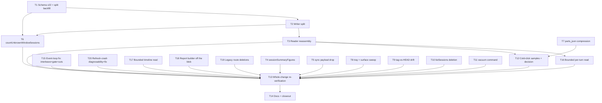

# KyberDash payload-independence follow-ups: the turn split and the nine todos

**Status: Ready 2026-10-20 — approved for execution at the approve-and-execute gate.** This plan completes, as one delivery, the nine follow-up todos filed by the archived sessions-list plan ([`docs/archive/plans/2026-10-19-kyberdash-sessions-list-payload-independence.md`](../archive/plans/2026-10-19-kyberdash-sessions-list-payload-independence.md), §12 items 1–9) and resolves every entry of that plan's §10 out-of-scope list. The owner has directed that none of the nine be deferred and that "out of scope" no longer be used as a deferral mechanism: §10 of this plan accounts for every one of them, and §12 creates no new follow-up todos. The plan was amended later the same day after an evidence pass reported on todos 4–6: the detail-path premise is **falsified** (the measured worst case is 191.16 ms cold, not 3.86 s; the multi-second stalls are the engine's ~24.5 s event-loop block on a 30 s cadence), the tray is structurally clean but **four other full-payload consumers** exist, and the installed build has nothing HEAD lacks — the running engine is simply the old build, still paying 17.61 s per list request on a copy of the live store. The amendment records the decisions (D18–D20), corrects D2's split rationale honestly, and adds T15–T19 — the event-loop block, the bounded reads, and the legacy-route deletions — inside the existing graph; no item is deferred and §12 stays empty (§2 items 11–13). A diagnosis pass then completed T15's diagnosis and uncovered a second, separate defect: the block is the tick's **synchronous maintenance pass** — a full re-projection of the store on the main thread every 30 s, ~26 s measured — and the scheduled-refresh child crashes on its own, its failure hidden by a stderr summarizer that records bundled source instead of the error. The fix is designed (D21), the crash and its diagnosability are tasked (T20), and the RSS/freelist question is closed in-plan (D23, T11 widened) — the graph is now twenty tasks, nothing deferred, §12 still empty (§2 items 14–15).

Development mode: `test-first`. Autonomy: `autonomous` — the resolved value declared as **<autonomy>** in the repository root `AGENTS.md` Config Reg. Both persisted here per architect protocol; a missing development mode would default to `test-first`. Every implementation task has a Test-contract row in [section 7](#7-test-contract-test-first) created before implementation starts.

## 1. Problem and goal

The sessions list no longer reads `payload` — that work landed, measured, and archived (cold 37.5–47.2 ms against the < 1 s target, warm median 2.174 ms against ≤ 10 ms, byte-identical output across all four read states). What remains is everything that work deliberately left: the detail/turns path still reads the whole `payload` blob per session (Σ ≈ 75.9 MB across 336 rows, largest row 15.3 MB), several secondary readers still extract from `payload` per row, and nine filed todos carry the rest.

The owner's directive governs this plan: **complete all nine todos in this delivery; resolve every §10 entry; create no new follow-ups.** Concretely:

1. Split the session `payload` — turns move to a dedicated `session_turn` store, compressed; `session.payload` becomes metadata-only (todo 9, the largest change).
2. Compress `records.parts_json` for the detail/digest path (todo 8) — after the split, this is its remaining target.
3. Convert both `sessionSummaryFigures` copies to `summary_json` column-first (todo 1), drop the never-read `payload` from the transcript-sync unsettled-row SELECT (todo 2), and make `countUnknownWindowSessions` read a materialized column instead of a payload expression (todo 3).
4. Settle the three evidence items with decisions, not open questions: detail-endpoint cold-click samples (todo 4), the tray endpoint full-payload sweep (todo 5), and the tag-vs-HEAD drift check (todo 6).
5. Settle the storage concern with a decision and a mechanism: the freelist/retention question (todo 7).
6. Delete the dead `store.listSessions` surface (archived §10's one undecided entry).

Measured baselines → targets (T8 actuals from the archived plan, the todos' recorded facts, and this pass's code verification):

| Signal | Today (measured) | Target / decision |
|---|---|---|
| Sessions list, cold / warm | 37.5–47.2 ms / 2.174 ms median | **Re-established unchanged** (the split must not regress them; re-measured in T13) |
| `EXPLAIN QUERY PLAN` of the list query | `SCAN session USING COVERING INDEX session_denorm_idx`, no `payload` | Unchanged — the index is kept and re-verified (D8) |
| Detail-endpoint cold click | **measured (2026-10-20 evidence pass): the 3.86 s premise is falsified** — cold median 1.12 ms (min) / 1.70 ms (p50) / 8.49 ms (p90) / **191.16 ms (max, 15.3 MB / 10,933 turns)**; warm median 0.49–63.26 ms; model `warm_ms = 0.661 + 4.292 · MB` (R² 0.998) | **Inherent and acceptable** — the ≤ 1 s rule fired; no pagination branch; re-measured post-change in T13 (D18) |
| Any route's request latency — the live symptom | **measured: `/api/kyber/meta` blocks 23.18–29.04 s every ~30 s** (`DEFAULT_TICK_INTERVAL_MS = 30_000`, `host.ts:89`) while the detail route stays 70–92 ms; CPU 107% during a block vs ~2% idle. **Cause identified (§2 item 14): the tick's synchronous maintenance pass** — a full re-projection on the main thread, ~26 s measured on the scratch corpus | **The designed fix (D21): interleave + change-detection gate + cost cuts — p95 of a trivial endpoint across live ticks ≤ 100 ms** (from ~24 s); the steady-state unchanged-corpus tick performs no projection work; a request's latency is its handler cost (D18, D21) |
| Maintenance pass wall time (scratch corpus: 40,536 records, 337 sessions, 7,031 findings) | **~26 s measured** — project 26.0 s (session rows + tokenization ≈ 10.3 s, `buildRuns` 7.1 s, `buildFindings` 8.0 s, reads 0.4 s) + purge 0.9 s | **≤ 15 s budget (D21's (b))** — with the stated acceptable fallback: if the CPU cuts miss, the pass may stay long while the p95 bound stands — the loop is freed either way (D21) |
| Sessions list on the **deployed** build | the running engine is `0.1.8-rc.2` — the old payload-reading list path: **17.61 s cold on a copy of the live store (21.4 s live)** where HEAD's materialized reader measures **0.86 s cold / 62 ms warm** on the same bytes | **Deployment note (D20): the live symptom persists until a HEAD build ships — server and client together**; recorded in T14's runbook/release note; the live store is re-measured after deployment as the owner step |
| `session.payload` | turns inside; Σ ≈ 75.9 MB, largest 15.3 MB; Σ turns = 40,621 | Metadata-only; turns in `session_turn`, deflated (D2–D4); assembled detail response deep-equal with the same key set (D6) |
| Turn reads on the detail path | whole-blob `SELECT payload` per session | One ordered range scan per session over the `session_turn` PK btree — no per-turn N+1 (D6) |
| Full-rebuild (projection) maintenance | within 0.5% of baseline; skip-unchanged not needed | Turn upserts skip unchanged content; budget **≤ baseline + 750 ms** (deflate modelled ~+330 ms on the measured `compressRaw` precedent); T13 measures (D16) |
| `sessionSummaryFigures` (both copies) | `json_extract(payload,…)` per id set | Column-first on `summary_json`, per-row payload fallback (D10) |
| Transcript-sync unsettled SELECT | fetches every unsettled row's `payload`, never read | No `payload` column (D11) |
| `countUnknownWindowSessions` (both copies) | `json_extract(payload,'$.context.contextLimitSource')` in `WHERE`, pages every blob | Materialized `context_limit_source` column; no payload read on the unscoped path (D9) |
| `records.parts_json` | uncompressed JSON (records I/O 79 MB per full refresh) | Deflated BLOB, measured precedent 79 → 6.1 MB at +330 ms (D5) |
| `canon.db` | 3.33 GB file, 1.65 GB freelist; quarantine family 933 MB ≈ 62% of ~1,498 MB live | No recurring vacuum cadence; one-time post-migration `VACUUM` via a new `kyberdash vacuum` command (D12) |
| `store.listSessions` | zero production callers (all 9 are tests), ~120 ms warm, `SELECT *` + per-row `JSON.parse` | **Deleted** with its test callers (D17) |
| Tray endpoint surface | **sweep complete (2026-10-20): the tray is structurally clean** — the closed allow-list (`api.rs:43-50`, enforced in `endpoint_url()`/`api_request_url()`) serves no session content, the tray UI makes zero HTTP calls, no other tray Rust file opens a socket — but **four other full-payload consumers exist**, one reachable from the tray's own `/api/kyber/report` | The four are dispositioned in-plan: three bounded reads + two legacy routes deleted (D19, T16–T19); nothing re-filed |
| `bridge.ts`/`routes.ts` vs installed 0.1.8-rc.2 | **diff complete (2026-10-20): nothing to port** — the installed build is `b303d420` (#388); `getSessionPayload` and `_clip` are **byte-identical** to HEAD (same `MAX_STRING_LENGTH`, depth-8 cutoff, truncation suffix), the detail handler identical; every bundle difference is **HEAD-only and additive** (+457/−22 bridge, +57 routes); six probes confirm the tag; store compatibility holds both ways | The Item-4 measurements describe the running engine exactly (the detail path is identical); the one constraint: **the HEAD web bundle must not be served by the `0.1.8-rc.2` engine** (the ancestry lookup would 404) — server and client ship together (D20) |

## 2. Investigation findings

Provenance: the nine todo files under `docs/todo/` are the authoritative statement of each item and were read in full (verbatim, this checkout); the archived plan's §10/§12/§14 supply the recorded measurements and closeout facts; code facts were verified in this checkout with CodeGraph; the tray surface was read directly (the tray is Rust, outside the CodeGraph index). The docs MCP answered from the correct root this pass (`root=/Users/dave/git/personal/opencode/kyber-weave`, 113 documents).

Evidence-recording amendment pass (2026-10-20, later the same day): the conductor's evidence pass measured todos 4–6 in this checkout; its findings are recorded as items 11–13 below, its decisions as D18–D20, and the work it revealed as T15–T19 (the event-loop block, the bounded reads, the legacy-route deletions) — inside the existing graph, nothing deferred, no new todos (§12 stays empty). `Discovery: codegraph 1, docs 0, direct reads 1` — codegraph verified the evidence's client-side citations (the turn page's counters query calling `fetchKyberSessionTurns` at `TurnDetail.tsx:113-117`, `findSessionTurnRow` at `:33-38`, `turnRowFigures` reading `input`/`output`/`fresh`/`cache_read` at `:54-62`, `TurnTokenFigures` at `kyberApi.ts:268-273`, and `buildLatestSession` at `build.ts:360` — one caller, no covering tests); direct read: the plan file (the artifact under in-place amendment; verbatim text required for exact-match edits). The measurements — the eviction method (`msync(MS_INVALIDATE)`, proven by 2.65 → 131.10 → 2.63 ms on the same 3,739 pages), the per-size detail table, the component breakdown, the warm model, the block timings and host facts, the tag comparison, and both-ways store compatibility — are the evidence pass's, supplied by the conductor's packet as established evidence.

Diagnosis-recording pass (2026-10-20, third pass): T15's diagnosis landed in this checkout — the event-loop block's root cause, measured live and on a scratch copy, plus a second, separate defect it uncovered (the scheduled-refresh child crash). The findings are recorded as items 14–15, the fix design as D21, the crash task as T20, and the RSS/freelist disposition as D23 with T11 widened; nothing is deferred and §12 stays empty. `Discovery: codegraph 1, docs 0, direct reads 1` — codegraph verified the diagnosis's decisive wiring (the `summarize` first-line slice at `host.ts:119-123`, `runMaintenancePass`'s purge-then-project at `folder-import.ts:79-84`, the purge's per-record N+1 at `retention.ts:52-59` over `store.get`'s `SELECT *` + parse at `store.ts:2348-2353` and `setContent`'s per-row `UPDATE` at `:2377-2386`, the per-key `sessionKeys`/`recordsForSession` reads at `store.ts:2737-2772`/`:2915-2922`, and the `JobHost` wiring at `web.ts:892-901` with the central module's maintenance injected); direct read: the plan file (the artifact under in-place amendment). The live reproduction (23.18 s first `/meta`, 107% CPU), the scratch timings (the phased `tsx` run on a read-only `.backup` copy of the 3,331,403,776-byte store), the `sample`/`lsof` results, and the child-crash evidence are the diagnosis pass's, supplied by the conductor's packet as established evidence.

`Discovery: codegraph 2, docs 1, direct reads 16` — direct reads: the nine todo files (the authoritative per-item statements; verbatim full text required), `docs/todo/README.md` (todo-index mechanics — completing a todo moves its row to Closed with a superseding-plan link), `docs/plans/README.md` (plan-index row format; Active Plans currently empty), the archived plan's frontmatter/status and §9–§14 regions (the §10 entries to resolve and the closeout facts), `products/kyber-squad/agents/architect/references/plan-authoring.md` and `autonomy-decisions.md` (architect references, not docs-corpus indexed), and `dash/tray/src-tauri/src/api.rs` (the tray's endpoint surface — not CodeGraph-indexed). CodeGraph verified (2026-10-20): `upsertSession` (`store.ts:2809-2860`, one serialization feeding `payload` + `materializeSessionSummary` at `:1450-1474`; `payload` last in the fresh-table column order), both `getSessionPayload` copies (`store.ts:2863-2868`; the bridge's store and direct-DB paths at `bridge.ts:2133-2161` with `_clip` at `:1013-1035`), `compressRaw`/`decompressRaw` (`store.ts:1132-1137`, `deflateSync`), `fetchKyberSessionTurns` (`kyberApi.ts:275-278`, reads `body.turns` from the detail route), `buildSessions`/`buildSessionRow` (`sessions.ts:718-962`/`:974+`, the projection upserts every row wholesale), and `AsadSessionPayload` (`sessions.ts:641-679`) — **`turns` is a required `Array` key** (`:657`), so a reassembled document can always carry it.

1. **The payload's shape and what the split leaves behind.** `AsadSessionPayload` carries identity, `context`, `tools`, `timeline`, **`turns`** (required array), `costBasisMismatch`, `skills?`, `requests`, `servers`, `coverage`, `problems`, `reconciliation`, `summary`. The archived diagnosis measured `problems` at offset 12,384,167 of 15,302,492 in the largest row — ~12.4 MB of JSON (turns, timeline, requests) precedes it and ~2.9 MB follows. **Consequence:** the split shrinks the largest `payload` from 15.3 MB to its non-turn keys, which remain MB-scale — `session_denorm_idx` stays load-bearing (D8), and the split is a detail-path fix, not a list-path one (the list already reads columns only).
2. **One payload writer, already the split point.** `upsertSession` (`store.ts:2809-2860`) serializes `row.payload` once and derives `summary_json`/`problems_count` from the same object — the projection (`buildSessions` → `buildSessionRow`) is untouched by a split that lives entirely in the writer. The upsert already proves the pattern: columns derived from the same serialization cannot drift from the payload. `buildSessionRow` stays pure and unchanged; turns and metadata both come from the object it already returns.
3. **The write-amplification trade is real and the todo's numbers stand.** Σ turns = 40,621 across 336 rows, comparable to the 40,490 `records` rows; uncompressed, that is an estimated 1.2–1.5× more btree pages per rebuild plus per-session delete/reinsert churn (todo 9). Two mechanisms offset it: **content-compressed turn rows** (the `compressRaw` precedent: `records` I/O 79 → 6.1 MB per full refresh at +330 ms — a ~13× byte reduction for ~+330 ms CPU at the same scale) and **skip-unchanged upserts** (`ON CONFLICT … DO UPDATE … WHERE session_turn.content IS NOT excluded.content` — SQLite evaluates the `WHERE` before writing, so an unchanged turn dirties no page; SQLite supports the guard). The projection rebuilds every row wholesale on each pass, so the deflate CPU is per-pass, not one-time — modelled ~+330 ms per full rebuild at the measured precedent, gated in T13 (D16).
4. **The reassembly points are exactly two, and both must convert.** `CanonStore.getSessionPayload` (`store.ts:2863-2868`) and the bridge's direct-DB fallback (`bridge.ts:2141-2158`) both do `SELECT payload … JSON.parse`. The bridge's store path delegates to the store method (`:2136-2139`). `_clip` applies after reassembly, unchanged. The served contract: `kyber-api.test.ts:526` pins the served key set to the stored payload's key set — after the split the pin becomes stored key set **∪ {turns}** (D6).
5. **The tray cannot be a full-payload consumer.** `api.rs`'s `API_PATHS` is a closed 7-path list — report, jobs, settings, coverage, refresh, clean, import-history (`api.rs:43-51`) — with no session route of any kind, and the loopback choke (`loopback_origin`) is the only URL builder. The sweep (T8) still enumerates the tray UI's fetches and every other payload-reading surface formally, but the Rust closed list is decisive evidence for the expected conclusion (D14).
6. **The sync columns survive a split rewrite.** The migration's row rewrite names only `payload` and `context_limit_source` in its `UPDATE`; the five transcript-sync columns (`synced_at`, `sync_status`, `settled_at`, `transcript_path`, `transcript_offset`) are the sync job's alone, exactly as the upsert's comment (`store.ts:2818-2826`) already guarantees for the writer.
7. **`countUnknownWindowSessions`' expression-index alternative is already measured dead.** The archived D14 pattern: an expression index over `json_extract(payload,…)` costs 3.5× upsert maintenance (29 → 101 ms per full refresh) and hard-fails the INSERT on malformed JSON. A materialized column written by the single writer has neither failure mode (D9).
8. **The freelist is measured orthogonal to latency.** `VACUUM` halves the file (3.33 → 1.65 GB, 13.8 s) and leaves the session page set and cold latency unchanged — freelist pages are never read. The quarantine family is 933 MB ≈ 62% of live bytes and is evidence retention by design (ADR 0035) under the existing purge policy (ADR 0018) — the storage answer is reclamation mechanics, not retention change (D12).
9. **`store.listSessions` is dead code.** Zero production callers, all 9 callers are tests, ~120 ms warm, `SELECT *` + per-row `JSON.parse` — the exact hazard class the parent plan removed from the list path, surviving only because nothing calls it. Deletion, not deprecation: there are no consumers to warn (D17).
10. **Engine facts carried forward.** `node:sqlite` `DatabaseSync` bundling SQLite 3.54.1; `WITHOUT ROWID` tables supported (since 3.8.2); `PRAGMA optimize` on every `CanonStore.close()` keeps statistics on the corpus-change cadence; the migration convention is presence-guarded, idempotent, transaction-per-step, forward-only refusal of newer stores (`store.ts:1744+`).
11. **Todo 4's premise is falsified; the real stall is the engine's event-loop block.** The todo's single 3.86 s sample does not reproduce as a detail-path cost: controlled measurement on a copy of the live store (scratch server on the dashboard's own API layer, whole-file eviction via `msync(MS_INVALIDATE)`, eviction proven — 2.65 ms → 131.10 ms → 2.63 ms on the same 3,739 pages) puts the detail route at a cold median of 1.12 ms (min, 3,167 B served), 1.70 ms (p50, 39,652 B), 8.49 ms (p90, 448,125 B), and **191.16 ms (max, 15,302,492 B / 10,933 turns)**; warm median 0.49–63.26 ms; warm model `warm_ms = 0.661 + 4.292 · MB` (R² 0.998). The largest session's cold breakdown: page-in ~128 ms (67%), `_clip` 25.4 ms (13.3%), `JSON.parse` 16.5 ms (8.6%), `JSON.stringify` 13.7 ms (7.1%), transfer ~7 ms (3.7%) — the page-in **rate** is set by the row's overflow-chain fragmentation, not its byte count (3,017 runs over 3,739 pages = 92 MB/s). **The multi-second stalls are the engine's event-loop block:** a trivial `GET /api/kyber/meta` blocks **24.4–25.0 s every ~30 s** while the detail route stays at 70–92 ms; `GET /api/kyber/jobs` took 25.29 s; the ~30 s cadence is `DEFAULT_TICK_INTERVAL_MS = 30_000` (`dash/src/jobs/host.ts:89`), and the first 24.4 s block's completion coincides exactly with the scheduled refresh's recorded failure timestamp (`2026-10-20T16:16:15.943Z`); the engine sat at 87% CPU / 2.4 GB RSS with 580 min CPU in 15h55m. A request's latency is `max(handler cost, time left in the current block)` — **no detail-path change fixes that.** **Correction (2026-10-20 diagnosis pass): the cause is now identified — item 14 — and the correlation below is resolved: the scheduled-refresh failure is a separate defect (item 15); the timestamp coincidence was the loop processing the child's already-fired `close` event once maintenance yielded.** `sample` yields only native/SEA frames for the packed binary, so the cause was proven by direct timing of the implicated functions instead of a stack trace — and the 2.4 GB RSS recorded above is **not** a per-pass allocation (the scratch projection peaked at ~20 MB); its holder is not isolated and is closed as in-plan work (item 14's gaps, D23, T11).
12. **Todo 5's tray ruling was right about the tray and wrong about the wider surface.** The tray is clean **structurally**: the closed 7-path allow-list (`api.rs:43-50`, enforced in `endpoint_url()` and `api_request_url()`) serves no session content, the tray UI makes zero HTTP calls, and no other tray Rust file opens a socket — a closed list, not a grep artefact. But **four full-payload consumers the earlier ruling missed are now the work**: (1) `fetchKyberSessionTurns` (`kyberApi.ts:276`, called from the turn page's counters query at `TurnDetail.tsx:113-117` through `findSessionTurnRow` at `:33`) downloads the whole payload — up to 10,933 turn rows — to read **one** row's counters (`input`, `output`, `fresh`, `cache_read` — `turnRowFigures` at `:54-62`); (2) `GET /api/kyber/timeline` (`routes.ts:1617` → `getSessionPayload`) reads 15.3 MB to serve 13.8 KB, and the web client does call it (`kyberApi.ts:50`); (3) `buildLatestSession` (`build.ts:360`, the payload read at `:369`) reads the latest session's payload for **every** report request — and `/api/kyber/report` is on the **tray's** endpoint list, so one full-payload read *is* reachable from a tray endpoint, in the engine; (4) the legacy `GET /api/kyber/context` (whole payload → 10,782 B served) and `GET /api/kyber/schema` (468 B) have **no live caller** — only `dash/src/cli/web-dashboard.test.ts:355,363`; they are marked "Backward-compatible endpoints for older/legacy callers". The landed bounded pattern (`GET /api/kyber/session/:id/summary`, previous plan) is the template; the unbounded siblings measure **127 ms (timeline) / 64 ms (context) / 65 ms (schema) warm** — each reading 15.3 MB to serve kilobytes.
13. **Todo 6: nothing to port; the running engine is the old build.** The installed `0.1.8-rc.2` is commit `b303d420` (#388), built 71 minutes later as a Node SEA; the bundle is unminified with an inline source map (not decoded), so the complete bundle was not diffed line-by-line, but the decisive parts were compared: `getSessionPayload` and `_clip` are **byte-identical** between the installed build and HEAD (same `MAX_STRING_LENGTH`, same depth-8 cutoff, same truncation suffix), the detail route handler is identical, and every difference in `bridge.ts`/`routes.ts` is **HEAD-only and additive** (+457/−22 in bridge, +57 purely additive in routes). Six independent probes confirm the binary is that tag's code (it contains the old `json_extract(payload,'$.summary')` list SQL; it lacks `parseSessionSummaryPath`, `getSessionSummary`, `SESSION_LIST_SELECT`, `readSessionListRows`; its `/api/kyber/session/:id/summary` 404s). **Store compatibility holds both ways:** HEAD's writer populates the materialized columns and the tag's reader ignores them, deriving from the payload; a store last written by the tag leaves them NULL, so HEAD's list reader takes its legacy fallback — slower, correct, and self-healing on the next HEAD projection. Two consequences: the Item-4 measurements describe the running engine exactly (the detail path is identical between builds), and **the old list path is still what the live machine runs** — 17.61 s cold on a copy of the live store (21.4 s live) where HEAD's reader measures 0.86 s cold / 62 ms warm on the same bytes, so **deploying HEAD is itself a mitigation of the observed stalls.** The one asymmetry: the HEAD web bundle must not be served by the `0.1.8-rc.2` engine (the ancestry lookup would 404) — **server and client ship together**; the installed engine serves its own embedded `0.1.8-rc.2` web asset, so the old pair is self-consistent.
14. **Todo 4's real stall, root-caused: the tick's synchronous maintenance pass.** Every 30 s `JobHost` tick runs the maintenance pass synchronously on the main thread: `runTick` (`host.ts:184-195`) → `runMaintenance` (`:320-332`, awaiting `this.maintenance()`) → the injected central pass (`web.ts:898-900`: `maintenance: … ?? (() => runMaintenancePass(store, new Date()))`) — and `runMaintenancePass` (`folder-import.ts:79-84`) runs `purgeExpiredContent` then `await projectCanonicalStore(store)`, where the projection (`buildSessions`, `buildRuns`, `buildHarnessRollup`, `buildFindings`) is synchronous SQLite (`node:sqlite` `DatabaseSync`), JSON parse/serialize, o200k tokenization, and finding detection, with awaits only at stage boundaries — **the loop never yields mid-pass.** Every HTTP handler, including trivial `GET /api/kyber/meta` (a few `COUNT(*)` queries), queues behind it. **Live reproduction (read-only GETs):** the first `GET /api/kyber/meta` took **23.18 s**, the next two 23 ms; CPU spiked to **107%** during the block vs ~2% after; repeat polling measured blocks of 27.78 / 29.04 / 23.55 / 23.42 / 23.75 s. **Scratch reproduction** (a read-only `.backup` copy of the live 3,331,403,776-byte store; the real `purgeExpiredContent`/`projectCanonicalStore` timed via `tsx`; no repo files touched): read-loop 726 ms (40,536 ids, 9,740 expired); project **26,047 ms** (built 337, skipped 85, pruned 0, rollups 51, findings 7,031); purge 920 ms (0 writes — the old rows' content was already purged); `sessionKeys` 127 ms; `recordsForSession`-all 319 ms; `buildRuns` **7,143 ms**; `buildHarnessRollup` 162 ms; `buildFindings` **7,971 ms**. So of ~26 s: record loading 0.4 s; session-row building and tokenization ≈ 10.3 s; `buildRuns` 7.1 s; `buildFindings` 8.0 s; purge 0.9 s. Corpus: 40,536 records, ~286 session keys / 337 derived sessions, 7,031 findings, 988,454 quarantine rows; the file is 813,331 pages with a 343,510-page freelist (≈42% bloat — D23, T11). **Why a 30 s cadence and a ~24.5 s hold:** the tick interval is 30 s and the pass costs ~25 s; `tickInFlight` (`host.ts:180`) makes overlapping ticks join rather than pile up, and `busy` declines a refresh launch while one runs — ticks neither accumulate nor overlap; the hold is simply shorter than the interval. **Cause vs effect:** the 87% CPU is an effect (single-threaded projection), proven by 107% during a live block vs ~2% idle; the **2.4 GB RSS is not separated** — `sample` reports footprint 3.4G / peak 5.0G, but the scratch projection peaked at only ~20 MB transient and ticks cannot accumulate; most plausibly the mapped 3.3 GB store file is charged to the process, but the persistent holder was not isolated (D23 closes this in-plan). `lsof` confirms the engine holds `canon.db` + WAL open and spawns no refresh child during the block — **no child-process involvement**; `sample <pid>` yields only native/SEA frames for the packed binary, so the cause was instead proven by direct timing of the implicated functions, matching the observed hold to within a second.
15. **A second, separate defect: the scheduled-refresh child crashes on its own.** The refresh (`dash refresh --trigger scheduled`, launched only when `isDue()` — a 5-minute cadence per `shared-settings.ts:67`; overdue since `lastSuccessAt 2026-10-20T05:08:26Z`) **crashes with a JavaScript error inside commander.js argument handling**. The schedule is intact — `nextDueAt = lastRunAt + cadence` (`host.ts:371-375`, confirmed: 16:42:20 = 16:37:20 + 5:00) — the child dies. The engine's recorded `lastFailure` is a **mangled artifact, not an error message**: `summarize()` (`host.ts:119-123`) takes the first non-empty line of the child's stderr, sliced to 200 characters, and the child's stderr tail contains bundled commander.js source — so the stored fragment decodes to commander internals rather than the error. The child's **full stderr is discarded by design** (`STDERR_CAP`, in-memory only), so the crash's actual cause could not be determined — and a failure summary that shows bundled source instead of the error makes the failure **undiagnosable, which is itself a defect** (D22, T20). The crash is separate from the event-loop block: the failure timestamp coinciding with a block completing is the loop processing the child's already-fired `close` event after maintenance yields — correlation, not causation. The consequence is real: the scheduled refresh has been failing since 05:08, so the corpus's derived state is stale. Gaps carried into the tasks: no JS-level hot stack (SEA native frames only); the GB-scale RSS holder not isolated (D23); the refresh child's crash cause unknown until its stderr is captured (T20 captures it first).

## 3. Decisions

| ID | Question | Answer / decision | Mitigating and supporting information | Status / approval provenance |
|---|---|---|---|---|
| D1 | Development mode? | **`test-first`.** | Architect default; packet confirms. Test contract in section 7. | DECIDED — protocol default, packet-confirmed |
| D2 | Adopt or decline the payload split (todo 9's adopt-or-decline)? | **Adopt.** Turns move to a dedicated store; `session.payload` becomes metadata-only. | Owner-directed completion as part of this delivery (the packet's section B designs around the split being the plan). The todo's trade stands — 40,621 turn rows ≈ the 40,490 `records` rows, 1.2–1.5× more btree pages per rebuild uncompressed — and is offset by compression (measured ~13× byte reduction at the same scale) and skip-unchanged upserts (D16); the write cost is gated in T13, with deflate level 1 as the stated escape hatch. **Correction (2026-10-20 evidence pass):** the detail path no longer justifies the split on performance — the measured worst case is 191.16 ms cold / 63.26 ms warm (§2 item 11), so this row's earlier framing ("the one measured cost the parent plan deliberately left standing") was wrong and is corrected here rather than silently rewritten. The adoption stands on the owner's directive plus the structural argument now stated in D18: the bounded per-turn read (T16) needs a turn store to be natural, and the split is what removes the 15.3 MB blob from the server side of every one of those reads — a design argument, not a performance one. The T13 write-cost gate remains the decision point on the trade. | DECIDED — owner directive; trade modelled and gated; rationale corrected by the evidence pass (2026-10-20) |
| D3 | Split shape? | **New `session_turn` table — `(session_id TEXT NOT NULL, turn_index INTEGER NOT NULL, content BLOB NOT NULL, PRIMARY KEY (session_id, turn_index)) WITHOUT ROWID`, `content` = deflated turn JSON.** | `WITHOUT ROWID` puts the content in the PK btree itself: the detail read is one sequential range scan with no rowid indirection, and the access shape is exactly `(session_id, turn_index) → content`. Alternatives rejected: turns inside `records` (records are the ingest-owned source of truth, not the projection's to rewrite); a separate summary table + join (measured redundant — archived D15); a rebuilt table with `payload` last (measured redundant — archived D16 — and it fixed the list path, not the detail path this split exists for). | DECIDED — pattern-covered; SQLite 3.54.1 supports `WITHOUT ROWID` |
| D4 | Is the turn store compressed from birth (the 9/8 coupling)? | **Yes — `deflateSync` per turn, mirroring `compressRaw` (`store.ts:1132`).** | Measured precedent: `records` I/O 79 → 6.1 MB per full refresh at +330 ms — ~13× fewer bytes for the same-scale CPU. Uncompressed turn rows would re-create the 75.9 MB cold-read cost the split removes, just distributed one row per turn. The deflate CPU is per projection pass (rebuilds are wholesale), modelled ~+330 ms at the precedent — gated in T13 (D16). | DECIDED — measured precedent |
| D5 | What does todo 8 mean after the split lands? | **Two surfaces, one order: the split first (T1–T3), then `records.parts_json` compression as its own task (T7). The turn store is compressed from birth (D4); `parts_json` — the todo's original target — is unchanged and compresses with the same pattern.** | The packet's "changes shape" is exactly this: compression applies to the new turn store (by D4, inside the split's design), not to `records.parts_json` alone. The list path is untouched either way — the todo's explicit constraint, already met by `session_denorm_idx`. | DECIDED — packet section B |
| D6 | Reader shape and the served contract? | **One ordered range scan per session — `SELECT turn_index, content FROM session_turn WHERE session_id = ? ORDER BY turn_index` — decompressed in one pass and reassembled `{...metadata, turns}`; no per-turn queries. `turns` is always inserted (a required array in the builder's type, `sessions.ts:657`); `_clip` applies to the assembled document unchanged; the served key-set pin becomes stored ∪ {turns}; parity standard: deep-equal with an identical key set.** Both `getSessionPayload` copies convert (the store method and the bridge's direct-DB fallback). | The one recorded serialization departure: `turns` is appended last rather than at the builder's original position — JSON key order is not semantic and no consumer byte-compares the response (the pin at `kyber-api.test.ts:526` is a key **set**). The both-copies rule is the parent plan's D21 precedent for duplicated readers. `TurnDetail`/`fetchKyberSessionTurns` are unchanged — same route, same `body.turns`. | DECIDED — code-verified |
| D7 | Migration shape? | **`MIGRATIONS[21]` (v21 → v22), one step transaction: presence-guarded `ALTER TABLE session ADD COLUMN context_limit_source TEXT`; a per-row TS backfill split (parse payload → deflate each turn into `session_turn` → rewrite `payload` sans `turns` → set `context_limit_source`); `ANALYZE` as the step's final statement (hygiene). No lazy dual-read period. Rollback forward-only.** | Idempotent: a row whose payload carries no `turns` key is skipped, so re-running on a split store writes nothing. A dual-read period would keep the giant-payload read path alive — the exact thing being removed — and the projection rebuilds every row on its next pass anyway. Rollback is the designed fail-closed refusal of older binaries (release note in T14), the same story as v21. The row rewrite names only `payload` and `context_limit_source` in its `UPDATE`, so the five transcript-sync columns survive untouched (§2 item 6). `SCHEMA_VERSION` 22; `SCHEMA_SQL` gains `session_turn` and the column so fresh stores are born split. | DECIDED — convention |
| D8 | Does the split obsolete `session_denorm_idx`? | **Keep it, unchanged.** | The list reader's column set is unchanged, so the EXPLAIN pin stays green as-is; the split leaves the largest rows' non-turn keys at MB scale (§2 item 1 — `problems`, `reconciliation`, `timeline`, `requests`), so the payload overflow chain persists and the index remains the list path's mechanism. Its maintenance measured free (within 0.5%). T13 re-verifies the covering scan; the parent plan's rule carries: if any reader change ever alters the column list, the index and the EXPLAIN pin move together — the covering property is never silently broken. | DECIDED — measured + code-verified |
| D9 | `countUnknownWindowSessions` (todo 3)? | **Materialized `context_limit_source TEXT` column — added in migration 21, populated for every row during the split rewrite, written by the single writer thereafter; both copies convert to `WHERE COALESCE(context_limit_source, json_extract(payload,'$.context.contextLimitSource')) = 'unknown'`.** | The expression-index alternative is measured dead by the archived D14 pattern: 3.5× upsert maintenance (29 → 101 ms per full refresh) and a hard INSERT failure on malformed JSON — the materialized column has neither failure mode. The `COALESCE` preserves the NULL-sentinel fallback (the parent plan's D5 pattern) for pathological rows; post-split the fallback's payload read is a cheap metadata read, and the unscoped count stops paging turn blobs entirely. | DECIDED — measured pattern |
| D10 | `sessionSummaryFigures` (todo 1)? | **Both copies convert together to `summary_json`-first, with the same per-row payload fallback the list reader uses; merge semantics preserved exactly** (a missing figure stays omitted, never zero; `costStatus`/`costCurrency` only when strings; non-finite numbers dropped). | The both-copies rule is the parent plan's D21 item 1: converting one copy would leave two implementations of one reader that could disagree. | DECIDED — todo authoritative |
| D11 | Transcript-sync unsettled SELECT (todo 2)? | **Drop the `payload` column; nothing else changes.** | `row.payload` is verified never read across the whole `syncSessions` loop (the parent plan's T5 audit). | DECIDED — verified |
| D12 | Freelist/retention (todo 7)? | **No recurring vacuum cadence, plus a one-time post-migration `VACUUM` run through a new `kyberdash vacuum` engine command; retention policy unchanged.** | Freelist pages are never read (measured orthogonal — the parent plan's D17); `auto_vacuum` is rejected because ptrmap pages tax every write on the store's hottest insert path for zero latency gain. The one-time `VACUUM` is measured (13.8 s, 3.33 → 1.65 GB) and reclaims more after the split frees the old payload pages; a first-class tested command beats an undocumented `sqlite3` invocation, and `VACUUM` cannot run inside the migration's transaction — an operator step after the v22 migration lands on the live store is the correct shape. Retention: the quarantine family (933 MB ≈ 62% of live bytes) is evidence retention by design (ADR 0035) under the existing purge policy (ADR 0018) — recorded numbers, decision "no change." | DECIDED — measured + convention |
| D13 | Detail cold-click (todo 4)? | **Pre-registered rule: after T3+T7 land, gather cold-click samples across session sizes (the parent plan's eviction method). p95 ≤ 1 s → the cost is inherent and acceptable — recorded with the numbers (the remainder is Σ-turns transfer, inherent to the ASAD contract). p95 > 1 s → the bounded turns-pagination branch executes in this plan** (design sketched in §4.8; its test contract activates only on trigger). Baseline (pre-split) samples are gathered first so the delta is attributable. | A pre-registered threshold makes the measurement a decision, not an open question; 1 s matches the list path's cold budget. | DECIDED — pre-registered; **rule fired 2026-10-20 (the ≤ 1 s branch, max 191.16 ms)** — the pagination trigger never fired and the §4.8 sketch is retired; the outcome and the falsified premise are recorded in D18 |
| D14 | Tray sweep (todo 5)? | **Enumerate the tray's endpoint surface (the closed `API_PATHS` list, `api.rs:43-51`, plus the tray UI's fetches) and every other payload-reading surface; expected conclusion: no full-payload consumer. If one is found, it is fixed in this plan** by switching it to the bounded/summary pattern (the parent plan's D8/D19 route) — never filed as a new todo. | The Rust closed list is decisive evidence: the tray contacts seven paths — report, jobs, settings, coverage, refresh, clean, import-history — and no session route of any kind; the loopback choke (`loopback_origin`) is its only URL builder. The sweep still records the full enumeration and the surfaces checked. | DECIDED — code-verified; **rule executed 2026-10-20** — the tray confirmed clean (structurally), the wider surface yielded four consumers, fixed in-plan exactly as this row's conditional provided; the outcome is recorded in D19 |
| D15 | Tag-vs-HEAD drift (todo 6)? | **Run the diff of `bridge.ts`/`routes.ts` between the installed `0.1.8-rc.2` and HEAD; no behavioral drift expected. Any divergence is dispositioned: ported into this plan if HEAD lacks useful behavior, recorded as superseded if the installed build is simply behind.** | The parent plan measured behavior parity on every exercised path; the diff is the never-run confirmation, and its result is recorded either way. | DECIDED — pre-registered; **rule executed 2026-10-20** — no drift found, nothing to port; the outcome, the deployed-build fact, and the ship-together constraint are recorded in D20 |
| D16 | Writer cost budget? | **Skip-unchanged turn upserts (`DO UPDATE … WHERE session_turn.content IS NOT excluded.content`) plus contiguous stale deletes (`DELETE … WHERE session_id = ? AND turn_index >= <new count>`); steady-state projection passes write no turn pages. Budget: full-rebuild duration ≤ pre-split baseline + 750 ms at the 336-row / 40,621-turn corpus.** | Deflate CPU modelled ~+330 ms per pass on the measured precedent (79 → 6.1 MB at +330 ms); the budget headroom covers the turn-row insert overhead. The first post-migration rebuild is a one-time all-rows cost — recorded, not gated. If T13 blows the budget, deflate level drops to 1 before any re-design (the stated escape hatch). The todo's 1.2–1.5× page estimate was for an uncompressed store — compression and skip-unchanged are the offsets. | DECIDED — modelled, gated in T13 |
| D17 | `store.listSessions` (archived §10's undecided entry)? | **Delete the method and rewire or remove its 9 test callers.** | Zero production callers (all 9 are tests — measured), ~120 ms warm, `SELECT *` + per-row `JSON.parse` — the exact hazard class the parent plan removed from the list path, surviving as dead code. Deprecation is rejected: there are no consumers to warn. | DECIDED — measured |
| D18 | What does the Item-4 evidence require — the detail path's real cost, the stalls' real cause, and the split's honest rationale? | **A three-part disposition: (a) fix the event-loop block** — the real user-visible stall and the highest-value item in this plan; T15 diagnoses the ~24.5 s hold with instrumentation and fixes the identified cause, and must **not** assume the scheduled refresh is the cause merely because the timestamps correlate; **(b) replace the four full-payload consumers Item 5 found with bounded reads** (T16–T19); **(c) the split (todo 9) stays, owner-directed, with its rationale corrected** — the measurement does not support it as a detail-path performance fix; what it buys is structural: the turn store the bounded per-turn read needs (D2's correction). The pagination branch is dead — the ≤ 1 s rule fired (max 191.16 ms cold). | The measured detail-path model: cold median 1.12–191.16 ms, warm `0.661 + 4.292 · MB` (R² 0.998), page-in rate set by overflow-chain fragmentation (92 MB/s measured on 3,017 runs / 3,739 pages). The stalls: `/api/kyber/meta` 24.4–25.0 s every ~30 s (`DEFAULT_TICK_INTERVAL_MS`, `host.ts:89`) while the detail route stays 70–92 ms; engine 87% CPU / 2.4 GB RSS, 580 min CPU in 15h55m — a request's latency is `max(handler cost, time left in the current block)`, which **no detail-path change fixes**. The block's cause is unidentified (no stack or child trace; the `lastFailure` is a mangled base64 fragment) — T15 must identify it before any fix is designed. | DECIDED — evidence pass (2026-10-20), packet-supplied, client citations code-verified in this checkout; **(2026-10-20 diagnosis pass)** part (a)'s diagnosis is complete (§2 item 14), its fix is designed as D21, and the scheduled-refresh correlation is resolved as the separate defect of item 15/D22 | 
| D19 | What is the disposition of the four full-payload consumers the Item-5 sweep found? | **Three bounded reads and two deletions. (1)** `fetchKyberSessionTurns` repoints to a bounded per-turn figures read — a new additive `GET /api/kyber/session/:id/turn/:index` on the landed `/summary` pattern, ordered **after** the split so it is born reading one `session_turn` row; **(2)** `GET /api/kyber/timeline` stops reading through the whole-blob `getSessionPayload` reassembly and serves the timeline from the stored payload directly — response unchanged, read bounded, and its cost collapses automatically when the split lands (timeline is metadata that stays in `payload`); **(3)** `buildLatestSession` reads columns (`summary_json` and the columns the report consumes — which exist since v21) instead of the payload blob — report response unchanged, and the tray's `/api/kyber/report` endpoint stops reaching a 15.3 MB read; **(4)** the legacy `GET /api/kyber/context` and `GET /api/kyber/schema` routes are **deleted**, not repaired — no live caller exists (only `web-dashboard.test.ts:355,363`, updated with them); there is no consumer to serve.** | The tray itself is structurally clean (the closed allow-list; zero UI HTTP calls; no other socket) — the earlier ruling was right about the tray and wrong about the wider surface. The unbounded siblings measure 127 (timeline) / 64 (context) / 65 (schema) ms warm — each reading 15.3 MB to serve kilobytes (10,782 B / 468 B). | DECIDED — evidence pass (2026-10-20), packet-supplied, citations code-verified | 
| D20 | What follows from the Item-6 tag comparison? | **Nothing to port; three facts recorded. (1)** The running engine is the old build — it still pays 17.61 s cold per list request on a copy of the live store (21.4 s live) where HEAD's reader pays 0.86 s — so **deploying HEAD is itself a mitigation of the observed stalls**, and the live symptom persists until then: the deployment note lands in T14's runbook/release note and in §1's targets. **(2)** The Item-4 measurements describe the running engine exactly — `getSessionPayload`/`_clip` are byte-identical between the builds. **(3)** Server and client ship together — the HEAD web bundle must not be served by the `0.1.8-rc.2` engine (the ancestry lookup would 404); the installed pair is self-consistent and stays so until deployment.** | Store compatibility holds both ways: HEAD's writer populates the materialized columns and the tag's reader ignores them; a tag-written store self-heals on the next HEAD projection. Every bundle difference is HEAD-only and additive (+457/−22 bridge, +57 routes); six probes confirm the tag (`b303d420`, #388). | DECIDED — evidence pass (2026-10-20), packet-supplied | 
| D21 | What is the event-loop fix — (a) don't block the loop, (b) make the pass cheaper, (c) run it less often? | **A sequenced combination: (a1) interleave, then (c) a change-detection gate, with (b) cost cuts inside the pass. (a1)** The maintenance pass yields between units of work (per session, per run key, per finding batch), so handlers interleave with the pass — in-process, one store connection, no second-writer semantics; a handler's wait is bounded by one unit plus its own cost regardless of pass length. **(c)** A change-detection gate skips the projection entirely when the corpus is unchanged: it compares a records-write marker (bumped by every records write — ingest, wipe, and the projection's own repricing write-back, which converges: pass 1 reprices and bumps, pass 2 finds nothing to change and writes nothing) plus the detector and parser-contract versions (either bump forces one pass); the purge keeps its time-based cadence, because its trigger is the retention deadline, not a records change. **(b)** Cost cuts inside the pass: the purge's per-record N+1 (`retention.ts:52-59` — one `get` with 3–4 `JSON.parse` plus one autocommit `UPDATE` per expired row; 9,740 expired ids measured) becomes one set-based transaction, and the corpus is read once and shared across `buildSessions`/`buildRuns`/`buildFindings` instead of the measured per-key double walk. **(a2) — moving the projection off the main thread (a worker or a child) — is declined on architecture-risk grounds, not deferred:** `node:sqlite`'s `DatabaseSync` is synchronous by design, so off-thread means a second connection to `canon.db` — WAL single-writer contention with the main thread's store, the projection scheduler's in-process debounce, and the close/checkpoint cadence all change at once; interleaving delivers the handler-latency bound without any of that. The revisit trigger is recorded: if the interleaved p95 measurement misses, the off-thread option is the escalation path with exactly this constraint stated. | The measured budget (§2 item 14): handler p95 across live ticks — a trivial `GET /api/kyber/meta`, a few `COUNT(*)`s — **≤ 100 ms** (from the measured 23.18–29.04 s blocks; unit sizes modelled at ~30 ms per session, ~25 ms per run key, ~1 ms per finding). The steady-state unchanged-corpus tick performs no projection work — pinned **structurally, not by timing**: `host.test.ts` stubs maintenance with a counter and does not pin the real cost, so the pins are a probe scheduled during the pass that must resolve before the pass completes (the interleave pin), a gated tick on an unchanged corpus that makes no projection call (the gate pin), and the purge's intercepted SQL as one transaction with no per-row autocommit loop (the SQL-shape pin). Pass wall on the same scratch corpus: **≤ 15 s** (from ~26 s), with the stated acceptable fallback — if the CPU cuts miss, the pass may stay long while the p95 bound stands: the loop is freed either way, and the miss is attributed with numbers in T13. | DECIDED — diagnosis pass (2026-10-20), packet-supplied, wiring code-verified in this checkout; recorded under the owner's standing directive (revealed work completed in-plan) |
| D22 | What is the disposition of the scheduled-refresh crash? | **Diagnosability first, then the root fix — two defects, both fixed. (1) The failure-summary defect:** `summarize()` (`host.ts:119-123`) records the first non-empty stderr line sliced to 200 characters — bundled commander.js source, not the error — and `STDERR_CAP` discards the child's full stderr. The fix captures the child's full stderr to a bounded on-disk failure artifact so the recorded summary names the actual error: a failure summary that shows bundled source is useless, and undiagnosability is itself the first defect to fix. **(2) The crash:** with the stderr captured, reproduce `dash refresh --trigger scheduled`, identify the commander.js argument-handling error, and fix it at the root — **not a suppression**: catching the error to keep the child alive is explicitly not the fix; whatever the cause, the fix removes it. The schedule itself is intact (`nextDueAt = lastRunAt + cadence`, `host.ts:371-375`) — the child dies on its own, and the scheduled refresh has been failing since 2026-10-20T05:08:26Z, leaving the corpus's derived state stale. | The diagnosis (§2 item 15) could not determine the cause precisely because the evidence was destroyed by design — the diagnosability fix must land before the crash's fix can be designed, so the task sequences them. | DECIDED — diagnosis pass (2026-10-20), packet-supplied, `summarize`'s slice code-verified in this checkout; recorded under the owner's standing directive |
| D23 | What is the disposition of the 2.4 GB RSS and the 42% freelist bloat? | **Both closed in-plan, sequenced with T11. (a) RSS:** the question is closed by measurement — the engine's heap vs external vs RSS at idle and during a pass (the scratch projection peaked at ~20 MB, so the RSS is not a per-pass allocation; the candidates are the mapped 3.3 GB store file vs the heap). Both branches execute: a heap holder is a leak, found and fixed in this task; a mapped-file holder is not a defect (page-cache-backed) — the attribution and the no-action decision are recorded with the numbers. Either way the question is answered, not left open. **(b) Freelist:** the measured 343,510 free pages of an 813,331-page file (≈42%) join T11's existing one-time post-migration `VACUUM` (D12) — the vacuum is **independent of the event-loop fix for correctness** (the p95 bound holds regardless of file size) but is **sequenced before T13's re-verification** so the re-measured pass/p95 numbers describe the post-vacuum store the live machine will actually run. | The bloat bears on the event-loop work only through mapped/paged bytes — the pass's measured reads are 0.4 s of 26 s, so the vacuum is not a latency fix; its value is the mapped-footprint/RSS question (a) and D12's reclamation. | DECIDED — diagnosis pass (2026-10-20), packet-supplied; recorded under the owner's standing directive |
| AP1 | Approve and execute? | **Approved for execution — the plan is approved as it stands on disk (the amended artifact).** | The plan is decision-complete: every D-row is decided, no open decisions remain other than this gate. | APPROVED — `autonomous: recommendation accepted` (AUTONOMOUS_APPROVAL: AP1, 2026-10-20), on the owner directive that all nine follow-up todos are completed and "out of scope" is dropped as a deferral mechanism |

Open decisions: **none** — AP1 was approved at the approve-and-execute gate on 2026-10-20 (`autonomous: recommendation accepted`). D2's adoption is owner-directed, with its rationale corrected honestly by the evidence pass; the remaining rows are decided from measurements, the todos' authoritative statements, repository patterns (the migration convention, `compressRaw`, the both-copies rule, the bounded-route precedent), pre-registered decision rules, or the 2026-10-20 evidence pass's findings (D18–D20) — todos 4, 5, and 6 are complete as evidence-backed decisions, and the work each revealed (the event-loop block, the bounded reads, the legacy deletions) is T15–T19 inside this plan's graph, not a deferral. The diagnosis pass's findings are likewise decided in-plan (D21–D23): the event-loop fix is designed, the refresh crash and its diagnosability are tasked (T20), and the RSS/freelist question is closed by measurement and the vacuum (T11, widened) — the graph is now twenty tasks.

## 4. Design

### 4.1 Schema change (migration 21, v20-style presence guards, v21 → v22)

```sql
CREATE TABLE IF NOT EXISTS session_turn (
  session_id TEXT NOT NULL,
  turn_index INTEGER NOT NULL,
  content BLOB NOT NULL,
  PRIMARY KEY (session_id, turn_index)
) WITHOUT ROWID;
ALTER TABLE session ADD COLUMN context_limit_source TEXT; -- presence-guarded; NULL = not materialized
```

- `SCHEMA_VERSION` becomes **22**; `SCHEMA_SQL` gains the `session_turn` table and the `context_limit_source` column so fresh databases are born split (the new writer never embeds `turns` in `payload`, so a fresh store is consistent by construction).
- `MIGRATIONS[21]` runs inside the step's `BEGIN … COMMIT`: the presence-guarded `ALTER`, then the per-row backfill split — for each `session` row: `JSON.parse(payload)`; skip rows with no `turns` key (idempotency); `deflateSync(JSON.stringify(turn))` per array index into `session_turn`; rewrite `payload` as the object sans `turns` (the TS `parse → delete key → stringify` round-trip is byte-stable for `JSON.stringify`-produced input, which is exactly what the writer stores); set `context_limit_source` from `payload.context.contextLimitSource` when it is a string, `NULL` otherwise. The `UPDATE` names only `payload` and `context_limit_source`.
- `ANALYZE session` closes the step — hygiene and EXPLAIN-pin determinism (the corrected D13 story), not an index unlock.
- `session_denorm_idx`, `createSessionDenormIndex`, and every existing index are untouched (D8). The migration follows the existing convention exactly: presence-guarded, idempotent, transaction-per-step, refusing newer stores.

### 4.2 Writer change (`upsertSession`, `store.ts:2809-2860` — the single payload writer)

From the same `row.payload` object it already serializes:

```ts
const { turns, ...metadata } = row.payload as { turns?: unknown[] } & Record<string, unknown>
const metadataJson = JSON.stringify(metadata)                       // payload sans turns
const turnBlobs = (turns ?? []).map((t) => deflateSync(JSON.stringify(t)))
const contextLimitSource = typeof metadata?.context?.contextLimitSource === 'string' ? … : null
```

- The session upsert gains `context_limit_source` (INSERT + `DO UPDATE SET … from excluded`), alongside the existing `summary_json`/`problems_count` derivation — all three still derive from the one serialization, so they cannot drift from what is stored.
- Turn rows: `INSERT INTO session_turn (session_id, turn_index, content) VALUES (?, ?, ?) ON CONFLICT(session_id, turn_index) DO UPDATE SET content = excluded.content WHERE session_turn.content IS NOT excluded.content` — the guard skips the write when the deflated content is byte-identical, so a steady-state projection pass dirties no turn page.
- Stale turns: `DELETE FROM session_turn WHERE session_id = ? AND turn_index >= turnBlobs.length` — turn indexes are contiguous array positions, so a shrinking turn set is a single range delete.
- `buildSessionRow` and the three projection call sites are **untouched** — the split lives entirely in the writer, the same place `summary_json` already materializes.
- Invariant (pinned by test): metadata ∪ turns reconstructs the payload exactly — deep-equal, identical key set.

### 4.3 Reader reassembly (both `getSessionPayload` copies)

- `CanonStore.getSessionPayload` (`store.ts:2863-2868`): parse the metadata `payload`, one ordered range scan over `session_turn`, `inflateSync` each blob, return `{ ...metadata, turns }` — `turns` always present (a required array in the builder's type, `sessions.ts:657`).
- The bridge's direct-DB fallback (`bridge.ts:2141-2158`) converts the same way — the both-copies rule (D6); `_clip` applies to the assembled document exactly as today.
- Served contract: the response is unchanged in content — the key-set pin (`kyber-api.test.ts:526`) becomes stored key set ∪ {`turns`}; the one serialization departure (`turns` appended last) is recorded in D6. The detail route, `_clip` bounds, and the ASAD response contract are preserved at the response level; what changes is internal: the served document is assembled, no longer the stored blob verbatim.
- `fetchKyberSessionTurns`, `TurnDetail`, and the inspector header counters are unchanged — same route, same `body.turns`.

### 4.4 `sessionSummaryFigures` conversion (todo 1 — both copies together)

Both the store method and the bridge's direct-DB copy read `summary_json` first over the caller-supplied id set (`WHERE session_id IN (…)`, deduplicated, chunked at 900 placeholders — unchanged), parse it, and fall back to the existing `json_extract(payload, '$.summary')` only for rows whose `summary_json` is NULL. Merge semantics are preserved verbatim: a missing figure stays omitted, never zero; `costStatus`/`costCurrency` are taken only when they are strings; non-finite numbers are dropped.

### 4.5 Transcript-sync unsettled-row SELECT (todo 2)

A column-list edit only: remove `payload` from the `SELECT session_id, harness, transcript_path, transcript_offset, sync_status, settled_at, started, ended, payload FROM session WHERE sync_status NOT IN ('settled', 'unavailable') OR sync_status IS NULL`. No predicate, behavior, or ownership change.

### 4.6 `countUnknownWindowSessions` conversion (todo 3 — both copies)

Replace the `json_extract(payload, '$.context.contextLimitSource')` predicate with `COALESCE(context_limit_source, json_extract(payload, '$.context.contextLimitSource')) = 'unknown'` in both the store method and the bridge mirror. The unscoped (no-harness) count no longer pages turn blobs — after the split the fallback expression reads a metadata payload, and the materialized column serves every migrated row. The harness-scoped behavior and the rollup-preferred bridge path are unchanged.

### 4.7 `records.parts_json` compression (todo 8 — the detail/digest path)

Compress `records.parts_json` to a deflated BLOB at the record writer, mirroring `compressRaw` (`store.ts:1132-1137`), and decompress at the record-detail/digest readers (the surfaces that read `parts_json` — located and enumerated by the task via CodeGraph before the edit). The measured precedent is the budget: `records` I/O 79 → 6.1 MB per full refresh at +330 ms. The list path is untouched — it reads no `records` column (the todo's explicit constraint, already met).

### 4.8 The evidence pass (2026-10-20): fired rules, the real stall, and the bounded reads

- **Detail cold-click (todo 4) — the rule fired, the premise died.** The ≤ 1 s branch fired: the measured worst case is 191.16 ms cold / 63.26 ms warm (§2 item 11), so the pagination branch is dead and the cost is recorded as inherent and acceptable — page-in ~128 ms (67%) on a 15.3 MB row, `_clip` 25.4 ms, `JSON.parse` 16.5 ms, `JSON.stringify` 13.7 ms, transfer ~7 ms; warm model `0.661 + 4.292 · MB`. The split's honest rationale is recorded in D2's correction: it is the structural enabler of the bounded per-turn read, not a detail-path performance fix — a design argument, not a performance one. T13 re-measures the detail endpoints against this model.
- **The event-loop block (todo 4's real stall → T15).** Instrument the tick's units (loop/long-task sampling, a child-process trace where a unit spawns), identify which unit holds the loop ~24.5 s, then fix the identified cause. The evidence correlates the block with the 30 s tick's scheduled-refresh failure timestamp but captured no stack or child trace, and the recorded `lastFailure` is a mangled base64 fragment — the correlation must not be read as causation; the diagnosis artifact must name the unit with evidence before any fix is designed (risk 12). The fix carries a regression test written from the identified cause, and a `/api/kyber/meta`-class probe under a live tick as the bound.
- **The bounded reads (todo 5's four consumers → T16–T19).** The order statement: **the per-turn read is ordered after the split** (T16 depends on T3) because a per-turn read served from the payload today would still pay the whole-blob server cost (`json_extract` materializes the row — the parent plan's D2 lesson) and would be re-designed when the split lands; born on the turn store, it is one `session_turn` row forever. **The timeline and report-builder reads proceed in parallel** (T17, T18) because their fixes are shape-stable across the split: the `timeline` key is metadata that stays in `payload` (the read just gets cheap when the split lands), and the columns the report builder needs exist since v21. The legacy deletions (T19) are deletions — no split interaction.
- **`kyberdash vacuum` (todo 7's mechanism, D12):** a small engine CLI verb (a `CanonStore.vacuum()` that runs `VACUUM` outside any transaction) registered per the existing command convention, with the runbook recording it as the one-time post-migration step on the live store. Tested on a scratch copy (duration and page reclamation recorded); never run on the live store by CI or tests.
- **`store.listSessions` deletion (D17):** remove the method; its 9 test callers are deleted or rewired to the readers they were actually exercising.

## 5. Contracts preserved and changed

| Surface | Disposition |
|---|---|
| `GET /api/kyber/sessions` list response | **Preserved byte-for-byte** — the list reader is untouched by this plan; re-verified in T13. |
| `GET /api/kyber/session/:id` detail response | **Preserved in content — now assembled**: deep-equal with an identical key set, `_clip` bounds unchanged; the served document is metadata + turns rather than the stored blob verbatim (D6). The one serialization departure (`turns` appended last) is recorded there. |
| ASAD key-set pin (`kyber-api.test.ts:526`) | Updated to stored key set **∪ {`turns`}** — an internal-contract change recorded here; the response-level contract is preserved. |
| `session` table | v22: `payload` becomes metadata-only (the writer and the migration both stop embedding `turns`); new `context_limit_source`; everything else unchanged; older binaries fail closed on a v22 store (by design). |
| New `session_turn` table | Internal derived cache; no public contract. |
| `session_denorm_idx` + the EXPLAIN pin | **Unchanged** (D8) — the list path's mechanism, kept and re-verified. |
| Transcript-sync behavior | Unchanged — a column-list edit only (D11). |
| `countUnknownWindowSessions` counts | Identical for materialized and legacy rows (D9). |
| `sessionSummaryFigures` figures | Identical, merge semantics pinned (D10). |
| Detail click route | Unchanged — the pagination branch is dead (D18: the ≤ 1 s rule fired, max 191.16 ms cold); the response is the assembled document (D6). |
| New `GET /api/kyber/session/:id/turn/:index` | **New, additive, bounded** — one turn's figures/content from the turn store (T16); the `fetchKyberSessionTurns` client repoints to it; strict 0-based identity lookup semantics preserved (`findSessionTurnRow`). |
| `GET /api/kyber/timeline` response | **Unchanged** — the read is taken off the whole-blob `getSessionPayload` reassembly and serves the `timeline` key from the stored payload directly (T17); the shape the client already parses is preserved. |
| `/api/kyber/report` response | **Unchanged** — `buildLatestSession` reads columns instead of the payload blob (T18); the tray's report endpoint stops reaching a 15.3 MB read. |
| Legacy `GET /api/kyber/context` + `GET /api/kyber/schema` | **Deleted** (T19) — no live caller exists (only `web-dashboard.test.ts:355,363`, updated with them); the deletion is the decision (D19), with the caveat that an external caller cannot be proven absent (risk 14). |
| KyberDash display-layer rule (ADR 0033) | Preserved — all new logic in `dash/src`; `kyberdash vacuum` is an engine verb; the tray stays a display layer (T8 confirms). |

## 6. Task breakdown

Ordered by dependency; every task names its required skills. Each task has its own `task-reviewer` pass; a required fix is taken by the same worker immediately.

| Task | Objective — exact files/symbols | Acceptance criteria | Depends on | Skills |
|---|---|---|---|---|
| **T1** Schema v22: `session_turn` + `context_limit_source` + split backfill | `dash/src/canon/store.ts`: `SCHEMA_VERSION` 21→22 (`:164`), `MIGRATIONS[21]` per §4.1 (presence-guarded `ALTER`, per-row TS split backfill — deflate turns into `session_turn`, rewrite `payload` sans `turns`, set `context_limit_source`, `ANALYZE session` final), `SCHEMA_SQL` gains the table + column. `createSessionDenormIndex` untouched. | Fresh store born split (`session_turn` exists, column present); a v21 fixture upgrades once: Σ turn rows extracted, payloads sans `turns`, `context_limit_source` set, `metadata.schema_version = 22`; idempotent re-open (rows without a `turns` key skipped); transaction-per-step preserved; newer-store refusal untouched; `sqlite_stat1` table present with `session` rows once the table holds rows. | — | `test-dev` |
| **T2** Writer split | `dash/src/canon/store.ts` `upsertSession` (`:2809-2860`): derive `metadataJson`, deflated turn blobs, and `context_limit_source` from the same `row.payload`; session upsert gains `context_limit_source`; turn upserts with the skip-unchanged guard; contiguous stale deletes per §4.2. `buildSessionRow` and its call sites untouched. | A payload with turns stores metadata-only `payload` + `session_turn` rows that inflate back exactly; a re-upsert with changed turns rewrites only changed turn rows (guard pinned); a shrinking turn set deletes the tail; reconstruct-deep-equal invariant pinned; sync columns still survive a re-upsert. | T1 | `test-dev` |
| **T3** Reader reassembly | `dash/src/canon/store.ts` `getSessionPayload` (`:2863-2868`) and `dash/src/server/bridge.ts` direct-DB fallback (`:2141-2158`): metadata parse + one ordered range scan + inflate + `{...metadata, turns}`; `_clip` unchanged; `kyber-api.test.ts:526` pin → stored ∪ {`turns`}. | Assembled response deep-equal to the pre-split stored payload for the same fixture (identical key set, `turns` present); `_clip` bounds still apply; `fetchKyberSessionTurns`/`TurnDetail` tests green unchanged; no per-turn queries (one statement per session, pinned by SQL-shape). | T1, T2 | `test-dev` |
| **T4** `sessionSummaryFigures` column-first (todo 1) | Both copies — `CanonStore.sessionSummaryFigures` (`store.ts:3423`) and the bridge's direct-DB copy (`bridge.ts:4477`) — read `summary_json` first, per-row payload fallback, per §4.4. | Identical figures for materialized and legacy rows; omit-not-zero, string-only `costStatus`/`costCurrency`, non-finite-drop pins green; a both-copies-agree test on one fixture. | — | `test-dev` |
| **T5** Transcript-sync payload drop (todo 2) | `dash/src/sync/transcript-sync.ts` unsettled-row SELECT: remove the `payload` column (§4.5). | The SELECT names no `payload` column (SQL-shape pin); sync behavior (delta streaming, settlement, timeout, lock arbitration) unchanged; sync tests green. | — | `test-dev` |
| **T6** `countUnknownWindowSessions` conversion (todo 3) | Both copies — `store.ts:3203` and the bridge mirror `bridge.ts:4016` — `COALESCE(context_limit_source, json_extract(…))` predicate per §4.6. | Identical counts for materialized and legacy rows; the unscoped count's SQL carries the materialized column first (SQL-shape pin) and no unqualified payload expression on the hot path; harness-scoped behavior and rollup preference unchanged. | T1, T2 | `test-dev` |
| **T7** `records.parts_json` compression (todo 8) | The record writer's `parts_json` write path + every `parts_json` reader (located via CodeGraph in-task) per §4.7: deflate at write, inflate at read, mirroring `compressRaw`. | Round-trip parity for the digest/detail path; the measured I/O and refresh numbers recorded in task evidence against the 79 → 6.1 MB precedent; the list path untouched. | — | `test-dev` |
| **T8** Tray + surface sweep (todo 5) | **Complete (2026-10-20 evidence pass; result recorded at §2 item 12 and D19):** the tray is structurally clean — the closed 7-path allow-list (`api.rs:43-50`, enforced in `endpoint_url()`/`api_request_url()`) serves no session content, the tray UI makes zero HTTP calls, no other tray Rust file opens a socket — and the wider surface enumerated **four full-payload consumers**, now dispositioned as D19 → T16–T19; nothing re-filed. | The enumeration and conclusion are recorded in-plan; each of the four consumers carries a task with its own test contract. | — (complete) | — (evidence pass; artifact recorded in-plan) |
| **T9** Tag-vs-HEAD drift check (todo 6) | **Complete (2026-10-20 evidence pass; result recorded at §2 item 13 and D20):** the installed `0.1.8-rc.2` is `b303d420` (#388); `getSessionPayload`/`_clip` byte-identical to HEAD; every `bridge.ts`/`routes.ts` difference is HEAD-only and additive; six probes confirm the tag; store compatibility holds both ways — nothing to port. | The comparison, the deployment note (the running engine is the old build), and the ship-together constraint are recorded in-plan (D20, §13). | — (complete) | — (evidence pass; artifact recorded in-plan) |
| **T10** `store.listSessions` deletion (D17) | `dash/src/canon/store.ts` `listSessions` (`store.ts:2793` region): delete the method; rewire or remove its 9 test callers. | The method no longer exists; typecheck green; the rewired tests assert what they actually exercised; no production caller appears (grep + CodeGraph evidence in-task). | — | `test-dev` |
| **T11** Storage: `kyberdash vacuum` + engine RSS isolation (todo 7 mechanism, D12; D23) | The vacuum verb as before — a small engine CLI verb registering `CanonStore.vacuum()` (`VACUUM` outside any transaction) per the existing command convention in `dash/src/cli/` — **plus** the RSS isolation: measure the engine's heap vs external vs RSS at idle and during a pass, attribute the 2.4 GB (the scratch projection peaked at ~20 MB, so it is not per-pass; candidates: the mapped 3.3 GB store file vs the heap), and execute the disposition (D23): a heap holder is a leak, found and fixed here; a mapped-file holder is recorded as not-a-defect with the numbers. The measured bloat joins the vacuum's case: 343,510 free pages of an 813,331-page file (≈42%). | The vacuum runs on a scratch copy and reclaims free pages (duration + sizes recorded); the RSS attribution is recorded with idle-and-pass measurements and the disposition executed (fix, or no-action-with-reason); never run against the live store by tests or CI; **sequenced before T13** so the re-verification numbers describe the post-vacuum store (D23). | — | `test-dev` |
| **T12** Detail cold-click samples + decision (todo 4) | **Complete (2026-10-20 evidence pass; result recorded at §2 item 11 and D18):** the 3.86 s premise is falsified — cold median 1.12–191.16 ms (max 15.3 MB / 10,933 turns), warm model `0.661 + 4.292 · MB` (R² 0.998); the ≤ 1 s rule fired — no pagination branch; the real stall is the engine's event-loop block → T15. The detail endpoints are re-measured post-change in T13. | The decision is recorded with the numbers (D18); the pagination branch is dead. | — (complete) | — (evidence pass; artifact recorded in-plan) |
| **T15** Event-loop block — the synchronous maintenance pass (**diagnosis complete, §2 item 14; fix designed per D21**) | Root cause recorded: the 30 s tick's maintenance pass (`runTick` `host.ts:184-195` → `runMaintenance` `:320-332` → the central `runMaintenancePass` `folder-import.ts:79-84`, injected at `web.ts:898-900`) runs the purge plus a full synchronous re-projection on the main thread — ~26 s measured (session rows + tokenization ≈ 10.3 s, `buildRuns` 7.1 s, `buildFindings` 8.0 s, reads 0.4 s, purge 0.9 s); live blocks 23.18–29.04 s at 107% CPU. The fix, per D21, in sequence: **(a1)** the pass yields between units (per session / run key / finding batch — in-process, one connection); **(c)** a change-detection gate skips the projection when the corpus is unchanged (a records-write marker bumped by every records write, plus detector/parser versions; the purge keeps its time-based cadence); **(b)** the purge's N+1 (`retention.ts:52-59`) becomes one set-based transaction, and the corpus is read once and shared across `buildSessions`/`buildRuns`/`buildFindings`. (a2) off-thread is declined (D21). Files: `dash/src/jobs/host.ts`, `dash/src/refresh/folder-import.ts`, `dash/src/canon/retention.ts`, `dash/src/canon/projection.ts`, `dash/src/canon/sessions.ts`/`runs.ts`/`findings.ts`, the gate's marker in the store. | A trivial endpoint's p95 across live ticks **≤ 100 ms** (from ~24 s); a probe scheduled during the pass resolves before the pass completes (the structural interleave pin — **not a timing assertion**; `host.test.ts`'s counter stub does not pin the real cost); a gated tick on an unchanged corpus makes **no** projection call (structural gate pin); the purge's intercepted SQL is one transaction with no per-row autocommit `get`/`UPDATE` loop (SQL-shape pin); pass wall on the same scratch corpus ≤ 15 s, or the miss is attributed with numbers and the p95 bound stands as the gate (D21's stated fallback). | — | `test-dev` (measurement method in the task evidence) |
| **T16** Bounded per-turn read | New additive `GET /api/kyber/session/:id/turn/:index` (`dash/src/server/routes.ts`, beside the detail route) serving one turn's figures/content — post-split, one `session_turn` row (`SELECT content FROM session_turn WHERE session_id = ? AND turn_index = ?`), `_clip`-equivalent bounds; `fetchKyberSessionTurns` repoints (`dash/web/src/lib/kyberApi.ts:275-278`) and the turn page's counters query (`TurnDetail.tsx:113-118`) reads one row instead of 10,933. | Response bounded by construction; 404 on unknown turn with the strict 0-based identity-lookup semantics preserved; the client downloads kilobytes, not 15.3 MB; the detail route's assembled document unchanged. | T3 | `test-dev` |
| **T17** Bounded timeline read | `dash/src/server/routes.ts:1617`: serve the timeline from the stored payload directly (parse once, serve the `timeline` key) instead of through the whole-blob `getSessionPayload` reassembly; response shape unchanged. | The response is byte-identical to today's; the read no longer touches turns; measured warm cost recorded against the 127 ms baseline (collapsing further when the split lands — timeline is metadata). | — | `test-dev` |
| **T18** Report builder off the blob | `dash/src/analysis/report/build.ts:360/369` (`buildLatestSession`): read the latest session's columns (`summary_json` plus the columns the report consumes — which keys it needs located in-task) instead of the payload blob; report response unchanged. | The report response is byte-identical; no payload read on the report path — the tray's `/api/kyber/report` endpoint stops reaching a 15.3 MB read; measured cost recorded. | — | `test-dev` |
| **T19** Legacy route deletions | Delete `GET /api/kyber/context` and `GET /api/kyber/schema` (`dash/src/server/routes.ts`) and update `dash/src/cli/web-dashboard.test.ts:355,363` — no live caller exists; the deletion is the decision (D19). | The routes are gone from the route table (404 everywhere); the test file's two cases updated mechanically; a grep + CodeGraph sweep recorded in-task confirms no other caller in this repository. | — | `test-dev` |
| **T20** Scheduled-refresh crash — diagnosability, then the root fix (D22) | Two defects in sequence. (1) The failure summary: `summarize()` (`host.ts:119-123`) records the first non-empty stderr line sliced to 200 characters — bundled commander.js source, not the error — and `STDERR_CAP` discards the child's full stderr; capture the full stderr to a bounded on-disk failure artifact so the recorded summary names the actual error. (2) The crash: with the stderr captured, reproduce `dash refresh --trigger scheduled`, identify the commander.js argument-handling error, and fix it at the root (**not a suppression** — catching the error to keep the child alive is explicitly not the fix). The schedule is intact (`nextDueAt = lastRunAt + cadence`, `host.ts:371-375`); the scheduled refresh has been failing since 2026-10-20T05:08:26Z. | The recorded `lastFailure` for a seeded crashing child names the actual error, not bundled source (the diagnosability pin); the scheduled trigger runs green end-to-end on a scratch store; the identified cause is fixed at the root with a regression test written from it; a scheduled refresh succeeds and the corpus's derived state is current again. | — | `test-dev` |
| **T13** Whole-change re-verification | Read-only measurement on a **copy** of the live `canon.db` (never the live file): re-establish every §1 target — cold/warm list, byte-parity across read states (including assembled-detail deep parity vs a pre-change build), harness-filter invariance, EXPLAIN covering scan, full-rebuild maintenance vs the ≤ baseline + 750 ms budget (D16), v22 migration duration, the detail endpoints re-measured against the recorded model (§2 item 11 — no pagination, the ≤ 1 s rule already fired), the event-loop probe bound re-verified under a live tick (T15's fix), the bounded reads' costs recorded against the 127/64/65 ms baselines, and the vacuum scratch numbers. | Every §1 target re-established or the failure attributed to its cause with numbers; the write-maintenance gate met (or the deflate-level-1 escape hatch applied and re-measured); evidence artifact is the acceptance record. The live store's numbers will not change until a HEAD build is deployed (D20) — T13 measures on copies, and the live re-measurement is the post-deployment owner step recorded in T14's runbook note. | T1–T12, T15–T20 | — (manual/read-only) |
| **T14** Docs + closeout | `docs/dash/architecture.md` (schema v22, the turn store, the split writer/reader, compression, the materialized context column, the vacuum verb, the resolved-item ledger); `docs/dash/runbook.md` (the one-time post-migration vacuum step, the v22 release note); the nine todo files moved to Closed per the todo-index mechanics, each linking this plan; `docs validate` + `docs drift` zero findings; closeout mapping per the plan-index policy; plan archived per `KW-DOC-LIFECYCLE-003`. | Docs current and validated; every durable decision mapped or waived (ADR evaluated — expected `no ADR — ADR waiver: the turn store is another projection-owned derived cache under the existing session-cache architecture and ADR 0038 ownership pattern; the covering-index lesson carries`); all nine todo rows Closed; plan archived. | T1–T13 | `docs-dev`, `kyber-weave-docs` |

## 7. Test contract (test-first)

Every implementation task's contract tests are written first; RED evidence shows the test existing and failing for the intended missing behavior; GREEN uses the same test unweakened. Runner: `npm --prefix dash run test -- <file>` (host `vitest` suite); task gates add `npm --prefix dash run typecheck` and `npm --prefix dash run lint`.

| Task | Test project or file | Runner command | Observable behavior | RED evidence required | GREEN acceptance |
|---|---|---|---|---|---|
| T1 | `dash/src/canon/migration-v22.test.ts` (new) | `npm --prefix dash run test -- src/canon/migration-v22.test.ts` | Fresh store born split; v21 fixture upgrades once with Σ turn rows extracted, payloads sans turns, `context_limit_source` set; idempotent re-open; per-step transaction; newer-store refusal; stats hygiene | New test fails on current code (no `session_turn`, version 21) | All pass without weakening; the backfill's turn count equals the fixture's Σ turns |
| T2 | `migration-v22.test.ts` (writer section) | same runner | `upsertSession` stores metadata-only payload + deflated turn rows that inflate back exactly; changed turns rewrite, unchanged skip (guard pinned), shrinking sets delete the tail; `context_limit_source` materialized | Writer assertions fail (no split, no column) | Pass; the reconstruct-deep-equal invariant and the sync-column survival invariant green |
| T3 | `dash/src/server/kyber-bridge.test.ts` + `kyber-api.test.ts` | `npm --prefix dash run test -- src/server/kyber-bridge.test.ts src/server/kyber-api.test.ts` | Assembled detail response deep-equal, identical key set, `turns` present, `_clip` bounds applied; one statement per session (no per-turn queries); ASAD pin = stored ∪ {`turns`} | Parity fixtures fail on current code (stored payload still carries turns; no `session_turn`) | All pass; `TurnDetail`/`fetchKyberSessionTurns` assertions untouched and green |
| T4 | the figures tests beside both copies | `npm --prefix dash run test -- <figures file>` | Figures identical for materialized and legacy rows; omit-not-zero; string-only gating; non-finite dropped; both copies agree on one fixture | Figures test against `summary_json` fails (payload-only reader) | Pass; both-copies-agreement pinned |
| T5 | the sync suite covering `syncSessions` | `npm --prefix dash run test -- <sync file>` | Unsettled-row SELECT names no `payload` (SQL-shape pin); settlement behavior unchanged | SQL-shape pin fails (column present) | Pass; sync suite green |
| T6 | the count tests beside both copies | `npm --prefix dash run test -- <count file>` | Counts identical for materialized and legacy rows; unscoped SQL carries `context_limit_source` first | Count test against the column fails (no column) | Pass; rollup-preferred path unchanged |
| T7 | the record digest/detail tests | `npm --prefix dash run test -- <digest file>` | `parts_json` round-trips through deflate/inflate; digest output unchanged | Round-trip test fails (plain JSON column) | Pass; measured I/O recorded in evidence |
| T8 | — (evidence task; no test) | Satisfied by the evidence pass's artifact (2026-10-20, recorded in-plan at §2 item 12) | The enumeration: the tray structurally clean; four full-payload consumers found and dispositioned | n/a — satisfied | The revealed work carries its own contracts (T16–T19) |
| T9 | — (evidence task; no test) | Satisfied by the evidence pass's artifact (2026-10-20, recorded in-plan at §2 item 13) | The tag comparison: nothing to port; both constraints recorded | n/a — satisfied | The deployment note lands in T14's runbook/release note |
| T10 | the `listSessions` callers' suites | `npm --prefix dash run test -- <rewired files>` | The method is gone; rewired tests assert what they exercised | Typecheck fails on first deletion (callers reference it) | Typecheck + suite green; zero references remain |
| T11 | the command's test file + the RSS measurement artifact | `npm --prefix dash run test -- <vacuum test>` (measurement commands in the task evidence) | `vacuum` reclaims free pages on a scratch copy (the measured 343,510-page freelist of 813,331); the RSS attribution is recorded (idle vs pass, heap vs mapped) with the disposition executed per D23 | Command test fails (unknown verb) | Pass; duration + sizes + the RSS attribution and disposition recorded in evidence |
| T12 | — (measurement task; no test) | Satisfied by the evidence pass's artifact (2026-10-20, recorded in-plan at §2 item 11) | The samples, the warm model, and the fired ≤ 1 s rule — no pagination branch | n/a — satisfied | The detail re-measurement folds into T13; the real stall's work is T15 |
| T15 | `dash/src/jobs/host.test.ts` (structural pins) + the maintenance-pass/purge suites + the diagnosis artifact (already produced) | `npm --prefix dash run test -- src/jobs/host.test.ts` (pass/purge suites by placement) | **Structural pins, not timing assertions:** a probe scheduled during the pass resolves before the pass completes (the interleave pin); a gated tick on an unchanged corpus makes no projection call (the gate pin); the purge's intercepted SQL is one transaction with no per-row `get`/autocommit loop (the SQL-shape pin); the scratch-corpus wall measurement and the live-tick p95 are recorded in the task evidence, not as unit tests | The interleave and gate pins fail on current code (the pass runs uninterrupted; the tick projects unconditionally) | All pins pass; p95 ≤ 100 ms and pass wall ≤ 15 s (or attributed, per D21's fallback) recorded in evidence |
| T16 | `dash/src/server/kyber-api.test.ts` + `dash/web/src/pages/TurnDetail.test.tsx` | `npm --prefix dash run test -- src/server/kyber-api.test.ts web/src/pages/TurnDetail.test.tsx` | The new route serves one bounded turn (404 on unknown, strict identity lookup); the client repointed — the whole-payload fetch is gone from the turn page | Route tests fail (unknown route today); the client test expects the old fetch | All pass; identity-lookup semantics pinned; response bounded |
| T17 | `dash/src/server/kyber-api.test.ts` (timeline) | `npm --prefix dash run test -- src/server/kyber-api.test.ts` | The timeline response is byte-identical before/after; the read no longer goes through the reassembly | Parity test fails (the route reads through `getSessionPayload`) | Pass; measured warm cost recorded vs the 127 ms baseline |
| T18 | the report builder's tests | `npm --prefix dash run test -- src/analysis/report` | The report response is byte-identical; no payload read on the latest-session path (read-shape pin) | Parity test fails (the builder reads the blob) | Pass; measured cost recorded |
| T19 | `dash/src/cli/web-dashboard.test.ts` | `npm --prefix dash run test -- src/cli/web-dashboard.test.ts` | The two routes are gone; the test file's `:355,363` cases updated; no other caller exists | The current tests fail on deletion (they call the routes) | Pass; the in-task sweep evidence recorded |
| T20 | the jobs-host failure-summary tests + the refresh trigger's suites | `npm --prefix dash run test -- src/jobs/host.test.ts` (refresh suites by placement) | A seeded crashing child's recorded `lastFailure` names the actual error (not bundled source) and the full stderr is retained in a bounded on-disk artifact; the scheduled trigger runs green end-to-end on a scratch store | The diagnosability test fails on current code (`summarize` records the first stderr line, sliced); the scheduled trigger crashes on current code | Pass; the root-fix regression test written from the identified cause goes RED→GREEN; a scheduled refresh succeeds |
| T13 | — (measurement task; no test) | Commands + method recorded in the task evidence artifact | Every §1 target re-established on the copy | n/a — no-test task; the evidence artifact is the gate | The artifact is the acceptance record for section 1's targets |
| T14 | — (docs task) | `dotnet run --project src/KyberWeave.Cli -c Release -- docs validate .` and `… docs drift .` | Corpus at zero findings | n/a | Both gates zero findings |

## 8. Dependency graph



T4, T5, T7, T8, T9, T10, T11, T15, T17, T18, T19, and T20 are roots — they touch no file the split touches and start immediately, in parallel (T15's fix is independent of the split's files: the pass interleaves and gates around whatever the store is; T20's diagnosability and crash fix live in the jobs host and the refresh child; T17/T18's fixes are shape-stable across the split — timeline is metadata and the report's columns exist since v21 — and T19 is deletion). T1→T2→T3 is the split's spine (schema, then writer, then reader — the parent plan's lesson). T6 needs the column (T1) and its writer (T2). T16 is ordered **after** T3 by design (D19): a per-turn read served from the payload today would still pay the whole-blob server cost — `json_extract` materializes the row, the parent plan's D2 lesson — and would be re-designed when the split lands; born on the turn store, it is one `session_turn` row forever. T12's post-split samples need the reader (T3) and compression (T7); its baseline sampling is complete (the evidence pass). T13 consumes every task's output — **after T11's vacuum** (D23: sequenced before the re-verification so the numbers describe the post-vacuum store) — and T14 consumes T13.

## 9. Risks and tripwires

1. **Persistence-schema change v22.** Mitigated by the presence-guarded, idempotent, transaction-per-step convention and the migration tests. Tripwire: a concurrent branch also claiming v22 — rebase check before merge.
2. **Backfill weight.** The split migration parses, deflates, and rewrites ≈75.9 MB inside one step transaction — modelled seconds, transient WAL growth (bounded after checkpoint by the existing `journal_size_limit`). T13 measures the migration duration on a copy and records it; it is a one-time cost, recorded, not gated. A crash mid-step resumes at the step boundary (the convention).
3. **Assembled-document parity.** The TS `parse → delete key → stringify` round-trip is byte-stable for `JSON.stringify`-produced input — exactly what the writer stores — and the parity tests compare a pre-change build against the new build on the same corpus. Any departure is adjudicated in-task with a decision row (the parent plan's D20 precedent), never shipped silently.
4. **The ASAD pin change is a real internal-contract change** — served key set becomes stored ∪ {`turns`} — recorded in §5 and pinned by the updated test; the response-level contract is preserved.
5. **Write amplification.** The skip-unchanged guard, contiguous deletes, and compression are the offsets (D16); the gate is T13's full-rebuild measurement against ≤ baseline + 750 ms, with deflate level 1 as the stated escape hatch before any re-design.
6. **Reader/index sync (carried).** The list reader's column set is unchanged, so `session_denorm_idx` and the EXPLAIN pin stay as-is (D8); the parent plan's rule carries — any future list-reader change moves the index and the pin together.
7. **Detail cold-click — resolved by measurement (2026-10-20).** The ≤ 1 s rule fired (max 191.16 ms cold / 63.26 ms warm; model `0.661 + 4.292 · MB`); the pagination branch is dead and D18 records the decision; T13 re-measures the detail endpoints against the recorded model. The earlier 3.86 s premise is corrected in §1, §2 item 11, and D18 — the correction is shown, not silent.
8. **Evidence tasks must end in decisions.** T8/T9/T12 carry pre-registered rules (D13–D15); no open question survives them, and nothing they find is filed as a new todo — it is fixed in-plan.
9. **Rollback is forward-only.** An older binary refuses a v22 store — the designed fail-closed behavior; release note in T14: every read-write surface that opens the live store must be on the new build before it migrates.
10. **Both-copies drift.** `getSessionPayload`, `sessionSummaryFigures`, and `countUnknownWindowSessions` are each implemented twice; each pair converts in one task (the parent plan's D21 rule), and a both-copies-agree assertion pins each pair.
11. **The display-layer rule.** All new logic lives in `dash/src` (`upsertSession`, the readers, the vacuum verb, the event-loop instrumentation and fix); the tray stays a display layer — T8's sweep confirms it structurally; `dash/src/architecture/display-layer.test.ts` stays green.
12. **The event-loop fix crosses five layers, and the off-thread option is declined on recorded grounds.** The cause is identified (§2 item 14 — the tick's synchronous maintenance pass); the fix (D21) crosses the jobs scheduler (`host.ts`), the maintenance pass (`folder-import.ts`), the projection (`projection.ts`, `sessions.ts`, `runs.ts`, `findings.ts`), retention, and the store's change marker — each with its own structural pin. `node:sqlite`'s synchronous `DatabaseSync` constrains the off-thread option: a second connection to `canon.db` changes WAL single-writer semantics, the in-process projection debounce, and the close/checkpoint cadence all at once — declined on those grounds, with the revisit trigger recorded (if the interleaved p95 misses, the off-thread option is the escalation path with exactly this constraint stated). The change-detection gate must not skip a needed rebuild: the marker must be bumped by every records write (ingest, wipe, the projection's own repricing write-back — which converges, since a stable corpus writes nothing) and invalidated by detector/parser version bumps; tripwire: a gated tick that skipped while the corpus changed.
13. **The bounded reads change response shapes only where the client must move with them.** The per-turn endpoint is additive and the client repoints (`kyberApi.ts` + `TurnDetail.tsx`); the timeline and report responses are unchanged in shape; the deletions remove endpoints. Server and client ship together (D20's constraint — the same rule that forbids serving the HEAD web bundle from the `0.1.8-rc.2` engine); the installed pair stays self-consistent until deployment.
14. **The legacy deletions remove public endpoints.** No live caller exists in this repository (only `web-dashboard.test.ts:355,363`); an external caller cannot be proven absent — the deletion is the decision (D19), recorded with that caveat; the routes 404 everywhere after and the route admission is updated with them.
15. **The refresh crash's cause is unknown until its stderr is captured.** The diagnosability defect (`summarize`'s 200-character first-line slice recording bundled source; `STDERR_CAP` discarding the tail) must be fixed before the crash's fix can be designed — T20 sequences them, and the suppression temptation (catching the commander error to keep the child alive) is explicitly not the fix. The schedule is intact; the child has been dying since 2026-10-20T05:08:26Z, leaving the corpus's derived state stale until the fix lands.
16. **The RSS holder is unidentified until T11's measurement closes it.** The scratch projection peaked at ~20 MB, so the 2.4 GB is not per-pass; the candidates (the mapped 3.3 GB store file vs the heap) have different dispositions — a leak is fixed in-plan; a page-cache-backed mapping is recorded as not-a-defect. Either branch completes (D23); neither is left open.

## 10. Resolved items

The parent plan's §10 mixed completed-by-measurement rejections, genuine deferrals, and one undecided entry. Every entry is accounted for here; none is re-filed.

**The parent plan's §10 entries, resolved:**

| Archived §10 entry | Resolution | Evidence / task |
|---|---|---|
| Hotspot B — `store.listSessions` | **Completed here — deleted** | Zero production callers (all 9 are tests), ~120 ms warm, `SELECT *` + per-row `JSON.parse` (D17; T10) |
| Payload split / turns pagination | **Completed here** | The split is adopted (D2–D7; T1–T3); pagination is a pre-registered conditional, not a deferral (D13; T12) |
| `canon.db` freelist/retention/vacuum | **Completed here** | No recurring cadence + one-time post-migration `VACUUM` via `kyberdash vacuum`; retention unchanged by design (D12; T11, T14) |
| `PRAGMA cache_size` keep-warm | **Already resolved by measurement — not a deferral** | Warm unchanged 60/59/58 ms across 64/128/256 MB; no cache retention (253 vs 256 ms post-flood) — parent D3 |
| Other PRAGMA tuning | **Already resolved by measurement** | `mmap_size`/`temp_store` measured no-ops — parent D18 |
| Expression index over `json_extract` | **Already resolved by measurement** | 3.5× upsert maintenance (29 → 101 ms per full refresh) + hard INSERT failure on malformed JSON — parent D14; and it governs todo 3's resolution (D9) |
| Separate summary table + join | **Already resolved by measurement** | Warm 5.6 / cold 6.7 ms — fine but redundant — parent D15 |
| Rebuilt table with `payload` last | **Already resolved by measurement** | Warm 5.3 / cold 26.9 ms with a 469 ms whole-table rewrite — parent D16; the split supersedes it for the detail path this plan fixes |
| `$.summary`-only extraction | **Already resolved by measurement** | 0.077 s vs 0.072 s warm — parent D2 |
| Detail passthrough rework | **Completed here** | The detail path's internals are reworked (T1–T3) with the response-level contract preserved (§5); `_clip` unchanged |
| SQL-level `LIMIT` push-down | **A standing decision with evidence — not a deferral** | The JS slice must stay after nesting/rollup or output changes (parent D6); the narrow scan is ≤3 ms at corpus scale |
| Tray endpoint surface enumeration | **Completed here** | The closed 7-path list has no session route (`api.rs:43-51`); the sweep formalizes it (D14; T8) |

**The nine todos, completed:** 1 → T4 (figures, both copies) · 2 → T5 (sync SELECT) · 3 → T6 (materialized context column) · 4 → **complete (2026-10-20 evidence pass; diagnosis completed 2026-10-20)** — the 3.86 s premise falsified (measured: cold median 1.12–191.16 ms, warm `0.661 + 4.292 · MB`; the ≤ 1 s rule fired, no pagination — D18), the real cause found (§2 item 14: the tick's synchronous maintenance pass), and the work committed in-plan: the event-loop fix designed (D21, T15), the refresh crash and its diagnosability tasked (D22, T20), the four full-payload consumers → T16–T19 — nothing re-filed · 5 → **complete (2026-10-20 evidence pass)** — the tray structurally clean (closed allow-list, zero UI HTTP calls, no other socket); four other consumers found and dispositioned: three bounded reads (T16–T18) and two legacy routes deleted (T19) — D19 · 6 → **complete (2026-10-20 evidence pass)** — nothing to port (`b303d420`/#388; the detail path byte-identical; every difference HEAD-only and additive; store compatible both ways); the deployment note and the ship-together constraint recorded — D20 · 7 → T11 (widened: the vacuum mechanism **plus the engine RSS isolation**, D23 — the measured ≈42% freelist bloat, 343,510 free pages of 813,331, joins the vacuum's case, sequenced before T13) + T14 (runbook step and the deployment note) · 8 → T7 (`parts_json` compression; the turn store is compressed from birth inside T1–T3 per D4/D5) · 9 → T1–T3 (the split stays owner-directed with its rationale corrected honestly — the measurement does not justify it as a detail-path performance fix; the bounded per-turn read it enables does: D2's correction, D18).

## 11. Verification gates and evidence

- **Per task:** RED→GREEN contract evidence per section 7; `task-reviewer` audit per task.
- **Dash suite gates:** `npm --prefix dash run typecheck`, `npm --prefix dash run lint`, `npm --prefix dash run test`, `npm --prefix dash run check:reachable` green before T14.
- **Docs gates:** `docs validate .` and `docs drift .` zero findings after every `docs/` edit (this plan included).
- **T13 whole-change re-verification (the acceptance record for §1):** on a **copy** of the live `canon.db` — cold/warm list re-established (37.5–47.2 ms / ~2.2 ms class); assembled-detail deep parity vs a pre-change build; harness-filter invariance; `EXPLAIN` covering scan unchanged; full-rebuild maintenance vs the ≤ baseline + 750 ms budget (D16, with deflate level 1 as the escape hatch); v22 migration duration; the detail endpoints re-measured against the recorded model (§2 item 11 — no pagination, the ≤ 1 s rule already fired); the event-loop probe bound re-verified under a live tick (T15's fix); the bounded reads' costs recorded against the 127/64/65 ms baselines; the vacuum scratch numbers. If the split or the readers move a previously-measured figure, T13's artifact must attribute the change with numbers before any re-design — the parent plan's measured-target rule carries. **The live store's numbers will not change until a HEAD build is deployed** (the running engine is `0.1.8-rc.2`, paying 17.61 s cold per list request on a copy, 21.4 s live — D20): T13 measures on copies, and the live re-measurement is the post-deployment owner step recorded in T14's runbook note.
- **Review:** whole-change code review (`code-review` skill) after the implementation tasks, before T14 closeout.

## 12. Follow-ups

**None pending.** The nine follow-up todos this plan was created to complete are all
completed — no item is deferred, re-filed, or converted into a replacement todo, and
nothing remains to name here:

| Todo | Outcome |
|---|---|
| [Payload split for huge-session detail and turns](../archive/todo/kyberdash-payload-split-huge-session-turns.md) | Adopted: turns in the compressed `session_turn` table, metadata-only `payload`, schema v22. |
| [records.parts_json BLOB compression](../archive/todo/kyberdash-records-parts-json-compression-detail-path.md) | Adopted: compressed storage with tolerant read-back, plain text below ~74 bytes; `turn_json` compressed from birth. |
| [canon.db freelist and retention](../archive/todo/kyberdash-canon-freelist-retention.md) | No recurring cadence, retention unchanged; `kyberdash dash vacuum` is the one-time reclamation step. |
| [countUnknownWindowSessions expression cost](../archive/todo/kyberdash-count-unknown-window-sessions-expression-cost.md) | Materialized `context_limit_source` column in both copies, materialized on every write. |
| [sessionSummaryFigures column-first](../archive/todo/kyberdash-session-summary-figures-column-first.md) | Both copies column-first through one shared implementation. |
| [Transcript-sync unsettled SELECT](../archive/todo/kyberdash-transcript-sync-unsettled-payload-drop.md) | `payload` dropped from the column list; behavior unchanged. |
| [Tag-vs-HEAD drift check](../archive/todo/kyberdash-tag-vs-head-drift-check.md) | No drift, nothing to port; deployment and ship-together facts recorded. |
| [Tray endpoint full-payload sweep](../archive/todo/kyberdash-tray-endpoint-full-payload-sweep.md) | Tray structurally clean; four wider-surface consumers dispositioned in-plan. |
| [Detail-endpoint cold-click samples](../archive/todo/kyberdash-detail-endpoint-cold-click-samples.md) | Premise falsified (max 191.16 ms cold); the stalls are the event-loop block, fixed in-plan. |

Work discovered during execution was completed inside this plan's task graph (T15–T20,
the event-loop fix, the bounded reads, the legacy deletions, and the refresh-crash
work); no new follow-up was filed.

## 13. Review and closeout

Whole-change review after implementation; `docs-dev` closeout per the plan-index policy: durable decisions harvested into `docs/dash/architecture.md` (schema v22 and the `session_turn` store, the split writer/reader and the assembled-detail contract, the compressed turn content, the materialized `context_limit_source` column, the `kyberdash vacuum` verb, the event-loop block's identified cause and fix, the bounded reads and the legacy-route deletions, the resolved-item ledger), `docs/dash/runbook.md` (the one-time post-migration vacuum step, the v22 release note, and the **deployment note** — the running engine is the old build, the live stalls persist until a HEAD build ships, server and client together, per D20), the nine todo files moved to Closed under the todo index's mechanics with each row linking this plan, ADR evaluated with the expected waiver recorded in section 6 (T14), and the finishing PR archiving this plan per `KW-DOC-LIFECYCLE-003`.

### Closeout (2026-10-20)

**Outcome.** All twenty tasks delivered: T1–T7, T10, T11, and T13–T20 as
implementation and measurement tasks, and T8, T9, T12 complete as evidence-backed
decisions recorded in-plan (§2 items 11–13, D18–D20). T13's re-verification artifact
on a copy of the live store is the acceptance record for the §1 targets; the live
store's numbers change only after a HEAD build is deployed (D20), with the live
re-measurement as the post-deployment owner step. The §1 targets carried forward are
the parent delivery's: list cold 37.5–47.2 ms, warm 2.174 ms median, byte-identical
output across all four read states, the covering EXPLAIN scan, and the ≤ baseline +
750 ms full-rebuild budget.

**Closeout mapping.** Every durable decision is harvested below. Architecture
destinations are in `docs/dash/architecture.md`:

| Decision | Destination or waiver |
|---|---|
| D1 (test-first) | No migration — process decision, retained in this plan record. |
| D2–D4, D7 (split adoption, table shape, compression from birth, migration) | [Session turn split subsection](../dash/architecture.md#session-turn-split-and-the-narrow-read-columns-schema-22) |
| D5 (todo-8 meaning after the split) | Same subsection, plus the [Store codec paragraph](../dash/architecture.md#store) |
| D6 (reader reassembly, served contract) | Same subsection (reassembly), plus the [assembled detail route row](../dash/architecture.md#backend-rest-api-contract-dashsrcserverroutests) |
| D8 (keep `session_denorm_idx`) | Same subsection (stays load-bearing), plus the unchanged schema-21 subsection |
| D9 (`context_limit_source`) | Same subsection (NULL sentinel and the NULL-count rule) |
| D10 (`sessionSummaryFigures`) | No new prose — the conversion preserves the documented materialized-column semantics. |
| D11 (sync SELECT drop) | No new prose — a column-list edit; the transcript-sync behavior the architecture documents is unchanged. |
| D12 (vacuum and retention) | Same subsection ([Operator reclamation](../dash/architecture.md#session-turn-split-and-the-narrow-read-columns-schema-22)) |
| D13 (cold-click rule fired) | Documentation waiver — measurement outcome with no surviving constraint; the numbers stay in §2 item 11 and D18. |
| D14 (tray sweep) | Via D19 — the route table and the retired-route note. |
| D15 (tag-vs-HEAD) | [Deployment fact](../dash/architecture.md#session-turn-split-and-the-narrow-read-columns-schema-22) and the unchanged ship-together sentence on the summary route |
| D16 (writer budget) | Same subsection (skip-unchanged and the ≤ baseline + 750 ms budget) |
| D17 (`listSessions` deletion) | No migration — no canonical reference to `store.listSessions` existed; none created. |
| D18 (evidence disposition) | Maintenance-pass paragraph and the bounded reads below |
| D19 (four consumers) | New `turn/:index` and `timeline` route rows and the retired-route note |
| D20 (tag-comparison consequences) | Deployment fact and the ship-together sentence |
| D21 (event-loop fix) | [Maintenance-pass paragraph](../dash/architecture.md#the-shared-canonical-projection) (interleave, the change-detection gate inputs, the set-based purge) and the projection memory discipline |
| D22 (refresh-crash diagnosability and fix) | Same section (the recorded `lastFailure` names the captured error) |
| D23 (RSS and freelist) | Freelist → Operator reclamation paragraph; RSS attribution → documentation waiver (measurement outcome retained in §2 item 14 — either branch ends the question). |
| AP1 (approve and execute) | No migration — process gate, retained in this plan record. |

**ADR evaluation.** no ADR — ADR waiver: the turn store is another projection-owned
derived cache under the existing session-cache architecture and ADR 0038
column-ownership pattern; the covering-index lesson carries, the bounded reads follow
the landed summary-route precedent, and the route deletions are already recorded in
ADR 0041.

**Documentation waivers.** D13 and the D23 RSS branch only (reasons above). Every
other decision has a canonical destination. `docs/dash/runbook.md` was checked
against the delivery — it states no schema version, its store path and refresh
cadence are unchanged, and it references neither retired route — so the vacuum step,
release note, and deployment note anticipated here live in the architecture document
instead, and the runbook is unchanged.

**Todo rows.** The nine Closed rows link their archived files; the four rows closed by
this pass link this plan, and the five rows closed by the earlier pass were left
untouched in their established format.

**Archive status.** Mapping, harvest, and documentation updates are complete in this
pass. Implementation verification rests on the delivery's independent audit and T13's
re-verification artifact, and the corpus gates (`docs validate`, `docs drift`) must
report zero findings — this pass has no shell, so running both gates and performing
the file moves are conductor steps (commands in the delivery digest).
