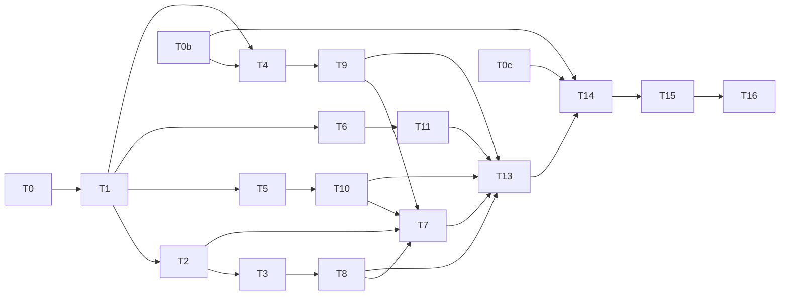

# KyberDash: Antigravity Tool and Skill Detail Views, and Copilot CLI System Prompt, Tools and Skills

**Status: Archived (2026-10-21).** Delivered on local branch `feat/kyberdash-agy-copilot-detail-views`.
Closeout, decision harvest, waivers and the owner gate are in §12. Nothing is pushed and no pull request
exists.

Revision 3 was approved on 2026-10-21 under A3
(`AUTONOMOUS_APPROVAL: approve-and-execute`). It corrects the Copilot CLI design (D23–D26) and
what the Antigravity reader can reach (D27, D28), based on the T0b and T0c evidence. It replaces
D10 and refines D19–D21.

The tasks it revises are T4, T9, T13, T14 and T16, and it adds the Todo proposals in §10. Every
other part keeps its A2 approval.

Execution is on branch `feat/kyberdash-agy-copilot-detail-views`. Progress is recorded in §11.
This plan is implementation authority.

Revision 2 applied the T0 corrections (D1–D5, D10, D11, D19) and added D20–D22. A2 approved it
after A1 lapsed.

The owner's approval to execute this plan stands. These corrections stay within the approved
scope.

- Development mode: `test-first`.
- Autonomy: `autonomous` (repository default, Config Reg `<autonomy>`).

---

## 1. Problem and Goal

### 1.1 Requests (owner)

1. **Antigravity (`agy`).** The skills and tools detail views show nothing, and the skills
   view is cluttered.
2. **GitHub Copilot CLI.** Sessions show no system prompt, no tools and no skills.

### 1.2 Goal

1. An Antigravity session read from a conversation store with a sibling
   `brain/<conversationId>/.system_generated/logs/transcript.jsonl` shows, per turn, the tools
   the model invoked and the skills it loaded.
   - Tool rows carry the name, the arguments, and the result where it can be paired.
   - Each turn is paired by the `last_step_index` rule in D4.
   - A session, or a call, with no transcript coverage states that invocations are not
     measurable. It never shows a measured 0.
2. The Antigravity skills view shows each listed skill with its `SKILL.md` description and a
   derived-token bar, without the turn-number list. This is already done and uncommitted
   (C1).
3. The Antigravity MCP tool catalogue (`<root>/mcp/<server>/<tool>.json`) appears as tool
   definitions offered to the model, not counted as resident context. A session with no
   catalogue states that tool definitions are not exported. It never shows an empty measured
   list.
4. A Copilot CLI session shows its root system prompt and the skills listed in its
   `<available_skills>` block, with descriptions. Both come from
   `~/.copilot/session-state/<id>/events.jsonl` and attach to the records the inspector
   actually renders: `data.db` session rows and shutdown rollups (D20). The session also
   shows the tools it invoked, with results (D10). Tool definitions stay not measurable, with
   a Copilot-CLI-specific reason.
5. All existing work for both asks lands on **one local branch**: the main checkout, two agent
   worktrees and one stopped branch. Nothing is pushed and no pull request is opened or
   updated without the owner.

No other harness changes behaviour.

---

## 2. Decisions

| ID | Question | Answer / decision | Mitigating and supporting information | Status / approval provenance |
|---|---|---|---|---|
| D1 | How is the existing work reconciled? | One local branch, `feat/kyberdash-agy-copilot-detail-views`, created in the main checkout from `main` at `6b30f533`. It carries the main checkout's uncommitted edits. Uncommitted work in each worktree is committed **in place on its own branch**, then cherry-picked onto the integration branch. Four sources, in this order: • **C1** — main checkout: the skill-description work (7 files plus `antigravity-skill-text.ts`). The plan files are committed separately. • **C2** — `worktree-agent-a70a652852dc16a9e`: the MCP catalogue reader (uncommitted). • **C3** — `feat/copilot-cli-system-prompt`: clean, two commits ahead, `06961940` and `28e45733` (the PR #406 review fixes). • **C4** — `claude/musing-swirles-a2efcb`: the transcript work (uncommitted). It adds `attachTranscriptActivity` (+17 lines) in `antigravity.ts`, `antigravity-transcript.ts` and its test, and `telemetry-inventory.md` edits. No push. PR #406 is neither updated nor closed. No worktree or branch is deleted. Cleanup, and whether this branch supersedes #406, are left to the owner. | User brief: "one branch; no push/PR without the owner". Committing in place keeps each source auditable; a patch export would silently lose untracked files. Expected textual conflicts: `telemetry-inventory.md` (C2, C3, C4) and `providers/antigravity.ts` (C4 against later tasks). T1 resolves the textual conflicts only. Behaviour is set by D4, D20 and T7–T10. | autonomous: decided from the user instruction plus T0(d); revision 2, approved 2026-10-21 (A2) |
| D2 | Redo or reuse the stopped Copilot CLI work? | Reuse C3. Its `readEventsJournal` (system prompt per agent, keyed by `messageId`) and its `pairingId: messageId` change on journal calls have **nothing to pair with**: no journal call reaches canon (T0(c)). T9 changes the reader's output to the D20 attachment and keeps the journal parsing. | User brief: "reuse, don't redo". T0(c): 0 of 5,605 journal `messageId`s exist as canon records. | autonomous: decided from the user instruction plus T0(c); revision 2, approved 2026-10-21 (A2) |
| D3 | Where do Antigravity tool and skill invocations come from? | `transcript.jsonl`, parsed by C4's `antigravity-transcript.ts`, which is reused and becomes the one transcript parser. • `PLANNER_RESPONSE.tool_calls[{name,args}]` give the calls. • `GENERIC` steps give the results where they can be paired (D4). • The provider puts invoked tool and skill **names** on the calls (`tools`, `skills`, so `kyber.skills.invoked`). • The reader puts `toolCalls` and `toolResults` on the turns (child `tool.invoke` records). The protobuf `steps.step_payload` is not used. | Plain JSON with a `step_index` per line, against a protobuf decoder. Reusing C4 avoids a second parser. C4's time-based attachment (`nearest`, `following`) is replaced by D4. | autonomous: low-confidence, no authoritative source — cheap to reverse; revision 2, approved 2026-10-21 (A2) |
| D4 | How are transcript steps paired with provider calls? | **`last_step_index` (lsi) is the last step the model saw as input.** • The model's own `PLANNER_RESPONSE` is at `lsi + 1`. • Call N owns the steps in `(lsi[N], lsi[N+1]]`. The last call's range is unbounded above. • lsi is read from the key/value attributes under `chatModel` field #20 (key `last_step_index`, a decimal-string value), through the existing `antigravitySqliteMetadataAttributes` decoder. • Top-level protobuf field #2 (packed varints) is **never** used. • The provider stamps `pairingId = agy-step:<lsi>` on each call. • The reader gets the lsi list through a helper exported from the provider module, so there is one decoder. It emits one turn per call with `nativeRecordId = agy-step:<lsi>` and declares `positionalPairingUnsafe`. • A call whose range lies before the transcript's first step gets **no parts**. A transcript can start mid-conversation. • Inside a range, a `GENERIC` step is a tool's result only when the range holds exactly one tool call. Otherwise the result is absent (status `unset`). | T0(a): 11 real sessions across `antigravity`, `antigravity-cli` and `antigravity-ide`. lsi is strictly increasing. `lsi + 1` is a `PLANNER_RESPONSE` in 100% of fully covered sessions. The step type at lsi itself varies by store version, so it is not asserted. The revision-1 rule, `(lsi[N-1], lsi[N]]`, gave each call its predecessor's tools. T2 includes a case that fails under that rule. `matchingTurns` (`dash/src/synth/provider.ts:176`) already pairs on `turnId ?? pairingId`. | autonomous: decided from T0(a) evidence; revision 2, approved 2026-10-21 (A2) |
| D5 | What counts as an Antigravity skill invocation? | A `view_file` tool call whose decoded `AbsolutePath` has the basename `SKILL.md`. • The skill name is the parent directory name, accepted only if it matches `^[\w.-]+$`. • The rule lives in `antigravity-transcript.ts` and fills `call.skills` for the owning call (D4). • A name need not appear in the `Active Skills` listing. | Read-only scan: 234 such calls across 157 of 666 transcripts. Argument values are JSON-encoded strings inside the args object, so they are decoded twice, and the fixtures reproduce this. The existing skills engine reads `kyber.skills.invoked`, so `skills.ts` needs no Antigravity predicate. | autonomous: low-confidence, no authoritative source — cheap to reverse; revision 2, approved 2026-10-21 (A2) |
| D6 | When are Antigravity skill invocations measured? | A call whose lsi range is covered by the transcript carries measured invocations. That includes a measured none (`kyber.skills.invoked: []`). A call without coverage carries nothing, and the session-level reason names the missing transcript. | Skills-view contract: "absent means not measured, `[]` is the measured none". `synthesizeCall` drops an empty `skills` array (`dash/src/synth/synth.ts:455`), so T10 keeps `[]` for Antigravity calls marked as transcript-covered, without changing other providers. | autonomous: decided from the documented skills-view contract; approved 2026-10-21 (A1), unchanged |
| D7 | How is the MCP catalogue kept from overstating residency? | Add an optional `resident?: false` to `ContentPart`. • The Antigravity reader sets it on catalogue `tool_definitions` parts. • Context composition and findings leave non-resident parts out of resident-token totals. • The catalogue is attached to the first turn only. • If T5 shows composition already ignores these parts, the RED step is recorded as "already holds". | Antigravity's prompt says MCP schemas are read on demand. Precedent: optional `role` on `ContentPart`, archived plan 2026-10-19 D21. | autonomous: decided from precedent; approved 2026-10-21 (A1), unchanged |
| D8 | How does a declared reader limit become measured when parts exist? | A content key listed in `READER_UNMEASURABLE` is lifted to measured **only on records whose paired reader turn carries parts of that key**. Other records keep a harness-specific reason. This covers Copilot CLI `system_prompt` (D20) and Antigravity `tool_definitions`. C2's removal of `tool_definitions` from Antigravity's declared limits is reverted in favour of this rule. | Fixes C2's caveat that a session without an MCP directory could read as a measured zero. Local to `measurabilityFor` and synthesis. | autonomous: low-confidence, no authoritative source — cheap to reverse; approved 2026-10-21 (A1), unchanged |
| D9 | Copilot CLI tool definitions? | Not measurable. Reason: "Copilot CLI session journals carry no tool schemas; the system prompt's `<tools>` section is usage guidance, not the offered tool set." | Brief diagnosis; comment in C3. | autonomous: decided from source evidence; approved 2026-10-21 (A1), unchanged |
| D10 | Copilot CLI tool invocations? | The reader builds `toolCalls` from `assistant.message.data.toolRequests` (`toolCallId`, `name`/`toolName`, `arguments`) and `toolResults` from `tool.execution_complete` on `data.toolCallId`. • Each call attaches to the session's canon record with the latest timestamp at or before the call's `assistant.message`. A call earlier than every record attaches to the earliest record. • Synthesis produces child `tool.invoke` records. | Read-only scan: 16,447 `tool.execution_*` events across 32 sessions, and `tool.execution_complete` carries `data.toolCallId`. T0(c): the session's records are `data.db` session rows and shutdown rollups, not one record per message, so the attachment is by time and is honest at session granularity. T0b records how many records each session has, and so how coarse the attachment is. Partly closes #211, for the CLI only. | autonomous: low-confidence, no authoritative source — cheap to reverse (reader-local); revision 2, approved 2026-10-21 (A2); **superseded by D25 (revision 3, approved 2026-10-21 under A3)** |
| D11 | Sessions sourced only from Antigravity status-line events? | **Closed as a non-goal.** The status-line events and the `StatusLinePayload`/`StatusLineEvent` types carry no `transcript_path`. No session exists only through status-line events. Revision 1's T12a and T12b are removed. | T0(b): 17 sessions have file records, and every one has a `.db`. | autonomous: decided from T0(b) evidence; revision 2, approved 2026-10-21 (A2) |
| D12 | Parser-contract invalidation? | Add `ANTIGRAVITY_PARSER_CONTRACT_VERSION = '2'` (provider `antigravity`) and `COPILOT_PARSER_CONTRACT_VERSION = '3'` (provider `copilot`, moved out of `SKILLS_CONTRACT_PROVIDER_NAMES`) in `dash/src/refresh/registry.ts`, each with a comment saying why. No key-shape change, so no `CACHE_VERSION` bump. | The ADR 0016 repair contract, and the in-file precedent. | autonomous: decided from ADR 0016 and in-file precedent; approved 2026-10-21 (A1), unchanged |
| D13 | The uncommitted `SKILL.md` description lookup? | Keep it: a serve-time lookup with a cache that lives as long as the process. Add the missing unit tests against a synthetic `HOME`. Residual: an edited description shows only after a restart. | Reads only `~/.gemini/{config,antigravity*}/skills/<name>/SKILL.md`, and rejects names outside `^[\w.-]+$`. | autonomous: low-confidence, no authoritative source — cheap to reverse; approved 2026-10-21 (A1), unchanged |
| D14 | Fixture and evidence policy? | Synthetic fixtures only. No real content is committed. Real-machine evidence is counts and shapes only, recorded in §3.5. | User brief. | autonomous: decided from the user instruction; approved 2026-10-21 (A1), unchanged |
| D15 | Mode and autonomy? | `development-mode: test-first`; `autonomy: autonomous`. | Packet inputs. | autonomous: packet input; approved 2026-10-21 (A1), unchanged |
| D16 | Which specialist runs the TypeScript tasks under `dash/src`? | The tasks name the **TypeScript** skill, which the conductor maps to `react-dev`. `.tsx` work also goes to `react-dev`, tests to `test-dev`, and documentation to `docs-dev`. | The squad has no dedicated TypeScript backend agent. | autonomous: low-confidence, no authoritative source — cheap to reverse; approved 2026-10-21 (A1), unchanged |
| D17 | Linux verification? | T13 runs all four dash gates with: `docker run --rm -v <repo>:/work -v /work/dash/node_modules -v /work/dash/web/node_modules -w /work/dash node:22-bookworm bash -lc "npm ci && (cd web && npm ci) && npm run typecheck && npm run lint && npm run test && npm run check:reachable"` Exit codes are recorded. | `engines.node >= 22.13.0`. The anonymous volumes keep the host's `node_modules` untouched. | autonomous: decided from the user instruction; approved 2026-10-21 (A1), unchanged |
| D18 | ADR? | None expected. The ADR waiver is anticipated: this refines the reader, synth and measurability layering under ADR 0009 and ADR 0016, and adds one optional field (D7). T16 confirms. | Plan index closeout policy. | autonomous: decided from the plan index closeout policy; approved 2026-10-21 (A1), unchanged |
| D19 | Antigravity sessions seen only through OTLP (the `gen_ai.skills` listing source)? | **This plan does not rely on a same-session-id join.** • OTLP sessions get no transcript-derived invocations; this is recorded as a residual. • T0c explains, read-only, why 9 OTLP sessions that have a `.db` on disk under the same id have no file records in canon. Possible causes: twin dedupe, never ingested, or a window or classification filter. • The answer is recorded in the inventory. • Any fix is proposed as a todo for the owner, not done here. | T0(e): 13 OTLP sessions, with `gen_ai.skills` on 20,712 of 20,712 records, and 17 file-record sessions. No session id appears in both sets. 9 of the 13 have a `.db` under the same id. | autonomous: decided from T0(e) evidence; revision 2, approved 2026-10-21 (A2); **refined by D27 (revision 3, approved 2026-10-21 under A3)** |
| D20 | How does the Copilot CLI system prompt reach the records the inspector renders? | **Attach, don't ingest.** • The Copilot CLI reader, called with the `data.db` path that `callsAndTurns` uses (`dash/src/synth/provider.ts` lines 142–147), resolves each session's `~/.copilot/session-state/<sessionId>/events.jsonl`. • It attaches the **root** agent's latest `system.message` as one `system_prompt` part to every canon record of that session: the `data.db` session rows and the shutdown rollups. Attachment is by session id, never by position. • Subagent prompts (`agentId` set) are not attached, because no subagent record exists. This is recorded as a residual. • Journal calls are **not** ingested as new records. • T0b first establishes whether the `events.jsonl` parser calls are never produced or produced and then dropped at ingest. The result is recorded in §3.5. • A defect found by T0b is proposed as a todo, not fixed here. | T0(c): 69 `copilot-cli` records (60 `data.db` session rows, 9 shutdown rollups), all with 0 parts. 0 of 5,605 journal `messageId`s exist as canon records. The inspector renders the `data.db` rows and the rollups. Ingesting journal calls would change the session's record set and its accounting (cost and token totals against the rollups). That is expensive to reverse and outside the owner's ask. Attaching is local to the reader and re-derives on the D12 bump. | autonomous: low-confidence, no authoritative source — cheap to reverse; the costly alternative was rejected; revision 2, approved 2026-10-21 (A2); **refined by D23 and D24 (revision 3, approved 2026-10-21 under A3)** |
| D21 | Copilot CLI skills? | The listing is measured from the attached root `system_prompt` through the existing `readSystemPromptListing` (`<available_skills>`). Invocations stay as today: the provider extracts them from `toolRequests` on journal calls, which do not reach canon. They therefore stay not measurable, and the inventory says why. | Follows D20. Changing the invocation source would mean ingesting journal calls, which D20 rejected. | autonomous: decided as a consequence of D20; revision 2, approved 2026-10-21 (A2); **reason text refined by D26 (revision 3, approved 2026-10-21 under A3)** |
| D22 | How does C4's time-based transcript attachment relate to D4? | T7 replaces `attachTranscriptActivity`'s `nearest`/`following` time attachment with the D4 lsi rule, and keeps C4's transcript parsing in `antigravity-transcript.ts`. C4's own tests that assert the time behaviour are rewritten to D4. That rewrites C4's tests, not this plan's approved Test contract. | T0(d). | autonomous: decided from T0(a) and T0(d) evidence; revision 2, approved 2026-10-21 (A2) |
| A1 | Approve and execute (revision 1)? | Approved, then lapsed: on 2026-10-21 the T0 evidence returned the plan to Draft. | `AUTONOMOUS_APPROVAL: approve-and-execute`, relayed by the conductor. The owner approved execution in chat. | autonomous: recommendation accepted (AUTONOMOUS_APPROVAL: approve-and-execute); owner approved execution in chat, relayed by the conductor 2026-10-21; lapsed on return to Draft |
| A2 | Approve and execute (revision 2)? | Approved. The plan is Ready and is implementation authority. | Revision 2 corrects the plan from the T0 evidence, within the scope the owner already approved. `docs validate .` and `docs drift .` on revision 2 returned no findings (conductor's worker). | autonomous: recommendation accepted (AUTONOMOUS_APPROVAL: approve-and-execute); owner approved execution in chat, relayed by the conductor; revision 2 is a T0-evidence correction (2026-10-21). Still covers every row it approved, except where D23–D28 refine or supersede a row |
| D23 | What do the Copilot CLI records the UI lists actually hold, and what does the system prompt attach to? | The root `system.message`, the one with no `agentId`, is attached as one `system_prompt` part to **every** canon record of the session: the session-store placeholder rows and the shutdown rollups. Matching is by `session_id` equal to the `session-state` directory name, exact match only. Non-UUID entries are never matched by prefix: `.session-operation-locks`, `pending-session:<uuid>`, `pending-session:draft:<uuid>`. Which records the UI lists depends on the refresh window (wording corrected after T13; behaviour unchanged). In a narrow window, the session-store unit's window-sliced envelopes are empty and it yields one placeholder row per session (model `unknown`, $0, key `copilot:<id>:<id>`). T13 saw this with 6 weeks: 60 placeholders plus 9 rollups; 29 placeholders carried the prompt as measured and 31 were not measurable with the Copilot CLI reason. In a wider window, the same unit yields per-request rows, each carrying the root prompt; T13 saw 2,439 with 8 weeks. The attachment rule does not change: every canon record of the session gets the root prompt. The inventory states this plainly. A session with no `events.jsonl` keeps its records with no parts and the D9 or D21 reasons. The reader runs on two kinds of unit. On the `session-store.db` unit it resolves each session's journal. On an `events.jsonl` unit with rollup calls it uses that journal. `matchingTurns` pairs each turn at most once, so T9 either yields one turn per record, keyed by a `pairingId` T9 stamps on these calls, or adds the smallest session-scoped attach. T9 chooses whichever is the smaller change that passes T4. | T0b: 69 records. 60 are session-store placeholder rows that skip `sliceCallsToWindow`; 9 are shutdown rollups from 3 sessions. There are 0 per-message records. All 63 canon session ids match a `session-state` directory. 31 of the 60 store sessions have an `events.jsonl`. `data.db` (3 rows) is never discovered. 1,138 of the 1,784 messages that could be yielded are subagent messages, and no subagent record exists. | autonomous: decided from T0b evidence; revision 3, approved 2026-10-21 (A3) |
| D24 | The masking defect: an empty `events.jsonl` load opened as SQLite? | This is a minimal prerequisite fix inside T9. In `callsAndTurns` (`dash/src/synth/provider.ts:142-147`), the `copilot`/`copilot-cli` empty-load fallback to `loadCopilotCliCalls` runs only when `load.filePath` ends in `.db`. For any other path, calls stay `[]` and the content reader still runs. Nothing else changes: not the claude fallback, not the parse windows, not the `outputTokens` default. | T0b: `orchestrator.ts:467-470` ingests empty units (`calls: []`, `filePath = events.jsonl`). The fallback opens that file as SQLite, raising 31 `file is not a database` `PROVIDER_PARSE_ERROR`s, and it throws **before** the content reader runs. A suffix test is the smallest deterministic change; both real stores end in `.db`. A header sniff was considered and rejected as more I/O for no case seen. Accounting is unchanged: an empty journal unit still produces no records. | autonomous: low-confidence, no authoritative source — cheap to reverse (one condition); revision 3, approved 2026-10-21 (A3) |
| D25 | Copilot CLI tool invocations, given the real record set (supersedes D10)? | Tool calls are read from the journal directly, so they do not depend on the skipped `assistant.message` calls. They come from `toolRequests` (`toolCallId`, `name`/`toolName`, `arguments`), with results from `tool.execution_complete` joined on `toolCallId`. They attach at **session granularity**: as child `tool.invoke` records of the session's placeholder row, or of its earliest rollup when the session has no placeholder row. They never go per rollup leg. Subagent calls are included, tagged with their `agentId` in a raw attribute. The inspector labels the list "session-level: Copilot CLI records are not per message". | T0b: no session has per-message records. 3 sessions have rollups and the rest have one placeholder row each, so attaching by time across records would look like precision the data does not have. Per-message tool attachment is a residual that depends on the outputTokens todo (TP1). | autonomous: low-confidence, no authoritative source — cheap to reverse (reader-local); revision 3, approved 2026-10-21 (A3) |
| D26 | The Copilot CLI skill-invocation reason (refines D21)? | Reason: "Copilot CLI skill invocations are read from per-message journal calls, which are not ingested for this session (journal assistant messages lack outputTokens or fall outside the refresh window)." The listing stays measured from the attached prompt. | T0b, cause (1). | autonomous: decided from T0b evidence; revision 3, approved 2026-10-21 (A3) |
| D27 | What the Antigravity transcript reader can reach (refines D19)? | The reader reaches **file-based** sessions only. That means up to 8 of the 13 OTLP-only sessions, and only after a correct `antigravity-cli` import. The ninth has an empty db and no transcript, and 4 sessions have a slug `gen_ai.session.id` with no conversation or brain directory, so they cannot be joined. OTLP records stay harness `antigravity`, by design (`measurability.ts:243`, architecture #195). File records of the CLI root are harness `antigravity-cli`. Whether the session view joins the two labels on one `session_id` is **unverified**. T13 checks it on the smoke run and reports the result; it is not fixed here. The causes are recorded as todo proposals TP4–TP7. | T0c: 0 canon `antigravity-cli`/`-ide` records or checkpoints for the 9. One folder pass since the clean, with `history_weeks=1` and only the `antigravity` descriptor run. `resolveHarnessScope` (`refresh/registry.ts` ~643-683) checks `descriptorFor(id)` before family expansion. The web picker offers only harnesses that already hold samples (`MaintenancePanel.tsx:185,311-329`). Twin dedupe, discovery or `-wal`, and parse failures were all ruled out. | autonomous: decided from T0c evidence; revision 3, approved 2026-10-21 (A3) |
| D28 | The T13 smoke import? | The scratch smoke run imports the `antigravity-cli` root **explicitly**, by descriptor id `antigravity-cli` with `--history-weeks` wide enough to cover the chosen session. It must not rely on `--harness antigravity`. It also imports `copilot-cli`. It writes only a scratch cache dir and a scratch canon db. | T0c family-scope finding (TP4). | autonomous: decided from T0c evidence; revision 3, approved 2026-10-21 (A3) |
| D29 | Do `tool.invoke` children inherit a parent's lifted measurability? | No. Under D8 a child has no paired reader turn. For the lift harnesses (`copilot-cli`, `antigravity`, `antigravity-cli`, `antigravity-ide`), a key declared not measurable is measured on a child only where the child itself carries it (`tool_result_content` when the result has content). Otherwise the child keeps the declared reason. All other keys, and all other harnesses, inherit from the parent as before. Measurability is stamped at ingest, and the 14-day content purge does not re-derive it: a record shown as measured with null `parts_json` means the content was measured and then purged. | The T13 smoke run found tool children shown as measured without the part: 5,390 Copilot CLI tool records, 476 `antigravity-cli` tool records, and 6,257 children of 29 carrier placeholder rows in the 6-week run. The inheritance predates this branch (main `synth.ts:813`); it became wrong only once the per-record lift existed. | autonomous: defect fix within approved D8 (A3 scope); decided from the T13 diagnosis |
| D30 | How are Antigravity skill invocations shown when only part of a session is covered by the transcript? | The provider is the single source of coverage. A call inside a covered lsi range carries `skills: []` or the names it read. A call outside any range carries no `skills`. Synthesis keeps the array, including `[]`, for the Antigravity family whatever the reader turn says. In the per-turn and session views, an Antigravity turn whose record carries no key is not measured, never measured none. When some turns of a session are covered and some are not, the skills view stays measured over the covered turns and carries the optional `invocationsCoverage: { measuredTurns, totalTurns }`. The Skills panel then shows "Invocations measured on X of Y turns". Other harnesses are unchanged. | The T14 docs check found that D6 was not realized end to end. `attachTranscriptActivity` deleted `[]`, so covered sessions showed "not measurable". Separately, `invokedByTurnOf` gave `[]` to uncovered turns once any record carried the key. The reader turn is not a proof of coverage, because the catalogue turn pairs with the first call even when that call is uncovered. The provider assertions pinned to `undefined` are corrected to `[]` to match T3(b). | autonomous: defect fix within approved D6 (A3 scope); the additive optional field is cheap to reverse and display-only |
| A3 | Approve and execute (revision 3)? | Approved. The plan is Ready. | Revision 3 corrects the Copilot CLI design to the T0b evidence and the Antigravity reach to the T0c evidence. It is the same ask, within the scope the owner approved. Affected tasks: T4, T9, T13, T14, T16. T1, T2, T3, T5, T6, T7, T8, T10 and T11 keep their A2 approval. | autonomous: recommendation accepted (AUTONOMOUS_APPROVAL: approve-and-execute); owner approved execution in chat, relayed by the conductor; revision 3 is a T0b/T0c-evidence correction (2026-10-21). `docs validate .` and `docs drift .` on revision 3: no findings |

There is no impactful escalation. D20 rejects the one costly option, ingesting journal calls,
and takes the reader-local alternative, which is cheap to reverse.

---

## 3. Investigation Findings

### 3.1 Antigravity (verified)

- The provider `dash/src/providers/antigravity.ts` builds calls from SQLite `gen_metadata`
  (`buildCallFromSqliteGenMetadataRow`), from `.pb` files or the live server, and from the
  status-line journal. Every one of these paths sets `tools: []`.
  `antigravitySqliteMetadataAttributes` already decodes `chatModel` field #20, where the lsi
  lives.
- `PROVIDER_READERS` (`dash/src/synth/provider.ts:101`) has no Antigravity reader on `main`.
  C2 adds one.
- Transcript shape:
  - `PLANNER_RESPONSE` steps carry `tool_calls[{name,args}]`, with JSON-encoded string
    argument values.
  - Token fields appear in 255 of the 666 transcripts.
  - `view_file` of a `SKILL.md` appears 234 times across 157 files.
- `skills.ts` reads Antigravity listings from `gen_ai.skills`, and invocations only from
  `Skill` tool records or `kyber.skills.invoked`.

### 3.2 Copilot CLI (verified)

- On `main`, `copilotCliReader` yields nothing. `callsAndTurns` falls back to
  `loadCopilotCliCalls` (`data.db` `sessions` rows, key `copilot:<sid>:<id>`) when the parser
  yields no calls.
- `READER_UNMEASURABLE` `copilot` declares every content key not measurable.
- Real `events.jsonl`:
  - 418 `system.message` events across 32 sessions.
  - `agentId` is a top-level field.
  - `tool.execution_complete` carries `data.toolCallId`.

### 3.3 Existing work to reconcile (T0(d))

| Source | Location / branch | State | Content |
|---|---|---|---|
| C1 | main checkout, `main` at `6b30f533` | uncommitted | 7 files plus `dash/src/canon/antigravity-skill-text.ts`: the `SKILL.md` descriptions, the `SkillsPanel` description and token bar, the drawer fallback, `kyberApi.ts`, and tests. The plan files sit beside them and are committed separately. |
| C2 | `.claude/worktrees/agent-a70a652852dc16a9e`, branch `worktree-agent-a70a652852dc16a9e` | uncommitted | MCP catalogue reader, registration, Antigravity measurability row, "does not export tool definitions" notice, inventory section |
| C3 | `/Users/dave/git/claude-worktree/kyber-weave/sleepy-greider-7c478b`, branch `feat/copilot-cli-system-prompt` | clean, 2 commits: `06961940`, `28e45733` (PR #406 review fixes) | `readEventsJournal`, `pairingId: messageId`, tests, inventory line |
| C4 | `/Users/dave/git/claude-worktree/kyber-weave/musing-swirles-a2efcb`, branch `claude/musing-swirles-a2efcb` | uncommitted | `antigravity.ts` (+17 lines, `attachTranscriptActivity`, time-based), `antigravity-transcript.ts` and its test, `telemetry-inventory.md` |

The other worktrees are unrelated and are not touched.

### 3.4 Discovery

- **Revision 1:** codegraph 5, docs 6, direct reads 26. Reasons: the architect references and
  `AGENTS.md`; the plan index and template; `.git` metadata read because there was no shell;
  worktree files outside the index; and narrow confirmations of the `tools: []` sites, the
  fixture `last_step_index`, the contract versions and the inventory rows.
- **Revision 2:** 1 direct read of this plan's Decisions section, for the rewrite. The T0
  evidence was gathered by the conductor's worker, read-only and as counts only.
- **Self-gathered work:** counts-only greps over `~/.gemini` and `~/.copilot`. No
  `research-agent` was used.

### 3.5 T0 evidence (counts and shapes only; conductor's worker, 2026-10-21)

- **(a) lsi.**
  - Where it is: a key/value attribute under `chatModel` field #20 (key `last_step_index`, a
    decimal-string value). The fixture `gen-metadata.json` holds `"2"`.
  - What it means: it is the last step given to the model as input. The model's
    `PLANNER_RESPONSE` is at `lsi + 1`.
  - Sample: 11 real sessions across `antigravity`, `antigravity-cli` and `antigravity-ide`.
  - In every session lsi is strictly increasing, and `lsi + 1` is a `PLANNER_RESPONSE` in 100%
    of the fully covered sessions.
  - Some transcripts start mid-conversation (for example at step 674). Calls before the first
    transcript step must get no parts.
  - The step type at lsi varies by store version.
  - Top-level protobuf field #2 (packed varints) must not be used.
  - The revision-1 rule was off by one: each call received its predecessor's tool calls.
- **(b) Status line.** No `transcript_path` on status-line events or in the
  `StatusLinePayload`/`StatusLineEvent` types. No session exists only through status-line
  events. All 17 sessions with file records have a `.db`.
- **(c) Copilot CLI.**
  - Canon holds 69 `copilot-cli` records, all with 0 parts. T0b corrected the source of 60 of
    them: they are `session-store.db` `sessions` placeholder rows, not `data.db` rows. The
    other 9 are shutdown rollups from 3 sessions.
  - 0 of 5,605 journal `messageId`s exist as canon records.
  - The inspector renders the placeholder rows and the rollups.
- **(c, T0b) Copilot CLI trace.** Verdict: journal calls are **never produced**. They are not
  dropped at ingest, and the parser version is not stale.
  1. `providers/copilot.ts:1028` defaults `outputTokens` to 0. `:1035` then skips the
     `assistant.message` (`!isTranscript && outputTokens === 0`). From CLI 1.0.81 onward the
     field is absent, which accounts for 3,821 of the 5,605 messages. The other 1,784 are
     dated 2026-06-01 to 2026-09-02. `source-reader.ts:232` `sliceCallsToWindow` drops them,
     because the window is 2026-10-11 to 10-18.
  2. Masking defect: `orchestrator.ts:467-470` ingests empty units with `calls: []` and
     `filePath = events.jsonl`. `synth/provider.ts:143-144` sends every empty
     `copilot`/`copilot-cli` load to `loadCopilotCliCalls(load.filePath)`, which opens the
     journal as SQLite. That produced 31 `file is not a database` `PROVIDER_PARSE_ERROR`s,
     each thrown before the content reader runs.
  3. On the `session-store.db` unit, `sessions` has 60 rows. Its columns are `id`, `cwd`,
     `repository` and so on, with no model or token columns. Those rows become the 60
     placeholder records: model `unknown`, $0, key `copilot:<id>:<id>`, outside window
     slicing.
     - Correction after T13: this record set holds only for a narrow refresh window. With a
       6-week window it was 60 placeholders plus 9 rollups. With an 8-week window the same
       unit yields per-request rows instead (2,439 in T13), each carrying the root prompt
       (D23).
  4. `data.db` (3 rows) is never discovered.
  - Session join:
    - `records.session_id` equals the `session-state` directory name, and is also in
      `trace_id` `synth:copilot-cli:<sid>`.
    - All 63 canon session ids match a directory.
    - 31 of the 60 store sessions have an `events.jsonl`.
    - 11 entries are non-UUID: `.session-operation-locks`, `pending-session:<uuid>` and
      `pending-session:draft:<uuid>`. These require an exact match, never a prefix match.
    - Only the root `system.message` (no `agentId`) is used. 1,138 of the 1,784 messages that
      could be yielded are subagent messages.
- **(d) Git.** See §3.3.
- **(e) OTLP and file records.**
  - 13 OTLP Antigravity sessions, with `gen_ai.skills` on 20,712 of 20,712 records.
  - 17 file-record sessions.
  - 0 session ids in common.
  - 9 of the 13 OTLP sessions have a conversation `.db` on disk under the same id, but canon
    has no file records for them. The reason is unknown; T0c owns it.
- **(e, T0c) Antigravity OTLP gap.**
  - Of the 13 OTLP-only sessions, 9 have conversation dbs under
    `~/.gemini/antigravity-cli/conversations`. 8 of those have `gen_metadata` rows and
    transcripts; 1 is empty, with no transcript.
  - Canon has **zero** `antigravity-cli` or `-ide` records, and zero checkpoints, for any of
    the 9.
  - Only one folder pass has run since the clean: `refresh_run` 2026-10-18T14:20Z, trigger
    cli, `history_weeks=1`. It ran 9 source jobs: antigravity 1, claude 3, copilot 4, pi 1.
  - `resolveHarnessScope` (`refresh/registry.ts` ~643-683) checks `descriptorFor(id)` before
    expanding the family. As a result, `--harness antigravity` resolves only the
    `~/.gemini/antigravity` descriptor and never `-cli` or `-ide`. The claude and copilot
    families do not have this problem.
  - The web import picker offers only harnesses that already hold samples
    (`MaintenancePanel.tsx:185,311-329`).
  - The other 4 sessions have a slug `gen_ai.session.id`, equal to
    `copilot_chat.chat_session_id`, with no conversation id and no brain dir. They cannot be
    joined.
  - OTLP records are harness `antigravity` by design; file records of the CLI root are
    `antigravity-cli`. Whether the session view joins the two labels on one `session_id` is
    unverified.
  - Ruled out as causes: twin dedupe, discovery or `-wal`, and parse failures. The
    `immutable=1` fallback exists (`ingest/sqlite.ts:403-443`).

---

## 4. Test Contract (test-first)

The runner root is `/Users/dave/git/personal/claude/kyber-weave/dash`. Every fixture is
synthetic (D14).

Tests assert observable output:

- reader turns;
- canonical records;
- measurability;
- the skills view;
- rendered HTML.

Weakening any assertion to reach GREEN is a scope change, and it returns this plan to Draft.

| Task | Test project or file | Runner command | Observable behavior | RED evidence required | GREEN acceptance |
|---|---|---|---|---|---|
| T0 | none (evidence task) | read-only | §3.5 (a)–(e) | n/a: no-test task, replaced by §3.5 | **Met** (§3.5) |
| T0b | none (trace task) | read-only, against a scratch copy of the store and a synthetic `HOME`; nothing is written to `~/.kyberdash` | Traces one real Copilot CLI session through discovery (`sourceType: 'jsonl'`), `createJsonlParser` and `callsAndTurns`. Records whether the journal calls are never produced, or produced and then dropped, and where. Records how many canon records each session has (input to D10). Written to §3.5 (c) | n/a: no-test task, replaced by the §3.5 note | **Met** (§3.5 c, T0b). Defects are TP1–TP3 |
| T0c | none (trace task) | read-only, as T0b | For the 9 OTLP sessions that have a `.db` on disk and no file records, finds the cause: twin dedupe, never discovered, a window filter, or classification. Written to §3.5 (e) | n/a: no-test task, replaced by the §3.5 note | **Met** (§3.5 e, T0c). Findings are TP4–TP7 |
| T1 | none (integration task) | `git log --oneline main..HEAD`, then the four dash gates | One branch holds C1–C4 per D1. A baseline gate run is recorded | n/a: no-test task, replaced by the commit list and gate log | Branch exists with C1–C4. No push. PR #406 untouched. Baseline recorded |
| T2 | `src/providers/antigravity-transcript.test.ts` (from C4), `src/providers/antigravity.test.ts`, `src/synth/readers/antigravity.test.ts`, new `tests/fixtures/antigravity-transcript/` | `npx vitest run src/providers/antigravity-transcript.test.ts src/providers/antigravity.test.ts src/synth/readers/antigravity.test.ts` | See the four cases below this table | (a) and (b) fail on the reconciled branch: no `pairingId`, and the C4 time rule gives other results. (c) and (d) fail where not implemented. C4's time-rule assertions are rewritten to D4 (D22) | Pass unmodified. The existing Antigravity suites pass |
| T3 | `src/providers/antigravity-transcript.test.ts` (skill cases), `src/canon/skills.test.ts`, new `src/canon/antigravity-skill-text.test.ts` | `npx vitest run src/providers/antigravity-transcript.test.ts src/canon/skills.test.ts src/canon/antigravity-skill-text.test.ts` | (a) A `view_file` with double-encoded `AbsolutePath` `/x/skills/alpha/SKILL.md` in call N's range puts `alpha` in call N's `skills`. A `README.md` puts nothing, and neither does a parent name outside `^[\w.-]+$`. (b) Through the skills view on synthetic records: covered calls with no skill load give a measured 0. A session with no covered call is not measurable, with the transcript reason. Other harnesses are unchanged. (c) `skillDescriptionOf` handles inline, quoted, folded and absent descriptions. `antigravitySkillDescription` resolves under a synthetic `HOME` and returns undefined for a missing skill and for `../x` | (a) and (b) fail. (c) may pass at once and is then recorded as characterization of the D13 code, not as RED | Pass unmodified |
| T4 | `src/synth/readers/copilot.test.ts`, `src/synth/provider.test.ts` | `npx vitest run src/synth/readers/copilot.test.ts src/synth/provider.test.ts` | **Revision 3 (D23–D26).** Synthetic fixtures: • a `session-store.db` with `sessions` rows (`id`, `cwd`, `repository`; no model or token columns) for sessions S1, S2 and S3; • `session-state/S1/events.jsonl`: root `system.message` with `<available_skills>`, a subagent `system.message`, `assistant.message` events **without** `outputTokens` carrying `toolRequests` (one with `agentId`), and `tool.execution_complete` for all but one call; • `session-state/S4/events.jsonl`: a shutdown rollup and a root prompt, with no store row; • no journal for S2; • `session-state/pending-session:S3/` holding a journal. Through `ingestProviders`: (a) S1's placeholder record carries exactly the root `system_prompt` part, and no record carries the subagent prompt. S4's rollup records each carry S4's root prompt (D23). (b) `readListingOf` on those records gives a measured listing with names and descriptions. Skill invocations are not measurable, with the D26 reason. (c) S1's child `tool.invoke` records hang off its placeholder record, and S4's off its earliest rollup. Results are joined on `toolCallId`; the result is absent where there is no complete event. The subagent call carries its `agentId` attribute. No tool record attaches per rollup leg (D25). (d) S2's records have no parts. (e) S3 is not matched from `pending-session:S3` (exact match only), and no journal attaches to another session. (f) **D24:** an empty `copilot-cli` load whose `filePath` is `events.jsonl` produces no `PROVIDER_PARSE_ERROR` and runs the content reader. An empty load whose `filePath` ends in `.db` still uses `loadCopilotCliCalls`. Record counts and costs equal those on the pre-change branch for the same fixtures (accounting unchanged). C3's per-message assertions are rewritten to D23. | (a)–(e) fail: the reader yields nothing for a store path. (f) fails: `file is not a database` | Pass unmodified |
| T5 | `src/canon/measurability.test.ts`, `src/synth/synth.test.ts`, `src/analysis/context.test.ts`, `src/refresh/registry.test.ts` | `npx vitest run src/canon/measurability.test.ts src/synth/synth.test.ts src/analysis/context.test.ts src/refresh/registry.test.ts` | (a) D8 lift: Copilot CLI `system_prompt` is measured only on records with the part, and Antigravity `tool_definitions` only on records with catalogue parts. Other records keep the harness reasons (D9; "does not export tool definitions"). (b) D7: `resident: false` parts add no resident tokens and are reported as offered. (c) D6: covered Antigravity calls keep `kyber.skills.invoked: []`, while other providers still drop an empty `skills`. (d) D12: version `'2'` for `antigravity` and `'3'` for `copilot`; others unchanged | All fail on the reconciled branch | Pass unmodified. The full suites pass |
| T6 | `web/src/components/{AgentSessionDashboard,SessionInspectorDrawer,SkillsPanel}.test.tsx` | `npx vitest run web/src/components/AgentSessionDashboard.test.tsx web/src/components/SessionInspectorDrawer.test.tsx web/src/components/SkillsPanel.test.tsx` | Synthetic payloads: • Antigravity: invoked tools appear with counts and previews. Skills show their invocation count, or the reason it is not measurable, beside the description and token bar, with no turn-number list. MCP catalogue tools are labelled "offered (MCP catalogue)". • Copilot CLI: the system-prompt tab shows the root prompt. The tool-definitions area shows the D9 reason. The skills panel shows the listing, and the D21 reason for invocations | Fails where the UI does not render the new fields | Pass unmodified |
| T7 | T2 files | as T2 | as T2 | consumes T2 RED | T2 GREEN |
| T8 | T3 files | as T3 | as T3 | consumes T3 RED | T3 GREEN |
| T9 | T4 files | as T4 | as T4 | consumes T4 RED | T4 GREEN |
| T10 | T5 files | as T5 | as T5 | consumes T5 RED | T5 GREEN |
| T11 | T6 files | as T6 | as T6 | consumes T6 RED | T6 GREEN |
| T13 | whole `dash` suite | the four dash gates on macOS, then the D17 docker command | Green on both platforms, or each failure shown to pre-date the change (T1 baseline) | n/a: verification task | Exit 0, or a disclosed failure that pre-dates the change |
| T14 | none (documentation) | `dotnet run --project src/KyberWeave.Cli -- docs validate .`, then `-- docs drift .` | The docs describe the shipped contract | n/a: documentation task | Zero findings |
| T15 | none (review) | `code-reviewer` over `main..HEAD` | Council verdict | n/a | APPROVE, or the findings are fixed and re-audited |
| T16 | none (closeout) | `docs validate . --merge-ready`, `docs drift .` | Archived and harvested | n/a | Zero findings |

**T2 observable behavior.** The fixture is a synthetic `.db` with three `gen_metadata` rows,
lsi 2, 5 and 8, and a transcript with steps 0–10. The `PLANNER_RESPONSE` steps are at 3, 6
and 9, each with a **distinct** tool: `tool_a` (step 3), `tool_b` (step 6), `tool_c` (step
9). The `GENERIC` results are at 4, 7 and 10.

- **(a) Pairing** (`pairingId` `agy-step:2`, `agy-step:5`, `agy-step:8`):
  - call lsi 2 owns `tool_a`, with result step 4;
  - call lsi 5 owns `tool_b`;
  - call lsi 8 owns `tool_c`, so the last call's range is unbounded above.
  - The revision-1 rule would give lsi 5 `tool_a` and give lsi 2 nothing, so these
    assertions fail under it.
- **(b) Mid-conversation transcript.** A second fixture's transcript starts at step 6. The
  call with lsi 2 gets **no** parts and no invocations. The call with lsi 5 owns `tool_b`.
  No positional fallback applies.
- **(c) Results and decoding.** A range with two tool calls leaves both results absent.
  Double-encoded arguments are decoded. An unparseable line is skipped without throwing.
- **(d) End to end.** Through `ingestProviders`: the child `tool.invoke` records sit under
  the right parents. Calls carry `tools` names. The MCP catalogue is still on the first turn
  with `resident: false`. A `.db` with no transcript gives no invocation turns.

---

## 5. Tasks

Every developer task ends with the worker's own `task-gate` run. A failing gate goes back to
the same worker.

| ID | Objective | Files / symbols | Acceptance | Depends on | Required skills |
|---|---|---|---|---|---|
| T0 | Evidence | — | **Complete** (§3.5) | — | — |
| T0b | Copilot CLI ingest trace (D20) | read-only; this plan §3.5 (c) | T0b row | — | TypeScript (investigation) |
| T0c | Trace of the OTLP sessions that have a `.db` but no file records (D19) | read-only; this plan §3.5 (e) | T0c row | — | TypeScript (investigation) |
| T1 | Reconcile C1–C4 per D1. Commit in place; cherry-pick `06961940` and `28e45733`; commit C4 in place and cherry-pick it. Resolve textual conflicts only. Record a baseline gate run. No push, no deletion, PR #406 untouched | git; files per §3.3 | T1 row | T0 | git, TypeScript |
| T2 | RED: Antigravity lsi pairing, transcript reader and fixtures | `dash/src/providers/antigravity-transcript.test.ts`, `dash/src/providers/antigravity.test.ts`, `dash/src/synth/readers/antigravity.test.ts`, `dash/tests/fixtures/antigravity-transcript/**` (new, README states synthetic) | T2 RED | T1 | test-dev, Vitest |
| T3 | RED: Antigravity skill detection, measured-none in the skills view, skill-text tests | `dash/src/providers/antigravity-transcript.test.ts` (skill cases only; coordinate with T2 on this shared file, or run T2 and T3 in sequence on it), `dash/src/canon/skills.test.ts`, `dash/src/canon/antigravity-skill-text.test.ts` (new) | T3 RED | T1, T2 (shared test file) | test-dev, Vitest |
| T4 | RED, revision 3: Copilot CLI attachment, listing, session-level tools and the D24 masking fix (D23–D26) | `dash/src/synth/readers/copilot.test.ts`, `dash/src/synth/provider.test.ts` | T4 RED | T1, T0b | test-dev, Vitest |
| T5 | RED: measurability lift, residency, measured-none, versions | `dash/src/canon/measurability.test.ts`, `dash/src/synth/synth.test.ts`, `dash/src/analysis/context.test.ts`, `dash/src/refresh/registry.test.ts` | T5 RED | T1 | test-dev, Vitest |
| T6 | RED: web rendering | `dash/web/src/components/{AgentSessionDashboard,SessionInspectorDrawer,SkillsPanel}.test.tsx` | T6 RED | T1 | test-dev, Vitest, React |
| T7 | GREEN: D4 and D22, plus the D3 provider and reader halves. Provider: read lsi through `antigravitySqliteMetadataAttributes` (field #20 only), stamp `pairingId`, export the lsi helper, replace C4's time attachment in `attachTranscriptActivity` with D4 ranges filling `tools` and `skills` (via the T8 detector), and mark calls as transcript-covered. Reader: emit lsi-keyed turns with `toolCalls` and `toolResults`; keep the first-turn catalogue with `resident: false`; declare `positionalPairingUnsafe` | `dash/src/providers/antigravity.ts`, `dash/src/providers/antigravity-transcript.ts` (range parsing), `dash/src/synth/readers/antigravity.ts`, `dash/src/synth/provider.ts` (`PROVIDER_READERS`, pairing-unsafe flag) | T2 GREEN | T2, T8, T10, T9 (T9 edits `synth/provider.ts` first) | TypeScript |
| T8 | GREEN: the D5 skill-load detector in the transcript module; `antigravity-skill-text.ts` only if T3(c) finds a defect | `dash/src/providers/antigravity-transcript.ts` (skill detector, exported), `dash/src/canon/antigravity-skill-text.ts` | T3 GREEN (a, c); T3(b) after T7 and T10 | T3 | TypeScript |
| T9 | GREEN, revision 3. **Step 1, the prerequisite D24 fix:** the empty-load fallback in `callsAndTurns` runs only for a `.db` path. Nothing else in accounting changes. **Step 2, D23:** the reader resolves the journal by exact session id from both a `session-store.db` unit and an `events.jsonl` unit. It attaches the root prompt to every record of the session (placeholder rows and rollups), using one turn per record keyed by a `pairingId` stamped in `loadCopilotCliCalls` and on the rollup calls, or the smallest session-scoped attach. **Step 3, D25:** tool calls and results attach at session granularity. **Step 4, D26:** the reason text. C3's journal parsing is kept and its unused per-message turns are removed. The `outputTokens` default and the window are **not** touched (TP1, TP2) | `dash/src/synth/provider.ts` (`callsAndTurns`, around `:142-147`), `dash/src/synth/readers/copilot.ts` (`copilotCliReader`, `readEventsJournal`, `loadCopilotCliCalls`), `dash/src/providers/copilot.ts` (only the rollup-call `pairingId`, if that route is chosen) | T4 GREEN | T4 | TypeScript |
| T10 | GREEN: D7 `ContentPart.resident`; D8 lift, with C2's Antigravity row restored and harness reasons (D9, the Antigravity reason, and D21's invocation reason); D6 measured-none for covered Antigravity calls; D12 versions | `dash/src/canon/types.ts`, `dash/src/canon/measurability.ts`, `dash/src/synth/synth.ts` (`synthesizeCall`, around `:455`), `dash/src/analysis/context.ts`, `dash/src/refresh/registry.ts` | T5 GREEN | T5 | TypeScript |
| T11 | GREEN: web rendering only, under the display-layer rule | `dash/web/src/components/AgentSessionDashboard.tsx`, `SessionInspectorDrawer.tsx`, `SkillsPanel.tsx`, `dash/web/src/lib/kyberApi.ts` | T6 GREEN; `display-layer.test.ts` passes | T6 | react-dev, React |
| T13 | Full dash gates on macOS and Linux (D17). Read-only smoke run against a **scratch** cache dir and canon db, never `~/.kyberdash/canon.db`. It imports `antigravity-cli` **explicitly** by descriptor id, plus `copilot-cli`, with `--history-weeks` wide enough (D28). Confirm, with counts only: (1) one real `antigravity-cli` session shows lsi-paired tools and skills; (2) how many of the 8 transcript-bearing OTLP sessions gain file records, and whether the session view joins `antigravity` and `antigravity-cli` on one `session_id`. Report this as a finding (TP7), not a pass condition; (3) one Copilot CLI session with a journal shows the root prompt and listing on its placeholder row, and session-level tools; (4) no `file is not a database` problem is recorded | none edited | T13 row | T7, T8, T9, T10, T11 | TypeScript, docker |
| T14 | Docs (§7), including the T0b and T0c findings and the D19–D21 and D23–D27 residuals. The docs must state plainly that Copilot CLI placeholder rows are $0, model `unknown` session-store rows; that Copilot tools are session-level; and that the Antigravity reader reaches file sessions only | `docs/dash/telemetry-inventory.md`, `docs/dash/architecture.md`, `docs/dash/runbook.md` | T14 row | T13, T0b, T0c | docs-dev, app-docs-standard |
| T15 | Whole-change review of `main..HEAD` | — | T15 row | T13, T14 | code-review |
| T16 | Closeout: map D1–D22 to their destinations (ADR waiver per D18, or an ADR); record the Linux evidence and residuals; list the T0b and T0c todo proposals for owner acceptance; archive the plan and move its index row; the owner gate for push, PR and #406 stays open | this plan, `docs/plans/README.md`, `docs/archive/plans/` | T16 row | T15 | docs-dev |

Revision 1's T12a and T12b are removed (D11).

### 5.1 Dependency graph

**Parallel groups.**

- **G0:** T0b and T0c run at once, and alongside T1.
- **G1:** T2, T5 and T6 run after T1. T4 runs after T1 and T0b. T3 runs after T2, because they
  share a test file.
- **G2:** T8, T9, T10 and T11 run at once (disjoint source files). T7 waits for T8, which owns
  the detector in the shared transcript module, and for T10, which owns the `resident` type.
  Revision 3: T7 also waits for T9, because both edit `synth/provider.ts`. T9 makes its
  `callsAndTurns` change first.

---

## 6. Risks

- **Store versions outside the 11 sampled sessions.** The lsi rule is not tested against
  them. A call whose `lsi + 1` is not a `PLANNER_RESPONSE` gets no parts; nothing is guessed.
  T13 smoke-checks one real session.
- **Copilot tool attachment is coarse.** Records are per session row and rollup, so a tool
  can only be placed on a session-level record. The count of records per session (T0b) is
  stated in the inventory.
- **Subagent prompts are not shown** for Copilot CLI (D20 residual).
- **Copilot skill invocations stay not measurable** (D21 residual).
- **9 OTLP Antigravity sessions with a `.db` have no file records.** The cause is unknown
  until T0c. No fix is made in this plan.
- **Transcripts written mid-session.** The reader takes whole lines only and never throws.
  The next pass, after the D12 re-read, heals the rest.
- **Content volume.** Covered by the existing 64 KiB bound and the 14-day purge (ADR 0018).
- **Failures that pre-date the change** (the `migration.test.ts` DROP COLUMN test, the Cursor
  date floor) are recorded in the T1 baseline and disclosed by T13.
- **Cherry-pick conflicts** across C2, C3 and C4 in `telemetry-inventory.md` and
  `providers/antigravity.ts`. T1 resolves the text; the behaviour is set by T7 and T9.
- **PR #406** exists for C3. This branch may supersede it. That is the owner's call.

## 7. Documentation updates (T14)

- `docs/dash/telemetry-inventory.md`:
  - **Verified harness outcomes.** The Copilot CLI row gets the root prompt attached to the
    session records (D20), tool invocations by time (D10) and the D9 reason. The Antigravity
    row is updated to match.
  - **Tool extraction support (#180).**
    - Copilot CLI becomes **Implemented (CLI journal, session-level attachment)**. VS Code
      stays deferred under #211.
    - Antigravity becomes **Implemented (`transcript.jsonl`, lsi-paired, `.db` sources)**.
      The status-line source is a non-goal (D11). OTLP-only sessions are a residual (D19,
      with the T0c finding). Tracked under #213.
  - **Skill availability.**
    - Copilot CLI: listing measured from the attached prompt; invocations not measurable
      (D21).
    - Antigravity: invocations measured through `view_file` of `SKILL.md` (D5, D6);
      descriptions from `SKILL.md` (D13).
  - **"Antigravity tool definitions and system prompt"** (from C2): invocations are now
    extracted; residency per D7.
  - **Parser contracts:** Antigravity `2`, Copilot `3`. Add the T0b finding.
- `docs/dash/architecture.md`:
  - the skills view contract (measured-none);
  - the canonical model (`ContentPart.resident`);
  - the measurability lift (D8);
  - the Antigravity lsi pairing rule (D4);
  - the Copilot CLI session-keyed attachment (D20).
- `docs/dash/runbook.md`: the skills view section, covering what the two harnesses now show
  and how a not-measurable state differs from an empty one.

## 8. Out of scope

- Ingesting Copilot CLI journal calls as records (D20).
- Copilot tool extraction for VS Code, JetBrains and agent.
- Antigravity built-in tool schemas and system prompt.
- Antigravity status-line transcript pairing (D11).
- OTLP-only Antigravity sessions (D19).
- The `steps.step_payload` decoder.
- Fixing the T0b or T0c causes (proposed as todos only).
- Deleting worktrees or branches.
- Pushing, opening or updating a PR, and closing PR #406. These are owner gates.

## 9. Verification gates

- Per task: `task-gate`.
- The whole change:
  - the four dash gates on macOS and on Linux in docker (D17);
  - `docs validate .` and `docs drift .`;
  - at closeout, `docs validate . --merge-ready`.
- The .NET gates do not reach `dash/`. They run only through `review gates` in T15.

## 10. Todo proposals (from T0b and T0c; not fixed in this plan)

T16 closeout: `docs-dev` files each item as a `docs/todo/` entry and links it from the todo
index, once the owner accepts it. This follows the `AGENTS.md` rule that deferred work is
captured as a todo only when the user accepts it. The owner's acceptance is recorded per item
at closeout.

**Filed 2026-10-21** (on the conductor's instruction to file all of them; the per-item owner
acceptance is recorded in §12.8). TP8 to TP11 are added by the closeout (the review nits):

- TP1 `copilot-cli-output-tokens-skipped-messages`; TP2 `copilot-cli-journal-refresh-window`;
  TP3 `copilot-cli-placeholder-session-rows`; TP4 `antigravity-family-scope-resolve-harness`;
  TP5 `antigravity-cli-backfill-import-picker`; TP6 `antigravity-slug-session-bridge`;
  TP7 `antigravity-harness-label-session-join`.
- TP8 `readsessionfile-stat-before-cap`; TP9 `transcript-segment-single-sweep`;
  TP10 `antigravity-file-session-skill-listing`; TP11 `antigravity-offered-label-per-definition`.

Every item is a file under `docs/todo/` with the same stem, and each row is in the todo index.

| ID | Proposal | Evidence | Area |
|---|---|---|---|
| TP1 | Copilot CLI `assistant.message` from CLI 1.0.81 onward has no `outputTokens`. `providers/copilot.ts:1028/:1035` defaults it to 0 and skips the message, so no per-message records exist. Decide on an accounting-safe way to ingest these messages (it interacts with session-store rows and rollups). | T0b(1): 3,821 of 5,605 messages | KyberDash Copilot ingest (accounting) |
| TP2 | The remaining 1,784 journal messages fall outside the refresh window (`sliceCallsToWindow`, window 2026-10-11 to 10-18; messages dated 2026-06-01 to 09-02). Operational: a wider re-import, or documented guidance on the window. | T0b(1) | KyberDash refresh (operational) |
| TP3 | Phantom rows: `session-store.db` `sessions` rows become canon records with model `unknown` and $0 cost, not windowed. `data.db` (3 rows) is never discovered. Decide whether these placeholder rows should exist or carry real figures. | T0b(3, 4) | KyberDash Copilot ingest |
| TP4 | `resolveHarnessScope` checks `descriptorFor(id)` before family expansion, so `--harness antigravity` never includes `antigravity-cli` or `-ide`. The claude and copilot families are not affected. | T0c; `refresh/registry.ts` ~643-683 | KyberDash refresh |
| TP5 | Backfill: import `antigravity-cli` with `history_weeks >= 2`, so the 8 transcript-bearing OTLP-only sessions gain file records. The web import picker offers only harnesses that already hold samples (`MaintenancePanel.tsx:185,311-329`), so it cannot offer `antigravity-cli` today. | T0c | KyberDash operational / web |
| TP6 | Bridge for slug sessions: 4 OTLP sessions carry a slug `gen_ai.session.id` (equal to `copilot_chat.chat_session_id`) with no conversation id and no brain dir. | T0c | KyberDash Antigravity OTLP |
| TP7 | Verify, and fix if needed, how the session view treats the harness-label split: OTLP `antigravity` records and `antigravity-cli` file records on one `session_id`. T13(2) supplies the first evidence. | T0c; T13 | KyberDash sessions |

## 11. Execution notes

- **T1 complete.** Branch `feat/kyberdash-agy-copilot-detail-views`, commits C0–C4:
  `ba2e646b`, `3a836677`, `61b46388`, `0d6b73e8`, `bff4e665`, `d72fcfef`.
  - Baseline: lint passes, test passes (450 files, 6,708 tests), check:reachable passes.
  - Typecheck has one error, TS18048 at
    `web/src/components/AgentSessionDashboard.test.tsx:1993`. It came in from C2, and T6 owns
    the fix.
- **Coding standard for the TypeScript and React tasks (owner decision in chat, relayed by the
  conductor, 2026-10-21).**
  - The repository declares no React standard. The existing `dash/web` and `dash/src`
    conventions are the coding standard for these tasks.
  - The D16 mapping of TypeScript and React tasks to `react-dev` proceeds on that basis.
- **RED evidence accepted** for T2, T5 and T6 (conductor, 2026-10-21).
- **T13 result (2026-10-21).**
  - **macOS:** all gates green: typecheck, lint, check:reachable, and test (452 files,
    6,815 tests).
  - **Linux** (docker `node:22-bookworm`, running as root): green except two root-permission
    artefacts, EACCES in `warp.test.ts` and in `cli/doctor.test.ts` (#197). These files are
    unrelated to this change.
  - **Smoke run** in a scratch, redirected HOME: no `PROVIDER_PARSE_ERROR` and no quarantine.
  - The smoke run found one D8 breach: `tool.invoke` children inherited the parent's lifted
    measurability. It is assessed as a defect inside the approved D8 (contract unchanged) and
    recorded as D29. It is being fixed by test-first rework of T5 and T10.
- **Open finding (D27; a finding, not a pass condition).**
  - Antigravity file records (`antigravity-cli`) carry no skill listing. Only OTLP carries
    `gen_ai.skills`.
  - So a session's skills panel needs the listing from the OTLP side.
  - Whether the `antigravity` and `antigravity-cli` labels join on one session is unverified
    (TP7).
- **D30 (the T14 docs check found that D6 was not realized end to end; assessed as contract
  unchanged).**
  - Antigravity coverage now comes from the provider: a covered call carries `skills: []` or
    the names it read; an uncovered call carries no key. Uncovered turns are not measured.
  - A partly covered session carries `invocationsCoverage`.
  - Three provider assertions in `antigravity-transcript.test.ts` (around lines 148, 191 and
    239) pinned `skills` to `undefined`. They were corrected to `[]` by explicit architect
    instruction. This strengthens T3(b) to match D6; it does not weaken it.
- **Gap 4 (Copilot CLI skill-invocation reason).**
  - The wording of `COPILOT_CLI_SKILLS_INVOKED_REASON` is accepted unchanged, and so is its
    pinned test.
  - T14 adds this sentence to the inventory: "session-level tool records are shown, but skill
    loads are not counted from them".
  - A guard test asserts that `isSkillToolCall` does not count a `copilot-cli` session-level
    tool named `skill` or `Skill`. If the guard fails, `copilot-cli` records are excluded in
    `isSkillToolCall`. That is a one-line change within D21 and D26, with the contract
    unchanged.

---

## 12. Closeout record (T16, 2026-10-21)

### 12.1 Outcome

The Antigravity transcript reader and the Copilot CLI attachment are delivered on
`feat/kyberdash-agy-copilot-detail-views` as six local commits (C0–C4: `ba2e646b`, `3a836677`,
`61b46388`, `0d6b73e8`, `bff4e665`, `d72fcfef`) plus the uncommitted closeout work. Nothing is pushed.
PR #406 is untouched.

- **Antigravity.** Tool calls and skill reads pair to a model call by `last_step_index` (D4). Skill
  invocations and coverage are measured per call, with a measured none where a transcript covers a
  call (D5, D6, D30). The MCP catalogue is offered, not resident (D7). Descriptions come from
  `SKILL.md` (D13, as revised by the review fixes below).
- **Copilot CLI.** The root system prompt and its skill listing attach to every canon record of the
  session (D20, D21, D23). Tool calls attach at session granularity (D25). The empty-journal fallback
  no longer opens `events.jsonl` as SQLite (D24). Reasons are D9 and D26.
- **Measurability.** The per-record lift for the four harnesses in D8, with child records measured
  only where they carry the key (D29).
- **Parser contracts.** `antigravity` `2` and `copilot` `3` (D12). The Antigravity provider's
  `CACHE_VERSION` is `6` and its parse label is `worktree-project-grouping-v5-agy-step-segments-v1`
  (§12.6 on the bump).

### 12.2 Review fixes (verified in code at closeout)

- **Antigravity transcript activity is never cached.** `createParser` attaches to shallow copies of the
  parsed calls (`dash/src/providers/antigravity.ts`). `attachTranscriptActivity` clears `tools`,
  `toolSequence` and `skills` on every call with a pairing id before any lookup, so a transcript that
  has vanished, grown past the cap or become unreadable leaves no stale activity.
- **`readTranscript` uses the shared capped reader.** `readSessionFile` (128 MiB,
  `MAX_SESSION_FILE_BYTES`). An oversize transcript is no transcript (`dash/src/providers/antigravity-transcript.ts`).
- **Copilot session-store lookup is memoized.** One entry, keyed by the store path and the mtime and size of
  the store and its `-wal` (`dash/src/synth/readers/copilot.ts`, `storeSessionIds`). It is not cleared per
  refresh; any change to the store or its WAL misses and reads the store again.
- **Description cache.** Keyed by `SKILL.md` path and valid only while its mtime and size are unchanged. An
  absent file is never stored. `.` and `..` are refused (`dash/src/canon/antigravity-skill-text.ts`).
  The lookup runs in `buildSessionRow` (`dash/src/canon/sessions.ts`, around line 1691).
- **F5 is not identified.** The review brief lists F1 to F5. The closeout author could not find an F5 in the
  brief or in the code comments, so F5 is not claimed here. The owner should confirm which finding it was.

### 12.3 Acceptance against §1

| Goal | Verdict | Evidence at closeout |
|---|---|---|
| 1. Antigravity tools and skills per turn; not-measurable, never a measured 0 | Met on code. T13 check (1), a real `antigravity-cli` session with lsi-paired tools and skills, is not reported in the closeout brief | `attachTranscriptActivity`, `segmentTranscript`, D30 `invocationsCoverage`; inventory "Antigravity transcript pairing" |
| 2. Skills view with `SKILL.md` descriptions and a derived-token bar | Met on code | `antigravity-skill-text.ts`, `sessions.ts` around line 1691, `SkillsPanel` |
| 3. MCP catalogue as offered tool definitions, not resident | Met on code | `readAntigravityMcpCatalogue`, `ContentPart.resident: false`, inventory "Antigravity tool definitions and system prompt" |
| 4. Copilot CLI root prompt and listing with descriptions; tools session-level; D9 reason for tool definitions | Met on code. T13 check (3), a Copilot CLI session showing the root prompt on its placeholder row, is not reported in the closeout brief | `copilot.ts` reader, `measurability.ts`, inventory "Copilot CLI journal and system prompt" |
| 5. One local branch; nothing pushed; no PR without the owner | Met as recorded by the owner brief | §12.7 |

These were verified by reading the code and the inventory. The test suites were not re-run by the
closeout author; see §12.4.

### 12.4 Gate evidence (T13, from the closeout brief)

- **macOS:** typecheck, lint, `check:reachable` and test all green. Test: 452 files, 6,858 tests. The
  §11 entry for the T13 pass recorded 6,815 tests; the 6,858 figure is the closeout count after the
  D29 and D30 rework. This closeout did not reconcile the two.
- **Linux** (`docker` `node:22-bookworm`, run as root): green except two root-permission artefacts,
  `warp.test.ts` and `cli/doctor.test.ts` (#197, EACCES). Both were run as non-root and pass. The
  files are unrelated to this change.
- **Scratch smoke run** (HOME redirected, scratch cache and canon db): no `PROVIDER_PARSE_ERROR`, no
  quarantine. The tool children of lifted keys are not measured (D29). A cache-hit run is identical to
  a fresh run.
- **Docs gates.** `docs validate . --merge-ready` and `docs drift .` are run by the worker after this
  closeout. The closeout author did not run them, and does not claim a result for them.

### 12.5 Code review

APPROVE, with F1 to F5 fixed and re-audited APPROVE (§12.2 on F5). Remaining nits, filed as todos:

- `readSessionFile` reads the whole file before it checks the cap (TP8).
- `segmentTranscript` is O(calls x steps) (TP9).
- `readTranscript` probes up to three roots per conversation per refresh. This nit has no todo; it
  is recorded here only.

### 12.6 Decisions the owner may overturn

These were taken autonomously. Each has a reason and each is cheap to reverse.

- **D16.** The existing `dash` TypeScript and React conventions are the coding standard for these tasks.
  The repository declares no React standard. The owner confirmed this in chat.
- **D29 and D30.** Defect fixes made within the approved D6 and D8 contracts. D29 stops `tool.invoke`
  children inheriting a lifted measurability. D30 keeps an Antigravity `[]` where a transcript covers the
  call and adds the optional `invocationsCoverage`.
- **Parts-discipline digest re-pin** (`dash/src/canon/parts-discipline.test.ts`). Only two reason-text
  leaves differ from the previous pin.
- **`ParsedProviderCall.measuredAs`.** A declaration-only field. It selects the measurability family and
  changes nothing else (`dash/src/providers/types.ts`, `dash/src/canon/measurability.ts`).
- **The Copilot reader does not relabel the provider.** Records keep harness `copilot-cli`.
- **The `antigravity` parse label and the `CACHE_VERSION` 6 bump.** The plan's D12 says no cache bump. The
  code carries `CACHE_VERSION = 6` in `dash/src/providers/antigravity.ts`, and the parse label changed to
  `worktree-project-grouping-v5-agy-step-segments-v1`. The owner should confirm the bump is intended.
- **The Copilot skill-invocation reason wording.** The shipped text is in `dash/src/canon/measurability.ts`
  (`COPILOT_CLI_SKILLS_INVOKED_REASON`). It differs from the D26 wording and the inventory quotes the shipped
  meaning, not the D26 text.

### 12.7 Residuals

- Subagent prompts are not attached for Copilot CLI (D20).
- Copilot CLI skill invocations are not measurable (D21, D26).
- Copilot CLI tool calls are session-level only (D25).
- OTLP-only Antigravity sessions get no transcript activity unless `antigravity-cli` is imported and the two
  harness labels join on one session. **UNVERIFIED** (TP7).
- Antigravity file records carry no skill listing, so a file-only session's Skills panel shows the listing as
  not measurable (TP10).
- A mixed resident and non-resident block gets one label, and the block-member case has no dedicated test
  (TP11).
- **Not found in code:** D25 specifies the inspector label "session-level: Copilot CLI records are not per
  message". No such text exists in `dash/web/src`. The inventory does not claim it.

### 12.8 Todo proposals

TP1 to TP11 are filed, one file each under `docs/todo/`, and each is in the todo index. They were filed on the
conductor's instruction. The owner's acceptance of each item is not recorded separately, and the owner should
confirm the list. The filenames are listed in §10.

### 12.9 Owner gate

- No push and no pull request were made.
- The integration branch is `feat/kyberdash-agy-copilot-detail-views`: six local commits (C0–C4) plus the
  uncommitted work.
- PR #406 (`feat/copilot-cli-system-prompt`) is untouched and may be superseded by this branch. Whether to
  supersede it, push, open a PR, or clean up the worktrees and branches is the owner's decision.

### 12.10 ADR waiver

no ADR — ADR waiver: this change refines the reader, synth and measurability layering under ADR 0009 and
ADR 0016, and it adds one optional field, `ContentPart.resident` (D7). The pairing rules are reader-local
and cheap to reverse. D20 (attach, do not ingest journal calls) is the one decision whose rejected
alternative is expensive to revisit. If TP1 is accepted and changes it, that change should be recorded as
an ADR at that time.

### 12.11 Decision-to-canonical mapping

Harvested means the content now lives in the named canonical document. "Waiver" means the documentation
waiver of the plan index policy, with its reason.

| ID | Decision (short form) | Destination in canonical docs | Status |
|---|---|---|---|
| D1 | Reconcile the four sources onto one branch | None (process) | Waiver: one-time branch reconciliation with no surviving runtime invariant. Owner gate recorded in §12.9 |
| D2 | Reuse C3 and keep the journal parsing | `dash/telemetry-inventory.md` "Copilot CLI journal and system prompt" (journal calls not ingested) | Harvested (the surviving fact); the choice itself is a waiver |
| D3 | Antigravity tool and skill source is `transcript.jsonl`; protobuf `step_payload` not used | `dash/telemetry-inventory.md` "Antigravity transcript pairing" | Harvested |
| D4 | `last_step_index` pairing; range `(lsi[N], lsi[N+1]]`; field #2 never used | `telemetry-inventory.md` "Antigravity transcript pairing" (range, pairing id, single-result rule); `dash/architecture.md` "Transcript-paired and journal-paired activity" | Harvested |
| D5 | `SKILL.md` view_file detection; name pattern | `telemetry-inventory.md` "Antigravity transcript pairing" (skill reads) | Harvested |
| D6 | Measured none when covered | `telemetry-inventory.md` (what the Skills view shows); `architecture.md` "Skills view contract" | Harvested |
| D7 | `ContentPart.resident: false` for MCP catalogue | `telemetry-inventory.md` "Antigravity tool definitions and system prompt"; `architecture.md` "Non-resident parts" | Harvested |
| D8 | Per-record lift of declared limits | `architecture.md` "Per-record lift, child records, and non-resident parts" | Harvested |
| D9 | Copilot CLI tool definitions not measurable, reason text | `telemetry-inventory.md` "Copilot CLI journal and system prompt" (tool definitions) and skill availability row | Harvested |
| D10 | Copilot tool attachment by time (superseded by D25) | Superseded; the current rule is in D25's row | Superseded, no separate doc |
| D11 | Status-line sessions are a non-goal | `telemetry-inventory.md` "Antigravity transcript pairing" (status-line recorder writes no transcript path) and "Tool extraction support" row | Harvested |
| D12 | Contract versions `antigravity` 2 and `copilot` 3 | `telemetry-inventory.md` "Parser contracts" and the Antigravity and Copilot rows | Harvested |
| D13 | Serve-time `SKILL.md` description lookup | `telemetry-inventory.md` "Antigravity skill descriptions" (rewritten for F4); `architecture.md` "Skills view contract" | Harvested (as revised by F4) |
| D14 | Synthetic fixtures only | None | Waiver: test-fixture policy of this change, no surviving runtime invariant |
| D15 | Development mode and autonomy | Plan frontmatter | Waiver: process metadata of this change |
| D16 | TypeScript and React tasks under the `dash` conventions | None | Waiver: process assignment of this change. The owner may decide whether a TypeScript or React standard should be declared (§12.6) |
| D17 | Linux verification with the docker command | None | Waiver: one-off verification command. The standing gates are in `AGENTS.md`; the evidence is §12.4 |
| D18 | ADR | §12.10 | Waiver: no ADR, see §12.10 |
| D19 | OTLP-only sessions get no transcript activity | `telemetry-inventory.md` "What the transcript reader reaches" | Harvested |
| D20 | Attach the Copilot CLI root prompt; do not ingest journal calls | `telemetry-inventory.md` "Copilot CLI journal and system prompt" (one copy per record; journal calls not ingested); `architecture.md` "Transcript-paired and journal-paired activity" | Harvested |
| D21 | Copilot CLI listing measured; invocations not measurable | `telemetry-inventory.md` skill availability row and "Skills" bullet | Harvested |
| D22 | Replace time attachment with the lsi rule | `telemetry-inventory.md` "Antigravity transcript pairing" ("No time-based attachment exists") | Harvested |
| D23 | Root prompt on every record of the session; window-dependent record set | `telemetry-inventory.md` "Which records a session has depends on the refresh window"; `architecture.md` Copilot CLI paragraph | Harvested |
| D24 | Empty-load fallback runs only for a `.db` path | `telemetry-inventory.md` "Empty journal units" | Harvested |
| D25 | Tool calls at session granularity | `telemetry-inventory.md` "Tool calls" bullet and "Tool extraction support" row | Harvested. The inspector label is not in the code (§12.7) |
| D26 | Copilot CLI skill-invocation reason | `telemetry-inventory.md` "Skills" bullet and skill availability row; reason text in `measurability.ts` | Harvested (shipped wording differs, §12.6) |
| D27 | Reader reaches file-based sessions only | `telemetry-inventory.md` "What the transcript reader reaches"; `architecture.md` Antigravity paragraph | Harvested |
| D28 | Scratch smoke import by explicit descriptor id | `runbook.md` "Importing `antigravity-cli`" (name each descriptor explicitly) | Harvested as the durable rule. The smoke procedure itself is a waiver: one-off verification |
| D29 | Child records do not inherit a lifted measurability | `architecture.md` "Per-record lift, child records, and non-resident parts" (child records) | Harvested |
| D30 | Coverage per call; `invocationsCoverage` | `telemetry-inventory.md` (what the Skills view shows, partly covered sessions); `architecture.md` "Skills view contract"; `runbook.md` "Skills (`4 · Skills`)" | Harvested |
| A1 | Approve and execute (revision 1) | Plan Status line and §2 | Waiver: approval provenance, transient |
| A2 | Approve and execute (revision 2) | Plan §2 | Waiver: approval provenance, transient |
| A3 | Approve and execute (revision 3) | Plan §2 | Waiver: approval provenance, transient |

### 12.12 Documentation changed at closeout

- `docs/dash/telemetry-inventory.md`: the tool-extraction table (Copilot CLI and Antigravity now
  Implemented); Antigravity transcript reader paragraphs (protobuf not decoded, per-parse read and cap,
  cache never holds transcript data, the reach section replacing the owner-store observation); the
  description cache (F4); the Copilot CLI section (journal calls not ingested, refresh window and
  placeholder rows, `.db`-only fallback, session-level tools, the todo links); the MCP catalogue
  offered-label todo link.
- `docs/dash/architecture.md`: the transcript and journal pairing section (lsi range, reach, Copilot
  placeholder rows and journal calls); the description cache.
- `docs/dash/runbook.md`: "Antigravity descriptions after an edit" (no restart needed); the
  `antigravity-cli` import note (family scope, picker, OTLP-only sessions).
- `docs/todo/README.md`: eleven rows added under Open; `last-reviewed` 2026-10-21.
- `docs/todo/` new files: `copilot-cli-output-tokens-skipped-messages.md`, `copilot-cli-journal-refresh-window.md`,
  `copilot-cli-placeholder-session-rows.md`, `antigravity-family-scope-resolve-harness.md`,
  `antigravity-cli-backfill-import-picker.md`, `antigravity-slug-session-bridge.md`,
  `antigravity-harness-label-session-join.md`, `readsessionfile-stat-before-cap.md`,
  `transcript-segment-single-sweep.md`, `antigravity-file-session-skill-listing.md`,
  `antigravity-offered-label-per-definition.md`.
- This plan: status, the Status line, the §10 filing record, and this §12.
- `docs/plans/README.md`: the plan moved from Active to Archived, with the archive date.
- The plan file itself moves to `docs/archive/plans/` (a shell `mv`, run by the worker; see §12.13).

### 12.13 Not verified at closeout

- The test suites, the gates, `docs validate` and `docs drift` were not run by the closeout author.
  The T13 figures are the owner brief's, not re-run here.
- The move of this file to `docs/archive/plans/` is not done by the closeout author, which had no shell.
  The worker must move it, after which `docs/plans/README.md` links resolve.
- Whether each todo has the owner's acceptance is not recorded (§12.8).
- F5 is not identified (§12.2).
- D25's inspector label is not in the code (§12.7).
