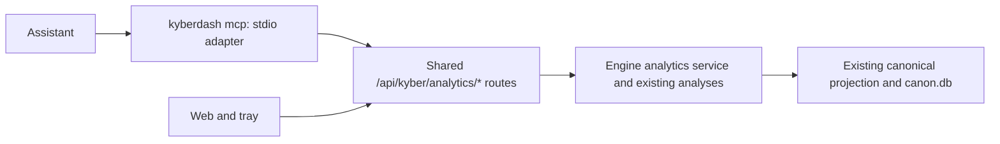
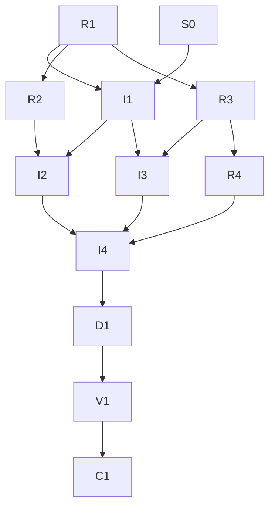

# KyberDash analysis MCP

**Status:** Archived after implementation, current-source finding recheck, durable-decision harvest,
and documentation validation. Host-client integration remains `[NOT LIVE-VERIFIED]`.
The review artifact retains its mechanical `NEEDS_HUMAN` policy result (`KW-REVIEW-008`);
AP3 separately records the user's direct approval of the exact config change.
**Development mode:** test-first. **Autonomy:** autonomous, resolved from root `AGENTS.md` Config Reg.

## Problem and goal

KyberDash holds useful evidence about agent sessions, context composition, cache behavior,
tool and skill usage, delegation, timing, costs and observable outcomes. Today an assistant
cannot discover and interrogate that evidence through a KyberDash MCP interface. The
existing documentation MCP answers a different question, and the optional context-review
endpoint reviews supplied content rather than providing conversational analytics.

Deliver a local MCP interface through which a user can ask questions, investigate evidence
and develop improvement recommendations. Computation stays in the shared KyberDash engine;
the assistant reasons over its results. Eight tools form the MVP: `dash_status`,
`dash_catalog`, `dash_query`, `dash_search_sessions`, `dash_inspect`, `dash_findings`,
`dash_compare` and `dash_outcomes`. The transport and all eight tools are read-only.

Examples of intended questions include which sessions had the most input tokens, whether a
cache ratio changed between two periods, which findings recur, what happened in a costly
run, which tools had high schema residency, and whether a particular comparison has enough
outcome evidence to support a recommendation. A tool must explain when the data cannot
answer a question. Lower cost or fewer tokens alone cannot establish better work.

This is a plan extending existing engine, API, report and MCP SDK patterns; it does not
require a separate specification bundle.

## Decisions

These rows are permanent. `ANSWERED` records the original decision provenance. AP1 records
the subsequent direct human approval of the complete plan, including D1–D12 and the
test-first contract. AP3 records the subsequent direct human approval of the exact TypeScript
ontology and generated registry change. Preserve the table at closeout. There are no open
product decisions requiring a separate question round. Approval does not waive required
validation.

| ID | Question | Answer / decision | Mitigating and supporting information | Status / approval provenance |
|---|---|---|---|---|
| D1 | What is the product surface? | The eight named tools above, read-only, with recommendations supplied by the assistant. | User requested a plan based on the preceding eight-tool proposal. Excludes autonomous changes to skills, instructions, settings or source. | ANSWERED — user-requested baseline, 2026-10-24 |
| D2 | Where does analysis execute? | In `dash/src` engine services behind the existing `/api/kyber/*` API and canonical projection. The MCP adapter neither opens SQLite nor derives domain figures. | Root and `dash/AGENTS.md`, display-layer rule, existing `ContextReport` and `KyberBridge`. Reuse `resolveCanonDbPath`; no parallel datastore, ingest or projection. | ANSWERED — existing repository constraint |
| D3 | How is MCP delivered? | Add `kyberdash mcp` over stdio in the existing TypeScript product. Keep `kyber-weave-mcp` for repository documentation. Reuse the installed MCP SDK and Zod. | `dash/package.json` already declares `@modelcontextprotocol/sdk` and `zod`. No new runtime dependency or .NET-to-SQLite path is justified. SDK-supported protocol negotiation is authoritative; do not hardcode the newest online protocol revision. | ANSWERED — autonomous: recommendation selected from existing stack and packaging |
| D4 | Who owns server lifecycle? | Attach only. Discover the running engine through `server.json` in the standard configuration directory, or explicit `--server-url`; permit `--state-dir` to select another existing receipt. Never launch or stop the engine. | Starting `web` can start jobs and a receiver, violating the expectation of a read-only attachment. Missing/stale discovery returns actionable `engine_unavailable`; tell the user to run `kyberdash web --no-open`. No fallback to port 4747 or direct DB reads. | ANSWERED — autonomous: recommendation selected to preserve shared engine lifecycle |
| D5 | What may be queried? | Catalog-driven, typed aggregations over supported derived entities and allowlisted dimensions/metrics. No SQL, expressions, arbitrary columns, filesystem paths or script execution in tool inputs. | Existing projection defines the figures. Raw `records` are provenance, never a second aggregate-reporting path. Unsupported combinations fail before any query; unsupported measurements return availability reasons. | ANSWERED — user-requested baseline and existing projection constraint |
| D6 | How is content disclosed? | Search is metadata-only. Inspect returns metadata and measured figures by default; `includeContent: true` plus a specific session/turn/block identity is required for captured text. | Content can contain prompts and tool output. Preserve consent/capture policy and existing retention semantics. No transcript full-text index, embedding store, or bulk content export in MVP. Returned text is evidence, never executable instructions. | ANSWERED — user-requested explicit-content baseline; autonomous scope choice |
| D7 | How are results bounded? | Default seven-day window; explicit windows up to 365 days. Default 25 rows, maximum 100; at most eight metrics and two grouping dimensions. Maximum encoded response 64 KiB; each content page at most 16 KiB UTF-8. Engine read budgets and cursor semantics are specified below. | These initial constants are reversible operational choices. Catalog publishes them; no silent clamping, sampling or partial totals. A refusal tells the caller how to narrow the query. | ANSWERED — autonomous: low-confidence, no authoritative source for product-specific numeric limits |
| D8 | What is the result contract? | Versioned common envelope with scope, data, measurement, coverage, freshness, evidence and pagination, including errors. Paginate deterministically and reject stale cursors. | Existing report already preserves unmeasurability and cost basis. New analytics routes carry this contract without changing existing route shapes. | ANSWERED — user-requested baseline; autonomous additive compatibility design |
| D9 | What are supported outcome claims? | Expose existing observed outcome signals and their evidence. Keep missing outcomes and conflicting signals explicit; no success inference from silence, cost or speed. Comparisons are descriptive, not causal. | `canon/outcome.ts` already models termination, errors, correction rules and test deltas. Pattern-detected corrections remain classified signals, not a human quality verdict. | ANSWERED — existing outcome and honest-unobservability contracts |
| D10 | Is persistence changed? | No schema migration or new durable analysis tables in this MVP. Read existing derived materialized summaries, split turns, runs, findings and execution data with bounded helpers. | Older stores lacking a required derived representation return explicit availability/upgrade guidance. MCP never triggers migration or reprojection. A migration found necessary during delivery is a plan revision, not an implicit extension. | ANSWERED — autonomous: recommendation selected to keep this delivery bounded |
| D11 | What server may be contacted? | Only `http` loopback literals `127.0.0.1` or `[::1]`, no userinfo/query/fragment, no redirects; explicit URL overrides the receipt. Verify analytics contract identity/version and pin engine instance/store-generation identity. | Avoid DNS ambiguity and treating a stale receipt or unrelated HTTP listener as KyberDash. Receipt PID alone is insufficient. No remote HTTP MCP listener/authentication feature in MVP. | ANSWERED — autonomous: recommendation selected for local scope |
| D12 | How is it verified and closed? | Test-first per task, task-gate at each developer handoff, one whole-change code review, all declared repository/Dash gates and release-loop checks, then docs-dev closeout. | No per-task code-review council. Canonical docs must describe lasting behavior. Finalization and execution approval are still separate from the user's request to create this plan. | ANSWERED — existing workflow and root gate requirements |
| AP1 | Has execution been authorized? | Execute this plan, D1–D12 and its unchanged test-first contract, using specialist profiles' configured models without overrides. | User: "approve and execute being sure to use the models identified in the sub agents so we make the most efficient use of our tokens". Initial docs validate passed; docs drift had 28 existing corpus/index findings. B0 diagnoses those; V1/C1 may not claim success while unresolved. | APPROVED — direct user instruction, 2026-10-24 |
| AP2 | How is the missing TypeScript policy prerequisite resolved? | Create and activate a repository TypeScript coding standard before application TypeScript implementation. Declare only `typescript` in `ontology.technologies`, author the substantive current standard, and regenerate Config Reg using `docs init . --no-skill` without force or broad template seeding. | User: "Create a TypeScript standard first". S0 owns policy/config/generated registry changes; it does not change MCP architecture or weaken the approved Test contract. Existing root/dash boundaries and actual compiler/lint/module conventions are the policy sources. | APPROVED — direct user instruction, 2026-10-24 |
| AP3 | Is the exact repository policy/config change approved? | Approve adding only `typescript` to `ontology.technologies` with its explanatory comment, and the generated `<typescript-coding-standard>` Config Reg entry. No review-policy, capability, exclusion, or autonomy relaxation is included. | The user directly approved this exact repository config change after its scope was explained in the current conversation. This records approval provenance without inventing a verbatim quotation. | APPROVED — direct user approval, 2026-10-25 |

## Investigation findings

- Documentation responses named `root=/Users/dave/git/personal/kyber-weave`, matching the
  checkout; initial revision was `d571b246`, and the checkout was clean before authoring.
- `dash/src/canon/types.ts` defines disjoint token classes, cost basis/status,
  per-metric measurability, structured context parts, session metadata and run grouping
  basis. `canon/outcome.ts` already represents sparse, empirical outcome signals.
- `dash/src/server/routes.ts` already serves reports, findings, sessions, turns, coverage,
  harnesses, runs, comparisons, timelines, predictions and calibration. New analytics
  endpoints should reuse engine seams, not issue an HTTP request back into the server.
- `dash/src/server/bridge.ts` already offers bounded session-summary/turn reads. Session
  `summary_json` and `problems_count` are materialized to avoid loading huge payloads.
  Legacy fallbacks exist, but cannot be used without the new read budgets. `session_turn`
  can carry compressed data; use existing decoding helpers rather than SQLite JSON
  operations that assume every stored turn is plain text.
- `dash/src/analysis/review.ts` and `/api/kyber/review` implement opt-in model review of
  supplied context. Their `model_review` output must stay distinct from canonical findings.
  None of the new MCP tools calls that endpoint or a paid model provider.
- `dash/src/cli/web.ts` publishes `server.json` after bind and owns its lifecycle.
  `/api/kyber/meta` exposes an API version, but is not a complete identity handshake for the
  proposed analysis surface. Additive identity belongs in the new analytics status route.
- `dash/src/cli/program.ts` registers commands; `cli/main.ts` and `launcher.ts` handle
  errors. Global pre-action hooks load configuration; registration must bypass irrelevant
  report/pricing initialization for MCP and keep stdout exclusively JSON-RPC once connected.
- `dash/tsup.config.ts` externalizes SDK/Zod for npm; `tsup.sea.config.ts` bundles all
  non-Node dependencies. A real SEA invocation must prove SDK imports work without a
  checkout or `node_modules`; source tests alone cannot prove distribution works.
- No live user database was opened or modified. Real source coverage and the validity of
  particular improvement claims have not been audited by this plan.
- B0 follow-up: the initial CodeGraph index was stale (October 2); refreshing the ignored
  index changed its indexed-file inventory from 988 to 1,301 and cleared all 28 baseline
  drift findings. No tracked files changed. This is an index repair, not a waiver of future
  documentation drift validation.

Discovery: codegraph 4, docs 6, direct reads 17 unique indexed source/config/document files
across the initial discussion and planning continuation. Direct reads confirmed exact
route schemas, compressed/materialized store layout, outcome availability, review labeling,
entry/launcher behavior, discovery receipt fields, SDK/build settings and governed plan
metadata after semantic retrieval did not return those exact details. The plan inventory
and catalog were read narrowly to edit the active row and confirm existing owner/component.
One guessed `cli.ts` and one guessed derive-directory lookup missed; the actual CLI entry
was then confirmed. No index or documentation server was unavailable.

Primary external reference: [MCP architecture](https://modelcontextprotocol.io/docs/2026-07-28/learn/architecture)
for tools and local stdio. This was self-gathered during initial discovery. The installed SDK's
documented API and negotiated protocol versions determine implementation compatibility.

## Architecture and common contract



The final arrow from web/tray denotes API availability, not a requirement to change either
UI. No UI change is part of this plan. Proposed engine code lives under
`dash/src/analysis/query/`, HTTP dispatch under `dash/src/server/analytics-routes.ts`, and
transport-only code under `dash/src/mcp/`. One service owns validation, scope, aggregation,
search, inspection, findings, comparison and outcomes. Reuse `KyberBridge` and canonical
store read helpers; do not copy detectors, scoring, pairing, taxonomy or cost algorithms.

Each of the eight tools maps one-to-one to an additive route under
`/api/kyber/analytics/`: GET `status`, GET `catalog`, POST `query`, POST `search-sessions`,
POST `inspect`, POST `findings`, POST `compare`, and POST `outcomes`. POST carries bounded
read specifications; it does not authorize mutations. The HTTP routes and MCP share the
same schemas, results and errors. Existing endpoints keep their current shapes and versions.

Every response uses `contractVersion: 1` and these required keys:

| Key | Contract |
|---|---|
| `scope` | Entity grain, canonical harness/repo/branch/run/session filters, normalized UTC `[from,to)` interval and grouping timezone; echo the applied scope. Status/catalog use an explicit service scope. Never silently drop unsupported filters. |
| `data` | Typed result for the operation, or null on error. A measured empty result is distinguishable from unavailable data. |
| `measurement` | Metric definitions, units, numerator/denominator for ratios, measured/derived/inferred/unavailable classification, and availability reason. Preserve source cost basis and currency partitions. |
| `coverage` | In-scope candidate, included and eligible counts per metric; unknown/unavailable counts; exclusion reasons and grouping/linkage basis where relevant. Unknown counts are null with a reason. |
| `freshness` | Generated-at, engine instance ID, store/projection generation, last ingest/projection timestamps when recorded, otherwise null plus reason. Never substitute request time for data freshness. |
| `evidence` | Stable session/run/execution/turn/finding/span references and selection basis. Aggregate evidence is a bounded deterministic sample with contributor count, not a claim of exhaustive evidence. |
| `pagination` | Limit, returned count, next cursor or null, deterministic ordering, truncation flags. Aggregate query totals describe the whole admitted scope even when grouped output is paged. |
| `error` | Null on success; otherwise stable code, safe message, field details where applicable and actionable hint. Never expose raw DB payloads or credentials through diagnostics. |

Schema validation rejects unknown keys, unsupported IDs, nonfinite values, duplicate metrics,
invalid units and malformed time ranges before a store read. Use stable errors:
`invalid_request`, `unsupported_query`, `not_found`, `not_measurable`, `content_unavailable`,
`budget_exceeded`, `stale_cursor`, `engine_unavailable`, `incompatible_engine`, `cancelled`
and `internal_error`. HTTP maps these to 400/404/409/413/503/500 as appropriate. MCP returns
tool-domain errors with `isError: true` and the same structured envelope; JSON-RPC errors
are reserved for protocol failures. Do not turn an absent measurement into a failed request
when a useful partial result can carry it explicitly.

### Catalog, query and aggregation semantics

`dash_catalog` is the authoritative machine-readable catalog. It publishes entity grains,
metric IDs, dimension IDs, filter operators, compatible combinations, units, aggregation
operators, measurability rules, supported comparison forms and limits. Catalog version is
part of every query request; a mismatched version requires rediscovery.

Initial query grain is **session**, with additive own-session figures, never sums of
parent totals that include children. Required metric families are session count, measured
input/output/cache/fresh-input tokens, measured duration, measured cost partitioned by
basis/currency/status, and ratios computed from eligible summed numerators/denominators.
Initial grouping/filter dimensions are canonical harness, repository, branch, is-subagent
and started-at day/week in the requested IANA timezone. `runId` and `sessionId` are scope
filters where relationships are observable. Model, tool, MCP server and skill analytics are
reachable through `dash_inspect` and existing findings; they are not fabricated as session
grouping dimensions for mixed-model sessions. Add them to aggregate catalog only in later
authorized work. Return a specific unsupported-dimension hint directing callers to inspect.

Use existing summary meanings and materialized readers. Missing counters exclude that
row only from that metric and appear in its denominator/coverage; zero remains eligible.
Do not average per-session ratios. Input is fresh + cache-read + cache-creation; reasoning
is a subset of output. Cost partitions are never summed across currencies or bases. A
partial priced figure remains partial. No composite efficiency score is introduced.

Required query operators are `count`, `sum`, `min`, `max` and ratio-of-sums where catalog
permits. Sorting uses explicit catalog fields plus stable entity/group-key tie breakers;
limit applies after aggregation. No joins supplied by the caller, percentile estimates,
unbounded group expansion or automatic sampling in this delivery.

Query scope defaults to the previous seven days relative to an engine-injected clock.
Unknown session timestamps are excluded from a time-scoped result and counted explicitly;
they are not silently assigned to today. Count at most 10,001 candidate IDs before admitting
a request capped at 10,000 sessions. Scan derived summaries in batches of at most 100;
reject a single decoded summary above 256 KiB or cumulative decoded input above 16 MiB.
Legacy payload fallback obeys the same cumulative budget and a 4 MiB per-entity cap. Inspect
turn/content reads are confined to one explicit entity/page. Never load all session payloads
or raw records to answer a filtered aggregate. Budget failure returns no partial total.

Use a five-second cooperative computation deadline checked between bounded batches and
abortable HTTP requests capped at ten seconds. Do not claim a JavaScript timer interrupts
a synchronous SQLite statement. Queries must use bounded statement shapes, and integration
tests must demonstrate that cancellation/budget refusal releases resources and permits the
next request. If those bounds cannot preserve engine responsiveness on the fixture corpus,
revise the implementation plan before adding a worker/second connection architecture.

Cursors bind contract/catalog version, normalized query, ordering key, engine instance and
projection generation. They are opaque to callers and validated for size/shape. A changed
projection, server replacement or query rejects the cursor; no misleading continuation
across changing snapshots. No cursor cache, saved analysis or server-side session database
is needed. Engine instance identity is ephemeral; projection identity derives from existing
generation observation, with store replacement/rebuild tests rather than guessed timestamps.

### Eight-tool behavior

| Tool | Inputs and returned behavior |
|---|---|
| `dash_status` | No corpus scan: report connection/API/catalog identity, available derived capabilities, recorded freshness and coverage limitations. Must be callable as an MCP tool when the engine is absent, returning `engine_unavailable` with startup guidance. |
| `dash_catalog` | Optional entity/section selection; return the exact query/inspect/search/comparison/outcome vocabulary and limits, with content-policy and retention limitations. |
| `dash_query` | Catalog version, scope, metrics/operators, optional groupBy/order/limit/cursor. Return typed aggregates, denominators and evidence references under admitted budgets. |
| `dash_search_sessions` | Scope and optional literal metadata text, max 200 characters. Match label, agent name, repo and branch; no regex, SQL wildcard language, embeddings or transcript text. Return bounded metadata/summary rows. Escape SQL pattern metacharacters and bind values. |
| `dash_inspect` | Kind plus stable ID; turn/block requires session ID and explicit 0-based transport index/block key. Sections select existing summary, dimensions, tools/skills, tree, findings or captured context. Default excludes text. Content requires explicit inclusion and continuation page; absent, expired, uncaptured and unsupported content have distinct reasons. Never silently return a neighboring turn or dump a complete session payload. |
| `dash_findings` | Scope plus detector/measurement-class filters and pagination; reuse canonical ranking and contracts. Return finding ID, mechanism, confidence basis, recommendations, risk and concrete evidence. Preserve `model_review` separation; do not promote model prose into canonical findings. |
| `dash_compare` | Exactly two explicit run IDs, or two query scopes using identical metrics/grain/units and grouping. Reuse run pairing where comparing runs; scoped aggregate comparisons use the same query service. Report per-side availability/sample sizes, grouping basis and confounders. Relative delta with zero/missing denominator is unavailable. No causal or automatic before/after-change claim. |
| `dash_outcomes` | Run IDs or a bounded time/harness/run scope; inspect existing outcome blocks and their termination/error/correction/test evidence. Return status distribution including unavailable and inconclusive, observable denominators and supporting IDs. Do not reinterpret run completion, regex corrections or a clean tool exit as proof of task quality. |

### Transport, compatibility and packaging

`kyberdash mcp [--server-url http://127.0.0.1:<port>] [--state-dir <directory>]` uses stdio.
The explicit URL wins; otherwise read the existing receipt without rewriting it. No `--db`
flag is offered by the adapter because the running engine owns the datastore selection.
Status returns a store identity token, not the contents or an unnecessary absolute DB path.

Handshake and tools/list work without a running engine so clients can discover capabilities;
tool calls then report availability. Validate the new status handshake before any data call;
unknown analytics contract version or absent analytics routes yields `incompatible_engine`,
not an empty corpus. Rediscover once after an unavailable connection, never silently attach
to a different store after an instance change mid-query. Client cancellation aborts active
fetches. EOF/SIGTERM drains accepted requests within a bounded deadline, closes stdio/fetch
resources and exits without stopping the shared engine. A client closing its read end does
not produce an unhandled EPIPE. Tests must prove the full process exits cleanly.

SDK tool declarations carry read-only/idempotent/non-destructive/closed-world hints where
supported, plus input/output schemas and structured results. Those annotations do not
replace actual allowlisting. The adapter can reach only its analytics routes; it never
passes user-provided URLs or arbitrary route names to fetch. Logs and diagnostics use
stderr; no banners, pricing messages or unsolicited stdout after MCP starts. Help/version
before transport activation retain normal CLI behavior.

The npm build and SEA binary use the same command. Reuse the existing pinned SDK resolution;
do not upgrade dependencies as part of this plan. A standalone SEA smoke test must run from
a directory without node_modules, initialize via the installed SDK client, list exactly
eight tools, call status/catalog/query against an isolated fixture engine, then close and
observe exit zero. Release packaging checks must include that smoke alongside existing web
smoke without changing archive contents or creating another executable.

## Test contract

Every RED row is authored and executed before its GREEN implementation. Record the command,
failure assertion and exit status; a missing production module may explain an initial RED,
but the completed suite must assert observable behavior. GREEN uses unchanged assertions.
New source and tests are separate ownership scopes. Task-gate evidence belongs to each
developer handoff; the final code review covers the accumulated change once.

| Task | Test project or file | Runner command | Observable behavior | RED evidence required | GREEN acceptance |
|---|---|---|---|---|---|
| R1 → I1 | `dash/src/analysis/query/contracts.test.ts`, `catalog.test.ts`, `aggregate.test.ts`, `search.test.ts`, `outcomes.test.ts` | `cd dash && npx vitest run src/analysis/query` | Strict schemas/catalog, bounded and exact scoped aggregates, missing/zero and ratio semantics, parent-child non-duplication, cost partitions, metadata-only search, sparse outcomes, cursors and budgets. Fixture store has mixed availability, mixed cost bases, unknown timestamps, subagents and compressed/legacy representations. | Each new contract fails on absent behavior; include large-corpus bounded-reader and cancellation failures rather than a snapshot-only test. | Same cases pass with exact fixture totals, contributor IDs/denominators and no full-payload corpus scan. Following requests still succeed after refusal/cancellation. |
| R2 → I2 | `dash/src/server/analytics-routes.test.ts`, `analytics-parity.test.ts` | `cd dash && npx vitest run src/server/analytics-routes.test.ts src/server/analytics-parity.test.ts` | All eight routes share the envelope, identity/version, bounded bodies/results, GET/POST allowlist and correct errors. Existing report/findings/turn values match their new scoped wrappers. | New endpoints absent or fail parity; tests retain existing-route compatibility assertions. | All operations pass; invalid filters are rejected, unknown values remain unavailable, existing route shapes unchanged. No write/projection/job seam called by analytics requests. |
| R3 → I3 | `dash/src/mcp/server.test.ts`, `client.test.ts`, `stdio.test.ts` | `cd dash && npx vitest run src/mcp` | Exactly eight tools; catalog/schema/output parity; attach discovery and explicit override; missing/stale/incompatible engine; loopback/redirect refusal; content opt-in; stable errors; stdout framing; clean EOF, cancellation and EPIPE. | SDK client requests fail intended missing command/tool/lifecycle behavior. | Real child process initializes, lists and calls tools; every stdout line is valid protocol, engine untouched, child exits zero and no handles/children remain. |
| R4 → I4 | `dash/scripts/sea-mcp-smoke.test.ts`; extend release parity tests only if release commands change | `cd dash && npx vitest run scripts/sea-mcp-smoke.test.ts`; changed .NET release tests via `dotnet test` | Smoke script rejects malformed protocol, missing tool, wrong aggregate, timeout or child leak; release/local build wires the same smoke; real SEA contains SDK runtime. | Script/release assertion fails before build wiring exists. | Script tests pass and real staged SEA passes smoke without checkout/node_modules. Existing web smoke and update loop pass. |
| D1 | Canonical docs and this plan/index | repository docs validate and drift | Accurate public tool/CLI/API contracts, install/setup, bounds/limitations and decision harvest. | No test — documentation-only task, verified by governed docs checks and source review. | Both docs checks zero findings; closeout mapping and archived index are accurate. |
| S0 | TypeScript standard, config and generated registry | repository docs validate and drift; existing ConfigReg/DocsScaffolder tests if generation reveals a defect | Substantive current standard resolves through the generated property; unrelated YAML and hand-authored instruction text preserved. | No new test — policy/configuration authoring, checked through actual generator and governed docs checks. | Only `typescript` added; current standard and correct property exist; outside-marker AGENTS and all CLAUDE bytes preserved; docs checks pass. |

The two command forms using `cd dash` above denote runner working directory, not a shell
requirement. The conductor should dispatch argv with `cwd=dash` where supported.

## Dispatchable tasks and dependency graph

Before dispatch, read applicable coding/test standards and use `docs_for_symbol` for any
changed existing symbol contract. All workers preserve unrelated edits. No task may expand
the metric vocabulary or weaken the Test contract to achieve GREEN without returning this
plan to Draft for review.

| Task | Objective and owned files/symbols | Dependencies | Acceptance and required skills |
|---|---|---|---|
| B0 | Diagnose initial 28 `KW-DOC-DRIFT-001` findings and CodeGraph freshness against current checkout. Read-only source/doc assessment; an index refresh may update only ignored index state while preserving tracked files. Return exact causes/attribution and the narrow remediation needed; do not edit unrelated source or canonical docs merely to silence findings. | None | No-test diagnosis. Root assigns any actual code/docs repair separately with concrete ownership. Preserve baseline evidence; required docs drift must pass before V1/C1. `kyber-weave-docs`. |
| S0 | Author `docs/standards/typescript/README.md`; add only the technology to `.kyber-weave/kyber-weave.yml`, preserving other config/comments; update `docs/standards/README.md` and the technology-specific outdated paragraph in `docs/configuration.md`; regenerate only the Config Reg region in root `AGENTS.md` through `docs init . --no-skill`. Do not edit `CLAUDE.md`, seed other standards or hand-edit generated markers. | None | Current policy covers actual Node/React TypeScript conventions, honest absent values, data/lifecycle boundaries, bounded reads and real gates; new property resolves; no unrelated tracked changes. `app-docs-standard`, `kyber-weave-docs`. |
| R1 | Author engine/query RED tests and isolated fixtures under `dash/src/analysis/query/*.test.ts` and `fixtures/`; cover the I1 contract above. | None | Record reproducible intended RED; `test-dev`, `task-gate`. |
| I1 | Implement catalog/schema/envelope and bounded analytics service under `dash/src/analysis/query/{types,catalog,scope,aggregate,search,inspect,findings,compare,outcomes,service}.ts`. Add narrow read helpers in `canon/store.ts` and `server/bridge.ts` only where required, reusing existing materialized/compressed readers and analysis modules. No migrations or schema DDL. | R1, S0 | Eight engine operations, source-to-metric mapping published in catalog, budgets/unknown semantics and contributor identity proven; `typescript-dev`, `task-gate`. |
| R2 | Author HTTP RED/parity tests in the two server test files above; use R1 fixture IDs and frozen expected contracts. | R1 | New routes RED, compatibility assertions retained; `test-dev`, `task-gate`. |
| I2 | Implement `server/analytics-routes.ts` and mount it in `server/routes.ts` before generic session routes and JSON 404. Supply engine instance/store-generation observation from `server/store-generation.ts`/`cli/web.ts` only as needed; do not change existing route responses or receipt ownership. | I1, R2 | Eight routes and handshake return common service results, no store mutations/jobs; `typescript-dev`, `task-gate`. |
| R3 | Author transport/client/stdio RED tests under `dash/src/mcp/*.test.ts`; use a temporary loopback API fixture and isolated HOME/state dir, never the user's receipt/database. | R1 | Real SDK/child lifecycle and content boundary asserted; `test-dev`, `task-gate`. |
| I3 | Implement transport-only `dash/src/mcp/{server,client,discovery,tools}.ts`, registration in `dash/src/cli/mcp.ts` and `cli/program.ts`. Adjust `cli/main.ts`/`launcher.ts` only for clean protocol shutdown/error handling where tests require it. Never import the canonical store or own the server lifecycle. | I1, R3 | All eight tools, strict route mapping, attach-only lifecycle and stdout/EOF guarantees. HTTP fixture permits development independently of I2; `typescript-dev`, `task-gate`. |
| R4 | Author smoke harness RED tests `dash/scripts/sea-mcp-smoke.test.ts`, and release parity tests if wiring modifies release commands. | R3 | A fake child demonstrates each smoke failure path and resource cleanup; `test-dev`, `task-gate`. |
| I4 | Implement `dash/scripts/sea-mcp-smoke.mjs`; integrate smoke into `scripts/release-local.sh` and `.github/workflows/release.yml` alongside web smoke. Change `dash/tsup.config.ts`/`tsup.sea.config.ts` only if bundled SDK tests require it; no dependency upgrades. | I2, I3, R4 | npm and staged SEA work outside checkout/node_modules; local/release command parity and update loop pass; `typescript-dev`, `github-devops`, `task-gate`. |
| D1 | Update `docs/dash/{README,onboarding,architecture,requirements,runbook}.md`, `docs/cli-command-surface.md`, relevant `docs/distribution.md` and KyberDash `docs/catalog.md` row. Explain tools, limits, content/outcome caveats, startup/stop ownership and exact client setup validated against supported clients. | I2, I3, I4 | Canonical docs reflect delivered contracts and explicit unsupported cases. No writes to user-level client config. `app-docs-standard`, `kyber-weave-docs`; docs checks. |
| V1 | Run required gates and whole-change review, address findings and repeat affected gates. Evidence stored in `artifacts/gates.json` plus Dash/release artifacts referenced by review. | D1 | Declared gates, Dash gates, SEA smoke and update loop pass; `code-review`. |
| C1 | Docs-dev closeout: verify all acceptance/evidence, map each D-row to canonical docs/ADR, record any live-client gap honestly, archive this plan and move inventory row. | V1 | No active completed plan remains for merge-ready validation; `app-docs-standard`, `kyber-weave-docs`. |



R2/R3 tests consume R1 fixtures and declared contracts, not I1 implementation. I2 and I3
can proceed independently after I1 without editing the same files: I2 owns `cli/web.ts`,
I3 owns `cli/program.ts`/entry files. I4 follows both because it consumes the real route and
command. Where release parity tests are C#, use the existing test coding standard and keep
the release implementation out of test ownership. Each implementation task ends with its
own task-gate; a failing task-gate returns to that worker. No separate per-task council.

## Acceptance and verification

Completion requires all of the following:

1. A standard MCP client can initialize and list exactly the eight requested tools from
   npm and the released-shape SEA binary without a repository checkout.
2. Discovery does not invent a port/store, start an engine, acquire a job lease, mutate
   config, import content, trigger migrations/projection or stop an attached engine.
3. Identical scoped requests through MCP and HTTP return identical domain data and
   measurement/coverage/evidence, apart from permitted transport timing metadata.
4. Fixture questions have exact expected answers: token leaders, cache-ratio change,
   recurring findings, run delegation tree, schema residency detail and unavailable
   outcomes. Every recommendation can be traced to stable evidence IDs and limitations.
5. Mixed coverage, stale data, missing content, derived grouping, conflicting outcomes,
   empty data, malformed scopes and budget excess stay explicit. No coercion to zero,
   invented causality, composite scores or mixed cost-basis totals.
6. Limits are enforced by both schema and engine; aggregate totals are never silently
   truncated. Text is absent without explicit inclusion and pagination respects UTF-8.
7. Full child processes exit cleanly after EOF/cancellation/error and leave no listeners,
   jobs, processes or temporary receipts behind. The shared engine remains healthy.
8. Existing web/tray/report contracts keep their behavior; all required gates pass.

During development, focused RED/GREEN runs and `scripts/fast-loop.sh` are iteration aids,
not delivery evidence. Before any push or PR, run the root declared suite:

```bash
dotnet tool restore
dotnet run --project src/KyberWeave.Cli -- review gates . --out artifacts/gates.json
npm --prefix dash run typecheck
npm --prefix dash run lint
npm --prefix dash run test
npm --prefix dash run check:reachable
./scripts/update-loop.sh
```

Run the staged SEA MCP smoke as part of release-local wiring and preserve its output.
`update-loop.sh` is required because this delivery touches how KyberDash is built. No tray
source is planned; if scope later touches it, add its UI/Rust gates before editing.
The docs suite must include `docs validate .` and `docs drift .` after every docs edit.
Use `docs validate . --merge-ready` only after C1 archives this plan; its intentional active
Draft/Ready status is not a merge-ready pass. ReSharper findings are attributed by review,
not assumed absent because InspectCode exits zero.

Live acceptance uses a disposable fixture engine and one already-installed MCP client;
record product/client versions, tool list, one successful question, one unavailable-data
answer and clean disconnect. Do not rewrite a user's config or query their corpus merely
to satisfy this gate. An owner-requested real-data analysis is a later user action, not a
precondition that silently authorizes disclosure. If client integration cannot be observed,
mark that gap `[NOT LIVE-VERIFIED]`; protocol and SEA smoke are necessary but do not prove
every host client works.

## Risks, exclusions and closeout

Large legacy payloads and synchronous SQLite operations are the principal runtime risk.
Bounded materialized reads, explicit budgets and no partial totals are mandatory; bypassing
them for a convenient answer is not an acceptable optimization. SDK initialization and
CommonJS imports can behave differently in SEA; real binary smoke is mandatory. New
endpoints are additive and must not turn a legacy store into a write/upgrade operation.

MVP excludes remote/cloud access, an HTTP MCP listener, OAuth, automatic engine start,
scheduled analysis, saved questions, embeddings/vector search, transcript-wide semantic
search, unrestricted SQL, new telemetry capture, schema migrations, automatic prompt/skill
changes, outcome grading and new web/tray UI. It also excludes paid provider calls from the
tools. No todo is created for these exclusions without separate user acceptance.

At C1 preserve the Decisions table and map D1/D3/D4/D11 to onboarding/runbook/CLI surface;
D2/D5/D8/D10 to architecture/requirements; D6/D7/D9 to architecture/runbook measurement
and content contracts; D12 to verification/distribution evidence. Evaluate whether the new
public MCP surface warrants an ADR during documentation closeout; the recommendation is
an ADR for the durable local read-only analytics boundary and its rejected direct-SQL and
auto-start alternatives. Do not claim an ADR waiver before that assessment. No
documentation waiver applies: the command, public tool/API contract, limits and lifecycle
are lasting product behavior. Archive only after evidence supports the stated completion
and after canonical documents contain those contracts.

Planning validation and later execution evidence are separate. AP1 authorizes implementation;
no task has been completed by the approval itself. Initial planning checks: docs validate
passed with zero findings; docs drift failed with 28 existing corpus/index references,
including `SquadStateMigration` and `ReviewTaskGate`. B0 must establish the cause rather
than treating that baseline as a blanket waiver. This plan makes no implementation
completion or commit/push claim.

## Closeout (C1, 2026-10-25)

The implementation tasks S0, R1, I1, R2, I2, R3, I3, R4, I4, D1 and V1 are recorded as
delivered. The prior `artifacts/gates.json` records 18 declared gates green, but it predates
these closeout edits and is not evidence for this revision. The fresh review gate run
reported 17/18 passing; `docs validate` failed because the plan was still in `docs/plans/`
while the inventory listed it under Archived Plans. The inventory was corrected, then
`docs validate .` and `docs drift .` both passed with zero findings. The reviewer confirmed
all eight historical product findings (5 major, 3 minor) are absent in current source. A
fresh whole-suite artifact must still be generated after this closeout change; the stale
18/18 artifact is not cited as current evidence. The review artifact's mechanical result
remains `NEEDS_HUMAN`: its policy finding is `KW-REVIEW-008` for the S0
`.kyber-weave/kyber-weave.yml` edit, with roll-up `KW-REVIEW-024`. The user separately
approved the exact scoped change as recorded in AP3; that approval does not alter the review
artifacts. The prior V1 evidence describes the following remediations: MCP surface-to-engine field mapping is adapter behavior with code
remarks (`dash/src/mcp/client.ts` `toEngineBody`); full token-class/duration/cost
projections (`bridge.ts` `analyticsSessionProjections`); two-scope comparison
(`compare.ts` `compareScopes`); observed outcome reads (`canon-source.ts`
`readOutcomes`); ISO-week grouping (`aggregate.ts` `isoWeekKey`); run input-token
rollup (`sumSessionFigures`); multi-field metadata search
(label/harness/repository/branch); finding filters and pagination
(detector/confidence/limit/cursor). Gates re-ran green after remediation.

**Live-client gap (honest):** `[NOT LIVE-VERIFIED]` — no host-client integration
(Claude Code/Desktop, Cursor, Copilot, or any other MCP host) has been observed
against this surface. The stdio shape, tool list, and attach-only boundary are proven
by SDK smoke on npm and staged SEA builds; that is necessary but does not prove every
host client works. Owner follow-up: connect one already-installed client, record
product/client versions, one successful question, one unavailable-data answer, and a
clean disconnect — never authorize a real-data analysis merely to satisfy that check.

### Closeout mapping (each durable D-row to its canonical destination)

| ID | Destination |
|---|---|
| D1 (eight read-only tools, assistant-supplied recommendations) | [dash/architecture.md](../dash/architecture.md) (eight-tool table), [dash/runbook.md](../dash/runbook.md) (§2j), [dash/onboarding.md](../dash/onboarding.md) (Ask KyberDash from an MCP client), [dash/README.md](../dash/README.md) (surface row), [catalog.md](../catalog.md) (KyberDash row) |
| D2 (engine execution, no parallel datastore) | [ADR 0043](../adr/0043-kyberdash-analysis-mcp-read-only-boundary.md) (rejected direct-SQL alternative); [dash/architecture.md](../dash/architecture.md) (shared-engine computation, adapter never opens SQLite) |
| D3 (SDK stdio delivery, existing product surface) | [dash/architecture.md](../dash/architecture.md) (SDK transport), [dash/runbook.md](../dash/runbook.md) (§2j), [cli-command-surface.md](../cli-command-surface.md) (`mcp` row) |
| D4 (attach-only lifecycle, receipt discovery) | [ADR 0043](../adr/0043-kyberdash-analysis-mcp-read-only-boundary.md) (rejected auto-start); [dash/architecture.md](../dash/architecture.md), [dash/runbook.md](../dash/runbook.md) (§2j), [dash/onboarding.md](../dash/onboarding.md) |
| D5 (catalog-driven typed aggregations) | [dash/architecture.md](../dash/architecture.md) (envelope, catalog, aggregation semantics); no ADR — ADR waiver: applies the established projection and measurability patterns with no new boundary |
| D6 (metadata-only search, explicit content opt-in) | [dash/architecture.md](../dash/architecture.md), [dash/runbook.md](../dash/runbook.md) (§2j content/page limits, §4 retention); no ADR — ADR waiver: refines the existing content-retention and consent contracts (ADRs 0014/0018/0031) with no new invariant |
| D7 (seven-day default, 25/100 rows, 8 metrics, 2 dimensions, 64 KiB/16 KiB caps) | [dash/architecture.md](../dash/architecture.md) (bounds), [dash/runbook.md](../dash/runbook.md) (§2j operator limits); no ADR — ADR waiver: reversible operational constants, documented in canonical docs |
| D8 (versioned envelope, deterministic pagination, stable errors) | [dash/architecture.md](../dash/architecture.md) (contract table); no ADR — ADR waiver: additive envelope versioning on the existing `/api/kyber/*` contract pattern |
| D9 (observed outcome signals, no success inference) | [dash/architecture.md](../dash/architecture.md) (outcome caveats), [dash/requirements.md](../dash/requirements.md) (KD-007–KD-010 governance); no ADR — ADR waiver: applies the existing honest-unobservability and outcome rules with no new invariant |
| D10 (no schema migration, no durable analysis tables) | [dash/architecture.md](../dash/architecture.md) (read helpers over derived summaries); no ADR — ADR waiver: implementation bound with no surviving schema decision |
| D11 (loopback-only contact, instance/store identity pinning) | [ADR 0043](../adr/0043-kyberdash-analysis-mcp-read-only-boundary.md) (local-loopback-only term; no remote listener); [dash/architecture.md](../dash/architecture.md), [dash/runbook.md](../dash/runbook.md) (§2j) |
| D12 (test-first, task-gate, whole-change review, gates, closeout) | [distribution.md](../distribution.md) (Kyberdash in the loop: SEA MCP smoke, pinning tests); this closeout section records the evidence |
| AP1/AP2/AP3 | Authorization provenance only; no canonical destination (transient approvals, preserved in this Decisions table) |

**ADR disposition:** one new record —
[ADR 0043](../adr/0043-kyberdash-analysis-mcp-read-only-boundary.md) (the durable
local read-only analytics boundary and its rejected direct-SQL and auto-start
alternatives). All other D-rows carry explicit ADR waivers above. **Documentation
waiver:** none — the command, public tool/API contract, limits, lifecycle, content
and outcome caveats are lasting product behavior and are all in canonical docs.

No todo is created for the MVP exclusions (remote access, HTTP listener, OAuth,
automatic engine start, scheduled analysis, saved questions, embeddings, SQL, new
telemetry capture, migrations, prompt/skill changes, outcome grading, web/tray UI)
without separate user acceptance.
