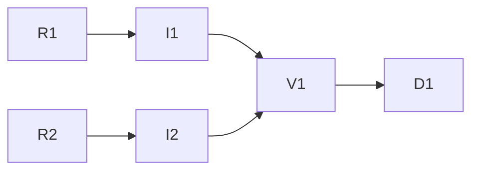

# KyberDash complete captured context through MCP

**Status:** Archived — implementation delivered with the recorded evidence below; the review
artifact remains mechanically `NEEDS_HUMAN` (`KW-REVIEW-008`, reserved-path config change)
pending human review, never cited as approval.
**Development mode:** test-first. **Autonomy:** autonomous, from the root Config Reg.

## Problem and goal

The user wants agents to retrieve the complete captured context of a run so they can
understand what happened. Metadata-only search is a discovery default, not the intended
limit of analysis. The current MCP reader exposes one exact part class on one turn,
omits shared context and block enumeration, and refuses a compressed value whose total
decoded JSON exceeds 64 KiB. Consequently, a caller cannot traverse all retained context.

Extend the existing eight-tool surface through `dash_inspect`: manifests discover runs,
sessions, subagents, turns and parts; content requests page all captured canonical context
within the selected target. Preserve exact retained text and provenance, and explicitly
identify capture gaps and reconstruction. Page limits must bound responses and working
memory, not impose a hidden maximum total retrievable transcript size.

This is a new authorized scope following the
[archived initial MCP delivery](2026-10-24-kyberdash-analysis-mcp.md).
That artifact remains a historical record; its completion evidence does not establish
completion or test evidence for this follow-up.

## Decisions

| ID | Question | Answer / decision | Mitigating and supporting information | Status / approval provenance |
|---|---|---|---|---|
| A1 | Is complete context retrieval authorized? | Implement complete retained captured-context traversal through MCP. No separate human content approval is required per request. | User: "i want the mcp to expose the complete context text, how else are agents going to analyze the run". Conductor explicitly directed this follow-up planning and execution on 2026-10-25. | ANSWERED — direct current user capability request; conductor-authorized execution |
| D1 | Where does retrieval execute? | Shared KyberDash engine and existing analytics HTTP route; MCP remains a thin attach-only adapter. | Root display-layer invariant and existing ADR 0043. No second datastore, projection, scheduler or provider call. | ANSWERED — existing repository constraint |
| D2 | Which public tool changes? | Extend `dash_inspect` with `mode`, `target` and `representation`; keep eight tools and preserve legacy calls. | Additive extension is smaller than a separate transcript tool and keeps existing callers working. Exact contract below was dispatched to conductor before RED authoring. | ANSWERED — autonomous recommendation; reversible additive interface choice |
| D3 | What constitutes complete context? | Every retained canonical content part in the selected scope, including legacy flat canonical content, shared/session prompts and child-session context for a run. Preserve distinct repeated occurrences. | This is captured evidence, not a claim that all provider input was observed. Original arbitrary telemetry payloads are not silently equated with model context. If context-bearing retained fields exist outside canonical parts/content, identify that representation and report the gap before claiming complete coverage. | ANSWERED — user capability and honest-unobservability constraints |
| D4 | How is content requested? | `mode: content` is the explicit request for captured text and needs no additional `includeContent` flag or user confirmation. Metadata remains the default for legacy calls/search. | Legacy explicit turn/block calls remain valid; invalid combinations fail rather than silently degrade to metadata. | ANSWERED — direct user intent; autonomous compatibility choice |
| D5 | How are large stored values served? | Chunk SQLite columns, stream inflation and incrementally tokenize JSON strings/parts. No whole-blob SELECT, full inflate, full JSON parse or 64 KiB total decoded-content refusal on the new path. | Existing columns are BLOB=zlib-deflated JSON or TEXT=plain JSON. Native Node streams and existing dependencies suffice; a new dependency requires justification and primary-source verification before adoption. | ANSWERED — existing storage facts and requested completeness |
| D6 | How are work and resources bounded? | Per response: at most 16 KiB UTF-8 content and 64 KiB encoded envelope; resumable scan progress permits empty text pages only with an advancing continuation. Cursor-held ephemeral parser/inflater state may bridge work slices; expire and dispose it explicitly. | A stateless restart from byte zero with a fixed scan budget can starve late parts indefinitely. No durable export table/cache or database migration. Resource limits are operational defaults below, not transcript-size caps. | ANSWERED — autonomous recommendation; memory/work bounded without discarding retained text |
| D7 | How are historical completion and approval treated? | Do not reopen or rewrite the archived initial plan. Preserve its AP3 human approval and machine NeedsHuman artifact unchanged. | This follow-up is separately authorized and adds no configuration/policy edit. Historical machine review cannot be forged into approval. | ANSWERED — conductor constraint |

## Investigation findings

- Documentation MCP provenance named this checkout, `/Users/dave/git/personal/kyber-weave`.
- `analyticsTurnBlock` selects one `session_turn` row and one span's `parts_json`,
  matches exact `part` strings and omits preceding/shared context. Its 64 KiB decoded
  ceiling rejects valid large parts before paging. It has no real-store regression suite.
- `executeInspect` removes turns/content from session detail; MCP schema has no manifest
  traversal. Supplying `includeContent` without a turn and block becomes session metadata.
- Existing `assembleTurnContent` groups `user_messages` and `assistant_turns` into the
  conversation block and exposes session/shared prompts, captured order and recurrence.
  It has useful semantics but its full path materializes whole content and cannot be used
  as the new bounded-memory implementation.
- Existing turn transport identity uses explicit zero-based `index`, legacy `turn - 1`,
  then positional fallback only for identity-free records. Direct new `session_turn`
  lookup alone does not cover all legacy representations.
- `compressColumn` stores zlib-deflated BLOB when compression pays, otherwise TEXT JSON;
  SQLite storage class distinguishes them. `parts_json` is not an independently chunked
  part table. Large string selection therefore requires incremental JSON decoding.
- Existing `CanonStore.upsert`, `upsertSession`, `upsertRun` and `upsertExecution` seed
  realistic fixtures. `server/bridge-fallback-cost.test.ts` already seeds shared prompts,
  legacy flat content and unrelated 200,000-character parts.
- Existing inspect tests mock the source. They do not prove full traversal, compression,
  UTF-8 paging, legacy mapping, provenance or shared-context equivalence.
- Existing content retention purges old canonical content after 14 days. Retrieval does
  not recapture, undo purge or manufacture absent provider text.

Discovery for this follow-up: codegraph 3, docs 2, direct reads 5 indexed source/document
files. Compression source was read because semantic retrieval omitted the codec body;
store session-write range confirmed fixture shape; existing HTTP test range confirmed
the server injection seam; ontology/index ranges confirmed exact frontmatter and current
active-plan insertion. Prior bounded audit supplied four CodeGraph calls and three docs
calls; its direct bridge/store ranges confirmed assembly and legacy identity omitted by
retrieval. No live user database was opened. Discovery was self-gathered; no model profile
was substituted and no external source was needed for repository storage facts.

## Public contract frozen for RED authoring

The new body is identical for MCP and `POST /api/kyber/analytics/inspect`:

```typescript
type ContextTarget =
  | { kind: 'run'; runId: string }
  | { kind: 'session'; sessionId: string }
  | { kind: 'turn'; sessionId: string; turnIndex: number }

type ContextRequest = {
  mode: 'manifest' | 'content'
  target: ContextTarget
  representation?: 'captured_parts' | 'assembled_turn'
  cursor?: string
  limit?: number
  byteLimit?: number
}
```

`captured_parts` is the default. `assembled_turn` requires a turn target and denotes a
reconstructed presentation, never proof of the exact full request sent to the model.
`turnIndex` is the existing zero-based transport identity; no neighboring-turn fallback.
IDs must be nonempty; indices/budgets must be safe nonnegative/positive integers.
Unknown fields and invalid target/mode/representation combinations return `invalid_request`.
Manifest limit defaults to 25, maximum 100. Content byteLimit defaults to 16,384, maximum
16,384; reject excess rather than silently clamp. A continuation retains the original
target, representation, limit and byteLimit; changing them requires restarting traversal.

The existing version-1 envelope is retained. For a manifest, `data` contains
`{ target, representation, items }`. Items depend on the selected target:

- Run: sessions with `sessionId`, `executionId`, `parentExecutionId`, `parentSessionId`
  and `isSubagent`; unresolved linkage is null plus a gap, not an invented parent.
- Session: turns with `sessionId`, stable `turnIndex` and `spanId`; shared session-only
  content must also be discoverable and never assigned an invented turn index.
- Turn: part descriptors with opaque stable `partId`, `blockId`, `sessionId`, `spanId`,
  `partIndex`, `origin: turn | session_shared`, optional `turnIndex`, and captured
  `role`, `order`, `resident` when present. Include availability/gap information.

For content, `data` contains `{ target, representation, chunks }`; each chunk has
`partId`, `blockId`, `sessionId`, `spanId`, `origin`, `text`, `byteOffset`, `complete`,
optional `turnIndex`, and the captured role/order/residency fields. `complete` means the
current part ended, not that the run traversal finished. `byteOffset` counts UTF-8 bytes
within that part's text. Exact captured whitespace and repeated same-kind parts survive.

Both modes publish `coverage: { completeness: captured_only, gaps: [...] }`, where each
gap carries `code`, `reason` and available identity. Use distinct reasons for not captured,
purged when supported by retention evidence, unsupported legacy representation, corrupt
storage and unknown linkage. Never classify a value as expired merely because it is absent.
Response `pagination` has `{ nextCursor: string | null, hasMore: boolean }`.

For run content, traverse the selected run's linked sessions and subagent descendants.
For session content, traverse that session only; its child sessions are separately
discoverable. For turn content, traverse that exact turn and applicable session/shared
parts, distinguishing them through `origin`. A run/session raw captured-parts traversal
returns each stored part occurrence once; equal text in distinct occurrences stays distinct.
Shared prompts in an assembled-turn presentation are explicitly contextual evidence, not
an inferred guarantee of effective model residency. Never borrow a parent agent's prompt
for a child whose capture does not establish it.

Ordering is deterministic: linked sessions by captured start then stable session/execution
identity (unknown start after known); turns by transport identity; session-only parts by
capture timestamp then stable span identity; parts by captured order then stored ordinal.
Do not deduplicate identical text or infer order from text. Publish any ordering ambiguity
in coverage. Stable opaque IDs derive from scope-independent stored provenance/part ordinal,
not text hashes alone. Tests compare returned IDs for stability, not a specific encoding.

Cursor binding covers engine instance, store identity, projection/content generation,
canonical target, representation, traversal options and exact traversal/part byte position.
Cross-target, altered, tampered or expired cursors return `stale_cursor` with restart guidance.
Content mutations and purge invalidate cursors even when aggregate projection did not change.
Replay must not silently advance someone else's traversal: either return the same page
idempotently while its bounded replay entry lives or reject the consumed cursor explicitly.
Changing generation during a page rejects/restarts rather than mixing content generations.

Legacy MCP shapes remain valid: session metadata by `sessionId`, and explicit
`sessionId`/`turnIndex`/`blockId`/`includeContent: true` block reads. Wire legacy explicit
content into the corrected canonical mapping/paging seam; do not leave the artificial
whole-value limit as the only route to the same retained part. New content mode is already
an explicit text request and does not need an additional opt-in flag.

## Bounded reader design

Use only the bridge's existing database owner. Read fixed-size bytes with bound parameters
and allowlisted table/column names, for example `substr(CAST(parts_json AS BLOB), ?, ?)`
plus `typeof` and metadata. The cast gives byte offsets for TEXT as well as compressed
BLOB; no caller controls SQL identifiers. Do the same for legacy `content_json` and
turn descriptor fields that otherwise require full JSON decoding.

Feed compressed bytes through Node's streaming zlib inflater with backpressure and small
output chunks; pass plain bytes through a streaming UTF-8 decoder. An incremental JSON
tokenizer must preserve JSON escapes, surrogate pairs, nested structures and property
order without retaining a whole text string/object. Scan/select relevant part fields,
stream string text to the page, skip unrelated large fields and preserve metadata.
Treat malformed JSON/deflate as explicit corruption, not successful truncated content.

Use a per-engine transient traversal registry if decompression/parser state must survive
requests. Store only current bounded parser state, one bounded pending input/output chunk,
the traversal cursor and at most one bounded replay page. Initial operational defaults:
16 KiB SQLite/input chunks, 16 KiB content page, at most 100 live traversals and two minutes
idle lifetime. A registry at capacity returns an actionable `budget_exceeded`, never evicts
an active traversal silently. TTL, cancellation, EOF, store replacement, shutdown and
generation changes dispose inflater/read state; idle cleanup handles must not keep CLI
processes alive. These are limits on concurrent resources, not on total context size.

Work cooperatively: after at most 4 MiB decoded scanning or a 100 ms work slice, return
scan progress with an advancing continuation, possibly no content chunks. Resume at the
retained parser/inflater position, not from byte zero. A caller following continuations
must eventually reach late fields after arbitrarily large earlier fields. Page counters
and JSON encoding overhead must remain under the 64 KiB envelope. A compression bomb can
consume multiple bounded slices but never a whole-output allocation or an uninterruptible
request. Cancellation disposes the active attempt and subsequent requests remain healthy.

Do not invoke existing unbounded `assembleTurnContent(..., Infinity)`, `recordsForSession`,
full-session payload reconstruction, whole-column `decompressColumn`, or an SDK/provider
inside the new reader. Share the old assembly's grouping/identity semantics through narrow
helpers where useful; its synchronous unbounded allocation is not an acceptable shortcut.

## Test contract

Every RED suite is authored and run before its implementation. GREEN runs the same
assertions. Mock source tests alone are insufficient for canonical retrieval.

| Task | Test project or file | Runner command | Observable behavior | RED evidence required | GREEN acceptance |
|---|---|---|---|---|---|
| R1 -> I1 | `dash/src/canon/streaming-content.test.ts`, `dash/src/analysis/query/context-inspect.test.ts` | `npm --prefix dash exec -- vitest run src/canon/streaming-content.test.ts src/analysis/query/context-inspect.test.ts` with cwd adjusted to dash for the runner | Real SQLite fixture exposes complete run/session/turn manifests, subagents/shared prompts, legacy flat content, exact parts and assembly grouping; large UTF-8 data crosses pages. | New public request through real service fails missing manifest/content behavior; record intended assertion and exit. Low-level helper tests may initially fail missing module, but public behavior RED must exist. | All bytes reconstructed exactly; sparse turn identities correct; no neighboring data; cursor target/generation/expiry/replay tested; unavailable/corrupt/purged distinct; finite working set and progress beyond large skipped fields. |
| R2 -> I2 | `dash/src/server/analytics-context.test.ts`, `dash/src/mcp/context-inspect.test.ts` | `npx vitest run src/server/analytics-context.test.ts src/mcp/context-inspect.test.ts` in dash | Identical frozen request and domain envelope through HTTP and MCP, strict validation, explicit content mode without second opt-in; eight tools and legacy calls retained. | SDK/HTTP requests reject or return missing new behavior before adapter GREEN. Fixtures use frozen real request/response shape; no second source truth. | HTTP/MCP parity, complete multi-page traversal and errors; stdout remains protocol-only; cancellation/EOF dispose transient resources; attach-only lifecycle unchanged. |
| D1 | Canonical docs and this plan/index | docs validate and docs drift | Actual retrieval contract, complete-vs-observed distinctions, retention and setup accurately documented. | No test: docs-only verified against current source and governed checks. | Docs checks zero, durable decision mapping recorded; no unsupported complete-model-input claim. |

Fixture construction: create disposable `CanonStore(':memory:')` or a temporary file for
real HTTP/process integration. Use `upsert`/`upsertMany` with valid `CanonicalRecord`,
including role/order/resident and duplicate same-kind parts. Use
`upsertSession({ sessionId, harness, label, payload: { turns: [{ index, spanId }] } })`;
`upsertRun({ runId, harness, groupingBasis: explicit })` and `upsertExecution` with real
execution/session/parent linkage and typed `MetricAvailability`. Construct `KyberBridge`
with the injected store and database, adapt using `createCanonAnalyticsSource`, then
`createAnalyticsService` with controlled generation/clock. The existing
`server/bridge-fallback-cost.test.ts` record and seed helpers demonstrate valid shape.
Tests own any new shared fixture module under `analysis/query/fixtures/`.

Include compressible and poorly compressible content larger than 64 KiB and several MiB,
plain TEXT legacy rows, JSON escaped quotes/backslashes/newlines, astral Unicode split
across input and output boundaries, a large unrelated field before the desired text,
multiple shared prompts at/before/after target, distinct parent/child prompts, missing
turns and purged content. Assert exact final bytes and provenance, not snapshots alone.
Instrument bounded source chunk/output reads and disposal to prove memory/work limits;
do not use brittle absolute process RSS thresholds as the sole evidence.

## Dispatchable tasks and dependencies

| ID | Objective and owned files | Dependencies | Acceptance / required skills |
|---|---|---|---|
| R1 | Author canonical streaming/content RED suites and their real-store fixture. Tests only; production module signatures follow this frozen public contract. | None | RED recorded for missing behavior; `test-dev`, `task-gate` |
| R2 | Author thin HTTP/MCP RED suites, separate files and fixture ownership from R1. Use frozen public contract above so R1/I1 need not block authoring. | None | RED for missing public modes; `test-dev`, `task-gate` |
| I1 | Implement engine retrieval in new `canon/streaming-content.ts` and `analysis/query/context-inspect.ts`; narrow bridge byte/identity/manifest helpers; update source/types/inspect/service integration. Own these production files only. Preserve other ongoing edits. | R1 | Real-store GREEN and bounded resumable decode; exact retained context/provenance; `typescript-dev`, `task-gate` |
| I2 | Extend `mcp/tools.ts`, `mcp/client.ts`, catalog discovery and narrow analytics HTTP validation as required. Own only these adapter files; coordinate any catalog ownership before editing. Consume source contract through service.execute, never database. | R2 | HTTP/MCP GREEN against frozen contract; adapters may implement in parallel with I1 and then integrate; `typescript-dev`, `task-gate` |
| V1 | Integrate R1/R2/I1/I2, run full applicable declared checks, preserve real npm/SEA MCP smoke and release-loop evidence, then whole-change review over accumulated follow-up. | I1, I2 | All required gates, no regression in original eight tools or attach lifecycle; findings resolved or accurately escalated; `code-review`, `task-gate` |
| D1 | Update canonical architecture/runbook/onboarding/requirements and relevant README claims to actual complete traversal; update this plan/index and archive after evidence. No source edits. | V1 | Explicit D-row harvest/ADR assessment, docs validate/drift, honest host-client gap; `app-docs-standard`, `kyber-weave-docs` |



Conductor dispatches self-contained packets; test agents need not read this plan. Every
developer handoff includes its own `task-gate`; whole-change council runs once for the
completed follow-up, not after each individual task. Use configured specialist models
without substitutions. Preserve the broad pre-existing dirty worktree.

## Verification, risks and closeout

Run the root declared gate suite and Dash typecheck/lint/test/reachability for delivery.
New engine code is included in npm and SEA, so preserve actual staged SEA MCP smoke and
run the required local release/update loop. These are verification activities, not permission
to install into user state. Existing 18/18 artifacts belong to the prior scope and predate
this follow-up. No new tray UI or Rust code is planned. No commit/push or PR is requested.

Documentation edits require docs validate and docs drift. An active plan intentionally
precludes `--merge-ready`; run merge-ready only after archival at closeout. Record exact
RED/GREEN and final gate paths/results, including limits of evidence. The previously
accepted `[NOT LIVE-VERIFIED]` installed-host integration gap remains explicit; SDK smoke
does not become real host evidence merely because content retrieval was added.

Principal risks are incremental JSON correctness, stateful continuation resource leaks,
cursor consistency across concurrent purge/projection, and confusing reconstructed history
with the actual model request. Tests must cover these directly. No database migration,
new durable content cache, arbitrary SQL input, new telemetry capture, retention change,
remote transport, automatic engine start, paid provider call or outcome grading is included.

At closeout, D1/D3/D4/D5/D6 must map to canonical MCP architecture/runbook/requirements
and setup documentation. Assess whether a bounded-context traversal ADR is warranted;
otherwise record an explicit ADR waiver explaining refinement of ADR 0043 and existing
content contracts. No documentation waiver: this public retrieval capability survives.
Preserve all Decisions rows and the archived initial plan. Do not claim this follow-up
complete while any retained canonical part in its supported scope is inaccessible solely
because of a fixed total decoded-size ceiling.

## Closeout (D1, 2026-10-25)

The implementation tasks R1, R2, I1, I2 and V1 are recorded as delivered on the evidence
below; D1's canonical-accuracy fix already landed in `docs/dash/requirements.md`,
`docs/dash/architecture.md` and `docs/dash/runbook.md`, and this section completes D1
with the closeout record and the archive. Delivery mode was test-first throughout: the
R1 and R2 RED suites were authored and run before their I1 and I2 implementations.
Nothing in this section re-runs the gates — the figures are the recorded V1 evidence,
and the shell-gated re-verification (`docs validate . --merge-ready`, `docs drift .`)
belongs to the finishing pass, which also performs the file move to `docs/archive/plans/`.

### Per-task outcome

- **R1** — RED contract suites authored for the canonical streaming/content engine and
  the real-store query path (`dash/src/analysis/query/context-inspect.test.ts`,
  `dash/src/canon/streaming-json.test.ts`, `dash/src/analysis/query/canon-source.test.ts`),
  run before implementation. Recorded RED evidence held.
- **R2** — RED suites for the thin HTTP/MCP adapters
  (`dash/src/server/analytics-context.test.ts`, `dash/src/server/analytics-routes.test.ts`,
  `dash/src/mcp/context-inspect.test.ts`), using the frozen public request/response
  shape, run before implementation.
- **I1** — Complete captured-context engine in `dash/src/server/bridge.ts`
  (`analyticsCapturedContext`): bounded `substr` reads plus `StreamingJsonReader`,
  resumable sealed cursors, `captured_only` coverage with explicit gaps.
  `context-inspect.test.ts` went 1/11 → 11/11 on the recorded run.
- **I2** — HTTP/MCP adapter parity on the frozen request shape; the eight tools are
  retained and the legacy `includeContent`/metadata-only forms are preserved.
- **V1** — Declared gate suite 18/18 passed (`format-whitespace`, `format-style`,
  `build`, `test`, `skill-validate`, `skill-lint`, `skill-scan`,
  `skill-validate-cli`, `skill-lint-cli`, `skill-scan-cli`, `docs-validate`,
  `docs-drift`, `inspectcode`, `duplicates`, `ts-typecheck`, `ts-test`, `ts-lint`,
  `ts-reachable`; artifact `artifacts/gates.json`). Follow-up contract tests: 7 files,
  82 tests passed (`context-inspect`, `canon-source`, `streaming-json`,
  `analytics-context`, `analytics-routes`, `mcp/context-inspect`, `mcp/client`).
  Full Dash suite: 488 files / 7,241 tests passed. The local release path
  (`scripts/release-local.sh --version 99.0.0-local --out .local-release --no-squad`)
  completed, including the SEA `kyberdash` MCP smoke check
  (`dash/scripts/sea-mcp-smoke.mjs`). The whole-change review raised 5 major + 2 minor
  findings; all 7 were fixed and re-verified with no new defects.
- **D1** — The canonical accuracy fix for the stale `includeContent: true` contract
  landed in `docs/dash/requirements.md`, `docs/dash/architecture.md` and
  `docs/dash/runbook.md` before this closeout; re-read at closeout, all three carry
  the shipped contract (`mode: 'manifest' | 'content'` plus an explicit `target`,
  page-vs-total limits, `captured_only`, the `assembled_turn` reconstruction label,
  retention, cursor error codes, legacy form footnoted) with no residual inaccuracy
  found. This mapping and the archive complete D1.

### Review outcome (pending human review, not an approval)

The engine returns **NEEDS_HUMAN — risk HIGH** under `KW-REVIEW-008`, because the
uncommitted diff includes a change to `.kyber-weave/kyber-weave.yml`, which
`review.policy.always-human` reserves for human sign-off. This is a structural gate,
not an adverse finding: all 7 review findings were resolved and re-verified with no
new defects. It is recorded honestly here and in the plan index as a **pending human
review** — never as an approval.

### Environmental caveat and limits of evidence

- `dash/src/server/analytics-parity.test.ts` reports 2 failures / 4 skips when vitest
  runs from the repository root (server-startup timeouts, `database is not open`) but
  passes 26/26 from `dash/`; the `dash/`-cwd run is authoritative. Recorded, not
  fixed: a runner-cwd caveat, not a product defect claim.
- The previously accepted `[NOT LIVE-VERIFIED]` installed-host-client integration gap
  remains: SDK/SEA smoke does not become real host evidence. No live user database was
  opened.
- The performance improvement (~13.7 s → ~1.8 s on a 50-page traversal) is a recorded
  measurement, not a gate-measured claim.

### Closeout mapping (each durable decision to its canonical destination)

Links are written from this plan's archive location (`docs/archive/plans/`).
Harvested means the decision's content now lives in the named canonical document.

| ID | Decision (short form) | Destination in canonical docs | ADR | Docs |
|---|---|---|---|---|
| A1 | Complete captured-context retrieval is authorized; no per-request content approval | This Decisions table (authorization provenance; no canonical destination) | no ADR — ADR waiver: authorization provenance, not architecture | Documentation waiver: historical authorization provenance, transient, no surviving invariant |
| D1 | Retrieval executes in the shared engine and analytics route; MCP stays a thin attach-only adapter | [dash/architecture.md](../dash/architecture.md#conversational-analytics-over-mcp-kyberdash-mcp) (shared-engine computation; adapter never opens SQLite); [dash/runbook.md](../dash/runbook.md#2j-conversational-analytics-over-mcp-kyberdash-mcp) (attach-only ownership); [ADR 0043](../adr/0043-kyberdash-analysis-mcp-read-only-boundary.md) (rejected direct-SQL and auto-start alternatives) | Governed by ADR 0043; no ADR — ADR waiver: applies the existing attach-only and display-layer boundary, no new boundary | Harvested |
| D2 | Extend `dash_inspect` with `mode`, `target` and `representation`; keep eight tools and preserve legacy calls | [dash/architecture.md](../dash/architecture.md#conversational-analytics-over-mcp-kyberdash-mcp) (`dash_inspect` row: one shared body, manifest/content, legacy forms retained); [dash/requirements.md](../dash/requirements.md#how-the-requirements-govern-the-analysis-mcp-surface) (KD-010 content contract); [dash/runbook.md](../dash/runbook.md#2j-conversational-analytics-over-mcp-kyberdash-mcp) (content contract); [dash/onboarding.md](../dash/onboarding.md#ask-kyberdash-from-an-mcp-client) (tool list) | no ADR — ADR waiver: additive, reversible interface choice under ADR 0043, no new invariant | Harvested |
| D3 | Complete means every retained canonical content part in scope (legacy flat parts, shared/session prompts, child sessions); gaps explicit, never equated with provider input | [dash/requirements.md](../dash/requirements.md#how-the-requirements-govern-the-analysis-mcp-surface) (`captured_only`, gap codes); [dash/architecture.md](../dash/architecture.md#conversational-analytics-over-mcp-kyberdash-mcp) (content and outcome caveats) | no ADR — ADR waiver: applies the existing honest-unobservability and retention contracts, no new invariant | Harvested |
| D4 | `mode: content` is the explicit text request and needs no `includeContent` flag or approval; metadata stays the default | [dash/requirements.md](../dash/requirements.md#how-the-requirements-govern-the-analysis-mcp-surface); [dash/architecture.md](../dash/architecture.md#conversational-analytics-over-mcp-kyberdash-mcp) (`dash_inspect` row); [dash/runbook.md](../dash/runbook.md#2j-conversational-analytics-over-mcp-kyberdash-mcp) | no ADR — ADR waiver: direct user intent; compatibility choice, no new boundary | Harvested |
| D5 | Chunked column reads, streaming inflate, incremental JSON tokenize; no whole-blob path and no 64 KiB total-decoded refusal on the new reader | [dash/requirements.md](../dash/requirements.md#how-the-requirements-govern-the-analysis-mcp-surface), [dash/architecture.md](../dash/architecture.md#conversational-analytics-over-mcp-kyberdash-mcp) and [dash/runbook.md](../dash/runbook.md#2j-conversational-analytics-over-mcp-kyberdash-mcp) (`limit`/`byteLimit` bind a page and working memory, never the total retrievable transcript) | no ADR — ADR waiver: bounded-reader implementation detail refining existing storage and budget contracts | Harvested |
| D6 | Per-response bounds, resumable sealed cursors, `captured_only` coverage with gaps | [dash/requirements.md](../dash/requirements.md#how-the-requirements-govern-the-analysis-mcp-surface) (limits; `stale_cursor` / `budget_exceeded` / `cancelled`); [dash/architecture.md](../dash/architecture.md#conversational-analytics-over-mcp-kyberdash-mcp) (bounds); [dash/runbook.md](../dash/runbook.md#2j-conversational-analytics-over-mcp-kyberdash-mcp) (operator limits) | no ADR — ADR waiver: reversible operational constants, documented in canonical docs | Harvested |
| D7 | The archived initial plan is history: not reopened or rewritten; its AP3 approval is preserved unchanged | This plan (reference in `## Problem and goal`); the archived plan itself is untouched | no ADR — ADR waiver: plan-lifecycle process constraint, not architecture | Documentation waiver: historical process constraint, transient, no surviving behavioral invariant (plan immutability is the existing lifecycle rule) |

### ADR assessment

no ADR — ADR waiver: this follow-up refines the durable local read-only analytics
boundary decided in ADR 0043 and the existing content contracts (KD-010,
honest unobservability, retention/purge) with no new invariant, dependency, boundary
or threshold. A thin new ADR would record no genuinely durable constraint, so none is
created. ADR 0043 itself is left untouched as the historical record of the initial
delivery; the new manifest/content contract lives in the canonical documents mapped
above.

### Documentation waivers

A1 and D7 only: historical authorization and process provenance, purely transient,
with zero surviving architectural, operational or behavioral invariants. Every other
decision above names the canonical document that now carries its content. "No ADR" was
never invoked as a documentation waiver, and "no existing doc describes it" was never
invoked at all — the D1 accuracy fix extended the canonical documents instead.

### Closing summary

The plan delivered its goal: agents can traverse all retained captured context of a
run through `dash_inspect` manifests and bounded content pages, with provenance and
explicit capture gaps, without a fixed total-size ceiling. All durable decisions
A1/D1–D7 are harvested into `docs/dash/architecture.md`, `docs/dash/requirements.md`,
`docs/dash/runbook.md` and `docs/dash/onboarding.md` under the existing ADR 0043
boundary, or explicitly waived above; the `## Decisions` table is preserved intact.
The remaining human gate (`KW-REVIEW-008` on the reserved-path config change),
the `[NOT LIVE-VERIFIED]` host-client gap, and the `analytics-parity` runner-cwd
caveat are recorded, not waived. Archive per `KW-DOC-LIFECYCLE-003`: the finishing
pass moves this file to `docs/archive/plans/`, updates the plan index, and runs
`docs validate . --merge-ready` plus `docs drift .` — this harness has no shell, so
those three commands are listed in the handover rather than claimed.
