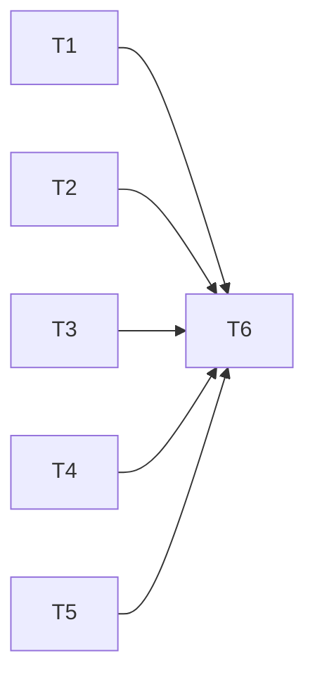

# Show the deployed version in kyber-weave --version and in both KyberDash Settings views

**Status: Archived — complete 2026-10-29.** Closeout mapping is in the Closeout mapping section at the end. Approved for execution under D11 (`AUTONOMOUS_APPROVAL: approve-and-execute`, provenance `autonomous: recommendation accepted`). Frontmatter `status: archived` follows the closed status vocabulary (`KW-DOC-SPEC-002`).

**Development mode:** `test-first` (packet value; no user opt-out). **Autonomy:** `autonomous` (packet value and the repository Config Reg `<autonomy>`).

**Scale:** `extends-component`, components `KyberDash` (new read-only route, two Settings views) and `Distribution` (the `--version` contract and its documented output).

**Objective (user words):** "when I open settings in the tray I want to see the current version of the kyberdash. I should be able to use `kyber-weave --version` to get the current deployed version, and the kyberdash web based dashboard settings option should also show me the current version."

> Discovery (authoring pass 1): codegraph 4, docs 1, direct reads 18, greps 14.
> - CodeGraph returned `ReleaseVersion`, `KyberdashCli`/`resolve_from` (tray CLI resolution), the tray `SettingsView`, `Popover`, `Maintenance`, `viewState.ts`, `api.rs` (`ApiResponse`, `LoopbackClient`, `api_request_url`), `Runtime`, the web `SettingsDrawer`/`PreviewPanel`, `kyberApi.ts` (`fetchJson`, `KyberApiError`) and the engine `settings-view.ts`.
> - Docs: `docs_explore` returned `docs/dash/architecture.md` and `docs/dash/runbook.md` (released binary, embedded web assets).
> - Direct reads, each for something the indexes did not return verbatim: the three architect references and `AGENTS.md` (not indexed code); `docs/plans/README.md` (index shape); one archived plan (template precedent); `src/KyberWeave.Cli/Program.cs` lines 1-60 and 270-302 (top-level statements: `SetApplicationVersion` and `GetVersion`, not returned by CodeGraph); `docs/distribution.md` lines 160-284 (the binary-versioning section, beyond the docs budget); `dash/src/server/routes.ts` lines 1200-1320 (`/api/kyber/meta` body); `tests/KyberWeave.Tests/VersionRetrievalTests.cs` (existing test pattern); `docs/rules/kyberdash-display-layer.md` (rule text); `dash/tray/src-tauri/src/api.rs` lines 1-60 (`API_PATHS`); `ipc.rs` lines 1-90 (`ViewState`, `view_state`); `runtime.rs` lines 170-199, 295-319, 575-620 (`ReportCacheState`, `get_view_state`, `poll_report_inner`); `dash/src/canon/projection.ts` lines 175-214 (the measured `/meta` stall); `SettingsDrawer.tsx` lines 400-419.
> - Greps (narrow, self-gathered): `--version` and `InformationalVersion` in the CLI and tests; `KYBERDASH_VERSION` and `package.json` in `dash/src`; `/meta` and `apiVersion` across `dash/`; version in the tray UI and web sources; `meta|api_version` in the tray crate; route-path mentions in `docs/`; `-p:Version` in the release workflow and local release script; `npm version` in `release.yml`; `version` in `docs/cli-command-surface.md`; the catalog component names; the `test`/`typecheck` scripts in the three `package.json` files.
>
> Validation note: the planner harness has no shell. `docs_validate` and `docs_drift` (MCP) were run on this plan. The plan file and the index row are written but **not yet `git add`ed**; the conductor must stage and commit them (AGENTS.md "Persisted plans belong in docs").

---

## 1. Problem and goal

### 1.1 Problem

- **CLI.** `kyber-weave --version` already prints the deployed version. `Program.cs` calls `config.SetApplicationVersion($"kyber-weave {GetVersion()}")`. `GetVersion()` reads `AssemblyInformationalVersionAttribute` and strips the `+<sha>` build metadata. `release.yml` stamps it with `-p:Version="${VERSION}"`. `VersionRetrievalTests` checks only that the output *contains* `kyber-weave` and `0.1.0`, so it does not pin the format. `docs/distribution.md` line 279 also shows an example with the `+sha` suffix, which the code removes. The doc and the code disagree.
- **KyberDash.** The engine already knows its version: `KYBERDASH_VERSION` comes from `dash/package.json`, and `release.yml` line 378 stamps it with `npm version "${RELEASE_VERSION}"`. It is served on `GET /api/kyber/meta` and in the report as `kyberdashVersion`. Neither Settings view shows it: the web `SettingsDrawer` and the tray `SettingsView` have no version line.
- **`/meta` is the wrong feed for this.** It also returns `bridge.getMeta()`, which reads the store. One measurement put it at 23 s during a projection (`projection.ts`, `yieldToEventLoop` remarks). The tray polls every 15 s while open, so a store-bound read is too costly just to show a version string.

### 1.2 Goal

- `kyber-weave --version` prints exactly `kyber-weave <version>`, with no build metadata. A test pins this, and `docs/distribution.md` describes it correctly.
- A new read-only, store-free `GET /api/kyber/version` returns `{ "version": <KYBERDASH_VERSION>, "apiVersion": <REPORT_SCHEMA_VERSION> }`. It is the one API both surfaces use.
- The web Settings drawer shows `KyberDash version <version>`, read from that route.
- The tray Settings view shows `KyberDash version <version>`. The Rust core fetches the route on its existing poll and passes the document through `ViewState` unchanged.
- If the version cannot be read, both surfaces show `KyberDash version unknown`. They never show a default such as `0.0.0`.

## Decisions

| ID | Question | Answer / decision | Mitigating and supporting information | Status / approval provenance |
|---|---|---|---|---|
| D1 | Does `kyber-weave --version` need a code change? | No. Keep `GetVersion()` as it is. Add a test pinning the exact output to `kyber-weave <InformationalVersion without +metadata>` for both `--version` and `-v`. Correct the `docs/distribution.md` output example so it shows no `+sha`. | Verified in code: `Program.cs` lines 19 and 287-301. The release stamps `-p:Version` (`release.yml` 277/292/565/1412; `scripts/release-local.sh` 121/334). The SDK appends the source revision to InformationalVersion, and `GetVersion` strips it. So a released binary prints the release tag version, which is the "deployed version" the user asked for. `cli-command-surface.md` line 191 already says `kyber-weave <version>`. Only `distribution.md` line 279 is wrong. Rejected: printing the `+sha` (changes a documented contract that `ProcessProbes` and the update loop parse). | autonomous: recommendation accepted (source = Program.cs, release.yml, cli-command-surface.md) |
| D2 | Where does the KyberDash version come from? | `KYBERDASH_VERSION` in `dash/src/server/routes.ts`, read from `dash/package.json`. No new stamping. | `release.yml` line 378 already stamps `dash/package.json` with the release version before the SEA build. `sea-shim.cjs` serves `package.json` as a SEA asset, so `createRequire('../../package.json')` resolves inside the released binary. `/meta` already relies on this. A dev checkout shows whatever `dash/package.json` holds, and the runbook will say so (H3). | autonomous: recommendation accepted (source = release.yml, sea-shim.cjs, routes.ts) |
| D3 | Which API carries the version to both surfaces? | A new route, `GET /api/kyber/version`, returning `{ version, apiVersion }`. It does no store access, and a non-GET method gets 405. Both surfaces read it, and nothing else, for this purpose. | Rejected `/api/kyber/meta`: it is store-bound (`bridge.getMeta()`) and measured 23 s during a projection, and the tray polls every 15 s. Rejected adding a field to `/api/kyber/settings`: `parseSettingsPatch` refuses unknown keys, so a read-only field in a PUT-able document invites a client to echo it back and get a 400. Rejected the report's `kyberdashVersion`: the web Settings drawer does not fetch the report, and it is null in the tray's setup and starting phases. Honours the display-layer rule: one API layer, and the surfaces only render. Cost of being wrong is low: one additive read-only route. | autonomous: recommendation accepted (source = routes.ts, projection.ts, settings-view.ts, docs/rules/kyberdash-display-layer.md) |
| D4 | How does the tray get it? | `api.rs` gains `VERSION_PATH = "/api/kyber/version"` in the closed `API_PATHS` list (7 → 8). `poll_report_inner` fetches it with `fetch_document` next to jobs, settings and coverage, into a new `ReportCacheState.kyberdash_version: Option<Value>`. `ipc::ViewState` gains `kyberdash_version: Option<serde_json::Value>`, serialized as `kyberdashVersion` and passed through unchanged. A failed fetch gives `None`. | Same "carried verbatim, unknown stays unknown" pattern as `jobs`, `shared_settings` and `coverage` (`runtime.rs` 600-606, `ipc.rs` 50-58). The webview opens no sockets (CSP), so the Rust core must fetch it. No new IPC command and no capability change: `authorized_commands` stays at 9. Re-fetching on every poll means an engine replaced by `kyber-weave update` shows its new version at the next poll. The cost is one loopback GET with no store read. | autonomous: recommendation accepted (source = api.rs, runtime.rs, ipc.rs) |
| D5 | Which version does the tray show: the engine's or the tray app bundle's? | The KyberDash engine's version, from the API. The tray app bundle's own version is out of scope. | The user asked for "the current version of the kyberdash", and the brief requires one API consumed by both surfaces. The bundle version would be a tray-local value that the web could not show, so it would break parity. Normally the two match, because `kyber-weave update` updates both together. If the bundle version is wanted later, it is a separate request. No todo is created without the owner's acceptance (AGENTS.md). | autonomous: recommendation accepted (source = packet constraint, AGENTS.md display-layer rule) |
| D6 | Wording and placement | Text: `KyberDash version <version>`. Unknown: `KyberDash version unknown`. Web: a line at the end of the drawer content, after `<DashboardPortSetting />`, with `data-testid="settings-kyberdash-version"`. Tray: a `settings__note` line just above the Back `nav`, with the same test id. While the web query is still loading, show `KyberDash version …`, which is never a value. | Short and plain, the same on both surfaces. The test ids match so the tests read alike. Cheap to reverse. | autonomous: low-confidence, no authoritative source |
| D7 | Does the web poll the route? | No. One `useQuery` fetch when the drawer content mounts, with no `refetchInterval`. | The display-layer rule allows read-only polls, but a version does not need one. Not polling keeps `TIMER_ALLOWLIST` unchanged. | autonomous: recommendation accepted (source = docs/rules/kyberdash-display-layer.md) |
| D8 | Gates, and is `scripts/update-loop.sh` required? | Gates: the .NET set (T1), the dash npm gates (T2, T3), the tray UI gates (T5), the tray cargo gates (T4), and docs validate/drift (T6). `update-loop.sh` is **not** required. | AGENTS.md requires the loop only when the self-updater, `install.sh`, the Squad release path, or how `kyberdash` is built or updated changes. None of them change here: `release.yml` and the SEA build are untouched, and D2 reuses the existing stamp. The new route is engine code covered by the dash gates. | autonomous: recommendation accepted (source = AGENTS.md) |
| D9 | ADR? | No ADR. ADR waiver: an additive read-only route and display lines under the existing display-layer decision ([ADR 0033](../../adr/0033-kyberdash-surfaces-are-display-layers.md)). No new boundary, dependency or schema. | Durable facts go to canonical docs (Design harvest H1–H4). | autonomous: recommendation accepted |
| D10 | Mode and autonomy | `development-mode: test-first`, `autonomy: autonomous`. | Packet values. The repository Config Reg `<autonomy>` is `autonomous`. | autonomous: recommendation accepted (packet) |
| D11 | Approve and execute this plan? | Approved. The plan moves to Ready, and execution proceeds on branch `feat/kyberdash-version` from `origin/main` `fad32474`. Scale `extends-component` (KyberDash, Distribution) confirmed. | Conductor input `AUTONOMOUS_APPROVAL: approve-and-execute` under resolved autonomy `autonomous`, `development-mode: test-first`. | autonomous: recommendation accepted (gate = approve-and-execute, 2026-10-29) |

## 2. Investigation findings

- `kyber-weave --version` and `-v` go through Spectre's `SetApplicationVersion`. They exit 0 and print `kyber-weave <version>` (`VersionRetrievalTests.CliVersionFlagOutputsApplicationVersionAndExitsZero`). `kyber-weave-mcp --version` is separate and unchanged.
- `kyberdash --version` already exists (`dash/src/cli/program.ts` line 61, `.version(version)`). It is not part of this request.
- `/api/kyber/meta` returns `{ ...bridge.getMeta(), version, apiVersion }` (`routes.ts` 1214-1228). It has tests in `report-route.test.ts` (98-118), `kyber-api.test.ts` (762, 1364 method-rejection list) and `web-dashboard.test.ts` (Host/Origin guard at 62/67).
- Tray: `api_request_url` refuses any path not in `API_PATHS`, so the new path must be added there or every fetch fails. `poll_report_inner` replaces every cached document on each poll.
- Tray UI: `Popover` renders `SettingsView` with `settings` and `sharedSettings`. `SettingsView` has no test file of its own. It is tested through `Popover.test.tsx` and `commands.test.tsx`.
- Web: `SettingsDrawer` → `SettingsContent` (`useQuery`) → `DashboardPortSetting` at line 394. API helpers are in `dash/web/src/lib/kyberApi.ts` (`fetchJson`). `SettingsDrawer.test.tsx` exists.
- `npm --prefix dash run test` runs `vitest run src tests scripts web/src`, so it covers the web tests. The tray UI has its own vitest (`npm --prefix dash/tray/ui run test`).
- Enforcement: `dash/src/architecture/display-layer.test.ts` scans the tray and web sources. This change adds no timer, no argv literal and no engine value import.

## 3. Test contract (test-first)

| Task | Test project or file | Runner command | Observable behavior | RED evidence required | GREEN acceptance |
|---|---|---|---|---|---|
| T1 | `tests/KyberWeave.Tests/VersionRetrievalTests.cs` (new theory `CliVersionFlagPrintsExactlyNameAndVersionWithoutBuildMetadata`, `--version` and `-v`) | `dotnet test tests/KyberWeave.Tests/KyberWeave.Tests.csproj -c Release --filter FullyQualifiedName~VersionRetrievalTests` | Trimmed stdout equals `kyber-weave ` + the assembly InformationalVersion with any `+…` suffix removed. Exit 0. No `+` in the output. | **Characterization pin, no RED possible:** the behaviour already exists (D1). Instead, record the test passing on the unchanged `Program.cs`, *and* a local mutation run (temporarily return the unstripped InformationalVersion from `GetVersion`) showing the test fails. Revert the mutation before commit. | Same test passes against the unmodified `Program.cs`. No assertion weakened. |
| T2 | `dash/src/server/report-route.test.ts` (new `describe('GET /api/kyber/version')`); `dash/src/server/kyber-api.test.ts` (add the path to the method-rejection list at ~1364) | `npm --prefix dash run test -- src/server/report-route.test.ts src/server/kyber-api.test.ts` | `GET /api/kyber/version` → 200 `{ version: <dash/package.json version>, apiVersion: 1 }`, exactly those two keys. `POST`/`PUT`/`DELETE` → 405. The route is handled even when the bridge's store reads throw (a bridge stub whose `getMeta` throws still gets 200), which proves it reads no store. | The new tests fail: the route is unhandled (falls through, not 200), and the method list gets no 405. | Same tests pass. The existing `/meta` tests stay green. |
| T3 | `dash/web/src/components/settings/SettingsDrawer.test.tsx` | `npm --prefix dash run test -- web/src/components/settings/SettingsDrawer.test.tsx` | With fetch stubbed so `/api/kyber/version` returns `{ version: '9.8.7-rc.1', apiVersion: 1 }`, the drawer shows `KyberDash version 9.8.7-rc.1` at `settings-kyberdash-version`. With a 500 or a rejected fetch, it shows `KyberDash version unknown`. It never shows `0.0.0`. Exactly one request is made to `/api/kyber/version`. | The new tests fail: the test id is missing. | Same tests pass. The existing drawer tests stay green. |
| T4 | `dash/tray/src-tauri/src/runtime.rs` `#[cfg(test)]` (new tests with `FakeFetcher`); `dash/tray/src-tauri/src/api.rs` tests | `cd dash/tray/src-tauri && cargo test` | `api_request_url` accepts `…/api/kyber/version` and still refuses unknown paths. After a poll, `get_view_state()` serializes `kyberdashVersion` equal to the fetched document. When that fetch fails, `kyberdashVersion` is `null`, even if an earlier poll succeeded. | The new tests fail to compile or fail: the constant and the field are missing. | Same tests pass. `cargo fmt --check` and `cargo clippy -- -D warnings` are clean. |
| T5 | `dash/tray/ui/src/Popover.test.tsx` (Settings view cases) | `npm --prefix dash/tray/ui run test -- src/Popover.test.tsx` | Opening Settings with `state.kyberdashVersion = { version: '9.8.7', apiVersion: 1 }` shows `KyberDash version 9.8.7` at `settings-kyberdash-version`. With `kyberdashVersion` `null` or absent, it shows `KyberDash version unknown`. | The new tests fail: the test id is missing. | Same tests pass. `npm --prefix dash/tray/ui run typecheck` is clean. |
| T6 | No test (documentation). | `docs_validate` / `docs_drift` (MCP) or `dotnet run --project src/KyberWeave.Cli -- docs validate .` and `docs drift .` | The canonical docs carry H1–H4. | Not applicable: no-test task. It is verified by the two docs gates and a read-through against H1–H4. | Both docs gates pass with zero findings. |

## 4. Tasks

**T1: Pin the `kyber-weave --version` output and correct the doc example.** Skills: `test-dev`, `csharp-dev` (no production change expected).
- Files: `tests/KyberWeave.Tests/VersionRetrievalTests.cs`, `docs/distribution.md` (the "Binary versioning and inspection" output-format line only).
- Acceptance: T1 contract row. `distribution.md` says the output is `kyber-weave <version>` with build metadata removed (example `kyber-weave 0.2.0-rc.1`). `Program.cs` is unchanged.
- Dependencies: none.

**T2: Add `GET /api/kyber/version` to the engine.** Skills: `test-dev` (RED), `typescript-dev` (GREEN).
- Files: `dash/src/server/routes.ts` (a new branch beside `/api/kyber/meta`, reusing `KYBERDASH_VERSION` and `REPORT_SCHEMA_VERSION`, with a short why-comment that it is store-free on purpose: D3), `dash/src/server/report-route.test.ts`, `dash/src/server/kyber-api.test.ts`.
- Acceptance: T2 contract row. `npm --prefix dash run typecheck`, `lint`, `test` and `check:reachable` are green.
- Dependencies: none.

**T3: Show the version in the web Settings drawer.** Skills: `test-dev` (RED), `react-dev` (GREEN).
- Files: `dash/web/src/lib/kyberApi.ts` (`KyberVersion` type, `fetchKyberVersion()` through `fetchJson('/api/kyber/version')`), `dash/web/src/components/settings/SettingsDrawer.tsx` (`SettingsContent`: `useQuery({ queryKey: ['kyber-version'], queryFn: fetchKyberVersion })` with no interval, and the line after `<DashboardPortSetting />`), `SettingsDrawer.test.tsx`.
- Acceptance: T3 contract row. The dash gates are green. The display-layer guard is green (no timer, no engine value import).
- Dependencies: none. It consumes only the D3 contract shape fixed in this plan, and its files do not overlap T2.

**T4: Carry the version through the tray core.** Skills: `test-dev` (RED), `tauri-dev` (GREEN).
- Files: `dash/tray/src-tauri/src/api.rs` (`VERSION_PATH`; `API_PATHS` becomes `[&str; 8]`), `dash/tray/src-tauri/src/runtime.rs` (`ReportCacheState.kyberdash_version`, fetched in `poll_report_inner`, passed in `get_view_state`), `dash/tray/src-tauri/src/ipc.rs` (`ViewState.kyberdash_version`, a new `view_state` parameter, and its existing callers and tests updated).
- Acceptance: T4 contract row. `cargo fmt --check && cargo clippy -- -D warnings && cargo test` are green. `authorized_commands` and the capability file are unchanged.
- Dependencies: none.

**T5: Show the version in the tray Settings view.** Skills: `test-dev` (RED), `react-dev` (GREEN).
- Files: `dash/tray/ui/src/viewState.ts` (`KyberdashVersion = { version: string; apiVersion: number }`; `ViewState.kyberdashVersion?: KyberdashVersion | null`), `dash/tray/ui/src/components/SettingsView.tsx` (new optional prop `kyberdashVersion`, and the line above the Back `nav`), `dash/tray/ui/src/Popover.tsx` (pass `state.kyberdashVersion ?? null`), `dash/tray/ui/src/Popover.test.tsx`.
- Acceptance: T5 contract row. `npm --prefix dash/tray/ui run typecheck` and `test` are green. `npm --prefix dash run lint` is green, since it covers the tray UI.
- Dependencies: none. It consumes only the D4 field name and shape fixed in this plan, and its files do not overlap T4.

**T6: docs-dev closeout and harvest.** Skills: `app-docs-standard` (docs-dev).
- Files: the H1–H4 targets below. Also archive this plan to `docs/archive/plans/` with `git mv`, and move its index row to Archived Plans with the closeout mapping.
- Acceptance: T6 contract row. `docs validate . --merge-ready` and `docs drift .` are clean after the archive.
- Dependencies: T1–T5 (it documents what shipped).

### Dependency graph

T1 to T5 run in parallel, up to `review.max-concurrent-workers` (4). Within each task, RED comes before GREEN. Each developer task ends with that worker's own `task-gate`.

## Design harvest

| ID | Target component | Target doc type | Target doc | Content |
|---|---|---|---|---|
| H1 | KyberDash | architecture (API contract) | [dash/architecture.md](../../dash/architecture.md) route table | A new row: `/api/kyber/version`, `GET`, `{ version, apiVersion }`, store-free on purpose (why not `/meta`). Both Settings views read it. The tray carries it as `ViewState.kyberdashVersion`, and unknown renders as unknown. |
| H2 | KyberDash | onboarding | [dash/onboarding.md](../../dash/onboarding.md) | Where to see the KyberDash version: the web Settings drawer, the tray Settings view, `kyberdash --version`. |
| H3 | KyberDash | runbook | [dash/runbook.md](../../dash/runbook.md) curl block | `curl -s http://127.0.0.1:3000/api/kyber/version`. Note that a dev checkout reports `dash/package.json`'s version, and a release reports the stamped release version. |
| H4 | Distribution | operations / reference | [distribution.md](../../distribution.md) "Binary versioning and inspection" | The exact `kyber-weave --version` output (build metadata removed), corrected example. Note that `dash/package.json` is stamped by `npm version` in the same release, so the KyberDash Settings views show the same release version. |

## 6. Risks

- **Engine and CLI versions can differ** if a user updates with `--no-kyberdash`. Each surface reports its own binary truthfully, which is correct, not a defect.
- **An older engine without the route** answers 404. The tray stores `None` and the web query errors, so both show `KyberDash version unknown`. This is honest, and it ends once the engine is updated.
- **Dev checkouts** show the `dash/package.json` version, not a release. This is documented (H3).
- **An `API_PATHS` array-length change** is a compile-time contract. A missed update fails `cargo build`, not runtime.
- **Linux:** the tray does not ship on Linux. The cargo tests and the dash tests run in Linux CI. The owner's Linux verification is the CI run; no tray install is exercised.

## 7. Out of scope

- The tray app bundle's own version (D5).
- Any change to `kyberdash --version`, `kyber-weave-mcp --version`, release stamping, `install.sh`, or the self-updater.
- Version-mismatch warnings between CLI, engine and tray.

## 8. Verification gates

- .NET (T1): `dotnet format KyberWeave.sln whitespace --verify-no-changes`, `dotnet format … style --verify-no-changes --severity warn`, `dotnet build KyberWeave.sln -c Release`, `dotnet test tests/KyberWeave.Tests/KyberWeave.Tests.csproj -c Release`. Or the full `dotnet run --project src/KyberWeave.Cli -- review gates . --out artifacts/gates.json`.
- Dash (T2, T3, T5 lint): `npm --prefix dash run typecheck`, `lint`, `test`, `check:reachable`.
- Tray UI (T5): `npm --prefix dash/tray/ui ci`, then `npm --prefix dash/tray/ui run typecheck` and `npm --prefix dash/tray/ui run test`.
- Tray core (T4): `cd dash/tray/src-tauri && cargo fmt --check && cargo clippy -- -D warnings && cargo test`.
- Docs (T1, T6, and this plan): `docs validate .` (with `--merge-ready` after archive) and `docs drift .`.
- `scripts/update-loop.sh`: not required (D8).

## 9. Review and closeout

- Whole-change council review once, after the draft pull request is pushed (`code-review`). Each task's own `task-gate` runs first.
- `docs-dev` closeout (T6) harvests H1–H4, maps D1–D11 to their destinations or waivers, archives the plan, and records `no ADR — ADR waiver` (D9).

## Closeout mapping

**Acceptance check.** The code shipped on branch `feat/kyberdash-version`: `dash/src/server/routes.ts` (the `/api/kyber/version` route), `dash/src/server/report-route.test.ts` and `kyber-api.test.ts` (T2), `dash/web/src/lib/kyberApi.ts` and `SettingsDrawer.tsx` with its test (T3), `dash/tray/src-tauri/src/{api,runtime,ipc}.rs` (T4), `dash/tray/ui/src/{viewState,Popover,components/SettingsView}.tsx` with `Popover.test.tsx` (T5), and `tests/KyberWeave.Tests/VersionRetrievalTests.cs` (T1). This closeout pass re-ran the documentation gates only. The dash, tray and .NET gates are the conductor's evidence, recorded in the change's digest, not this section.

**Documentation validation.** `docs validate` and `docs drift` run after the content edits and again after the archive move. Results are recorded in the closeout digest.

### Decisions

| ID | Destination | Waiver or note |
|---|---|---|
| D1 | Output contract in [distribution.md](../../distribution.md) "Binary versioning and inspection" (H4). Corrected example in [install.md](../../install.md) "Verify". Test pin in `tests/KyberWeave.Tests/VersionRetrievalTests.cs`. | Durable fact documented. No waiver. |
| D2 | [dash/architecture.md](../../dash/architecture.md) route table row for `/api/kyber/version` (H1). Release stamp note in [distribution.md](../../distribution.md) (H4). | Durable fact documented. No waiver. |
| D3 | [dash/architecture.md](../../dash/architecture.md) route table row (H1). Curl check in [dash/runbook.md](../../dash/runbook.md) "Option B" (H3). | Durable fact documented. No waiver. |
| D4 | [dash/architecture.md](../../dash/architecture.md) route table row (H1). | Durable fact documented. No waiver. |
| D5 | [dash/onboarding.md](../../dash/onboarding.md) "Check the KyberDash version" (H2). | Durable fact documented. No waiver. |
| D6 | [dash/onboarding.md](../../dash/onboarding.md) "Check the KyberDash version" (H2). | Durable fact documented. No waiver. |
| D7 | [dash/architecture.md](../../dash/architecture.md) route table row (H1); [dash/onboarding.md](../../dash/onboarding.md) (H2). | Durable fact documented. No waiver. |
| D8 | [distribution.md](../../distribution.md#verifying-a-release-locally) already documents the local release loop that `AGENTS.md` requires for self-updater changes. The loop was not required for this change, so nothing new is harvested. | None needed: the destination exists and is current. |
| D9 | [ADR 0033](../../adr/0033-kyberdash-surfaces-are-display-layers.md) governs the display-layer boundary this change sits under. Durable facts are in H1 to H4. | no ADR — ADR waiver: an additive read-only route and display lines under the existing display-layer decision. No new boundary, dependency or schema. |
| D10 | Documentation waiver: `development-mode` and `autonomy` are plan process state. They are transient, with no surviving architectural invariant, and stay recorded in this file's frontmatter. | Documentation waiver, transient process metadata. |
| D11 | Documentation waiver: the approval gate is a transient process record. It stays in this archived plan's Decisions table. | Documentation waiver, transient approval record. |

### Design harvest

| ID | Destination | Documentation impact | Impact components | Last reviewed | Status |
|---|---|---|---|---|---|
| H1 | [dash/architecture.md](../../dash/architecture.md) route table | extends-component | KyberDash | 2026-10-29 | Archived |
| H2 | [dash/onboarding.md](../../dash/onboarding.md) "Check the KyberDash version" | extends-component | KyberDash | 2026-10-29 | Archived |
| H3 | [dash/runbook.md](../../dash/runbook.md) "Option B", version curl check | extends-component | KyberDash | 2026-10-29 | Archived |
| H4 | [distribution.md](../../distribution.md) "Binary versioning and inspection" | extends-component | Distribution | 2026-10-29 | Archived |

Also corrected: [install.md](../../install.md) "Verify" example (`kyber-weave <version>`, no `+sha`), last reviewed 2026-10-29.

### Catalog impact

No new, moved, or renamed component. The KyberDash and Distribution entries in [catalog.md](../../catalog.md) are unchanged.
