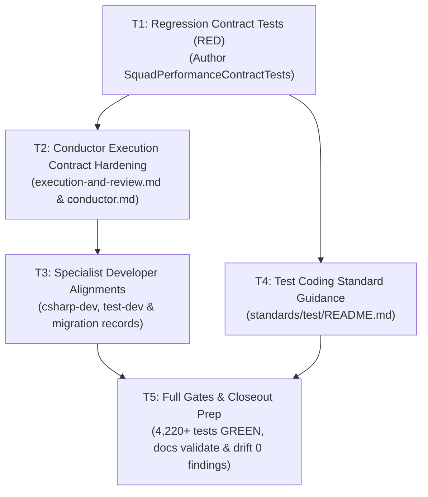

# Kyber-Squad performance improvements and execution latency reduction

**Status: Archived — complete 2026-10-30.** All tasks T1–T5 delivered under test-first development mode. Contract tests pass 26/26 in SquadPerformanceContractTests; full suite passes 4,278 total / 4,251 passed / 0 failed; deterministic gates and doc checks pass clean with 0 findings.

**Development mode:** `test-first` (default; no user opt-out).  
**Autonomy:** `autonomous` (resolved from repository Config Reg `<autonomy>`).  
**Scale:** `extends-component`, component `KyberSquad`.  
**Branch:** `feat/kyber-squad-performance-improvements`.

> Discovery: codegraph 13, docs 16, direct reads 32.
> - CodeGraph exploration returned verbatim source for: `SquadCommandComposition`, `SquadModelPreset`, `SquadSourceLoader`, `AntigravityRenderer`, `SquadDocsHarvestContractTests`, `SquadCanonicalContentTests`, `SquadModelPresetLifecycleTests`, `SquadModelPresetRenderTests`, `SquadDeploymentPlan`, `GateCatalogue`, `store.ts`, and `codex.ts`.
> - Docs status: `root=/Users/dave/git/personal/agy/kyber-weave rev=8612eb4 dirty=yes documents=140`. Explored `squad performance conductor`, `KW-DOC-LIFECYCLE-001`, `docs_validate`, and `docs_drift`.
> - Direct reads (with reasons):
>   1. `/Users/dave/.gemini/antigravity/mcp/kyber-weave/docs_explore.json`: To verify parameter schema of `docs_explore` tool.
>   2. `products/kyber-squad/profiles/models.yml`: To inspect currently declared model profiles (`fast`, `general`, `orchestration`, `reviewer`, `architect`, `deep-planning`) and confirm working tree has no uncommitted model changes.
>   3. `products/kyber-squad/squad.yml`: To inspect squad bundle and profile declarations.
>   4. `products/kyber-squad/bundles/full.yml`: To inspect full bundle agent roster.
>   5. `products/kyber-squad/agents/csharp-dev.md`: To inspect csharp-dev model-profile and instruction body, confirming working tree is clean.
>   6. `tests/KyberWeave.Tests/SquadCanonicalContentTests.cs`: To inspect circuit breaker, response format, agent model, and body assertions.
>   7. `tests/KyberWeave.Tests/SquadDocsHarvestContractTests.cs`: To inspect required phrases for conductor, docs-dev, and architect plan authoring.
>   8. `products/kyber-squad/agents/architect/references/plan-authoring.md`: To verify plan authoring contract and scale declaration requirements.
>   9. `products/kyber-squad/agents/architect/references/autonomy-decisions.md`: To verify autonomous decisions protocol.
>   10. `products/kyber-squad/agents/architect/references/test-first-contract.md`: To verify test-first contract table schema.
>   11. `docs/plans/README.md`: To inspect plan inventory table and active plans conventions.
>   12. `docs/archive/plans/2026-10-29-dotnet-test-suite-optimization.md`: To inspect frontmatter, scale, decisions table, and design harvest table conventions.
>   13. `products/kyber-squad/agents/conductor.md`: To inspect conductor role, delegation, and packet requirements.
>   14. `products/kyber-squad/agents/conductor/references/execution-and-review.md`: To inspect execution-and-review contract, task session continuity, test-first mode, and developer exit gate.
>   15. `products/kyber-squad/agents/conductor/references/plan-path.md`: To inspect plan-path lifecycle and approval protocol.
>   16. `products/kyber-squad/agents/test-dev.md`: To inspect test-dev workflow, isolation, and completion gate.
>   17. `docs/standards/test/README.md`: To inspect test coding standard, runner commands, and isolation rules.
>   18. `tests/KyberWeave.Tests/SquadModelPresetRenderTests.cs`: To inspect model preset render tests.
>   19. `tests/KyberWeave.Tests/AntigravityRendererContractTests.cs`: To inspect Antigravity agent rendering assertions.
>   20. `src/KyberWeave.Core/Squad/Rendering/AntigravityRenderer.cs`: To inspect how `modelTier` is rendered into agent frontmatter.
>   21. `products/kyber-squad/migration/csharp-dev.md`: To inspect migration report format and `final-body-sha256` calculation.
>   22. `docs/catalog.md`: To confirm component name `KyberSquad` and owner `dpalfery`.
>   23. `tests/KyberWeave.Tests/SquadPerformanceContractTests.cs`: Checked for existence to determine whether prior T1 dispatch left partial files (file was not found).
>   24. `docs/plans/2026-10-30-kyber-squad-performance-improvements.md`: Direct read to review initial revision prior to scope change.
>   25. `docs/plans/README.md`: Direct read to review Active Plans registration row.
>   26. `products/kyber-squad/agents/csharp-dev.md`: Re-checked lines 1–20 to confirm absence of model profile edits.
>   27. `.system_generated/steps/10/output.txt`: Direct read to inspect CodeGraph explore output for `SquadPerformanceContractTests`.
>   28: `docs/plans/README.md`: To inspect and verify Active Plans registration row status during R2 refinement.
>   29. `docs/plans/2026-10-30-kyber-squad-performance-improvements.md`: Direct read to review and update D8, R2, AP3, H1, and §1–§7 per user directive R2.
>   30. `docs/plans/2026-10-30-kyber-squad-performance-improvements.md`: Direct read to update D7, R3, AP4, H1, §1.1 #6, §1.2 #6, §3, §4 (T1–T3), and §7 per user concurrency refinement R3.
>   31. `docs/plans/README.md`: Direct read to update Active Plans registration row reflecting worktree-isolated parallel task/test execution and adversarial RED/GREEN separation.
>   32. `docs/plans/2026-10-30-kyber-squad-performance-improvements.md`: Direct read to record user explicit "approved execute" approval on AP4.

---

## Decisions

| ID | Question | Answer / Decision | Mitigating and Supporting Information | Status / Approval Provenance |
|---|---|---|---|---|
| D1 | How should model profiles be configured across agent roles to balance token cost with code authoring capability? | **Removed / Out of Scope per user direction.** The user explicitly directed: *"remove anything to do with changing the model assignment we have a solution for model targeting. focus only on the deterministic checks and unit test effeciencies"*. Model assignment and profile pinning are handled by an external model targeting solution and are excluded from this plan. | User direction eliminates all changes to `products/kyber-squad/profiles/models.yml` and agent frontmatter model profiles (`csharp-dev.md`, etc.). Eliminates risk of profile schema churn or renderer regressions while keeping this plan laser-focused on deterministic checks and workflow efficiencies. | Removed / Out of Scope (`user: explicit scope revision`) |
| R1 | How should the plan scope be reframed following the user's directive? | Reframe the plan strictly around deterministic checks, conductor execution contracts, unit test execution efficiencies, and task workflow optimizations: direct assembly runner invocation, build-once test-many iteration, zero-stash red proofs, terse 6-field completion digests, inlined task packet context, serial branch-head integration with worktree/artifacts-isolated parallel task and test execution, and combining small same-role micro-tasks while preserving independent verification. | Grounded directly in explicit user prompt: *"remove anything to do with changing the model assignment we have a solution for model targeting. focus only on the deterministic checks and unit test effeciencies"*. | Approved (`user: explicit scope revision`) |
| D2 | What exact test execution command should be standardized across conductor task packets and worker instructions? | Fix the test invocation once in task packets and standards: run `dotnet build KyberWeave.sln -c Release` once, then execute the built assembly directly via `dotnet tests/KyberWeave.Tests/bin/Release/net10.0/KyberWeave.Tests.dll -class "<namespace>.<Class>" -reporter quiet` (or `dotnet test tests/KyberWeave.Tests/KyberWeave.Tests.csproj -c Release --no-build --filter "FullyQualifiedName~<namespace>.<Class>"`). Pre-populate this exact command in every task packet. | Direct assembly execution runs in sub-seconds (<500ms) with zero MSBuild evaluation overhead. Workers hunting for test commands waste tokens, rediscover syntax, and frequently trigger full-suite rebuilds. | Approved (`autonomous: recommendation accepted`) |
| D3 | How should build frequency be constrained during worker task execution? | Require workers to build once (`dotnet build KyberWeave.sln -c Release`), then perform `--no-build` / direct assembly runs filtered to the changed class during red/green iteration. Full-suite testing is reserved strictly for task completion (`task-gate`) and the final council. | Prevents repeated multi-second MSBuild re-evaluations during incremental code edits while guaranteeing full verification before handoff. | Approved (`autonomous: recommendation accepted`) |
| D4 | How should honest RED proofs be captured without incurring extra stash/unstash dispatches and conflict risk? | Eliminate `git stash` cycles for red proofs. Workers capture RED either by running the newly authored contract test against the clean base checkout/build (or in an isolated scratchpad worktree `git worktree add .agent_scratchpad/<task-id>/red HEAD`) before implementation, or within a test-dev dispatch prior to handing off to an implementation specialist. Zero `git stash` dispatches. | Stashing on dirty working trees introduces git race conditions, lost stashes, and consumes 2–3 redundant dispatches per task. Clean-tree or throwaway worktree test runs provide genuine red evidence at zero stashing cost. | Approved (`autonomous: recommendation accepted`) |
| D5 | What is the exact required schema for worker completion digests to eliminate validation rework? | Standardize on an exact 6-field digest contract:<br>`STATUS: PASS \| FAIL \| ESCALATION`<br>`FILES: <comma-separated-paths>`<br>`TESTS: total=N failed=N passed=N`<br>`COMMIT: <commit-sha \| NONE>`<br>`REMOTE_HEAD: <remote-head-sha \| UNPUSHED>`<br>`TASK_GATE: PASS \| FAIL \| NONE_DECLARED \| NONE_APPLICABLE \| UNAVAILABLE — ...`<br>Conductor rejects only digests missing one of these exact fields or reporting FAIL. | Historical rework in multi-agent runs arose from missing SHA or test count fields rather than defective code. A rigid contract eliminates ambiguous interpretations and wasted rework dispatches. | Approved (`autonomous: recommendation accepted`) |
| D6 | What context must conductor inline in task packets to keep plans out of worker context? | Conductor packets must inline: (1) Objective and strict boundary, (2) Entry-file table (paths and key symbols), (3) Acceptance criteria checklist, (4) Pre-computed test runner command (`-class`), and (5) Test/verification contract. Workers are strictly forbidden from reading `<plan-index>` or `<specification-index>`. | Inlining consumes minimal conductor tokens while saving hundreds of worker context tokens otherwise spent hunting files, and eliminates the risk of workers hallucinating or mutating unassigned plan tasks. | Approved (`autonomous: recommendation accepted`) |
| D7 | How should conductor concurrency and task/test execution be scheduled to avoid collisions while achieving maximum parallelization? | **Maximum Parallelization via Worktree / Artifacts Isolation (`D7`, `R3`):** Do NOT serialize all task execution or test runs! Independent ready tasks whose declared file/symbol scopes do not overlap run **in parallel** up to `review.max-concurrent-workers`: (1) Each concurrent write/test worker executes in an isolated git worktree (`git worktree add`, or harness `Workspace: share`/`branch`) or uses per-task `artifacts-path` isolation (`--artifacts-path` / isolated `TASK_GATE` `--out artifacts/task-gate-<task-id>.json` and class-filtered direct assembly execution `-class "<namespace>.<Class>"`) so multiple workers author code and run tests simultaneously without `index.lock` or build-output collisions. (2) **Only final integration/branch-head mutations are serialized:** cherry-picking/merging a finished worktree back onto the shared feature branch, recording shared index/gate state on the integration branch, and `git push` are serialized at the integration boundary. All read-only tasks, test runs, and non-overlapping task implementations run concurrently. | Worktree and artifact isolation completely eliminates `index.lock` contention and build/test output collisions, enabling simultaneous multi-worker execution without artificial serialization delays. | Approved (`autonomous: recommendation accepted per user explicit refinement R3`) |
| D8 | How should task splitting vs RED/GREEN separation be handled, and what does "collapse small tasks" mean? | **Adversarial RED/GREEN separation is strictly preserved:** `test-dev` owns RED (authoring the failing contract test with a distinct adversarial focus) and the implementation specialist (`csharp-dev`, etc.) owns GREEN. Never collapse RED and GREEN into a single worker dispatch—we intentionally pay the context/dispatch cost for the adversarial boundary between `test-dev` and the implementation developer.<br><br>**What "Collapse small tasks" means (`D8` / `R2`):** Small adjacent same-role tasks or micro-slices (for example, bundling all related RED assertions into a single `test-dev` dispatch, or bundling small related implementation edits / oracle fixes across 1–3 files within the same specialist role into one dispatch, rather than splitting a 2-file change into multiple micro-tasks) should be combined at plan-authoring / task-dispatch time, while keeping `test-dev` (RED), implementation specialist (GREEN), and the independent verification pass strictly separate. | Collapsing RED and GREEN into one agent breaks the adversarial verification boundary where `test-dev` writes objective, uncompromised test assertions. Combining small tasks applies strictly within the same specialist role (bundling adjacent RED contract assertions into one `test-dev` dispatch, or bundling adjacent implementation fixes into one `csharp-dev` dispatch), while the independent verification pass at task completion catches any uncommitted or passing false-positives. | Approved (`autonomous: recommendation accepted per user explicit refinement R2`) |
| D9 | What documentation closeout mechanism applies to this optimization plan? | Close out under an **ADR Waiver**: this plan refines internal prompt instructions, packet templates, and conductor execution mechanics within the existing Kyber-Squad architecture (ADR 0022, ADR 0036, ADR 0045) without introducing new external storage schemas, public CLI flags, or external communication boundaries. Harvest durable facts into `docs/kyber-squad/architecture.md`, `docs/kyber-squad/onboarding.md`, `docs/kyber-squad/requirements.md`, and `docs/standards/test/README.md`. | Conforms to the repository ADR waiver policy in `docs/plans/README.md`. | Approved (`autonomous: recommendation accepted`) |
| D10 | How is autonomous approval recorded? | Record `autonomous: recommendation accepted` per repository Config Reg `<autonomy>: autonomous`. | In autonomous mode, the architect resolves open items with recommendations and records the approval provenance directly. | Approved (`autonomous: recommendation accepted`) |
| AP1 | Approve and execute initial plan revision on branch feat/kyber-squad-performance-improvements? | Initial plan approved; subsequently superseded by AP2 following user scope direction R1 removing model profile assignment. | Superseded by AP2. | Superseded (`user: explicit scope revision`) |
| AP2 | Approve and execute the revised Ready plan on branch feat/kyber-squad-performance-improvements following user scope change R1? | Superseded by AP3 following user scope refinement R2 preserving adversarial RED/GREEN separation. | Superseded by AP3. | Superseded (`user: explicit scope refinement R2`) |
| R2 | How should task splitting vs RED/GREEN separation be handled per user explicit refinement on item #7? | User explicitly directed: *"problems, number 7 task splitting, i am ok combining small tasks, but when we talk red green, the test-dev agent has a different focus that the dev agent(csharp) and we want that advisarial relationship and will pay the context cost for it. ther other 1-6 look good, update teh plan"*. Strictly preserve the adversarial two-agent boundary: `test-dev` authors the failing contract test (RED) with an adversarial focus, and the implementation specialist (`csharp-dev`, etc.) implements production code (GREEN). Never collapse RED and GREEN into a single worker dispatch. Combining small tasks applies strictly to same-role micro-tasks (e.g. bundling related RED assertions into one `test-dev` dispatch, or bundling related implementation edits across 1–3 files within the same specialist role). | The user explicitly confirmed willingness to pay the dispatch and context cost to retain adversarial tension between test authorship and production implementation. | Approved (`user: explicit decision`) |
| AP3 | Approve and execute the revised Ready plan on branch feat/kyber-squad-performance-improvements following user scope refinement R2 (adversarial RED/GREEN separation strictly preserved)? | Superseded by AP4 following user concurrency refinement R3. | Superseded by AP4. | Superseded (`user: explicit concurrency refinement R3`) |
| R3 | How should task execution and test concurrency be scheduled per user explicit comment on maximum parallelization? | User explicitly directed: *"i want maximum parallelization, can we split by worktree still achive isolation but have multiple tasks running simaltanously? serializeing all tests will slow us down"*. Do NOT serialize all task execution or test runs. Independent ready tasks whose declared file/symbol scopes do not overlap execute **in parallel** up to `review.max-concurrent-workers`: each concurrent write/test worker executes in an isolated git worktree (`git worktree add`, or harness `Workspace: share`/`branch`) or uses per-task `artifacts-path` isolation (`--artifacts-path` / isolated `TASK_GATE` `--out artifacts/task-gate-<task-id>.json` and class-filtered direct assembly execution `-class "<namespace>.<Class>"`) so multiple workers author code and run tests simultaneously without `index.lock` or build-output collisions. **Only final integration/branch-head mutations are serialized:** cherry-picking/merging a finished worktree back onto the shared feature branch, recording shared index/gate state on the integration branch, and `git push` are serialized at the integration boundary. All read-only tasks, test runs, and non-overlapping task implementations run concurrently. | Eliminates unnecessary test and task serialization bottlenecks while preventing git `index.lock` contention and artifact overwrite collisions through worktree and artifact-path isolation. | Approved (`user: explicit decision`) |
| AP4 | Approve and execute the revised Ready plan on branch feat/kyber-squad-performance-improvements following user concurrency refinement R3 (maximum parallelization via worktree/artifacts isolation; serial branch-head integration)? | Approve and execute the revised performance improvements plan with worktree-isolated parallel task and test execution, serial branch-head integration, adversarial RED/GREEN role separation, small same-role micro-task bundling, and independent verification enforced. | Scales concurrency up to `review.max-concurrent-workers` for non-overlapping tasks and test runs via worktrees and isolated artifact paths. Grounded in empirical evidence, user directives R1, R2, R3, and approved decisions D1–D10, R1–R3. | Approved (user: explicit approve and execute — "approved execute") |
| D11 | How should read-only review lenses access git diff without executing git commands across subagents? | `DECISION-COUNCIL-GIT-ACCESS: OPTION-A-MATERIALIZED-DIFF`. Option A reads task-scoped `.agent_scratchpad/<task-id>/review-diff.patch`, created and removed by `code-reviewer` before council fan-out and after council completion, passed in each `review-lens` packet. `review-lens` retains `read-only` profile and reads `.agent_scratchpad/<task-id>/review-diff.patch` via `filesystem.read: allow` (`view_file` / `read_file`) without running git commands. | Preserves strict capability lattice (`read-only` subagents never execute git or mutate state) while eliminating git index contention and duplicate git diff executions across 17 lenses. Council hardening also includes cross-document contract parity, contract assertion rigor, operational lifecycle walks, literal prompt parsing, and refutation guardrails. | Approved (user: explicit selection "option 2" and "option a"; provenance: Kilo round 2, thread 4429455876, accepted by conductor) |

---

## Design harvest

```yaml
documentation-impact: extends-component
impact-components: [KyberSquad, ReviewCouncil]
```

| ID | Target component | Target doc type | Proposed location | Summary of durable knowledge |
|---|---|---|---|---|
| H1 | KyberSquad | architecture | [`docs/kyber-squad/architecture.md`](../../kyber-squad/architecture.md) | Concurrency and scheduling model (maximum parallelization of non-overlapping tasks and test runs via worktree/artifacts isolation; serial branch-head integration); strict adversarial two-agent RED (`test-dev`) vs GREEN (`csharp-dev` / implementation specialist) boundary; bundling small same-role tasks with preserved independent verification pass. |
| H2 | KyberSquad | onboarding | [`docs/kyber-squad/onboarding.md`](../../kyber-squad/onboarding.md) | Task execution runbook: inlined task packets (entry-file table, acceptance checklist), pre-computed assembly test runner command (`-class`), and terse 6-field completion digest contract. |
| H3 | KyberSquad | requirements | [`docs/kyber-squad/requirements.md`](../../kyber-squad/requirements.md) | Conductor execution invariants: strict 6-field digest validation, zero-stashing red proof contract, build-once test-many iteration rules, and adversarial RED/GREEN role separation. |
| H4 | KyberSquad | coding-standard | [`docs/standards/test/README.md`](../../standards/test/README.md) | Fast .NET direct assembly runner invocation (`dotnet <dll> -class ... -reporter quiet`), `--no-build` filtered test iteration, and clean-tree / worktree red proof verification. |
| H5 | ReviewCouncil | architecture | [`docs/code-review/architecture.md`](../../code-review/architecture.md) | Review Council hardening: materialized diff contract at task-scoped `.agent_scratchpad/<task-id>/review-diff.patch` before lens fan-out (Option A); cross-document and prompt-to-prompt contract parity across modified markdown instructions, runbooks, and reference contracts; contract assertion rigor (banning bare single-word `Assert.Contains`, unguarded boolean `||` assertions, non-contiguous multi-line `foreach` checks); operational lifecycle state-machine walks (`create` → `execute` → `integrate` → `cleanup`/`remove`/`prune` → `conflict`/`rollback`); literal prompt parsing prohibiting charitable reading; and refutation guardrails forbidding dismissal of contract assertions (`R14`), cross-document contradictions (`R16`), or missing lifecycle cleanup paths. |

---

## 1. Problem and Goal

### 1.1 Empirical Baseline & Friction Analysis

In recent multi-turn Kyber-Squad delivery sessions, analysis of execution logs, agent dispatches, and verification gates identified several compounding sources of latency, token waste, and dispatch overhead:

1. **Test Command Rediscovery & MSBuild Evaluation Latency:** Workers routinely re-investigate how to invoke tests, running full `dotnet test` invocations that trigger multi-second MSBuild project re-evaluations on every turn instead of executing the pre-compiled test assembly directly with `-class`.
2. **Build Frequency Churn:** Workers repeatedly rebuild the entire solution between test runs rather than adhering to a "build once, test many" loop with filtered `--no-build` runs.
3. **Stashing Overhead for Red Proofs:** Capturing honest RED proofs previously involved dirty-tree `git stash` / `git stash pop` sequences across multiple agent dispatches, risking merge collisions, lost stashes, and consuming 2–3 dispatches per task solely to manage git state.
4. **Digest Validation Churn:** Conductor rejected worker digests due to inconsistent formatting and missing metadata fields (such as commit SHAs or test counters), causing unnecessary rework loops even when code changes were functionally correct.
5. **Context Hunting & Packet Ambiguity:** Workers lacking inlined acceptance criteria or target file locations spent turns grepping or reading index files, pulling large plan documents into their working context and risking context exhaustion.
6. **Git Index Contention & Test Serialization Bottlenecks:** When multiple workers attempted concurrent writes or gate updates on a single shared worktree, git lock contention (`index.lock`) and merge collisions occurred. However, serializing all task execution or test runs introduces severe latency bottlenecks. True isolation with maximum parallelization requires executing independent, non-overlapping tasks and test runs in isolated worktrees or with per-task artifact paths, serializing only final branch-head integration.
7. **Micro-Task Over-Splitting vs Adversarial Focus:** Over-splitting tiny adjacent edits into multiple micro-tasks within the same role adds dispatch latency and token overhead. However, while combining small adjacent same-role tasks is beneficial, collapsing RED and GREEN into a single agent eliminates the adversarial relationship between `test-dev` and the implementation developer (`csharp-dev`). The adversarial boundary must be strictly preserved even though it carries context/dispatch costs.

### 1.2 Target Objectives

This plan introduces seven targeted, quality-preserving optimizations focused entirely on deterministic checks and workflow/test execution efficiencies:

- **Fix the test invocation once:** Pre-compute and inline the direct assembly runner command (`dotnet <dll> -class ... -reporter quiet`) in every task packet.
- **Build once, test many:** Build once at the start of a task, then run filtered `--no-build` tests during iteration; reserve full-suite runs for exit gates and council review.
- **Stop stashing for red proofs:** Capture RED proofs via clean base checkouts or throwaway worktrees with zero stash cycles.
- **Terse, explicit digest contract:** Require exactly 6 standardized fields in worker digests to eliminate rejection churn.
- **Inline what workers need:** Include the entry-file table, acceptance checklist, and pre-computed test command directly in the task packet, keeping plan files out of worker context.
- **Parallelize tasks and test runs via worktree/artifacts isolation; serialize only branch-head integration:** Non-overlapping tasks and their test runs execute simultaneously up to `review.max-concurrent-workers` in isolated git worktrees (`git worktree add`, or harness `Workspace: share`/`branch`) or per-task artifact paths (`--artifacts-path`, `--out artifacts/task-gate-<task-id>.json`), while only merging/integrating onto the shared branch head and pushing are serialized at the integration boundary.
- **Combine small same-role tasks while strictly preserving adversarial RED/GREEN separation:** Bundle small adjacent same-role micro-tasks (e.g. bundling related RED assertions into one `test-dev` dispatch, or bundling related implementation edits across 1–3 files within the same specialist role) to avoid over-splitting, while strictly maintaining separate dispatches for `test-dev` (RED) and `csharp-dev` / implementation specialist (GREEN) to preserve adversarial focus and rigor, backed by the independent verification pass at task completion.

*(Note: Model assignment and profile pinning are handled by an external model targeting solution and are explicitly out of scope per user direction R1.)*

---

## 2. Investigation Findings & Codebase Analysis

### 2.1 Conductor Execution Contract & Ready Queue

- `products/kyber-squad/agents/conductor.md` and `products/kyber-squad/agents/conductor/references/execution-and-review.md` govern subagent dispatches, task session continuity, test-first ordering, task packets, developer exit gates (`task-gate`), circuit-breakers, and final council reviews.
- Conductor's task packet is the sole authority for worker scope. Enhancing the packet template to mandate inlined entry-file tables, acceptance checklists, and pre-computed test commands guarantees workers receive complete context without opening plan or spec files.

### 2.2 Direct Assembly Test Invocation Pattern

- The .NET test suite compiles to `tests/KyberWeave.Tests/bin/Release/net10.0/KyberWeave.Tests.dll`.
- Invoking the xUnit console engine directly via `dotnet tests/KyberWeave.Tests/bin/Release/net10.0/KyberWeave.Tests.dll -class "<namespace>.<Class>" -reporter quiet` bypasses MSBuild project evaluation, running target test classes in 200–500ms instead of 4–12s.
- `docs/standards/test/README.md` already specifies concurrency and isolation rules; adding normative guidance for the assembly runner command cements this pattern across the repository.

### 2.3 Migration Hash Invariance & Specialist Agent Alignment

- Normalized instruction body digests (`final-body-sha256` in `products/kyber-squad/migration/*.md`) hash the UTF-8 body after YAML frontmatter is stripped.
- Migrated agents (`csharp-dev`, `conductor`, `test-dev`) are verified by `SquadCanonicalContentTests.LoadMigrationReportsDeclareLockedSourcesAndActualCanonicalDigest`. When instruction bodies are amended to adopt the 6-field terse digest and build-once test-many rules, their corresponding migration report in `products/kyber-squad/migration/<agent>.md` (`final-body-sha256`) must be updated to match the re-calculated SHA-256.

---

## 3. Test-First Contract

| Task | Test project or file | Runner command | Observable behavior | RED evidence required | GREEN acceptance |
|---|---|---|---|---|---|
| T1 (RED) | `tests/KyberWeave.Tests/SquadPerformanceContractTests.cs` | `dotnet tests/KyberWeave.Tests/bin/Release/net10.0/KyberWeave.Tests.dll -class "KyberWeave.Tests.SquadPerformanceContractTests" -reporter quiet` | Contract assertions verify: (1) conductor packet template mandates inlined entry-file table, acceptance checklist, and pre-computed `-class` test command; (2) conductor execution contract mandates 6-field terse digest schema; (3) conductor maximizes concurrency by running non-overlapping tasks and test runs in parallel via worktree/artifacts isolation up to `review.max-concurrent-workers`, serializing only branch-head integration; (4) conductor strictly preserves adversarial two-agent RED (`test-dev`) vs GREEN (`csharp-dev` / implementation specialist) separation (never collapsing RED and GREEN into a single worker dispatch) and authorizes combining small same-role micro-tasks while preserving the independent verification pass; (5) conductor forbids stashing for red proofs and mandates clean-tree/worktree execution; (6) test-coding standard documents assembly runner `-class` pattern and build-once test-many workflow. | Test fails on unedited canonical squad files asserting missing contract clauses. | Test passes completely with 0 failures once canonical squad files, conductor references, agent instructions, and test standards are updated. |
| T2 | `tests/KyberWeave.Tests/SquadPerformanceContractTests.cs` | `dotnet tests/KyberWeave.Tests/bin/Release/net10.0/KyberWeave.Tests.dll -class "KyberWeave.Tests.SquadPerformanceContractTests" -reporter quiet` | Verify conductor execution contract, task packets, terse digest schema, no-stash red proofs, worktree/artifacts parallel task and test concurrency scheduling with serial branch-head integration, strict adversarial RED/GREEN separation, and same-role task bundling. | T1 red proof. | Conductor contract assertions pass. |
| T3 | `tests/KyberWeave.Tests/SquadPerformanceContractTests.cs` | `dotnet tests/KyberWeave.Tests/bin/Release/net10.0/KyberWeave.Tests.dll -class "KyberWeave.Tests.SquadPerformanceContractTests" -reporter quiet` | Verify developer agent instructions (`csharp-dev.md`, `test-dev.md`, `skills/test-dev/SKILL.md`) carry 6-field digest schema, build-once test-many, worktree/artifacts parallel isolation awareness, adversarial RED/GREEN role separation, and same-role task bundling rules. | T1 red proof. | Specialist agent assertions pass. |
| T4 | `tests/KyberWeave.Tests/SquadPerformanceContractTests.cs` | `dotnet tests/KyberWeave.Tests/bin/Release/net10.0/KyberWeave.Tests.dll -class "KyberWeave.Tests.SquadPerformanceContractTests" -reporter quiet` | Verify `docs/standards/test/README.md` carries the assembly runner `-class` invocation pattern and build-once test-many workflow. | T1 red proof. | Test standard assertions pass. |
| T5 | `tests/KyberWeave.Tests` | `dotnet test tests/KyberWeave.Tests/KyberWeave.Tests.csproj -c Release --no-build` | Full .NET test suite and documentation gates pass clean (zero regressions, zero drift). | Full suite executed against updated codebase. | 4,220+ tests pass, 0 regressions, `docs validate` and `docs drift` pass. |

---

## 4. Implementation Tasks

### T1: Author Regression Contract Tests for Performance Invariants (RED)
- **Objective:** Create `tests/KyberWeave.Tests/SquadPerformanceContractTests.cs` asserting all performance optimizations across Kyber-Squad canonical artifacts, agent instructions, conductor references, and test standards.
- **Files:**
  - Create `tests/KyberWeave.Tests/SquadPerformanceContractTests.cs`
- **Acceptance Criteria:**
  - Asserts `products/kyber-squad/agents/conductor/references/execution-and-review.md` mandates the 6-field terse digest schema: `STATUS`, `FILES`, `TESTS`, `COMMIT`, `REMOTE_HEAD`, `TASK_GATE`.
  - Asserts `execution-and-review.md` specifies the pre-computed direct assembly runner pattern (`dotnet <dll> -class ... -reporter quiet`) and "Build once, test many" rule.
  - Asserts `execution-and-review.md` forbids stashing for red proofs and mandates clean-tree/worktree execution.
  - Asserts `execution-and-review.md` and `conductor.md` enforce maximum task and test parallelization via worktree/artifacts isolation (for non-overlapping scopes up to `review.max-concurrent-workers`) and serialize only branch-head integration.
  - Asserts `execution-and-review.md` strictly preserves adversarial two-agent RED (`test-dev`) vs GREEN (`csharp-dev` / implementation specialist) separation (forbidding collapsing RED and GREEN into a single worker dispatch), authorizes combining small same-role micro-tasks, and preserves the independent verification pass.
  - Asserts `docs/standards/test/README.md` documents the assembly runner `-class` pattern and build-once workflow.
  - Excludes any assertions regarding model profiles or model assignment (out of scope per R1).
  - Compiles and runs red against unedited files, capturing genuine RED failure evidence.
- **Dependencies:** None.
- **Required Skills:** `test-dev`, `csharp-dev`.

### T2: Conductor Execution Contract & Ready Queue Hardening
- **Objective:** Update conductor instructions, execution-and-review reference, and packet template with the performance optimizations.
- **Files:**
  - `products/kyber-squad/agents/conductor/references/execution-and-review.md`
  - `products/kyber-squad/agents/conductor.md`
  - `products/kyber-squad/migration/conductor.md` (if instruction body is modified)
- **Acceptance Criteria:**
  - Add **Pre-computed Test Invocation & Build-Once Rule**: Conductor packets must provide the exact `-class` direct assembly runner command; workers must build once and run `--no-build` filtered tests during iteration.
  - Add **Zero-Stash Red Proof Contract**: Red proofs are captured in throwaway worktrees or against clean base checkouts; stashing on dirty trees is forbidden.
  - Add **Terse 6-Field Completion Digest Contract**: Specify the mandatory 6 fields (`STATUS`, `FILES`, `TESTS`, `COMMIT`, `REMOTE_HEAD`, `TASK_GATE`) and conductor rejection rules.
  - Add **Mandatory Inlined Task Packet Contents**: Mandate entry-file table, acceptance checklist, pre-computed test command, and forbid workers reading `<plan-index>` / `<specification-index>`.
  - Add **Concurrency Scheduling Rule (Worktree/Artifacts Parallelization & Serial Branch-Head Integration)**: Do not serialize all task execution or test runs. Independent ready tasks whose declared file/symbol scopes do not overlap run in parallel up to `review.max-concurrent-workers` using isolated git worktrees (`git worktree add` or harness `Workspace: share`/`branch`) or per-task artifact paths (`--artifacts-path` / `--out artifacts/task-gate-<task-id>.json`) and direct assembly execution (`-class`). Only final integration/branch-head mutations (merging finished worktrees, recording shared gate state, and `git push`) are serialized at the integration boundary. All read-only tasks, test runs, and non-overlapping task implementations run concurrently.
  - Add **Strict Adversarial RED/GREEN Separation & Same-Role Task Bundling**: Conductor strictly preserves the two-agent adversarial boundary where `test-dev` authors the failing contract test (RED) and the implementation specialist (`csharp-dev`, etc.) implements production code (GREEN); never collapse RED and GREEN into a single worker dispatch. Authorize combining small adjacent same-role micro-tasks (bundling related RED assertions into one `test-dev` dispatch, or bundling small related implementation edits across 1–3 files within the same specialist role) while strictly mandating the independent verification pass at task completion.
  - If `conductor.md` instruction body is edited, re-calculate LF-normalized SHA-256 and update `migration/conductor.md`.
- **Dependencies:** T1.
- **Required Skills:** `csharp-dev`, `docs-dev`.

### T3: Specialist Developer & Test Agent Alignments
- **Objective:** Align developer and test agent instruction bodies and skills with the terse digest, build-once test-many, worktree/artifacts parallel isolation, adversarial RED/GREEN separation, and same-role task bundling contracts.
- **Files:**
  - `products/kyber-squad/agents/csharp-dev.md`
  - `products/kyber-squad/agents/test-dev.md`
  - `products/kyber-squad/skills/test-dev/SKILL.md`
  - `products/kyber-squad/migration/csharp-dev.md` (if body is modified)
  - `products/kyber-squad/migration/test-dev.md` (if body is modified)
- **Acceptance Criteria:**
  - Update `csharp-dev.md` and `test-dev.md` to specify the 6-field terse completion digest.
  - Update `test-dev.md` and `skills/test-dev/SKILL.md` to instruct workers to build once, test many via direct assembly runner with `-class`, and capture red proofs without stashing.
  - Update developer and test-dev instructions to reinforce adversarial separation (`test-dev` owns failing contract tests, implementation specialist owns production code), worktree/artifacts isolation for parallel task execution and test runs, and guidance on bundling same-role micro-tasks rather than over-splitting, with the independent verification pass preserving test integrity.
  - Update migration reports (`migration/csharp-dev.md`, `migration/test-dev.md`) with re-calculated `final-body-sha256` if agent instruction bodies are modified.
  - Strictly preserve agent frontmatter `model-profile` keys unchanged (no model profile edits).
- **Dependencies:** T1, T2.
- **Required Skills:** `csharp-dev`, `test-dev`.

### T4: Test Coding Standard & Fast Assembly Runner Guidance
- **Objective:** Update `docs/standards/test/README.md` to document the direct assembly runner `-class` pattern and build-once test-many workflow.
- **Files:**
  - `docs/standards/test/README.md`
- **Acceptance Criteria:**
  - Add a dedicated subsection under `## Stack` or `## Concurrency and zero-flakiness isolation`: "Fast Assembly Runner and Iteration Workflow".
  - Documents the command: `dotnet tests/KyberWeave.Tests/bin/Release/net10.0/KyberWeave.Tests.dll -class "<namespace>.<Class>" -reporter quiet`.
  - Explains the build-once, test-many rule during iterative development, reserving full `dotnet test` for exit gates and council review.
- **Dependencies:** T1.
- **Required Skills:** `docs-dev`.

### T5: Verification Gates, Dogfooding & Docs Closeout Preparation
- **Objective:** Execute the full gate suite, verify zero test regressions across all 4,220+ tests, verify documentation validity and zero drift, and prepare closeout mapping.
- **Files:**
  - `tests/KyberWeave.Tests/SquadPerformanceContractTests.cs`
  - `docs/plans/2026-10-30-kyber-squad-performance-improvements.md`
  - `docs/plans/README.md`
- **Acceptance Criteria:**
  - `SquadPerformanceContractTests` passes 100% green.
  - Full .NET test suite passes (`dotnet test tests/KyberWeave.Tests/KyberWeave.Tests.csproj -c Release --no-build`).
  - `docs validate .` reports 0 errors, 0 warnings.
  - `docs drift .` reports 0 entity drift findings.
  - Plan is ready for owner approval and execution.
- **Dependencies:** T1, T2, T3, T4.
- **Required Skills:** `test-dev`, `docs-dev`.

---

## 5. Dependency Graph



---

## 6. Risks and Boundaries

### 6.1 Blast Radius & Migration Provenance Guardrails
- **Migration Hash Invariance:** Migrated agents (`csharp-dev`, `conductor`, `test-dev`) are pinned by `SquadCanonicalContentTests.LoadMigrationReportsDeclareLockedSourcesAndActualCanonicalDigest`. If their instruction bodies change, their corresponding report in `products/kyber-squad/migration/<agent>.md` (`final-body-sha256`) must be updated with the exact SHA-256 of the UTF-8, LF-normalized instruction body. Frontmatter changes alone do not alter this digest.
- **Preserved Adversarial Separation and Independent Verification:** Adversarial separation between `test-dev` (RED) and implementation specialists (GREEN) prevents developer confirmation bias and ensures rigorous test assertions. Combining small tasks is restricted to same-role micro-tasks. The deterministic `task-gate` exit check and final council review must run on the committed working tree as an independent verification pass.
- **Worktree Lifecycle & Integration Discipline:** Throwaway worktrees (`git worktree add`, harness `Workspace: share`/`branch`) must be pruned after integration (`git worktree remove`) to avoid leaking disk space or creating stale branch references. Final branch-head commits and pushes remain serialized.

### 6.2 Out-of-Scope Boundaries
- **Model Assignment & Profile Pinning:** Explicitly removed and out of scope per user direction R1; model targeting is handled by an external solution. No edits to `products/kyber-squad/profiles/models.yml` or agent frontmatter `model-profile` keys.
- **Core Engine C# Logic:** Modifying C# business logic in `KyberWeave.Core` or `KyberWeave.Cli` is out of scope; this plan optimizes agent prompts, task packet templates, and documentation standards.
- **Public CLI & Storage Schemas:** Introducing new external CLI flags or altering public command surfaces or storage schemas is out of scope.
- **Display Layers:** Upstream changes to `dash/` or Tauri tray are out of scope.

---

## 7. Verification Gates and Closeout

### 7.1 Pre-Execution Gate (PLAN_FINALIZED / Ready)
- Saved Ready plan at `docs/plans/2026-10-30-kyber-squad-performance-improvements.md`.
- Active Plans inventory row set to `Ready` in `docs/plans/README.md`.
- `docs validate .` passes with 0 errors and 0 warnings (`mergeReady: false`).
- `docs drift .` passes with 0 entity drift findings.
- Permanent `## Decisions` table complete with decisions D1–D10, R1–R3, and gates AP1–AP4 approved (AP4 user explicit approval `approved execute`).

### 7.2 Post-Execution Closeout Gate (PLAN_FINALIZED & Archival)
- All tasks T1–T5 delivered under test-first development mode.
- `SquadPerformanceContractTests` passing 100%.
- Full test suite passing (4,220+ tests clean, 0 regressions, 0 assertions weakened).
- Council review gates clean.
- `docs-dev` closeout mapping linking H1–H4, R1–R3, and D2–D10 into canonical documentation with ADR waiver recorded.

---

## Closeout mapping

ADR waiver for the whole plan: "no ADR — ADR waiver: This plan refines internal prompt instructions, packet templates, and conductor execution mechanics within existing Kyber-Squad architecture (ADRs 0022, 0036, 0045) without introducing new external storage schemas, public CLI flags, or external communication boundaries."

| ID | Destination | Documentation-impact | Impact components | Last reviewed | Status |
|---|---|---|---|---|---|
| D1 | Documentation waiver: Model profile configuration was removed / out of scope per user direction R1; transient planning history with no surviving code, architectural, or behavioral invariant. | extends-component | KyberSquad | 2026-10-30 | archived |
| R1 | Documentation waiver: Scope reframing directive per explicit user instruction; transient planning history with no surviving invariant beyond the resulting design. | extends-component | KyberSquad | 2026-10-30 | archived |
| D2 | Fast direct assembly runner command and filtered test invocation: [Test coding standard, Fast Assembly Runner and Iteration Workflow](../../standards/test/README.md#fast-assembly-runner-and-iteration-workflow); [Kyber-Squad onboarding, Task execution runbook](../../kyber-squad/onboarding.md#task-execution-runbook-inlined-packets-fast-testing-and-completion-digests) | extends-component | KyberSquad | 2026-10-30 | archived |
| D3 | Build-once test-many iteration workflow: [Test coding standard, Fast Assembly Runner and Iteration Workflow](../../standards/test/README.md#fast-assembly-runner-and-iteration-workflow); [Kyber-Squad requirements, Conductor execution and worker invariants](../../kyber-squad/requirements.md#conductor-execution-and-worker-invariants) | extends-component | KyberSquad | 2026-10-30 | archived |
| D4 | Zero-stash RED proof capture via clean-tree/worktree verification: [Test coding standard, Fast Assembly Runner and Iteration Workflow](../../standards/test/README.md#fast-assembly-runner-and-iteration-workflow); [Kyber-Squad requirements, Conductor execution and worker invariants](../../kyber-squad/requirements.md#conductor-execution-and-worker-invariants) | extends-component | KyberSquad | 2026-10-30 | archived |
| D5 | Standardized 6-field worker completion digest schema: [Kyber-Squad onboarding, Task execution runbook](../../kyber-squad/onboarding.md#task-execution-runbook-inlined-packets-fast-testing-and-completion-digests); [Kyber-Squad requirements, Conductor execution and worker invariants](../../kyber-squad/requirements.md#conductor-execution-and-worker-invariants) | extends-component | KyberSquad | 2026-10-30 | archived |
| D6 | Inlined conductor task packets (entry-file table, checklist, test command): [Kyber-Squad onboarding, Task execution runbook](../../kyber-squad/onboarding.md#task-execution-runbook-inlined-packets-fast-testing-and-completion-digests) | extends-component | KyberSquad | 2026-10-30 | archived |
| D7 | Maximum parallelization via worktree/artifacts isolation and serial branch-head integration: [Kyber-Squad architecture, Concurrency and scheduling model](../../kyber-squad/architecture.md#concurrency-and-scheduling-model-worktree-and-artifact-isolation) | extends-component | KyberSquad | 2026-10-30 | archived |
| D8 | Adversarial RED/GREEN role separation and same-role micro-task bundling: [Kyber-Squad architecture, Concurrency and scheduling model](../../kyber-squad/architecture.md#concurrency-and-scheduling-model-worktree-and-artifact-isolation); [Kyber-Squad requirements, Conductor execution and worker invariants](../../kyber-squad/requirements.md#conductor-execution-and-worker-invariants) | extends-component | KyberSquad | 2026-10-30 | archived |
| D9 | ADR waiver governance: [Plan inventory, Plan Decisions and Closeout Policy](../../plans/README.md#plan-decisions-and-closeout-policy) | extends-component | KyberSquad | 2026-10-30 | archived |
| D10 | Documentation waiver: Autonomous approval provenance recording under repository Config Reg `<autonomy>: autonomous`; transient planning protocol with no surviving invariant. | extends-component | KyberSquad | 2026-10-30 | archived |
| AP1 | Documentation waiver: Initial plan approval provenance; transient planning history with no surviving invariant. | extends-component | KyberSquad | 2026-10-30 | archived |
| AP2 | Documentation waiver: Revised plan approval provenance following R1; transient planning history with no surviving invariant. | extends-component | KyberSquad | 2026-10-30 | archived |
| R2 | Adversarial RED/GREEN role separation preservation: [Kyber-Squad architecture, Concurrency and scheduling model](../../kyber-squad/architecture.md#concurrency-and-scheduling-model-worktree-and-artifact-isolation); [Kyber-Squad requirements, Conductor execution and worker invariants](../../kyber-squad/requirements.md#conductor-execution-and-worker-invariants) | extends-component | KyberSquad | 2026-10-30 | archived |
| AP3 | Documentation waiver: Revised plan approval provenance following R2; transient planning history with no surviving invariant. | extends-component | KyberSquad | 2026-10-30 | archived |
| R3 | Concurrency and maximum parallelization via worktree/artifacts isolation: [Kyber-Squad architecture, Concurrency and scheduling model](../../kyber-squad/architecture.md#concurrency-and-scheduling-model-worktree-and-artifact-isolation) | extends-component | KyberSquad | 2026-10-30 | archived |
| AP4 | Documentation waiver: Final explicit user approval provenance ("approved execute"); transient planning authorization with no surviving invariant. | extends-component | KyberSquad | 2026-10-30 | archived |
| D11 | Review Council materialized diff contract (Option A): [Review council architecture, Materialized diff contract (Option A)](../../code-review/architecture.md#materialized-diff-contract-option-a) | extends-component | ReviewCouncil | 2026-10-30 | archived |
| H1 | Concurrency and scheduling model, worktree isolation, adversarial RED/GREEN role separation, same-role micro-task bundling: [Kyber-Squad architecture, Concurrency and scheduling model](../../kyber-squad/architecture.md#concurrency-and-scheduling-model-worktree-and-artifact-isolation) | extends-component | KyberSquad | 2026-10-30 | archived |
| H2 | Task execution runbook, inlined task packets, pre-computed test runner, and 6-field completion digest schema: [Kyber-Squad onboarding, Task execution runbook](../../kyber-squad/onboarding.md#task-execution-runbook-inlined-packets-fast-testing-and-completion-digests) | extends-component | KyberSquad | 2026-10-30 | archived |
| H3 | Conductor execution invariants, build-once test-many, zero-stash red proofs, 6-field digest validation, and adversarial separation: [Kyber-Squad requirements, Conductor execution and worker invariants](../../kyber-squad/requirements.md#conductor-execution-and-worker-invariants) | extends-component | KyberSquad | 2026-10-30 | archived |
| H4 | Fast direct assembly runner invocation, `--no-build` filtered iteration, and clean-tree / worktree red proofs: [Test coding standard, Fast Assembly Runner and Iteration Workflow](../../standards/test/README.md#fast-assembly-runner-and-iteration-workflow) | extends-component | KyberSquad | 2026-10-30 | archived |
| H5 | Review Council hardening (materialized diff, contract parity, assertion rigor, lifecycle walks, literal prompt parsing, and refutation guardrails): [Review council architecture, Council hardening and contract verification](../../code-review/architecture.md#council-hardening-and-contract-verification) | extends-component | ReviewCouncil | 2026-10-30 | archived |

```text
DOCS_REVIEW: update
RECOMMENDATIONS: docs/kyber-squad/architecture.md, docs/kyber-squad/onboarding.md, docs/kyber-squad/requirements.md, docs/standards/test/README.md, docs/code-review/architecture.md
```

CLOSEOUT_COMPLETE
