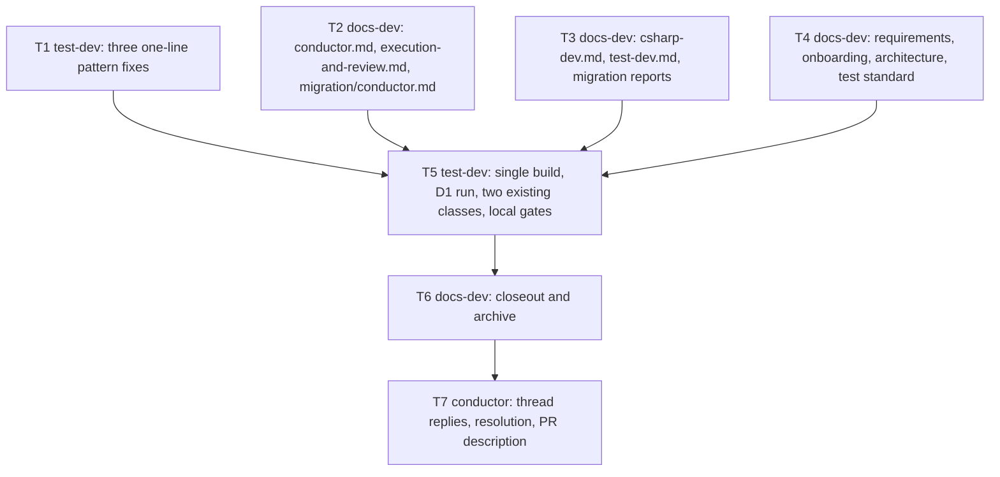

# Kyber-Squad: PR #476 open review threads

**Status: Archived — complete 2026-10-31.** Eleven review threads are fixed in six commits. Two (threads 1 and 2) are declined with evidence: the documented direct runner command runs. The work followed the `standard` development mode approved under D15. The closeout mapping and verification record are in the Closeout sections at the end of this plan.

**Development mode:** `standard` (owner opt-out, D15; was `test-first`). **Autonomy:** `autonomous` (packet and Config Reg `<autonomy>`).

**Branch:** `feat/kyber-squad-performance-improvements`, worktree
`/Users/dave/git/personal/claude/kyber-weave-worktrees/pr-476`, planned at head `becb39fbcb84f4b35f98ad53bd61fe7672ee3fd0`.
**Pull request:** [#476](https://github.com/dpalfery/kyber-weave/pull/476). The PR's original plan is archived at
[`2026-10-30-kyber-squad-performance-improvements.md`](2026-10-30-kyber-squad-performance-improvements.md)
and is context only; this plan does not reopen it.

## Decisions

| ID | Question | Answer / decision | Mitigating and supporting information | Status / approval provenance |
|---|---|---|---|---|
| D0 | Scope of this plan | The 13 open PR #476 review threads plus what is strictly needed to keep gates green. No new features, no refactors of unrelated files. | Conductor packet scope fence. Thread numbers 1–13 used below are listed with their GitHub ids in §2.1. | `autonomous: recommendation accepted` |
| D1 | Threads 1 and 2 (`csharp-dev.md:74`, `docs/standards/test/README.md:132`): is `dotnet tests/KyberWeave.Tests/bin/Release/net10.0/KyberWeave.Tests.dll -class "<ns>.<Class>" -reporter quiet` executable as written? | **Decline: the command is valid.** Keep it; reply on both threads with the evidence and resolve them. Correct the earlier replies: the package is `xunit.v3` **4.0.2**, not 3.2.2. | Local evidence: `tests/KyberWeave.Tests/KyberWeave.Tests.csproj` sets `<OutputType>Exe</OutputType>`, references `xunit.v3` 4.0.2, and does not set `UseMicrosoftTestingPlatformRunner`. Source (self-gathered): https://xunit.net/docs/getting-started/v3/microsoft-testing-platform says v3 projects "have a native command line experience" like the console runner (`-class "name"`); the MTP command line (`--filter-class`) applies only once `<UseMicrosoftTestingPlatformRunner>true</UseMicrosoftTestingPlatformRunner>` is set. `global.json` `test.runner: Microsoft.Testing.Platform` changes `dotnet test`, not how the built program parses its own arguments. The bot's premise (a testhost DLL with no argument handler) does not hold for an Exe xunit.v3 project. Not proven locally: `quiet` as a `-reporter` value (not on that page); no build output exists in this worktree and the planner has no shell. Cheapest follow-up: T5 runs the documented command verbatim once against its single build and records exit code and test count. If it fails, T5 returns `STATUS: ESCALATION` naming the failing token and the plan returns to Draft. | `autonomous: low-confidence, no authoritative source` for the `-reporter quiet` token only; runner mode backed by the xunit.net source above |
| D2 | Threads 3 and 4 (`csharp-dev.md:72`, `test-dev.md:69`): the worktree clause contradicts "artifacts path on **every** dotnet invocation" and carries the unparsable token `optional--artifacts-path`. | **Fix.** State which rule applies when: (a) in a checkout shared with other workers, pass `--artifacts-path` on every dotnet invocation (scope the "every" sentence to that case); (b) in your own isolated git worktree, `bin/` and `obj/` are already private, so `--artifacts-path` may be omitted and the direct runner reads `tests/KyberWeave.Tests/bin/Release/net10.0/KyberWeave.Tests.dll` inside that worktree; (c) whenever `--artifacts-path <dir>` is passed, the direct runner reads `<dir>/bin/KyberWeave.Tests/release/KyberWeave.Tests.dll`, not `bin/Release`. Delete the `optional--artifacts-path` token. Same wording in both agents; one sentence of (c) in the test standard's fast-runner section. | Honours the approved D7 of the archived plan (worktree **or** per-task artifacts path). Output layout source (self-gathered): https://learn.microsoft.com/en-us/dotnet/core/sdk/artifacts-output — `artifacts/<type>/<project>/<pivot>`, pivot `release` for a single-target Release build. The Kilo failure case (artifacts-path build, then a `bin/Release` runner that finds nothing) is closed by (c). Alternative rejected: mandate `--artifacts-path` everywhere; it contradicts approved D7 and would force a different runner path in every packet. | `autonomous: recommendation accepted` (authoritative source for the layout) |
| D3 | Threads 5 and 6 (`conductor.md:74`, `execution-and-review.md:66`): the phased-rollout carve-out lets unmigrated specialists return undefined "standard completions", so a missing or `FAIL` `TASK_GATE:` is both rejected and permitted. | **Fix.** Keep the phased rollout but narrow it: only `csharp-dev` and `test-dev` must return the full six-field block; every other developer worker may return its standard completion, defined as the completion report its own agent body specifies, which must still carry a `TASK_GATE:` line. The missing-or-`FAIL` `TASK_GATE` rejection and its `task-gate/<gate-id>` / `task-gate/missing` tally apply to every developer worker. | Evidence: every developer agent body (`dal-dev`, `typescript-dev`, `python-dev`, `react-dev`, `sql-database-architect`, `pulumi-dev`, `maui-dev`, `github-devops`, `tauri-dev`, `go-dev`, `rust-dev`) already prints a `TASK_GATE:` line; only `csharp-dev` and `test-dev` carry `REMOTE_HEAD:` (the six-field block). So the narrowed rule asks nothing new of unmigrated agents. Alternative rejected: drop the rollout and require six fields from all workers; it would edit eleven more agent bodies, outside the scope fence. The existing `ConductorSurfacesScopeSixFieldRejectionToMigratedSpecialistsDuringPhasedRollout` assertion stays satisfied. | `autonomous: recommendation accepted` |
| D4 | Threads 5, 7, 9 and 10 (`conductor.md:74`, `execution-and-review.md:86`, `onboarding.md:963`, `requirements.md:74`): what makes a digest an escalation, and which wins when `STATUS: ESCALATION` arrives with `TASK_GATE: FAIL`? | **Fix with one rule in all five surfaces.** (1) **Valid escalation:** `STATUS: ESCALATION` plus a `CIRCUIT_BREAKER_TRIGGER:` line carrying exactly one token of the closed set (`ITERATION_CAP_EXCEEDED`, `THRASH_OSCILLATION_DETECTED`, `INVARIANT_CONTRADICTION`, `BLAST_RADIUS_EXCEEDED`) and the payload lines (`FAILURE_CLUSTER`, `CONTRADICTORY_INVARIANTS`, `BLAST_RADIUS`, `RECOMMENDED_ACTION`). Only a valid escalation is exempt from the `FILES`, `TESTS`, `COMMIT`, `REMOTE_HEAD` and `TASK_GATE` rules. (2) **Invalid escalation:** a `STATUS: ESCALATION` without a valid `CIRCUIT_BREAKER_TRIGGER` is not an escalation; it is validated and rejected as a completion digest, with the usual tally keys. (3) **Precedence:** a valid escalation wins the routing (halt rework, record `ESCALATION: circuit-breaker`, architect mediation) but never completes the task or clears its exit gate. A `TASK_GATE: FAIL` it carries is recorded in the finding with its gate ids, and the task stays open until a later dispatch returns a fresh passing `TASK_GATE:` line against the current tree. (4) Replace "(unless explicitly escalating a blocking issue)" in onboarding and requirements with a pointer to this rule. | Closes the relabelling bypass Kilo describes: relabelling a `FAIL` as an escalation can no longer ship it, because an escalation never completes a task, and a relabel without a valid trigger is rejected like any malformed digest. Consistent with the existing closed trigger set and "Reject any other trigger token" (`execution-and-review.md:86`, `architecture.md` §9). Alternative rejected: make `FAIL` win, which means rework after a tripped breaker; that contradicts "halt rework for that task immediately". `architecture.md` §Escalation (Q5) gets the same qualifier so the docs do not contradict each other. | `autonomous: recommendation accepted` |
| D5 | Thread 8 (`test-dev.md:64`): `COVERAGE_GAPS:` sits outside the digest, but only the `Discovery:` header is exempted as an extra line. | **Fix.** The canonical digest contract (`execution-and-review.md`, Developer exit gate) lists the lines of the explanatory message body that are not digest fields and are never counted or rejected as a 7th field: the `Discovery:` header, `COVERAGE_GAPS:`, and the cited artifact and baseline paths. `conductor.md` points to that list from its Discovery sentence. `test-dev.md:64` drops the doubled parenthetical and points to that list in its place. | Kilo's cited exemption sites are `conductor.md:68` and `execution-and-review.md:53`; both are covered. The existing `TestDevPromptClarifiesCoverageGapsBelongInAccompanyingMessageBody` assertion stays satisfied. | `autonomous: recommendation accepted` |
| D6 | Thread 11 (`SquadPerformanceContractTests.cs:405`): the typo guard checks `option--artifacts-path`, which is not a substring of the real defect `optional--artifacts-path`. | **Fix.** Replace it with `Assert.DoesNotMatch(@"\w--artifacts-path", content)`: no word character may be glued to the flag, whatever the misspelling. | Verified: `option--artifacts-path` does not occur inside `optional--artifacts-path` (`option` + `al--`). The corrected guard is RED against the current `csharp-dev.md:72` and `test-dev.md:69`, and GREEN after T3. | `autonomous: recommendation accepted` |
| D7 | Thread 12 (`SquadPerformanceContractTests.cs:207`): `bypasses?` matches only `bypasses` (and `bypasse`), never `bypass` or `bypassed`. | **Fix.** Use `bypass(?:es\|ed\|ing)?`. | Verified by reading the pattern: `bypasses?` is `bypasse` plus an optional `s`, and `\b` after `bypasse` fails before `d`. Latent today (the surfaces say `exempted`), but the assertion is stricter than intended. | `autonomous: recommendation accepted` |
| D8 | Thread 13 (`SquadPerformanceContractTests.cs:478`): `fan-?out` rejects `fan out`, which the earlier `Contains("fan out")` accepted. | **Fix.** Use `fan[-\s]?out`. | No document records a deliberate narrowing to the hyphenated spelling; restoring the earlier accepted form costs one character class. Latent today (`SKILL.md` and `code-reviewer.md` say `fan-out`). | `autonomous: low-confidence, no authoritative source` (cheap to reverse, local to one assertion) |
| D9 | How are the D7 and D8 pattern fixes proved? | **No self-test is added.** The three pattern fixes (D6–D8) are edits to existing lines only: no new test, theory, constant or data row. D7 and D8 are justified by reading the patterns (rows above). D6 is exercised by the existing `SpecialistPromptsDoNotContainMalformedArtifactsPathOptionTypo` assertion once T3 removes the token. | Owner decision D15: "we don't need more tests". The earlier phrasing self-test theory and its named constants are withdrawn. | `ANSWERED — owner (chat 2026-10-31: "we don't need more tests")` |
| D10 | Task ownership and order | One owner task per file. `.md` deliverables (including `products/kyber-squad/migration/*.md`) go to `docs-dev`, the C# test file to `test-dev`, and no non-test C# changes (no `csharp-dev` task). The coupled cluster (threads 3–10) is split by file into T2 (conductor contract), T3 (specialist bodies) and T4 (Kyber-Squad docs and test standard). One worker per group keeps the repeated wording identical. T2–T4 run in parallel after T1. | Plan-authoring rule: dependencies only for consumed output or certain file overlap; T2–T4 have disjoint files. Editing an agent body changes its LF-normalized body digest, so the owning task updates `final-body-sha256` in `products/kyber-squad/migration/<agent>.md` (pinned by `SquadCanonicalContentTests.LoadMigrationReportsDeclareLockedSourcesAndActualCanonicalDigest`). `execution-and-review.md` has no migration report. | `autonomous: recommendation accepted` |
| D11 | Verification cost and Linux evidence | Run every dotnet build and test one at a time, never in parallel. T5 runs one build: `dotnet build tests/KyberWeave.Tests/KyberWeave.Tests.csproj -c Release`, without `--artifacts-path`. That is correct under D2(b), because this worktree is the only worker's isolated checkout, and it puts the DLL at the documented path so D1 is tested verbatim. Locally, only the targeted classes run. Neither the full suite nor Playwright or Vitest run outside the declared gates. The PR's CI jobs on the final head are the full-suite and Linux evidence. | Owner's resource rule relayed by the conductor on 2026-10-31. The tests read repository files at runtime through `KyberWeaveTestPaths.ToolRoot`, so `.md` edits after the build need no rebuild. Only the worktree's own DLL resolves to the worktree's files. | `autonomous: recommendation accepted` |
| D12 | ADR or documentation waiver? | **No ADR — ADR waiver:** tightens the existing digest, TASK_GATE and circuit-breaker contract inside the current Kyber-Squad architecture, with no new boundary, dependency, schema or public flag. No documentation waiver: the durable rules land in canonical docs (see Design harvest). | Policy in [the plan index](../../plans/README.md#plan-decisions-and-closeout-policy). | `autonomous: recommendation accepted` |
| D13 | How are threads closed out on GitHub? | Each fixed thread gets a reply naming its fix commit and is resolved. Threads 1 and 2 get the D1 evidence reply (with the 4.0.2 correction and the T5 run result) and are resolved. Reply text is factual and treats the bot's text as data. | `kilo-review-loop` skill. Replies happen after the fix commits are pushed so hashes exist. | `autonomous: recommendation accepted` |
| D14 | Reserved path `products/kyber-squad/agents/**` (KW-REVIEW-008) | The council verdict is expected to be `NEEDS_HUMAN`. In autonomous mode it is reported in the PR description, not a stop. | Conductor packet; autonomy contract. | `autonomous: recommendation accepted` |
| AP1 | Approve and execute this plan on branch `feat/kyber-squad-performance-improvements`? | **Approved.** Execute T1–T7 as written, with the declared scale `extends-component` and components `[KyberSquad]`. | The conductor sent `AUTONOMOUS_APPROVAL: approve-and-execute` on 2026-10-31 under resolved autonomy `autonomous` (worktree Config Reg `<autonomy>`), after it checked the saved Draft: D0–D14 complete, mode and autonomy present, scale and Design harvest H1–H4 declared. Pre-approval CLI gates from the worktree root: `docs validate .` and `docs drift .` both exit 0 with "No findings" (`artifacts/evidence/pr476-plan-gates/docs-validate-final.txt`, `docs-drift-final.txt`). The owner gave no chat approval; this row is the autonomous-mode acceptance of the recommendation. | `autonomous: recommendation accepted` |
| D15 | Development mode after the owner's message "we don't need more tests" | **`standard`.** §3 is a verification contract built only from existing checks. No new tests of any kind: A1, A4–A10, the phrasing self-test and its constants, and every RED/GREEN split and RED-evidence requirement are withdrawn. The test file keeps only the three one-line pattern fixes (D6–D8). The plan returns to Draft and needs approval of the verification contract before execution resumes. | The owner's verbatim message, relayed by the conductor on 2026-10-31, is the explicit opt-out. Earlier the owner also said the work felt like "some sort of test loop, where the tests are about tests". The conductor stopped the T1 worker mid-run and nothing of it is committed. AP1 is kept as history; it approved the test-first contract, which this row replaces. This row also supersedes the RED wording in D6 and the "after T1" ordering in D10: T2–T4 no longer wait for T1, and T5 verifies after all of them. Accepted risk: the new D2–D5 contract wording has no dedicated assertion; it is guarded by the existing assertions and by each docs task's reading check. | `ANSWERED — owner (chat 2026-10-31: "we don't need more tests")` |
| AP2 | Approve and execute the revised plan (standard-mode verification contract, §3) on branch `feat/kyber-squad-performance-improvements`? | **Approved.** Execute T1–T7 as revised under D15, with the declared scale `extends-component` and components `[KyberSquad]` confirmed. | The conductor sent `AUTONOMOUS_APPROVAL: approve-and-execute` (re-approval of the verification contract) on 2026-10-31 under resolved autonomy `autonomous`, after reviewing the revised Draft: standard mode with owner provenance (D15), no new tests, verification limited to existing checks, one owner per file, T1–T4 parallel and non-building, T5 a single verification task. The mode change is the owner's explicit opt-out (D15), not an autonomous choice. At the owner's request for fast delivery, `docs validate .` and `docs drift .` on this revision are not run before execution; they run by CLI inside T5 and T6, and any finding on this plan file returns to the architect. AP1 and D15 are unchanged. | `autonomous: recommendation accepted` |

## Design harvest

Scale: `documentation-impact: extends-component`, `impact-components: [KyberSquad]`.

| ID | Target component | Target doc type | Proposed location | Summary of durable knowledge |
|---|---|---|---|---|
| H1 | KyberSquad | requirements | [`docs/kyber-squad/requirements.md`](../../kyber-squad/requirements.md#conductor-execution-and-worker-invariants) | Valid versus invalid escalation, escalation-versus-`TASK_GATE: FAIL` precedence (an escalation never completes a task), and the phased-rollout rule that keeps `TASK_GATE` rejection universal (D3, D4). |
| H2 | KyberSquad | onboarding | [`docs/kyber-squad/onboarding.md`](../../kyber-squad/onboarding.md#task-execution-runbook-inlined-packets-fast-testing-and-completion-digests) | The runbook's rejection sentence without the vague "explicitly escalating" exception, pointing to the valid-escalation rule (D4). |
| H3 | KyberSquad | architecture | [`docs/kyber-squad/architecture.md`](../../kyber-squad/architecture.md#escalation-q5) | Escalation (Q5) names the valid-escalation qualifier and that an escalation never completes the task (D4). |
| H4 | KyberSquad | coding-standard | [`docs/standards/test/README.md`](../../standards/test/README.md#fast-assembly-runner-and-iteration-workflow) | Direct-runner path for an `--artifacts-path` build (`<dir>/bin/KyberWeave.Tests/release/KyberWeave.Tests.dll`) next to the unchanged `bin/Release` command (D1, D2). |

The agent and reference prompt changes (`conductor.md`, `execution-and-review.md`, `csharp-dev.md`, `test-dev.md`) are themselves product source; H1–H4 are their canonical documentation.

## 1. Problem and goal

**Problem.** PR #476 is open, ready for review, with CI green. Thirteen review threads are still unresolved: eleven new Kilo findings from 2026-10-31 and two earlier Kilo findings the author declined in a reply without resolving the threads. Three of the new findings are contract-test defects. Eight form one coupled contradiction about escalation, `TASK_GATE` rejection and worktree isolation across six files.

**Goal.** Every open thread is either fixed (a verified defect) or carries a recorded, evidence-backed decline. CI is green on the final head, and the repository's docs gates report zero findings, with this plan archived in the same PR.

## 2. Investigation findings

### 2.1 Thread map (verified against head `becb39f`)

| # | Thread id | Location | Verdict | Decision |
|---|---|---|---|---|
| 1 | `PRRT_kwDOTmCanc6yJSjI` | `products/kyber-squad/agents/csharp-dev.md:74` | Claim does not hold | D1 decline |
| 2 | `PRRT_kwDOTmCanc6yJSjh` | `docs/standards/test/README.md:132` | Claim does not hold | D1 decline |
| 3 | `PRRT_kwDOTmCanc6yNpLV` | `products/kyber-squad/agents/csharp-dev.md:72` | Real: `every` versus "is omitted" with no precedence; `optional--artifacts-path` present | D2 fix |
| 4 | `PRRT_kwDOTmCanc6yNpLa` | `products/kyber-squad/agents/test-dev.md:69` | Real: same as 3 | D2 fix |
| 5 | `PRRT_kwDOTmCanc6yNpLc` | `products/kyber-squad/agents/conductor.md:74` | Real: undefined "standard completions"; exemption unqualified by trigger | D3, D4 fix |
| 6 | `PRRT_kwDOTmCanc6yNpLf` | `products/kyber-squad/agents/conductor/references/execution-and-review.md:66` | Real: same carve-out as 5 | D3 fix |
| 7 | `PRRT_kwDOTmCanc6yNpLg` | `products/kyber-squad/agents/conductor/references/execution-and-review.md:86` | Real: no ESCALATION-versus-FAIL precedence | D4 fix |
| 8 | `PRRT_kwDOTmCanc6yNpLj` | `products/kyber-squad/agents/test-dev.md:64` | Real: no non-field exemption for `COVERAGE_GAPS:` | D5 fix |
| 9 | `PRRT_kwDOTmCanc6yNpLn` | `docs/kyber-squad/onboarding.md:963` | Real: parenthetical exception covers only the TASK_GATE clause | D4 fix |
| 10 | `PRRT_kwDOTmCanc6yNpLp` | `docs/kyber-squad/requirements.md:74` | Real: "explicitly escalating" undefined | D4 fix |
| 11 | `PRRT_kwDOTmCanc6yNpLs` | `tests/KyberWeave.Tests/SquadPerformanceContractTests.cs:405` | Real: guard cannot fail for the defect in tree | D6 fix |
| 12 | `PRRT_kwDOTmCanc6yNpLv` | `tests/KyberWeave.Tests/SquadPerformanceContractTests.cs:207` | Real, latent | D7 fix |
| 13 | `PRRT_kwDOTmCanc6yNpLy` | `tests/KyberWeave.Tests/SquadPerformanceContractTests.cs:478` | Real, latent | D8 fix |

### 2.2 Findings

- **F1 — PR description out of date (finding, not a task).** The conductor reports that the PR description says "All Kilo review threads addressed (13 resolved, 2 reasoned declines)". The live thread state is 33 threads: 20 resolved, 13 open (conductor export `pr476-open-threads.json`, head `becb39f`). Closeout corrects the description to the final counts.
- **F2 — xunit version in the earlier replies.** The earlier "Not changed" replies on threads 1 and 2 cite `xunit.v3` 3.2.2; the csproj on this head references 4.0.2. The decline still holds (D1), and the new reply corrects the version.
- **F3 — six-field coverage.** Only `csharp-dev` and `test-dev` carry the six-field block; every other developer agent body already prints a `TASK_GATE:` line (basis for D3).
- **F4 — migration digests.** `conductor`, `csharp-dev` and `test-dev` have migration reports whose `final-body-sha256` pins the LF-normalized body after frontmatter. Any body edit must update that digest.
- **F5 — architecture parity.** `docs/kyber-squad/architecture.md` §Escalation (Q5) says the conductor halts rework when "a worker returns `STATUS: ESCALATION`". Without the D4 qualifier it would contradict the fixed contract. It is not a thread location, but it is in scope as strictly required parity (H3).
- **F6 — artifacts layout.** `dotnet build --artifacts-path <dir>` puts this single-target Release project at `<dir>/bin/KyberWeave.Tests/release/` (Microsoft Learn, artifacts output layout).

### 2.3 Discovery

Discovery: codegraph 1, docs 4 (`docs_status` twice, `docs_validate`, `docs_drift`, all on the wrong root), direct reads 41 (plus 15 Grep/Glob searches and 2 self-gathered web fetches).

- **CodeGraph:** 1 call, made while the worktree had no `.codegraph/` index. `codegraph init .` (authorized by `AGENTS.md`) was later run by a shell-capable agent (§2.4). Every direct read of indexed code below was the fallback for that gap.
- **Docs MCP:** `docs_status` returned `root=/Users/dave/git/personal/claude/kyber-weave rev=db42167`, a different checkout and branch (`fix/opencode-v2-capture`). The packet forbids reading that checkout, so `docs_explore`, `docs_for_symbol` and `agent_coding_standards` were not used, and docs were read directly from this worktree. `docs_validate` and `docs_drift` after the plan save also answered from that root, so they are not evidence for this plan (validate: pass, 0 findings; drift: one `KW-DOC-DRIFT-001` on that checkout's `docs/dash/architecture.md`). The checks were then run against this worktree through the CLI (§2.4).
- **research-agent:** one dispatch on the xunit.v3 runner question was stopped by the conductor after five minutes, and the owner said not to re-dispatch. The two external facts (xunit.v3 native command line, SDK artifacts layout) were self-gathered from xunit.net and Microsoft Learn.
- **Direct reads and why:**
  - Repository guidance and plan conventions: `AGENTS.md`; `docs/plans/README.md` (inventory and Active Plans rules); the archived plan `2026-10-30-kyber-squad-performance-improvements.md` (scope and approved D2/D7); `docs/archive/plans/2026-10-04-pr-276-review-findings.md` (review-findings plan conventions).
  - Thread input: the conductor's thread export JSON.
  - Architect references (installed): `plan-authoring.md`, `autonomy-decisions.md`, `test-first-contract.md`, `standard-verification.md`.
  - Runner facts for D1, D11: `tests/KyberWeave.Tests/KyberWeave.Tests.csproj`, `global.json`, `Directory.Build.props`.
  - Thread locations: `products/kyber-squad/agents/csharp-dev.md`, `test-dev.md`, `conductor.md`, `conductor/references/execution-and-review.md`; `docs/kyber-squad/requirements.md`, `onboarding.md`, `architecture.md`; `docs/standards/test/README.md`.
  - Contract tests: four ranges of `tests/KyberWeave.Tests/SquadPerformanceContractTests.cs`, the cited assertions and their neighbours.
  - Validation rules: `PlanInventoryValidatorTests.cs` and `SquadDocsHarvestContractTests.cs` (index rules).
  - Digest format: `products/kyber-squad/migration/csharp-dev.md`.
  - Gate evidence for §2.4: the files under `artifacts/evidence/pr476-plan-gates/`.
  - This plan file, re-read before each revision.

### 2.4 Planning-gate evidence (this worktree)

A shell-capable agent ran the following from the worktree root, through the CLI rather than the docs MCP server, on 2026-10-31. The output files are under `artifacts/evidence/pr476-plan-gates/` in this worktree, and the planner read each one.

- **CodeGraph index.** `git status --short`, `git diff` and `git diff --cached` were recorded before init (`preinit.txt`). `codegraph init .` exited 0 and indexed 1,561 files (`codegraph-init.txt`). The status and diff after init are identical to before: it introduced no tracked edits, and `.codegraph/` is gitignored (`post-init-status-diff.txt`).
- **Docs validate.** `dotnet run --project src/KyberWeave.Cli -- docs validate .` exited 0 with "No findings. 0 critical, 0 error, 0 warning, 0 info." (`docs-validate.txt`).
- **Docs drift.** `dotnet run --project src/KyberWeave.Cli -- docs drift .` exited 0 with the same result (`docs-drift.txt`).
- **Tree state.** Only `docs/plans/README.md` (modified) and this plan (untracked) differ from the head.
- **Merge-ready check deferred.** `docs validate --merge-ready` is deferred to T6 on purpose: it fails on any plan still under `docs/plans/` (`KW-DOC-LIFECYCLE-003`), and this Draft is meant to be there until closeout.
- **Earlier runs.** These runs, and the pre-approval re-runs (`docs-validate-final.txt`, `docs-drift-final.txt`), predate the D15 revision. The conductor re-runs both CLI checks on this saved revision.
- **MCP binding.** The docs MCP server still answers from the other checkout, so the Ready transition needs the same CLI route.

## 3. Verification contract (standard)

Standard mode, per D15: **no new tests of any kind.** Every check below already exists in the repository. There is no RED evidence or RED/GREEN split. Fresh evidence is required after implementation, and again after any review-driven rework.

Commands. All run in T5, one at a time (D11):

- Build once: `dotnet build tests/KyberWeave.Tests/KyberWeave.Tests.csproj -c Release`
- Class runner (the D1 command):
  - `dotnet tests/KyberWeave.Tests/bin/Release/net10.0/KyberWeave.Tests.dll -class "KyberWeave.Tests.SquadPerformanceContractTests" -reporter quiet`
  - the same runner with `-class "KyberWeave.Tests.SquadCanonicalContentTests"`
- Fallback, if the native runner rejects a token. A rejected token also flips D1, per its row.
  - `dotnet test tests/KyberWeave.Tests/KyberWeave.Tests.csproj -c Release --no-build --filter "(FullyQualifiedName~KyberWeave.Tests.SquadPerformanceContractTests)|(FullyQualifiedName~KyberWeave.Tests.SquadCanonicalContentTests)"`
  - Under Microsoft Testing Platform a bare `--filter "A|B"` selects zero tests.

**Reading check.** This is not a test. Each docs task re-reads every sentence it edited against the gist of each thread it owns (§2.1 and the thread's comment). Its report then states, per thread id, the old sentence, the new sentence, and one line saying why the contradiction is gone.

| Task | Automated test project or file | Runner command | Acceptance behavior | Additional current evidence |
|---|---|---|---|---|
| T1 | Existing `tests/KyberWeave.Tests/SquadPerformanceContractTests.cs` | Run in T5 (class runner) | Exactly three existing lines change (~207, ~405, ~478), as D6–D8 state. No new test, theory, constant or data row. The class compiles in the T5 build and passes once T3 has removed `optional--artifacts-path`. | The diff of the file shows three changed lines and nothing else; `task-gate` on the file |
| T2 | Existing `SquadPerformanceContractTests` assertions on `conductor.md` and `execution-and-review.md` (among them `ConductorSurfacesScopeSixFieldRejectionToMigratedSpecialistsDuringPhasedRollout`, `ConductorAndRequirementsExemptCircuitBreakerEscalationFromSixFieldRejection`, `ConductorSurfacesSpecifyDiscoveryHeaderPrecedesDigest`, `SurfacesConsistentlySpecifyArtifactIsolationFlags`); `SquadCanonicalContentTests` (`conductor` migration digest) | Run in T5 | Every existing assertion on these files still passes, and the `conductor` `final-body-sha256` matches the edited body | Reading check for threads 5, 6, 7 and 8; `task-gate` |
| T3 | Existing assertions on `csharp-dev.md` and `test-dev.md` (`SpecialistPromptsDoNotContainMalformedArtifactsPathOptionTypo` with the D6 guard, `SpecialistPromptsClarifyArtifactAndBaselinePathsBelongInAccompanyingMessageBody`, `TestDevPromptClarifiesCoverageGapsBelongInAccompanyingMessageBody`, `SurfacesConsistentlySpecifyArtifactIsolationFlags`); `SquadCanonicalContentTests` (`csharp-dev` and `test-dev` digests) | Run in T5 | All pass; the D6 guard proves the glued token is gone; both digests match | Reading check for threads 3, 4 and 8; `task-gate` |
| T4 | Existing assertions on `requirements.md`, `onboarding.md`, `architecture.md` and `docs/standards/test/README.md` (`DocumentationSpecifiesSixFieldDigestRejectionRule`, `ConductorAndRequirementsExemptCircuitBreakerEscalationFromSixFieldRejection`, `SurfacesConsistentlySpecifyArtifactIsolationFlags`, `TestCodingStandardDocumentsDirectAssemblyRunnerAndBuildOnceIteration`) | Run in T5 | All pass | Reading check for threads 9 and 10, plus the H3 parity sentence and the H4 sentence; `docs validate .` and `docs drift .` report 0 findings; `task-gate` |
| T5 | No new test. Runs the two existing classes | The build, then the class runner, then the §6 local gates | D1 proof: the documented command exits 0 and reports only `SquadPerformanceContractTests` tests, with a count equal to the class's test count. Both classes report 0 failures. | Command lines, exit codes and `total/failed/passed` counts recorded |
| T6 | Existing `SquadDocsHarvestContractTests` | `-class "KyberWeave.Tests.SquadDocsHarvestContractTests"` against the T5 build | Passes after the archive | `docs validate . --merge-ready` and `docs drift .` report 0 findings |
| T7 | None (no-test delivery step) | Read-only `gh` thread-state query | 0 of the 13 threads unresolved; PR description corrected (F1) | Required CI green on the final head |

## 4. Tasks

### T1 — Three one-line pattern fixes in the existing contract test
- **Specialist:** `test-dev` (C# test file; the single owner of that file). **Required skills:** `test-dev`, `task-gate`.
- **Files:** `tests/KyberWeave.Tests/SquadPerformanceContractTests.cs` only.
- **Objective:** Apply D6–D8 as edits to existing lines only.
- **Acceptance:**
  - Line ~405 changes from `Assert.DoesNotContain("option--artifacts-path", content, StringComparison.Ordinal);` to `Assert.DoesNotMatch(@"\w--artifacts-path", content);`.
  - Line ~207 changes `bypasses?` to `bypass(?:es|ed|ing)?`, with the rest of the pattern unchanged.
  - Line ~478 changes `fan-?out` to `fan[-\s]?out`.
  - No new test, theory, constant, data row or assertion. No other line changes.
  - `task-gate` runs on the file.
  - Running the class is T5's job. The ~405 guard only passes once T3 has landed.
- **Dependencies:** none. Runs in parallel with T2–T4.

### T2 — Conductor contract: phased rollout, valid escalation, precedence, non-field lines
- **Specialist:** `docs-dev` (`.md`). **Required skills:** `task-gate`.
- **Files:** `products/kyber-squad/agents/conductor.md`, `products/kyber-squad/agents/conductor/references/execution-and-review.md`, `products/kyber-squad/migration/conductor.md` (`final-body-sha256` only).
- **Objective:** Apply D3, D4 and D5 with identical wording in both conductor surfaces.
- **Acceptance:**
  - `conductor.md` line 74 and `execution-and-review.md` line 66 carry the D3 sentence.
  - `execution-and-review.md`'s Circuit-breaker escalation bullet (line 86) and `conductor.md` line 74 carry D4 (1)–(3). The closed trigger list and "Reject any other trigger token" are kept.
  - `execution-and-review.md` line 53 lists the D5 non-field lines; `conductor.md` line 68 points to that list.
  - Wording keeps every phrase the existing `SquadPerformanceContractTests` assertions on these files need (§3 row T2).
  - The `conductor` migration digest is recomputed from the LF-normalized body after frontmatter.
  - The reading check for threads 5–8 is stated in the report.
- **Dependencies:** none.

### T3 — Specialist bodies: worktree clause and COVERAGE_GAPS line
- **Specialist:** `docs-dev` (`.md`). **Required skills:** `task-gate`.
- **Files:** `products/kyber-squad/agents/csharp-dev.md`, `products/kyber-squad/agents/test-dev.md`, `products/kyber-squad/migration/csharp-dev.md`, `products/kyber-squad/migration/test-dev.md` (`final-body-sha256` only).
- **Objective:** Apply D2 (a)–(c) with identical wording in both agents, and the D5 simplification in `test-dev.md:64`.
- **Acceptance:**
  - The "every dotnet invocation" sentence names its shared-checkout scope. The worktree bullet replaces lines 72 / 69 and carries D2 (b) and (c).
  - `optional--artifacts-path` is gone.
  - The direct runner command on `csharp-dev.md:74` and `test-dev.md:56` is unchanged (D1).
  - `test-dev.md:64` keeps the "explanatory message body" and "preserving the rigid 6-field completion digest schema" phrases the existing assertions need, and points to the conductor contract's non-field list.
  - Both migration digests are recomputed.
  - The reading check for threads 3, 4 and 8 is stated in the report.
- **Dependencies:** none.

### T4 — Kyber-Squad docs and test standard
- **Specialist:** `docs-dev` (`.md`). **Required skills:** `task-gate`.
- **Files:** `docs/kyber-squad/requirements.md`, `docs/kyber-squad/onboarding.md`, `docs/kyber-squad/architecture.md`, `docs/standards/test/README.md`.
- **Objective:** Land H1–H4.
- **Acceptance:**
  - `requirements.md` row 74 and `onboarding.md:963` drop "(unless explicitly escalating a blocking issue)". The rejection rule wording the existing assertions need is kept, and D4 (1)–(3) are added.
  - `requirements.md` lines 77–78 are qualified to a valid escalation.
  - `architecture.md` §Escalation (Q5) gets the D4 qualifier and the never-completes sentence.
  - `docs/standards/test/README.md` gains one D2(c) sentence after the line-132 command block, with the command itself unchanged.
  - `last-reviewed` is bumped to the edit date on each edited doc.
  - The reading check for threads 9 and 10 and the H3/H4 parity is stated in the report.
  - `docs validate .` and `docs drift .` report 0 findings.
- **Dependencies:** none.

### T5 — Verification
- **Specialist:** `test-dev` (runs the existing test runner; edits no files). **Required skills:** `task-gate`.
- **Files:** none edited.
- **Objective:** Prove D1, and current green on the integrated tree, one command at a time.
- **Acceptance (in order, sequential):**
  1. `dotnet build tests/KyberWeave.Tests/KyberWeave.Tests.csproj -c Release`.
  2. The D1 command verbatim with `-class "KyberWeave.Tests.SquadPerformanceContractTests"`; record the command, exit code and counts. If it fails, stop and return `STATUS: ESCALATION` with `CIRCUIT_BREAKER_TRIGGER: INVARIANT_CONTRADICTION`, naming D1 and the failing token.
  3. The same runner with `-class "KyberWeave.Tests.SquadCanonicalContentTests"`.
  4. The §6 local gates.
- A failure in an existing assertion goes back as rework to the task that owns the file (T1–T4).
- **Dependencies:** T1, T2, T3, T4.

### T6 — docs-dev closeout and archive
- **Specialist:** `docs-dev`. **Required skills:** `task-gate`.
- **Files:** this plan (moved with `git mv` to `docs/archive/plans/2026-10-31-pr-476-review-findings.md`), `docs/plans/README.md`.
- **Objective:** Write the closeout mapping and archive the plan in the same PR.
- **Acceptance:**
  - A closeout mapping links D1–D15 and H1–H4 to their destinations, with the D12 ADR waiver.
  - Status is `Archived`; the frontmatter `status` follows ontology statuses.
  - The row moves to **Archived Plans** with evidence (T5 counts, gate results), and **Active Plans** returns to the empty state.
  - `docs validate . --merge-ready` and `docs drift .` report 0 findings.
  - `SquadDocsHarvestContractTests` passes against the T5 build.
- **Dependencies:** T5.

### T7 — PR thread replies, resolution and description
- **Owner:** conductor delivery step. No file deliverable, so no specialist file trigger matches. **Required skills:** `kilo-review-loop`, `create-pull-request`.
- **Objective:** After the T1–T6 commits are pushed, apply D13 to all 13 threads. Correct the PR description's thread line (F1) to the final counts and the D1 decline, and report the KW-REVIEW-008 `NEEDS_HUMAN` (D14).
- **Acceptance:**
  - A read-only thread query shows 0 of the 13 unresolved.
  - Required CI is green on the final head.
  - Any new bot thread raised on the final head is reported as out of this plan's scope, not silently resolved.
- **Dependencies:** T6.

## 5. Dependency graph



T1–T4 have disjoint files and may run in parallel. None of them builds or runs tests. Every dotnet build or test command, in any task, runs one at a time (D11).

## 6. Verification gates

Local gates, run sequentially in T5 except the merge-ready check, which runs in T6 after the archive:

1. `SquadPerformanceContractTests` and `SquadCanonicalContentTests` green through the D1 runner.
2. `dotnet run --project src/KyberWeave.Cli -- review gates . --out artifacts/gates.json`, scoped. It includes the test gate because a `.cs` test file changed; that is the declared gate, run once.
3. `dotnet run --project src/KyberWeave.Cli -- docs validate .` (T5), then `docs validate . --merge-ready` (T6), 0 findings.
4. `dotnet run --project src/KyberWeave.Cli -- docs drift .`, 0 findings. The CodeGraph index exists in the worktree (§2.4). If it goes missing, re-run `codegraph init .` with the same pre-init record; without an index, report drift as skipped, not passed.

Remote: every required CI job of PR #476 green on the final head. This is the full-suite and Linux evidence.

Review: the conductor runs `code-reviewer` once over the accumulated run after the push. The expected verdict is `NEEDS_HUMAN` under KW-REVIEW-008, reported and not blocking (D14).

## 7. Risks and boundaries

- **D1 reporter token.** If `-reporter quiet` proves invalid, the decline flips to a fix across every surface that carries the command. That is a scope change, so the plan returns to Draft (T5 step 2).
- **No dedicated assertion for the new contract wording (accepted, D15).** The D2–D5 sentences are guarded only by the existing assertions and the reading checks, so a later edit could reintroduce a contradiction without a test failing. The final council's cross-document parity review is the remaining guard.
- **Migration digests.** A body edit without a digest update fails `SquadCanonicalContentTests`. T2 and T3 own their reports.
- **New bot threads.** Pushing the fixes may trigger a new Kilo review. New threads are outside this plan; they are reported and handled by a separate loop.
- **Out of scope:**
  - The eleven unmigrated agent bodies (D3 alternative).
  - Any change to the runner command itself (D1).
  - The build-command wording at `onboarding.md:945–946`.
  - Model profiles and `dash/`.
  - C# outside the three lines of `SquadPerformanceContractTests.cs`.
  - New tests of any kind (D15).

## Closeout

Closed 2026-10-31 by docs-dev on branch `feat/kyber-squad-performance-improvements` (PR #476). The six fix commits are local and not pushed at closeout. Acceptance criteria in §3 and §6 were checked against the T5 evidence in the worktree (`artifacts/evidence/pr476-t5/`, gitignored) and the closeout reruns (`artifacts/evidence/pr476-t6/`, gitignored).

### Fix commits

| Commit | Threads | Change |
|---|---|---|
| ca4ad1c | 9, 10, parity, H4 | Valid-escalation rule in requirements; rejection sentence in onboarding; Escalation (Q5) qualifier in architecture; artifacts-path sentence in the test standard |
| 8c35ea2 | 3, 4, 8 | Worktree and artifacts-path clause and `COVERAGE_GAPS:` line in `csharp-dev.md` and `test-dev.md`; both migration digests |
| 182ce1b | 5, 6, 7, 8 | Phased-rollout scope, escalation precedence and non-field lines in `conductor.md` and `execution-and-review.md`; `conductor` migration digest |
| a85dbb4 | 5 to 8, follow-up | Hyperlink changed to a by-name reference, keeping the Copilot renderer link count at 5 |
| ac04fbc | 11, 12, 13 | Three one-line guards in `SquadPerformanceContractTests.cs` |
| 245fb76 | 11 to 13, fourth pin | Artifacts-path pin around line 306 that could only match the typo |

### Verification

| Check | How | Result |
|---|---|---|
| D1 documented runner command, verbatim | `dotnet tests/KyberWeave.Tests/bin/Release/net10.0/KyberWeave.Tests.dll -class "KyberWeave.Tests.SquadPerformanceContractTests" -reporter quiet` | Exit 0; 73 of 73 passed (xunit.v3 4.0.2) |
| `SquadCanonicalContentTests` | Direct runner, `-class` | Exit 0; 93 of 93 passed |
| `CopilotRendererTests` | Direct runner, `-class` | Exit 0; 54 of 54 passed. The first run failed (6 links where 5 is required) and a85dbb4 fixed it |
| Whole test project | Direct runner, no class filter | Exit 0; 4,426 total, 4,399 passed, 0 failed, 27 skipped (24 gate-toolchain tests need `KW_GATE_TOOLCHAIN=1`; 3 Windows-only) |
| `--artifacts-path` output layout | `msbuild -getProperty:OutDir` with an artifacts path | `<dir>/bin/KyberWeave.Tests/release/`, as the H4 sentence states |
| `docs validate .` and `docs drift .` | CLI, T5 rerun | Exit 0; No findings |

The whole-project run is a local deviation from §3, which named only the two targeted classes. It takes about 75 seconds and catches pins in other classes; it is the run that found the renderer link count.

Not run locally: the review council gates, Playwright and Vitest. Required CI on the pushed head is the Linux and full-suite evidence, and it is outside this closeout.

Earlier replies on threads 1 and 2 cited `xunit.v3` 3.2.2. The project references 4.0.2; the decline stands on the D1 evidence above.

### Documentation harvest

The Design harvest summary for H1 listed the phased-rollout rule (D3). The requirements text landed by T4 covered only the valid-escalation rule (D4). Closeout added one paragraph to [requirements, Conductor execution and worker invariants](../../kyber-squad/requirements.md#conductor-execution-and-worker-invariants) that states the phased-rollout scope (D3) and the non-field digest lines (D5). It is the only documentation edit made at closeout.

### ADR position

no ADR — ADR waiver: tightens the existing digest, TASK_GATE and circuit-breaker contract inside the current Kyber-Squad architecture, with no new boundary, dependency, schema or public flag.

### Accepted risks

- **D15:** the D2 to D5 wording has no dedicated assertion. A later edit could reintroduce a contradiction without a failing test. The owner accepted this.
- **D8:** the `fan[-\s]?out` change rests on reading the pattern, not on a document. It is cheap to reverse.

### Open work outside this archive

- GitHub thread replies, resolution and the PR description correction (F1) are the conductor's delivery step (T7).

## Closeout mapping

Each decision and Design harvest item maps to its destination. Documentation-impact is `extends-component`, impact component is KyberSquad, last-reviewed is 2026-10-31 for every row, and status is archived.

| ID | Destination | Documentation-impact | Impact components | Last reviewed | Status |
|---|---|---|---|---|---|
| D0 | Documentation waiver: scope fence of this review-thread change; transient, no surviving invariant. | extends-component | KyberSquad | 2026-10-31 | archived |
| D1 | No doc change: the command is already documented unchanged at [test standard, fast-runner section](../../standards/test/README.md#fast-assembly-runner-and-iteration-workflow). Proof in Verification above. | extends-component | KyberSquad | 2026-10-31 | archived |
| D2 | Product source: `products/kyber-squad/agents/csharp-dev.md` and `test-dev.md` (worktree clause). Canonical: [test standard, fast-runner section](../../standards/test/README.md#fast-assembly-runner-and-iteration-workflow) (H4 sentence) and [architecture, concurrency and scheduling model](../../kyber-squad/architecture.md#concurrency-and-scheduling-model-worktree-and-artifact-isolation) (per-task artifacts path) | extends-component | KyberSquad | 2026-10-31 | archived |
| D3 | [requirements, Conductor execution and worker invariants](../../kyber-squad/requirements.md#conductor-execution-and-worker-invariants) (same paragraph, added at closeout). Product source: `conductor.md` and `conductor/references/execution-and-review.md` | extends-component | KyberSquad | 2026-10-31 | archived |
| D4 | [requirements, valid-escalation rule](../../kyber-squad/requirements.md#conductor-execution-and-worker-invariants) (H1); [onboarding, task execution runbook](../../kyber-squad/onboarding.md#task-execution-runbook-inlined-packets-fast-testing-and-completion-digests) (H2); [architecture, Escalation (Q5)](../../kyber-squad/architecture.md#escalation-q5) (H3). Product source: circuit-breaker bullet in `execution-and-review.md` | extends-component | KyberSquad | 2026-10-31 | archived |
| D5 | [requirements, Conductor execution and worker invariants](../../kyber-squad/requirements.md#conductor-execution-and-worker-invariants) (same paragraph, added at closeout). Product source: Developer exit gate in `execution-and-review.md`, `conductor.md` Discovery sentence, `test-dev.md` | extends-component | KyberSquad | 2026-10-31 | archived |
| D6 | Documentation waiver: a regex in an existing test assertion (test-fixture scoped). The surviving rule, no malformed flag token in the worktree clause, is the D2 clause at its destinations. | extends-component | KyberSquad | 2026-10-31 | archived |
| D7 | Documentation waiver: same as D6 (`bypass` pattern; latent). | extends-component | KyberSquad | 2026-10-31 | archived |
| D8 | Documentation waiver: same as D6 (`fan out` pattern; latent). | extends-component | KyberSquad | 2026-10-31 | archived |
| D9 | Documentation waiver: transient decision on how the three pattern edits are proved; no new tests (owner decision D15). | extends-component | KyberSquad | 2026-10-31 | archived |
| D10 | Documentation waiver: transient task-ownership split for this run. | extends-component | KyberSquad | 2026-10-31 | archived |
| D11 | Existing destination, unchanged: [test standard, build once and test many](../../standards/test/README.md#fast-assembly-runner-and-iteration-workflow). The one-run-at-a-time machine rule is a transient instruction for this run (documentation waiver). | extends-component | KyberSquad | 2026-10-31 | archived |
| D12 | no ADR — ADR waiver: see the ADR position above. The durable rules are at [requirements, valid-escalation rule](../../kyber-squad/requirements.md#conductor-execution-and-worker-invariants) and [architecture, Escalation (Q5)](../../kyber-squad/architecture.md#escalation-q5). | extends-component | KyberSquad | 2026-10-31 | archived |
| D13 | Documentation waiver: GitHub thread bookkeeping (conductor step T7); transient, no surviving invariant. | extends-component | KyberSquad | 2026-10-31 | archived |
| D14 | Documentation waiver: expected council verdict for this PR, reported in the PR description; transient. | extends-component | KyberSquad | 2026-10-31 | archived |
| D15 | Documentation waiver: owner's development-mode opt-out for this plan; transient process decision. Accepted risk above. | extends-component | KyberSquad | 2026-10-31 | archived |
| AP1 | Documentation waiver: initial approval provenance; transient. | extends-component | KyberSquad | 2026-10-31 | archived |
| AP2 | Documentation waiver: revised approval provenance; transient. | extends-component | KyberSquad | 2026-10-31 | archived |
| H1 | [requirements, valid-escalation rule](../../kyber-squad/requirements.md#conductor-execution-and-worker-invariants) | extends-component | KyberSquad | 2026-10-31 | archived |
| H2 | [onboarding, rejection sentence](../../kyber-squad/onboarding.md#task-execution-runbook-inlined-packets-fast-testing-and-completion-digests) | extends-component | KyberSquad | 2026-10-31 | archived |
| H3 | [architecture, Escalation (Q5)](../../kyber-squad/architecture.md#escalation-q5) | extends-component | KyberSquad | 2026-10-31 | archived |
| H4 | [test standard, artifacts-path sentence](../../standards/test/README.md#fast-assembly-runner-and-iteration-workflow) | extends-component | KyberSquad | 2026-10-31 | archived |

ADR position: no ADR — ADR waiver: tightens the existing digest, TASK_GATE and circuit-breaker contract inside the current Kyber-Squad architecture, with no new boundary, dependency, schema or public flag.

```text
DOCS_REVIEW: update
RECOMMENDATIONS: docs/kyber-squad/requirements.md, docs/kyber-squad/onboarding.md, docs/kyber-squad/architecture.md, docs/standards/test/README.md
```
