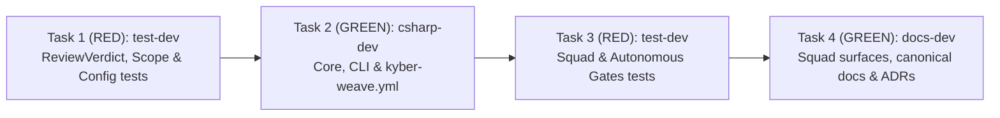

# Plan: Remove NEEDS_HUMAN verdict and escalate-to-human review policy rules

**Status: Archived — complete 2026-11-02 (Q2 CLOSEOUT_COMPLETE).**

## Discovery

Discovery: codegraph 0, docs 12, direct reads 54

Direct-read reasons:
- `CodeGraph` MCP tools (`codegraph_explore`) are not registered in the active harness toolset; fell back to `kyber-weave` documentation MCP tools (`docs_for_symbol` x4, `docs_explore` x8) followed by narrow direct reads of the affected C# review/configuration sources, Squad agent/skill contracts, canonical documentation, and xUnit test suites.
- Direct reads of skills and architect references (4): `.apm/skills/kyber-docs-authoring/SKILL.md`, `products/kyber-squad/agents/architect/references/plan-authoring.md`, `products/kyber-squad/agents/architect/references/autonomy-decisions.md`, `products/kyber-squad/agents/architect/references/test-first-contract.md` (required authoring and test-first contract rules).
- Direct reads of governance indexes and plan precedent (4): `docs/plans/README.md`, `docs/documentation-ontology.md`, `docs/catalog.md`, `docs/archive/plans/2026-11-02-worktree-mcp-canonical-binding.md` (frontmatter and structural conventions).
- Direct reads of C# Review Council and CLI sources (16): `src/KyberWeave.Core/Review/VerdictEngine.cs`, `src/KyberWeave.Core/Review/ReviewModel.cs`, `src/KyberWeave.Core/Review/ReviewOutcome.cs`, `src/KyberWeave.Core/Review/ReviewJson.cs`, `src/KyberWeave.Core/Review/PathGlob.cs`, `src/KyberWeave.Core/Review/CouncilGateSelection.cs`, `src/KyberWeave.Core/Review/TaskGateSelection.cs`, `src/KyberWeave.Core/Review/Catalogue/GateCatalogue.cs`, `src/KyberWeave.Core/Configuration/ReviewConfig.cs`, `src/KyberWeave.Core/Configuration/ReviewConfigLoader.cs`, `src/KyberWeave.Core/Configuration/ReviewYamlSection.cs`, `src/KyberWeave.Core/Docs/Scaffolding/ReviewBlockWriter.cs`, `src/KyberWeave.Cli/Commands/Review/ReviewVerdictCommand.cs`, `src/KyberWeave.Cli/Commands/Review/ReviewSettings.cs`, `src/KyberWeave.Cli/Commands/Review/ReviewGatesCommand.cs`, `src/KyberWeave.Cli/AGENTS.md` (unindexed symbol implementation details and blast radius).
- Direct reads of host config, CI template, and Squad sources (13): `.kyber-weave/kyber-weave.yml`, `templates/github-actions/kyber-weave-review-gate.yml`, `products/kyber-squad/README.md`, `products/kyber-squad/agents/code-reviewer.md`, `products/kyber-squad/migration/code-reviewer.md`, `products/kyber-squad/agents/conductor.md`, `products/kyber-squad/migration/conductor.md`, `products/kyber-squad/agents/conductor/references/execution-and-review.md`, `products/kyber-squad/agents/conductor/references/autonomy.md`, `products/kyber-squad/agents/conductor/references/intake-path.md`, `products/kyber-squad/agents/conductor/references/plan-path.md`, `products/kyber-squad/agents/conductor/references/spec-path.md`, `products/kyber-squad/agents/conductor/overlays/operator-channel.md` (verify exact wording and migration digest requirements).
- Direct reads of Squad skills (6): `products/kyber-squad/skills/code-review/SKILL.md`, `products/kyber-squad/skills/dp-code-reviewer/SKILL.md`, `products/kyber-squad/skills/bug-crusher/SKILL.md`, `products/kyber-squad/agents/bug-crusher.md`, `.apm/skills/kyber-weave-cli/SKILL.md`, `.apm/skills/spec-conductor/SKILL.md` (locate all `NEEDS_HUMAN`, `always-human`, and `max-reviewable-lines` references).
- Direct reads of canonical documentation and standards (13): `docs/cli-command-surface.md`, `docs/code-review/architecture.md`, `docs/code-review/README.md`, `docs/configuration.md`, `docs/ci-pipelines/rule-reference.md`, `docs/reference/autonomous-gates.md`, `docs/adr/README.md`, `docs/adr/0002-three-layer-review-council-verdict-engine.md`, `docs/adr/0045-conductor-operator-channel-opt-in.md`, `docs/kyber-squad/architecture.md` (2 slices), `docs/kyber-squad/requirements.md`, `docs/standards/csharp/README.md`, `docs/standards/test/README.md` (verify documentation harvest targets and coding standards).
- Direct reads of xUnit test suites and fixtures (15): `tests/KyberWeave.Tests/ReviewVerdictTests.cs`, `tests/KyberWeave.Tests/ReviewConfigTests.cs`, `tests/KyberWeave.Tests/ReviewScopeExclusionTests.cs`, `tests/KyberWeave.Tests/SquadAutonomousGatesInventoryTests.cs`, `tests/KyberWeave.Tests/SquadAutonomyContractTests.cs`, `tests/KyberWeave.Tests/SquadAutonomyRemediationTests.cs`, `tests/KyberWeave.Tests/SquadOperatorChannelCliTests.cs`, `tests/KyberWeave.Tests/SquadCanonicalContentTests.cs` (3 slices), `tests/KyberWeave.Tests/SquadPerformanceContractTests.cs`, `tests/KyberWeave.Tests/HostConfigYamlTests.cs`, `tests/KyberWeave.Tests/DocsInitReviewGatesTests.cs`, `tests/KyberWeave.Tests/GateCatalogueRenderTests.cs`, `tests/KyberWeave.Tests/AgentGovernanceTests.cs`, `tests/KyberWeave.Tests/Squad/SquadOperatorChannelOptInTests.cs` (2 slices), `tests/KyberWeave.Tests/Squad/SquadKyberWeaveSkillsTests.cs`, `tests/fixtures/gate-catalogue/go/expected-review.yml`, `tests/fixtures/gate-catalogue/csharp/expected-review.yml` (verify exact test assertions to update in RED tasks).

## Problem and Goal

The Review Council (`VerdictEngine` and `kyber-weave review verdict`) currently computes a three-way verdict: `APPROVE` (exit `0`), `REQUEST_CHANGES` (exit `1`), and `NEEDS_HUMAN` (exit `2`). `NEEDS_HUMAN` is triggered exclusively by two policy rules:
1. **`KW-REVIEW-008` (`VerdictEngine.ReservedPath`)**: any changed path matches `review.policy.always-human` (with companion info diagnostic `KW-REVIEW-011` (`VerdictEngine.NoReservedPathsDeclared`) when `always-human` is empty).
2. **`KW-REVIEW-009` (`VerdictEngine.ChangeTooLarge`)**: `scope.EffectiveChangedLines > review.policy.max-reviewable-lines`.

The repository owner explicitly directed that `NEEDS_HUMAN` be removed altogether across both autonomous and supervised modes:
- `"what is the nees_human review thing in the council... if we are in autonomous mode that result should no longer be allowed. i just want to remove it all together"`
- `"do it"`

**Goal**: Remove `ReviewVerdict.NeedsHuman` (and exit code `2`), the `always-human` and `max-reviewable-lines` policy rules (`KW-REVIEW-008`, `KW-REVIEW-009`, `KW-REVIEW-011`), and their configuration properties (`ReviewPolicy.AlwaysHuman`, `ReviewPolicy.MaxReviewableLines`) from the C# review engine, CLI, host configuration, Kyber-Squad agent/skill instructions, canonical documentation, and test suites. The Review Council verdict becomes strictly binary: **`APPROVE`** (exit `0`) or **`REQUEST_CHANGES`** (exit `1`), decided solely by blocking gates and surviving Critical/Major findings.

## Technical Investigation Findings

1. **Core Review Engine (`src/KyberWeave.Core/Review/`)**:
   - `ReviewVerdict` (`src/KyberWeave.Core/Review/ReviewModel.cs`): Remove `NeedsHuman` so the enum contains only `Approve` and `RequestChanges`. Update `RiskGrade` (`src/KyberWeave.Core/Review/ReviewModel.cs`) XML comments to drop "no reserved path touched" and "or a reserved path".
   - `ReviewOutcome.ExitCode` (`src/KyberWeave.Core/Review/ReviewOutcome.cs`): Remove `ReviewVerdict.NeedsHuman => 2`; update `<remarks>` to state `0` for `Approve` and `1` for `RequestChanges`.
   - `VerdictEngine` (`src/KyberWeave.Core/Review/VerdictEngine.cs`):
     - Remove rule constants `ReservedPath` (`KW-REVIEW-008`), `ChangeTooLarge` (`KW-REVIEW-009`), and `NoReservedPathsDeclared` (`KW-REVIEW-011`).
     - In `Evaluate`: change `ReviewVerdict verdict = EvaluateReservedPaths(scope, policy, diagnostics) ?? EvaluateSize(scope, policy, diagnostics) ?? EvaluateGates(gates, diagnostics) ?? EvaluateFindings(accepted, policy, diagnostics);` to `ReviewVerdict verdict = EvaluateGates(gates, diagnostics) ?? EvaluateFindings(accepted, policy, diagnostics);`.
     - Remove `EvaluateReservedPaths` and `EvaluateSize` private methods.
     - In `GradeRisk`: change `if (verdict is ReviewVerdict.NeedsHuman || accepted.Exists(...) || gates.Any(...))` to `if (accepted.Exists(f => f.Severity == ReviewSeverity.Critical) || gates.Any(g => g is { Blocking: true, Passed: false }))`.
     - Retain `ReviewScope.EffectiveChangedLines` and `ReviewScope.IsExcludedPath` on `ReviewModel.cs` as pure scope line-counting metadata (used by `ReviewScopeExclusionTests` and `ReviewVerdictCommand`), while asserting in `ReviewScopeExclusionTests` that large source or lockfile diffs evaluate to `ReviewVerdict.Approve` (exit `0`) when gates and findings are clean.

2. **Configuration Model & Loader (`src/KyberWeave.Core/Configuration/`)**:
   - `ReviewPolicy` (`src/KyberWeave.Core/Configuration/ReviewConfig.cs`): Remove `AlwaysHuman` (`IReadOnlyList<string>`) and `MaxReviewableLines` (`int`, default `10_000`).
   - `ReviewPolicyYaml` (`src/KyberWeave.Core/Configuration/ReviewYamlSection.cs`): Remove `AlwaysHuman` and `MaxReviewableLines` properties from the YAML DTO (note: `KyberWeaveConfigLoader` uses `IgnoreUnmatchedProperties()`, so external host YAML files with legacy keys will not fail deserialization).
   - `ReviewConfigLoader.ParsePolicy` (`src/KyberWeave.Core/Configuration/ReviewConfigLoader.cs`): Remove `maxLines` parsing and validation (`review.policy.max-reviewable-lines must be greater than zero.`) and remove `AlwaysHuman` and `MaxReviewableLines` assignments on `ReviewPolicy`.

3. **CLI Command & Surface (`src/KyberWeave.Cli/Commands/Review/ReviewVerdictCommand.cs`)**:
   - `ReviewVerdictCommand.Describe(ReviewVerdict)` (`src/KyberWeave.Cli/Commands/Review/ReviewVerdictCommand.cs`): Remove `ReviewVerdict.NeedsHuman => "NEEDS HUMAN"`.
   - `src/KyberWeave.Cli/AGENTS.md`: Confirm whether any exit code table mentions `2` (none in `src/KyberWeave.Cli/AGENTS.md`, only in `docs/cli-command-surface.md` and `.apm/skills/kyber-weave-cli/SKILL.md`).

4. **Host Configuration (`.kyber-weave/kyber-weave.yml`)**:
   - Under `review.policy:` (lines 390–415), remove `always-human:` and `max-reviewable-lines: 20000` along with their comments, leaving `strictness: strict`.
   - Update the comment on lines 428–430 under `mcp:` so it no longer references `review.policy.always-human`.

5. **Kyber-Squad Agents, References, Skills, and Migration Digests (`products/kyber-squad/` & `.apm/skills/`)**:
   - `products/kyber-squad/agents/code-reviewer.md`:
     - Frontmatter `description` (line 4): change `into APPROVE, REQUEST_CHANGES, or NEEDS_HUMAN.` to `into APPROVE or REQUEST_CHANGES.`.
     - Line 26: remove `If a change exceeds the configured review.policy.max-reviewable-lines ceiling, escalate immediately rather than scanning a diff too large for reliable review.`.
     - Line 54 (`## 1. Scope`): remove `- **Size ceiling**: if the effective changed lines exceed review.policy.max-reviewable-lines, stop and escalate — a diff that large needs to be split or reviewed by a human, not rubber-stamped.`.
     - Lines 102 & 106 (`## 5. Verdict`): change `` `APPROVE`, `REQUEST_CHANGES`, or `NEEDS_HUMAN` `` to `` `APPROVE` or `REQUEST_CHANGES` ``, remove `A path the policy reserves for human judgement forces NEEDS_HUMAN regardless of how clean everything was.`, and in the report template change `<APPROVE | REQUEST CHANGES | NEEDS HUMAN>` to `<APPROVE | REQUEST CHANGES>`.
   - `products/kyber-squad/migration/code-reviewer.md`:
     - Update `final-body-sha256` to match the SHA-256 of the LF-normalized instruction body of `products/kyber-squad/agents/code-reviewer.md` (pinned by `SquadCanonicalContentTests.LoadMigrationReportsDeclareLockedSourcesAndActualCanonicalDigest`).
   - `products/kyber-squad/agents/conductor/references/execution-and-review.md`:
     - Line 95 (`## Findings and final council`): remove `` `NEEDS_HUMAN` is terminal in supervised mode; in autonomous mode follow the autonomy contract. ``
     - Line 105 (`### Bounded council remediation loop`): change `- **Bypass paths**: KW-REVIEW-008 reserved-path escalation (always-human paths), size escalation over max-reviewable-lines (KW-REVIEW-009), and blocking-gate failure (blocking-gate verdict rule, including docs validate, docs drift, build, test, and analyzers) bypass finding remediation entirely and follow their existing escalation or REQUEST_CHANGES paths.` to `- **Bypass paths**: blocking-gate failure (blocking-gate verdict rule, including docs validate, docs drift, build, test, and analyzers) bypasses finding remediation entirely and follows its existing REQUEST_CHANGES path.`.
   - `products/kyber-squad/agents/conductor/references/autonomy.md`:
     - Lines 62–71: rename `## NEEDS_HUMAN and circuit-breakers are non-fatal` to `## Circuit-breakers are non-fatal` and update the body to state:
       - When a developer task trips a circuit-breaker (`ESCALATION: circuit-breaker`), it is **reported as a finding** and **delivery continues** — the draft pull request is the human review, so every open circuit-breaker finding is listed in the PR description as **pending human review**.
       - Supervised behaviour is unchanged: an unresolved circuit-breaker finding escalates to the user and blocks completion until the user resolves it.
     - Line 78 (`## Final report`): change `- every NEEDS_HUMAN and open circuit-breaker finding, listed as pending human review.` to `- every open circuit-breaker finding (and any run-start doctor exit 3 item), listed as pending human review.`.
   - `products/kyber-squad/skills/code-review/SKILL.md`:
     - Line 3 (`description`): change `Approve / Request-changes / Needs-human` to `Approve / Request-changes`.
     - Lines 32–34 (`### 1. Scope the change`): remove `If the effective line count is over review.policy.max-reviewable-lines, stop after the gates and escalate — a diff that large cannot be read honestly in one pass and pretending otherwise is worse than saying so.`.
     - Lines 194–214 (`### 5. Compute the verdict`): remove rules 1 (`always-human` / `NEEDS_HUMAN`) and 2 (`max-reviewable-lines` / `NEEDS_HUMAN`), renumbering the four remaining rules 1–4 (`Blocking gate failed` → `REQUEST_CHANGES`, `Any surviving critical finding` → `REQUEST_CHANGES`, `Surviving major findings reach major-count-blocks` → `REQUEST_CHANGES`, `Otherwise` → `APPROVE`), and remove the sentence `The first two rules are why the policy outranks the findings: "a human needs to look at this" is not the same instruction as "fix this".`.
     - Line 259 (`### Verdict`): change `APPROVE / REQUEST_CHANGES / NEEDS_HUMAN` to `APPROVE / REQUEST_CHANGES`.
     - Lines 311–312 (`## Configuration`): remove `always-human: ["**/auth/**", "**/*secret*"]` and `max-reviewable-lines: 1500` from the sample YAML.
   - `products/kyber-squad/skills/dp-code-reviewer/SKILL.md`:
     - Line 32 (`### shadow`): remove `and the always-human paths have been checked against what the repository actually holds`.
     - Lines 67–68 & 79 (`## The re-review loop` & `### Termination`): remove the `NEEDS_HUMAN` bullet and reference, leaving three termination conditions (`APPROVE`, `No progress`, `Three rounds completed`).
     - Line 101 (`## Reporting`): change `{APPROVE|REQUEST_CHANGES|NEEDS_HUMAN}` to `{APPROVE|REQUEST_CHANGES}`.
   - `products/kyber-squad/skills/bug-crusher/SKILL.md`:
     - Line 98 (`## 5. Escalated path`): change `and every NEEDS_HUMAN or open circuit-breaker item as pending human review` to `and every open circuit-breaker item as pending human review`.
   - `.apm/skills/kyber-weave-cli/SKILL.md`:
     - Line 117: change `` `review verdict` | `0` approve, `1` request-changes, `2` needs-human `` to `` `review verdict` | `0` approve, `1` request-changes ``.

6. **Canonical Documentation (`docs/`)**:
   - `docs/code-review/architecture.md`: Update the two Mermaid diagrams, `## The whole system`, `## How the verdict is computed` (four rules: blocking gate, critical finding, major threshold, otherwise approve; exit codes `0` approve and `1` request-changes), and `## Configuration` to remove `NEEDS_HUMAN`, `KW-REVIEW-008`, `KW-REVIEW-009`, `KW-REVIEW-011`, `always-human`, and `max-reviewable-lines`.
   - `docs/code-review/README.md`: Change `APPROVE, REQUEST_CHANGES, or NEEDS_HUMAN` to `APPROVE or REQUEST_CHANGES`, exit codes to `0` approve and `1` changes requested, and remove the `The policy outranks the engine (always-human)` bullet.
   - `docs/cli-command-surface.md`: Update `review verdict` description (line 206) and exit-code table row (line 431) from `0 approve, 1 request-changes, 2 needs-human` to `0 approve, 1 request-changes`.
   - `docs/configuration.md`: Remove the note on lines 488–494 referencing `review.policy.always-human`.
   - `docs/ci-pipelines/rule-reference.md`: Under `### Verdict — review verdict`, mark `KW-REVIEW-008`, `KW-REVIEW-009`, and `KW-REVIEW-011` as **Retired** (preserving rule IDs permanently per repository non-negotiables) and update the explanatory paragraph below the table to state the binary `0` (`APPROVE`) and `1` (`REQUEST_CHANGES`) exit codes.
   - `docs/reference/autonomous-gates.md`: Update §4, §5, §8 Verdict rules table (mark `KW-REVIEW-008` and `KW-REVIEW-009` as retired/removed so the council verdict is binary `APPROVE` / `REQUEST_CHANGES`), §9 Hard stops, §10 (record retirement of `always-human` and `NEEDS_HUMAN`), §11 Circuit-breakers, and §13 Disposition summary.
   - `docs/kyber-squad/architecture.md` and `docs/kyber-squad/requirements.md`: In `architecture.md` §10 (`### Delivery: draft first, ready on CI`, line 914), change `Autonomous NEEDS_HUMAN verdicts and unresolved circuit-breakers are listed as pending human review` to `Unresolved circuit-breakers are listed as pending human review`. In `requirements.md` (`### Q5 — Escalation`, line 513), change `alongside any NEEDS_HUMAN verdict` to `as pending human review`.
   - `docs/adr/0002-three-layer-review-council-verdict-engine.md`, `docs/adr/0045-conductor-operator-channel-opt-in.md`, and `docs/adr/README.md`: Amend ADR 0002 and ADR 0045 in place to record the 2026-11-02 owner directive retiring `NEEDS_HUMAN`, `always-human` (`KW-REVIEW-008` / `KW-REVIEW-011`), and `max-reviewable-lines` (`KW-REVIEW-009`) in favor of a binary `APPROVE` / `REQUEST_CHANGES` verdict, and update `docs/adr/README.md` summaries if needed.

## Decisions

| ID | Question | Answer / decision | Mitigating and supporting information | Status / approval provenance |
|---|---|---|---|---|
| D1 | Should `NEEDS_HUMAN` be suppressed only in autonomous mode or removed from the Review Council and `VerdictEngine` altogether? | Remove `NEEDS_HUMAN` altogether across all modes so the Review Council verdict is strictly binary: `APPROVE` (exit `0`) or `REQUEST_CHANGES` (exit `1`). | Owner explicitly directed: `"what is the nees_human review thing in the council... if we are in autonomous mode that result should no longer be allowed. i just want to remove it all together"` and `"do it"`. | `owner directive, 2026-11-02` |
| D2 | How should `review.policy.always-human`, `review.policy.max-reviewable-lines`, and rule IDs `KW-REVIEW-008`, `KW-REVIEW-009`, and `KW-REVIEW-011` be handled when `NEEDS_HUMAN` is removed? | Remove `AlwaysHuman` and `MaxReviewableLines` from `ReviewPolicy`, `ReviewPolicyYaml`, `ReviewConfigLoader`, and `.kyber-weave/kyber-weave.yml`; remove `ReservedPath` (`KW-REVIEW-008`), `ChangeTooLarge` (`KW-REVIEW-009`), and `NoReservedPathsDeclared` (`KW-REVIEW-011`) from `VerdictEngine`; and mark `KW-REVIEW-008`, `KW-REVIEW-009`, and `KW-REVIEW-011` as retired in `docs/ci-pipelines/rule-reference.md` without reusing or renumbering any `KW-REVIEW-*` IDs. | `KW-REVIEW-008`, `KW-REVIEW-009`, and `KW-REVIEW-011` exist solely to drive `NEEDS_HUMAN`. Repository non-negotiables require that `KW-*` rule IDs are permanent and never reused or renumbered. `KyberWeaveConfigLoader` already uses `IgnoreUnmatchedProperties()`, so external configs with legacy keys will not crash YAML deserialization. | `autonomous: recommendation accepted` |
| D3 | Should `ReviewScope.EffectiveChangedLines` and `ReviewScope.IsExcludedPath` remain on `ReviewScope`? | Keep `ReviewScope.EffectiveChangedLines` and `ReviewScope.IsExcludedPath` on `ReviewModel.cs` as scope line-counting metadata while removing the `KW-REVIEW-009` size-ceiling escalation from `VerdictEngine`. | `ReviewScope` still computes effective non-generated line counts for `ReviewVerdictCommand` scope summaries and `ReviewScopeExclusionTests`; keeping the scope calculation while asserting `ReviewVerdict.Approve` on large diffs preserves clean scope reporting without size escalation. | `autonomous: recommendation accepted` |
| D4 | Plan approval gate (`approve-and-execute`) | Approve and execute the test-first plan (`documentation-impact: extends-component`, `impact-components: [ReviewCouncil, KyberSquad]`). | All decisions are resolved, the Test contract is complete, and both documentation checks pass. | `autonomous: recommendation accepted` |

## Design harvest

| ID | Target Document | Target Section | Doc Type | Description |
|---|---|---|---|---|
| H1 | `docs/code-review/architecture.md` | `## How the verdict is computed` | architecture | Binary `APPROVE` / `REQUEST_CHANGES` verdict table, exit codes (`0` / `1`), Mermaid diagrams, and removal of `always-human` / `max-reviewable-lines` policy keys |
| H2 | `docs/ci-pipelines/rule-reference.md` | `## Verdict — review verdict` | reference | Retirement of `KW-REVIEW-008`, `KW-REVIEW-009`, and `KW-REVIEW-011` in the permanent rule table |
| H3 | `docs/kyber-squad/architecture.md` | `### Escalation (Q5)` | architecture | Autonomous gates inventory and Squad architecture/requirements updates removing `NEEDS_HUMAN` and `always-human` |
| H4 | `docs/adr/0002-three-layer-review-council-verdict-engine.md` | Root | adr | In-place ADR amendments recording the 2026-11-02 owner directive retiring `NEEDS_HUMAN`, `always-human`, and `max-reviewable-lines` |

## Test contract (`development-mode: test-first`)

Every behavior change is pinned by a failing test (`test-dev`, RED) before the production or canonical-contract change (`csharp-dev` / `docs-dev`, GREEN) makes it pass. RED and GREEN are strictly separated across dispatches.

| Requirement / Decision | Test file & test name(s) | Asserted behavior | Expected RED failure before GREEN |
|---|---|---|---|
| D1, D2: Binary `ReviewVerdict` enum (`Approve`, `RequestChanges` only), binary `ReviewOutcome.ExitCode` (`0`, `1`), and removal of `KW-REVIEW-008`, `KW-REVIEW-009`, and `KW-REVIEW-011` from `VerdictEngine` | `tests/KyberWeave.Tests/ReviewVerdictTests.cs`: `ReviewVerdictDefinesOnlyApproveAndRequestChanges`, `TouchToAuthPathWithCleanGatesAndNoFindingsIsApproved`, `LargeChangeWithCleanGatesAndNoFindingsIsApproved`, `DefaultConfigEmitsNoReservedPathsDiagnostic` (replacing `AReservedPathEscalatesRegardlessOfHowCleanTheReviewWas`, `AReservedPathOutranksACriticalFinding`, `AChangeTooLargeToReviewEscalatesRatherThanBeingGraded`, `AHostThatDeclaredNoReservedPathsIsToldSoRatherThanSilentlyUnprotected`); `tests/KyberWeave.Tests/ReviewScopeExclusionTests.cs`: `SourceOnlyLargeDiffApprovesWhenGatesAndFindingsAreClean` (replacing `SourceOnlyOverflowStillNeedsHumanReview`) | `Enum.GetNames<ReviewVerdict>()` equals `["Approve", "RequestChanges"]`; `VerdictEngine` defines no `ReservedPath`, `ChangeTooLarge`, or `NoReservedPathsDeclared` field; touching `src/auth/TokenIssuer.cs` or changing `10_001` / `21_000` lines with clean gates and no findings returns `ReviewVerdict.Approve` with `ExitCode == 0`, `RiskGrade.Low`, and no `KW-REVIEW-008`, `KW-REVIEW-009`, or `KW-REVIEW-011` diagnostic. | Fails on current base because `ReviewVerdict` still contains `NeedsHuman`, `VerdictEngine` still defines `KW-REVIEW-008` / `KW-REVIEW-009` / `KW-REVIEW-011`, and `VerdictEngine.Evaluate` escalates `src/auth/TokenIssuer.cs` and `>10,000`-line scopes to `NeedsHuman` (exit `2`). |
| D2: Removal of `AlwaysHuman` and `MaxReviewableLines` from `ReviewPolicy`, `ReviewConfigLoader`, and `.kyber-weave/kyber-weave.yml` | `tests/KyberWeave.Tests/ReviewConfigTests.cs`: `AnUnconfiguredHostDeclaresNoGatesAndDefaultPolicyThresholds`, `PolicyValuesAreReadAndBoundsChecked`, `OutOfRangePolicyValuesAreRejected`, `ThisRepositorysOwnReviewConfigurationLoadsCleanlyWithStrictPolicy` | `typeof(ReviewPolicy).GetProperty("AlwaysHuman")` and `typeof(ReviewPolicy).GetProperty("MaxReviewableLines")` are `null`; `ReviewConfigLoader` loads `.kyber-weave/kyber-weave.yml` with `Strictness == ReviewStrictness.Strict` and `.kyber-weave/kyber-weave.yml` does not contain `always-human` or `max-reviewable-lines`. | Fails on current base because `ReviewPolicy` still exposes `AlwaysHuman` and `MaxReviewableLines` and `.kyber-weave/kyber-weave.yml` still declares `always-human` and `max-reviewable-lines`. |
| D1, D2: Kyber-Squad agent, skill, reference, and autonomous-gates inventory contracts drop `NEEDS_HUMAN`, `always-human`, and `max-reviewable-lines` | `tests/KyberWeave.Tests/SquadAutonomyContractTests.cs`: `AutonomousCircuitBreakerIsAReportedFindingAndDeliveryContinues`, `SupervisedGatesRemainInTheContracts`; `tests/KyberWeave.Tests/SquadAutonomyRemediationTests.cs`: `CouncilBypassPathsStayOutsideTheRemediationLoop`; `tests/KyberWeave.Tests/SquadAutonomousGatesInventoryTests.cs`: `VerdictRulesAndSection10RecordRetirementOfNeedsHumanAndAlwaysHuman`; `tests/KyberWeave.Tests/SquadCanonicalContentTests.cs`: `ReviewSurfacesEnforceBinaryApproveOrRequestChangesVerdict` | `code-reviewer.md`, `skills/code-review/SKILL.md`, `skills/dp-code-reviewer/SKILL.md`, `skills/bug-crusher/SKILL.md`, `conductor/references/autonomy.md`, and `conductor/references/execution-and-review.md` contain no `NEEDS_HUMAN`, `NEEDS HUMAN`, `Needs-human`, `always-human`, or `max-reviewable-lines`; `execution-and-review.md` still pins `blocking-gate` and `bypass`; `autonomy.md` pins circuit-breaker findings as `pending human review` while delivery continues; `docs/reference/autonomous-gates.md` records `KW-REVIEW-008` and `KW-REVIEW-009` as retired. | Fails on current base because `code-reviewer.md`, `code-review/SKILL.md`, `dp-code-reviewer/SKILL.md`, `bug-crusher/SKILL.md`, `autonomy.md`, `execution-and-review.md`, and `docs/reference/autonomous-gates.md` still prescribe `NEEDS_HUMAN`, `always-human`, and `max-reviewable-lines`. |

## Tasks

### Task 1 (RED): Pin binary `ReviewVerdict` and `ReviewPolicy` contracts in C# unit tests

- **Specialist**: `test-dev`
- **Role**: RED test authorship
- **Dependencies**: None
- **Required skills**: `test-dev`, `csharp-dev`
- **Standards**: `docs/standards/test/README.md`, `docs/standards/csharp/README.md`
- **Files and symbols in scope**:
  - `tests/KyberWeave.Tests/ReviewVerdictTests.cs` (`ReviewVerdictTests`)
  - `tests/KyberWeave.Tests/ReviewScopeExclusionTests.cs` (`ReviewScopeExclusionTests`)
  - `tests/KyberWeave.Tests/ReviewConfigTests.cs` (`ReviewConfigTests`)
- **Action**:
  1. Keep all reflection-based checks compile-safe so `dotnet build` succeeds while the new assertions fail on behavior (RED) until Task 2 (GREEN) removes the production members:
     - In `tests/KyberWeave.Tests/ReviewVerdictTests.cs`:
       - Remove `AlwaysHuman = ["**/auth/**"]` from `Config(...)`, `PresetWithReservedPaths(...)` (rename to `Preset(ReviewStrictness strictness)`), and `CoverageBelowTheFloorIsReportedButDoesNotBlock`.
       - Replace `AReservedPathEscalatesRegardlessOfHowCleanTheReviewWas` and `AReservedPathOutranksACriticalFinding` with:
         - `ReviewVerdictDefinesOnlyApproveAndRequestChanges`: asserts `Assert.Equal(["Approve", "RequestChanges"], Enum.GetNames<ReviewVerdict>())` and asserts via reflection that `typeof(VerdictEngine).GetField("ReservedPath")`, `typeof(VerdictEngine).GetField("ChangeTooLarge")`, and `typeof(VerdictEngine).GetField("NoReservedPathsDeclared")` are `null`.
         - `TouchToAuthPathWithCleanGatesAndNoFindingsIsApproved`: evaluates `Scope(10, "src/auth/TokenIssuer.cs")` with clean gates and no findings and asserts `ReviewVerdict.Approve`, `RiskGrade.Low`, `ExitCode == 0`, and `Assert.DoesNotContain(outcome.Diagnostics, d => d.Code is "KW-REVIEW-008" or "KW-REVIEW-011")`.
       - Replace `AChangeTooLargeToReviewEscalatesRatherThanBeingGraded` with `LargeChangeWithCleanGatesAndNoFindingsIsApproved`: evaluates `Scope(10_001)` and asserts `ReviewVerdict.Approve`, `RiskGrade.Low`, `ExitCode == 0`, and `Assert.DoesNotContain(outcome.Diagnostics, d => d.Code == "KW-REVIEW-009")`.
       - Replace `AHostThatDeclaredNoReservedPathsIsToldSoRatherThanSilentlyUnprotected` with `DefaultConfigEmitsNoReservedPathsDiagnostic`: evaluates `new ReviewConfig()` and asserts `Assert.DoesNotContain(outcome.Diagnostics, d => d.Code == "KW-REVIEW-011")`.
     - In `tests/KyberWeave.Tests/ReviewScopeExclusionTests.cs`:
       - Update XML doc comments and helper `Evaluate(ReviewScope scope)` to pass `new ReviewConfig()` without `MaxReviewableLines`.
       - In `LockfileLinesDoNotCountTowardTheSizeCeiling` and `ScratchpadLinesDoNotCountTowardTheSizeCeiling`, assert `Assert.Equal(SourceOnlyLines, scope.EffectiveChangedLines)`, `Assert.Equal(ReviewVerdict.Approve, outcome.Verdict)`, `Assert.DoesNotContain(outcome.Diagnostics, d => d.Code == "KW-REVIEW-009")`, and `Assert.Contains(..., scope.ChangedPaths)`.
       - Replace `SourceOnlyOverflowStillNeedsHumanReview` with `SourceOnlyLargeDiffApprovesWhenGatesAndFindingsAreClean`: for `21_000` source lines (`10_500` in `src/A.cs` and `10_500` in `src/B.cs`), assert `Assert.Equal(21_000, scope.EffectiveChangedLines)`, `Assert.Equal(ReviewVerdict.Approve, outcome.Verdict)`, `Assert.Equal(0, outcome.ExitCode)`, and `Assert.DoesNotContain(outcome.Diagnostics, d => d.Code == "KW-REVIEW-009")`.
     - In `tests/KyberWeave.Tests/ReviewConfigTests.cs`:
       - Update `AnUnconfiguredHostDeclaresNoGatesAndNoReservedPaths` (rename to `AnUnconfiguredHostDeclaresNoGatesAndDefaultPolicyThresholds`): assert `Assert.Empty(config.Gates)`, `Assert.Equal(7, config.Policy.MinConfidence)`, `Assert.Equal(3, config.Policy.MajorCountBlocks)`, `Assert.False(config.Coverage.IsDeclared)`, and assert via reflection that `typeof(ReviewPolicy).GetProperty("AlwaysHuman")` and `typeof(ReviewPolicy).GetProperty("MaxReviewableLines")` are `null`.
       - Update `PolicyValuesAreReadAndBoundsChecked` to load `coverage`, `major-count-blocks: 2`, `min-confidence: 8`, and `suppressions` without `always-human` or `max-reviewable-lines`.
       - Update `StrictnessDefaultsToBalancedWithTheProductThresholds` to load `"review:\n  policy: {}\n"`.
       - In `OutOfRangePolicyValuesAreRejected`, remove `[InlineData("max-reviewable-lines: 0", "max-reviewable-lines")]`.
       - Update `ThisRepositorysOwnReviewConfigurationLoadsAndReservesItsGovernanceArtifacts` (rename to `ThisRepositorysOwnReviewConfigurationLoadsCleanlyWithStrictPolicy`): assert `result.Success`, `review.Gates` contains `build` and `test`, `Assert.Equal(ReviewStrictness.Strict, review.Policy.Strictness)`, and assert that the raw `.kyber-weave/kyber-weave.yml` text contains neither `always-human` nor `max-reviewable-lines`.
- **Pre-computed test commands**:
  - Build: `scripts/proc-guard.sh run -- dotnet build KyberWeave.sln -c Release`
  - Run RED tests: `scripts/proc-guard.sh run -- dotnet tests/KyberWeave.Tests/bin/Release/net10.0/KyberWeave.Tests.dll -class KyberWeave.Tests.ReviewVerdictTests -class KyberWeave.Tests.ReviewScopeExclusionTests -class KyberWeave.Tests.ReviewConfigTests -reporter quiet`
  - Expected outcome: Build succeeds; the new assertions fail (RED) because `ReviewVerdict.NeedsHuman`, `VerdictEngine.ReservedPath`/`ChangeTooLarge`/`NoReservedPathsDeclared`, `ReviewPolicy.AlwaysHuman`/`MaxReviewableLines`, and `.kyber-weave/kyber-weave.yml` policy keys are still present.

### Task 2 (GREEN): Remove `NeedsHuman`, `always-human`, and `max-reviewable-lines` from C# engine, CLI, and host config

- **Specialist**: `csharp-dev`
- **Role**: GREEN production implementation
- **Dependencies**: Task 1
- **Required skills**: `csharp-dev`, `resharper-clt`, `task-gate`
- **Standards**: `docs/standards/csharp/README.md`
- **Files and symbols in scope**:
  - `src/KyberWeave.Core/Review/ReviewModel.cs` (`ReviewVerdict`, `RiskGrade`)
  - `src/KyberWeave.Core/Review/ReviewOutcome.cs` (`ReviewOutcome.ExitCode`)
  - `src/KyberWeave.Core/Review/VerdictEngine.cs` (`VerdictEngine`)
  - `src/KyberWeave.Core/Configuration/ReviewConfig.cs` (`ReviewPolicy`)
  - `src/KyberWeave.Core/Configuration/ReviewYamlSection.cs` (`ReviewPolicyYaml`)
  - `src/KyberWeave.Core/Configuration/ReviewConfigLoader.cs` (`ReviewConfigLoader.ParsePolicy`)
  - `src/KyberWeave.Cli/Commands/Review/ReviewVerdictCommand.cs` (`ReviewVerdictCommand.Describe`)
  - `.kyber-weave/kyber-weave.yml` (`review.policy`, `mcp` comment)
- **Action**:
  1. In `src/KyberWeave.Core/Review/ReviewModel.cs`:
     - Remove `NeedsHuman` from `ReviewVerdict` so only `Approve` and `RequestChanges` remain.
     - Update `RiskGrade` XML doc comments on `Low` and `High` to remove "no reserved path touched" and "or a reserved path".
  2. In `src/KyberWeave.Core/Review/ReviewOutcome.cs`:
     - Remove `ReviewVerdict.NeedsHuman => 2,` from `ExitCode` and update `<remarks>` to state `0` for `Approve` and `1` for `RequestChanges`.
  3. In `src/KyberWeave.Core/Review/VerdictEngine.cs`:
     - Update the class `
` XML comment to describe the binary `Approve` / `RequestChanges` evaluation.
     - Remove `ReservedPath`, `ChangeTooLarge`, and `NoReservedPathsDeclared` constants.
     - In `Evaluate`, compute `ReviewVerdict verdict = EvaluateGates(gates, diagnostics) ?? EvaluateFindings(accepted, policy, diagnostics);`.
     - Remove `EvaluateReservedPaths` and `EvaluateSize`.
     - In `GradeRisk`, remove `verdict is ReviewVerdict.NeedsHuman ||` and drop the unused `ReviewVerdict verdict` parameter from `GradeRisk(List<ReviewFinding> accepted, IReadOnlyList<GateResult> gates)`.
  4. In `src/KyberWeave.Core/Configuration/ReviewConfig.cs`, `ReviewYamlSection.cs`, and `ReviewConfigLoader.cs`:
     - Remove `AlwaysHuman` and `MaxReviewableLines` from `ReviewPolicy` (`ReviewConfig.cs`) and `ReviewPolicyYaml` (`ReviewYamlSection.cs`).
     - In `ReviewConfigLoader.ParsePolicy` (`ReviewConfigLoader.cs`), remove `maxLines` parsing and validation (`review.policy.max-reviewable-lines must be greater than zero.`) and remove `AlwaysHuman` and `MaxReviewableLines` from the `new ReviewPolicy` initializer.
  5. In `src/KyberWeave.Cli/Commands/Review/ReviewVerdictCommand.cs`:
     - Remove `ReviewVerdict.NeedsHuman => "NEEDS HUMAN",` from `Describe(ReviewVerdict verdict)`.
  6. In `.kyber-weave/kyber-weave.yml`:
     - Under `review.policy:`, remove `always-human:` and `max-reviewable-lines: 20000` (and their comments), leaving `strictness: strict`.
     - Update the comment above `mcp:` (lines 428–430) to remove the reference to `review.policy.always-human`.
- **Pre-computed test commands**:
  - Build: `scripts/proc-guard.sh run -- dotnet build KyberWeave.sln -c Release`
  - Run GREEN tests: `scripts/proc-guard.sh run -- dotnet tests/KyberWeave.Tests/bin/Release/net10.0/KyberWeave.Tests.dll -class KyberWeave.Tests.ReviewVerdictTests -class KyberWeave.Tests.ReviewScopeExclusionTests -class KyberWeave.Tests.ReviewConfigTests -reporter quiet`
  - Expected outcome: All tests in `ReviewVerdictTests`, `ReviewScopeExclusionTests`, and `ReviewConfigTests` pass (GREEN).

### Task 3 (RED): Pin binary verdict and retired `NEEDS_HUMAN` / `always-human` rules in Squad contract tests

- **Specialist**: `test-dev`
- **Role**: RED test authorship
- **Dependencies**: Task 2
- **Required skills**: `test-dev`, `csharp-dev`
- **Standards**: `docs/standards/test/README.md`, `docs/standards/csharp/README.md`
- **Files and symbols in scope**:
  - `tests/KyberWeave.Tests/SquadAutonomyContractTests.cs` (`SquadAutonomyContractTests`)
  - `tests/KyberWeave.Tests/SquadAutonomyRemediationTests.cs` (`SquadAutonomyRemediationTests`)
  - `tests/KyberWeave.Tests/SquadAutonomousGatesInventoryTests.cs` (`SquadAutonomousGatesInventoryTests`)
  - `tests/KyberWeave.Tests/SquadCanonicalContentTests.cs` (`SquadCanonicalContentTests`)
- **Action**:
  1. In `tests/KyberWeave.Tests/SquadAutonomyContractTests.cs`:
     - Rename `AutonomousNeedsHumanIsAReportedFindingAndDeliveryContinues` to `AutonomousCircuitBreakerIsAReportedFindingAndDeliveryContinues`: assert `autonomy` contains `"pending human review"`, `"reported as a finding"`, `"the draft pull request is the human review"`, `"listed in the PR"`, `"delivery continues"`, and `Assert.DoesNotContain("NEEDS_HUMAN", autonomy, StringComparison.Ordinal)`. Assert `Assert.DoesNotContain("NEEDS_HUMAN", execution, StringComparison.Ordinal)`.
     - In `SupervisedGatesRemainInTheContracts`: remove `"NEEDS_HUMAN is terminal"` from `AssertAll(contract, ...)` and assert `Assert.DoesNotContain("NEEDS_HUMAN", contract, StringComparison.Ordinal)`.
  2. In `tests/KyberWeave.Tests/SquadAutonomyRemediationTests.cs`:
     - In `CouncilBypassPathsStayOutsideTheRemediationLoop`: remove `"KW-REVIEW-008"` from `AssertAll(execution, ...)`, keep `"blocking-gate"` and `"bypass"`, and add `Assert.DoesNotContain("KW-REVIEW-008", execution, StringComparison.Ordinal)` and `Assert.DoesNotContain("KW-REVIEW-009", execution, StringComparison.Ordinal)`.
  3. In `tests/KyberWeave.Tests/SquadAutonomousGatesInventoryTests.cs`:
     - Keep `HardStopsSectionDropsTheAlwaysHumanReservedPathBullet`.
     - Replace `AlwaysHumanPathListIsUnchanged` with `VerdictRulesAndSection10RecordRetirementOfNeedsHumanAndAlwaysHuman`: assert that `## 8. Verdict rules` and `## 10.` in `docs/reference/autonomous-gates.md` record that `NEEDS_HUMAN`, `KW-REVIEW-008` (`always-human`), and `KW-REVIEW-009` (`max-reviewable-lines`) are retired and that the council verdict is binary (`APPROVE` or `REQUEST_CHANGES`).
  4. In `tests/KyberWeave.Tests/SquadCanonicalContentTests.cs`:
     - Add `[Fact] public void ReviewSurfacesEnforceBinaryApproveOrRequestChangesVerdict()`: scans `products/kyber-squad/agents/code-reviewer.md`, `products/kyber-squad/skills/code-review/SKILL.md`, `products/kyber-squad/skills/dp-code-reviewer/SKILL.md`, `products/kyber-squad/skills/bug-crusher/SKILL.md`, `products/kyber-squad/agents/conductor/references/autonomy.md`, and `products/kyber-squad/agents/conductor/references/execution-and-review.md` and asserts that none of them contains `"NEEDS_HUMAN"`, `"NEEDS HUMAN"`, `"Needs-human"`, `"always-human"`, or `"max-reviewable-lines"`, and that `code-reviewer.md` and `skills/code-review/SKILL.md` both contain `"APPROVE"` and `"REQUEST_CHANGES"`.
- **Pre-computed test commands**:
  - Build: `scripts/proc-guard.sh run -- dotnet build KyberWeave.sln -c Release`
  - Run RED tests: `scripts/proc-guard.sh run -- dotnet tests/KyberWeave.Tests/bin/Release/net10.0/KyberWeave.Tests.dll -class KyberWeave.Tests.SquadAutonomyContractTests -class KyberWeave.Tests.SquadAutonomyRemediationTests -class KyberWeave.Tests.SquadAutonomousGatesInventoryTests -class KyberWeave.Tests.SquadCanonicalContentTests -reporter quiet`
  - Expected outcome: Build succeeds; the updated/new tests fail (RED) because the Squad markdown files and `docs/reference/autonomous-gates.md` still contain `NEEDS_HUMAN`, `always-human`, `max-reviewable-lines`, and `KW-REVIEW-008`.

### Task 4 (GREEN): Update Kyber-Squad agents, skills, migration digest, and canonical documentation

- **Specialist**: `docs-dev`
- **Role**: GREEN canonical instruction and documentation implementation
- **Dependencies**: Task 3
- **Required skills**: `kyber-docs-authoring`, `architecture-decision-record`
- **Standards**: `docs/documentation-ontology.md`
- **Files and symbols in scope**:
  - `products/kyber-squad/agents/code-reviewer.md`
  - `products/kyber-squad/migration/code-reviewer.md`
  - `products/kyber-squad/agents/conductor/references/execution-and-review.md`
  - `products/kyber-squad/agents/conductor/references/autonomy.md`
  - `products/kyber-squad/skills/code-review/SKILL.md`
  - `products/kyber-squad/skills/dp-code-reviewer/SKILL.md`
  - `products/kyber-squad/skills/bug-crusher/SKILL.md`
  - `.apm/skills/kyber-weave-cli/SKILL.md`
  - `docs/code-review/architecture.md`
  - `docs/code-review/README.md`
  - `docs/cli-command-surface.md`
  - `docs/configuration.md`
  - `docs/ci-pipelines/rule-reference.md`
  - `docs/reference/autonomous-gates.md`
  - `docs/kyber-squad/architecture.md`
  - `docs/kyber-squad/requirements.md`
  - `docs/adr/0002-three-layer-review-council-verdict-engine.md`
  - `docs/adr/0045-conductor-operator-channel-opt-in.md`
- **Action**:
  1. Update Kyber-Squad canonical agent, reference, and skill files as specified in **Technical Investigation Findings §5**:
     - `products/kyber-squad/agents/code-reviewer.md` (and update `final-body-sha256` in `products/kyber-squad/migration/code-reviewer.md` to the new LF-normalized body SHA-256 digest).
     - `products/kyber-squad/agents/conductor/references/execution-and-review.md` (preserve `"one bounded remediation pass"`, `"before park"`, `"blocking-gate"`, and `"bypass"` pinned by `SquadAutonomyRemediationTests`).
     - `products/kyber-squad/agents/conductor/references/autonomy.md` (preserve `"pending human review"`, `"reported as a finding"`, `"the draft pull request is the human review"`, `"listed in the PR"`, `"delivery continues"`, and `"Supervised behaviour is unchanged"` pinned by `SquadAutonomyContractTests`).
     - `products/kyber-squad/skills/code-review/SKILL.md` (preserve `"remediation pass"`, `"Minor/Info"`, `"Rule"`, `"Verdict"`, and `"major-count-blocks"` pinned by `SquadAutonomyRemediationTests`).
     - `products/kyber-squad/skills/dp-code-reviewer/SKILL.md`.
     - `products/kyber-squad/skills/bug-crusher/SKILL.md`.
     - `.apm/skills/kyber-weave-cli/SKILL.md`.
  2. Update canonical documentation and ADRs in place as specified in **Technical Investigation Findings §6** and **Design harvest**:
     - `docs/code-review/architecture.md`, `docs/code-review/README.md`, `docs/cli-command-surface.md`, `docs/configuration.md`.
     - `docs/ci-pipelines/rule-reference.md`: mark `KW-REVIEW-008`, `KW-REVIEW-009`, and `KW-REVIEW-011` as **Retired** in place (never reuse or renumber `KW-REVIEW-*` IDs) and update `last-reviewed: 2026-11-02`.
     - `docs/reference/autonomous-gates.md`: update §4, §5, §8 Verdict rules, §9, §10, §11, and §13 to record the retirement of `NEEDS_HUMAN`, `KW-REVIEW-008` (`always-human`), and `KW-REVIEW-009` (`max-reviewable-lines`) while keeping all phrases pinned by `SquadAutonomousGatesInventoryTests` (`intake choice`, `READY_FOR_REVIEW`, `tasks approval`, `approve and execute`, `mode-change re-approval`, `task-gate`, `council`, `self-review`, `docs validate`, `docs drift`, `verdict rules`, `keep`, `reduce`, `collapse`, `irreversible`, `Removed by #424`, `## 9. Hard stops`, `## 10. Always-human paths`, `## 11.`).
     - `docs/kyber-squad/architecture.md` and `docs/kyber-squad/requirements.md`.
     - `docs/adr/0002-three-layer-review-council-verdict-engine.md` and `docs/adr/0045-conductor-operator-channel-opt-in.md`: amend in place to record the 2026-11-02 owner directive retiring `NEEDS_HUMAN`, `always-human`, and `max-reviewable-lines`.
- **Pre-computed test commands**:
  - Run GREEN tests: `scripts/proc-guard.sh run -- dotnet tests/KyberWeave.Tests/bin/Release/net10.0/KyberWeave.Tests.dll -class KyberWeave.Tests.SquadAutonomyContractTests -class KyberWeave.Tests.SquadAutonomyRemediationTests -class KyberWeave.Tests.SquadAutonomousGatesInventoryTests -class KyberWeave.Tests.SquadCanonicalContentTests -class KyberWeave.Tests.DocGovernanceTests -class KyberWeave.Tests.DocumentIndexTests -reporter quiet`
  - Docs validation: `dotnet run --project src/KyberWeave.Cli -- docs validate .` and `dotnet run --project src/KyberWeave.Cli -- docs drift .`
  - Expected outcome: All Squad contract tests, doc governance tests, `docs validate`, and `docs drift` pass with 0 errors and 0 warnings.

## Dependency Graph

## Risks and Open Questions

- **Migration digest sensitivity (`SquadCanonicalContentTests.LoadMigrationReportsDeclareLockedSourcesAndActualCanonicalDigest`)**: Editing `products/kyber-squad/agents/code-reviewer.md` changes its instruction body SHA-256 digest. Task 4 explicitly updates `final-body-sha256` in `products/kyber-squad/migration/code-reviewer.md` to match the LF-normalized body after frontmatter.
- **Autonomous gates inventory pins (`SquadAutonomousGatesInventoryTests`)**: `HardStopsSectionDropsTheAlwaysHumanReservedPathBullet` splits `docs/reference/autonomous-gates.md` on the exact headings `## 9. Hard stops`, `## 10. Always-human paths`, and `## 11.`. Task 4 preserves those exact section headings while recording the retirement of `always-human` and `NEEDS_HUMAN` inside `## 10. Always-human paths`.
- **CodeGraph drift check (`KW-DOC-DRIFT-001`)**: Removing `NeedsHuman`, `AlwaysHuman`, and `MaxReviewableLines` from C# types requires refreshing the CodeGraph index (`codegraph init .`) if `docs drift` reports stale symbol digests, or verifying `docs_drift` passes cleanly.
- **Open questions**: `NONE` (all decisions resolved).

## Out-of-Scope Boundaries

- Do not alter `ReviewStrictness` presets (`Lenient`, `Balanced`, `Strict`), `MinConfidence`, `MajorCountBlocks`, or `ReviewSuppression` expiration rules.
- Do not remove `ReviewScope.EffectiveChangedLines` or `ReviewScope.IsExcludedPath` (they remain scope line-counting metadata).
- Do not reuse or renumber any `KW-REVIEW-*` diagnostic codes; `KW-REVIEW-008`, `KW-REVIEW-009`, and `KW-REVIEW-011` are marked retired in `docs/ci-pipelines/rule-reference.md`.
- Do not change the worker/conductor iteration circuit-breaker (`ESCALATION: circuit-breaker`) or the opt-in operator channel (`KYBER_SQUAD_OPERATOR_CHANNEL`).

## Verification, Review, and Closeout

1. **Task gates**: Each developer task runs its `task-gate` check (`scripts/proc-guard.sh run -- dotnet run --project src/KyberWeave.Cli -- review gates . --agent <role> --task <task-id> --out artifacts/task-gate-<task-id>.json`) and targeted test classes.
2. **Whole-change verification**:
   - `scripts/proc-guard.sh run -- dotnet run --project src/KyberWeave.Cli -- review gates . --all --out artifacts/gates.json`
   - `scripts/proc-guard.sh run -- dotnet run --project src/KyberWeave.Cli -- docs validate . --merge-ready`
   - `scripts/proc-guard.sh run -- dotnet run --project src/KyberWeave.Cli -- docs drift .`
3. **Council review**: After opening/updating the draft pull request, run one `code-reviewer` council pass over the accumulated change; it must return `APPROVE`.
4. **Closeout (`docs-dev`)**: Verify all rows in the **Design harvest** and **Decisions** tables are harvested into canonical documentation (`documentation-impact: extends-component`, `impact-components: [ReviewCouncil, KyberSquad]`), archive this plan to `docs/archive/plans/2026-11-02-remove-needs-human-verdict.md`, update `docs/plans/README.md`, and re-run `docs validate --merge-ready` and `docs drift`.

---

## Closeout mapping

**Completed 2026-11-02.** Archived under `docs/archive/plans/`. Every decision and design harvest item is mapped to canonical documentation and verified by tests.

### Verification evidence

| Check | Result |
|---|---|
| Council Review (Round 2 & 3) | `dp-code-reviewer` verified all 9 council findings resolved: `Verdict: APPROVE`, exit code `0`, `Risk: LOW`, `0` surviving findings, `19/19` applicable blocking gates passed (`test`, `docs-validate`, `docs-drift`, `inspectcode`, `duplicates`). |
| Contract & Unit Tests | All tests passing in `ReviewVerdictTests`, `ReviewConfigTests`, `ReviewScopeExclusionTests`, `SquadAutonomyContractTests`, `SquadAutonomyRemediationTests`, `SquadAutonomousGatesInventoryTests`, `SquadCanonicalContentTests`, `DocGovernanceTests`, and `DocumentIndexTests`. |
| `docs validate . --merge-ready` | 0 critical, 0 error, 0 warning, 0 info. |
| `docs drift .` | 0 critical, 0 error, 0 warning, 0 info against current CodeGraph index. |

### ADR Waiver

no new ADR — ADR waiver: amends ADR 0002 and ADR 0045 in place to record the 2026-11-02 owner directive retiring NEEDS_HUMAN, always-human (KW-REVIEW-008/011), and max-reviewable-lines (KW-REVIEW-009).

### Mapping

Documentation-impact is `extends-component` for every row; impact components are `ReviewCouncil` and `KyberSquad`; `last-reviewed` is 2026-11-02.

| ID | Destination | Documentation-impact | Impact components | Last reviewed | Status |
|---|---|---|---|---|---|
| D1 | [`docs/code-review/architecture.md`](../../code-review/architecture.md#how-the-verdict-is-computed), [`docs/code-review/README.md`](../../code-review/README.md), [`docs/cli-command-surface.md`](../../cli-command-surface.md#review--the-deterministic-review-half), [`docs/ci-pipelines/rule-reference.md`](../../ci-pipelines/rule-reference.md#verdict--review-verdict), [`docs/reference/autonomous-gates.md`](../../reference/autonomous-gates.md#8-verdict-rules), [`docs/kyber-squad/architecture.md`](../../kyber-squad/architecture.md#escalation-q5), [`docs/kyber-squad/requirements.md`](../../kyber-squad/requirements.md#conductor-execution-circuit-breaker), [`docs/adr/0002-three-layer-review-council-verdict-engine.md`](../../adr/0002-three-layer-review-council-verdict-engine.md), [`docs/adr/0045-conductor-operator-channel-opt-in.md`](../../adr/0045-conductor-operator-channel-opt-in.md) | extends-component | ReviewCouncil, KyberSquad | 2026-11-02 | archived |
| D2 | [`docs/configuration.md`](../../configuration.md#review), [`docs/docgraph/onboarding.md`](../../docgraph/onboarding.md#review-gates), [`docs/ci-pipelines/rule-reference.md`](../../ci-pipelines/rule-reference.md#verdict--review-verdict), [`docs/code-review/architecture.md`](../../code-review/architecture.md#how-the-verdict-is-computed), [`docs/reference/autonomous-gates.md`](../../reference/autonomous-gates.md#10-always-human-paths), [`docs/adr/0002-three-layer-review-council-verdict-engine.md`](../../adr/0002-three-layer-review-council-verdict-engine.md), [`docs/adr/0045-conductor-operator-channel-opt-in.md`](../../adr/0045-conductor-operator-channel-opt-in.md) | extends-component | ReviewCouncil, KyberSquad | 2026-11-02 | archived |
| D3 | [`docs/code-review/architecture.md`](../../code-review/architecture.md#how-the-verdict-is-computed), [`docs/reference/autonomous-gates.md`](../../reference/autonomous-gates.md#8-verdict-rules) | extends-component | ReviewCouncil | 2026-11-02 | archived |
| D4 | Documentation waiver: plan approve-and-execute gate is execution-approval provenance only, with no surviving architectural, operational, or behavioral invariant. | extends-component | ReviewCouncil, KyberSquad | 2026-11-02 | archived |
| H1 | [`docs/code-review/architecture.md`](../../code-review/architecture.md#how-the-verdict-is-computed), [`docs/code-review/README.md`](../../code-review/README.md), [`docs/cli-command-surface.md`](../../cli-command-surface.md#review--the-deterministic-review-half), [`docs/configuration.md`](../../configuration.md#review), [`docs/docgraph/onboarding.md`](../../docgraph/onboarding.md#review-gates) | extends-component | ReviewCouncil | 2026-11-02 | archived |
| H2 | [`docs/ci-pipelines/rule-reference.md`](../../ci-pipelines/rule-reference.md#verdict--review-verdict) | extends-component | ReviewCouncil | 2026-11-02 | archived |
| H3 | [`docs/kyber-squad/architecture.md`](../../kyber-squad/architecture.md#escalation-q5), [`docs/kyber-squad/requirements.md`](../../kyber-squad/requirements.md#conductor-execution-circuit-breaker), [`docs/reference/autonomous-gates.md`](../../reference/autonomous-gates.md#8-verdict-rules) | extends-component | KyberSquad, ReviewCouncil | 2026-11-02 | archived |
| H4 | [`docs/adr/0002-three-layer-review-council-verdict-engine.md`](../../adr/0002-three-layer-review-council-verdict-engine.md), [`docs/adr/0045-conductor-operator-channel-opt-in.md`](../../adr/0045-conductor-operator-channel-opt-in.md) | extends-component | ReviewCouncil, KyberSquad | 2026-11-02 | archived |
