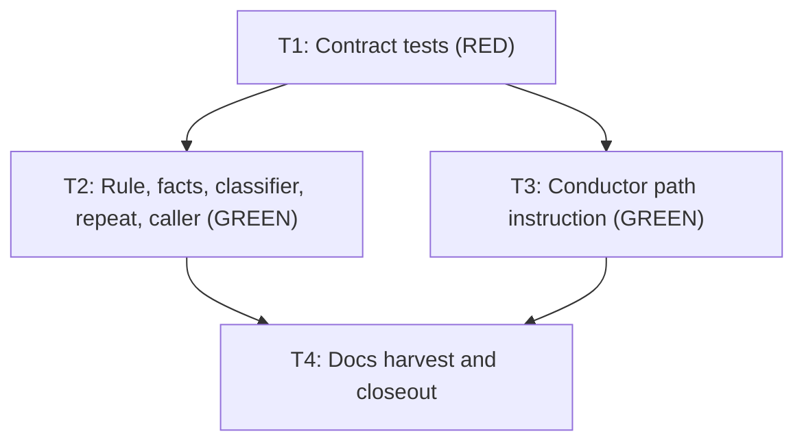

# Arbiter stops refusing valid architect dispatches and names the real reason when it refuses

**Status: Archived — complete 2026-11-09.** Approved for execution under autonomy `autonomous` (decision AP1 below). Development mode `test-first`; autonomy `autonomous`; scale `extends-component` on `KyberArbiter`.

**The one change that lets more dispatches through is D5.** An unmarked dispatch to a planner now passes on project-wide-hook harnesses. To revert it, remove the guard in `TriggerClassifier.ResolveCaller` so a planner target always infers the conductor, and delete the `Classification_UnmarkedPlannerTargetOnProjectWideHarnessPasses` and `RealEngine_Factory_UnmarkedPlannerDispatch_PassesThrough` tests.

**Bottom line.** The Arbiter (the hook that checks each agent dispatch against rules) refuses valid `architect` dispatches for three separate reasons, and every refusal says the same unhelpful thing: `malformed`, "use a recognised marker". The plan fixes the three false refusals, gives each real refusal its own reason and its own next step, and keeps refusing absolute plan paths. This is not specific to Factory: only the `CALLER` label and one of the three causes are.

## Problem and goal

**Problem.** The owner ran `architect` on Factory with the Arbiter on and got:

```text
STATUS: ARBITER_ESCALATION
TRIGGER: delegate.planner
CALLER: unidentified (factory)
TARGET: architect
RULES: KW-ARB-PLANNER-001
ANSWER: malformed (step 0)
EVIDENCE: rule KW-ARB-PLANNER-001 answered 'malformed' on delegate.planner
DECISION_ID: 08df3ecc2fc69e6e-55f69f86
REPEAT: 2
NEXT: re-issue this planner dispatch with a recognised marker; do not send it to architect.
```

The dispatch had a valid marker. Its `PLAN_FILE:` header held an absolute worktree path, which the header parser drops by design. Nothing in the shipped conductor text says the path must be relative.

**Goal.**

1. A conductor sends `PLAN_FILE:` as a repository-relative path, because its instructions now say so.
2. A planner dispatch whose marker needs no `PLAN_FILE:` (intake, findings drain, Arbiter escalation, spec phase) is no longer refused.
3. An unmarked dispatch to a planner on a harness whose hooks are project-wide passes through, as the Arbiter's architecture document says it should.
4. A refusal names its real cause in `ANSWER` and `NEXT`, shows the caller the Arbiter actually resolved, and does not report a false repeat.
5. Everything the rule enforces today on marked dispatches stays enforced: a rejected path stays refused, and a path outside the plan, spec and todo directories stays refused.

## Decisions

Permanent state, preserved across the plan's whole lifecycle.

| ID | Question | Answer / decision | Mitigating and supporting information | Status / approval provenance |
|---|---|---|---|---|
| D1 | Should the Arbiter accept an absolute `PLAN_FILE:`? | No. Keep refusing it, and tell the conductor to send a repository-relative path. | The archived Arbiter design (section 5) defines the value as "a repository-relative path". `PlanPathResolver` names rooted paths as the threat. A worktree path sits outside the hook's repository root, so containment fails, and suffix matching would let `/tmp/evil/docs/plans/x.md` through. Safe acceptance needs valid roots derived from git, which is new security-sensitive code for a problem the instruction fix and a clear refusal already solve. | ANSWERED — autonomous: recommendation accepted 2026-11-09. Covered by design section 5 and `PlanPathResolver`. |
| D2 | How does a refusal state its real cause? | Add two answers to `KW-ARB-PLANNER-001`: `plan-file-invalid` and `plan-file-outside-planning-dirs`. `malformed` stays and now means only "no recognised marker". `NEXT` is chosen per answer. The rule id does not change. | Rejected alternative: keep one answer and fill the `EVIDENCE` line. Step-0 decision records carry no evidence, so that needs new plumbing and leaves the logged answer ambiguous. Keeping `malformed` means a host's existing `effects` override still loads. New answers inherit the shipped `escalate` effect. | ANSWERED — autonomous: recommendation accepted 2026-11-09. Low-confidence, no authoritative source; cheap to reverse. |
| D3 | Should a marker that needs no `PLAN_FILE:` be recognised without one? | Yes. Intake, `FINDINGS:`, the `STATUS: ARBITER_ESCALATION` envelope and the `FEATURE:`/`PHASE:` pair answer `recognised` when no `PLAN_FILE:` was sent. | Design section 4.3 requires `PLAN_FILE` only "when the marker is that header", section 4.4 lists these markers, and the escalation flow says `PLANNER-001` recognises the envelope. `plan-path.md`, `intake-path.md` and `spec-path.md` tell the conductor to send them without `PLAN_FILE:`. So every intake, escalation, findings drain and spec phase is refused today. No requirement backs the pinned test `Planner001_MarkedDispatchWithoutPlanFile_AnswersMalformed`, and no plan or spec names it; it pins the defect, so T1 replaces it. Security: a `PLAN_FILE:` dispatch already passes on header text alone and the rule never checks the file exists, so this adds no capability. `KW-ARB-PLANNER-DIFF-001` still bounds what the planner writes. | ANSWERED — autonomous: recommendation accepted 2026-11-09. Covered by design sections 4.3 and 4.4 and the shipped conductor contract. |
| D4 | Can a body marker rescue a dispatch whose `PLAN_FILE:` was rejected? | No. A rejected `PLAN_FILE:` answers `plan-file-invalid` before any marker is considered. | Without this, D3 opens a bypass: an absolute path plus an `INTAKE:` line would look like a marker-only dispatch. A new fact, `delegation.plan-file-rejected`, separates "absent" from "sent and refused". It carries no raw value, so nothing from the prompt reaches the decision log. | ANSWERED — autonomous: recommendation accepted 2026-11-09. Required to keep the enforcement in Goal 5. |
| D5 | Should an unmarked dispatch to a planner on a project-wide-hook harness pass? | Yes. Infer the conductor from a planner target only when the dispatch is marked, or on a harness that names its caller (`claude`, `copilot-vscode`). | `docs/kyber-arbiter/architecture.md` ("Delivery and caller notes"): project-wide harnesses "gate only dispatches carrying the `KYBER-ARBITER: true` marker ... and pass anything else through". The design is consistent: its "Header inference" list opens "applies to marked dispatches", which resolves the contradiction the investigation reported, and section 4.3 passes an unmarked, unidentified dispatch. The code is the outlier. **This is the one change that lets more through:** a conductor that dropped its marker would go ungated on those harnesses, which is the accepted risk R13 in the design, and `KW-ARB-AUDIT-002` reports it. Implementation-class targets already behave this way. An unmarked dispatch carrying `PLAN_FILE:` or `TASK:` still infers the conductor and stays gated. The test `CallerInference_PlannerTargetMeansConductor` uses an unmarked prompt, so T1 marks it. To revert, remove the guard in `TriggerClassifier.ResolveCaller` so a planner target always infers the conductor, and delete the two tests that pin the pass-through. | ANSWERED — autonomous: recommendation accepted 2026-11-09. Covered by architecture "Delivery and caller notes" and design section 4.2. |
| D6 | Is the false `REPEAT` in scope? | Yes. With no plan file, count earlier escalations only from the same session. With a plan file, the key is unchanged. | The repeat key is rule, plan file, digest and task, so with no plan file every unrelated refusal shares one counter (the investigation saw it climb 1 to 6). The conductor contract says a repeat stops. A first-time absolute-path refusal that reads `REPEAT: 2` would stop the run instead of letting the conductor correct the path, which defeats Goal 1. | ANSWERED — autonomous: recommendation accepted 2026-11-09. Low-confidence, no authoritative source; cheap to reverse. |
| D7 | Should `CALLER` show the resolved caller? | Yes. Print the caller the evaluator recorded, falling back to the hook's own value. | The decision log recorded `conductor` while the message printed `unidentified (factory)`, which reads as a Factory identity failure. One line, and the message is the deliverable. | ANSWERED — autonomous: recommendation accepted 2026-11-09. Low-confidence, no authoritative source; cheap to reverse. |
| D8 | What is the scale? | `extends-component` on `KyberArbiter`, with no ADR. | Rule answers, a fact, and the classification of unmarked planner dispatches are durable behaviour that canonical docs describe. ADR waiver: this restores the documented contract and adds no new boundary, dependency or schema. | ANSWERED — autonomous: recommendation accepted 2026-11-09. Covered by the plan index scale policy. |
| AP1 | Approve and execute | Approved: this plan and its Test contract (T1 to T4), at the declared scale, `extends-component` on `KyberArbiter`. | The conductor returned `AUTONOMOUS_APPROVAL: approve-and-execute` under resolved autonomy `autonomous` (Config Reg `<autonomy>`), accepting D1 to D8 as recommended. Docs checks in the worktree before finalization: `docs validate --merge-ready` reported only `KW-DOC-LIFECYCLE-003` on this active plan, expected until closeout; `docs drift` reported no findings. | ANSWERED — autonomous: recommendation accepted 2026-11-09; explicit conductor gate `approve-and-execute`. |

## Design harvest

`documentation-impact: extends-component`; `impact-components: [KyberArbiter]`. Each item lands in canonical docs at closeout (T4).

| ID | Target component | Target doc type | Durable design item |
|---|---|---|---|
| H1 | KyberArbiter | architecture | `PLAN_FILE:` is repository-relative; a sent-but-rejected header is distinct from an absent one (D1, D4). An unmarked planner dispatch on a project-wide harness passes (D5). |
| H2 | KyberArbiter | reference | The four `KW-ARB-PLANNER-001` answers and what each means, in the rule reference (D2, D3). |
| H3 | KyberArbiter | runbook | How to read a planner refusal and what to do for each answer; `REPEAT` without a plan file counts one session (D2, D6). |

## Investigation findings

- **Discovery:** codegraph 1, docs 4, direct reads 88 (16 of them at finalization, for the task-file schema and parser).
- **Revision read:** `7a235215f33f60473363062549666fb6174b0dd9` on branch `claude/fix/arbiter-factory-planner-malformed`, read directly from the worktree.
- **Direct reads and reason:** every direct read of indexed code or docs was for the reason "server bound to another revision": `kw-docs` answered from `claude/docs/conductor-bug-crusher-run-speed` at `05eb938a`, and the CodeGraph response carried no `rev=` line to compare.
- **Reproduced by the investigation (0.1.8-rc.23):** Factory and Claude, absolute `PLAN_FILE:` is refused and relative is allowed. Same result on both, so the rule is harness-neutral. Base, head and failing binary are the same version; this branch did not introduce it.

Checked against the source and confirmed:

- `HeaderBlock.IsValidPlanFile` rejects a leading `/`, and the value is silently dropped. `TriggerClassifier.PlannerMarkerFor` then finds no marker, so the rule answers `malformed`.
- `default-rules.yml`, rule `KW-ARB-PLANNER-001`: `delegation.plan-file exists: false` answers `malformed`, refusing markers the design says need no plan file.
- `ArbiterEscalationEnvelope.NextFor` gives one `NEXT` for all `malformed` answers. `ArbiterHookDecisionEngine.RenderReason` prints the hook's raw caller rather than `record.Caller`.
- `DecisionLog.Repeat` matches on plan file, digest and task only; `ArbiterEvaluator.AppendDecisionAsync` calls it with `planFile` null for these dispatches.

Corrected against the investigation:

- It reported that the design contradicts itself on unmarked dispatches. It does not: the inference list is scoped to marked dispatches. Code is the outlier (D5).
- Planner-target inference lives in two places in the same call path: `CallerResolver.InferFromHeaders`, reached through the `TARGET` entry `TriggerClassifier.ResolveCaller` adds, and the fallback at the end of `ResolveCaller`. Both need the guard.
- The MCP fallback (`ArbiterTools`) writes `KYBER-ARBITER: true` into the prompt it builds, so D5 does not affect it.
- The conductor contract stops on `REPEAT` 2 or greater for planner refusals too, which is why D6 is in scope and not cosmetic.

Earlier fix of the same symptom: commit `af4f70d9` (#514) changed `config.planning-dirs` to directory globs. Different cause, same `malformed` answer, which is the argument for D2: one answer for several causes hid this one.

## Test contract (test-first)

| Task | Test project or file | Runner command | Observable behaviour | RED evidence required | GREEN acceptance |
|---|---|---|---|---|---|
| T1 | The five test classes named in task T1 | The command in task T1 | The contract tests exist, compile, and split into the failing and guard sets the task lists. | The failing set fails on assertions, with no compile error. | Not applicable here: T2 and T3 turn these green. |
| T2 | `tests/KyberWeave.Tests/Arbiter/ArbiterPlannerRuleTests.cs`, `tests/KyberWeave.Tests/Arbiter/ArbiterEscalationEnvelopeTests.cs`, `tests/KyberWeave.Tests/Arbiter/ArbiterClassificationTests.cs`, `tests/KyberWeave.Tests/Arbiter/ArbiterRealEngineTests.cs` | `scripts/proc-guard.sh run -- dotnet test tests/KyberWeave.Tests/KyberWeave.Tests.csproj -c Release --filter "FullyQualifiedName~KyberWeave.Tests.Arbiter.ArbiterPlannerRuleTests\|FullyQualifiedName~KyberWeave.Tests.Arbiter.ArbiterEscalationEnvelopeTests\|FullyQualifiedName~KyberWeave.Tests.Arbiter.ArbiterClassificationTests\|FullyQualifiedName~KyberWeave.Tests.Arbiter.ArbiterRealEngineTests"` | 1. A rejected `PLAN_FILE:` (absolute, `..`, duplicated, or absolute with a body marker) answers `plan-file-invalid`. 2. A marker with no `PLAN_FILE:` answers `recognised`. 3. A path outside the planning directories answers `plan-file-outside-planning-dirs`. 4. No marker at all answers `malformed`. 5. Each answer has its own exact `NEXT`. 6. An unmarked planner dispatch passes on project-wide harnesses and stays gated on `claude`. 7. On Factory end to end, an absolute path is denied with the real reason and `CALLER: conductor (factory)`. 8. `REPEAT` with no plan file counts one session. | The tests named RED in T1 fail on their assertions (`malformed` returned where another answer is expected, the old `NEXT`, a non-null trigger, `CALLER: unidentified`, `REPEAT: 3`), with no compile error. | The same tests pass unchanged with a non-zero test count and 0 failures. |
| T3 | `tests/KyberWeave.Tests/ArbiterConductorContractTests.cs` | `scripts/proc-guard.sh run -- dotnet test tests/KyberWeave.Tests/KyberWeave.Tests.csproj -c Release --filter "FullyQualifiedName~KyberWeave.Tests.ArbiterConductorContractTests"` | `plan-path.md` and the `delivery-execution` skill each state that `PLAN_FILE:` is repository-relative; the contract names `plan-file-invalid`, and no harness name appears. | `PlanFileHeaders_AreRepositoryRelative` fails because neither file contains `repository-relative`. | The same class passes unchanged with a non-zero test count and 0 failures. |
| T4 | No-test task: documentation and plan closeout. | `dotnet run --project src/KyberWeave.Cli -- docs validate . --merge-ready` and `dotnet run --project src/KyberWeave.Cli -- docs drift .` | Canonical docs state the H1 to H3 behaviour; the plan is archived. | Not applicable: no code changes. Replaced by the two docs gates. | Both gates exit 0 with 0 findings. |

## Tasks

### T1: Failing contract tests for planner refusals (RED)

- **Files:**
  - `tests/KyberWeave.Tests/Arbiter/ArbiterPlannerRuleTests.cs` (class `ArbiterPlannerRuleTests`)
  - `tests/KyberWeave.Tests/Arbiter/ArbiterEscalationEnvelopeTests.cs` (class `ArbiterEscalationEnvelopeTests`)
  - `tests/KyberWeave.Tests/Arbiter/ArbiterClassificationTests.cs` (class `ArbiterClassificationTests`)
  - `tests/KyberWeave.Tests/Arbiter/ArbiterRealEngineTests.cs` (class `ArbiterRealEngineTests`)
  - `tests/KyberWeave.Tests/ArbiterConductorContractTests.cs` (class `ArbiterConductorContractTests`)
- **Depends on:** none
- **Required skills:** `test-dev`
- **Session:** `red`
- **Objective:** Pin the behaviour below. Use only strings and existing APIs, so the tests compile today and fail on their assertions.
  - `ArbiterPlannerRuleTests`:
    - Replace `Planner001_MarkedDispatchWithoutPlanFile_AnswersMalformed` with `Planner001_NoMarkerAtAll_AnswersMalformed`, prompt `"KYBER-ARBITER: true\n\nWrite the plan."`, expected `malformed`.
    - Rename `Planner001_PlanFileOutsideThePlanningDirectories_AnswersMalformed` to `Planner001_PlanFileOutsideThePlanningDirectories_AnswersOutside`, expected `plan-file-outside-planning-dirs`.
    - Add theory `Planner001_RejectedPlanFile_AnswersPlanFileInvalid` with five prompts: `"KYBER-ARBITER: true\nPLAN_FILE: /Users/x/repo/docs/plans/plan.md\n\nWrite the plan."`, `"KYBER-ARBITER: true\nPLAN_FILE: docs/plans/../secrets.md\n\nWrite the plan."`, `"KYBER-ARBITER: true\nPLAN_FILE: docs/plans/a.md\nPLAN_FILE: docs/plans/b.md\n\nWrite the plan."`, `"KYBER-ARBITER: true\nPLAN_FILE: /tmp/evil/docs/plans/x.md\n\nINTAKE: docs/todo/item.md"`, `"KYBER-ARBITER: true\nPLAN_FILE: /Users/x/docs/plans/plan.md\n\nFINALIZE"`.
    - Add theory `Planner001_MarkerWithoutPlanFile_AnswersRecognised` with bodies `INTAKE: docs/todo/item.md`, `FINDINGS:`, `STATUS: ARBITER_ESCALATION`, and `FEATURE: search` followed by `PHASE: design`, each after `KYBER-ARBITER: true` and a blank line.
  - `ArbiterEscalationEnvelopeTests`: add `Next_PlannerPlanFileInvalid_NamesTheRepositoryRelativeRule` and `Next_PlannerPlanFileOutside_NamesThePlanningDirectories`, built like `Next_PlannerMalformed_ReissuesPlannerDispatch`. Expected `RenderNext()` values, exactly:
    - `re-issue this planner dispatch with PLAN_FILE as one repository-relative path, '/'-separated, with no leading '/', '..', backslash or space; do not send it to architect.`
    - `re-issue this planner dispatch with a PLAN_FILE under the plan, spec or todo directory; do not send it to architect.`
  - `ArbiterClassificationTests`:
    - In `CallerInference_PlannerTargetMeansConductor`, use `Marked("INTAKE: docs/todo/item.md")` as the prompt.
    - Add theory `Classification_UnmarkedPlannerTargetOnProjectWideHarnessPasses` for harnesses `factory` and `antigravity`: prompt `Plan the upgrade.`, target `architect`, asserting null `Trigger` and null `Caller`.
    - Add `Classification_UnmarkedPlannerTargetOnTrustedHarnessStaysGated`: harness `claude`, no caller, same prompt, asserting `delegate.planner` and caller `conductor`.
    - Add `Classification_UnmarkedPlanFileHeaderStillInfersConductor`: harness `factory`, target `architect`, prompt `PLAN_FILE: docs/plans/plan.md\n\nwork`, asserting `delegate.planner`.
  - `ArbiterRealEngineTests`: add a private Factory helper that writes `.kyber-weave/kyber-weave.yml` with `ontology:` `docs-root: docs` and `arbiter:` `enabled: true`, `provider:` `kind: none`; builds a `PreToolUse` payload with `tool_name` `Task`, `tool_input` holding `subagent_type`, `prompt` and `description`, a `cwd`, and a `session_id` parameter; and runs `command.Run("factory", null, stdin, stdout, log)`. Add:
    - `RealEngine_Factory_AbsolutePlanFile_DeniesWithTheRealReason`: prompt `"KYBER-ARBITER: true\nPLAN_FILE: /Users/x/repo.worktrees/fix/docs/plans/plan.md\n\nWrite the plan."`; the deny reason contains `ANSWER: plan-file-invalid (step 0)`, `CALLER: conductor (factory)` and `repository-relative`, and does not contain `recognised marker`.
    - `RealEngine_Factory_RelativePlanFile_Allows`: same prompt with `docs/plans/plan.md`, exit 0, empty stdout.
    - Theory `RealEngine_Factory_MarkerOnlyPlannerDispatch_Allows`: the four marker bodies above, exit 0, empty stdout.
    - `RealEngine_Factory_UnmarkedPlannerDispatch_PassesThrough`: prompt `Plan the upgrade.`, exit 0, empty stdout.
    - `RealEngine_Factory_RepeatWithoutPlanFile_CountsOneSession`: prompt `"KYBER-ARBITER: true\n\nWrite the plan."` twice in session A, then once in session B; the reasons contain `REPEAT: 1`, `REPEAT: 2`, `REPEAT: 1`.
  - `ArbiterConductorContractTests`: add `PlanFileHeaders_AreRepositoryRelative`, reading `agents/conductor/references/plan-path.md` and `skills/delivery-execution/SKILL.md` under `ProductRoot` separately and asserting each contains `repository-relative`, and asserting `ConductorContract` contains `plan-file-invalid`.
- **Command:** `scripts/proc-guard.sh run -- dotnet test tests/KyberWeave.Tests/KyberWeave.Tests.csproj -c Release --filter "FullyQualifiedName~KyberWeave.Tests.Arbiter.ArbiterPlannerRuleTests|FullyQualifiedName~KyberWeave.Tests.Arbiter.ArbiterEscalationEnvelopeTests|FullyQualifiedName~KyberWeave.Tests.Arbiter.ArbiterClassificationTests|FullyQualifiedName~KyberWeave.Tests.Arbiter.ArbiterRealEngineTests|FullyQualifiedName~KyberWeave.Tests.ArbiterConductorContractTests"`
- **Acceptance criteria:** The project compiles. These fail on assertions: `Planner001_RejectedPlanFile_AnswersPlanFileInvalid`, `Planner001_MarkerWithoutPlanFile_AnswersRecognised`, `Planner001_PlanFileOutsideThePlanningDirectories_AnswersOutside`, both new `Next_` tests, `Classification_UnmarkedPlannerTargetOnProjectWideHarnessPasses`, `RealEngine_Factory_AbsolutePlanFile_DeniesWithTheRealReason`, `RealEngine_Factory_MarkerOnlyPlannerDispatch_Allows`, `RealEngine_Factory_UnmarkedPlannerDispatch_PassesThrough`, `RealEngine_Factory_RepeatWithoutPlanFile_CountsOneSession`, `PlanFileHeaders_AreRepositoryRelative`. These pass, as guards on behaviour that must not change: `Planner001_NoMarkerAtAll_AnswersMalformed`, `Planner001_PlanFileInsideAPlanningDirectory_AnswersRecognised`, `CallerInference_PlannerTargetMeansConductor`, `Classification_UnmarkedPlannerTargetOnTrustedHarnessStaysGated`, `Classification_UnmarkedPlanFileHeaderStillInfersConductor`, `RealEngine_Factory_RelativePlanFile_Allows`. Report the failing and passing names as RED evidence.

### T2: Implement the refusal reasons and the classification guard (GREEN)

- **Files:**
  - `src/KyberWeave.Core/Arbiter/Facts/HeaderBlock.cs` (method `Parse`, new property `RejectedNames`)
  - `src/KyberWeave.Core/Arbiter/ArbiterTriggerCatalog.cs` (`DelegatePlannerFacts`)
  - `src/KyberWeave.Core/Arbiter/Facts/TriggerFactBuilder.cs` (`Build`, the fact switch)
  - `src/KyberWeave.Core/Arbiter/Rules/default-rules.yml` (rule `KW-ARB-PLANNER-001`)
  - `src/KyberWeave.Core/Arbiter/ArbiterEscalationEnvelope.cs` (`NextFor`)
  - `src/KyberWeave.Core/Arbiter/Facts/TriggerClassifier.cs` (`ResolveCaller`)
  - `src/KyberWeave.Core/Arbiter/Facts/DecisionLog.cs` (`Repeat`)
  - `src/KyberWeave.Core/Arbiter/ArbiterEvaluator.cs` (`AppendDecisionAsync`)
  - `src/KyberWeave.Arbiter/Hooks/ArbiterHookDecisionEngine.cs` (`RenderReason`)
- **Depends on:** `T1`
- **Required skills:** `csharp-dev`
- **Session:** `green-code`
- **Objective:**
  - `HeaderBlock`: add a public `IReadOnlySet<string> RejectedNames`: names whose line matched the header grammar but whose value failed validation or which appeared more than once. `Headers` is unchanged. Do not store the rejected value.
  - `ArbiterTriggerCatalog.DelegatePlannerFacts`: add `delegation.plan-file-rejected`.
  - `TriggerFactBuilder.Build`: set `delegation.plan-file-rejected` to `true` when `block.RejectedNames` contains `PLAN_FILE`, otherwise null (absent).
  - `default-rules.yml`, rule `KW-ARB-PLANNER-001`, in this order:

    ```yaml
    answers: [recognised, malformed, plan-file-invalid, plan-file-outside-planning-dirs]
    decide:
      - when: { fact: delegation.plan-file-rejected, exists: true }
        answer: plan-file-invalid
      - when: { fact: delegation.markers, exists: false }
        answer: malformed
      - when: { fact: delegation.plan-file, exists: false }
        answer: recognised
      - when: { fact: delegation.plan-file, matches: config.planning-dirs }
        answer: recognised
      - when: { fact: delegation.plan-file, exists: true }
        answer: plan-file-outside-planning-dirs
    effects: { recognised: allow, malformed: escalate, plan-file-invalid: escalate, plan-file-outside-planning-dirs: escalate }
    ```

  - `ArbiterEscalationEnvelope.NextFor`: for a `KW-ARB-PLANNER-001` entry, return the exact `NEXT` strings pinned in T1 for the two new answers. Keep the existing `malformed` text.
  - `TriggerClassifier.ResolveCaller`: compute `headers.ContainsKey("KYBER-ARBITER") || !IsProjectWideHarness(ev.Harness)`. Add the `TARGET` entry to `resolveHeaders`, and take the planner-target fallback, only when it is true. `PLAN_FILE` and `TASK` inference is unchanged.
  - `DecisionLog.Repeat`: add `string? session = null`. When `planFile` is null, also require `decision.Session` to equal `session`. When `planFile` is set, behave as today.
  - `ArbiterEvaluator.AppendDecisionAsync`: pass `ev.Session`.
  - `ArbiterHookDecisionEngine.RenderReason`: build `callerText` from `record.Caller ?? caller ?? "unidentified"`.
- **Command:** `scripts/proc-guard.sh run -- dotnet test tests/KyberWeave.Tests/KyberWeave.Tests.csproj -c Release --filter "FullyQualifiedName~KyberWeave.Tests.Arbiter.ArbiterPlannerRuleTests|FullyQualifiedName~KyberWeave.Tests.Arbiter.ArbiterEscalationEnvelopeTests|FullyQualifiedName~KyberWeave.Tests.Arbiter.ArbiterClassificationTests|FullyQualifiedName~KyberWeave.Tests.Arbiter.ArbiterRealEngineTests|FullyQualifiedName~KyberWeave.Tests.Arbiter.ArbiterExistsFalseRuleTests|FullyQualifiedName~KyberWeave.Tests.Arbiter.ArbiterFactBuilderTests|FullyQualifiedName~KyberWeave.Tests.Arbiter.ArbiterDefaultRulesTests|FullyQualifiedName~KyberWeave.Tests.Arbiter.ArbiterConfigTests|FullyQualifiedName~KyberWeave.Tests.Arbiter.ArbiterLedgerTests|FullyQualifiedName~KyberWeave.Tests.Arbiter.ArbiterPlannerDiffRuleTests|FullyQualifiedName~KyberWeave.Tests.Arbiter.FactoryHookAdapterTests"`
- **Acceptance criteria:** Every T1 test except `PlanFileHeaders_AreRepositoryRelative` passes with no test edited, and the regression classes in the command pass. Non-zero test count, 0 failures, `task-gate` passes on the changed files.

### T3: Tell the conductor to send a repository-relative path (GREEN)

- **Files:**
  - `products/kyber-squad/agents/conductor/references/plan-path.md` (section "Planner dispatches")
  - `products/kyber-squad/skills/delivery-execution/SKILL.md` (sections "Arbiter routing headers" and "Escalations")
- **Depends on:** `T1`
- **Required skills:** `docs-dev`
- **Session:** `green-docs`
- **Objective:**
  - In both "Planner dispatches" and "Arbiter routing headers", add: `PLAN_FILE:` is always the plan's repository-relative path with `/` separators, never the absolute path of a checkout or worktree, even when the run works in a worktree. Sent any other way it is refused as `plan-file-invalid`.
  - In "Escalations", extend the `malformed` bullet so that a `plan-file-invalid` or `plan-file-outside-planning-dirs` planner answer is re-issued with the `PLAN_FILE:` its `NEXT` describes. Keep the words `re-issue`, `recognised marker` and `malformed`, and keep "A repeat stops as above."
  - Name no harness in this text; `Contract_NamesNoHarness` enforces it.
- **Command:** `scripts/proc-guard.sh run -- dotnet test tests/KyberWeave.Tests/KyberWeave.Tests.csproj -c Release --filter "FullyQualifiedName~KyberWeave.Tests.ArbiterConductorContractTests"`
- **Acceptance criteria:** `ArbiterConductorContractTests` passes in full with a non-zero test count and no test edited.

### T4: Docs harvest and plan closeout

- **Files:**
  - `docs/kyber-arbiter/architecture.md` (section "Delivery and caller notes", and the header paragraph that names `HeaderBlock`)
  - `docs/ci-pipelines/rule-reference.md` (row `KW-ARB-PLANNER-001`)
  - `docs/kyber-arbiter/runbook.md` (new section "Reading a planner refusal", before "Setup, doctor, audit")
  - `docs/plans/README.md` (section "Active Plans")
  - `docs/archive/plans/README.md` (top of the inventory table)
  - `docs/plans/2026-11-09-arbiter-planner-refusal-reasons.md` (moved by `git mv`)
  - `docs/archive/plans/2026-11-09-arbiter-planner-refusal-reasons.md` (the moved file, with its completion summary)
  - `docs/plans/2026-11-09-arbiter-planner-refusal-reasons.tasks.json` (removed by `git rm`)
- **Depends on:** `T2`, `T3`
- **Required skills:** `docs-dev`
- **Session:** `closeout`
- **Objective:** Harvest H1 to H3. Then move this plan to `docs/archive/plans/`, remove its **Active Plans** row, add its line to the archived inventory, write the completion summary with a closeout mapping for every decision including `no ADR — ADR waiver: <reason>`, and `git rm` the task file in the same commit.
- **Command:** `dotnet run --project src/KyberWeave.Cli -- docs validate . --merge-ready && dotnet run --project src/KyberWeave.Cli -- docs drift .`
- **Acceptance criteria:** Both commands exit 0 with 0 findings, and the plan's status, index row and archive line agree.

## Dependency graph



T2 and T3 touch different files and may run at the same time.

## Out of scope

Left out, each for a stated reason:

- **Accepting absolute paths** (`src/KyberWeave.Core/Arbiter/Plans/PlanPathResolver.cs`). Rejected in D1.
- **Whether `KW-ARB-PLANNER-DIFF-001` sees no writes when the plan is written in a worktree** (`src/KyberWeave.Arbiter/Hooks/HookCommand.cs`, `src/KyberWeave.Arbiter/Hooks/HookGitFacts.cs`). The hook takes its repository root from the payload's `cwd`, and a background task's return was judged about a second after launch. A different rule, extent unverified, and a real change to write enforcement. It deserves its own investigation and should be filed as a separate defect.
- **Stronger caller identity on Factory** (`src/KyberWeave.Arbiter/Hooks/Adapters/FactoryHookAdapter.cs`). The vendor documents no caller field. On project-wide harnesses this rule is a routing check, not proof of who called, and the plan does not claim otherwise.
- **Checking that a `PLAN_FILE:` exists at the planner gate.** New enforcement, not part of this defect; a new plan's file legitimately does not exist yet.
- **The untraced Factory `malformed` at 01:50:48 with no session id.** No evidence ties it to a cause. D2 will make any recurrence name its reason.
- **`KW-ARB-PLAN-001`** on implementation dispatches. It already answers `invalid-path`, which states the reason, and T3's instruction covers the cause.

## Risks and verification gates

- **Risk: D5 lets a marker-less conductor dispatch through on project-wide harnesses.** Mitigation: accepted risk in the design, reported by `KW-ARB-AUDIT-002`, limited to a dispatch with no routing header at all, and one condition to revert. Called out to the owner.
- **Risk: D3 opens a bypass for bad paths.** Mitigation: D4 is evaluated first, and T1 pins an absolute path with an `INTAKE:` body.
- **Risk: a host tuned `malformed` for this rule.** Mitigation: the answer stays, so the override still loads. New answers inherit `escalate`, which is the stricter default.
- **Risk: older conductors in deployed repositories still send absolute paths.** Mitigation: until they update, the refusal now says exactly how to correct it, and `REPEAT` no longer stops the correction.
- **Verification gates:** `task-gate` by each worker on its files; the targeted classes above through the watchdog; `docs validate --merge-ready` and `docs drift`.
- **Manual check before closeout:** pipe a Factory `PreToolUse` payload with an absolute `PLAN_FILE:` to the built `kyber-weave-arbiter hook --harness factory`, confirm the deny text, then repeat with a relative path and confirm it is allowed.
- **Review:** the end-of-run review council under the `code-review` skill, run by `code-reviewer`.
- **`docs-dev` closeout:** T4.

## Completion summary

**Outcome.** Delivered test-first. A conductor's valid `architect` dispatch is no longer refused, a refused one names its real cause, and an absolute `PLAN_FILE:` is still refused.

**Acceptance evidence.**

- T1 (RED contract tests): commit `52ed8c52`.
- T2 (rule, facts, classifier, repeat, caller; GREEN): commit `31242c9d`. The test run reported 204 total, 204 passed, 0 failed. The task gate passed, with 5 gates and 0 failed. Step 6 changed from the packet: the `TARGET` entry was already in `resolveHeaders`, and `CallerResolver` reads it to infer `conductor`, so the planner-target guard sits on that same condition.
- T3 (conductor path instruction; GREEN): commit `828903c3`. `ArbiterConductorContractTests` passed 8 of 8.
- Documentation-impact review: commit `e904586e`. It changed the runbook's "Fail-closed behaviour" section and the architecture MCP fallback paragraph, which renders the same `PLAN_FILE:` header.
- Code review: APPROVE, risk LOW, rule `KW-REVIEW-024`, 9 of 9 gates passed, no findings.
- Documentation closeout (T4): the three harvest items below, then both documentation gates.

## Closeout mapping

### Decisions

| ID | Destination | ADR or waiver |
|---|---|---|
| D1 | [architecture, HeaderBlock paragraph](../../kyber-arbiter/architecture.md#the-engine); [runbook, Reading a planner refusal](../../kyber-arbiter/runbook.md#reading-a-planner-refusal) | no ADR — ADR waiver: keeps the archived Arbiter design's section 5 contract that `PLAN_FILE:` is repository-relative; adds no boundary, dependency or schema |
| D2 | [rule reference, KW-ARB-PLANNER-001 row](../../ci-pipelines/rule-reference.md); [runbook, Reading a planner refusal](../../kyber-arbiter/runbook.md#reading-a-planner-refusal) | no ADR — ADR waiver: adds answers to an existing rule; the rule id and the `malformed` answer are unchanged, and no boundary is added |
| D3 | [rule reference, KW-ARB-PLANNER-001 row](../../ci-pipelines/rule-reference.md); [runbook, Reading a planner refusal](../../kyber-arbiter/runbook.md#reading-a-planner-refusal) | no ADR — ADR waiver: restores the marker set design sections 4.3 and 4.4 already state; records no new decision |
| D4 | [architecture, HeaderBlock paragraph](../../kyber-arbiter/architecture.md#the-engine); [runbook, Reading a planner refusal](../../kyber-arbiter/runbook.md#reading-a-planner-refusal) | no ADR — ADR waiver: a rule ordering and one fact inside the existing rule; no boundary |
| D5 | [architecture, Delivery and caller notes](../../kyber-arbiter/architecture.md#delivery-and-caller-notes) (unmarked planner dispatch passes on project-wide harnesses; `KW-ARB-AUDIT-002` reports it) | no ADR — ADR waiver: the architecture page already states this pass-through, and the change restores it; ADR 0053 is not amended |
| D6 | [runbook, Reading a planner refusal](../../kyber-arbiter/runbook.md#reading-a-planner-refusal) (`REPEAT` with no `PLAN_FILE:` counts one session) | no ADR — ADR waiver: a repeat-key fix inside the existing decision log; no boundary or schema |
| D7 | [runbook, Reading a planner refusal](../../kyber-arbiter/runbook.md#reading-a-planner-refusal) (`CALLER` shows the resolved caller) | no ADR — ADR waiver: message text on an existing envelope field |
| D8 | [architecture](../../kyber-arbiter/architecture.md); [rule reference](../../ci-pipelines/rule-reference.md); [runbook](../../kyber-arbiter/runbook.md) (the H1 to H3 destinations) | no ADR — ADR waiver: `extends-component` on `KyberArbiter`; restores documented contract, adds no new component, boundary, dependency or schema |
| AP1 | Documentation waiver: execution approval is transient lifecycle provenance, recorded in the Decisions table above, with no surviving architectural, operational or behavioural invariant | not applicable: documentation waiver |

### Harvested items

| ID | Destination | Documentation-impact | Impact-components | Last-reviewed | Status |
|---|---|---|---|---|---|
| H1 | [architecture, HeaderBlock paragraph and Delivery and caller notes](../../kyber-arbiter/architecture.md#the-engine), plus the MCP fallback paragraph | extends-component | KyberArbiter | 2026-11-09 | Archived |
| H2 | [rule reference, KW-ARB-PLANNER-001 row](../../ci-pipelines/rule-reference.md) | extends-component | KyberArbiter | 2026-11-09 | Archived |
| H3 | [runbook, Reading a planner refusal](../../kyber-arbiter/runbook.md#reading-a-planner-refusal) | extends-component | KyberArbiter | 2026-11-09 | Archived |

**Not verified at closeout.** The Risks section lists a manual check: pipe a Factory `PreToolUse` payload with an absolute `PLAN_FILE:` to the built `kyber-weave-arbiter hook --harness factory`, confirm the deny text, then repeat with a relative path. No evidence for it is in the closeout record, and docs-dev did not run it.

**Known edge.** An unmarked dispatch that carries a rejected `PLAN_FILE:` still passes on a project-wide harness, because it has no marker and no inferred caller. This matches D5 and was not changed here.
