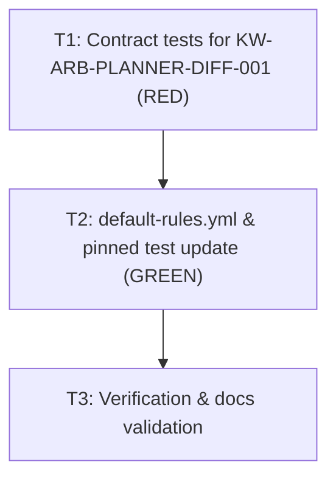

# Arbiter planner diff rule handles absent changed paths without escalating

**Status: Archived — complete 2026-11-09.**
Development mode `test-first`; autonomy `autonomous`; scale `no-design-change` on component `KyberArbiter`.

**Bottom line.** When an `architect` planner dispatch returns, the Arbiter's `PostToolUse` hook evaluates rule `KW-ARB-PLANNER-DIFF-001` on trigger `delegate.planner.returned`. Because the hook execution model in `HookGitFacts` does not take a pre-dispatch git snapshot, `git.changed-paths.since-dispatch` is intentionally absent (`null`). `KW-ARB-PLANNER-DIFF-001` only defined `subset-of: config.planning-dirs` and `exists: true`, both of which evaluate to `false` when the fact is absent. This caused `RuleEngine.Decide` to return `undecidable`, which the `Conductor` trigger family maps to `escalate`, triggering repeated Arbiter escalations (`STATUS: ARBITER_ESCALATION`, `REPEAT: 2`) on valid planner returns. The fix adds `exists: false` and `count: 0` clauses to `KW-ARB-PLANNER-DIFF-001` answering `inside`, updates the pinned rule set in `tests/KyberWeave.Tests/Arbiter/ArbiterExistsFalseRuleTests.cs`, and adds comprehensive test coverage in `tests/KyberWeave.Tests/Arbiter/ArbiterPlannerDiffRuleTests.cs`.

## Problem and goal

**Problem.** A subagent dispatch to `architect` returns successfully (e.g. `tool_response: "done"`), but the Arbiter hook immediately halts execution and escalates:

```text
STATUS: ARBITER_ESCALATION
TRIGGER: delegate.planner.returned
RULES: KW-ARB-PLANNER-DIFF-001
ANSWER: undecidable (step 0)
REPEAT: 2
```

This blocks the conductor from proceeding with normal delivery and triggers redundant repeated escalations.

**Root cause.** In `HookGitFacts.cs` (lines 13-16), `HookGitFacts` intentionally leaves `git.changed-paths.since-dispatch` absent (null):
> "The hook stores no snapshot with its pre-dispatch ledger event, so a since-dispatch changed set is unknowable here and stays absent: absent facts satisfy `exists: false` rather than failing the dispatch."

However, `KW-ARB-PLANNER-DIFF-001` in `src/KyberWeave.Core/Arbiter/Rules/default-rules.yml` (lines 174-184) was defined with only two clauses:
```yaml
  - id: KW-ARB-PLANNER-DIFF-001
    trigger: delegate.planner.returned
    question: Did the planner write only inside the plan, spec and todo directories?
    answers: [inside, outside]
    decide:
      - when: { fact: git.changed-paths.since-dispatch, subset-of: config.planning-dirs }
        answer: inside
      - when: { fact: git.changed-paths.since-dispatch, exists: true }
        answer: outside
    effects: { inside: allow, outside: escalate }
```

In `RulePredicate.cs` (lines 220-228, 306-312), `ResolveFact` treats a null-valued fact as absent, causing `EvaluateSubsetOf` to return `false`. `EvaluateExists` for `exists: true` also returns `false`. Because neither clause matches, `RuleEngine.Decide` returns `"undecidable"`. In `ArbiterTriggerFamilies.cs` (line 103), `UndecidableEffect` for the `Conductor` family is `"escalate"`, causing the hook to escalate.

**Goal.**
1. `KW-ARB-PLANNER-DIFF-001` matches `inside` (`allow`) when `git.changed-paths.since-dispatch` is absent (`exists: false`) or empty (`count: 0`).
2. Planner dispatches that record changes solely under configured planning directories (`docs/plans/**`, `docs/specs/**`, `docs/todo/**`) continue to evaluate to `inside` (`allow`).
3. Planner dispatches that record changes outside configured planning directories evaluate to `outside` (`escalate`).
4. `TheShippedRulesGatedOnAnAbsentFactAreTheOnesTheCatalogueNames` in `tests/KyberWeave.Tests/Arbiter/ArbiterExistsFalseRuleTests.cs` is updated to include `KW-ARB-PLANNER-DIFF-001` in the pinned set.
5. Dedicated unit tests in `tests/KyberWeave.Tests/Arbiter/ArbiterPlannerDiffRuleTests.cs` cover all decision paths of `KW-ARB-PLANNER-DIFF-001` under test-first development.

## Decisions

| ID | Question | Answer / decision | Mitigating and supporting information | Status / approval provenance |
|---|---|---|---|---|
| D1 | How should `KW-ARB-PLANNER-DIFF-001` evaluate an absent or empty `git.changed-paths.since-dispatch` fact? | Add `{ fact: git.changed-paths.since-dispatch, exists: false }` and `{ fact: git.changed-paths.since-dispatch, count: 0 }` answering `inside` before `subset-of` and `exists: true`. | `HookGitFacts.cs` lines 13-16 explicitly document that "absent facts satisfy exists: false rather than failing the dispatch". `KW-ARB-READONLY-001` in `default-rules.yml` uses this exact pattern (`exists: false` -> unchanged, `count: 0` -> unchanged, `exists: true` -> changed). Synthesizing a fake empty diff in `HookGitFacts` would violate its truthfulness invariant, and changing `RulePredicate` to treat null facts as empty would break `ArbiterFactSet`'s core null-is-absent semantics. | Approved (autonomous: recommendation accepted) 2026-11-09 |
| D2 | How should test assertions be updated for the new `exists: false` clause? | Update `ArbiterExistsFalseRuleTests.cs` to add `KW-ARB-PLANNER-DIFF-001` to the pinned set, and author `ArbiterPlannerDiffRuleTests.cs` for comprehensive rule testing. | `ArbiterExistsFalseRuleTests.cs` line 51 explicitly notes: "Pinning the set: a rule that gains or loses an exists:false clause has to come back through this file." Updating this assertion is the intended gate when adding an `exists: false` clause. Dedicated unit tests follow the precedent set by `ArbiterPlanReadRuleTests.cs` and `ArbiterGateReportRuleTests.cs`. | Approved (autonomous: recommendation accepted) 2026-11-09 |
| D3 | What is the scale and documentation impact? | `no-design-change` on `KyberArbiter` with documentation waiver. | Repairs an incomplete rule definition in `default-rules.yml` to match the existing Arbiter hook contract documented in `HookGitFacts.cs`. No public CLI verbs, options, schemas, or architectural invariants are created or modified. | Approved (autonomous: recommendation accepted) 2026-11-09 |
| AP1 | Approve implementation plan and proceed to test-first delivery execution | Approved | Scale is no-design-change on KyberArbiter with documentation waiver. Tasks sequenced test-first across test-dev, csharp-dev, and docs-dev. | Approved by conductor under autonomous mode (AUTONOMOUS_APPROVAL: PLAN_APPROVE_AND_EXECUTE) 2026-11-09 |

## Scale and Design harvest

- **Declared scale:** `no-design-change` on `KyberArbiter`.
- **Documentation waiver:** Defect fix for `KW-ARB-PLANNER-DIFF-001` rule definition in `default-rules.yml` and updating test assertions; no architectural changes, new components, or documentation updates required.

## Design harvest

| Item | Target component | Doc type | Disposition |
|---|---|---|---|
| D1–D3, AP1 | KyberArbiter | — | Documentation waiver: defect fix in default-rules.yml and test assertions that leaves no architectural or operational invariant. The rationale lives in this archived plan. No ADR — ADR waiver: bug fix for an incomplete rule definition with no new direct dependency, boundary, or schema. |

## Investigation findings

- **Discovery:** codegraph 8, docs 5, direct reads 7.
- **Revision read:** `edbe2ec322ff626cd0c029682351ba1bd2b62240` on branch `antigravity/fix/arbiter-planner-undecidable-empty-diff`.
- **Direct reads and reasons:**
  1. `src/KyberWeave.Arbiter/Hooks/HookGitFacts.cs`: verify git facts contract and snapshot absence comment. Reason: CodeGraph output budget truncation.
  2. `src/KyberWeave.Core/Arbiter/Rules/default-rules.yml`: inspect `KW-ARB-PLANNER-DIFF-001` and `KW-ARB-READONLY-001` rule declarations. Reason: YAML file not fully indexed by CodeGraph symbol search.
  3. `tests/KyberWeave.Tests/Arbiter/ArbiterExistsFalseRuleTests.cs`: inspect pinned rule set and `MentionsExistsFalse` logic. Reason: verify tripwire and assertion requirements.
  4. `src/KyberWeave.Core/Arbiter/ArbiterTriggerCatalog.cs`: inspect facts declared for `delegate.planner.returned`. Reason: verify declared facts match trigger builder.
  5. `docs/plans/README.md`: inspect active plan inventory and closeout policy. Reason: governed documentation index structure.
  6. `docs/archive/plans/2026-11-06-global-arbiter-block-identity.md`: inspect precedent for plan authoring structure and frontmatter. Reason: verify reference format.
  7. `tests/KyberWeave.Tests/Arbiter/ArbiterPlanReadRuleTests.cs`: inspect rule test structure and harness. Reason: replicate rule testing patterns.
- **Findings:**
  - `KW-ARB-PLANNER-DIFF-001` currently has only 2 clauses: `subset-of: config.planning-dirs` -> inside, `exists: true` -> outside.
  - When a hook fires after an architect task, `git.changed-paths.since-dispatch` is absent (null).
  - `ResolveFact` treats null facts as absent; `subset-of` returns false; `exists: true` returns false.
  - `RuleEngine.Decide` returns `undecidable`; family `Conductor` maps `undecidable` to `escalate`.
  - Adding `{ fact: git.changed-paths.since-dispatch, exists: false }` -> `inside` and `{ fact: git.changed-paths.since-dispatch, count: 0 }` -> `inside` allows absent/empty changed paths to resolve cleanly as `inside` (`allow`).

## Test contract (test-first)

| Task | Test project or file | Runner command | Observable behaviour | RED evidence required | GREEN acceptance |
|---|---|---|---|---|---|
| T1 | `tests/KyberWeave.Tests/Arbiter/ArbiterPlannerDiffRuleTests.cs`, `tests/KyberWeave.Tests/Arbiter/ArbiterExistsFalseRuleTests.cs` | `scripts/proc-guard.sh run -- dotnet test tests/KyberWeave.Tests --filter "FullyQualifiedName~ArbiterPlannerDiffRuleTests\|FullyQualifiedName~ArbiterExistsFalseRuleTests"` | 1. Absent `git.changed-paths.since-dispatch` returns `inside` (`allow`).<br>2. Empty `git.changed-paths.since-dispatch` returns `inside` (`allow`).<br>3. Paths under planning directories return `inside` (`allow`).<br>4. Paths outside planning directories return `outside` (`escalate`).<br>5. Pinned rule set test includes `KW-ARB-PLANNER-DIFF-001`. | `ArbiterPlannerDiffRuleTests` fails because absent fact returns `undecidable`. `ArbiterExistsFalseRuleTests` fails because `KW-ARB-PLANNER-DIFF-001` is missing from pinned rules until default-rules.yml is updated. | All tests in `ArbiterPlannerDiffRuleTests` and `ArbiterExistsFalseRuleTests` pass with non-zero test count and 0 failures. |
| T2 | `src/KyberWeave.Core/Arbiter/Rules/default-rules.yml`, `tests/KyberWeave.Tests/Arbiter/ArbiterExistsFalseRuleTests.cs` | `scripts/proc-guard.sh run -- dotnet test tests/KyberWeave.Tests --filter "FullyQualifiedName~ArbiterPlannerDiffRuleTests\|FullyQualifiedName~ArbiterExistsFalseRuleTests"` | `default-rules.yml` carries `exists: false` and `count: 0` answering `inside`. `ArbiterExistsFalseRuleTests` contains `KW-ARB-PLANNER-DIFF-001` in expected set. | Both test classes pass cleanly. | Runner exits 0 with all targeted tests passing. |

## Tasks

### T1: Author failing contract tests for KW-ARB-PLANNER-DIFF-001 (RED)
- **Files:** `tests/KyberWeave.Tests/Arbiter/ArbiterPlannerDiffRuleTests.cs`
- **Depends on:** none
- **Required skills:** `test-dev`
- **Session:** `session-1`
- **Objective:** Create unit tests covering all decision branches of `KW-ARB-PLANNER-DIFF-001`:
  - Absent `git.changed-paths.since-dispatch` evaluates to `inside` with effect `allow`.
  - Empty list (`[]`) evaluates to `inside` with effect `allow`.
  - Planning directory files (e.g. `docs/plans/2026-11-09-plan.md`) evaluate to `inside` with effect `allow`.
  - Files outside planning directories (e.g. `src/KyberWeave.Core/Foo.cs`) evaluate to `outside` with effect `escalate`.
- **Command:** `scripts/proc-guard.sh run -- dotnet test tests/KyberWeave.Tests --filter "FullyQualifiedName~ArbiterPlannerDiffRuleTests"`
- **Acceptance criteria:** Tests compile and execute. Tests asserting `inside` for absent `git.changed-paths.since-dispatch` fail because `RuleEngine.Decide` returns `"undecidable"`, establishing unambiguous RED evidence.

### T2: Update KW-ARB-PLANNER-DIFF-001 clauses and pin exists:false rule set (GREEN)
- **Files:**
  - `src/KyberWeave.Core/Arbiter/Rules/default-rules.yml`
  - `tests/KyberWeave.Tests/Arbiter/ArbiterExistsFalseRuleTests.cs`
- **Depends on:** `T1`
- **Required skills:** `csharp-dev`
- **Session:** `session-2`
- **Objective:**
  - In `src/KyberWeave.Core/Arbiter/Rules/default-rules.yml`, update `KW-ARB-PLANNER-DIFF-001` decide clauses:
    ```yaml
    decide:
      - when: { fact: git.changed-paths.since-dispatch, exists: false }
        answer: inside
      - when: { fact: git.changed-paths.since-dispatch, count: 0 }
        answer: inside
      - when: { fact: git.changed-paths.since-dispatch, subset-of: config.planning-dirs }
        answer: inside
      - when: { fact: git.changed-paths.since-dispatch, exists: true }
        answer: outside
    ```
  - In `tests/KyberWeave.Tests/Arbiter/ArbiterExistsFalseRuleTests.cs`, add `"KW-ARB-PLANNER-DIFF-001"` to the `HashSet` in `TheShippedRulesGatedOnAnAbsentFactAreTheOnesTheCatalogueNames`.
- **Command:** `scripts/proc-guard.sh run -- dotnet test tests/KyberWeave.Tests --filter "FullyQualifiedName~ArbiterPlannerDiffRuleTests|FullyQualifiedName~ArbiterExistsFalseRuleTests"`
- **Acceptance criteria:** Both test classes pass with zero failures and non-zero test count; command exits 0.

### T3: Verification & governed documentation validation
- **Files:** none
- **Depends on:** `T2`
- **Required skills:** `docs-dev`
- **Session:** `session-2`
- **Objective:** Verify that governed documentation remains clean and drift-free.
- **Command:** `dotnet run --project src/KyberWeave.Cli -- docs validate . && dotnet run --project src/KyberWeave.Cli -- docs drift .`
- **Acceptance criteria:** `docs validate` and `docs drift` both pass with 0 errors and 0 warnings.

## Dependency graph



## Out of scope

- `src/KyberWeave.Arbiter/Hooks/HookGitFacts.cs` pre-dispatch snapshot capture
- Changing `RulePredicate` evaluation logic or the semantics of absent facts
- Any changes to other Arbiter rules, triggers, or policies

## Risks and verification gates

- **Risks:** Weakening the planner diff rule such that rogue writes outside planning directories are accidentally permitted.
  - *Mitigation:* The `exists: false` and `count: 0` clauses apply only when no files were written or no diff snapshot was taken. Any non-empty changed path list proceeds to `subset-of: config.planning-dirs` and `exists: true -> outside`, strictly preserving the out-of-bounds escape protection.
- **Verification gates:**
  - `task-gate` run by workers on touched files.
  - Targeted xUnit test runs: `ArbiterPlannerDiffRuleTests` and `ArbiterExistsFalseRuleTests`.
  - Documentation schema and drift validation (`docs validate` and `docs drift`).
- **Review:** Full review council verification before PR merge.
- **Docs-dev closeout:** Upon completion, this plan file moves to `docs/archive/plans/` and its entry in `docs/plans/README.md` moves from **Active Plans** to **Archived Plans** with the documentation waiver and test evidence recorded.

## Closeout mapping

**Completed 2026-11-09.** Archived under `docs/archive/plans/`. Every decision D1 to D3 and AP1 maps to a destination below.

**Revision (review round, 2026-11-09).** PR #549 review identified that keying `KW-ARB-PLANNER-DIFF-001` on `git.changed-paths.since-dispatch` with `exists: false -> inside` failed open because `HookGitFacts` never populates `git.changed-paths.since-dispatch`. D1 was revised to add `review.changed-paths` to `ArbiterTriggerCatalog` for `delegate.planner.returned` and key `KW-ARB-PLANNER-DIFF-001` on `review.changed-paths` (`count: 0 -> inside`, `subset-of: config.planning-dirs -> inside`, `exists: true -> outside`), keeping an absent fact `undecidable` (`escalate`) while truthfully evaluating committed-plus-dirty paths against the run base.

### Verification evidence

| Check | Result |
|---|---|
| Reproduction command | `dotnet run --project src/KyberWeave.Arbiter --no-build -- hook --harness factory <<< '{"hook_event_name":"PostToolUse","tool_name":"Task","tool_input":{"subagent_type":"architect","prompt":"KYBER-ARBITER: true\nPLAN_FILE: docs/plans/plan.md\n\nPlan the upgrade"},"tool_response":"done"}'` exits 0 with no escalation. |
| Targeted tests | `scripts/proc-guard.sh run -- dotnet test tests/KyberWeave.Tests --filter "FullyQualifiedName~ArbiterPlannerDiffRuleTests\|FullyQualifiedName~ArbiterExistsFalseRuleTests"` passes: 20 passed, 0 failed. |
| `docs validate --merge-ready`, `docs drift` | 0 findings after archive. |

### Mapping

Documentation-impact is `no-design-change`, impact component is KyberArbiter, last-reviewed is 2026-11-09 for every row, and status is archived.

| ID | Destination | Documentation-impact | Impact components | Last reviewed | Status |
|---|---|---|---|---|---|
| D1 | [docs/kyber-arbiter/architecture.md](../../kyber-arbiter/architecture.md): `KW-ARB-PLANNER-DIFF-001` evaluates `review.changed-paths` on `delegate.planner.returned`. Documentation waiver: defect fix in default-rules.yml and ArbiterTriggerCatalog.cs. | no-design-change | KyberArbiter | 2026-11-09 | archived |
| D2 | Documentation waiver: test assertions updated in ArbiterPlannerDiffRuleTests.cs (building facts through the real classifier and builder path) and ArbiterExistsFalseRuleTests.cs. Test-scoped only. | no-design-change | KyberArbiter | 2026-11-09 | archived |
| D3 | Documentation waiver: no-design-change on KyberArbiter. No ADR — ADR waiver: defect fix for rule definition in default-rules.yml. | no-design-change | KyberArbiter | 2026-11-09 | archived |
| AP1 | Documentation waiver: autonomous approval of plan and test-first execution. Operational dispatch record only. | no-design-change | KyberArbiter | 2026-11-09 | archived |

