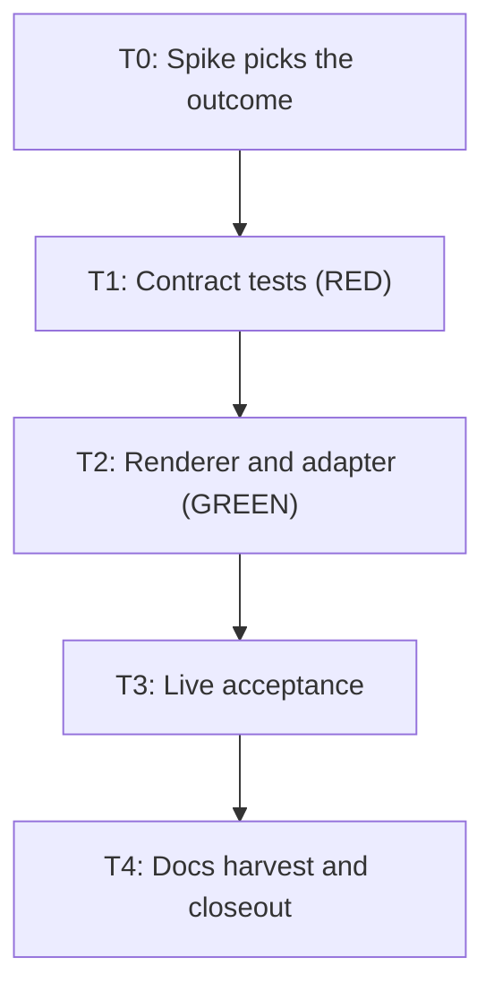

# Start Copilot's parent roles as skills so VS Code workers keep their tools

**Status: Archived — complete 2026-11-10.** Approved for execution under autonomy `autonomous` (decision AP1 below). Development mode `test-first`; autonomy `autonomous`; scale `extends-component` on `KyberSquad` and `KyberArbiter`.

**Bottom line.** In VS Code's Copilot chat, a worker keeps a built-in tool only if the agent selected in the chat also lists it. The conductor lists no shell or edit tools on purpose, so every worker it starts can only read files, and the run stops with `STATUS: TOOL_FAILURE no shell`. This plan makes the three parent roles (`conductor`, `bug-crusher`, `product-owner`) start as skills in normal chat, with `/conductor` and so on, and hides them from the VS Code dropdown. A short spike runs first and picks one of three pre-agreed outcomes.

## Problem and goal

**Problem.** Kyber-Squad renders agent files for GitHub Copilot, and VS Code, the Copilot CLI and the GitHub Copilot app all read `~/.copilot/agents`. Since `microsoft/vscode` pull request 342336 (merged 2026-10-18), VS Code gives a worker only the built-in tools the selected agent also lists. A shell-less selected conductor therefore leaves its workers with file reading only.

**Goal.**

1. From `/conductor` in an unselected VS Code chat, a worker runs a shell command and edits a file.
2. `/bug-crusher` and `/product-owner` start the same way.
3. The three parents cannot be picked from the VS Code dropdown, so the failing path cannot be reached.
4. `product-owner` stays a hidden agent the conductor can dispatch, in every outcome.
5. Every worker stays an agent, unchanged.
6. The receipt says plainly what was given up: the session's tools, roster and model apply to the skill, and no caller identity reaches the Arbiter (the hook that checks each dispatch against rules).

## Decisions

Permanent state, preserved across the plan's whole lifecycle. D1 to D7 are the owner's and are not reopened.

| ID | Question | Answer / decision | Mitigating and supporting information | Status / approval provenance |
|---|---|---|---|---|
| D1 | How do the parents start on Copilot? | `conductor`, `bug-crusher` and `product-owner` move to the role-skill fallback already used for harnesses without parent agents. People type `/conductor`, `/bug-crusher` or `/product-owner` in normal chat. No new pattern and no new agent. | `products/kyber-squad/profiles/fallbacks.yml` and ADR 0036. | ANSWERED — owner decision 2026-11-10, relayed by the conductor. |
| D2 | Do workers change? | No. All workers stay agents. | The defect is in the parent, not the worker. | ANSWERED — owner decision 2026-11-10, relayed by the conductor. |
| D3 | Can VS Code be split from the CLI? | Preferred: keep the three agent files, mark them `user-invocable: false`, add the skills. If that cannot work, remove the parent agent files from the Copilot render. Downstream solutions that use the CLI are then adjusted by the owner and are out of scope. | No way was found to remove a native-folder agent for VS Code alone. VS Code documents that `user-invocable` belongs to the shared definition. | ANSWERED — owner decision 2026-11-10, relayed by the conductor. |
| D4 | What happens to `product-owner`? | It stays a dispatchable hidden agent in every outcome, because the conductor dispatches it for specs. It also gets its skill for direct starts. | `product-owner` is in the conductor's `delegates-to` roster. | ANSWERED — owner decision 2026-11-10, relayed by the conductor. |
| D5 | Is losing the pinned model acceptable? | Yes, on `bug-crusher` and `product-owner` when started as skills. | The `orchestration` model profile has no `copilot` entry, so `conductor` has no pin to lose. | ANSWERED — owner decision 2026-11-10, relayed by the conductor. |
| D6 | What about the GitHub Copilot app? | It follows VS Code. Losing its dropdown entries is accepted. | Named workers ran shell and edit in app 1.1.35 with the conductor selected, so the app is not broken today; it just shares the agent files. | ANSWERED — owner decision 2026-11-10, relayed by the conductor. |
| D7 | Is giving up the hard no-shell limit acceptable in VS Code? | Yes. There the conductor runs in normal chat with a shell, so the limit is instruction-only. Recorded against ADR 0045 by editing that record in place. | ADR rules: an ADR states only the decision in force and is edited in place. Conductor text already says that where the harness gives a shell it runs run-start itself. | ANSWERED — owner decision 2026-11-10, relayed by the conductor. |
| D8 | How is the outcome chosen? | Task T0 answers three questions and sets `SPIKE_BRANCH`, using the table below. **A:** Q1 and Q2 pass: keep all three agent files hidden and add the skills. **B:** Q1 fails, Q2 passes: remove the `conductor` and `bug-crusher` agent files; keep `product-owner` hidden; add the skills. **C:** Q2 fails and Q3 passes: same files as B. **Anything else:** stop and return the result to the architect. | Q1: does `copilot --agent <name>` run an agent marked `user-invocable: false`? Q2: can an agent and a skill with the same name coexist under VS Code's conditions? Q3 (asked only when Q2 fails): can a dispatched hidden agent still load a skill that has its own name? Each branch honours D3 and D4. | ANSWERED — autonomous decision by architect 2026-11-10. Low confidence on which branch applies, no authoritative source; the spike replaces the guess. Vendor docs are silent on Q1 and Q2. |
| D9 | In branch C, what happens to a direct start of `product-owner`? | The hidden agent and its skill both stay, and the final report tells the owner that `/product-owner` does not start in VS Code. No new name is added. | D4 is unqualified for the agent ("in every outcome") and D1 forbids a new agent or pattern, so the agent wins the conflict. The canonical wrapper body loads the skill by name, which is why Q3 must pass. | ANSWERED — autonomous decision by architect 2026-11-10; honours D1 and D4. Only applies if C is the outcome. |
| D10 | How does the conductor's skill get its body and resources? | Through the existing `SquadHarnessRenderContext.AddEntryPointSkillProjection`, as `ClaudeRenderer`, `FactoryRenderer` and `CommandCodeRenderer` do: body verbatim from the agent, resources at `skills/conductor/conductor/references/*.md`. `bug-crusher` and `product-owner` reuse their canonical skills (ADR 0036), so no duplicate is emitted. No change to `SquadHarnessRenderer`. | `conductor` is unoccupied and resolves to `EntryPointSkill`; the two shared identities resolve to `ReuseCanonicalSkill`. | ANSWERED — autonomous decision by architect 2026-11-10. Covered by ADR 0034, ADR 0036 and the three renderers. |
| D11 | Do the skill's relative links need rewriting at global scope, as the agent file's do? | No. They stay relative, like every other Copilot skill and like Claude, Factory and Command Code. T0 proves one read from a skill outside the workspace. If it fails, the skill body goes through the existing `RewriteResourceLinks` with a skills root. | VS Code docs: "Paths in `SKILL.md` are resolved relative to the file." The authored link `conductor/references/plan-path.md` resolves against `skills/conductor/SKILL.md` to the projected file. | ANSWERED — autonomous decision by architect 2026-11-10. Covered by vendor documentation; T0 confirms it. |
| D12 | How is a parent kept from being dispatched by accident as a shell-less worker? | Add `disable-model-invocation: true` to a parent agent that no agent names in `delegates-to` (today `conductor` and `bug-crusher`), so normal chat cannot run it as a subagent. `product-owner` is named in a roster and does not get the key. T0 tests the key; if it alone breaks `--agent`, it is dropped. | VS Code docs: it "Stops other agents from invoking this agent as a subagent", and naming the agent in an `agents` list still permits it. The rule is derived from the roster, so it cannot go stale. | ANSWERED — autonomous decision by architect 2026-11-10. Covered by vendor documentation; cheap to reverse. |
| D13 | What about Arbiter hooks when the conductor runs as a skill? | Keep all hook rendering and add no new token. Agent-scoped hooks with `--harness copilot-vscode` apply only while that agent is active, so they do not fire for a skill. Gating then rests on the owned hook file (`~/.copilot/hooks/kyber-arbiter.json`, or `.github/hooks/kyber-arbiter.json` at project scope) with `--harness copilot-cli` and no caller. T0 captures the real payload. If VS Code sends the CLI-shaped payload with a dispatch tool other than `task`, `CopilotHookAdapter` is extended to recognise it. If it sends the Local shape, the adapter already handles it. Record `arbiter-not-enforced` per parent with reason `skill-entry-no-caller`. | `CopilotHookAdapter.IsCliPassThrough` passes every tool except `task`, so a VS Code dispatch in the CLI shape would be silently ungated. VS Code docs say its parser ignores `matcher`, so the hook does reach it. Project-wide hooks infer the caller from `KYBER-ARBITER: true`, which the conductor writes on every dispatch. `SKILL.md` has no documented `hooks` key, so none is emitted. | ANSWERED — autonomous decision by architect 2026-11-10. Low confidence, no authoritative source for the payload; cost of wrong is one adapter method. |
| D14 | Do the now-unreachable hooks on hidden parent agent files go? | No, in branch A they stay. They are inert for a hidden parent but still apply while `product-owner` runs as a subagent, and removing them for two agents only adds a special case. | Cheap to remove later. | ANSWERED — autonomous decision by architect 2026-11-10. Low confidence, no authoritative source; cheap to reverse. |
| D15 | Where does the operator channel overlay go (ADR 0045)? | Branch A: on the agent file only, as now, so `copilot --agent conductor` keeps it and the skill stays free of it. Branches B and C: the overlay body is appended to the conductor skill, with no tool entry, because a skill has no tool list and a normal session already reaches the operator's server. | With no agent file the overlay would otherwise have no home on the one target that carries it. The overlay already tells the conductor to carry on if the channel cannot be called. | ANSWERED — autonomous decision by architect 2026-11-10; honours ADR 0045. |
| D16 | Does `CopilotToolCatalog` change? | No. No tool list changes. rc.24's bare `execute` on workers stays; it is harmless. | Tools are the agent file's concern, and the fix moves the parent out of the selected-agent role. | ANSWERED — autonomous decision by architect 2026-11-10. Covered by owner evidence. |
| D17 | How is this recorded? | New ADR 0066 for the Copilot render decision. ADR 0045 is edited in place for D7 and D15. ADR 0036 is edited in place to name Copilot. | The ADR index says a new ADR is for a decision on a different subject. The render decision is a different subject from the operator channel, as ADR 0034 was for Factory. | ANSWERED — autonomous decision by architect 2026-11-10. Covered by the ADR index rules. |
| AP1 | Approve and execute | Approved: this plan and its Test contract (T0 to T4), at the declared scale, `extends-component` on `KyberSquad` and `KyberArbiter`. | The conductor returned `AUTONOMOUS_APPROVAL: approve-and-execute` under resolved autonomy `autonomous` (Config Reg `<autonomy>`), accepting D8 to D17 as recommended. Docs checks in the worktree before finalization: `docs validate --merge-ready` reported only `KW-DOC-LIFECYCLE-003` on this active plan, expected until closeout; `docs drift` reported no findings. | ANSWERED — autonomous: recommendation accepted 2026-11-10; explicit conductor gate `approve-and-execute`. |

## Spike outcome table (D8)

| Q1 `--agent` with `user-invocable: false` | Q2 same-name agent and skill | Q3 hidden agent loads own-name skill | `SPIKE_BRANCH` |
|---|---|---|---|
| Pass | Pass | Not asked | A |
| Fail | Pass | Not asked | B |
| Either | Fail | Pass | C |
| Either | Fail | Fail | Stop: return the result to the architect |

## Design harvest

`documentation-impact: extends-component`; `impact-components: [KyberSquad, KyberArbiter]`. Each item lands in canonical docs in T4.

| ID | Target component | Target doc type | Durable design item |
|---|---|---|---|
| H1 | KyberSquad | adr | New ADR 0066: Copilot parents start as skills and are hidden from the dropdown, why, what was rejected, and the branch that shipped. ADR 0045 and ADR 0036 edited in place (D7, D15, D17). |
| H2 | KyberSquad | architecture | `docs/kyber-squad/architecture.md`: Copilot's primary-agent projection, the output table, the entry-file table, the operator overlay bullet, and the file count (D1, D3, D10, D11, D12, D15). |
| H3 | KyberSquad | requirements | `docs/kyber-squad/requirements.md`: Copilot's matrix row, `role-skill-fallback` examples, the conductor-shell and Arbiter rows, and the accepted loss of the no-shell limit (D1, D3, D5, D7, D13). |
| H4 | KyberSquad | onboarding | `docs/kyber-squad/onboarding.md`: how a person starts these roles on Copilot (D1, D6). |
| H5 | KyberArbiter | architecture | `docs/kyber-arbiter/architecture.md` and `docs/kyber-arbiter/runbook.md`: gating for a skill-run conductor in VS Code, the observed payload, and the `skill-entry-no-caller` reason (D13). |

## Investigation findings

- **Discovery:** codegraph 38, docs 6, direct reads 34, plus 5 batches of `git show` lookups.
- **Revision read:** `7f4bcb7c60be24928a552ca865d2dd5bae11ec2f` on branch `claude/fix/copilot-parent-agents-skill-fallback`, in the worktree. The `kw-docs` server answered from `claude/docs/conductor-bug-crusher-run-speed` at `05eb938a`, so its answers were used only to find where to read.
- **Direct reads and reason:** `CopilotRenderer.cs`, `SquadHarnessRenderer.cs`, `CopilotToolCatalog.cs`, `FactoryRenderer.cs`, `CommandCodeRenderer.cs`, `ClaudeRenderer.cs` and `ArbiterHookWiring.cs` were read directly before the coordinator's correction to use `codegraph explore` in the worktree; reason "server bound to another revision". Agent bodies, YAML profiles, ADRs, docs, plans and the repro script are not code the index covers. The `git show` lookups took test class names and doc lines the index did not return.
- **Delegated:** one vendor-documentation sweep completed; its quotes are model-extracted, so T0 and T3 test the behaviour rather than trust them. A repository grep sweep was stopped by the coordinator before it ran; T4 therefore searches the docs itself.
- **Vendor sources:** [VS Code custom agents](https://code.visualstudio.com/docs/copilot/customization/custom-agents), [custom agent file reference](https://code.visualstudio.com/docs/agents/reference/custom-agent-file-reference.md), [VS Code Agent Skills](https://code.visualstudio.com/docs/copilot/customization/agent-skills), [VS Code hooks](https://code.visualstudio.com/docs/copilot/customization/hooks), [Agent Skills specification](https://agentskills.io/specification), [GitHub custom agents reference](https://docs.github.com/en/copilot/reference/custom-agents-configuration), [Copilot CLI hooks reference](https://docs.github.com/en/copilot/reference/copilot-cli-reference/cli-hooks-reference). Not documented anywhere read: whether `--agent` honours `user-invocable: false`, a same-name agent and skill, `hooks` in `SKILL.md`, and VS Code's dispatch tool name.

Owner's evidence, taken as given:

- Driving the Copilot SDK and runtime bundled in VS Code Insiders 1.146 (runtime 1.0.108-0) with VS Code's `availableTools` list: conductor selected leaves the worker only `view`; no agent selected leaves everything; no `availableTools` list (the standalone CLI) leaves everything, so a CLI-only test cannot catch this.
- `bug-crusher` as a skill in an unselected chat: its worker kept shell, edit and web fetch.

Checked in the source:

- `SquadHarnessRenderContext.AddEntryPointSkillProjection` already emits exactly the required shape, including the fail-closed collision and the reuse of a shared identity. `CopilotRenderer.RenderAgent` is the only caller that needs it.
- `CopilotRenderer.RenderAgentFile` sets `user-invocable: false` only for subagents today, and `BuildPermissionDegradation` records only `safety-narrowed`.
- `SquadResourceProjection.Append` projects resources beside the principal, so the link `conductor/references/plan-path.md` resolves from `skills/conductor/SKILL.md`.
- `SquadResponsePreferencesInjector` classifies files from the render output, so the conductor skill gets its preferences block automatically. `SquadResponsePreferencesPerTargetTests` pins the file list, so it needs updating.
- A primary whose profile says `no-primary-agent: omit` gets no skill, so hiding its agent file would leave it unreachable. Hiding is conditional on an entry point existing.
- `SquadHarnessRenderContext.RenderSkillDocument` serialises frontmatter through YamlDotNet, which quotes a value containing `: `. The conductor's description is the first Copilot skill description with a colon. T1 pins that it parses.
- `ArbiterHookWiring.BuildHooks` returns nothing at global scope, so a global install in VS Code already relies on the owned hook file alone. Only project scope loses a firing path.

## Test contract (test-first)

The shared filter below is `$F`:

`FullyQualifiedName~KyberWeave.Tests.Squad.CopilotRendererTests|FullyQualifiedName~KyberWeave.Tests.SquadRenderingContractTests|FullyQualifiedName~KyberWeave.Tests.Squad.SquadRendererSharedContractTests|FullyQualifiedName~KyberWeave.Tests.Squad.SquadResponsePreferencesPerTargetTests|FullyQualifiedName~KyberWeave.Tests.Squad.SquadOperatorChannelOptInTests|FullyQualifiedName~KyberWeave.Tests.ArbiterCopilotRenderingTests|FullyQualifiedName~KyberWeave.Tests.ArbiterGlobalClaudeCopilotRenderingTests|FullyQualifiedName~KyberWeave.Tests.Arbiter.CopilotHookAdapterTests`

| Task | Test project or file | Runner command | Observable behaviour | RED evidence required | GREEN acceptance |
|---|---|---|---|---|---|
| T0 | No-test task: a live spike outside the repository. | The commands in task T0. | The digest reports Q1, Q2, Q3, the hook payload shape and `SPIKE_BRANCH`. | Not applicable: no repository change. Replaced by the recorded command output. | The digest carries every `T0` field with its evidence. |
| T1 | The classes in `$F`, under `tests/KyberWeave.Tests/` | `scripts/proc-guard.sh run -- dotnet test tests/KyberWeave.Tests/KyberWeave.Tests.csproj -c Release --filter "$F"` | The contract tests exist, compile, and split into the failing and guard sets the task lists. | The failing set fails on assertions with no compile error. | Not applicable here: T2 turns these green. |
| T2 | The classes in `$F` | The T1 command | 1. Each parent is reachable as a skill whose frontmatter is valid YAML, with `name` equal to its directory and a `description` of at most 1024 characters on one line. 2. The conductor skill's links all resolve to emitted files. 3. Branch A: three hidden agent files; undispatched parents carry `disable-model-invocation: true`. Branches B and C: no `conductor` or `bug-crusher` agent file. 4. `product-owner` is a hidden dispatchable agent in every branch. 5. A parent records `role-skill-fallback` and an honest `permission-not-expressible`, plus `arbiter-not-enforced` when the Arbiter is on. 6. Workers are byte-identical. 7. A dispatch in the observed VS Code payload is gated. | The tests named RED in T1 fail on their assertions. | The same tests pass unchanged, with a non-zero test count and 0 failures. |
| T3 | No-test task: live acceptance under VS Code's conditions. | The commands in task T3. | From the conductor skill in an unselected session, a worker runs a shell command and edits a file. | Not applicable: replaced by the recorded session output. | The digest carries the worker's shell output and the edited file's content. |
| T4 | No-test task: documentation and plan closeout. | `dotnet run --project src/KyberWeave.Cli -- docs validate . --merge-ready` and `dotnet run --project src/KyberWeave.Cli -- docs drift .` | Canonical docs state H1 to H5; the plan is archived. | Not applicable: no code changes. Replaced by the two docs gates. | Both gates exit 0 with 0 findings. |

## Tasks

### T0: Spike that picks the outcome

- **Files:** none in the repository. Every file is written under a new directory in the worker's scratch space.
- **Depends on:** none
- **Required skills:** none
- **Session:** `spike`
- **Objective:** Answer Q1, Q2 and Q3 and capture the hook payload, using a probe name so no installed agent interferes. Change nothing in the repository or in `~/.copilot`.
  1. Make a scratch git repository holding `.github/agents/ksprobe.agent.md` and `.github/skills/ksprobe/SKILL.md`.
     - The agent has frontmatter `name: ksprobe`, a double-quoted `description` containing `: `, `tools: [read, agent]`, `user-invocable: false`, `disable-model-invocation: true`, and the body `Reply with exactly: AGENT-RAN`.
     - The skill has `name: ksprobe`, a double-quoted `description` containing `: `, and a body telling the model to read `ksprobe/references/marker.md` and print its contents. Create that file holding `SKILL-REFERENCE-READ`.
  2. **Q1.** In that repository run `copilot --agent ksprobe -p "hello" --allow-all-tools`. Pass means the output contains `AGENT-RAN`. On failure repeat with the `disable-model-invocation` line removed and report `DISABLE_MODEL_INVOCATION: drop` if that passes, otherwise `keep`.
  3. **Q2.** Copy `/private/tmp/claude-501/-Users-dave--claude-spares-spare-wo45o3/9cf93364-77b2-4d4e-8cb9-a7569a87ac6a/scratchpad/hostrepro/run.mjs` into your scratch directory. Add a scenario with `select: false`, `skills: true`, `available: true`, and an added custom agent named `ksprobe`. Its prompt loads the `ksprobe` skill with the skill tool, prints what the skill says to print, then dispatches `github-devops` to run `echo SHELL-OK` and to create and edit `probe.txt`. Run it with `REPRO_SKILLS` set to the scratch `.github/skills` and `REPRO_CWD` set to the scratch repository. Pass means the skill loads, `SKILL-REFERENCE-READ` is printed, and the worker's shell and edit calls succeed. Report `RELATIVE_REFERENCE: ok` or `failed` from the printed marker.
  4. **Q3, only when Q2 fails.** Add a scenario that dispatches the hidden `ksprobe` agent, with a prompt telling it to load the skill with its own name and print its marker. Pass means the marker is printed.
  5. **Hook payload.** Add `.github/hooks/probe.json` with `version: 1` and `preToolUse` and `postToolUse` entries whose `bash` command appends stdin to a log file in your scratch directory. Rerun the Q2 scenario and read the log. Report `HOOK_PAYLOAD_SHAPE: local` if a `runSubagent` record has `hook_event_name`, `cli` if it has `toolName`, or `none` if the hook never fired for a dispatch. Report `HOOK_DISPATCH_TOOL:` with the tool name.
  6. Choose `SPIKE_BRANCH` from the outcome table in this task's packet: A when Q1 and Q2 pass; B when Q1 fails and Q2 passes; C when Q2 fails and Q3 passes; `STOP` when Q2 and Q3 both fail.
- **Command:** `copilot --agent ksprobe -p "hello" --allow-all-tools` and `node run.mjs <scenario>`, both run from the scratch directory.
- **Acceptance criteria:** The digest carries `Q1: pass|fail`, `Q2: pass|fail`, `Q3: pass|fail|not-asked`, `DISABLE_MODEL_INVOCATION: keep|drop`, `RELATIVE_REFERENCE: ok|failed`, `HOOK_PAYLOAD_SHAPE: local|cli|none`, `HOOK_DISPATCH_TOOL: <name>` and `SPIKE_BRANCH: A|B|C|STOP`, each with its command and output. `git status` in the repository shows no change from this task. A `STOP` result goes back to the architect before T1 starts.

### T1: Failing contract tests for the parent roles (RED)

- **Files:**
  - `tests/KyberWeave.Tests/Squad/CopilotRendererTests.cs` (class `CopilotRendererTests`; methods `RenderAsync_DeclaresDelegationRosterForDelegatingPrimaryAgents`, `RenderAsync_OmitsDelegationRosterForPrimaryAgentWithoutDelegates`, `RenderAsync_PrimaryDelegationRosterDoesNotImplyNonInvocable`)
  - `tests/KyberWeave.Tests/SquadRenderingContractTests.cs` (class `SquadRenderingContractTests`, method `RenderAsync_Copilot_RendersTheRealCanonicalCorpus`)
  - `tests/KyberWeave.Tests/Squad/SquadResponsePreferencesPerTargetTests.cs` (class `SquadResponsePreferencesPerTargetTests`, the Copilot row of `RealCanonicalTree_CarriesTheTargetUnionOfResponsePreferenceEntryFiles`)
  - `tests/KyberWeave.Tests/Squad/SquadOperatorChannelOptInTests.cs` (class `SquadOperatorChannelOptInTests`)
  - `tests/KyberWeave.Tests/ArbiterCopilotRenderingTests.cs` (class `ArbiterCopilotRenderingTests`)
  - `tests/KyberWeave.Tests/Arbiter/CopilotHookAdapterTests.cs` (class `CopilotHookAdapterTests`)
- **Depends on:** `T0`
- **Required skills:** `test-dev`
- **Session:** `red`
- **Objective:** Read `SPIKE_BRANCH`, `DISABLE_MODEL_INVOCATION`, `HOOK_PAYLOAD_SHAPE` and `HOOK_DISPATCH_TOOL` from the prior results. Pin the behaviour below using existing APIs only, so the tests compile today and fail on their assertions.
  - `CopilotRendererTests`, every branch, against the canonical corpus at project scope:
    - `RenderAsync_RendersConductorEntryPointSkillWithItsReferences`: `.github/skills/conductor/SKILL.md` exists; `.github/skills/conductor/conductor/references/autonomy.md`, `intake-path.md`, `plan-path.md` and `spec-path.md` exist; and every relative link in the skill body resolves to an emitted file.
    - Theory `RenderAsync_ParentSkillFrontmatterIsValidYaml` over `conductor`, `bug-crusher`, `product-owner`: the frontmatter parses with YamlDotNet; `name` equals the directory; `description` is non-empty, at most 1024 characters, equals the canonical description, and sits on one physical line.
    - `RenderAsync_SharedParentsEmitNoDuplicateSkill`: exactly one `SKILL.md` each for `bug-crusher` and `product-owner`, carrying the canonical body.
    - Theory `RenderAsync_ParentRecordsRoleSkillFallback` over the three parents: a `role-skill-fallback` record for target `copilot`, and a `permission-not-expressible` record whose details say the session's tools, roster and model apply to the skill.
    - `RenderAsync_ProductOwnerStaysAHiddenDispatchableAgent`: `.github/agents/product-owner.agent.md` exists with `user-invocable: false` and no `disable-model-invocation` line.
    - `RenderAsync_WorkerAgentFilesAreUnchanged`: every subagent's rendered file carries `user-invocable: false` and no `disable-model-invocation` line.
    - `RenderAsync_PrimaryWithNoEntryPointStaysSelectable`: a fixture primary whose fallback profile says `no-primary-agent: omit` has an agent file with no `user-invocable` line.
  - `CopilotRendererTests`, branch A: `RenderAsync_ParentAgentFilesAreHidden` asserts all three carry `user-invocable: false`. `RenderAsync_UndispatchedParentsCannotBeInvokedByTheModel` asserts `conductor` and `bug-crusher` carry `disable-model-invocation: true`; omit this test when `DISABLE_MODEL_INVOCATION` is `drop`. Change the three named existing tests so a primary with a skill entry point expects `user-invocable: false`.
  - `CopilotRendererTests`, branches B and C: `RenderAsync_UndispatchedParentsHaveNoAgentFile` asserts no `conductor.agent.md`, no `bug-crusher.agent.md` and no `.github/agents/conductor/` resource. Change the three named existing tests to use a primary that another agent names in `delegates-to`.
  - `SquadRenderingContractTests.RenderAsync_Copilot_RendersTheRealCanonicalCorpus`: update its expected Copilot files to the branch.
  - `SquadResponsePreferencesPerTargetTests`: the Copilot row adds `.github/skills/conductor/SKILL.md`; branches B and C also remove both parent agent files.
  - `SquadOperatorChannelOptInTests`: `Overlay_OnBranchAgentFileOnly` for branch A (the skill carries no overlay text or placeholder); `Overlay_MovesToConductorSkill` for branches B and C (the skill carries the overlay body and no tool entry).
  - `ArbiterCopilotRenderingTests`: `RenderAsync_EnabledArbiter_RecordsSkillEntryHasNoCallerIdentity`, one `arbiter-not-enforced` record with details `skill-entry-no-caller` per parent, at project and global scope. `RenderAsync_DisabledArbiter_RendersByteForByteAsOmittingTheWiring` stays a guard.
  - `CopilotHookAdapterTests`:
    - When `HOOK_PAYLOAD_SHAPE` is `local`: `LocalDispatchWithNoRenderedCaller_IsClassifiedAndGated`, token `copilot-cli`, `tool_name` `runSubagent`, a marked prompt, no caller. This is a guard and should pass.
    - When it is `cli`: `CliShapedVsCodeDispatch_IsNotPassThrough` and `CliShapedVsCodeDispatch_MapsTargetAndPrompt`, using `toolName` equal to `HOOK_DISPATCH_TOOL`, with the argument names the spike logged. These fail on assertions. `task` dispatch tests stay as guards.
    - When it is `none`: add nothing and say so in the digest.
- **Command:** `scripts/proc-guard.sh run -- dotnet test tests/KyberWeave.Tests/KyberWeave.Tests.csproj -c Release --filter "FullyQualifiedName~KyberWeave.Tests.Squad.CopilotRendererTests|FullyQualifiedName~KyberWeave.Tests.SquadRenderingContractTests|FullyQualifiedName~KyberWeave.Tests.Squad.SquadRendererSharedContractTests|FullyQualifiedName~KyberWeave.Tests.Squad.SquadResponsePreferencesPerTargetTests|FullyQualifiedName~KyberWeave.Tests.Squad.SquadOperatorChannelOptInTests|FullyQualifiedName~KyberWeave.Tests.ArbiterCopilotRenderingTests|FullyQualifiedName~KyberWeave.Tests.ArbiterGlobalClaudeCopilotRenderingTests|FullyQualifiedName~KyberWeave.Tests.Arbiter.CopilotHookAdapterTests"`
- **Acceptance criteria:** The project compiles. Every new test above fails on an assertion, except the ones this task names as guards and `RenderAsync_WorkerAgentFilesAreUnchanged`, `RenderAsync_PrimaryWithNoEntryPointStaysSelectable` and `RenderAsync_ProductOwnerStaysAHiddenDispatchableAgent`, which pass today. Report the failing and passing names as RED evidence.

### T2: Render the parents as skills and gate their dispatches (GREEN)

- **Files:**
  - `src/KyberWeave.Core.Squad/Rendering/CopilotRenderer.cs` (`RenderAgent`, `RenderAgentFile`, `BuildPermissionDegradation`, the class remarks)
  - `src/KyberWeave.Arbiter/Hooks/Adapters/CopilotHookAdapter.cs` (`IsCliPassThrough`, `HandleCli`), only when `HOOK_PAYLOAD_SHAPE` is `cli`
- **Depends on:** `T1`
- **Required skills:** `csharp-dev`
- **Session:** `green-code`
- **Objective:** Read the same four fields from the prior results. Do not change `CopilotToolCatalog` or `SquadHarnessRenderer`.
  - Add a private helper: a parent is undispatched when `agent.Invocation == SquadInvocation.Primary` and no agent in `context.Source.Agents` names it in `DelegatesTo`.
  - `RenderAgentFile`: set `user-invocable: false` for every subagent and for every primary whose `ResolvePrimaryLowering` is not `Omit`. In branch A, also set `disable-model-invocation: true` on an undispatched parent, unless `DISABLE_MODEL_INVOCATION` is `drop`.
  - `RenderAgent`, branch A: after `AddPrincipal`, call `AddEntryPointSkillProjection` with form `an agent` and `context.RenderSkillDocument(agent.Name, agent.Description, agent.InstructionBody, Yaml)`, the shape `CommandCodeRenderer.RenderAgent` uses. Pass the operator channel overlay to the agent file only.
  - `RenderAgent`, branches B and C: for an undispatched parent use `AddLoweredPrimaryAgent` and emit no agent file; every other agent keeps the branch A path. The conductor skill's body takes the overlay body when the overlay applies, with no tool entry.
  - Records: `role-skill-fallback` stating why VS Code forces this, the skill path, and whether the agent file is kept; `permission-not-expressible` stating that the session's tools, roster and model apply; and, when `context.EnabledArbiter` is not null, `arbiter-not-enforced` with details `skill-entry-no-caller`. Keep the existing `safety-narrowed` record.
  - When `RELATIVE_REFERENCE` is `failed`, apply `RewriteResourceLinks` to the skill body with the global skills root.
  - `CopilotHookAdapter`, when the shape is `cli`: treat `HOOK_DISPATCH_TOOL` as a dispatch alongside `task` in `IsCliPassThrough`, and read the target and prompt from the argument names T1 pinned in `HandleCli`.
  - Rewrite the remarks and the inline comment that say primary agents stay user-invocable.
- **Command:** `scripts/proc-guard.sh run -- dotnet test tests/KyberWeave.Tests/KyberWeave.Tests.csproj -c Release --filter "FullyQualifiedName~KyberWeave.Tests.Squad.CopilotRendererTests|FullyQualifiedName~KyberWeave.Tests.SquadRenderingContractTests|FullyQualifiedName~KyberWeave.Tests.Squad.SquadRendererSharedContractTests|FullyQualifiedName~KyberWeave.Tests.Squad.SquadResponsePreferencesPerTargetTests|FullyQualifiedName~KyberWeave.Tests.Squad.SquadOperatorChannelOptInTests|FullyQualifiedName~KyberWeave.Tests.ArbiterCopilotRenderingTests|FullyQualifiedName~KyberWeave.Tests.ArbiterGlobalClaudeCopilotRenderingTests|FullyQualifiedName~KyberWeave.Tests.Arbiter.CopilotHookAdapterTests"`
- **Acceptance criteria:** Every T1 test passes with no test edited, non-zero test count, 0 failures, and `task-gate` passes on the changed files.

### T3: Live acceptance under VS Code's conditions

- **Files:** none in the repository. Every file is written under a new directory in the worker's scratch space.
- **Depends on:** `T2`
- **Required skills:** none
- **Session:** `spike`
- **Objective:** Prove the rendered output, not a hand-made probe, works under VS Code's conditions.
  1. In a scratch git repository run `dotnet run --project <worktree>/src/KyberWeave.Cli -- squad install --target copilot`.
  2. Add a scenario to the scratch copy of `run.mjs` with `select: false`, `skills: true`, `available: true`, `REPRO_SKILLS` set to the rendered `.github/skills`, and the rendered `github-devops` tool list. Its prompt loads the `conductor` skill, reads `conductor/references/plan-path.md`, then dispatches `github-devops` to run `echo SHELL-OK` and to create `probe.txt` containing `hello` and edit it to `bye`.
  3. Run it with `REPRO_MODEL` left at its default, then confirm `probe.txt` contains `bye`.
  4. In branch A, also run `copilot --agent conductor -p "Say READY and stop." --allow-all-tools` in the scratch repository and confirm it runs.
- **Command:** `node run.mjs <scenario>`, run from the scratch directory.
- **Acceptance criteria:** The digest carries the worker's shell output `SHELL-OK`, the content of `probe.txt`, the reference read, and the branch A CLI output. Any failure goes back to the same implementation session, not to closeout. The digest also repeats the four manual checks below as "not verified here".

### T4: Docs harvest and plan closeout

- **Files:**
  - `docs/adr/0066-copilot-parent-roles-start-as-skills.md` (new)
  - `docs/adr/0045-conductor-operator-channel-opt-in.md` (Context, Consequences)
  - `docs/adr/0036-primary-agent-canonical-skill-entry-point.md` (Decision 3)
  - `docs/adr/README.md` (Inventory)
  - `docs/kyber-squad/architecture.md` (sections 3, 8 and the entry-file table)
  - `docs/kyber-squad/requirements.md` (degradation contract, the Copilot matrix row, "Harness behaviour the product relies on")
  - `docs/kyber-squad/onboarding.md` (Copilot rows and start instructions)
  - `docs/kyber-arbiter/architecture.md` (harness table, "Delivery and caller notes", verified global-hook matrix)
  - `docs/kyber-arbiter/runbook.md` (section "Hooks")
  - `products/kyber-squad/agents/bug-crusher.md` and `products/kyber-squad/agents/product-owner.md` (the sentence listing targets that keep a native agent file), branches B and C only
  - `docs/plans/README.md` (section "Active Plans")
  - `docs/archive/plans/README.md` (top of the inventory table)
  - `docs/plans/2026-11-10-copilot-parent-agents-skill-fallback.md` (moved by `git mv`)
  - `docs/archive/plans/2026-11-10-copilot-parent-agents-skill-fallback.md` (the moved file, with its completion summary)
  - `docs/plans/2026-11-10-copilot-parent-agents-skill-fallback.tasks.json` (removed by `git rm`)
- **Depends on:** `T3`
- **Required skills:** `docs-dev`
- **Session:** `closeout`
- **Objective:** Harvest H1 to H5 for the branch that shipped.
  - Search `docs/` (not `docs/archive/`), `products/kyber-squad/` and `README.md` for `--agent`, `dropdown`, `agent picker`, `no-primary-agent`, `user-invocable`, `copilot-vscode`, `kyber-arbiter.json` and `(Claude, Factory`. Correct every statement this change makes false, and add the skill start to the Copilot text in onboarding.
  - State the real rendered Copilot file count. The docs disagree today (149 and 150), so take it from a render.
  - ADR 0045: edit in place so "The conductor has no shell" reads as true of the agent file, state that in VS Code the conductor runs as a skill with a shell and the limit is instruction-only, and state where the overlay lives.
  - Write the four manual checks into `docs/kyber-squad/onboarding.md` as what an operator confirms after install.
  - Then move this plan to `docs/archive/plans/`, remove its **Active Plans** row, add its line to the archived inventory, write the completion summary with a closeout mapping for every decision, and `git rm` the task file in the same commit.
- **Command:** `dotnet run --project src/KyberWeave.Cli -- docs validate . --merge-ready && dotnet run --project src/KyberWeave.Cli -- docs drift .`
- **Acceptance criteria:** Both commands exit 0 with 0 findings, and the plan's status, index row and archive line agree.

## Dependency graph

## Out of scope

- **Downstream solutions that use the CLI** (`copilot --agent conductor`), if branch B or C ships. D3 leaves them to the owner.
- **Worker tool lists and `CopilotToolCatalog`** (`src/KyberWeave.Core.Squad/Model/CopilotToolCatalog.cs`). D16.
- **Shared lowering** (`src/KyberWeave.Core.Squad/Rendering/SquadHarnessRenderer.cs`). D10: it already does this.
- **A VS Code-only agent location** (`chat.agentFilesLocations`). It needs a setting in each user's editor, which Squad does not own.
- **Stronger caller identity on the owned hook file** (`src/KyberWeave.Arbiter/Hooks/Adapters/CopilotHookAdapter.cs`). Copilot's payload carries no caller field.
- **Stopping VS Code from auto-loading the skill from its description.** Claude and Factory accept the same behaviour; see Risks.

## Risks and verification gates

- **Risk: the SDK reproduction differs from the real chat window.** Mitigation: the owner's earlier runs matched it, and the four manual checks below cover what it cannot.
- **Risk: Arbiter gating is weaker for a skill-run conductor.** No caller identity reaches the hook, and it needs `chat.useHooks` and a trusted workspace. Accepted under D7 and D13, and recorded per parent.
- **Risk: VS Code may auto-load `/conductor` from its description in a chat that did not ask for it.** Accepted, as on Claude and Factory. If it proves noisy, `disable-model-invocation: true` on the skill is a one-line follow-up.
- **Risk: the conductor stays instruction-bound in VS Code.** It now holds a shell it is told not to use for project work. D7 accepts this; `permission-not-expressible` records it.
- **Risk: branch C drops `/product-owner` as a direct start in VS Code.** D9; the final report must say so.
- **Verification gates:** `task-gate` by each developer worker on its files; the targeted classes above through the watchdog; `docs validate --merge-ready` and `docs drift`.

**What only the real VS Code chat window can check.** No script here can confirm these; the owner confirms them after install, and an unconfirmed item is reported as not verified.

1. `/conductor`, `/bug-crusher` and `/product-owner` appear in the slash menu, and none of the three appears in the agent dropdown.
2. A real `/conductor` run in an unselected chat has a worker run a shell command and edit a file.
3. With `chat.useHooks` on in a trusted workspace, the Arbiter denies a bad dispatch and shows why.
4. The GitHub Copilot app starts `/conductor` the same way and no longer lists the parents.

- **Review:** the end-of-run review council under the `code-review` skill, run by `code-reviewer`.
- **`docs-dev` closeout:** T4.

## Completion summary

**Completed 2026-11-10.** Branch A shipped. The spike chose it: `copilot --agent` runs an agent marked `user-invocable: false`, and a same-name agent and skill coexist in the Copilot runtime bundled with VS Code. All three parent agent files stay hidden, and the three parents also render as entry-point skills. Workers are unchanged.

| Task | Result |
|---|---|
| T0 spike | `SPIKE_BRANCH: A`. Q1 pass, Q2 pass, Q3 not asked. `DISABLE_MODEL_INVOCATION: keep`. `RELATIVE_REFERENCE: ok`. `HOOK_PAYLOAD_SHAPE: cli`. `HOOK_DISPATCH_TOOL: task`. Run through the Copilot SDK runtime bundled with VS Code, not the chat window. |
| T1 RED | Contract tests added in the `$F` classes, failing on assertions with no compile error. |
| T2 GREEN | Commit `888ecec9`, `src/KyberWeave.Core.Squad/Rendering/CopilotRenderer.cs` only. `CopilotHookAdapter` needed no change, because `task` was already a dispatch. 466 targeted tests passed and the task gate passed. |
| T3 live | Under VS Code's conditions, from a real render: the `conductor` skill loaded, `conductor/references/plan-path.md` was read through its relative path, and a `github-devops` worker ran `echo SHELL-OK` and created then edited `probe.txt` to `bye`. `copilot --agent conductor` printed READY, but it loaded the user-level agent file, so the rendered hidden file was not proven under `--agent`. |
| T4 closeout | Harvest H1 to H5 below. The corpus render test `RenderAsync_Copilot_RendersTheRealCanonicalCorpus` passed at closeout. Closeout changed no code, so that is the T2 code. `docs validate` and `docs drift` were run after the archival move (see the closeout digest). |

### Not verified

Only a real VS Code chat window can check these. The owner confirms them after install; the checklist is in [onboarding](../../kyber-squad/onboarding.md#copilot-notes).

1. `/conductor`, `/bug-crusher` and `/product-owner` appear in the slash menu, and none of the three appears in the agent dropdown.
2. A real `/conductor` run in an unselected chat has a worker run a shell command and edit a file.
3. With `chat.useHooks` on in a trusted workspace, the Arbiter denies a bad dispatch and shows why.
4. The GitHub Copilot app starts `/conductor` the same way and no longer lists the parents.

The rendered Copilot file total is not stated in the canonical docs. The render contract test pins it, and this closeout did not take a number from a standalone render.

## Closeout mapping

**Completed 2026-11-10.** Archived under `docs/archive/plans/`. Every decision D1 to D17 and AP1 maps to a destination below, and every Design harvest item H1 to H5 is mapped in the second table. Documentation-impact is `extends-component`, impact components are KyberSquad and KyberArbiter, and last-reviewed is 2026-11-10 for every row.

| ID | Destination | Documentation-impact | Impact components | Last reviewed | Status |
|---|---|---|---|---|---|
| D1 | [ADR 0066](../../adr/0066-copilot-parent-roles-start-as-skills.md) decision 1; [kyber-squad/architecture.md](../../kyber-squad/architecture.md#native-branch-copilot-with-parent-entry-point-skills); [requirements](../../kyber-squad/requirements.md#target-capability-and-degradation-matrix) Copilot row | extends-component | KyberSquad | 2026-11-10 | archived |
| D2 | [ADR 0066](../../adr/0066-copilot-parent-roles-start-as-skills.md) decision 3 (workers unchanged) | extends-component | KyberSquad | 2026-11-10 | archived |
| D3 | [ADR 0066](../../adr/0066-copilot-parent-roles-start-as-skills.md) decision 2 (agent files kept, hidden) and decision 6 (branch A shipped); alternatives rejected in the same record | extends-component | KyberSquad | 2026-11-10 | archived |
| D4 | [ADR 0066](../../adr/0066-copilot-parent-roles-start-as-skills.md) decision 2 (`product-owner` stays dispatchable); [architecture §3 Copilot subsection](../../kyber-squad/architecture.md#native-branch-copilot-with-parent-entry-point-skills) | extends-component | KyberSquad | 2026-11-10 | archived |
| D5 | [ADR 0066](../../adr/0066-copilot-parent-roles-start-as-skills.md) consequences (model pin lost); [requirements](../../kyber-squad/requirements.md#non-broadening-guarantee) accepted-loss paragraph; [onboarding Copilot notes](../../kyber-squad/onboarding.md#copilot-notes) | extends-component | KyberSquad | 2026-11-10 | archived |
| D6 | [onboarding Copilot notes](../../kyber-squad/onboarding.md#copilot-notes) (the app follows VS Code); [ADR 0066](../../adr/0066-copilot-parent-roles-start-as-skills.md) context (the shared agent folder) | extends-component | KyberSquad | 2026-11-10 | archived |
| D7 | [ADR 0045](../../adr/0045-conductor-operator-channel-opt-in.md) Context, Decision 1 and Consequences, edited in place; [requirements](../../kyber-squad/requirements.md#non-broadening-guarantee) accepted-loss paragraph; [ADR 0066](../../adr/0066-copilot-parent-roles-start-as-skills.md) consequences | extends-component | KyberSquad | 2026-11-10 | archived |
| D8 | [ADR 0066](../../adr/0066-copilot-parent-roles-start-as-skills.md) decision 6 records the outcome (branch A). Documentation waiver for the spike mechanism: transient probe scaffolding, and the behaviour it measured is recorded in the ADR. | extends-component | KyberSquad | 2026-11-10 | archived |
| D9 | Documentation waiver: applies only if branch C shipped. Branch A shipped, so the direct start of `/product-owner` is not in question. No surviving invariant beyond the outcome recorded in ADR 0066. | extends-component | KyberSquad | 2026-11-10 | archived |
| D10 | [architecture §3 Copilot subsection](../../kyber-squad/architecture.md#native-branch-copilot-with-parent-entry-point-skills) (body verbatim, resources under `skills/conductor/conductor/references/`) and [architecture §8](../../kyber-squad/architecture.md#8-rendering) dispatch bullet. No ADR — ADR waiver: applies the entry-point projection that ADR 0034 and ADR 0036 already record. | extends-component | KyberSquad | 2026-11-10 | archived |
| D11 | [architecture §3 Copilot subsection](../../kyber-squad/architecture.md#native-branch-copilot-with-parent-entry-point-skills) (relative links stay relative, `RELATIVE_REFERENCE: ok`). No ADR — ADR waiver: relies on the existing per-target link rule. | extends-component | KyberSquad | 2026-11-10 | archived |
| D12 | [ADR 0066](../../adr/0066-copilot-parent-roles-start-as-skills.md) decision 2 (`disable-model-invocation` on undispatched parents); [architecture §3 Copilot subsection](../../kyber-squad/architecture.md#native-branch-copilot-with-parent-entry-point-skills); [requirements](../../kyber-squad/requirements.md#target-capability-and-degradation-matrix) Copilot row | extends-component | KyberSquad | 2026-11-10 | archived |
| D13 | [Kyber Arbiter architecture](../../kyber-arbiter/architecture.md#harness-facts) harness table (skill-entry row) and Delivery and caller notes; [runbook](../../kyber-arbiter/runbook.md#hooks) Hooks section and trust table; [requirements](../../kyber-squad/requirements.md#harness-behaviour-the-product-relies-on) Arbiter row; `skill-entry-no-caller` in the [degradation taxonomy](../../kyber-squad/requirements.md#degradation-taxonomy) | extends-component | KyberArbiter, KyberSquad | 2026-11-10 | archived |
| D14 | [architecture §3 Copilot subsection](../../kyber-squad/architecture.md#native-branch-copilot-with-parent-entry-point-skills) (hooks on a hidden parent's agent file stay) | extends-component | KyberSquad | 2026-11-10 | archived |
| D15 | [ADR 0045](../../adr/0045-conductor-operator-channel-opt-in.md) Decision 1 (overlay on the agent file only); [architecture §8 operator overlay bullet](../../kyber-squad/architecture.md#8-rendering); [onboarding Copilot notes](../../kyber-squad/onboarding.md#copilot-notes) | extends-component | KyberSquad | 2026-11-10 | archived |
| D16 | No ADR — ADR waiver: `CopilotToolCatalog` is unchanged, and [ADR 0017](../../adr/0017-copilot-deterministic-tool-order.md) already states that Copilot tool membership comes from `copilot-tools`. Documentation waiver: no-design-change for the catalog; the agent's tools remain the agent file's concern. | extends-component | KyberSquad | 2026-11-10 | archived |
| D17 | [ADR 0066](../../adr/0066-copilot-parent-roles-start-as-skills.md) (new); [ADR 0045](../../adr/0045-conductor-operator-channel-opt-in.md) and [ADR 0036](../../adr/0036-primary-agent-canonical-skill-entry-point.md) edited in place; [ADR index](../../adr/README.md) rows | extends-component | KyberSquad | 2026-11-10 | archived |
| AP1 | Documentation waiver: approval provenance only (autonomous approval and the execution record). Historical, with no surviving invariant beyond the decisions above. | extends-component | KyberSquad, KyberArbiter | 2026-11-10 | archived |

### Design harvest mapping

| ID | Destination | Documentation-impact | Impact components | Last reviewed | Status |
|---|---|---|---|---|---|
| H1 | [ADR 0066](../../adr/0066-copilot-parent-roles-start-as-skills.md) (new), with the index row; ADR 0045 and ADR 0036 edited in place | extends-component | KyberSquad | 2026-11-10 | archived |
| H2 | [kyber-squad/architecture.md](../../kyber-squad/architecture.md): §3 Copilot subsection, §8 output table, dispatch bullet, operator overlay bullet, Copilot emit paragraph, entry-file table | extends-component | KyberSquad | 2026-11-10 | archived |
| H3 | [kyber-squad/requirements.md](../../kyber-squad/requirements.md): degradation taxonomy examples, Copilot matrix row, accepted-loss paragraph, the conductor-shell and Arbiter rows | extends-component | KyberSquad | 2026-11-10 | archived |
| H4 | [kyber-squad/onboarding.md](../../kyber-squad/onboarding.md): targets table, coverage text, Copilot notes with the four post-install checks, trust-step row | extends-component | KyberSquad | 2026-11-10 | archived |
| H5 | [kyber-arbiter/architecture.md](../../kyber-arbiter/architecture.md) harness table, Delivery and caller notes, global matrix row; [kyber-arbiter/runbook.md](../../kyber-arbiter/runbook.md) Hooks section and trust table | extends-component | KyberArbiter | 2026-11-10 | archived |

### Wording corrections made in the same change

- Copilot's conductor is no longer described as having no shell in VS Code. The limit is stated as the agent file's, with the skill-run exception recorded.
- Copilot's entry-point skill is listed in the entry-file table and in the rendered-output description.
- The Arbiter's VS Code dispatch observed in the 2026-11-10 runtime reproduction is `task` in the CLI payload shape. The earlier `runSubagent` remains for agent-file hooks only.
- Each file-count sentence that disagreed (149 and 150) now points at the render contract test instead of stating a number.
