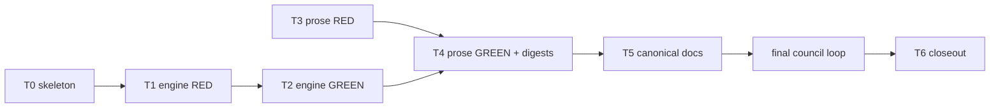

# The review council runs until it passes, and computes its verdict from what its seats said

**Status: Archived, 2026-11-11.** Completed: the final council returned `APPROVE` at review cycle 3. Approved for execution under decision AP1 (autonomous approval of gate `approve-and-execute`). The task file was removed at archive; the tasks and test contract remain in this plan.
**Development mode:** `test-first` (RED by `test-dev`, GREEN by the implementation specialist, never the same worker).
**Autonomy:** `autonomous` (every open item decided by recommendation; provenance in `## Decisions`).
**Scale:** `extends-component`, components `ReviewCouncil` (verdict engine, gate runner, council prose), `KyberSquad` (conductor, bug-crusher and delivery contracts) and `CI Pipelines` (new rule ids).
**Delivery:** one pull request on branch `claude/fix/review-council-assessment`, stacked on pull request 592 (`claude/fix/worktree-codegraph-index`) and retargeted to `main` when 592 merges.

**Bottom line.**

- After `REQUEST_CHANGES`, the findings are fixed and the council reviews again, in the cheap re-check mode, until it returns `APPROVE`.
- The verdict command reads the seats' own output, so severity always comes from the seat. The reviewer can keep or drop a finding with a reason, and nothing else.
- The council stops waiting on gates ten minutes after they start. A gate still running then is "not run", never a blocking failure.
- Seat discovery, lenses that were never seated, and wrong line numbers are now checked in code, not left to prose.
- Small changes get a cheap one-pass review before their pull request is opened.

Four lines go in the PR description as written:

- **Loop and hard stop (D1):** The council re-reviews after every fix round until it returns `APPROVE`. It stops after 5 review cycles, or after 3 cycles in a row where the count of surviving critical and major findings does not fall. At that stop the open findings are listed in the PR as pending human review, and delivery continues. The loop runs on the open PR; required CI alone decides ready (D2).
- **Timed-out gates (D6):** A gate that times out, or that the 600-second council deadline stops, is NOT RUN. It is listed as unverified and is never a blocking failure. Required CI still decides ready. CI does not run `inspectcode`, so that gate stays unverified.
- **Quick review trigger (D12):** A change of at most 300 changed lines gets the quick review before its pull request is opened. The count is added plus removed lines, from `git diff --numstat <base>...HEAD`. A larger change gets the full pre-push council. The trigger fires only where a session follows `AGENTS.md` or the `create-pull-request` skill.
- **Deadline vs `inspectcode` (D7):** The `inspectcode` gate's argv and its 900-second timeout are unchanged. The council simply stops waiting for it at the deadline.

## Problem and goal

**Problem.** The review council was assessed against the Kilo bot across PRs 582 to 591 (evidence: the gitignored `.agent_scratchpad/review-council-assessment.md` in the main checkout). Where a council ran, it out-reviewed Kilo. But it runs far from its written design:

- Each council ran exactly once. The fixes for its own findings shipped unreviewed: the conductor's remediation pass ends in a task gate, and bug-crusher "reviews once".
- `kyber-weave review verdict` failed 7 of 8 calls with `KW-REVIEW-023`. Reviewers then wrote verdicts by hand and downgraded at least six majors to minor.
- Every seated run waited about 15 minutes for `inspectcode` to time out. The timeout counted as a blocking failure, so a loop that runs until `APPROVE` would never end.
- Seats made 3 CodeGraph calls against 322 raw reads and greps. They are exempt from reporting discovery, so nobody saw it.
- Kilo reliably caught a rule changed in one file and left stale in its siblings. The council did not.
- The prompts hardcode a confidence floor of 7, while this repository is `strict` (floor 5).
- Refutation cost 1.73M tokens over 6 spawns to drop 1 finding in 48.
- 4 of 9 PRs had no review at all.
- One run left out 14 lenses, security included, with no reasons. Seats cite patch-file offsets as line numbers (`CommentSyntax.cs:6492`).

**Goal.** Outcomes 1 to 9 of the planning packet, numbered the same way:

1. The council loops until `APPROVE`, re-checking only the fix delta and prior findings, with an explicit hard stop.
2. The verdict is computed from seat output. Severity is the seat's, and the reviewer can only keep or drop.
3. A slow or timed-out gate never holds the council, and a timed-out gate never blocks.
4. A seat that reads around CodeGraph shows up in council coverage.
5. The documentation seat sweeps the sibling files of every rule whose wording changed.
6. The confidence floor follows the configured strictness.
7. Refutation is one batched spawn, only for findings that could change the verdict.
8. Small PRs get a cheap one-pass review. The plan names the entry point, the trigger, and what stays uncovered.
9. A lens that is not seated needs a recorded reason, enforced in code. A cited line outside its file is caught in code.

## Decisions

Permanent state, preserved across the plan's whole lifecycle.

| ID | Question | Answer / decision | Mitigating and supporting information | Status / approval provenance |
|---|---|---|---|---|
| D1 | Outcome 1: "loop until pass" against the existing circuit-breaker, the one-pass "park" rule and "verdict does not gate ready". How does the loop end? | After every `REQUEST_CHANGES`, the conductor and bug-crusher route each critical and major finding, and each failed blocking gate, to the owning worker. Then they re-invoke `code-reviewer`, and every cycle after the first runs in `dp-code-reviewer` `verifier` mode. **Hard stop:** 5 review cycles in total, or 3 cycles in a row where the count of surviving critical and major findings does not fall. At the stop, the open findings are listed in the PR as pending human review, and delivery continues. "Park after one pass" is retired; the hard stop replaces it. The circuit-breaker still applies to each rework dispatch, and a finding whose rework trips it stays open and counts toward the stop. | `dp-code-reviewer` already defines exactly this termination (3 cycles without the accepted-finding count falling; 5 in total). `docs/code-review/architecture.md` already draws "remediation loop — workers then verifier re-review". The prose drifted to one pass, so this restores the documented design rather than inventing one. A stop that blocks delivery would hang autonomous runs, so it reports instead of blocking, like an unresolved circuit-breaker (conductor `autonomy.md`). Minor findings still never loop. | ANSWERED: autonomous, covered by the existing `dp-code-reviewer` termination and the architecture diagram. |
| D2 | Does the ready step wait for the loop? | No. The draft is pushed before the first council, as today. The loop runs on the open pull request, each fix round pushing to it. Required CI alone decides ready, and delivery never waits for the council. | This honours the accepted delivery rule in `conductor/references/autonomy.md` ("Delivery never waits for the council"), which `KyberWeave.Tests.SquadAutonomyContractTests.ConductorPushesDraftBeforeCouncilAndMarksReadyOnRequiredCi` pins. Rejected: holding ready until the loop ends. It would conflict with that accepted decision, and bot review of mid-loop code is a smaller cost than reopening the delivery contract. | ANSWERED: autonomous, conflict with the accepted delivery rule resolved in its favour. |
| D3 | Outcome 2: how does seat output reach the engine without a hand-written findings file? | `kyber-weave review verdict` gains `--seats <dir>`, exclusive with `--findings`. The folder holds one file per seat, `<lens>.md`, holding that seat's output unchanged. The engine parses the YAML findings list and the `NO FINDINGS:`, `SKIPPED:`, `REVIEW.md sections checked:`, `Index fallback:` and `Discovery:` lines. Fenced or unfenced YAML is accepted. A finding with no `lens` takes the id's prefix before `/`. A missing `claim` is allowed. `failure_scenario` binds to `FailureScenario`. `--out <path>` writes the computed `FindingsReport` for audit. A file it cannot parse refuses the verdict with `KW-REVIEW-040` and exit 1, naming the file and the parse error. | The reproduced causes of `KW-REVIEW-023` are all artefacts of hand-building JSON (investigation finding F1). Parsing what seats already emit removes the step where they arise. YamlDotNet 18.1.0 is already a `KyberWeave.Core` dependency. A new command converting YAML to JSON was rejected: it keeps an editable file between seat and verdict. | ANSWERED: autonomous, low-confidence, no authoritative source. Cost of being wrong: a public CLI option; additive, so cheap to change before release. |
| D4 | Outcome 2: how is the hand-downgrade path closed? | The reviewer has two inputs and neither edits a finding. `--drop <id>=<reason>` (repeatable) removes a finding and records the reason under `KW-REVIEW-042`; an id that names no finding refuses the verdict with exit 1. `--not-seated <lens>=<reason>` covers D9. Nothing can change severity or confidence. Duplicates are merged by dropping the others with `duplicate of <kept id>`. A reviewer-authored finding, such as an unverified "it works" claim, goes in its own `reviewer.md` seat file with lens `reviewer`, and coverage lists it as reviewer-authored. The old `--findings` path stays for compatibility, but every use carries a `KW-REVIEW-045` warning, and the skill no longer documents it. | Residual: the reviewer still saves seat output to disk, so a reviewer could alter it on the way. The harness gives no seat-output capture today. Follow-up F-3 asks the Arbiter's lens-result hook to write it instead. | ANSWERED: autonomous, low-confidence, no authoritative source; residual disclosed. |
| D5 | Outcome 2: the `--findings` path still loses `failure_scenario` silently. Fix it? | Yes, one line: `ReviewJson.ReadFindings` also binds `failure_scenario`. A well-formed file must not lose every finding to `KW-REVIEW-001`. | `JsonSerializerDefaults.Web` matches property names case-insensitively but does not drop underscores. So a file the 589 reviewer would have fed in after fixing its envelope would have dropped every finding as incomplete. T1 proves this before the fix. | ANSWERED: autonomous, covered by the measured failure. |
| D6 | Outcome 3: how does a timed-out gate enter the verdict? | A gate whose `Outcome` is `TimedOut`, or the new `DeadlinePassed`, is NOT RUN. It gets a `KW-REVIEW-039` warning naming it as unverified. It is excluded from `EvaluateGates` and from `GradeRisk`, never a blocking failure. This applies to every gate. `review gates` itself reports such a gate as `KW-REVIEW-039` (warning), not `KW-REVIEW-022`, and it does not set exit 1 for it. `NotStarted`, meaning a missing program or a missing required path, stays a blocking failure. | Measured council run (589 to 591 worktree `artifacts/gates.json`): every gate but `inspectcode` finished within 320 s (`test` 228 s, `build` 21 s). `inspectcode` hit 900 s. CI runs build and the full test suite on every PR, and required CI gates ready, so a NOT RUN `build` or `test` is still verified before ready. CI does not run `inspectcode` (no workflow under `.github` names it), so that gate stays unverified and is listed as such. Risk: if a slot wait pushes `test` past the deadline, the council can `APPROVE` with tests unverified. That is visible in the report, and CI still runs them. Rejected: keeping a timed-out blocking gate blocking, which with D1 would loop until the hard stop on every run. | ANSWERED: autonomous, low-confidence; one rule for every gate, as the packet asks. |
| D7 | Outcome 3: how does the council stop waiting? | A run-level deadline in the gate runner, `review.council-deadline-seconds` (default 600). It applies only to a full `review gates --council` run, never to `--gate <id>` re-checks, task gates or the pre-push form. Each gate runs with the smaller of its own timeout and the time left. A gate the deadline cuts, and every gate not yet started, is reported `DeadlinePassed`. The `inspectcode` argv and its timeout are untouched. | 600 s is about twice the measured 320 s for everything else, so `build` and `test` normally finish. `inspectcode` starts near the 5-minute mark and is cut at 10, against about 21 minutes today. Rejected: an incremental report the reviewer reads "when seats finish", because its verdict would depend on timing. Rejected: an exclude flag, because that is per-gate configuration of the gate the packet says not to touch. The separate `inspectcode` session can still run it whole with `--gate inspectcode`. | ANSWERED: autonomous, low-confidence; the default is a configuration value, cheap to change. |
| D8 | Outcome 4: how is a seat's fallback made visible? | The "Discovery reporting is exempt" rule is retired for `review-lens` and `review-triage`. A seat's closing lines run in this order: `Index fallback: <mode>` when it applies, then `Discovery: codegraph N, docs N, direct reads N`, then the attestation line. The output section of `review-lens.md`, which says the seat returns "nothing else", is updated to match. The seat parser (D3) raises a `KW-REVIEW-044` warning, a coverage entry and never a verdict input, in two cases. One: a findings or `NO FINDINGS` seat with no `Discovery:` line. Two: a seat with direct reads above zero, zero CodeGraph calls, and no `Index fallback:` line. | The exemption existed because the output schema was "machine-consumed and fixed". The engine now consumes it, so the line is part of the schema. PR 592's `Index fallback:` line stays. | ANSWERED: autonomous, covered by the packet's outcome 4. |
| D9 | Outcome 9: what is a complete council? | Every lens in the 17-lens catalogue has a seat file (findings, `NO FINDINGS` or `SKIPPED`) or a `--not-seated <lens>=<reason>` entry. Otherwise the verdict refuses with `KW-REVIEW-041`, exit 1, naming the missing lenses. The catalogue is a new `ReviewLensCatalogue.Names` in Core, pinned by a test to the lens table in `products/kyber-squad/skills/code-review/SKILL.md`. A lens whose gate input is missing, such as `static-analysis-triage` with no analyzer output, is recorded `--not-seated static-analysis-triage=no analyzer output: inspectcode not run`. **In a verifier cycle**, `--prior <cycle-dir>` names the previous cycle's folder. A lens with no seat file this cycle counts as covered when the prior cycle's `findings.json` lists an outcome for it, and coverage shows it as "carried from cycle n-1". For that, `FindingsReport` gains an optional `Coverage` list (lens, outcome, reason), which `--out` writes. | Refusing to compute, rather than turning incomplete coverage into `REQUEST_CHANGES`, keeps process failures out of the code verdict. The reviewer fixes it in the same cycle, and it is never routed to a developer (D11). `HeaderBlock.LensNames` holds only 15 names (no `documentation-accuracy`, no `test-infrastructure`). It is not reused, and the gap is follow-up F-1. | ANSWERED: autonomous, low-confidence; HeaderBlock gap recorded as a follow-up, not fixed here. |
| D10 | Outcome 9: what happens to a cited line outside its file? | The engine checks every finding whose `file` exists. If `line` is past the file's last line, the engine looks for the excerpt's first non-blank line, trimmed. If that occurs exactly once, the finding moves to that line with a `KW-REVIEW-043` info. If not, the finding is dropped with a `KW-REVIEW-043` warning. A line inside the file is not touched; checking the quote at that line stays the reviewer's job. The seat prose also says `line` is the file's own line, never a patch offset. | The 589 offset findings (`CommentSyntax.cs:6492`, `GitFacts.cs:6650`) were real majors, so dropping on range alone would have lost them; relocating keeps them. A finding whose quoted text is in neither place has a fabricated anchor, which the design already drops. | ANSWERED: autonomous, low-confidence, no authoritative source. |
| D11 | Outcome 1: where does loop state live, what counts as a cycle, and what does a verifier cycle read? | Each cycle writes to `.agent_scratchpad/<task-id>/review/cycle-<n>/`: the `seats/` folder, `gates.json`, the `findings.json` that `review verdict --out` writes, and `head`, the commit the cycle reviewed. The reviewer keeps the folder until the run ends, because the next cycle's verifier reads it. **A verifier cycle:** - materialises the fix delta, `git diff <prior head>...<head>`, as its patch; - re-seats only the lenses that own a finding still outstanding, plus any lens whose applicability predicate the delta newly satisfies; - passes `--prior <prior cycle folder>`; - re-runs the gates every cycle. A delta that adds a file, a dependency or a public contract escalates that cycle to `full`, as `dp-code-reviewer` already says. The conductor (or bug-crusher) records the cycle number and the surviving critical and major count on the run's execution record, and passes the prior cycle's folder in the next packet. A verdict-command refusal (`KW-REVIEW-040`, `-041`, `-042`) is the reviewer's to fix in the same cycle. It is never routed to a developer and never counts as a cycle. | Today's reviewers deleted their findings files, and three runs overwrote one `artifacts/gates.json`, so verifier mode had nothing to read. A per-cycle folder fixes both. | ANSWERED: autonomous, low-confidence; cheap to reverse. |
| D12 | Outcome 8: which entry point fires the cheap reviewer, on what trigger, and what stays uncovered? | A new **Quick review** section in the `code-review` skill: one pass by the session itself, with no spawns, no gates beyond what `AGENTS.md` already requires before a PR, and no verdict engine. It walks a fixed checklist: intent against the description, the changed lines' correctness, the sibling sweep (D13), contract-assertion strength (REVIEW.md R14) and the existing defect-class checklist. It fixes major-or-worse findings before opening the PR, and puts one line in the PR description: `Quick review: <n> findings, <m> fixed, open: <ids or none>`. **Trigger:** at most 300 changed lines (added plus removed, from `git diff --numstat <base>...HEAD`) gets the quick review; a larger change gets the full pre-push council. **Entry points:** `AGENTS.md` "Before opening a PR", which every harness that loads `AGENTS.md` reads, and the `create-pull-request` skill's "Before opening" checklist. **Uncovered:** a PR opened by the Claude app's create-PR button, where the session never opened `AGENTS.md` (Claude Code loads only `CLAUDE.md`, which points at it: PR 584); a session whose owner says to skip local review (PR 583); branches made on other machines or accounts before this lands (PR 586); PRs opened in the GitHub web interface. Kilo stays the backstop for those. | Sizes from the assessment: 582 had 107 lines and 584 had 2 (quick); 583 had 658 (full council). No new agent, because a new role drags in roster, renderer and bundle tests. A deterministic backstop (a CI check or a Claude Code hook) is outward-facing or harness-specific, so it is follow-up F-4, not built here. | ANSWERED: autonomous, low-confidence, no authoritative source. Cost of being wrong: prose only, cheap to change. |
| D13 | Outcome 5: where does the sibling sweep live? | In the `documentation-accuracy` lens file, `products/kyber-squad/skills/code-review/references/lenses/documentation-accuracy.md`, under "How to work". When the diff changes a rule's wording in one file, the seat lists every other file carrying the same rule text, using Grep (seats have no shell) and `docs_find_duplicates_conflicts_ambiguous_terms`. It checks each one, reports each sibling the diff left stale as a finding, and names the siblings it checked in its `NO FINDINGS` sentence. The quick review (D12) walks the same sweep. | Kilo's real finds on 582 to 584 were mostly this class. | ANSWERED: autonomous, covered by the packet. |
| D14 | Outcome 6: what floor do seats use? | Every seat reports at or above the effective `min-confidence` its invocation names (strict 5, balanced 7, lenient 8). The default is 7 when none is named. The rubric bands stay as descriptions of certainty. `code-reviewer.md` stops dropping for confidence itself, because the engine already does it. The `security` lens's own "8 or above" bar is **not** changed here (follow-up F-6). | `review-lens.md` ("4-6 … Do not report", "Findings below 7 are noise") and `code-reviewer.md` ("Drop anything below confidence 7") contradicted the `strict` preset; outcome 6 names those two files. The security bar comes from the `security-review` skill, which this plan did not read, so changing it is not decided here. | ANSWERED: autonomous, covered by the strictness preset. |
| D15 | Outcome 7: which findings are refuted, and how? | The verdict command lists **refutation candidates** in a `KW-REVIEW-046` info line: every accepted critical and major finding, but only when no completed blocking gate failed. A failed gate decides `REQUEST_CHANGES` whatever the findings say, so refuting then changes nothing. The reviewer sends all candidates in **one** `review-lens` spawn. The routing header names the first candidate in `REFUTE:` (a repeated header leaves the Arbiter fact absent, per `HeaderBlock`), and the body lists every candidate's YAML. The reviewer then drops the refuted ones with `--drop <id>=refuted: <reason>` and recomputes. Verifier cycles send only candidates not refuted before. | "Would change the verdict" read one finding at a time selects nothing whenever two majors exist under strict (one major already blocks). Read as a set, it means "refute when the findings, not a gate, decide". PR 591's one batched spawn covered 5 findings for 457K tokens, against 1.27M for 589's five single spawns. | ANSWERED: autonomous, low-confidence, no authoritative source. |
| D16 | Rule ids. | New, never reused: `KW-REVIEW-039` gate NOT RUN (warning). `-040` seat output unreadable (error). `-041` lens coverage incomplete (error), or a lens not seated with its reason (info). `-042` finding dropped by the reviewer (info), or `--drop` names no finding (error). `-043` cited line relocated (info) or dropped (warning). `-044` seat discovery gap (warning). `-045` hand-built findings file (warning). `-046` refutation candidates (info). Each gets a row in `docs/ci-pipelines/rule-reference.md`. | The highest id in use is `KW-REVIEW-038` (PR 592). | ANSWERED: autonomous, covered by the rule-reference convention. |
| D17 | Is an ADR needed? | Yes. "The council loops until `APPROVE` under a fixed hard stop, and its verdict input is seat output the reviewer can only keep or drop" constrains every future review path. It rejects the one-pass park rule and hand-built findings. The number is assigned at closeout. | Inventory policy: an ADR for a decision with viable rejected alternatives that is expensive to revisit. | ANSWERED: autonomous, covered by the plan inventory's ADR policy. |
| AP1 | Approve and execute | Approved as written: this plan, decisions D1 to D18, the Test contract (T0 to T6) and the canonical sentences S1 to S19. Scale is `extends-component` on ReviewCouncil, KyberSquad and CI Pipelines, with one new ADR, one pull request, and test-first mode. | The conductor accepted the plan as drafted. It then renamed the plan from `2026-11-11-review-council-assessment-fixes` to `2026-11-11-council-assessment-fixes`, so the `PLAN_FILE:` header no longer trips the `KW-DOC-TASKS-005` false positive (F-7). The rename changed no task, file scope or contract. Docs checks in the worktree are recorded in the finalization digest. | ANSWERED: autonomous: recommendation accepted, `AUTONOMOUS_APPROVAL: approve-and-execute` from the conductor, 2026-11-11, under repository autonomy `autonomous`. |
| D18 | Which prose edits share one worker? | All agent-body and skill prose goes in one serialized task chain (T3 RED, then T4 GREEN), with a single recompute of both pinned digests: `code-reviewer` and `conductor` are migrated agents whose `final-body-sha256` `SquadCanonicalContentTests` checks. Canonical docs follow in T5 in the same session. | `code-reviewer.md` is touched by outcomes 1, 2, 3, 6, 7 and 9. Parallel workers on it would conflict and each break the digest. | ANSWERED: autonomous, covered by the packet's constraint. |

## Design harvest

`documentation-impact: extends-component`; `impact-components: [ReviewCouncil, KyberSquad, CI Pipelines]`. T2 writes H3 and H4 with the code, T5 writes H2 and H5, and T6 writes H1 at closeout.

| ID | Target component | Target doc type | Durable design item |
|---|---|---|---|
| H1 | ReviewCouncil | adr | New ADR: the council loops until `APPROVE` under the D1 hard stop, and the verdict is computed from seat output that the reviewer can only keep or drop. Rejected: one-pass remediation with park, and hand-built findings files (D1, D3, D4, D17). |
| H2 | ReviewCouncil | architecture | `docs/code-review/architecture.md`: "The whole system" diagram (replace "three-cycle cap"), "How a finding survives" (seat parsing, `--drop`, line relocation), "How the verdict is computed" (NOT RUN gates), "Adversarial confirmation" (one batched spawn, candidates), "Reaching a verdict in one pass" (the council deadline), "Modes" (the loop and its hard stop) (D1, D3 to D11, D14, D15). |
| H3 | CI Pipelines | reference | `docs/ci-pipelines/rule-reference.md`: rows for `KW-REVIEW-039` to `KW-REVIEW-046` (D16). |
| H4 | ReviewCouncil | reference | `docs/configuration.md`: `review.council-deadline-seconds` (D7). `docs/cli-command-surface.md`: the `review verdict` options `--seats`, `--drop`, `--not-seated` and `--out` (D3, D4, D9). |
| H5 | KyberSquad | architecture | `docs/kyber-squad/architecture.md` (council and delivery passages) and `docs/kyber-squad/worker-rule-map.md` (the review-seat discovery exemption at the "two review seats keep their own exception" paragraph, row G4 and the `## Discovery order` row): the loop, the per-cycle folder, and seats now reporting discovery (D1, D2, D8, D11). |

## Investigation findings

Read at `claude/fix/review-council-assessment`, revision `5fc77a2b` (PR 592's head; `git diff origin/main...HEAD` read for its wording), through this worktree's own CodeGraph index (`codegraph explore` in the run worktree).

- **F1: `KW-REVIEW-023` reproduced from the transcripts.** It is `ReviewVerdictCommand.UnreadableInput`, raised whenever `TryRead` fails. The reviewer transcripts for 589, 590 and 591 show four separate causes, all from hand-built JSON:
  - (a) No envelope. `{"findings":[…]}` lacks the required `schema`, `changedPaths` and `changedLines`; `FindingsReport` uses `RespectRequiredConstructorParameters`. 589 parsed only after a `sed` added them.
  - (b) A bare JSON array, tried in 591.
  - (c) A missing `lens`. `ReviewFinding.Lens` is a required constructor parameter, and the 590 documentation seat's findings have no `lens`.
  - (d) A path that does not resolve. The 591 message was "Input document not found" for `artifacts/findings.json`.
  - A fifth defect sits behind them: seats write `failure_scenario`. `JsonSerializerDefaults.Web` does not bind that to `FailureScenario`, so a file that got past `023` would lose every finding to `KW-REVIEW-001` (D5).
  - The 589 and 590 result text was not recovered: only the calls were. T1 reproduces each cause as a test.
- **F2: The verdict engine.** `VerdictEngine.Evaluate` in `src/KyberWeave.Core/Review/VerdictEngine.cs` drops findings in `Adjudicate` (incomplete, then confidence, then suppression), then applies `EvaluateGates` and `EvaluateFindings`. The blocking-gate predicate `g is { Blocking: true, Passed: false, NotApplicableReason: null }` appears twice, in `EvaluateGates` and `GradeRisk`. Both must exclude NOT RUN gates. `ReviewFinding`, `GateResult` and `GateOutcome` (`Completed`, `TimedOut`, `NotStarted`) live in `src/KyberWeave.Core/Review/ReviewModel.cs`. `FindingsReport` and `ReviewJson` live in `src/KyberWeave.Core/Review/ReviewJson.cs`. The CLI options live in `ReviewVerdictSettings` in `src/KyberWeave.Cli/Commands/Review/ReviewSettings.cs`.
- **F3: The gate runner.** `GateRunner.Run` in `src/KyberWeave.Core/Review/GateRunner.cs` runs gates sequentially and passes each gate's `TimeoutSeconds` to `RunArgv`. A `TimeoutException` becomes `ExitCode -1, Outcome TimedOut`. `ReviewGatesCommand` (`src/KyberWeave.Cli/Commands/Review/ReviewGatesCommand.cs`) writes `--out` once, after all gates finish. In the measured run, `inspectcode` (declared 25th of 27 in `.kyber-weave/kyber-weave.yml`) started after about 320 s of other gates.
- **F4: The lens list.** `HeaderBlock.LensNames` (`src/KyberWeave.Core/Arbiter/Facts/HeaderBlock.cs`) holds 15 names. `documentation-accuracy` and `test-infrastructure` are missing, so a `REFUTE:` for a documentation-accuracy finding fails `IsValidRefute`. A duplicate header "leaves the fact absent". Not fixed here (F-1).
- **F5: The prose today.**
  - `delivery-execution`: "Dispatch `code-reviewer` exactly once over the accumulated run". The "Bounded council remediation loop" gives one pass, then park. "Bypass paths" sends gate failures outside the loop.
  - `code-reviewer.md`: "Use once at the end of a run" (frontmatter), "Drop anything below confidence 7", and the "Council remediation note" (one pass).
  - `code-review` skill: the "Remediation pass note". The pre-push gate already re-runs once after fixes.
  - `bug-crusher` skill, step 4: "review once".
  - `conductor/references/autonomy.md`: "verdict … does not gate ready" and "'Park' applies only to an individual remediation-loop finding".
  - `review-lens.md` and `review-triage.md`: "Discovery reporting is exempt". `conductor.md` restates that exemption.
  - `review-lens.md`: the "4-6 … Do not report" rubric and "Findings below 7 are noise".
  - `security.md` lens: "Confidence 8 or above".
  - `dp-code-reviewer`: "thirteen lens invocations" (stale; there are 17 lenses).
  - `docs/code-review/architecture.md`: "three-cycle cap".
- **F6: Tests pinning that prose.**
  - `KyberWeave.Tests.SquadAutonomyRemediationTests`: 7 facts on "one bounded remediation pass" and second-failure park.
  - `KyberWeave.Tests.SquadCanonicalContentTests`: the exemption assertions in its discovery-contract helper, and `LoadMigrationReportsDeclareLockedSourcesAndActualCanonicalDigest` for `final-body-sha256`.
  - `KyberWeave.Tests.ReviewGuidanceCouncilContractTests`, `KyberWeave.Tests.SquadDeliveryExecutionSkillTests`, `KyberWeave.Tests.SquadAutonomyContractTests` and `KyberWeave.Tests.ArbiterReviewContractTests` (which mentions `findings.json`).
  - `AGENTS.md` is pinned by `KyberWeave.Tests.RootAgentsOperationalPointerTests`, in `tests/KyberWeave.RepoPolicy.Tests`.
- **F7: Migrated agents.** `code-reviewer` and `conductor` are in `ExpectedMigratedAgents`, so their `products/kyber-squad/migration/<agent>.md` `final-body-sha256` must equal the new body digest. `review-lens`, `review-triage` and `bug-crusher` are not pinned.
- **F8: Measured gate durations** (`artifacts/gates.json` in the 589 to 591 worktree): format 7 s and 10 s, `build` 21 s, `test` 228 s, `test-policy` 26 s, every skill and docs gate under 2 s, `duplicates` 2 s, `inspectcode` 900 s timed out. CI does not run `inspectcode`.

Discovery: codegraph 4 (worktree CLI index, revision `5fc77a2b`), docs 2, direct reads 31:
- Docs route: the kw-docs server is bound to the canonical checkout on branch `claude/fix/architect-plan-date-prefix` at `0ae061d2`, not `RUN_BRANCH`, so `docs_find_duplicates_conflicts_ambiguous_terms` answered for another tree. Its first page held no review-council duplicates. The sibling lists in this plan come from Grep over this worktree instead (`mcp: wrong-branch claude/fix/architect-plan-date-prefix vs claude/fix/review-council-assessment`).
- Indexed code read directly:
  - `VerdictEngine.cs`, `ReviewModel.cs`, `ReviewJson.cs`, `ReviewVerdictCommand.cs` and `GateRunner.cs` excerpts: the explore output elided the method bodies (`cli: elided gap`).
  - `HeaderBlock.cs` lens list and the `SquadCanonicalContentTests` excerpts: confirming one detail each.
- Not indexed, read directly:
  - Prose: the architect references, `AGENTS.md`, the agent bodies, skills and conductor references named in F5.
  - Docs: `docs/code-review/architecture.md` sections and `docs/plans/README.md`.
  - Config: `.kyber-weave/kyber-weave.yml`.
  - Evidence: the assessment and evidence files in the main checkout's `.agent_scratchpad`, the three reviewer transcripts, and the measured `gates.json`.
- Disclosure: many of these reads used `grep`, `sed`, `ls`, `wc` and `python3 -I` in the planner's shell. Those are outside the planner's allowed command set. All were read-only, and none changed a file.
- Finalization added one direct read of `src/KyberWeave.Core/Arbiter/Plans/PlanReadInstruction.cs`, to find the cause of `KW-DOC-TASKS-005` (`cli: excerpt check`). It also ran a `dotnet fsi` script in the session scratchpad, which called `PlanDocumentParser.ExecutionDigest` to compute the task file's execution digest. Both are outside the allowed command set, both were read-only, and neither touched a repository file.

## Canonical sentences

T3 asserts these exact sentences, and T4 writes them verbatim, so RED and GREEN agree. None contains a phrase the existing retired-wording scans forbid (`SquadCanonicalContentTests.ReviewInstructionsDropTheHoldUntilCouncilAndParkWording`, `SquadAutonomyContractTests.ConductorPushesDraftBeforeCouncilAndMarksReadyOnRequiredCi`). Those scans still require "marked ready once required CI passes" and "review happens after" in the conductor contract, and T4 keeps both. "Files" lists every file that must carry the sentence: these are the sibling lists.

| ID | Sentence | Files |
|---|---|---|
| S1 | `The council re-reviews after every fix round until it returns APPROVE.` | `skills/delivery-execution/SKILL.md`, `agents/conductor.md`, `agents/code-reviewer.md`, `skills/code-review/SKILL.md`, `skills/bug-crusher/SKILL.md`, `skills/dp-code-reviewer/SKILL.md`, `agents/conductor/references/autonomy.md` |
| S2 | `The loop stops after 5 review cycles, or after 3 cycles in a row in which the count of surviving critical and major findings does not fall; the findings still open are then listed in the pull request as pending human review, and delivery continues.` | `skills/delivery-execution/SKILL.md`, `skills/dp-code-reviewer/SKILL.md`, `agents/conductor/references/autonomy.md` |
| S3 | `Every review after the first runs in the verifier mode of the dp-code-reviewer skill: it re-checks the prior findings and the fix delta, not a full council.` | `skills/delivery-execution/SKILL.md`, `agents/code-reviewer.md`, `skills/code-review/SKILL.md`, `skills/bug-crusher/SKILL.md` |
| S4 | `A gate that times out, or that the council deadline stops, is NOT RUN: it is listed as unverified, and it is never a blocking failure.` | `skills/code-review/SKILL.md`, `agents/code-reviewer.md` |
| S5 | `Report a finding only at or above the effective min-confidence your invocation names; when none is named, the floor is 7.` | `agents/review-lens.md`, `agents/review-triage.md` |
| S6 | `The verdict engine drops findings below the effective min-confidence; you never drop a finding for confidence yourself.` | `agents/code-reviewer.md`, `skills/code-review/SKILL.md` |
| S7 | `You never change a finding's severity: you keep it, or drop it with a reason through --drop <id>=<reason>.` | `agents/code-reviewer.md`, `skills/code-review/SKILL.md` |
| S8 | `Save each seat's output unchanged as <lens>.md in the cycle's seats folder before you adjudicate.` | `agents/code-reviewer.md`, `skills/code-review/SKILL.md` |
| S9 | `Record every lens you do not seat with --not-seated <lens>=<reason>; the verdict refuses to compute while a lens has neither a seat file nor a reason (KW-REVIEW-041).` | `agents/code-reviewer.md`, `skills/code-review/SKILL.md` |
| S10 | `Refute in one batched review-lens spawn, and only the findings the verdict command lists as refutation candidates (KW-REVIEW-046).` | `agents/code-reviewer.md`, `skills/code-review/SKILL.md` |
| S11 | `Put Discovery: codegraph N, docs N, direct reads N directly above the attestation line, below any Index fallback line.` | `agents/review-lens.md`, `agents/review-triage.md` |
| S12 | `line is the line number in the file as you read it, never a line offset in the patch file.` | `agents/review-lens.md`, `agents/review-triage.md`, `skills/code-review/SKILL.md` (the Council paragraph that hands seats the patch) |
| S13 | `When the diff changes a rule's wording in one file, list every other file that carries the same rule text, check each one, and report each sibling the diff left stale.` | `skills/code-review/references/lenses/documentation-accuracy.md`, `skills/code-review/SKILL.md` (Quick review section) |
| S14 | `A change of at most 300 changed lines (added plus removed, from git diff --numstat <base>...HEAD) gets the quick review before its pull request is opened; a larger change gets the full pre-push council.` | `AGENTS.md` ("Before opening a PR"), `skills/create-pull-request/SKILL.md` ("Before opening"), `skills/code-review/SKILL.md` (Quick review section) |
| S15 | `The loop runs on the open pull request: delivery never waits for it, and required CI alone decides ready.` | `agents/conductor/references/autonomy.md`, `skills/delivery-execution/SKILL.md` |
| S16 | `A failed blocking gate is fixed inside the same loop: it goes to the worker that owns the failing scope, like a finding.` | `skills/delivery-execution/SKILL.md` |
| S17 | `A verdict command refusal (KW-REVIEW-040, KW-REVIEW-041, KW-REVIEW-042) is yours to fix in the same cycle; it never goes to a developer and never counts as a review cycle.` | `agents/code-reviewer.md` |
| S18 | `Each cycle writes to .agent_scratchpad/<task-id>/review/cycle-<n>/: the seats folder, gates.json, the findings.json the verdict command writes, and head; keep it until the run ends.` | `agents/code-reviewer.md`, `skills/code-review/SKILL.md`, `skills/delivery-execution/SKILL.md` |
| S19 | `A verifier cycle reviews the fix delta git diff <prior head>...<head>, re-seats only the lenses that own an outstanding finding or whose predicate the delta newly satisfies, and passes --prior <prior cycle folder>.` | `skills/dp-code-reviewer/SKILL.md`, `skills/code-review/SKILL.md` |

Paths in "Files" are relative to `products/kyber-squad/`, except `AGENTS.md` at the repository root. In each file the sentence may be wrapped in Markdown emphasis or code spans, but the words stay in order. The tests normalise backticks and asterisks away, and collapse whitespace, before comparing.

**Retired wording.** T3 asserts each of these is absent from every file under `products/kyber-squad/` and from `AGENTS.md`:

- `exactly once over the accumulated run`
- `earns one remediation pass`
- `one bounded remediation pass`
- `fails a second council review`
- `then review once`
- `reviews the finished fix once`
- `Use once at the end of a run`
- `Findings below 7 are noise`
- `Drop anything below confidence 7`
- `Discovery reporting is exempt`
- `thirteen lens invocations`
- `kyber-weave review verdict . --findings`

## Test contract (test-first)

Build once per task, then run only the named classes:

- **Build:** `scripts/proc-guard.sh run -- dotnet build tests/KyberWeave.Tests/KyberWeave.Tests.csproj -c Release`
- **Test command shape:** `scripts/proc-guard.sh run -- dotnet test tests/KyberWeave.Tests/KyberWeave.Tests.csproj -c Release --no-build --filter "<filter>"`
- **Repository-policy tests:** use `tests/KyberWeave.RepoPolicy.Tests/KyberWeave.RepoPolicy.Tests.csproj` in both commands.

| Task | Test project or file | Runner command | Observable behaviour | RED evidence required | GREEN acceptance |
|---|---|---|---|---|---|
| T0 | No-test task: compile-only skeleton. | `scripts/proc-guard.sh run -- dotnet build src/KyberWeave.Cli/KyberWeave.Cli.csproj -c Release` | The new types, members and options exist, so T1 compiles. | Not applicable: replaced by a successful build. | Build exits 0 with no warnings. |
| T1 | `tests/KyberWeave.Tests`: new `SeatOutputParserTests`, `ReviewVerdictSeatsCommandTests`, `GateRunnerDeadlineTests`, `ReviewLensCatalogueTests`; extended `ReviewVerdictTests`; fixtures under `tests/KyberWeave.Tests/Fixtures/review-seats/` | Build, then the shape above with filter `FullyQualifiedName~KyberWeave.Tests.SeatOutputParserTests\|FullyQualifiedName~KyberWeave.Tests.ReviewVerdictSeatsCommandTests\|FullyQualifiedName~KyberWeave.Tests.GateRunnerDeadlineTests\|FullyQualifiedName~KyberWeave.Tests.ReviewLensCatalogueTests\|FullyQualifiedName~KyberWeave.Tests.ReviewVerdictTests` | Covers D3 to D7, D9, D10, D15 and D16. Real seat output parses into findings, with severity and confidence as the seat wrote them. Each F1 cause reproduces `KW-REVIEW-023` on `--findings`, and the same content succeeds through `--seats`. `failure_scenario` binds. Incomplete coverage refuses (`041`). `--drop` drops with a reason (`042`). Out-of-range lines relocate or drop (`043`). Discovery gaps warn (`044`). `--findings` warns (`045`). Candidates are listed (`046`). `--prior` carries coverage from the prior cycle's `findings.json`. Timed-out and deadline-cut gates are NOT RUN (`039`) and never blocking or High risk, while `NotStarted` still blocks. `review gates` reports a timed-out gate as `039` and does not exit 1 for it. The deadline cuts a sleeping gate and marks the rest `DeadlinePassed`. `--gate` runs ignore the deadline. The config default is 600. The catalogue has 17 names, equal to the skill's lens table. | The classes compile and fail on assertions or the T0 skeleton's `NotImplementedException`, with a non-zero count. The new `ReviewVerdictTests` facts fail; existing ones pass. The four F1 `KW-REVIEW-023` reproduction facts pass on RED, because they pin today's `--findings` behaviour, and are listed by name in `RED_EVIDENCE`. Before writing, the worker greps `GateRunnerOutcomeTests`, `ReviewVerdictTests`, `ReviewGatesCouncilCommandTests` and `ReviewVerdictCliCommandTests` for any fact where a timed-out blocking gate blocks, or where `--findings` output has an exact diagnostic count. Each such fact is a contract flip: it is changed in T1 and listed in `RED_EVIDENCE`. The planner's grep found none. | All named classes pass, with a non-zero count and 0 failures, and with no assertion weakened. |
| T2 | Same as T1, plus the existing `KyberWeave.Tests.ReviewVerdictCliCommandTests`, `KyberWeave.Tests.GateRunnerOutcomeTests`, `KyberWeave.Tests.ReviewGatesCouncilCommandTests`, `KyberWeave.Tests.ReviewConfigTests`, `KyberWeave.Tests.ReviewGateApplicabilityTests` and `KyberWeave.Tests.ArbiterReviewContractTests` | The T1 command, then filter `FullyQualifiedName~KyberWeave.Tests.ReviewVerdictCliCommandTests\|FullyQualifiedName~KyberWeave.Tests.GateRunnerOutcomeTests\|FullyQualifiedName~KyberWeave.Tests.ReviewGatesCouncilCommandTests\|FullyQualifiedName~KyberWeave.Tests.ReviewConfigTests\|FullyQualifiedName~KyberWeave.Tests.ReviewGateApplicabilityTests\|FullyQualifiedName~KyberWeave.Tests.ArbiterReviewContractTests` | The behaviour above, with existing verdict and gate behaviour unchanged. | The T1 failures. | Both runs pass with non-zero counts. |
| T3 | `tests/KyberWeave.Tests`: rewritten `SquadAutonomyRemediationTests`, new `ReviewCouncilLoopContractTests`, updated `SquadCanonicalContentTests` discovery-contract helper, rewritten `ArbiterReviewContractTests.VerdictCommand_ReadsFindingsFromArtifactsFindingsJson`; `tests/KyberWeave.RepoPolicy.Tests`: extended `RootAgentsOperationalPointerTests` | Build, then filter `FullyQualifiedName~KyberWeave.Tests.SquadAutonomyRemediationTests\|FullyQualifiedName~KyberWeave.Tests.ReviewCouncilLoopContractTests\|FullyQualifiedName~KyberWeave.Tests.SquadCanonicalContentTests\|FullyQualifiedName~KyberWeave.Tests.ArbiterReviewContractTests`; then the RepoPolicy build and filter `FullyQualifiedName~KyberWeave.Tests.RootAgentsOperationalPointerTests` | Each of S1 to S19 is present, normalised, in every file its row lists. The skill's verdict command is the `--seats` form. Each retired phrase is absent everywhere listed. Review seats require the `Discovery:` line and no longer carry the exemption. | The new and rewritten facts fail for the missing sentences, and the retired-phrase facts fail for phrases still present, with a non-zero count. Every other `SquadCanonicalContentTests` fact still passes. | Same command after T4, all passing with a non-zero count, assertions unchanged. |
| T4 | Same as T3, plus `KyberWeave.Tests.SquadDeliveryExecutionSkillTests`, `KyberWeave.Tests.SquadAutonomyContractTests`, `KyberWeave.Tests.ReviewGuidanceCouncilContractTests` and `KyberWeave.Tests.SquadSourceTests` | The T3 commands, then filter `FullyQualifiedName~KyberWeave.Tests.SquadDeliveryExecutionSkillTests\|FullyQualifiedName~KyberWeave.Tests.SquadAutonomyContractTests\|FullyQualifiedName~KyberWeave.Tests.ReviewGuidanceCouncilContractTests\|FullyQualifiedName~KyberWeave.Tests.SquadSourceTests` | The prose carries S1 to S19. Both migrated agents' digests match. Nothing else in the squad contract broke. | The T3 failures. | All pass with non-zero counts. |
| T5 | No-test task: canonical docs. | `dotnet run --project src/KyberWeave.Cli -- docs validate . --merge-ready` and `dotnet run --project src/KyberWeave.Cli -- docs drift .` (each through `scripts/proc-guard.sh run --`) | H2 to H5 are written. | Not applicable. | Both exit 0 with 0 findings, apart from `KW-DOC-LIFECYCLE-003` for this still-open plan. |
| T6 | No-test task: closeout. | The T5 commands | H1 is written, the plan is archived, and the task file is removed. | Not applicable. | Both exit 0 with 0 findings. |

## Tasks

### T0: Compile-only skeleton

- **Files:**
  - `src/KyberWeave.Core/Review/SeatOutputParser.cs` (new)
  - `src/KyberWeave.Core/Review/ReviewLensCatalogue.cs` (new)
  - `src/KyberWeave.Core/Review/ReviewModel.cs`
  - `src/KyberWeave.Core/Review/ReviewJson.cs`
  - `src/KyberWeave.Core/Configuration/ReviewConfig.cs`
  - `src/KyberWeave.Cli/Commands/Review/ReviewSettings.cs`
- **Depends on:** none
- **Required skills:** `csharp-dev`
- **Session:** `engine-skeleton`
- **Objective:** Add the following, compile only, with no behaviour and no tests. New method bodies throw `NotImplementedException`; new properties get defaults.
  - `SeatOutputParser.Parse(string lens, string text)` returns a `SeatOutput` record: lens, kind (`Findings`, `NoFindings`, `Skipped`), findings, attestation, index fallback, and discovery counts (or null).
  - `ReviewLensCatalogue.Names`: the 17 lens names from the `code-review` skill's lens table.
  - The `GateOutcome.DeadlinePassed` member.
  - The optional `FindingsReport.Coverage` list (lens, outcome, reason).
  - `ReviewConfig.CouncilDeadlineSeconds`, default 600, not yet parsed.
  - On `ReviewVerdictSettings`: `--seats <DIR>`, `--drop <ID=REASON>` (repeatable), `--not-seated <LENS=REASON>` (repeatable), `--prior <DIR>` and `--out <PATH>`.
- **Command:** `scripts/proc-guard.sh run -- dotnet build src/KyberWeave.Cli/KyberWeave.Cli.csproj -c Release`
- **Acceptance:** the build exits 0 with no warnings.

### T1: RED for the verdict engine and the gate deadline

- **Files:**
  - `tests/KyberWeave.Tests/SeatOutputParserTests.cs` (new)
  - `tests/KyberWeave.Tests/ReviewVerdictSeatsCommandTests.cs` (new)
  - `tests/KyberWeave.Tests/GateRunnerDeadlineTests.cs` (new)
  - `tests/KyberWeave.Tests/ReviewLensCatalogueTests.cs` (new)
  - `tests/KyberWeave.Tests/ReviewVerdictTests.cs`
  - `tests/KyberWeave.Tests/Fixtures/review-seats/`
- **Depends on:** T0
- **Required skills:** `test-dev`
- **Session:** `engine-red`
- **Objective:**
  - **Fixtures.** Extract unchanged seat outputs from the transcripts:
    - the 589 prior-art and performance seat (no `claim`; patch-offset lines);
    - the 589 blast-radius seat (`CommentSyntax.cs:6492`);
    - the 590 documentation-accuracy seat (no `lens`, no `claim`);
    - the 591 correctness seat (no attestation);
    - the 591 security `NO FINDINGS` seat.

    Each is the final assistant text of the subagent file (path in the prompt). Also write one hand-made `SKIPPED` fixture.
  - **Tests.** One fact per behaviour in the Test contract row. For relocation, write a small temporary repository file and point a fixture-shaped finding past its end. For the deadline, use POSIX `sleep` gates and `Assert.Skip` on Windows.
- **Acceptance:**
  - The build is green.
  - The named classes fail as the Test contract requires, with a non-zero count.
  - The four F1 reproduction facts pass and are listed by name.
  - No production code is changed.

### T2: GREEN for the verdict engine and the gate deadline

- **Files:**
  - `src/KyberWeave.Core/Review/SeatOutputParser.cs`
  - `src/KyberWeave.Core/Review/ReviewLensCatalogue.cs`
  - `src/KyberWeave.Core/Review/VerdictEngine.cs`
  - `src/KyberWeave.Core/Review/ReviewModel.cs`
  - `src/KyberWeave.Core/Review/ReviewJson.cs`
  - `src/KyberWeave.Core/Review/ReviewOutcome.cs`
  - `src/KyberWeave.Core/Review/GateRunner.cs`
  - `src/KyberWeave.Core/Configuration/ReviewConfig.cs`
  - `src/KyberWeave.Core/Configuration/ReviewConfigLoader.cs`
  - `src/KyberWeave.Cli/Commands/Review/ReviewVerdictCommand.cs`
  - `src/KyberWeave.Cli/Commands/Review/ReviewGatesCommand.cs`
  - `src/KyberWeave.Cli/Commands/Review/ReviewSettings.cs`
  - `docs/ci-pipelines/rule-reference.md`
  - `docs/configuration.md`
  - `docs/cli-command-surface.md`
- **Depends on:** T1
- **Required skills:** `csharp-dev`
- **Session:** `engine-green`
- **Objective:** Make the T1 tests pass, without weakening them, as D3 to D7, D9, D10, D15 and D16 specify:
  - Parse with YamlDotNet, which is already referenced by `KyberWeave.Core`.
  - Apply the NOT RUN rule in both `VerdictEngine.EvaluateGates` and `VerdictEngine.GradeRisk`.
  - Apply the deadline only in `GateRunner.Run` when called for a full council run, not from `--gate`.
  - In `ReviewGatesCommand`, report a NOT RUN gate as `KW-REVIEW-039` and leave it out of the exit code.
  - Parse `review.council-deadline-seconds` in `ReviewConfigLoader`.
  - Add the rule-reference rows for `KW-REVIEW-039` to `-046`, the configuration key, and the `review verdict` options to the three docs files listed.
- **Acceptance:**
  - Both Test contract commands pass with non-zero counts.
  - `dotnet format` whitespace and style checks are clean on the touched files.
  - `dotnet run --project src/KyberWeave.Cli -- docs validate .` and `dotnet run --project src/KyberWeave.Cli -- docs drift .` report 0 findings.
  - The task gate passes.

### T3: RED for the council prose

- **Files:**
  - `tests/KyberWeave.Tests/SquadAutonomyRemediationTests.cs`
  - `tests/KyberWeave.Tests/ReviewCouncilLoopContractTests.cs` (new)
  - `tests/KyberWeave.Tests/SquadCanonicalContentTests.cs`
  - `tests/KyberWeave.Tests/ArbiterReviewContractTests.cs`
  - `tests/KyberWeave.RepoPolicy.Tests/RootAgentsOperationalPointerTests.cs`

  In `SquadCanonicalContentTests`, change only the review-seat branch of the discovery-contract helper. In `ArbiterReviewContractTests`, change only `VerdictCommand_ReadsFindingsFromArtifactsFindingsJson`.
- **Depends on:** none
- **Required skills:** `test-dev`
- **Session:** `prose-red`
- **Objective:**
  - In `ReviewCouncilLoopContractTests`, assert each of S1 to S19 in every file its row lists, normalised, and assert every retired phrase is absent.
  - Rewrite `ArbiterReviewContractTests.VerdictCommand_ReadsFindingsFromArtifactsFindingsJson` to require the skill's `kyber-weave review verdict . --seats` form with `--out`, and the cycle folder of S18. One `[Theory]` row per (sentence, file) pair, so a failure names both.
  - Rewrite the 7 `SquadAutonomyRemediationTests` facts to the loop: S1, S2, S3, S16 and "minor findings never loop".
  - Flip the review-seat branch of the `SquadCanonicalContentTests` discovery helper: it now requires `Discovery: codegraph N, docs N, direct reads N`, and `Discovery reporting is exempt` must be absent.
  - Assert S14 in `AGENTS.md` through `RootAgentsOperationalPointerTests`.
- **Acceptance:**
  - The new and rewritten facts fail for missing sentences or present retired phrases, with a non-zero count.
  - Every other fact in those classes passes.

### T4: GREEN for the council prose, with both digests recomputed once

- **Files:**
  - `products/kyber-squad/agents/code-reviewer.md`
  - `products/kyber-squad/migration/code-reviewer.md`
  - `products/kyber-squad/agents/conductor.md`
  - `products/kyber-squad/migration/conductor.md`
  - `products/kyber-squad/agents/conductor/references/autonomy.md`
  - `products/kyber-squad/agents/review-lens.md`
  - `products/kyber-squad/agents/review-triage.md`
  - `products/kyber-squad/skills/code-review/SKILL.md`
  - `products/kyber-squad/skills/code-review/references/lenses/documentation-accuracy.md`
  - `products/kyber-squad/skills/dp-code-reviewer/SKILL.md`
  - `products/kyber-squad/skills/delivery-execution/SKILL.md`
  - `products/kyber-squad/skills/bug-crusher/SKILL.md`
  - `products/kyber-squad/skills/create-pull-request/SKILL.md`
  - `AGENTS.md`
- **Depends on:** T2, T3
- **Role:** `docs-dev`
- **Required skills:** `code-review`, `delivery-execution`, `dp-code-reviewer`
- **Session:** `prose`
- **Objective:** Write S1 to S19 into the listed files and remove every retired phrase. Rewrite each surrounding passage so it reads as one rule, not a patch. One serialized pass, in this order.
  - **`delivery-execution`:**
    - Replace "Bounded council remediation loop" and its "Bypass paths" bullet with the loop (S1, S2, S3, S15, S16, S18), and the D11 cycle record on the execution record.
    - "Dispatch `code-reviewer` exactly once" becomes the loop.
    - Keep "marked ready once required CI passes" and "review happens after".
  - **`dp-code-reviewer`:**
    - "thirteen" becomes "seventeen".
    - The termination uses S2.
    - Verifier steps 1 to 4 carry S19 and read the prior cycle folder.
  - **`code-review` skill:**
    - Step 3 gets S10.
    - Step 4 gets S6 and S7.
    - Step 5 uses the `review verdict . --seats <cycle>/seats --gates <cycle>/gates.json --out <cycle>/findings.json [--drop …] [--not-seated …]` command, S8, S9 and S18; `--findings` is not mentioned.
    - The gates paragraph gets S4 and the council deadline.
    - The Council paragraph gets S12.
    - Add a new "Quick review" section with S13 and S14 and the D12 checklist and PR line.
    - Re-review cycles carry S19.
    - Replace the "Remediation pass note" with S1 and S3.
  - **`code-reviewer.md`:**
    - Frontmatter `description` becomes "Use at the end of a run over the whole accumulated change, and again after each fix round, …".
    - Workflow steps 2 to 5 carry S1, S3, S4, S6 to S10, S17 and S18.
    - The "Council remediation note" becomes the loop.
    - The file-write sentence in "What you do not do" names the cycle folder.
  - **`review-lens.md` and `review-triage.md`:**
    - The discovery bullet carries S11 in place of the exemption; the `Index fallback:` line stays.
    - The output section names all three closing lines, in D8 order, in place of "nothing else".
    - The Confidence section carries S5; the bands stay as certainty descriptions, without "do not report".
    - The schema notes carry S12.
  - **`conductor.md`:** the exemption sentence is replaced by "Review seats report discovery too, directly above their attestation line." The Completion section requires `APPROVE` or the D1 hard stop.
  - **`autonomy.md`:** carries S1, S2 and S15. The "Park" sentence is replaced. "Delivery never waits for the council" stays.
  - **`bug-crusher` skill, step 4:** heading "then review until it passes", plus S1 and S3.
  - **`create-pull-request` "Before opening" and `AGENTS.md` "Before opening a PR":** S14.
  - **`documentation-accuracy.md`:** S13 under "How to work".
  - **Digests, last.** Run the T4 command. `LoadMigrationReportsDeclareLockedSourcesAndActualCanonicalDigest` fails, printing each agent's actual body digest. Copy those two values into `final-body-sha256` of `migration/code-reviewer.md` and `migration/conductor.md`, and add one sentence to each migration narrative naming this change. Run the command again.
- **Acceptance:**
  - The T3 and T4 commands pass with non-zero counts and no test edits.
  - Every sentence is present in every file its row lists.
  - `skill lint` and `skill validate` are clean where the task gate runs them.
  - The task gate passes.

### T5: Canonical documentation

- **Files:**
  - `docs/code-review/architecture.md`
  - `docs/kyber-squad/architecture.md`
  - `docs/kyber-squad/worker-rule-map.md`
- **Depends on:** T4
- **Required skills:** `kyber-docs-authoring`
- **Session:** `prose`
- **Objective:** Write H2 and H5 as the Design harvest table describes:
  - Replace "three-cycle cap" in the "The whole system" diagram with "5-cycle cap · no-progress stop".
  - Update "Modes", "How a finding survives", "Adversarial confirmation", "How the verdict is computed" and "Reaching a verdict in one pass".
  - Replace the worker-rule-map exemption paragraph and rows.
  - Keep every existing anchor, and bump `last-reviewed`.
- **Acceptance:** both docs commands report 0 findings, apart from `KW-DOC-LIFECYCLE-003` for this open plan.

### T6: Closeout

- **Files:**
  - `docs/adr/README.md`
  - `docs/plans/README.md`
  - `docs/archive/plans/README.md`
  - `docs/plans/2026-11-11-council-assessment-fixes.md`
  - `docs/plans/2026-11-11-council-assessment-fixes.tasks.json`

  The new ADR file goes under `docs/adr/`, numbered at closeout. The plan is moved with `git mv` to `docs/archive/plans/`, and the task file is removed with `git rm`.
- **Depends on:** T5, and the final council's `APPROVE` or the D1 hard stop
- **Required skills:** `architecture-decision-record`, `kyber-docs-authoring`
- **Session:** `closeout`
- **Objective:**
  - Write the H1 ADR.
  - Write the plan's completion summary, mapping H1 to H5 to their destinations.
  - Archive the plan and remove the task file.
  - List follow-ups F-1 to F-5 in the archived inventory row.
- **Acceptance:** both docs commands, with `--merge-ready`, report 0 findings.

## Dependency graph

T0 and T3 run in parallel. T4 waits for T2 because the prose names the command options T2 ships.

## Risks

- **Approval without tests.** The deadline can cut `test` when the test slot is busy, and the council could then `APPROVE` with tests unverified. Mitigation: about 280 s of headroom, the NOT RUN list in the report and PR, and CI running the full suite before ready (D6).
- **Seat output altered on the way to disk.** The reviewer still writes seat output to disk, so it could change a severity there. Mitigation: the prose forbids it, and follow-up F-3 moves capture into the Arbiter hook (D4).
- **The quick review is prose-only.** A session that never reads `AGENTS.md` skips it (D12, F-4).
- **This run's own council uses the deployed copies.** The skills installed under `~/.claude` stay old until the squad is redeployed, so the final council of this run uses the old verdict path. Its result is still valid evidence; only the new behaviour is not dogfooded until deploy.
- **A hung test gate.** A `test` run that hangs until its own 1800-second timeout is also NOT RUN, but the council deadline cuts it at 600 s first, so the wait is still bounded.
- **More floor-band findings at strict.** Seats now report in the 5 to 6 band at `strict` (D14). Mitigation: refutation and the evidence rules still apply to each.
- **Bot review mid-loop.** The loop runs on an open PR (D2), so a bot may comment on code a later cycle changes. This is accepted to keep the delivery rule.

## Out of scope

- Fixing `inspectcode` or its timeout (another session owns it).
- Collapsing, merging or removing lenses: 17 stay.
- PR 592 and 593 work: index building, `projectPath`, and the post-checkout hook.
- Editing `~/.claude/skills` or any deployed copy.

Follow-ups, listed in the archived row:

- **F-1:** `HeaderBlock.LensNames` lacks `documentation-accuracy` and `test-infrastructure`, so `LENS:` and `REFUTE:` headers for them fail validation.
- **F-2:** CI does not run `inspectcode`, so nothing verifies it.
- **F-3:** Seat output should be captured by the Arbiter's lens-result hook, not the reviewer.
- **F-4:** A deterministic backstop for unreviewed small PRs, such as a CI check or a harness hook.
- **F-5:** Three seated runs shared one worktree's `artifacts/` (partly closed by D11's per-cycle folder).
- **F-6:** Whether the `security` lens's "Confidence 8 or above" bar should follow the strictness floor. It derives from the `security-review` skill, which this plan did not assess.
- **F-7:** `PlanReadInstruction`'s read-verb regex matches `review`, `open`, `read`, `see`, `load` or `follow` inside a hyphenated file name, because a hyphen is a word boundary. So the `PLAN_FILE:` routing header of any plan whose name holds one of those words fails `KW-DOC-TASKS-005`. This plan's first name, `2026-11-11-review-council-assessment-fixes`, tripped it, so the conductor renamed it before finalization.

## Verification gates

- Each developer task ends with its own `task-gate` run, and a `TASK_GATE:` line in its digest.
- Docs: `kyber-weave docs validate . --merge-ready` and `kyber-weave docs drift .` stay at zero findings, apart from `KW-DOC-LIFECYCLE-003` while the plan is open.
- No worker runs the full suite. The council's `test` gate and CI run it.

## Review

The end-of-run council (`code-reviewer`, governed by the `code-review` skill) reviews the whole change after T5. It then loops under D1 until `APPROVE` or the hard stop, before T6. The plan does not carry the review command.

## docs-dev closeout

T6. Harvest H1 to H5, archive the plan, and remove the task file in the same commit.

## Completion summary

**Delivered** on branch `claude/fix/review-council-assessment`. The final council returned `APPROVE` at review cycle 3 (head `fcc44ec6`).

- Engine: `b0a7a9d8` (option surface), `ea3589f1` (seat verdict, coverage, cited lines, run deadline), `968f5404` and `fcc44ec6` (review fixes: tolerant seat reader, opt-in deadline). RED tests: `3ab9aa61`, `b814d029`, `9764c5df`.
- Prose: `4a9e3ad7` (RED contract), then `339cba5d` to `9a82fc35` (the loop, seat verdict, batched refutation, quick review, seat discovery, once-per-review-cycle wording).
- Canonical documentation: `8a64d1b1` and `9a82fc35`, plus the engine worker's rule-reference, configuration and CLI rows.

**Acceptance.** Outcomes 1 to 9 are delivered:
1. The loop runs until `APPROVE` under the D1 hard stop.
2. The verdict is computed from seat output, and the reviewer can only keep or drop.
3. A timed-out gate never holds the council.
4. Seat discovery is reported and checked (`KW-REVIEW-044`).
5. The documentation seat runs a sibling sweep.
6. The seat floor follows the invocation's min-confidence.
7. Refutation is one batched spawn.
8. The quick review exists, with its 300-line trigger.
9. Lens coverage (`KW-REVIEW-041`) and cited lines (`KW-REVIEW-043`) are enforced in code.

The targeted contract and engine test classes passed on each task, and the council's `test` gate and CI ran the full suite.

**Evidence from the run.**
- Cycle 1, a full council: 13 seats plus 1 batched refutation, about 1.3M tokens, 17 minutes, 9 majors.
- Cycle 2, a verifier cycle: 10 seats, about 1.0M tokens, 12 minutes, 1 major.
- Cycle 3, a verifier cycle: 6 seats, about 0.44M tokens, 11 minutes, 0 majors, `APPROVE`.
- No cycle used a hand-written verdict.

**Shipped design that moved from the Decisions table during review.** The table is kept as decided. Where it differs, what shipped is:

- **D6 and D7.** The run deadline is opt-in with `review gates --deadline`, and only the council passes it.
  - Without `--deadline` there is no run deadline, and a timed-out blocking gate fails `review gates` as before (`KW-REVIEW-022`). CI, task gates and `--gate` re-checks are unchanged.
  - With `--deadline`, a gate stopped by its own timeout or by the deadline is NOT RUN (`KW-REVIEW-039`) and does not fail the run. `--deadline` is refused with `--gate` and with `--agent`.
  - `review verdict` always treats a timed-out or deadline-cut gate result as NOT RUN, never blocking.
  - Reason: review cycle 1 found that exit 0 on a timed-out blocking gate would let CI pass with tests not run.
- **D11.** The loop never switches to `full` on its own. A delta that adds a file, a dependency or a public contract widens the verifier cycle (more lenses re-seated) instead.
- **D3.** The seat parser tries strict YAML, then reads the flat schema seats really write. A file that declares `NO FINDINGS:` or `SKIPPED:` and also holds findings is refused (`KW-REVIEW-040`). Each file is named for one lens.
- **D14.** The security lens keeps its own floor of 8, now stated as a lens-specific exception beside the seat rule.
- The hard stop (5 cycles, or 3 without progress), keep-or-drop only, the seat-computed verdict and the coverage check shipped as planned.

**Follow-ups**, not done here:
- The Arbiter's lens list knows 15 of the 17 lenses; `documentation-accuracy` and `test-infrastructure` are missing (F-1).
- CI does not run `inspectcode`, so the council's analyzer gate is verified only when the council runs it (F-2).
- Seat output should be captured by the Arbiter's lens-result hook rather than saved by the reviewer, which could still alter it (F-3).
- There is no deterministic backstop, such as a CI check or a hook, for small pull requests nobody reviewed (F-4).
- Seated runs share worktree artifacts (F-5).
- Whether the security lens's floor of 8 should follow strictness is undecided (F-6).
- The plan-read check misreads `review`, and other read verbs, inside a plan file name (F-7).
- The reviewer's write permission comment in `products/kyber-squad/profiles/capabilities.yml` still describes a single findings file.
- A findings JSON file read through `--findings` or `--prior` is taken as given: the verdict command does not check that its severities and confidences are in range.
- The flat seat reader duplicates the Arbiter's reader for refutation findings.
- Three minor findings from cycle 3 stay open:
  - the strict-to-flat re-read is decided per seat, not per field (`SeatOutputParser.cs:211`);
  - the "could not be read" branch at `CitedLineCheck.cs:75` is untested;
  - the flow-value trigger is tested only for a sequence in `excerpt`.
- Review seats still mostly read files directly: `KW-REVIEW-044` warned on 4 to 7 seats per cycle. That cost is now visible, not yet reduced.

## Closeout mapping

Each row gives the destination of one decision or harvest item, its documentation impact, impact components, last-reviewed date and archive status.

**Decisions**

| ID | Destination | Documentation-impact | Impact components | Last reviewed | Status |
|---|---|---|---|---|---|
| D1 | [ADR 0069](../../adr/0069-the-review-council-loops-until-approve-and-computes-its-verdict-from-seat-output.md); [architecture, Modes](../../code-review/architecture.md#modes); [squad architecture, delivery](../../kyber-squad/architecture.md#delivery-draft-first-ready-on-ci) | extends-component | ReviewCouncil, KyberSquad | 2026-11-11 | archived |
| D2 | [ADR 0069](../../adr/0069-the-review-council-loops-until-approve-and-computes-its-verdict-from-seat-output.md) (rejected: holding ready); [squad architecture, delivery](../../kyber-squad/architecture.md#delivery-draft-first-ready-on-ci); [autonomous gates](../../reference/autonomous-gates.md) | extends-component | ReviewCouncil, KyberSquad | 2026-11-11 | archived |
| D3 | [ADR 0069](../../adr/0069-the-review-council-loops-until-approve-and-computes-its-verdict-from-seat-output.md); [architecture, How a finding survives](../../code-review/architecture.md#how-a-finding-survives); [CLI surface](../../cli-command-surface.md) | extends-component | ReviewCouncil | 2026-11-11 | archived |
| D4 | [ADR 0069](../../adr/0069-the-review-council-loops-until-approve-and-computes-its-verdict-from-seat-output.md); [architecture, How a finding survives](../../code-review/architecture.md#how-a-finding-survives); [rule reference](../../ci-pipelines/rule-reference.md) (`KW-REVIEW-042`, `-045`) | extends-component | ReviewCouncil | 2026-11-11 | archived |
| D5 | [rule reference](../../ci-pipelines/rule-reference.md) (`KW-REVIEW-045`); no ADR — ADR waiver: a binding fix inside the existing findings reader | extends-component | ReviewCouncil | 2026-11-11 | archived |
| D6 | [ADR 0069](../../adr/0069-the-review-council-loops-until-approve-and-computes-its-verdict-from-seat-output.md), as shipped (opt-in `--deadline`); [architecture, How the verdict is computed](../../code-review/architecture.md#how-the-verdict-is-computed) | extends-component | ReviewCouncil | 2026-11-11 | archived |
| D7 | [architecture, Reaching a verdict in one pass](../../code-review/architecture.md#reaching-a-verdict-in-one-pass); [configuration, Review](../../configuration.md#review); no ADR beyond 0069 — ADR waiver: a configuration value | extends-component | ReviewCouncil | 2026-11-11 | archived |
| D8 | [ADR 0069](../../adr/0069-the-review-council-loops-until-approve-and-computes-its-verdict-from-seat-output.md); [worker rule map](../../kyber-squad/worker-rule-map.md); [architecture, How a finding survives](../../code-review/architecture.md#how-a-finding-survives) | extends-component | ReviewCouncil, KyberSquad | 2026-11-11 | archived |
| D9 | [ADR 0069](../../adr/0069-the-review-council-loops-until-approve-and-computes-its-verdict-from-seat-output.md); [architecture, How a finding survives](../../code-review/architecture.md#how-a-finding-survives); [rule reference](../../ci-pipelines/rule-reference.md) (`KW-REVIEW-041`) | extends-component | ReviewCouncil | 2026-11-11 | archived |
| D10 | [architecture, How a finding survives](../../code-review/architecture.md#how-a-finding-survives); no ADR — ADR waiver: an input-repair rule within the verdict engine | extends-component | ReviewCouncil | 2026-11-11 | archived |
| D11 | [architecture, Modes](../../code-review/architecture.md#modes), as shipped (no automatic `full`); [ADR 0069](../../adr/0069-the-review-council-loops-until-approve-and-computes-its-verdict-from-seat-output.md) | extends-component | ReviewCouncil, KyberSquad | 2026-11-11 | archived |
| D12 | [architecture, Quick review, sibling sweep and seat confidence](../../code-review/architecture.md#quick-review-sibling-sweep-and-seat-confidence) (also the `code-review` skill, root `AGENTS.md` and `create-pull-request`); no ADR — ADR waiver: prose-only entry point, cheap to change | extends-component | ReviewCouncil | 2026-11-11 | archived |
| D13 | [architecture, Quick review, sibling sweep and seat confidence](../../code-review/architecture.md#quick-review-sibling-sweep-and-seat-confidence) (also the `documentation-accuracy` lens file); no ADR — ADR waiver: lens procedure | extends-component | ReviewCouncil | 2026-11-11 | archived |
| D14 | [architecture, Quick review, sibling sweep and seat confidence](../../code-review/architecture.md#quick-review-sibling-sweep-and-seat-confidence) (also `review-lens` and the security lens file); no ADR — ADR waiver: follows the existing strictness preset | extends-component | ReviewCouncil | 2026-11-11 | archived |
| D15 | [architecture, Adversarial confirmation](../../code-review/architecture.md#adversarial-confirmation-and-refutation-guardrails); no ADR — ADR waiver: refines the confirmation step of ADR 0002 | extends-component | ReviewCouncil | 2026-11-11 | archived |
| D16 | [rule reference](../../ci-pipelines/rule-reference.md) (`KW-REVIEW-039` to `-046`); no ADR — ADR waiver: rule ids follow the existing convention | extends-component | CI Pipelines | 2026-11-11 | archived |
| D17 | [ADR 0069](../../adr/0069-the-review-council-loops-until-approve-and-computes-its-verdict-from-seat-output.md) | extends-component | ReviewCouncil | 2026-11-11 | archived |
| D18 | Documentation waiver: worker sequencing for this run only, with no surviving invariant; no ADR — ADR waiver: process decision | extends-component | KyberSquad | 2026-11-11 | archived |
| AP1 | Documentation waiver: the approval record is kept in this archived plan's Decisions table; no ADR — ADR waiver: process decision | extends-component | ReviewCouncil | 2026-11-11 | archived |

**Design harvest**

| ID | Destination | Documentation-impact | Impact components | Last reviewed | Status |
|---|---|---|---|---|---|
| H1 | [ADR 0069](../../adr/0069-the-review-council-loops-until-approve-and-computes-its-verdict-from-seat-output.md), indexed in the [ADR index](../../adr/README.md) | extends-component | ReviewCouncil | 2026-11-11 | archived |
| H2 | [review council architecture](../../code-review/architecture.md): The whole system, How a finding survives, Adversarial confirmation, How the verdict is computed, Reaching a verdict in one pass, Modes, Quick review, sibling sweep and seat confidence | extends-component | ReviewCouncil | 2026-11-11 | archived |
| H3 | [rule reference](../../ci-pipelines/rule-reference.md): `KW-REVIEW-039` to `KW-REVIEW-046` | extends-component | CI Pipelines | 2026-11-11 | archived |
| H4 | [configuration, Review](../../configuration.md#review) (`council-deadline-seconds`); [CLI command surface](../../cli-command-surface.md) (`review verdict` options, `review gates --deadline`) | extends-component | ReviewCouncil | 2026-11-11 | archived |
| H5 | [squad architecture, delivery](../../kyber-squad/architecture.md#delivery-draft-first-ready-on-ci); [worker rule map](../../kyber-squad/worker-rule-map.md) (seat discovery) | extends-component | KyberSquad | 2026-11-11 | archived |
