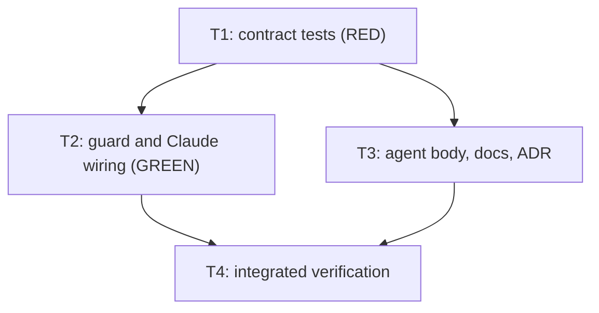

# Arbiter enforces the architect's shell allowlist

**Status: Archived — complete 2026-11-12.** Approved for execution (D13). The task file was removed at archival; the decisions, tasks and test contract above are the record.
Development mode `test-first`; autonomy `autonomous`; scale `extends-component` on `KyberArbiter` and `KyberSquad`.

**Bottom line.** `products/kyber-squad/agents/architect.md` lists the only shell commands the architect may run, and
says itself that nothing enforces the list. During issue 599 the architect ran `grep`, `sed`, `ls`, `gh`, a `git log`
loop and a Python scratch write, and the Arbiter passed all of them. This plan adds a deterministic hook guard,
`ArchitectShellGuard`, with the permanent id `KW-ARB-SHELL-001`. It denies any architect `Bash` or `PowerShell` call
outside the list before the command runs. On Claude it is wired at project scope and at user scope, so it covers a
repository like this one, whose agents are installed globally. It also widens the list with the read-only search
commands the architect has no other way to run on current Claude (D4), and keeps the agent body and the guard in step
with a sync test.

## Problem and goal

**Problem.** The architect's shell boundary is instruction-only:

- `architect.md` (the bullet "Your shell is limited to this command set") ends with "The lattice cannot enforce this
  list; you keep it."
- `products/kyber-squad/profiles/capabilities.yml` grants the `architect` profile `process.execute: allow` under an
  "ACCEPTED WIDENING" comment. It names the agent body's list as the compensating control and says none is enforced.
- On Claude the Arbiter hooks only `Agent`/`Task` and `SubagentHandback` for the architect. The read guard's
  `Read|Grep|Glob|Bash` matcher is rendered only for worker-profile agents. So `ClaudeHookAdapter.IsPassThrough`
  passes every architect shell call.
- In a repository whose Squad agents are installed at user scope, as this one is (no `.claude/agents/`, and
  `~/.claude/agents/architect.md` carries no hooks), nothing is rendered per agent at all.
  `ClaudeRenderer.BuildArbiterHooks` returns null at Global scope. The user-level `settings.json` block matches only
  `^(Agent|Task)$` and `SubagentHandback`.

**Goal.**

1. An architect `Bash` or `PowerShell` call on Claude is denied before it runs unless every segment of the command is
   an allowed form (D2, D4, D10). The deny reason names `KW-ARB-SHELL-001`, the offending segment, and what to use
   instead.
2. The guard fires at project scope (agent-file hook) and at user scope (user-level agent-file hook) (D7).
3. `touch` is limited to the plan, spec and todo directories (D9). This closes the "accepted residual" in
   `architect.md`.
4. `architect.md`, `capabilities.yml`, the rule reference, the Arbiter runbook and the Arbiter architecture say that
   the list is enforced on Claude, and that on other harnesses it is not (D6).
5. A sync test fails whenever the command-set clause in `architect.md` and the guard disagree (D5).

## Decisions

| ID | Question | Answer / decision | Mitigating and supporting information | Status / approval provenance |
|---|---|---|---|---|
| D1 | Mechanism: a shipped rule in `default-rules.yml`, or a hook guard beside `ReadGuard` and `ConductorGuard`? | A stateless hook guard, `src/KyberWeave.Arbiter/Hooks/ArchitectShellGuard.cs`, with the permanent id `KW-ARB-SHELL-001`. The id is listed in a new **Hook guards** subsection of the rule reference, not in the shipped-rules table. Its test class follows the pattern of the per-rule classes: one dedicated class asserting every answer, like the `KW-ARB-READONLY-001`, `KW-ARB-PLANNER-DIFF-001` and `KW-ARB-GATE-REPORT-001` tests. | The rule engine evaluates dispatch triggers (`TriggerClassifier`, `ArbiterEvent.IsDispatch`). Every decision becomes a ledger event, and repeat counts stop tasks (ADR 0070). Shell calls are frequent and have no claim key (`ClaudeHookAdapter.ClaimKey` returns null for non-dispatch tools), so a global and a project hook could both record one call. A rule would also need a new trigger family, its effects, catalogue facts and a code-computed fact. It would change the "32 shipped rules" header and the four tests that pin the rule ids (`ArbiterConfigTests`, `ArbiterDefaultRulesTests`, `ArbiterExistsFalseRuleTests`, `ArbiterGateReportRuleTests`). And hosts could tune or disable a security boundary by id. The existing per-agent tool boundaries are already stateless guards: `ReadGuard` for workers and `ConductorGuard` for the Copilot conductor (ADR 0066). The owner asked for "a KW-ARB-* rule"; the id format and the dedicated test class meet that, and this row records the difference. `KW-ARB-GUARD-001` is taken (read-guard diagnostic), and `KW-ARB-SHELL-*` is unused on `main` @ `31afb054`. | APPROVED: autonomous: recommendation accepted, 2026-11-12 (conductor `AUTONOMOUS_APPROVAL: approve-and-execute`). Decided as autonomous: covered by existing pattern (`ReadGuard`, `ConductorGuard`) |
| D2 | How does the guard match a command line? | It splits the command into segments on unquoted `&&`, `\|\|`, `;`, `\|` and newline, and allows the command only when every segment is an allowed form (D3, D4, D10). The match is anchored and whole-command, like `ConductorGuard.RunStartCommand`. It is not a substring match like `ReadGuard`. **Denied anywhere:** `$(…)`, backticks, `$` outside single quotes (double quotes included), `<(`/`>(`, unquoted `(`, `)`, `{`, `}`, a heredoc `<<`, a background `&`, any redirect except `2>&1` and (Bash only) `2>/dev/null`, a leading `NAME=value` assignment, the shell keywords (`for`, `while`, `until`, `if`, `then`, `do`, `done`, `case`, `function`, `select`), unbalanced quotes, an empty segment, and in Bash an unquoted backslash. **Wrapper commands are not allowed forms:** `bash`, `sh`, `zsh`, `pwsh`, `powershell`, `eval`, `exec`, `xargs`, `env`, `command`, `sudo`, `nohup`, `time`, `source`, `.`. **PowerShell:** the same tokenizer and forms apply. A backtick and `$` (so `$()`, `@()` and variables) are denied. `&` as a call operator is denied, and a backslash is literal so Windows paths work. | Whole-command matching is the only form that holds against chaining: a substring or first-word match passes `git status; python x.py`. Issue 599's `for … do git log …; done` loop is denied by the keyword rule, and its Python write by the form list. Deny-on-unparseable keeps it fail-closed. | APPROVED: autonomous: recommendation accepted, 2026-11-12 (conductor `AUTONOMOUS_APPROVAL: approve-and-execute`). Decided as autonomous: covered by existing pattern (`ConductorGuard.RunStartCommand` anchored match) |
| D3 | The Bash tool resets the working directory on every call, and the role runs its commands in the run's worktree. How is that allowed? | Three ways. A `cd <dir>` segment with exactly one operand (no flags, not `-`), followed by `&&`. `git -C <dir>`. And a path operand in place of `.` for `kyber-weave docs validate`, `kyber-weave docs drift` and `kyber-weave doctor --ensure`. The guard tracks the effective directory across `cd` segments to resolve `touch` operands (D9). | Every shell call this planner made in this run was `cd <worktree> && …`. A guard without `cd` would block the mandatory docs gate (`kyber-weave docs validate . --merge-ready` in the worktree). | APPROVED: autonomous: recommendation accepted, 2026-11-12 (conductor `AUTONOMOUS_APPROVAL: approve-and-execute`). Decided as autonomous: low-confidence, no authoritative source (cheap to reverse) |
| D4 | Which read-only commands outside the list on `main` does the architect need? | **Allow:** `grep` and `rg` (with `rg --pre`, `--pre-glob`, `-z` and `--search-zip` denied, because they run programs); `ls`; `find` (with `-exec`, `-execdir`, `-ok`, `-okdir`, `-delete`, `-fprint`, `-fprint0`, `-fprintf` and `-fls` denied); and as standalone readers or pipe filters `head`, `tail`, `wc`, `cut`, `sort` (with `-o`, `--output` and `--compress-program` denied) and `uniq` (at most one file operand, because a second one is an output file). **Deny, with the replacement named in the deny reason:** `cat` (use the Read tool), `sed` and `awk` (they can write files and run commands; use Read with offset and limit), `git grep`, `git ls-files` and `git blame` (use CodeGraph, `grep` or `find`), `git fetch` (the conductor fetches), `gh`, `curl` and `wget` (network; ask the conductor to relay), `python`, `node` and any interpreter (no scripts), and `echo`, `printf`, `pwd` and `tee`. `architect.md`'s command-set clause is updated to the exact text in task T3. | In this Claude session the planner has no `Grep` or `Glob` tool. Calling one returned "Grep is not available in this session — search file contents with `grep` via the Bash tool instead". So shell `grep`, `ls` and `find` are the only search the role has for files CodeGraph does not index (docs, YAML), and the discovery order allows direct reads for exactly those. The allowed tools are read-only once the listed flags are denied. The denied ones either write, run code, reach the network, or duplicate a harness tool. The owner's standing preference for CodeGraph and kw-docs first is unchanged: the discovery report still counts every direct read. | APPROVED: autonomous: recommendation accepted, 2026-11-12 (conductor `AUTONOMOUS_APPROVAL: approve-and-execute`). Decided as autonomous: low-confidence, no authoritative source (cheap to reverse: one form row and one body sentence) |
| D5 | PR 600 adds `kyber-weave arbiter plan <plan file> -f json` to the list. It is not on `main`. What does the guard follow? | It follows `main` @ `31afb054`. That clause does not contain `kyber-weave arbiter plan`, so the guard does not allow it. `ArchitectShellGuardSyncTests` extracts the backticked spans of the command-set clause in `architect.md` and asserts that they equal the keys of the guard's documented-forms table, each with a sample command and its expected verdict. Whichever of the two PRs merges second gets a red test, not a runtime denial, and adds the `arbiter plan` form there. | **Delta, recorded:** `origin/main` (`31afb054`) has no `arbiter plan` in `architect.md` line 26. `ArbiterPlanCommand` exists on `main`, so only the agent-body sentence is missing. This planner cannot fetch, so the PR 600 branch was not read. | APPROVED: autonomous: recommendation accepted, 2026-11-12 (conductor `AUTONOMOUS_APPROVAL: approve-and-execute`). Decided as autonomous: covered (the request says main is authoritative) |
| D6 | Which harnesses does this slice enforce? | Claude only: the `Bash` and `PowerShell` tools, at project and user scope. The docs carry the matrix. **Copilot VS Code:** the per-agent hook carries a rendered `--caller`, but the terminal tool's name in the payload is undocumented and its content guard keys on input values (follow-up). **Copilot CLI:** gates only `task` (follow-up). **Codex, Cursor, OpenCode, Kilo, Pi, Factory, Devin, Antigravity:** their adapters gate dispatches only (follow-up). On those harnesses the list stays instruction-only, and the agent body says so. | One plan is one pull request (plan index policy). Claude is where issue 599 happened and the only harness whose user-level hook evaluates under the project (ADR 0070). | APPROVED: autonomous: recommendation accepted, 2026-11-12 (conductor `AUTONOMOUS_APPROVAL: approve-and-execute`). Decided as autonomous: covered (plan index one-PR rule; ADR 0070) |
| D7 | How does the guard reach an architect whose agents are installed at user scope? | `ClaudeRenderer.BuildArbiterHooks` renders a `PreToolUse` entry with matcher `^(Bash\|PowerShell)$` into the agent file of each shell-guarded agent (capability profile `architect`), at **both** scopes. At Project scope the entry is added to the existing list, with the project command line. At Global scope only that entry is rendered, with `ArbiterHookWiring.HookCommandLine(SquadTarget.Claude, agent.Name, SquadDeploymentScope.Global)`. Dispatch and hand-back matchers stay in the user-level `settings.json` block, as ADR 0070 has them. The user-level `settings.json` block is not changed. | Claude Code documents that frontmatter hooks of user-level sub-agents in `~/.claude/agents/` run without the trust step, and only while that sub-agent is active. They also fire for `--agent` sessions. A project sub-agent of the same name outranks the user one, so exactly one file's hooks fire ([sub-agents](https://code.claude.com/docs/en/sub-agents)). Hook input carries `agent_type` "when the session uses `--agent` or the hook fires inside a subagent" ([hooks](https://code.claude.com/docs/en/hooks)). On the global path, `HookCommand.TakeUserLevelDispatch` returns true for a Bash event, because `CandidateSources` and `ClaimKey` are both null for non-dispatch tools. So the event is evaluated under the project config when the project enables Arbiter, under the user config when there is none, and passed when the project sets `arbiter.enabled: false`. **Rejected:** a `^(Bash\|PowerShell)$` matcher in the user-level `settings.json`. It would start the hook process for every shell call of every agent on the machine, and fire a second time beside a project agent-file hook. **Departure, recorded:** Req 22.2 and the `BuildArbiterHooks` remark ("nothing is rendered when … the scope is Global") gain one exception, for this matcher. | APPROVED: autonomous: recommendation accepted, 2026-11-12 (conductor `AUTONOMOUS_APPROVAL: approve-and-execute`). Decided as autonomous: low-confidence, no authoritative source. Cost if wrong: one renderer branch and one ADR are reverted. |
| D8 | Enforce at once, or ship in shadow? Can hosts configure it? | Enforce at once. No shadow mode and no configuration, like `ReadGuard` and `ConductorGuard`. The guard runs only when `arbiter.enabled` is true for the evaluated config. The deny reason ends: "If you need this command, return STATUS: BLOCKED naming it; do not work around the denial." | Shadow would not have stopped issue 599. The guard is deterministic with no model, and a wrongly denied command costs one BLOCKED round trip. | APPROVED: autonomous: recommendation accepted, 2026-11-12 (conductor `AUTONOMOUS_APPROVAL: approve-and-execute`). Decided as autonomous: covered by existing pattern |
| D9 | Does the guard enforce where `touch` writes? | Yes. `touch` takes no flags, one or more literal operands, and no glob characters (`*?[{`). Each operand is resolved against the effective directory (payload `cwd`, then any `cd`) and normalised. It must contain no `..` after normalisation, and its absolute path must contain `/<dir>/` for one of `ReadGuard.ProtectedDirectories(config)` (the plan, spec and todo index folders). The file name must end in `.md` or `.json`. | The worktree sits outside the session's `cwd` (`…inspiring-jemison-edd4bd.worktrees/…`), so "under the repo root" cannot be required. A path segment match under a planning directory is the boundary `architect.md` states. The remaining residual is an empty file in a foreign `docs/plans/` directory, which is harmless. | APPROVED: autonomous: recommendation accepted, 2026-11-12 (conductor `AUTONOMOUS_APPROVAL: approve-and-execute`). Decided as autonomous: low-confidence, no authoritative source (cheap to reverse) |
| D10 | Which `git` forms are allowed? | `git [--no-pager] [-C <dir>] (log\|diff\|status\|show\|rev-parse) [args]`. Denied: global options other than `--no-pager` and `-C` (so `-c`, `--config-env`, `--exec-path`, `--git-dir`, `--work-tree` and `--namespace`), and `--output`/`--output=…` on any subcommand. Every other subcommand is denied. | `git -c core.pager=…` and `-c alias.*` run arbitrary programs. `git diff --output=<file>` writes a file. The five subcommands are the documented list. | APPROVED: autonomous: recommendation accepted, 2026-11-12 (conductor `AUTONOMOUS_APPROVAL: approve-and-execute`). Decided as autonomous: covered (`architect.md` list) |
| D11 | ADR, or a waiver? | A new ADR, `docs/adr/0071-the-arbiter-enforces-the-architect-shell-allowlist-on-claude.md`. It records D1 (guard rather than rule), D7 (a user-scope agent-file hook, an exception to Req 22.2) and D6 (Claude only). | D7 changes a documented rendering requirement, and the guard turns an agent-body sentence into enforced code bound by a test. Both constrain later work and had real alternatives. | APPROVED: autonomous: recommendation accepted, 2026-11-12 (conductor `AUTONOMOUS_APPROVAL: approve-and-execute`). Decided as autonomous: covered (plan index ADR policy) |
| D12 | Scale | `extends-component` on `KyberArbiter` (the guard, the adapter, the docs) and `KyberSquad` (the renderer, the hook wiring, the agent body, the capability comment). | Names checked against `docs/catalog.md` rows `KyberArbiter` and `KyberSquad`. | APPROVED: autonomous: recommendation accepted, 2026-11-12 (conductor `AUTONOMOUS_APPROVAL: approve-and-execute`). Decided as autonomous: covered |
| D13 | Is the plan approved to execute as written? | Yes. The plan is set to Ready and the task file `2026-11-12-arbiter-architect-shell-allowlist.tasks.json` is written beside it. At finalization T3 gained `products/kyber-squad/migration/architect.md`: it pins `final-body-sha256` of the architect body, so `SquadCanonicalContentTests` fails until T3 recomputes it; T3's command and acceptance criteria now name that test. D3 is read with the Test contract's PowerShell row: in PowerShell a `cd <dir>` segment may be followed by `;` (`cd C:\w; git log -1`), because PowerShell 5 has no `&&`. No other task, file scope, dependency or test row changed. | Gate `approve-and-execute`, supplied by the conductor as `AUTONOMOUS_APPROVAL` under resolved autonomy `autonomous`. Development mode `test-first`; scale `extends-component` (KyberArbiter, KyberSquad). | APPROVED: autonomous: recommendation accepted, 2026-11-12 (conductor `AUTONOMOUS_APPROVAL: approve-and-execute`). |

## Scale and Design harvest

- **Declared scale:** `extends-component` on `KyberArbiter`, `KyberSquad`.

## Design harvest

| ID | Item | Target component | Target doc type | Destination |
|---|---|---|---|---|
| H1 | D1, D2, D3, D4, D8, D9, D10: guard id, matching contract, allowed forms, enforcement | KyberArbiter | reference | `docs/ci-pipelines/rule-reference.md`, new subsection **Hook guards** |
| H2 | Operating the guard: reading a denial, widening the list, the harness matrix (D6) | KyberArbiter | runbook | `docs/kyber-arbiter/runbook.md`, new section **The architect shell guard** |
| H3 | Guard placement beside the Read guard; user-scope agent-file hook (D7); harness matrix | KyberArbiter | architecture | `docs/kyber-arbiter/architecture.md`, **The rules** (guard paragraph) and **The user-level Claude hook** |
| H4 | Agent-file shell matcher rendered at both scopes for `architect`-profile agents | KyberSquad | architecture | `docs/kyber-squad/architecture.md`, Arbiter hook rendering section (docs-dev locates it with `docs_find_documents_citing_code_symbol` for `ArbiterHookWiring`) |
| H5 | D1, D6, D7, D11 | KyberArbiter | adr | `docs/adr/0071-the-arbiter-enforces-the-architect-shell-allowlist-on-claude.md` and `docs/adr/README.md` row |
| H6 | The agent-body command set and its enforcement sentence (D4, D5) | KyberSquad | agent body (product source) | `products/kyber-squad/agents/architect.md` and the `capabilities.yml` comment |

## Investigation findings

- **Discovery:** codegraph 7, docs 1, direct reads 21.
- **Revision read:** worktree `…inspiring-jemison-edd4bd.worktrees/20261112T165307Z-claude-feat-arbiter-architect-shell-allowlist`,
  branch `claude/feat/arbiter-architect-shell-allowlist`, `HEAD` = `origin/main` = `31afb054`. CodeGraph was queried
  with that worktree as `projectPath`.
- **kw-docs server untrusted for this run:** its provenance was `branch=claude/fix/architect-plan-date-prefix
  rev=0ae061d2` in the canonical checkout, not this branch. Its one answer was set aside, and docs were read directly.
- **Direct reads and reasons:**
  1. `products/kyber-squad/agents/architect/references/{plan-authoring,autonomy-decisions,test-first-contract}.md`: role
     instructions, not indexed code (3 reads).
  2. `AGENTS.md` Config Reg: path resolution (shell `grep`).
  3. `src/KyberWeave.Core/Arbiter/Rules/default-rules.yml`: YAML, not symbol-indexed.
  4. Shell searches over `src`, `tests`, `docs` and `products` for `KW-ARB-READONLY`, the allowlist sentence, `ReadGuard`
     call sites, shell tool names, and the free `KW-ARB-SHELL` id. Reason: locating references across YAML, Markdown
     and C# at once. The `Grep` tool is not available in this session (5 reads).
  5. `src/KyberWeave.Arbiter/Hooks/ConductorGuard.cs` lines 120–331: CodeGraph trimmed the body.
  6. `src/KyberWeave.Arbiter/Hooks/Adapters/CopilotHookAdapter.cs` (three ranges): CodeGraph trimmed `HandleLocalPre`,
     `IsLocalPassThrough` and `CheckContent` (3 reads).
  7. `src/KyberWeave.Core.Squad/Rendering/ClaudeRenderer.cs` (two ranges): CodeGraph trimmed `BuildArbiterHooks` and
     `RenderArbiter` (2 reads).
  8. `src/KyberWeave.Arbiter/Hooks/Adapters/ClaudeHookAdapter.cs` (two ranges): class remarks and
     `Handle`/`ResolveCaller` (2 reads).
  9. `docs/ci-pipelines/rule-reference.md` (Arbiter section), `docs/kyber-arbiter/runbook.md` (head and sections),
     `docs/adr/0070-…md`, `docs/archive/plans/2026-11-09-arbiter-planner-undecidable-empty-diff.md` (format
     precedent), `docs/plans/README.md`: the kw-docs server was bound to another branch (4 reads, counted once each).
  10. `products/kyber-squad/profiles/capabilities.yml` lines 15–60: YAML profile.
- **External sources (self-gathered, WebFetch):** Claude Code
  [sub-agents](https://code.claude.com/docs/en/sub-agents) (frontmatter `hooks`; user-level sub-agent hooks run
  without trust; project outranks user) and [hooks](https://code.claude.com/docs/en/hooks) (`agent_type` in hook input
  for sub-agents and `--agent`; `permissionDecision: deny` blocks a `PreToolUse`).
- **Findings:**
  - The rule engine is dispatch-only. Per-agent tool boundaries are guards inside the adapters: `ReadGuard.Check` for
    `worker`/`publishing-worker` profiles (Claude `Read|Grep|Glob|Bash`, Copilot VS Code content guard), and
    `ConductorGuard` for the Copilot conductor (anchored `RunStartCommand` regex for `bash`/`powershell`).
  - `ClaudeHookAdapter.IsPassThrough` returns true for every architect non-dispatch tool. `IsReadTool` includes `Bash`
    but not `PowerShell`, and `ReadGuardMatcher` is `^(Read|Grep|Glob|Bash)$`, so **the worker read guard does not
    cover the `PowerShell` tool.** Out of scope; recorded for a follow-up.
  - `ArbiterHookWiring.Dispatchers` includes `architect` (its `delegates-to` holds `azure-reader` and
    `research-agent`), so at Project scope its agent file already carries `Agent|Task` hooks. `GuardedAgents` covers
    only the `worker` and `publishing-worker` profiles.
  - `BuildArbiterHooks` and `ArbiterHookWiring.BuildHooks` return nothing at Global scope. `RenderArbiter` writes
    `settings.json` matchers for `^(Agent|Task)$` and `SubagentHandback` only.
  - `HookCommand.Run` at Global scope, for a Bash event: `IsPassThrough` (must become false for an architect),
    project-config opt-out check, then `TakeUserLevelDispatch`, which returns true because `CandidateSources` and
    `ClaimKey` are null for non-dispatch tools. The event is evaluated.
  - `architect` is the only agent with `capability-profile: architect`.
  - **PR 600 delta:** `main` has no `kyber-weave arbiter plan <plan file> -f json` in the architect's list (D5).

## Test contract (test-first)

Runner prefix for every row: `scripts/proc-guard.sh run -- dotnet test tests/KyberWeave.Tests --filter`.

| Task | Test project or file | Runner command | Observable behavior | RED evidence required | GREEN acceptance |
|---|---|---|---|---|---|
| T1→T2 | `tests/KyberWeave.Tests/Arbiter/ArchitectShellGuardTests.cs` (new, `KyberWeave.Tests.Arbiter.ArchitectShellGuardTests`) | `scripts/proc-guard.sh run -- dotnet test tests/KyberWeave.Tests --filter "FullyQualifiedName~KyberWeave.Tests.Arbiter.ArchitectShellGuardTests"` | **Allowed (Bash):** each documented form; `cd /w && kyber-weave docs validate . --merge-ready`; `kyber-weave docs validate /w --merge-ready`; `kyber-weave docs drift .`; `codegraph explore "ArbiterHookWiring BuildHooks"`; `codegraph explore 'a && b'` (quoted separator is not split); `kyber-weave doctor --ensure`; `git status`, `git -C /w log --oneline -5`, `git --no-pager diff main...HEAD`, `git show HEAD:path`, `git rev-parse --git-common-dir`; `git log -3 2>&1`; `grep -rn "Foo" src`; `rg -n Foo src`; `ls docs/plans`; `find docs -name '*.md'`; `git log --oneline \| head -5`; `grep -c x f \| sort \| uniq`; `touch /w/docs/plans/2026-11-12-x.md` and `cd /w && touch docs/plans/x.tasks.json`. **Allowed (PowerShell):** `git status`; `cd C:\w; git log -1`. **Denied, each with a reason containing `KW-ARB-SHELL-001` and the offending segment:** `sed -n 1,5p f`, `awk '{print}' f`, `cat f`, `gh issue view 599`, `curl x`, `python3 -c 'print(1)'`, `python3 scratch.py`, `for f in a b; do git log $f; done`, `git status; python x.py`, `git log $(cat f)`, ``git log `x` ``, `codegraph explore "$(rm -rf x)"`, `git log > out.txt`, `git log >> f`, `cat <<EOF`, `(git status)`, `git status &`, `FOO=1 git status`, `bash -c 'git status'`, `xargs ls`, `git -c core.pager=x log`, `git diff --output=f`, `git checkout main`, `git commit -m x`, `git fetch`, `git grep x`, `find . -exec rm {} \;`, `find . -delete`, `rg --pre cat x`, `sort -o f x`, `uniq a b`, `tee f`, `echo x`, `touch src/x.cs`, `touch /w/docs/plans/../../src/x.md`, `touch docs/plans/*.md`, `touch -r a docs/plans/x.md`, `cd -`, empty command, unbalanced `"`. **PowerShell denied:** `git log $(x)`, ``git log `n``, `& git status`, `Set-Content f x`, `git status 2>$null`. **Guard scope:** `IsShellGuarded("architect")` is true; `IsShellGuarded("csharp-dev")`, `IsShellGuarded("conductor")` and `IsShellGuarded(null)` are false. | Test project fails to build only because `KyberWeave.Arbiter.Hooks.ArchitectShellGuard` does not exist (CS0103/CS0246 naming it), or, once a stub exists, the deny-case assertions fail. | All cases pass; non-zero test count; no assertion weakened. |
| T1→T2,T3 | `tests/KyberWeave.Tests/Arbiter/ArchitectShellGuardSyncTests.cs` (new, `KyberWeave.Tests.Arbiter.ArchitectShellGuardSyncTests`) | `scripts/proc-guard.sh run -- dotnet test tests/KyberWeave.Tests --filter "FullyQualifiedName~KyberWeave.Tests.Arbiter.ArchitectShellGuardSyncTests"` | Reads `products/kyber-squad/agents/architect.md` (from the repository root, located the way existing repo-file tests do). Takes the text between `Your shell is limited to this command set:` and the first following `before you edit it.`, extracts its backticked spans, and asserts that the set equals the keys of `ArchitectShellGuard.DocumentedForms`. For each key it asserts that the guard's verdict on the form's sample command equals the form's expected verdict. A clause that gains a span (for example PR 600's `kyber-weave arbiter plan <plan file> -f json`) fails, naming the span. | Fails to build (no `ArchitectShellGuard`), then fails on the span-set mismatch until T3 lands the new clause. | Passes against the T3 clause text; non-zero test count. |
| T1→T2 | `tests/KyberWeave.Tests/Arbiter/ClaudeHookAdapterTests.cs` (extend `KyberWeave.Tests.Arbiter.ClaudeHookAdapterTests`) | `scripts/proc-guard.sh run -- dotnet test tests/KyberWeave.Tests --filter "FullyQualifiedName~KyberWeave.Tests.Arbiter.ClaudeHookAdapterTests"` | A `PreToolUse` `Bash` payload with `agent_type: architect`, or with rendered caller `architect` and no `agent_type`, is not pass-through. `Handle` returns a `permissionDecision: deny` whose reason contains `KW-ARB-SHELL-001` for `grep x \| sed y` and for `python3 x.py`, and returns empty output (allow) for `git status`. The same holds for the `PowerShell` tool. A `Bash` payload from `csharp-dev` still gets the read guard (planning-path deny unchanged), and a `Bash` payload from `conductor`, or with no caller, is pass-through. | New tests fail: `IsPassThrough` returns true for the architect `Bash`, so no deny is produced. | New and existing tests pass. |
| T1→T2 | `tests/KyberWeave.Tests/ClaudeRendererContractTests.cs` (extend `KyberWeave.Tests.ClaudeRendererContractTests`) and `tests/KyberWeave.Tests/ArbiterHookWiringTests.cs` (extend `KyberWeave.Tests.ArbiterHookWiringTests`) | `scripts/proc-guard.sh run -- dotnet test tests/KyberWeave.Tests --filter "FullyQualifiedName~KyberWeave.Tests.ClaudeRendererContractTests\|FullyQualifiedName~KyberWeave.Tests.ArbiterHookWiringTests"` | `ArbiterHookWiring.ShellGuardedAgents(source)` is exactly `{architect}` for the shipped source. With Arbiter enabled, the Project-scope `.claude/agents/architect.md` frontmatter has a `PreToolUse` entry with matcher `^(Bash\|PowerShell)$` and the project command `kyber-weave-arbiter hook --harness claude --caller architect`, besides its existing entries. The Global-scope `agents/architect.md` has exactly one hooks entry, `PreToolUse` with matcher `^(Bash\|PowerShell)$` and command `… --caller architect --scope global`. No other agent gains the matcher at either scope. The Global-scope `settings.json` block is byte-identical to before. With Arbiter disabled, no agent file has hooks. | New tests fail: no shell matcher is rendered, and `ShellGuardedAgents` does not exist. | New and existing tests pass. |
| T1→T2 | `tests/KyberWeave.Tests/ArbiterGlobalHookRuntimeTests.cs` (extend `KyberWeave.Tests.ArbiterGlobalHookRuntimeTests`) | `scripts/proc-guard.sh run -- dotnet test tests/KyberWeave.Tests --filter "FullyQualifiedName~KyberWeave.Tests.ArbiterGlobalHookRuntimeTests"` | `HookCommand.Run(…, scope: HookScope.Global)` on an architect `Bash` `grep x \| sed y` payload: it denies with `KW-ARB-SHELL-001` when the project enables Arbiter (and writes no dispatch claim file); it denies under the user config when the project has no config; and it allows with no evaluation when the project sets `arbiter.enabled: false`. | New tests fail: the event is pass-through. | New and existing tests pass. |
| T3 | No test of its own. Covered by `ArchitectShellGuardSyncTests` | — | Agent body, capability comment and docs. | Not applicable (documentation task). Verification: the sync test above plus `kyber-weave docs validate . --merge-ready` and `kyber-weave docs drift .` in the worktree. | Sync test passes; docs checks report no new findings. |

## Tasks

### T1: Contract tests for the architect shell guard (RED)

- **Files:**
  - `tests/KyberWeave.Tests/Arbiter/ArchitectShellGuardTests.cs` (new class `ArchitectShellGuardTests`)
  - `tests/KyberWeave.Tests/Arbiter/ArchitectShellGuardSyncTests.cs` (new class `ArchitectShellGuardSyncTests`)
  - `tests/KyberWeave.Tests/Arbiter/ClaudeHookAdapterTests.cs` (class `ClaudeHookAdapterTests`, new facts)
  - `tests/KyberWeave.Tests/ClaudeRendererContractTests.cs` (class `ClaudeRendererContractTests`, new facts)
  - `tests/KyberWeave.Tests/ArbiterHookWiringTests.cs` (class `ArbiterHookWiringTests`, new facts)
  - `tests/KyberWeave.Tests/ArbiterGlobalHookRuntimeTests.cs` (class `ArbiterGlobalHookRuntimeTests`, new facts)
- **Depends on:** none
- **Required skills:** `test-dev`
- **Session:** `red`
- **Objective:** Write every Test-contract row above as failing tests against this API, which T2 implements:
  - `KyberWeave.Arbiter.Hooks.ArchitectShellGuard` (public static class):
    - `const string RuleId = "KW-ARB-SHELL-001"`;
    - `static bool IsShellGuarded(string? agentName)`;
    - `static ShellGuardResult Check(string toolName, JsonElement toolInput, string workingDirectory, IReadOnlyList<string> planningDirectories)`, where `toolName` is `Bash` or `PowerShell`;
    - `static IReadOnlyDictionary<string, DocumentedForm> DocumentedForms`.
  - `ShellGuardResult(bool Allowed, string? Reason)`.
  - `DocumentedForm(string SampleCommand, bool Allowed)`.
  - `KyberWeave.Core.Squad.Rendering.ArbiterHookWiring.ShellGuardedAgents(SquadSource)`.

  The `DocumentedForms` keys are the backticked spans of the T3 clause, with a sample command and verdict for each:

  | Key | Sample command | Verdict |
  |---|---|---|
  | `kyber-weave docs validate . --merge-ready` | (itself) | allow |
  | `kyber-weave docs drift .` | (itself) | allow |
  | `codegraph explore "…"` | `codegraph explore "x"` | allow |
  | `kyber-weave doctor --ensure` | (itself) | allow |
  | `git` | `git status` | allow |
  | `log` | `git log -1` | allow |
  | `diff` | `git diff` | allow |
  | `status` | `git status` | allow |
  | `show` | `git show HEAD` | allow |
  | `rev-parse` | `git rev-parse HEAD` | allow |
  | `grep` | `grep -rn x docs` | allow |
  | `rg` | `rg x docs` | allow |
  | `ls` | `ls docs` | allow |
  | `find` | `find docs -name '*.md'` | allow |
  | `-exec` | `find . -exec ls {} ;` | deny |
  | `-ok` | `find . -ok ls {} ;` | deny |
  | `-delete` | `find . -delete` | deny |
  | `head` | `git log \| head -5` | allow |
  | `tail` | `tail -5 f` | allow |
  | `wc` | `wc -l f` | allow |
  | `cut` | `cut -c1-80 f` | allow |
  | `sort` | `sort f` | allow |
  | `uniq` | `uniq f` | allow |
  | `cd <dir>` | `cd /w && git status` | allow |
  | `&&` | `git status && git log -1` | allow |
  | `touch <file>` | `touch /w/docs/plans/x.md` | allow |
- **Command:** `scripts/proc-guard.sh run -- dotnet test tests/KyberWeave.Tests --filter "FullyQualifiedName~KyberWeave.Tests.Arbiter.ArchitectShellGuardTests|FullyQualifiedName~KyberWeave.Tests.Arbiter.ArchitectShellGuardSyncTests|FullyQualifiedName~KyberWeave.Tests.Arbiter.ClaudeHookAdapterTests|FullyQualifiedName~KyberWeave.Tests.ClaudeRendererContractTests|FullyQualifiedName~KyberWeave.Tests.ArbiterHookWiringTests|FullyQualifiedName~KyberWeave.Tests.ArbiterGlobalHookRuntimeTests"`
- **Acceptance criteria:** The RED evidence in each Test-contract row is captured: the build fails only on the missing
  `ArchitectShellGuard`/`ShellGuardedAgents` symbols, or the new assertions fail for the missing behaviour. Existing
  tests are unchanged. No production file is edited.

### T2: Implement the guard and wire it on Claude (GREEN)

- **Files:**
  - `src/KyberWeave.Arbiter/Hooks/ArchitectShellGuard.cs` (new: `ArchitectShellGuard`, `ShellGuardResult`, `DocumentedForm`)
  - `src/KyberWeave.Arbiter/Hooks/Adapters/ClaudeHookAdapter.cs` (`IsPassThrough`, `HandlePre`, new private `IsShellTool`; class remarks)
  - `src/KyberWeave.Core.Squad/Rendering/ArbiterHookWiring.cs` (new `ShellGuardedAgents`; `ShellGuardedCapabilityProfiles = { "architect" }`)
  - `src/KyberWeave.Core.Squad/Rendering/ClaudeRenderer.cs` (`ShellGuardMatcher = "^(Bash|PowerShell)$"`; `BuildArbiterHooks` both scopes; the `ArbiterPlan` record and its `Create` carry the shell-guarded set; the remark on Global scope)
- **Depends on:** T1
- **Required skills:** `csharp-dev`
- **Session:** `green`
- **Objective:**
  - The guard implements D2, D3, D4, D9 and D10 exactly as the Decisions table states. It reads `tool_input.command`;
    a missing or non-string command is denied. `IsShellGuarded` looks the agent up in
    `ArbiterSquadCatalog.LoadEmbedded()` and checks `CapabilityProfile == "architect"`, mirroring
    `ReadGuard.IsImplementationSpecialist`.
  - The deny reason is one line:
    `Kyber-Weave Arbiter shell guard (KW-ARB-SHELL-001) denied this <tool> call: '<segment>' <why>. <replacement>. If you need this command, return STATUS: BLOCKED naming it; do not work around the denial.`
  - `ClaudeHookAdapter`:
    - `IsPassThrough` returns false for `PreToolUse` on `Bash`/`PowerShell` when `ResolveCaller` names a shell-guarded
      agent. This branch is checked before the read-tool branch.
    - `HandlePre` runs `ArchitectShellGuard.Check(tool, toolInput, cwd-of-payload, ReadGuard.ProtectedDirectories(config))`.
      It returns `RenderPreDeny(reason)` on deny and empty output on allow, and writes one `context.Log` line naming
      `KW-ARB-SHELL-001` and the verdict.
    - The worker read-guard path is unchanged.
  - `ClaudeRenderer.BuildArbiterHooks` renders the shell matcher per D7 at Project and Global scope. Global scope
    renders only that entry, for shell-guarded agents. The `settings.json` block in `RenderArbiter` is unchanged.
    `ArbiterHookWiring.BuildHooks` is unchanged.
  - XML docs on every new public member (repository C# standard).
- **Command:** `scripts/proc-guard.sh run -- dotnet test tests/KyberWeave.Tests --filter "FullyQualifiedName~KyberWeave.Tests.Arbiter.ArchitectShellGuardTests|FullyQualifiedName~KyberWeave.Tests.Arbiter.ClaudeHookAdapterTests|FullyQualifiedName~KyberWeave.Tests.ClaudeRendererContractTests|FullyQualifiedName~KyberWeave.Tests.ArbiterHookWiringTests|FullyQualifiedName~KyberWeave.Tests.ArbiterGlobalHookRuntimeTests|FullyQualifiedName~KyberWeave.Tests.Arbiter.ConductorGuardTests|FullyQualifiedName~KyberWeave.Tests.Arbiter.ArbiterReadGuardTests"`
- **Acceptance criteria:** Every listed class passes with a non-zero count. `ArchitectShellGuardSyncTests` passes once
  T3 has landed. No T1 assertion is weakened. The `task-gate` run is clean on the touched files.

### T3: Agent body, capability comment, rule reference, runbook, architecture and ADR

- **Files:**
  - `products/kyber-squad/agents/architect.md` (the "Your shell is limited to this command set" bullet)
  - `products/kyber-squad/migration/architect.md` (frontmatter `final-body-sha256`, recomputed for the new body)
  - `products/kyber-squad/profiles/capabilities.yml` (`profiles.architect` comment "ACCEPTED WIDENING")
  - `docs/ci-pipelines/rule-reference.md` (Arbiter section: new subsection **Hook guards** after **Shipped rules**)
  - `docs/kyber-arbiter/runbook.md` (new section **The architect shell guard** after **The Copilot conductor guard**)
  - `docs/kyber-arbiter/architecture.md` (**The rules**: guard paragraph; **The user-level Claude hook**: the agent-file shell hook at user scope)
  - `docs/kyber-squad/architecture.md` (the Arbiter hook rendering section)
  - `docs/adr/0071-the-arbiter-enforces-the-architect-shell-allowlist-on-claude.md` (new) and `docs/adr/README.md` (row)
- **Depends on:** T1
- **Required skills:** `docs-dev`
- **Session:** `docs`
- **Objective:**
  - Replace the architect bullet with exactly this text, keeping the other bullets:

    > - Your shell is limited to this command set: `kyber-weave docs validate . --merge-ready`, `kyber-weave docs drift .`, `codegraph explore "…"`, `kyber-weave doctor --ensure`, read-only `git` (`log`, `diff`, `status`, `show`, `rev-parse`), read-only search with `grep`, `rg`, `ls` and `find` (never with `-exec`, `-ok` or `-delete`), the filters `head`, `tail`, `wc`, `cut`, `sort` and `uniq`, `cd <dir>` joined by `&&` to run in the worktree, and `touch <file>` to create a missing plan, plan task file or index destination beneath the directories named by **<plan-index>**, **<specification-index>** or **<todo-index>** before you edit it. `kyber-weave doctor --ensure` writes the worktree's `.codegraph` index and restores any tracked file it rewrote. Run `git status` afterwards; if a tracked file other than your plan files is modified, return `STATUS: BLOCKED` naming it rather than repairing it. Run them from the worktree when the run uses one. Nothing else: no builds, tests, package installs, network fetches (`gh`, `curl`), scripts or interpreters (`python`, `node`), `cat`, `sed` or `awk` (use the Read tool), `git checkout`, `reset`, `clean`, `commit` or any other `git` write, and no redirection or `tee` to write file content (use the edit tools, inside the write boundary above). On Claude the Arbiter enforces this list before each command runs (`KW-ARB-SHELL-001`): it denies any other command, a `$(…)` or backtick substitution, a redirect other than `2>&1` or `2>/dev/null`, a heredoc, a subshell, a loop, and a `touch` outside those three directories. If you need a command it denies, return `STATUS: BLOCKED` naming it; do not work around the denial. On other harnesses nothing enforces the list; you keep it.

    The backticked spans between `Your shell is limited to this command set:` and the first `before you edit it.` must
    be exactly the 26 keys of T1's `DocumentedForms` table.
  - `capabilities.yml`: the comment names `KW-ARB-SHELL-001` as the enforcement on Claude, and says other harnesses
    remain instruction-only. Permissions are unchanged.
  - Rule reference: a **Hook guards** table listing `KW-ARB-SHELL-001`, with columns harness/tool, caller, effect and
    meaning. Add one sentence saying hook guards are not rules: hosts cannot tune or disable them, and they write no
    ledger event.
  - Runbook: what the guard denies, how to read a denial, how to widen the list (one `DocumentedForms` row, the
    `architect.md` clause, and the sync test), the harness matrix (D6), and the worker read guard's `PowerShell` gap
    (finding).
  - ADR 0071 records D1, D6, D7 and D11 with alternatives, and refines ADR 0053 and ADR 0070.
  - `migration/architect.md`: after the body changes, run the `SquadCanonicalContentTests` command below; it fails
    printing the body's actual digest. Copy it into `final-body-sha256` and run again.
- **Command:** `kyber-weave docs validate . --merge-ready && kyber-weave docs drift .` (run in the worktree), then
  `scripts/proc-guard.sh run -- dotnet test tests/KyberWeave.Tests --filter "FullyQualifiedName~KyberWeave.Tests.SquadCanonicalContentTests"`
- **Acceptance criteria:** Docs validate and docs drift report no new findings. The only allowed findings are
  `KW-DOC-LIFECYCLE-003` and `KW-DOC-LIFECYCLE-005` for this plan and its task file while they are active. Every new
  code reference resolves. `KyberWeave.Tests.SquadCanonicalContentTests` passes with a non-zero count.

### T4: Integrated verification

- **Files:** none
- **Depends on:** T2, T3
- **Required skills:** `test-dev`
- **Session:** `red`
- **Objective:** Run every class from the Test contract together on the integrated tree and confirm that the sync test
  passes against the T3 clause.
- **Command:** `scripts/proc-guard.sh run -- dotnet test tests/KyberWeave.Tests --filter "FullyQualifiedName~KyberWeave.Tests.Arbiter.ArchitectShellGuardTests|FullyQualifiedName~KyberWeave.Tests.Arbiter.ArchitectShellGuardSyncTests|FullyQualifiedName~KyberWeave.Tests.Arbiter.ClaudeHookAdapterTests|FullyQualifiedName~KyberWeave.Tests.ClaudeRendererContractTests|FullyQualifiedName~KyberWeave.Tests.ArbiterHookWiringTests|FullyQualifiedName~KyberWeave.Tests.ArbiterGlobalHookRuntimeTests"`
- **Acceptance criteria:** All listed classes pass with a non-zero count. This task has no test of its own; the
  command is its verification.

## Dependency graph

## Out of scope

- Shell enforcement on harnesses other than Claude (D6): Copilot VS Code, Copilot CLI, Codex, Cursor, OpenCode, Kilo,
  Pi, Factory, Devin and Antigravity.
- The worker read guard's missing `PowerShell` coverage (`ClaudeHookAdapter.IsReadTool`, `ClaudeRenderer.ReadGuardMatcher`).
- Shell boundaries for other read-only roles (`product-owner`, investigators, reviewers).
- `src/KyberWeave.Core/Arbiter/Rules/default-rules.yml` and the rule engine (D1).
- Adding `kyber-weave arbiter plan` to the guard (D5): delivered by the merge of `main` into this branch (06469355), which carries the form in the clause and the guard (32b09efd).

## Risks and verification gates

- **Risk: a legitimate architect command is denied mid-run.** Mitigation: the sync test binds the documented list to
  the guard. The deny reason tells the architect to return BLOCKED, never to work around the denial. Widening is one
  form row.
- **Risk: a parser gap lets a chained command through.** Mitigation: the guard is allow-by-form and
  deny-on-unparseable, and the Test contract lists the escape shapes (substitution, redirects, heredoc, subshell,
  background, env prefix, wrappers, git `-c`/`--output`, find `-exec`, rg `--pre`, PowerShell `$`/backtick/`&`).
- **Risk: the user-scope agent-file hook does not fire on some Claude version.** Mitigation: the documented behaviour
  is cited (D7). The global runtime test covers the evaluation path, and the runbook tells operators to confirm with
  one denied architect `ls -la | sed` call in the hook log.
- **Risk: hook start-up cost on every architect shell call.** It is bounded to the architect role only, by the
  agent-file matcher.
- **Gates:** each developer task ends with its own `task-gate` run; the targeted test runs above; docs validate and
  docs drift in the worktree.
- **Review:** the end-of-run review council, governed by the `code-review` skill.
- **docs-dev closeout:** harvest per the Design harvest table, archive this plan to `docs/archive/plans/`, remove the
  task file with `git rm`, and move the index row to the archived inventory.

## Closeout mapping

**Acceptance verification.** Every acceptance criterion holds on the committed tree:

- T1 (RED contract tests), T2 (guard and Claude wiring) and T3 (agent body, docs, ADR, digest) are committed. T3 is `479232ef`; the conductor reports T1 as `48455f0a` and T2 as `e553c624`.
- `ArchitectShellGuardSyncTests`: 27 of 27 pass against the T3 clause.
- `SquadCanonicalContentTests`: 130 of 130 pass, with `final-body-sha256` set to the architect body digest.
- `docs validate . --merge-ready` and `docs drift .` report no finding except the lifecycle findings this archive commit removes.

Every durable decision (D1 to D13) and every Design harvest item (H1 to H6, in the order of the Design harvest table) maps to its canonical destination. Documentation impact is `update` for each row unless the row says otherwise; impact components are `KyberArbiter` and `KyberSquad`; last reviewed 2026-11-12.

| ID | Destination | ADR or waiver |
|---|---|---|
| D1 | [ADR 0071](../../adr/0071-the-arbiter-enforces-the-architect-shell-allowlist-on-claude.md) decision 1; [rule reference, Hook guards](../../ci-pipelines/rule-reference.md#hook-guards); [Arbiter architecture, The rules](../../kyber-arbiter/architecture.md#the-rules) | [ADR 0071](../../adr/0071-the-arbiter-enforces-the-architect-shell-allowlist-on-claude.md) |
| D2 | [Arbiter runbook, The architect shell guard](../../kyber-arbiter/runbook.md#the-architect-shell-guard); [ADR 0071](../../adr/0071-the-arbiter-enforces-the-architect-shell-allowlist-on-claude.md) decision 2 | [ADR 0071](../../adr/0071-the-arbiter-enforces-the-architect-shell-allowlist-on-claude.md) |
| D3 | [Arbiter runbook, forms that look unusual](../../kyber-arbiter/runbook.md#the-architect-shell-guard) | no ADR — ADR waiver: operator-facing description of an existing matching rule decided in D2 |
| D4 | `architect.md` command-set clause, sync-tested; [Arbiter runbook, widening the list](../../kyber-arbiter/runbook.md#the-architect-shell-guard) | no ADR — ADR waiver: the command list is product source, bound by a test, not an architectural record |
| D5 | [Arbiter runbook, widening the list](../../kyber-arbiter/runbook.md#the-architect-shell-guard); [ADR 0071](../../adr/0071-the-arbiter-enforces-the-architect-shell-allowlist-on-claude.md) decision 1 | [ADR 0071](../../adr/0071-the-arbiter-enforces-the-architect-shell-allowlist-on-claude.md) |
| D6 | [Arbiter runbook, harness matrix](../../kyber-arbiter/runbook.md#the-architect-shell-guard); [ADR 0071](../../adr/0071-the-arbiter-enforces-the-architect-shell-allowlist-on-claude.md) decision 3; `capabilities.yml` comment | [ADR 0071](../../adr/0071-the-arbiter-enforces-the-architect-shell-allowlist-on-claude.md) |
| D7 | [ADR 0071](../../adr/0071-the-arbiter-enforces-the-architect-shell-allowlist-on-claude.md) decision 4; [Arbiter architecture, The user-level Claude hook](../../kyber-arbiter/architecture.md#the-user-level-claude-hook); [Squad architecture, Arbiter hook wiring](../../kyber-squad/architecture.md) | [ADR 0071](../../adr/0071-the-arbiter-enforces-the-architect-shell-allowlist-on-claude.md) |
| D8 | [Arbiter runbook, the architect shell guard](../../kyber-arbiter/runbook.md#the-architect-shell-guard); [ADR 0071](../../adr/0071-the-arbiter-enforces-the-architect-shell-allowlist-on-claude.md) decision 5 | [ADR 0071](../../adr/0071-the-arbiter-enforces-the-architect-shell-allowlist-on-claude.md) |
| D9 | [Arbiter runbook, what the guard denies](../../kyber-arbiter/runbook.md#the-architect-shell-guard); [ADR 0071](../../adr/0071-the-arbiter-enforces-the-architect-shell-allowlist-on-claude.md) decision 2 | [ADR 0071](../../adr/0071-the-arbiter-enforces-the-architect-shell-allowlist-on-claude.md) |
| D10 | [Arbiter runbook, what the guard denies](../../kyber-arbiter/runbook.md#the-architect-shell-guard); [ADR 0071](../../adr/0071-the-arbiter-enforces-the-architect-shell-allowlist-on-claude.md) decision 2 | [ADR 0071](../../adr/0071-the-arbiter-enforces-the-architect-shell-allowlist-on-claude.md) |
| D11 | [ADR 0071](../../adr/0071-the-arbiter-enforces-the-architect-shell-allowlist-on-claude.md) and its [index row](../../adr/README.md) | [ADR 0071](../../adr/0071-the-arbiter-enforces-the-architect-shell-allowlist-on-claude.md) |
| D12 | [Plan inventory, plan decisions and closeout policy](../../plans/README.md#plan-decisions-and-closeout-policy), where scale is declared; the plan frontmatter and archive row carry the value | no ADR — ADR waiver: a scale declaration, not a decision; no canonical record needed |
| D13 | [Plan inventory, plan decisions and closeout policy](../../plans/README.md#plan-decisions-and-closeout-policy); this plan's Decisions table keeps the provenance | documentation waiver: approval provenance is historical, with no surviving operational invariant |
| H1 | [rule reference, Hook guards](../../ci-pipelines/rule-reference.md#hook-guards); [Arbiter runbook, The architect shell guard](../../kyber-arbiter/runbook.md#the-architect-shell-guard) | [ADR 0071](../../adr/0071-the-arbiter-enforces-the-architect-shell-allowlist-on-claude.md) |
| H2 | [Arbiter runbook, The architect shell guard](../../kyber-arbiter/runbook.md#the-architect-shell-guard) | no ADR — ADR waiver: operator guidance; the decision is in ADR 0071 |
| H3 | [Arbiter architecture, The rules](../../kyber-arbiter/architecture.md#the-rules) and [The user-level Claude hook](../../kyber-arbiter/architecture.md#the-user-level-claude-hook) | [ADR 0071](../../adr/0071-the-arbiter-enforces-the-architect-shell-allowlist-on-claude.md) |
| H4 | [Squad architecture, Arbiter hook wiring](../../kyber-squad/architecture.md) | [ADR 0071](../../adr/0071-the-arbiter-enforces-the-architect-shell-allowlist-on-claude.md) |
| H5 | [ADR 0071](../../adr/0071-the-arbiter-enforces-the-architect-shell-allowlist-on-claude.md) and its [index row](../../adr/README.md) | [ADR 0071](../../adr/0071-the-arbiter-enforces-the-architect-shell-allowlist-on-claude.md) |
| H6 | [Arbiter runbook, widening the list](../../kyber-arbiter/runbook.md#the-architect-shell-guard) (the clause itself is `products/kyber-squad/agents/architect.md`, sync-tested; the `capabilities.yml` comment is permission-neutral) | no ADR — ADR waiver: product source bound by the sync test; no separate architectural record |

**Follow-ups, recorded and not delivered by this plan.** Shell enforcement on the other harnesses (D6). The worker read guard's `PowerShell` gap, named in the runbook. The `kyber-weave arbiter plan` form (D5) is delivered by the merge of `main`, so it is no longer a follow-up.
