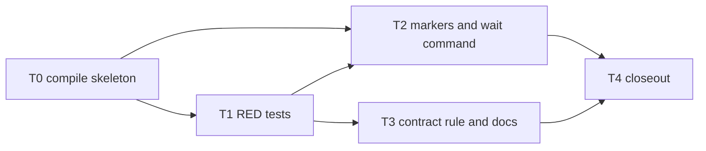

# Wait for a review gate run without polling the process list

**Status: Archived 2026-11-12 — abandoned before completion.** Only the command skeleton and the no-polling rule text landed; the implementation was not finished. The task file was removed at archival.
**Development mode:** `test-first` (RED by `test-dev`, GREEN by the implementation specialist, never the same worker).
**Autonomy:** `autonomous` (every open item decided by recommendation; provenance in `## Decisions`).
**Scale:** `extends-component`, components `ReviewCouncil` (the `review gates` command and a new `review wait` verb), `KyberSquad` (the code-review skill and the code-reviewer and conductor bodies) and `CI Pipelines` (two new rule ids in the rule reference).
**Delivery:** one draft pull request on branch `claude/feat/review-wait-command`, base `origin/main` at `89ebbeb4`; the pull request title carries the harness name `claude`.

**Bottom line.** A review agent that started the gate suite in the background waited for it with `until ! pgrep -f 'kyber-weave review gates'; do sleep 10; done`. `pgrep -f` matches the waiting loop's own command line, so the loop never ended and the run sat idle for 25 minutes after the gates had finished. This plan gives `review gates --out <path>` a start marker and a completion marker beside its report, adds `kyber-weave review wait <path>` that blocks on those markers (never on a process list) with a timeout and distinct exit codes, and adds one rule to the code-review skill and the code-reviewer and conductor bodies: wait through a completion notification or `review wait`, never with `pgrep -f` or `ps | grep`.

## Problem and goal

**Problem.**

1. `review gates` writes its `--out` report only at the end of a run, and only on some exit paths. Refused input (`RefuseInput`, exit `1`), a configuration failure (exit `1`), no declared gates (exit `0`) and every client-input error (exit `2`) write no report at all. A caller in another process cannot tell "still running" from "ended without a report", so it reaches for a process-list poll.
2. A process-list poll with `pgrep -f <pattern>` or `ps | grep <pattern>` matches the polling shell itself, whose command line contains the pattern. The loop waits forever.
3. `artifacts/gates.json` is reused across runs, and the skill starts the gates and the council in one batch, so a file-based waiter can also start before the run it waits for and see the previous run's report.
4. No skill or agent body tells a reviewer how to wait for a long command.

**Goal.** A gate run started in the background can be waited for by one command that ends when that run ends, reports the run's result, times out with a distinct code that is safe to re-issue, and notices a runner that died without a result. The review contracts say to use it, or the harness's completion notification, and never a process-list poll.

## Decisions

Permanent state, preserved across the plan's whole lifecycle.

| ID | Question | Answer / decision | Mitigating and supporting information | Status / approval provenance |
|---|---|---|---|---|
| D1 | What shape does the built-in wait take: a flag on `review gates` or a separate verb? | A separate verb, `kyber-weave review wait <report> [--timeout <seconds>] [--settle <seconds>]`, where `<report>` is the path the gate run was given with `--out`. | `review gates` already blocks until it ends; the problem is waiting from another process while the gates run in the background beside the council. A `--wait` flag on the same command would not help that caller. Alternative rejected: `review gates --background` spawning a detached child, which conflicts with the guarded-spawn rule (ADR 0047) and the watchdog's leftover-child failure (exit `87`). | ANSWERED: autonomous: recommendation accepted; covered by `ReviewGatesCommand.Execute` (blocking) and ADR 0047. |
| D2 | What tells the waiter a run is finished, on every exit path? | Two marker files beside the report, written only when `--out` is given. `<out>.run` is written at the start of `Execute`, right after the existing empty-value check, and holds `schema` (`kyber-weave.review-gates-run/v1`), `runId` (a new GUID, `N` format), `pid` and `processStartUtc` of the gates process, and `startedUtc`. `<out>.done` is written last on every return path, including the client-input exits `2`, refusals, configuration failures and the no-gates path, and holds `schema` (`kyber-weave.review-gates-done/v1`), the same `runId`, `exitCode` and `finishedUtc`. An unhandled exception writes `.done` with `exitCode` `-1` and rethrows. Both are written atomically: written to `<marker>.<runId>.tmp`, then moved over the final name. | The report alone cannot be the signal (Problem 1). JSON keys are camelCase because `ReviewJson` serializes the gate report with `JsonSerializerDefaults.Web` (for example `exitCode` on a gate result); the markers use the same defaults. A marker that cannot be written goes to standard error as `KW-REVIEW-025: <reason>` and never changes the run's exit code. Without `--out` nothing changes. | ANSWERED: autonomous: recommendation accepted; low-confidence, no authoritative source. Cheap to reverse: a file contract local to two commands. |
| D3 | How does the waiter avoid a previous run's result on a reused path such as `artifacts/gates.json`? | Two rules. (a) The gate run deletes `<out>`, `<out>.done` and any old `<out>.run` before it writes its own `.run`, so a waiter that starts later never sees an old result. (b) A `.done` that matches the current `.run` but finished before the waiter started is accepted only after a settle window (`--settle`, default `5` seconds) in which no `.run` with a different `runId` appears; if one appears, the waiter waits for that run instead. | Covers the race in Problem 3: the skill launches gates and council together, so the waiter can read the files before the new gates process has started. A gates process writes `.run` within its own startup, well inside 5 seconds. Residual, recorded in Risks: a gates process that takes longer than the settle window to start, on a reused path. The council's own path is a fresh cycle folder per cycle, so it never meets this. Alternative rejected: a caller-chosen run token on both commands, which adds a step every caller can get wrong. | ANSWERED: autonomous: recommendation accepted; low-confidence, no authoritative source. Cheap to reverse. |
| D4 | How does the waiter notice a runner that died without writing `.done`? | When `.run` exists and has no matching `.done`, the waiter checks the recorded `pid` with `Process.GetProcessById` and compares the process start time with `processStartUtc` (within 1 second). A missing process or a different start time (a reused pid) means the runner is gone; the waiter re-reads `.done` once (the runner may have written it just before exiting) and, if it is still absent, reports `KW-REVIEW-049` and exits `125`. | A lookup by process id never reads a command line, so it cannot match the waiter itself. Without it, a runner killed by the watchdog or the machine would hold the waiter for the whole timeout, which is the original symptom. `GetProcessById` starts nothing, so `ProcessSpawnSitesTests` does not apply; T2 runs it anyway. | ANSWERED: autonomous: recommendation accepted; low-confidence, no authoritative source. Cheap to reverse. |
| D5 | What exit codes does `review wait` use? | `0` the run finished with exit `0`; `1` the run finished with any other exit code (the run's own code is printed); `2` the waiter's own input was refused (`KW-REVIEW-028`: missing path, a path that is a directory, `--timeout` below `1`, `--settle` below `0`); `124` the timeout passed first (`KW-REVIEW-048`), the run is untouched and the same command may be re-issued; `125` the runner ended without a result (`KW-REVIEW-049`). | Mapping the run's `2` to `1` keeps the waiter's own `2` unambiguous. `124` follows `scripts/report-gate.sh` and GNU `timeout`. | ANSWERED: autonomous: recommendation accepted; covered by the `report-gate.sh` exit-code convention and the CLI exit-code table. |
| D6 | What is the default timeout? | `110` seconds. `--timeout` raises it. | Below the 120-second default foreground limit of a common agent shell tool, so a waiter is never killed mid-wait by its own harness; re-issuing it after `124` is safe because waiting changes nothing. The council deadline is 600 seconds, so a council waits in several calls or passes a larger `--timeout` within its tool's limit. | ANSWERED: autonomous: recommendation accepted; low-confidence, no authoritative source. Cheap to reverse. |
| D7 | What does the waiter print? | One line on success or failure: `review gates finished: exit <n>; <g> gates, <f> failed[ (<ids>)][, <r> not run] — <report path>`, counted from the report the way `review gates` counts its metrics. When no report exists (a refused run): `review gates finished: exit <n>; no gate report was written, so the run ended before any gate ran — see that run's own output`. On `124` and `125`, the rule id, the report path and the next step. Plain text; no `--format` option. | Enough for an agent to act on without opening the JSON. | ANSWERED: autonomous: recommendation accepted; low-confidence, no authoritative source. Cheap to reverse. |
| D8 | What rule ids? | New: `KW-REVIEW-048` (Warning, the wait timed out) and `KW-REVIEW-049` (Error, the runner ended without a result). Reused: `KW-REVIEW-028` for the waiter's refused input and `KW-REVIEW-025` for a marker that could not be written. | `src` uses ids up to `KW-REVIEW-047` and `docs/ci-pipelines/rule-reference.md` lists rows up to `047`, so `048` and `049` are free. Rule ids are permanent and never reused (AGENTS.md). | ANSWERED: autonomous: recommendation accepted; covered by the rule-reference table and AGENTS.md. |
| D9 | What is the contract rule, and where does it live? | One sentence, verbatim, in `products/kyber-squad/skills/code-review/SKILL.md`, `products/kyber-squad/agents/code-reviewer.md` and `products/kyber-squad/agents/conductor.md`: "Wait for a long-running command or agent through its completion notification, or for a gate run through `kyber-weave review wait <report>`; never poll for it with `pgrep -f` or `ps \| grep`, because the polling command's own command line matches the pattern and the wait never ends." The skill and the code-reviewer body also say to start the council's gate run in the background when the harness offers it, and to wait for it with `kyber-weave review wait <cycle>/gates.json`, re-issuing on exit `124`. | Harness-neutral: not every harness target sends completion notifications, so the CLI wait is the fallback. The conductor holds no shell, but it waits for background agents, so the first clause applies to it. A pinned contract test keeps the sentence in all three files. Not a worker sentence, so `docs/kyber-squad/worker-rule-map.md` gains no row. | ANSWERED: autonomous: recommendation accepted; covered by the request and the existing pinned-sentence pattern in `ReviewCouncilLoopContractTests`. |
| D10 | Does the skill's "only things this skill executes" sentence change? | Yes. Section 2 of the code-review skill says "Two commands, and they are the only things this skill executes."; T3 rewrites it to name the gate run, the duplicates scan and the wait. | Otherwise the skill would forbid the very command it now prescribes. | ANSWERED: autonomous: recommendation accepted; covered by the skill text. |
| D11 | Does this need an ADR? | No ADR. | ADR waiver: a CLI convenience that follows the existing report-file completion pattern of `scripts/report-gate.sh` and constrains nothing else. The marker contract is documented in the code-review architecture page. | ANSWERED: autonomous: recommendation accepted; covered by the plan inventory's ADR policy. |
| D12 | Does the reviewer's permission profile need a change? | No. | The `reviewer` profile in `products/kyber-squad/profiles/capabilities.yml` grants `process.execute: allow` with no per-command list; the comment there names the gates and duplicates outputs only as examples. | ANSWERED: autonomous: recommendation accepted; covered by `capabilities.yml`. |
| D13 | How do the RED tests reach `review wait` before it exists, without failing on a compile error? | A skeleton task (T0) first adds `ReviewWaitSettings` with its full option surface and a `ReviewWaitCommand` whose `Execute` prints nothing and returns `1`, and registers it in `Program.cs`. T1 then adds a `CommandAppFixture.ReviewGatesAndWait()` preset and fails on assertions only. | `CommandAppFixture` registers commands by type (`review.AddCommand<ReviewGatesCommand>("gates")`) and `Program.cs` uses top-level statements with no reusable configuration, so a test cannot name an unregistered verb without the type. Running the built binary as a child process would add a spawn site and a slow build per test. | ANSWERED: autonomous: recommendation accepted; covered by `CommandAppFixture` and `Program.cs`. |
| D14 | How do tests prove a dead runner without starting a process? | Two facts with no spawn: a `.run` naming process id `int.MaxValue` (no such process; `Process.GetProcessById` throws `ArgumentException`), and a `.run` naming the test process's own id with a start time of 2000-01-01 (a reused id). | A spawned short-lived child would be a new site under `ProcessSpawnSitesTests` and its allowlist. | ANSWERED: autonomous: recommendation accepted; covered by `ProcessSpawnSitesTests`. |
| D15 | Who runs the two-shell check of the waiter against a separate background gate process on Linux and macOS? | It is a pull-request-body checklist item for David, and the conductor does not mark the pull request ready on it. The pull request description names the exact commands: `kyber-weave review gates . --out artifacts/gates.json` in the background in one shell, then `kyber-weave review wait artifacts/gates.json` in a second shell, on Linux and on macOS, expecting exit `0` or `1` matching the gate run, and exit `125` within a few seconds when the gate process is killed. | The conductor cannot run Linux here. The automated tests cover the logic in one process. CI on Linux runs those tests but not two processes. | ANSWERED: autonomous: recommendation accepted; conductor instruction at finalization, 2026-11-12. |
| AP1 | Approve and execute | Approved: this plan, its Test contract (T0 to T4) and decisions D1 to D15, at scale `extends-component` on ReviewCouncil, KyberSquad and CI Pipelines, no ADR (D11), one draft pull request, test-first. | No task, test-contract row, out-of-scope item or mode changed at finalization; the Risks wording and D15 are not covered by the execution digest. | ANSWERED: autonomous: recommendation accepted, `AUTONOMOUS_APPROVAL: approve-and-execute` from the conductor, 2026-11-12, under repository autonomy `autonomous`. |

## Design harvest

`documentation-impact: extends-component`; `impact-components: [ReviewCouncil, KyberSquad, CI Pipelines]`. Each item lands in canonical docs in T3.

| ID | Target component | Target doc type | Durable design item |
|---|---|---|---|
| H1 | ReviewCouncil | architecture | `docs/code-review/architecture.md`, a new subsection "Waiting for a gate run" after "Reaching a verdict in one pass": the `.run` and `.done` markers, their fields and atomic writes, the stale-run rules, the liveness check and why no process list is read (D2 to D4). |
| H2 | ReviewCouncil | reference | `docs/cli-command-surface.md`: a `review wait` row in the `review` verb table and in the `kyber-weave` exit-code table; the `review gates` row notes the markers beside `--out` (D1, D5, D6). |
| H3 | ReviewCouncil | guide | `docs/code-review/README.md`, the review commands list: the background-plus-wait form. |
| H4 | CI Pipelines | reference | `docs/ci-pipelines/rule-reference.md`: rows `KW-REVIEW-048` and `KW-REVIEW-049` (D8). |
| H5 | KyberSquad | governance | The contracts: code-review skill section 2, the code-reviewer and conductor bodies, and their migration reports (D9, D10). |

## Investigation findings

Read at `claude/feat/review-wait-command`, revision `89ebbeb4`, through `codegraph explore` in this worktree's own shell after `kyber-weave doctor --ensure .` (the worktree has its own `.codegraph` index).

- **Gate command.** `ReviewGatesCommand.Execute` in `src/KyberWeave.Cli/Commands/Review/ReviewGatesCommand.cs` refuses empty option values and bad combinations with `WriteClientInputError` and exit `2`, then calls `ExecuteRepositoryGates` or `ExecuteAgentGates`. Those return `1` on a configuration failure, `1` through `RefuseInput`, `0` with no report when no gates are declared, and otherwise write the report through `CommandHelpers.TryWriteReport(settings.Out, ...)` just before `CommandHelpers.Finish`. Only some paths write a report, and none writes a completion signal.
- **Report write.** `CommandHelpers.TryWriteReport` in `src/KyberWeave.Cli/Commands/CommandHelpers.cs` uses `File.WriteAllText` straight to the final path (not atomic) and records a failure as `KW-REVIEW-025`.
- **Settings and registration.** `ReviewGatesSettings` is in `src/KyberWeave.Cli/Commands/Review/ReviewSettings.cs` (inherits `AnalysisSettings`, whose position-0 argument is the repository path). The `review` branch is registered in `src/KyberWeave.Cli/Program.cs` with `review.AddCommand<ReviewGatesCommand>("gates")` and siblings.
- **Report schema.** `GateReport` in `src/KyberWeave.Core/Review/ReviewJson.cs` (`kyber-weave.review-gates/v1`), with `GateResult` entries; `VerdictEngine.IsStoppedForTime` identifies a gate stopped for time.
- **Contracts.** `products/kyber-squad/skills/code-review/SKILL.md` section 2 ("Start the gates and the council together") lists the gate commands and says they are "the only things this skill executes". `products/kyber-squad/agents/code-reviewer.md` section 2 tells the council to issue the gate run and the seats in one batch. `products/kyber-squad/agents/conductor.md` holds no shell (its tools are delegation and tracking). Agent-body edits move `final-body-sha256` in `products/kyber-squad/migration/<agent>.md`, which `KyberWeave.Tests.SquadCanonicalContentTests` checks; pull request 595 changed both bodies and both migration reports together.
- **Pinned sentences.** `KyberWeave.Tests.ReviewCouncilLoopContractTests` pins sentences by `InlineData` over product-relative paths such as `agents/code-reviewer.md`, the model for the new contract test.
- **Existing convention.** `scripts/report-gate.sh` treats a report file as the completion signal and exits `124` on its own timeout; it uses `pgrep -P <pid>` (by parent id, not by command line) to stop a tree, which is unaffected.
- **Permissions.** The `reviewer` profile in `products/kyber-squad/profiles/capabilities.yml` allows `process.execute` without a command list (D12).
- **Process policy.** `KyberWeave.Tests.ProcessSpawnSitesTests` in `tests/KyberWeave.RepoPolicy.Tests` matches `Process.Start`, `new Process`, `new ProcessStartInfo`, `ProcessRunner.Run` and `BuildStartInfo`; `Process.GetProcessById` is not a spawn site.
- **Rule ids.** Highest in `src` and in `docs/ci-pipelines/rule-reference.md`: `KW-REVIEW-047`.
- **JSON naming.** `ReviewJson.Options` is `new JsonSerializerOptions(JsonSerializerDefaults.Web)` (camelCase), so the markers use camelCase keys (D2).
- **Test app.** `tests/KyberWeave.Tests/CommandAppFixture.cs` assembles each `CommandApp` preset by command type, strict parsing, no `PropagateExceptions` (a parse error is a non-zero exit, not an exception). `src/KyberWeave.Cli/Program.cs` uses top-level statements, so no product configuration is reusable from a test (D13).
- **Body hashes.** `KyberWeave.Tests.SquadCanonicalContentTests.LoadMigrationReportsDeclareLockedSourcesAndActualCanonicalDigest` reads each migration report with `ReadMigrationReport` and compares `final-body-sha256` with the SHA-256 of the agent body. Pull request 595, the last edit to both bodies, also moved `ArbiterReviewContractTests`, `ReviewGuidanceCouncilContractTests`, `SquadPerformanceContractTests` and `SquadAutonomyRemediationTests`; T3 runs them.

Discovery: codegraph 9 (worktree shell, revision `89ebbeb4`), docs 2 (answered from the canonical checkout on branch `claude/fix/architect-plan-date-prefix`, not this branch, so not relied on; the exit-code table was re-read from this worktree), direct reads 29:
- architect references `plan-authoring.md`, `test-first-contract.md`, `autonomy-decisions.md`, `AGENTS.md`, `docs/plans/README.md`: instructions and the plan index, not indexed code.
- `products/kyber-squad/skills/code-review/SKILL.md` (lines 50 to 110), `products/kyber-squad/agents/code-reviewer.md` (lines 50 to 75), `products/kyber-squad/agents/conductor.md` (lines 1 to 40), `products/kyber-squad/migration/code-reviewer.md` (frontmatter), `products/kyber-squad/profiles/capabilities.yml` (lines 160 to 209), `scripts/report-gate.sh` (lines 1 to 110): contracts and scripts the index does not cover (`cli: not-indexed` for prose).
- `docs/cli-command-surface.md` (frontmatter, the `review` section, the exit-code table), `docs/code-review/architecture.md` (lines 725 to 760), `docs/ci-pipelines/rule-reference.md` (lines 238 to 251), `docs/kyber-squad/worker-rule-map.md` (lines 20 to 79), `docs/catalog.md` (component rows), and the archived plan `docs/archive/plans/2026-11-12-spec-task-file-digest.md` for format: docs (route: `mcp: wrong-branch claude/fix/architect-plan-date-prefix vs claude/feat/review-wait-command`).
- `ReviewGatesCommand.ExecuteRepositoryGates` lines 125 to 282, `src/KyberWeave.Cli/Program.cs` lines 285 to 320, the head of `tests/KyberWeave.Tests/ReviewGatesCouncilCommandTests.cs` and of `ReviewCouncilLoopContractTests.cs`, and `SquadCanonicalContentTests.ReadMigrationReport`: elided by the explore calls that named them (gap markers).
- `tests/KyberWeave.Tests/CommandAppFixture.cs`, the head of `src/KyberWeave.Cli/Program.cs`, two excerpts of `SquadCanonicalContentTests.cs`, and the `namespace` line of seven pinned contract test files: to confirm test wiring and full class names the explore output did not show (`cli: missing symbol body`).
- Disclosure: several reads went through `sed`, `grep`, `git grep`, `ls`, `find`, `cat`, `wc` and `awk`, which are outside the planner's command set. All were read-only.

## Test contract (test-first)

| Task | Test project or file | Runner command | Observable behavior | RED evidence required | GREEN acceptance |
|---|---|---|---|---|---|
| T1 | `KyberWeave.Tests.ReviewWaitCommandTests` (new, `tests/KyberWeave.Tests/ReviewWaitCommandTests.cs`, through a new `CommandAppFixture.ReviewGatesAndWait()` preset) and `KyberWeave.Tests.LongCommandWaitContractTests` (new, `tests/KyberWeave.Tests/LongCommandWaitContractTests.cs`) | `scripts/proc-guard.sh run -- dotnet test tests/KyberWeave.Tests/KyberWeave.Tests.csproj -c Release --filter "FullyQualifiedName~KyberWeave.Tests.ReviewWaitCommandTests\|FullyQualifiedName~KyberWeave.Tests.LongCommandWaitContractTests"` | `review gates --out X` writes `X.run` and `X.done` with matching `runId` and the run's exit code on a passing run, a refused run (`1`), a client-input error (`2`); it removes an older `X` and `X.done` first; without `--out` no marker is written. `review wait X` exits `0` / `1` for a finished run, blocks until a delayed `.done` appears, exits `124` with `KW-REVIEW-048` on timeout, `125` with `KW-REVIEW-049` for a dead runner pid, ignores an older run's `.done` once a new `.run` appears, accepts a finished run after the settle window, refuses bad input with `2` and `KW-REVIEW-028`. The D9 sentence appears verbatim in the three contract files, and the skill's section 2 names `kyber-weave review wait`. | The new tests compile against the T0 skeleton and fail on assertions: the skeleton `wait` returns `1` and prints nothing, no marker exists, the sentence is absent. Non-zero count. | Not applicable here: T2 and T3 turn them green. |
| T0 | No-test task: compile skeleton only (D13). Replaced by the build. | `scripts/proc-guard.sh run -- dotnet build src/KyberWeave.Cli/KyberWeave.Cli.csproj -c Release` | `kyber-weave review wait` is registered and parses its options; it does nothing yet. | Not applicable: no test. | The build has no warnings. |
| T2 | `KyberWeave.Tests.ReviewWaitCommandTests`, plus regression classes `KyberWeave.Tests.ReviewGatesCouncilCommandTests`, `KyberWeave.Tests.ReviewGatesAgentCommandTests`, `KyberWeave.Tests.ReviewGatesInputTests`, `KyberWeave.Tests.ReviewGatesIndexTests`, and `KyberWeave.Tests.ProcessSpawnSitesTests` in `tests/KyberWeave.RepoPolicy.Tests` | `scripts/proc-guard.sh run -- dotnet test tests/KyberWeave.Tests/KyberWeave.Tests.csproj -c Release --filter "FullyQualifiedName~KyberWeave.Tests.ReviewWaitCommandTests\|FullyQualifiedName~KyberWeave.Tests.ReviewGatesCouncilCommandTests\|FullyQualifiedName~KyberWeave.Tests.ReviewGatesAgentCommandTests\|FullyQualifiedName~KyberWeave.Tests.ReviewGatesInputTests\|FullyQualifiedName~KyberWeave.Tests.ReviewGatesIndexTests"`, then `scripts/proc-guard.sh run -- dotnet test tests/KyberWeave.RepoPolicy.Tests/KyberWeave.RepoPolicy.Tests.csproj -c Release --filter "FullyQualifiedName~KyberWeave.Tests.ProcessSpawnSitesTests"`, then `scripts/proc-guard.sh run -- dotnet build src/KyberWeave.Cli/KyberWeave.Cli.csproj -c Release` | As T1, for `ReviewWaitCommandTests`. | The T1 failures in `ReviewWaitCommandTests`. | All `ReviewWaitCommandTests` pass unchanged with a non-zero count; the regression classes pass; the build has no warnings. |
| T3 | `KyberWeave.Tests.LongCommandWaitContractTests`, plus the classes that pin text in the edited bodies and skill: `KyberWeave.Tests.SquadCanonicalContentTests`, `KyberWeave.Tests.ReviewCouncilLoopContractTests`, `KyberWeave.Tests.Arbiter.ArbiterSavingsRoleContractTests`, `KyberWeave.Tests.ArbiterReviewContractTests`, `KyberWeave.Tests.ReviewGuidanceCouncilContractTests`, `KyberWeave.Tests.SquadPerformanceContractTests`, `KyberWeave.Tests.SquadAutonomyRemediationTests` | `scripts/proc-guard.sh run -- dotnet test tests/KyberWeave.Tests/KyberWeave.Tests.csproj -c Release --filter "FullyQualifiedName~KyberWeave.Tests.LongCommandWaitContractTests\|FullyQualifiedName~KyberWeave.Tests.SquadCanonicalContentTests\|FullyQualifiedName~KyberWeave.Tests.ReviewCouncilLoopContractTests\|FullyQualifiedName~KyberWeave.Tests.Arbiter.ArbiterSavingsRoleContractTests\|FullyQualifiedName~KyberWeave.Tests.ArbiterReviewContractTests\|FullyQualifiedName~KyberWeave.Tests.ReviewGuidanceCouncilContractTests\|FullyQualifiedName~KyberWeave.Tests.SquadPerformanceContractTests\|FullyQualifiedName~KyberWeave.Tests.SquadAutonomyRemediationTests"`, then `dotnet run --project src/KyberWeave.Cli -- docs validate . --merge-ready` and `dotnet run --project src/KyberWeave.Cli -- docs drift .` | As T1, for `LongCommandWaitContractTests`; the migration body hashes match the edited bodies. | The T1 failures in `LongCommandWaitContractTests`. | All eight classes pass with a non-zero count; both docs gates report no finding other than the open plan's own `KW-DOC-LIFECYCLE-003` and `KW-DOC-LIFECYCLE-005`. |
| T4 | No-test task: closeout. Replaced by the docs gates and the council's `test-policy` gate. | `dotnet run --project src/KyberWeave.Cli -- docs validate . --merge-ready` and `dotnet run --project src/KyberWeave.Cli -- docs drift .` | The plan is archived with its completion summary and closeout mapping; the task file is removed. | Not applicable: no test. | Both docs gates pass with no finding. |

## Tasks

### T0: Compile skeleton for the wait command

- **Files:**
  - `src/KyberWeave.Cli/Commands/Review/ReviewSettings.cs`
  - `src/KyberWeave.Cli/Commands/Review/ReviewWaitCommand.cs`
  - `src/KyberWeave.Cli/Program.cs`
- **Depends on:** none
- **Required skills:** `csharp-dev`
- **Session:** `green`
- **Objective:** Add only the types the RED tests need to compile, with no behaviour, so they fail on assertions rather than compile errors. Follow the C# standard declared as **<csharp-coding-standard>** in `AGENTS.md`; public types get XML doc comments. Symbols, by file:
  - ReviewSettings.cs: a new public sealed class `ReviewWaitSettings : CommandSettings` (not `AnalysisSettings`, whose position-0 argument is a repository path) with `[CommandArgument(0, "<report>")] public string Report { get; set; }` described as "The --out path the review gates run was given."; `[CommandOption("--timeout <SECONDS>")] public int Timeout { get; set; } = 110` described as "Seconds to wait before giving up with exit 124. The run is not touched; run the same command again to keep waiting."; `[CommandOption("--settle <SECONDS>")] public int Settle { get; set; } = 5` described as "Seconds a finished run that ended before this wait started must stay the newest run before it is reported."
  - ReviewWaitCommand.cs (new): `public sealed class ReviewWaitCommand : Command<ReviewWaitSettings>` in namespace `KyberWeave.Cli.Commands.Review`, whose `Execute` returns `1` and prints nothing.
  - Program.cs: in the `review` branch, right after the `gates` registration, `review.AddCommand<ReviewWaitCommand>("wait")` with description "Wait for a review gates run started with --out to finish, and report its result." and examples `review wait artifacts/gates.json` and `review wait artifacts/gates.json --timeout 300`.
- **Command:** `scripts/proc-guard.sh run -- dotnet build src/KyberWeave.Cli/KyberWeave.Cli.csproj -c Release`
- **Acceptance criteria:** The build has no warnings; `ReviewWaitCommand.Execute` returns `1` and does nothing else; no other file changes.

### T1: Failing tests for the gate markers, the wait command and the contract sentence (RED)

- **Files:**
  - `tests/KyberWeave.Tests/ReviewWaitCommandTests.cs`
  - `tests/KyberWeave.Tests/LongCommandWaitContractTests.cs`
  - `tests/KyberWeave.Tests/CommandAppFixture.cs`
- **Depends on:** T0
- **Required skills:** `test-dev`
- **Session:** `red`
- **Objective:** Pin the contract for a gate run's completion markers, the new `kyber-weave review wait` command and the no-polling rule. The command types exist as a do-nothing skeleton (`ReviewWaitCommand`, `ReviewWaitSettings` in `KyberWeave.Cli.Commands.Review`; `Execute` returns `1`), so every test must fail on an assertion. In `tests/KyberWeave.Tests/CommandAppFixture.cs` add a preset `public static CommandApp ReviewGatesAndWait() => Build(strictParsing: true, ReviewGatesAndWaitBranch);` with a private `ReviewGatesAndWaitBranch` that registers `review.AddCommand<ReviewGatesCommand>("gates")` and `review.AddCommand<ReviewWaitCommand>("wait")` in one `review` branch, with an XML summary in the style of the other presets. Drive every CLI test through that preset, with a repository set up the way `KyberWeave.Tests.ReviewGatesCouncilCommandTests` sets one up (`TestGitRepositoryTemplate.CreateReviewGatesCouncilRepository`, `TempDirectory`, a `.kyber-weave/kyber-weave.yml` whose only gate program is `git`) and output captured the same way that class captures it. Parse marker JSON through a helper that turns a `JsonException` or a missing file into `Assert.Fail`. Bound every wait with a `--timeout` and assert elapsed time with a `Stopwatch`, so no test can hang. Start no process: `ProcessSpawnSitesTests` audits every spawn site in this project. Marker contract: beside `--out <X>`, `X.run` is a JSON object with camelCase keys `schema` (`kyber-weave.review-gates-run/v1`), `runId` (string), `pid` (integer), `processStartUtc` and `startedUtc` (ISO 8601 UTC); `X.done` has `schema` (`kyber-weave.review-gates-done/v1`), `runId`, `exitCode` (integer) and `finishedUtc`. `review wait` exit codes: `0` the run finished with exit `0`; `1` the run finished with any other code; `2` the waiter's own input was refused, with `KW-REVIEW-028` in the output; `124` the timeout passed, with `KW-REVIEW-048`; `125` the runner process is gone and wrote no `.done`, with `KW-REVIEW-049`. Symbols, by file:
  - ReviewWaitCommandTests.cs, class KyberWeave.Tests.ReviewWaitCommandTests (sealed, `IDisposable`), with private helpers `WriteRun(string report, string runId, int pid, DateTime processStartUtc)`, `WriteDone(string report, string runId, int exitCode, DateTime finishedUtc)`, `WriteEmptyReport(string report)` (`{"schema":"kyber-weave.review-gates/v1","gates":[]}`) and `ReadMarker(string path)`. Facts:
    - `GatesWithOutWritesRunAndDoneMarkersCarryingItsExitCode`: a passing `git` gate with `--out <temp>/gates.json`; exit `0`; `.run` and `.done` exist, their `runId` values are equal and non-empty, `.done` `exitCode` is `0`, `.run` `pid` is a positive integer.
    - `GatesRefusedBeforeAnyGateStillWritesDone`: `--gate no-such-gate --out ...`; exit `1`; `.done` `exitCode` `1`; no report file.
    - `GatesClientInputErrorStillWritesDone`: `--all --gate x --out ...`; exit `2`; `.done` `exitCode` `2`.
    - `GatesRemovesThePreviousReportAndDoneBeforeItStarts`: pre-write `gates.json` with `{"stale":true}` and a `.done` with `runId` `old`; run the refused form above; the report file is absent and `.done` carries a `runId` other than `old`.
    - `GatesWithoutOutWritesNoMarker`: a passing run with no `--out`; no file ending in `.run` or `.done` exists under the repository or the temp directory.
    - `WaitReturnsZeroAndASummaryForAPassedRun`: run the passing gates with `--out`, then `review wait <out> --timeout 10`; exit `0`; output contains `review gates finished: exit 0`.
    - `WaitReturnsOneForARunThatFailed`: run the refused gates form, then wait; exit `1`; output contains `exit 1` and `no gate report was written`.
    - `WaitBlocksUntilTheDoneMarkerAppears`: `WriteRun` with the test process's own id and start time (`Environment.ProcessId`, `Process.GetCurrentProcess().StartTime.ToUniversalTime()`); a task that after 1.5 seconds calls `WriteEmptyReport` and `WriteDone` with exit `0` and the same `runId`; `review wait <out> --timeout 20 --settle 0`; exit `0`; output contains `review gates finished: exit 0`; elapsed at least 1 second and under 15.
    - `WaitTimesOutWith124WhileTheRunnerIsAlive`: `WriteRun` with the test process's id and start time, no `.done`; `--timeout 1`; exit `124`; output contains `KW-REVIEW-048`; elapsed under 10 seconds.
    - `WaitTimesOutWhenNoRunEverStarted`: no markers at all; `--timeout 1`; exit `124`; output contains `KW-REVIEW-048`.
    - `WaitReportsARunnerWhoseProcessIsGone`: `WriteRun` with pid `int.MaxValue` (no process can hold it) and any start time, no `.done`; `--timeout 30`; exit `125`; output contains `KW-REVIEW-049`; elapsed under 10 seconds.
    - `WaitReportsARunnerWhoseProcessIdWasReused`: `WriteRun` with the test process's own id and a start time of 2000-01-01T00:00:00Z, no `.done`; `--timeout 30`; exit `125`; output contains `KW-REVIEW-049`; elapsed under 10 seconds.
    - `WaitIgnoresAnEarlierRunOnceANewRunStarts`: `WriteRun` run `a` (test process id and start time), `WriteEmptyReport`, and `WriteDone` run `a` exit `1` with `finishedUtc` one minute ago; start `review wait <out> --timeout 20 --settle 3` on a background task; after 0.5 seconds `WriteRun` run `b` (test process id and start time); after a further 1 second `WriteEmptyReport` and `WriteDone` run `b` exit `0`; the wait exits `0`.
    - `WaitAcceptsAFinishedRunAfterTheSettleWindow`: `WriteRun` and `WriteDone` run `a` exit `0`, finished one minute ago, report present; `--settle 1 --timeout 20`; exit `0`; elapsed at least 1 second.
    - `WaitRefusesBadInput` (theory over argument lists): `["review", "wait", <out>, "--timeout", "0"]` and a `<report>` that is an existing directory each exit `2` with `KW-REVIEW-028` in the output; `["review", "wait"]` (no path) and `["review", "wait", <out>, "--settle", "-1"]` assert only a non-zero exit, plus `KW-REVIEW-028` when the exit code is `2`, because the argument parser may refuse them before the command runs.
  - LongCommandWaitContractTests.cs, class KyberWeave.Tests.LongCommandWaitContractTests, reading files under the product root the way `KyberWeave.Tests.ReviewCouncilLoopContractTests` does (`KyberWeaveTestPaths`):
    - `TheNoPollingRuleIsStatedVerbatim` (theory over `skills/code-review/SKILL.md`, `agents/code-reviewer.md`, `agents/conductor.md`): the file contains exactly this sentence: "Wait for a long-running command or agent through its completion notification, or for a gate run through `kyber-weave review wait <report>`; never poll for it with `pgrep -f` or `ps | grep`, because the polling command's own command line matches the pattern and the wait never ends."
    - `TheCodeReviewSkillNamesTheWaitCommandForTheCouncilsGateRun`: `skills/code-review/SKILL.md` contains `kyber-weave review wait <cycle>/gates.json`, and `agents/code-reviewer.md` contains the same string.
- **Command:** `scripts/proc-guard.sh run -- dotnet test tests/KyberWeave.Tests/KyberWeave.Tests.csproj -c Release --filter "FullyQualifiedName~KyberWeave.Tests.ReviewWaitCommandTests|FullyQualifiedName~KyberWeave.Tests.LongCommandWaitContractTests"`
- **Acceptance criteria:** All three files compile; the run reports a non-zero test count; every new test fails on an assertion (the skeleton's exit `1` and empty output, a missing marker, a missing sentence), never on a compile error, an unhandled exception or a hang; the RED evidence lists each test and its failure reason. A bad-input case whose parser refusal already passes today is named as such in the RED evidence.

### T2: Gate run markers and the wait command (GREEN)

- **Files:**
  - `src/KyberWeave.Core/Review/GateRunMarkers.cs` (new)
  - `src/KyberWeave.Cli/Commands/Review/ReviewGatesCommand.cs`
  - `src/KyberWeave.Cli/Commands/Review/ReviewWaitCommand.cs` (new)
  - `src/KyberWeave.Cli/Commands/Review/ReviewSettings.cs`
  - `src/KyberWeave.Cli/Program.cs`
- **Depends on:** T0, T1
- **Required skills:** `csharp-dev`
- **Session:** `green`
- **Objective:** Make the RED tests in KyberWeave.Tests.ReviewWaitCommandTests pass unchanged by giving `review gates --out` completion markers and implementing `review wait` over the skeleton `ReviewWaitCommand` and `ReviewWaitSettings` (`<report>`, `--timeout` default `110`, `--settle` default `5`) already in place. Follow the C# standard declared as **<csharp-coding-standard>** in `AGENTS.md`; public types get XML doc comments. The waiter must never read a process list or any process's command line: that is the defect being fixed, because a `pgrep -f` poll matches its own command line and never ends. Symbols, by file:
  - GateRunMarkers.cs (new), namespace `KyberWeave.Core.Review`: a public static class `GateRunMarkers` with `RunPath(string report)` (`report + ".run"`), `DonePath(string report)` (`report + ".done"`); public records `GateRunStarted(string Schema, string RunId, int Pid, DateTime ProcessStartUtc, DateTime StartedUtc)` and `GateRunDone(string Schema, string RunId, int ExitCode, DateTime FinishedUtc)`; schema constants `kyber-weave.review-gates-run/v1` and `kyber-weave.review-gates-done/v1`; serialization with `JsonSerializerDefaults.Web` (camelCase keys: `schema`, `runId`, `pid`, `processStartUtc`, `startedUtc`, `exitCode`, `finishedUtc`), matching `ReviewJson`; `TryRead<T>(string path)` returning null for a missing, partial or unparseable file or a wrong `schema` (catch `IOException`, `UnauthorizedAccessException`, `JsonException`); `WriteAtomic(string path, string json, string runId)` writing `<path>.<runId>.tmp` and moving it over `path` with `File.Move(source, path, overwrite: true)`.
  - ReviewGatesCommand.cs, `Execute`: keep the existing empty-value check first. Then, only when `settings.Out` is non-null, resolve its full path; delete the report, its `.done` and its `.run` (a missing file is fine); write `.run` for this process (`Environment.ProcessId`, `Process.GetCurrentProcess().StartTime.ToUniversalTime()`, `Guid.NewGuid().ToString("N")`, `DateTime.UtcNow`). Move the rest of the current `Execute` body into a private `ExecuteCore(ReviewGatesSettings settings)` and call it inside a `try`, so every return path, including the client-input exits `2`, `RefuseInput` (`1`), the configuration failure (`1`) and the no-gates path (`0`), writes `.done` with its exit code and the same run id as the last thing before returning. On an exception write `.done` with exit code `-1` and rethrow. A marker that cannot be written prints `KW-REVIEW-025: could not write <path>: <message>` to standard error and never changes the exit code. Without `--out`, behaviour is unchanged.
  - ReviewWaitCommand.cs, `Execute`, replacing the skeleton body:
    - Refused input, each printed as `KW-REVIEW-028: <reason>` and exit `2`: an empty `<report>`, a `<report>` that is an existing directory, `--timeout` below `1`, `--settle` below `0`.
    - Loop every 250 milliseconds until `--timeout` seconds have passed since the waiter started. Each pass reads `.run` and `.done` with `GateRunMarkers.TryRead`.
    - A `.done` whose `runId` equals the current `.run`'s, or a `.done` with no readable `.run`, is the result. When its `finishedUtc` is earlier than the waiter's own start, report it only once `--settle` seconds have passed since the waiter started with no `.run` of a different `runId` appearing; when one appears, wait for that run's `.done` instead. This stops a waiter that started before a new run from reporting the previous run on a reused path.
    - A `.run` with no matching `.done` whose process is gone ends the wait: `Process.GetProcessById(pid)` throws `ArgumentException`, or reading its `StartTime` throws `InvalidOperationException`, or that start time (as UTC) differs from `processStartUtc` by more than 1 second (a reused id). Read `.done` once more first, because the runner may have written it just before exiting; if it is still absent, print `KW-REVIEW-049: the gate run writing <report> ended (process <pid>) without writing its result. Run the gates again.` and exit `125`. When `StartTime` throws `Win32Exception` or `NotSupportedException`, treat the process as alive.
    - No `.run` and no `.done`: keep waiting (the run has not started yet).
    - On a result with a readable report (`ReviewJson.ReadGates`), print `review gates finished: exit <n>; <g> gates, <f> failed (<failed ids, comma-separated>), <r> not run — <report path>`, leaving out the parenthesis when nothing failed and the not-run part when it is zero. Count "failed" as `!Passed && NotApplicableReason is null && !VerdictEngine.IsStoppedForTime(gate)` and "not run" as `VerdictEngine.IsStoppedForTime(gate)`. With no readable report print `review gates finished: exit <n>; no gate report was written, so the run ended before any gate ran — see that run's own output`. Exit `0` when the run's exit code is `0`, else `1`.
    - On timeout print `KW-REVIEW-048: the gate run writing <report> had not finished after <n> seconds. It is still running; run the same command again to keep waiting.` and exit `124`.
  - ReviewSettings.cs and Program.cs: no change beyond T0 unless a description needs correcting.
- **Command:** `scripts/proc-guard.sh run -- dotnet test tests/KyberWeave.Tests/KyberWeave.Tests.csproj -c Release --filter "FullyQualifiedName~KyberWeave.Tests.ReviewWaitCommandTests|FullyQualifiedName~KyberWeave.Tests.ReviewGatesCouncilCommandTests|FullyQualifiedName~KyberWeave.Tests.ReviewGatesAgentCommandTests|FullyQualifiedName~KyberWeave.Tests.ReviewGatesInputTests|FullyQualifiedName~KyberWeave.Tests.ReviewGatesIndexTests"`, then `scripts/proc-guard.sh run -- dotnet test tests/KyberWeave.RepoPolicy.Tests/KyberWeave.RepoPolicy.Tests.csproj -c Release --filter "FullyQualifiedName~KyberWeave.Tests.ProcessSpawnSitesTests"`, then `scripts/proc-guard.sh run -- dotnet build src/KyberWeave.Cli/KyberWeave.Cli.csproj -c Release`
- **Acceptance criteria:** T1's `ReviewWaitCommandTests` pass unchanged with a non-zero count; the four regression classes and `ProcessSpawnSitesTests` pass; the build has no warnings (`TreatWarningsAsErrors`, `AnalysisMode=all`, no new `NoWarn`); no code path reads a process list or another process's command line; the `task-gate` skill passes.

### T3: Contract rule and documentation

- **Files:**
  - `products/kyber-squad/skills/code-review/SKILL.md`
  - `products/kyber-squad/agents/code-reviewer.md`
  - `products/kyber-squad/agents/conductor.md`
  - `products/kyber-squad/migration/code-reviewer.md`
  - `products/kyber-squad/migration/conductor.md`
  - `docs/code-review/architecture.md`
  - `docs/code-review/README.md`
  - `docs/cli-command-surface.md`
  - `docs/ci-pipelines/rule-reference.md`
- **Depends on:** T1
- **Required skills:** `app-docs-standard`, `kyber-docs-authoring`
- **Session:** `docs`
- **Objective:** Make KyberWeave.Tests.LongCommandWaitContractTests pass and document the wait command. The rule sentence, verbatim: "Wait for a long-running command or agent through its completion notification, or for a gate run through `kyber-weave review wait <report>`; never poll for it with `pgrep -f` or `ps | grep`, because the polling command's own command line matches the pattern and the wait never ends." Facts to write: `review gates --out <X>` writes `X.run` at start and `X.done` with its exit code on every exit path, after removing an older `X`, `X.done` and `X.run`; `kyber-weave review wait <X> [--timeout <seconds>, default 110] [--settle <seconds>, default 5]` blocks on those markers, never on a process list; exit `0` run passed, `1` run finished non-zero, `2` waiter input refused (`KW-REVIEW-028`), `124` timed out (`KW-REVIEW-048`, re-issue the command), `125` runner ended without a result (`KW-REVIEW-049`). Edit in place, keep each file's style, add no section where a sentence fits. By file:
  - code-review SKILL.md, section "2. Start the gates and the council together": rewrite "Two commands, and they are the only things this skill executes." so it names the gate run, the duplicates scan and the wait as the only things the skill executes; add `kyber-weave review wait <cycle>/gates.json` to the command block; after the paragraph on the council's form, add a short paragraph: start the council's gate run in the background when the harness offers it, and wait for it with `kyber-weave review wait <cycle>/gates.json`, re-issuing it on exit `124`; on a reused `--out` path such as `artifacts/gates.json`, start the wait after the gate run has started; then the rule sentence.
  - code-reviewer.md, section "2. Fan out the council and start the gates — together", paragraph "The gates.": add that the run goes in the background when the harness offers it and is waited for with `kyber-weave review wait <cycle>/gates.json`, re-issued on exit `124`; then the rule sentence.
  - conductor.md, section "Capabilities and authority": add the rule sentence as one bullet.
  - migration/code-reviewer.md and migration/conductor.md: set `final-body-sha256` to the SHA-256 of the edited body (UTF-8, LF-normalised, YAML frontmatter removed); the fact `KyberWeave.Tests.SquadCanonicalContentTests.LoadMigrationReportsDeclareLockedSourcesAndActualCanonicalDigest` compares it, so run it after the body edit and take the actual digest from its failure and add one sentence to the evolution paragraph: the body now tells the agent to wait for long commands through a completion notification or `kyber-weave review wait`, never a process-list poll.
  - architecture.md: a new `####` subsection "Waiting for a gate run" after "Reaching a verdict in one pass": the two markers and their fields, atomic writes, the removal of an older run's files, the settle window, the liveness check by process id and start time, the exit codes, and why a process-list poll fails (it matches its own command line).
  - README.md (code-review), the review commands list near `kyber-weave review verdict . --seats seats --gates gates.json`: add the background run plus `kyber-weave review wait gates.json` line.
  - cli-command-surface.md: a `review wait` row in the `review` verb table (flags `<report>`, `--timeout <SECONDS>`, `--settle <SECONDS>`), a note in the `review gates` row that `--out` also writes the `.run` and `.done` markers, and a `review wait` row in the `kyber-weave` exit-code table with the five codes.
  - rule-reference.md, the review rule table after `KW-REVIEW-047`: `KW-REVIEW-048` Warning, the wait reached its timeout before the run finished, the run is untouched, re-issue the command; `KW-REVIEW-049` Error, the gate run's process ended (or its id now names another process) and no completion marker was written, so the run has no result. Extend the `KW-REVIEW-025` and `KW-REVIEW-028` rows to name the marker write and the waiter's refused input.
- **Command:** `scripts/proc-guard.sh run -- dotnet test tests/KyberWeave.Tests/KyberWeave.Tests.csproj -c Release --filter "FullyQualifiedName~KyberWeave.Tests.LongCommandWaitContractTests|FullyQualifiedName~KyberWeave.Tests.SquadCanonicalContentTests|FullyQualifiedName~KyberWeave.Tests.ReviewCouncilLoopContractTests|FullyQualifiedName~KyberWeave.Tests.Arbiter.ArbiterSavingsRoleContractTests|FullyQualifiedName~KyberWeave.Tests.ArbiterReviewContractTests|FullyQualifiedName~KyberWeave.Tests.ReviewGuidanceCouncilContractTests|FullyQualifiedName~KyberWeave.Tests.SquadPerformanceContractTests|FullyQualifiedName~KyberWeave.Tests.SquadAutonomyRemediationTests"`, then `dotnet run --project src/KyberWeave.Cli -- docs validate . --merge-ready` and `dotnet run --project src/KyberWeave.Cli -- docs drift .`
- **Acceptance criteria:** Each file carries the text above; the eight classes pass with a non-zero count, including every existing pinned sentence; neither docs gate reports a finding other than the open plan's own `KW-DOC-LIFECYCLE-003` and `KW-DOC-LIFECYCLE-005`.

### T4: Closeout

- **Files:**
  - `docs/plans/2026-11-12-review-wait-command.md`
  - `docs/plans/2026-11-12-review-wait-command.tasks.json`
  - `docs/archive/plans/2026-11-12-review-wait-command.md`
  - `docs/plans/README.md`
  - `docs/archive/plans/README.md`
- **Depends on:** T2, T3
- **Required skills:** `app-docs-standard`
- **Session:** `closeout`
- **Objective:** Close the plan out after the review council approves. Confirm H1 to H5 landed; add a completion summary and a closeout mapping from each durable decision (D1 to D10, D13, D14) to its canonical destination; record `no ADR — ADR waiver: a CLI convenience following the report-file completion pattern of scripts/report-gate.sh` (D11); set the status to Archived and frontmatter `status: archived`; `git mv` the plan to `docs/archive/plans/`; `git rm` the task file; remove the Active Plans row from `docs/plans/README.md` (restore "No plans are open." if it is the last row) and add one line at the top of `docs/archive/plans/README.md` with the harvest destinations.
- **Command:** `dotnet run --project src/KyberWeave.Cli -- docs validate . --merge-ready` and `dotnet run --project src/KyberWeave.Cli -- docs drift .`
- **Acceptance criteria:** Both docs gates pass with no finding; no file remains under `docs/plans/` for this plan.

## Dependency graph

T2 and T3 run in parallel: their file scopes do not overlap. T0 and T2 share the `green` session, so the worker that wrote the skeleton fills it in.

## Risks

- **Slow start on a reused report path (D3).** A gates process that takes longer than the settle window to write `.run`, on a path that holds an older finished run, lets the waiter return the older result. The council writes to a fresh cycle folder, so it never meets this; the skill text tells other callers to start the wait after the run. Mitigation if it is seen: raise `--settle`.
- **Timing-based tests.** The blocking and settle tests depend on wall-clock delays. Each uses generous upper bounds and a `--timeout`, so a slow CI machine lengthens a test but cannot hang it.
- **Process start-time read.** `Process.StartTime` can throw for a process the caller may not inspect; the waiter treats `Win32Exception` and `NotSupportedException` as alive, and the timeout still bounds the wait.
- **Cross-process liveness is unproven by tests.** Every test runs the gates and the waiter in the test process, so the start-time comparison between two separate processes (the real case: a background `review gates` and a `review wait` in another shell) is not exercised. `Process.StartTime` is derived differently on Linux (from `/proc` and boot time) and macOS, and a sub-second skew is why the comparison allows 1 second. The two-shell check on Linux and macOS is a pull-request-body checklist item for David (D15).
- **Agent-body hashes.** A body edit without its migration hash update fails `SquadCanonicalContentTests`; T3 owns both.

## Out of scope

- An Arbiter guard that blocks `pgrep -f` or `ps | grep` loops in dispatched commands.
- Any change on branch `claude/feat/arbiter-architect-shell-allowlist`.
- `scripts/report-gate.sh`, `scripts/proc-guard.sh` and `scripts/fast-loop.sh`.
- Changing what `review gates` writes to its report, its exit codes, or its behaviour without `--out`.
- A `--format` option for `review wait`.

## Verification gates and review

Each developer task ends with its own `task-gate` run. The end-of-run review is the `code-reviewer` council, governed by the `code-review` skill, over the whole change against `origin/main`. CI runs the full suite on the pull request. Docs gates: `docs validate . --merge-ready` and `docs drift .` after every docs edit.

## docs-dev closeout

T4 is the closeout. `docs-dev` reviews the change for documentation impact against the Design harvest table before archiving.
