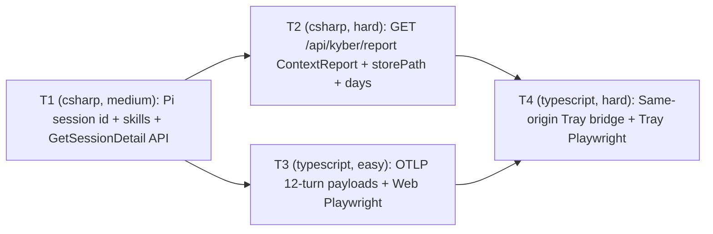

# Multi-Harness OTLP Telemetry Playwright Tests for KyberDash Web and Tray

**Status: Archived, 2026-11-23.**

## Request

> I want to start some Playwright tests for the Kyber Dash, both the tray as well as the webpage dashboard. What I want you to do is insert telemetry to the hotel collection endpoint for each harness with up to 12 turns in data. It should emulate what the actual harnesses send. Then I want you to validate on the dashboard page that each section in the form is filled out. Oftentimes there are gaps with each harness, and the intent of these tests is to identify when those gaps happen so that we can then ensure that the collector is either working correctly or the API is returning the correct data.

## Problem and goal

KyberDash currently has one isolated Playwright suite (`dash/e2e/harness-collection.spec.ts`) seeded offline via `kyberdash.e2e.seed` for a small synthetic fixture (`opencode` and unattributed `custom`) rather than ingesting live OTLP telemetry through the `/v1/traces` and `/v1/logs` collection endpoints ("hotel collection endpoint" in the request). Meanwhile, inspection shows real collector and API gaps across both surfaces:

1. **Collector gap (`pi`)**: `CanonAdapters.SessionIdKeys` omits `pi.session.id`, leaving native Pi OTLP spans with `SessionKey = null`.
2. **Web Dashboard API gap (`GET /api/kyber/session/:id`)**: `KyberBridgeEngine.GetSessionDetail` currently omits `span_count`, `context`, `schema`, `skills`, `servers`, `reconciliation`, `notes`, `costBasisMismatch`, tool schema cost metadata, and several summary/turn fields rendered by `AgentSessionDashboard.tsx`.
3. **Tray Report API gap (`GET /api/kyber/report`)**: `DashEndpointMappings.ReportAsync` ignores `?days=` and `KyberBridgeEngine.GetReport` returns a slim payload lacking `kyberdashVersion`, `scope`, `coverage.harnesses`, `harnesses[].dimensions`, `findings[].recoverableTokens`/`view`, `latestSession.latestTurn` context buckets/pressure/residual, and `cost[]` expected by `dash/tray/ui/src/report-types.ts`.

The goal is to fix these collector and API contract gaps in the C# KyberDash engine, add multi-turn (up to 12 turns) emulated OTLP telemetry generators for every OTLP-capable harness, and add isolated Playwright end-to-end suites covering both the Web Dashboard and the Tray UI so missing sections or silent zero-for-missing regressions are caught deterministically.

## Request trace

| Request instruction | Covered by | Evidence that it is met |
|---|---|---|
| Playwright tests for KyberDash webpage dashboard | D1, D7, T3 | `dash/e2e/otel-web-dashboard.spec.ts` runs under `dash/playwright.isolated.config.ts` and asserts `AgentSessionDashboard` and `ContextDoctor`/`HarnessDetail` sections |
| Playwright tests for KyberDash tray | D2, D7, T4 | `dash/e2e/otel-tray-dashboard.spec.ts` runs against `dash/tray/ui/dist` relayed to real `/api/kyber/*` API endpoints |
| Insert telemetry to the OTLP collection endpoint for each harness with up to 12 turns | D1, D3, T3, T4 | `dash/e2e/otel-harness-payloads.ts` posts multi-turn batches (up to 12 turns) over HTTP to `/v1/traces` and `/v1/logs` on the isolated `kyberdash` server |
| Emulate what the actual harnesses send | D3, T3 | Payloads follow `CanonAdapters.DefaultAdapters`, `OtlpLogMapper`, and recorded `dash/e2e/fixtures/{opencode,factory}` wire schemas for all 7 stored OTLP harnesses plus `gemini` attribution check |
| Validate on the dashboard page that each section in the form is filled out | D5, D6, T3, T4 | Web spec verifies Sections 1–5, Cost Panel, Stored Fields, Header/Requests, and Inspector Drawer; Tray spec verifies `HarnessSelector`, `SessionPanel`, `FindingsList`, `HealthFooter`, `SettingsView`, `Maintenance`/`CleanDatabase` |
| Identify harness gaps so collector or API returns the correct data | D3, D4, D5, D6, T1, T2 | Explicit per-harness gap manifest verifies documented unexported fields render as honest `not_measurable`/`—` indicators while collector (`pi.session.id`) and API (`GetSessionDetail`, `GetReport`) gaps are fixed in C# |

## Scale

- **Declared impact (`documentation-impact: extends-component`)**: Extends `KyberDash` across the OTLP ingest adapter (`PiAdapter`), read-side REST query projections (`GET /api/kyber/session/:id` and `GET /api/kyber/report`), and isolated Playwright E2E test suites for Web and Tray UIs.

## Decisions

| ID | Question | Answer / decision | Mitigating and supporting information | Status / approval provenance |
|---|---|---|---|---|
| D1 | Where should Playwright tests send OTLP telemetry and connect for dashboard reads? | Boot an isolated `kyberdash web --no-open --port 0 --db <temp> --state-dir <temp>` instance per suite and post OTLP/HTTP JSON payloads to its bound `/v1/traces` and `/v1/logs` endpoints, polling `/api/kyber/sessions` and `/api/kyber/coverage` until flushed. | `KyberDash.Api/Program.cs` mounts `MapDashApiEndpoints()` and `MapOtlpEndpoints()` on the same port and runs `OtlpCollectorService`. `dash/AGENTS.md` and `docs/dash/runbook.md` forbid touching `:4747` or `~/.kyberdash/canon.db`. | ANSWERED — autonomous: recommendation accepted (`dash/server/KyberDash.Api/Program.cs`, `dash/AGENTS.md`, `dash/e2e/harness-collection-world.ts`) |
| D2 | How should Playwright test the Tray UI across real OTLP telemetry on macOS and Linux CI? | Serve built `dash/tray/ui/dist` from a Node HTTP server in `dash/e2e/otel-tray-bridge.ts` with a same-origin `/tray/invoke` endpoint that proxies all `/api/kyber/*` calls (GET/PUT/POST) over server-side loopback HTTP **without** an `Origin` header, backed by a `page.addInitScript` `window.__TAURI_INTERNALS__` bridge supporting all 9 Tauri IPC commands from `lib.rs` plus `@tauri-apps/api/event` (`^2.8.0`: `transformCallback`, `plugin:event|listen`, `plugin:event|unlisten`) and `view-state-changed` event dispatch from live `/api/kyber/{report,coverage,jobs,settings,version}` state. | Direct browser `fetch` to kyberdash's port fails `DashHttp.IsAllowedMutation` (403 on any `Origin` header, pinned by `MinimalApiEndpointTests.SettingsPutRejectsABrowserOrigin`). `dash/tray/ui/src/App.tsx` loads `get_view_state` once on mount and updates solely via `view-state-changed` events while calling all 9 handlers (`get_view_state`, `refresh_now`, `open_view`, `set_settings`, `quit`, `hide_popover`, `clean_database`, `import_folder_history`, `set_shared_settings`). Native Rust IPC (`dash/tray/src-tauri`) remains covered by `cargo test` (`PR note:`). | ANSWERED — autonomous: recommendation accepted (`dash/tray/AGENTS.md`, `dash/tray/src-tauri/src/{lib.rs,api.rs,runtime.rs}`, `dash/tray/ui/package.json`, `dash/server/KyberDash.Api/Endpoints/DashHttp.cs`) |
| D3 | Which harnesses receive up-to-12-turn OTLP telemetry and how are harness gaps asserted? | Emulate all 7 stored OTLP harnesses in `CanonAdapters.DefaultAdapters` with up to 12 turns (`claude-code` spans+logs 12t, `opencode` v3 12t, `droid` Factory v1 8t/12t, `codex` spans+logs 12t, `copilot` 12t, `pi` 12t, `antigravity` 10t), plus a `gemini` attribution check confirming exclusion from stored rollups. Assert a per-harness contract: measured sections populated, documented unexported fields rendered honestly as `not_measurable` / `— (<reason>)` never zero. | Matches `CanonAdapters.DefaultAdapters`, `OtlpLogMapper`, `CanonPricing.IsExcludedHarnessIdentity`, `docs/rules/kyberdash-harness-collection.md`, and `docs/dash/telemetry-inventory.md`. Non-OTLP file-only harnesses (`cursor`, `kilo`, `commandcode`) do not ingest via `/v1/traces`. | ANSWERED — autonomous: recommendation accepted (`CanonAdapters.cs`, `docs/rules/kyberdash-harness-collection.md`) |
| D4 | Should the collector fix Pi `pi.session.id` session attribution? | Yes. Update `PiAdapter.Normalize` (`CanonAdapters.cs`) AND `PiSpanMapper.Parse` (`PiSpanMapper.cs`) to fall back to `pi.session.id` using `!string.IsNullOrWhiteSpace(v)` + `.Trim()` when `CanonicalSessionId` / `native.SessionId` is null, leaving whitespace-only values as `null`, and update Pi assertions in `CanonIngestTests.cs` and `DroidPiSpanMapperTests.cs`. | `CanonAdapters.ReadNonEmptyString` only checks `string.IsNullOrEmpty` without trimming, and `OtlpCollectorService` routes spans through `PiSpanMapper.Parse` whose underlying `OtlpSpanNative.SessionIdKeys` lacks `pi.session.id`. Updating both paths handles spans and logs consistently. | ANSWERED — autonomous: recommendation accepted (`CanonAdapters.cs`, `PiSpanMapper.cs`, `CanonIngestTests.cs`, `DroidPiSpanMapperTests.cs`) |
| D5 | How should `GET /api/kyber/session/:id` and OTLP skill ingest be fixed to fill Web Dashboard form sections? | Populate `SkillsInvoked` in `CanonIngestPipeline.ToCollectedRecord` and `OtlpLogMapper.ToCollectedRecord` (matching `OtlpSpanNative.SkillInvokedKeys`, `"kyber.skills.invoked"`, and `Skill`/`skill` tool calls), and extend `KyberBridgeEngine.GetSessionDetail` additively with: `span_count`, `servers`, `notes`, top-level `costBasisMismatch`, complete `summary`, dual turn keys (retaining `turnIndex`/`inputTokens`/`outputTokens` etc. while adding `index`/`input`/`output`/`fresh`/`fresh_input`/`cache_read`/`cache_creation`/`reasoning`), 1-based `context` (`turns[].index = Position + 1`, `flaggedTurns = +1`, map-shaped `toolDefinitionsByServer`, `{ tokens, attribution }` `residual`, `first`/`last`, or `{ measurable: false, reason }`), `schema` (with `neverInvoked`, `byServer`, `unusedRange`, `ranked`, or `{ measurable: false, reason }`), `tools[]` (`in_definitions`, `is_mcp`), snake-case `reconciliation` (omitting rows with null `InputMatch` or `OutputMatch`), and `skills` (`KyberSkillsBlock` matching `skills-payload.json` or `{ availability: "not_measurable", reason }`). | `CanonIngestPipeline` and `OtlpLogMapper` currently hardcode `SkillsInvoked: []` so `IRelationalStoreReader.SkillsInvoked` is empty for OTLP sessions. `AgentSessionDashboard.tsx`, `SessionSpendCharts.tsx`, `SchemaCostRanking.tsx`, and `SkillsPanel.tsx` expect 1-based context turn indices, map-shaped `toolDefinitionsByServer`, non-null boolean `input_match && output_match` reconciliation rows, and `not_measurable` markers where telemetry is unexported. Retaining existing camelCase turn fields preserves `AnalyticsReadPathTests.cs`. | ANSWERED — autonomous: recommendation accepted (`CanonIngestPipeline.cs`, `OtlpLogMapper.cs`, `KyberBridgeEngine.cs`, `AgentSessionDashboard.tsx`, `skills-payload.json`, `IProjectionStore.cs`) |
| D6 | How should `GET /api/kyber/report` be aligned with Tray `ContextReport` without breaking `ReportService` or existing callers? | Preserve the 4-arg `IDashboardQueryService.GetReport(...)` signature (defaulting `days` to `7`) and add a 5-arg overload `GetReport(string? harness, string? sessionId, string? runId, int limit, int days)` across `IDashboardQueryService`, `DashboardQueryService`, and `KyberBridgeEngine` (wired with optional `storePath` from `ServiceCollectionExtensions.RegisterEngines`); preserve scalar parity keys (`schemaVersion`, `generatedAt`, `storeGeneration`, `sessionCount`, `findingCount`, `harnessCount`) while emitting `kyberdashVersion`, `scope`, `coverage`, `findings` (`ReportFinding`), `harnesses` (`ReportHarness` dimensions derived from `StoredHarnessRollup` / bounded window rollups via `CanonRollupsEngine.BuildHarnessScorecard`), `latestSession` (hydrated via `ReadSessionFigures` for at most that single newest session in scope), and non-blended `cost[]`. | Adding a 5th optional parameter to the existing method breaks `Moq` expression trees (`CS0854`) in `SettingsCleanDoctorReportTests` and `PresentationBuilder`; adding an explicit 5-arg overload preserves CLI `ReportService` and tests untouched. Computing harness scorecards from `StoredHarnessRollup` / bounded window data and hydrating full turns only for `latestSession` avoids `ReadSessionFigures` N+1 projection scans. | ANSWERED — autonomous: recommendation accepted (`IDashServices.cs`, `ServiceCollectionExtensions.cs`, `DashEndpointMappings.cs`, `KyberBridgeEngine.cs`, `CanonRollupsEngine.cs`, `dash/tray/ui/src/report-types.ts`) |
| D7 | How should the isolated Playwright specs be configured? | Add `otel-web-dashboard.spec.ts` and `otel-tray-dashboard.spec.ts` to `dash/playwright.isolated.config.ts` (`testMatch`, keeping `workers: 1`), and defer `.github/workflows/ci.yml` `jobs.dash-e2e` wiring out of this slice (per D10). | Keeps all self-booting suites isolated behind `dash/playwright.isolated.config.ts` per `dash/AGENTS.md` without blocking delivery on a missing local `actionlint` binary. | ANSWERED — autonomous: recommendation accepted (`dash/AGENTS.md`, `dash/playwright.isolated.config.ts`, `D10`) |
| D8 | Which declared technologies and task boundaries govern execution? | Separate active tasks by declared technology and dependency order: `csharp` (`T1` -> `T2`) and `typescript` (`T3`, `T4`), assigning `Difficulty` and `--agent` tiers per the `plan-authoring.md` rubric (`T1`: `medium`/`dev-medium`, `T2`: `hard`/`dev-hard`, `T3`: `easy`/`dev-easy`, `T4`: `hard`/`dev-hard`). | Follows `.kyber-weave/kyber-weave.yml` `ontology.technologies` / `PlanTaskAgentPick`, serializes edits to `KyberBridgeEngine.cs`, and supplies failure modes and mitigations for intermediate/advanced tasks (`T5` deferred per `D10`). | ANSWERED — autonomous: recommendation accepted (`.kyber-weave/kyber-weave.yml`, `plan-authoring.md`, `D10`) |
| D9 | How do `test-first` RED/GREEN checks work when `.kyber-weave/kyber-weave.yml` task gates exclude `dash/server` and Playwright? | Explicitly exempt `T1`–`T4` from `kyber-weave review gates . ... --red` (exception to `plan-authoring.md:113` and `--red` gate enforcement): `T1`–`T4` list and run their Test contract runner commands directly for RED (before implementation) and GREEN + `dash/AGENTS.md` checks (`dotnet build`/`format` on `dash/server/KyberDash.sln`; `npm --prefix dash run check:reachable`), followed by passing `kyber-weave review gates . --agent <tier> --task <id>` (no `--red`) to record the Arbiter gate report. | `review.technology-gates.csharp` runs `KyberWeave.sln` only (never `dash/server.tests`), and `review.technology-gates.typescript` runs `dash-typecheck` + `dash-lint` only (pinned by `ReviewTaskGatesRepositoryConfigTests.cs:61` and `docs/standards/test/test.rules.md:21-24` forbidding Playwright in task gates), so `--red` fails unconditionally with `KW-REVIEW-052`. Do not modify `.kyber-weave/kyber-weave.yml`; `KW-ARB-MODE-002` permits missing `--red` with warning (`effects: { no-failing-run: allow }`). | ANSWERED — autonomous: recommendation accepted (`.kyber-weave/kyber-weave.yml`, `ReviewTaskGatesRepositoryConfigTests.cs`, `docs/standards/test/test.rules.md`, `conductor.arbiter-rules.yml`) |
| D10 | How is the `T5` circuit-breaker escalation (`task-gate/workflow-lint` missing `actionlint`) resolved? | Renegotiate plan scope to remove `T5` (`.github/workflows/ci.yml` `jobs.dash-e2e` update) from this plan slice, discard `task-T5` leaving `.github/workflows/ci.yml` untouched, and record the deferred CI wiring as a `PR note:` in `## Out-of-scope boundaries`. | `workflow-lint` (`actionlint "{changed}"`) is a blocking `technology-gates.github-actions` gate in `.kyber-weave/kyber-weave.yml`, and `actionlint` is absent on this host (`KW-REVIEW-033`, `NotStarted`). Returning `TASK_GATE: UNAVAILABLE` against `.agent_scratchpad/T5/task-gate.json` is invalid under `task-gate/SKILL.md` (reserved for missing `kyber-weave` CLI), rejected by `GateReportFacts` / `KW-ARB-GATE-REPORT-001` (`disagrees: escalate` on any non-`PASS` claim), and disallowed by `delivery-execution` (`TASK_GATE` is a `keep` gate). Neither council `review.gates` nor `.github/workflows/ci.yml` runs `actionlint`, so deferring to CI would ship un-linted YAML against `github-actions.rules.md`. Keeping `T5` halted inside the plan blocks `docs-dev` closeout and `RunDelivery` (`KW-DELIVER-004` / `KW-DOC-LIFECYCLE-003`), while `T1`–`T4` already fulfill 100% of `## Request` and `change-scope` reserves unrequested CI changes. | ANSWERED — autonomous: recommendation accepted (`task-gate/SKILL.md`, `GateReportFacts.cs`, `conductor.arbiter-rules.yml`, `delivery-execution/SKILL.md`, `change-scope/SKILL.md`, `docs/standards/github-actions/github-actions.rules.md`) |
| AP1 | Approve and execute | Approved for execution as planned (`documentation-impact: extends-component`, `impact-components: KyberDash`, `development-mode: test-first`). | Recorded at initial finalization under autonomous mode prior to D10 scope renegotiation. | ANSWERED: autonomous: recommendation accepted, approve-and-execute, 2026-11-22 |
| AP2 | Approve and execute | Approved for execution as planned. | Recorded by the finalize step, which changed no task, file scope, test row or command. | ANSWERED: autonomous: recommendation accepted, approve-and-execute (D10 scope renegotiation), 2026-11-22 |

## Design harvest

| Target component | Target doc type | Section | Content to harvest |
|---|---|---|---|
| KyberDash | architecture | Collector attribution & read-side API projection | Document `pi.session.id` session correlation (`PiAdapter` + `PiSpanMapper`), OTLP `SkillsInvoked` population (`CanonIngestPipeline` + `OtlpLogMapper`), complete `GET /api/kyber/session/:id` projection blocks (`context`, `schema`, `skills`, `reconciliation`, `notes`, `servers`), and `GET /api/kyber/report` `ContextReport` (`?days=` window) contract parity with `dash/tray/ui` |
| KyberDash | runbook | Running tests safely & isolated Playwright OTLP suites | Update the stale isolated spec list at `Running tests safely` (remove stale `refresh-filters.spec.ts` reference, align with `dash/playwright.isolated.config.ts`), document `otel-web-dashboard.spec.ts` and `otel-tray-dashboard.spec.ts` usage (`npx --prefix dash playwright test --config dash/playwright.isolated.config.ts`), `dash/tray/ui/dist` build prerequisite, and live `/v1/traces` + `/v1/logs` verification |
| KyberDash | rules | Per-harness OTLP telemetry collection matrix | Update `docs/rules/kyberdash-harness-collection.md` with verified `pi.session.id` extraction and OTLP-vs-dashboard completeness notes verified across multi-turn telemetry |

## Investigation findings

- `kw-docs` MCP server is not registered in this harness environment and `docs/standards/<tech>/README.md` paths resolve to `docs/standards/{test,typescript,react,csharp,rust,tauri,github-actions}/{...}.standards.md` and `.rules.md`; standards were read directly from those on-disk files.
- `DashHttp.IsAllowedMutation` (`dash/server/KyberDash.Api/Endpoints/DashHttp.cs`) rejects any mutating request carrying an `Origin` header with HTTP 403 (`MinimalApiEndpointTests.SettingsPutRejectsABrowserOrigin`), and `Program.BuildApplication` adds no CORS middleware; browser requests to a different port carry `Origin`, requiring a same-origin Node HTTP proxy in `otel-tray-bridge.ts` that forwards `/api/kyber/*` without `Origin`.
- `dash/tray/ui/src/App.tsx` (`@tauri-apps/api` `^2.8.0`) calls `get_view_state` only on mount/retry, updates state via `listen<ViewState>('view-state-changed', ...)`, and relies on 9 Tauri IPC commands (`lib.rs`) including `open_view`, `quit`, and `hide_popover`.
- `KyberDash.Api/Program.cs` hosts both `/api/kyber/*` (`MapDashApiEndpoints`) and OTLP `/v1/traces`, `/v1/logs`, `/v1/metrics` (`MapOtlpEndpoints`) on the same Kestrel listener with `OtlpCollectorService` background flush (`FlushInterval = 2s`, immediate wakeup via `WakeFlushLoop()`), making self-booting `kyberdash web --port 0 --db <temp> --state-dir <temp>` sufficient for end-to-end OTLP ingest -> UI verification.
- `CanonAdapters.DefaultAdapters` (`dash/server/KyberDash.Domain/CanonAdapters.cs`) orders 8 OTLP adapters: `pi`, `copilot`, `antigravity`, `gemini`, `claude-code`, `codex`, `opencode`, `droid`.
  - `PiAdapter` (`CanonAdapters.ReadNonEmptyString` only checks `IsNullOrEmpty` without `.Trim()`) and `PiSpanMapper.Parse` (`OtlpSpanNative.SessionIdKeys`) omit trimmed/non-whitespace `pi.session.id`, causing Pi OTLP telemetry to miss session attribution (`CanonIngestTests.cs:246`).
  - `GeminiAdapter` is attribution-only (`CanonPricing.ExcludedHarnessIdentities` excludes `"gemini"` from stored rollups per `docs/rules/kyberdash-harness-collection.md`).
- `CanonIngestPipeline.ToCollectedRecord` and `OtlpLogMapper.ToCollectedRecord` hardcode `SkillsInvoked: []`, leaving `IRelationalStoreReader.SkillsInvoked` empty for OTLP batches, while `KyberBridgeEngine.GetSessionDetail` omits `span_count`, `context`, `schema`, `skills`, `servers`, `reconciliation`, `notes`, top-level `costBasisMismatch`, tool schema residency flags (`in_definitions`, `is_mcp`), 1-based context turns, and snake-case fields read by `AgentSessionDashboard.tsx`.
- `KyberBridgeEngine` constructor lacks `storePath` (`ServiceCollectionExtensions.RegisterEngines` holds `options.DatabasePath`), `IDashboardQueryService.GetReport` has Moq expression trees sensitive to optional parameters (`CS0854`), `KyberBridgeEngine.GetReport` omits `ContextReport` fields, and `DashEndpointMappings.ReportAsync` does not bind `?days=`.
- `.github/workflows/ci.yml` `jobs.dash-e2e` caches only `dash` and `dash/web` lockfiles, skips `dash/tray/ui` `npm ci`/`build`, and executes only `harness-collection.spec.ts`; `docs/dash/runbook.md` (`Running tests safely`) also cites stale `refresh-filters.spec.ts`.
- `.kyber-weave/kyber-weave.yml` `review.technology-gates` covers `KyberWeave.sln` (for `csharp`) and `dash-typecheck` + `dash-lint` (for `typescript`, pinned by `ReviewTaskGatesRepositoryConfigTests.cs:61`); `technology-gates.github-actions` declares `workflow-lint` (`actionlint "{changed}"`), whereas `review.gates` (52 council gates) and `.github/workflows/ci.yml` do not run `actionlint`.
- **T5 circuit-breaker escalation mediation (`D10`)**: `actionlint` is absent on this host (`KW-REVIEW-033`, `outcome: "notStarted"` in `task-T5` `.agent_scratchpad/T5/task-gate.json`), `GateReportFacts.Corroborates` rejects any non-`PASS` `TASK_GATE:` claim paired with a gate report (`KW-ARB-GATE-REPORT-001` `disagrees: escalate`), and leaving an unfinished task in the plan blocks `docs-dev` closeout and `RunDelivery` (`KW-DELIVER-004` / `KW-DOC-LIFECYCLE-003`).
- **Discovery counts**: `codegraph`: 31 (`projectPath` set to worktree — 28 initial planning + 3 mediation calls covering `TaskGateSelectionService`, `GateRunService`, `ReviewGatesService`, `VerdictEngine`, `GateReportFacts`); `docs_*`: 0 (`kw-docs` MCP server not configured in harness); `direct reads`: 118 (68 initial planning reads + 50 mediation reads of non-indexed config/standards/workflows/Squad contracts/tests plus full C# bodies beyond CodeGraph gap truncation).

## Test contract (development-mode: test-first)

| Task | Test project or file | Runner command | Observable behavior | RED evidence required | GREEN acceptance |
|---|---|---|---|---|---|
| T1 | `dash/server.tests/KyberDash.Domain.Tests/CanonIngestTests.cs`, `dash/server.tests/KyberDash.Data.Tests/Harnesses/DroidPiSpanMapperTests.cs`, `dash/server.tests/KyberDash.Application.Tests/Otlp/OtlpLogMapperTests.cs`, `dash/server.tests/KyberDash.Application.Tests/Analytics/AnalyticsReadPathTests.cs` | `dotnet test dash/server.tests/KyberDash.Domain.Tests/KyberDash.Domain.Tests.csproj --filter "FullyQualifiedName~KyberDash.Domain.Tests.CanonIngestTests" -c Release && dotnet test dash/server.tests/KyberDash.Data.Tests/KyberDash.Data.Tests.csproj --filter "FullyQualifiedName~KyberDash.Data.Tests.Harnesses.DroidPiSpanMapperTests" -c Release && dotnet test dash/server.tests/KyberDash.Application.Tests/KyberDash.Application.Tests.csproj --filter "FullyQualifiedName~KyberDash.Application.Tests.Otlp.OtlpLogMapperTests|FullyQualifiedName~KyberDash.Application.Tests.Analytics.AnalyticsReadPathTests" -c Release` | Pi OTLP spans/logs (`PiAdapter` and `PiSpanMapper`) resolve trimmed/non-whitespace `pi.session.id` to `SessionKey` (`"sess-pi"`) while blank/whitespace resolves `null`; `CanonIngestPipeline` & `OtlpLogMapper` populate `SkillsInvoked`; `GetSessionDetail` returns `span_count`, `servers`, `notes`, top-level `costBasisMismatch`, complete `summary`, dual-key `turns`, 1-based `context` (with map-shaped `toolDefinitionsByServer`, `{ tokens, attribution }` `residual`, `first`/`last`), `schema` (`neverInvoked`, `byServer`, `unusedRange`, `ranked`), `tools[]` (`in_definitions`, `is_mcp`), snake-case `reconciliation` (omitting null-match rows), and `skills` (`KyberSkillsBlock`), or explicit `measurable: false` / `not_measurable` with reason for gaps, and `null` (HTTP 404 at `SessionDetailAsync`, read-only GET with no caller denial policy) when missing | Failing `CanonIngestTests` & `DroidPiSpanMapperTests` asserting `"sess-pi"` and whitespace `null` + failing `OtlpLogMapperTests` asserting `SkillsInvoked` + failing `AnalyticsReadPathTests` asserting `GetSessionDetail` blocks (`skills`, 1-based `context`, `schema`, `reconciliation`, `notes`, `span_count`, `costBasisMismatch`) | All filtered `CanonIngestTests`, `DroidPiSpanMapperTests`, `OtlpLogMapperTests`, and `AnalyticsReadPathTests` pass in Release with zero skipped tests |
| T2 | `dash/server.tests/KyberDash.Application.Tests/SettingsCleanDoctorReportTests.cs`, `dash/server.tests/KyberDash.Presentation.Tests/MinimalApiEndpointTests.cs` | `dotnet test dash/server.tests/KyberDash.Application.Tests/KyberDash.Application.Tests.csproj --filter "FullyQualifiedName~KyberDash.Application.Tests.SettingsCleanDoctorReportTests" -c Release && dotnet test dash/server.tests/KyberDash.Presentation.Tests/KyberDash.Presentation.Tests.csproj --filter "FullyQualifiedName~KyberDash.Presentation.Tests.MinimalApiEndpointTests" -c Release` | 4-arg `GetReport` defaults `days=7` preserving CLI `ReportService` & existing Moq tests; `KyberBridgeEngine` emits injected `coverage.storePath`; `GET /api/kyber/report` supports `harness`/`session`/`run` set & unset (blank/whitespace treated as absent), `days` unset (`7`) vs set (`days=30`), `limit` defaulted (`50`) & clamped (`1..200`), empty store (`latestSession: null`, `findings: []`, `cost: []`), `harnesses[].dimensions` from `StoredHarnessRollup`/`BuildHarnessScorecard` without N+1 `ReadSessionFigures` scans across sessions, single `latestSession` hydration, unexported dimensions as `{ value: null, reason }`, and refuses invalid `days`/`limit` (`<= 0` or non-integer) with HTTP 400 (`"days must be a positive whole number"` / `"limit must be a positive whole number"`); read-only GET allows loopback read with no origin denial | Failing `SettingsCleanDoctorReportTests` & `MinimalApiEndpointTests` asserting `storePath` injection, 5-arg `days` filtering, 400 error strings, and `ContextReport` sections (`scope`, `kyberdashVersion`, `coverage.harnesses`, `harnesses[].dimensions`, `latestSession.latestTurn.buckets`, `cost`) | Filtered `SettingsCleanDoctorReportTests` and `MinimalApiEndpointTests` pass in Release with zero skipped tests |
| T3 | `dash/e2e/otel-web-dashboard.spec.ts` | `npx --prefix dash playwright test --config dash/playwright.isolated.config.ts dash/e2e/otel-web-dashboard.spec.ts` | Boots isolated `kyberdash web` with bounded startup/test timeouts (`180_000` ms) and teardown, POSTs emulated multi-turn (up to 12 turns) OTLP payloads for `claude-code`, `opencode`, `droid`, `codex`, `copilot`, `pi`, `antigravity` + `gemini` check to `/v1/traces` and `/v1/logs`, and asserts all Web Dashboard sections render measured values or explicit gap banners/reasons across every stored harness (filtered harness view & unfiltered All Harnesses view, empty-filter state where `gemini` is excluded) | Test fails against unimplemented spec / missing multi-turn OTLP harness helpers or failing assertions before implementation | `otel-web-dashboard.spec.ts` passes all multi-harness specs plus `npm --prefix dash run typecheck`, `lint`, and `check:reachable` |
| T4 | `dash/e2e/otel-tray-dashboard.spec.ts` | `npx --prefix dash playwright test --config dash/playwright.isolated.config.ts dash/e2e/otel-tray-dashboard.spec.ts` | Boots isolated `kyberdash web` + same-origin Node HTTP Tray server (`/tray/invoke` loopback proxy without `Origin` header, satisfying `DashHttp.IsAllowedMutation`), verifies all 9 Tauri IPC commands + `view-state-changed` event dispatch, POSTs up-to-12-turn OTLP telemetry for all 7 stored harnesses, and validates Tray `HarnessSelector` (switching individual harnesses & All), `SessionPanel`, `FindingsList`, `HealthFooter`, `SettingsView` (`?days=` update), and `Maintenance`/`CleanDatabase` within `180_000` ms timeout and deterministic teardown | Test fails before Tray bridge & spec implementation (missing bridge/spec or unrendered live telemetry) | `otel-tray-dashboard.spec.ts` passes all Tray specs plus `npm --prefix dash run typecheck`, `lint`, and `check:reachable` |

## Tasks

### T1: Fix Pi OTLP session attribution, OTLP skill ingest, and Web Dashboard session detail projection

- **Objective:** Extract trimmed non-whitespace Pi session identifier (`pi.session.id`) in both `PiAdapter` and `PiSpanMapper`, populate OTLP `SkillsInvoked`, and extend `KyberBridgeEngine.GetSessionDetail` so all `AgentSessionDashboard` sections (`span_count`, `context`, `schema`, `skills`, `servers`, `reconciliation`, `notes`, `costBasisMismatch`, tool residency columns, and reconciled summary/turn metrics) render from real OTLP telemetry.
- **Capabilities:** C# domain adapter attribution, OTLP mappers, and Clean Architecture query projection updates with xUnit tests
- **Difficulty:** medium
- **Technology:** csharp
- **Session:** `csharp-api`
- **Depends on:** none
- **Failure mode:** OTLP spans routed via `PiSpanMapper` drop `pi.session.id` or keep untrimmed whitespace, `CanonIngestPipeline`/`OtlpLogMapper` leave `SkillsInvoked` empty, or mismatched field shapes (`0`-based `context` indices, null `reconciliation` rows, camelCase-only turns) make `AgentSessionDashboard.tsx` render missing or false-mismatch warnings.
- **Mitigations:**
  - Read `pi.session.id` with `!string.IsNullOrWhiteSpace(v)` + `.Trim()` in both `PiAdapter.Normalize` (`CanonAdapters.cs`) and `PiSpanMapper.Parse` (`PiSpanMapper.cs`), rejecting whitespace-only strings as `null`.
  - Populate `SkillsInvoked` in `CanonIngestPipeline.ToCollectedRecord` and `OtlpLogMapper.ToCollectedRecord` from `gen_ai.skill.name` / `skill.name` / `skill_name` / `kyber.skills.invoked` attributes and `Skill`/`skill` tool call arguments; emit `KyberSkillsBlock` matching `dash/web/src/components/fixtures/skills-payload.json` or `{ availability: "not_measurable", reason }`.
  - Keep existing camelCase fields on `ToTurnDto` (`turnIndex`, `inputTokens`, `outputTokens`, ...) while additively emitting UI keys (`index`, `input`, `output`, `fresh`, `fresh_input`, `cache_read`, `cache_creation`, `reasoning`).
  - Normalize 0-based `StoredSessionContext.Turns[].Position` and `FlaggedTurnIndexes` to 1-based (`+ 1`), convert `ServerDefinitions` to map-shaped `toolDefinitionsByServer`, filter out `Reconciliation` rows lacking both `InputMatch.HasValue && OutputMatch.HasValue` before snake-case serialization, and project `Schema` (`neverInvoked`, `byServer`, `unusedRange`, `ranked`), `tools[]` (`in_definitions`, `is_mcp`), `span_count`, `servers`, `notes`, and top-level `costBasisMismatch`.
- **Files:**
  - `dash/server/KyberDash.Domain/CanonAdapters.cs`: `PiAdapter.Normalize` — fall back to trimmed non-whitespace Pi session identifier attribute when `CanonicalSessionId` returns null (instead of untrimmed `ReadNonEmptyString`)
  - `dash/server/KyberDash.Data/Harnesses/Otlp/PiSpanMapper.cs`: `PiSpanMapper` `Parse` — fall back to trimmed non-whitespace Pi session identifier attribute when `SessionId` is null
  - `dash/server/KyberDash.Application/CanonIngestPipeline.cs`: `ToCollectedRecord` — extract `SkillsInvoked` from skill attributes and `Skill` / `skill` tool arguments instead of `[]`
  - `dash/server/KyberDash.Data/Harnesses/Otlp/OtlpLogMapper.cs`: `ToCollectedRecord` — extract `SkillsInvoked` from log skill attributes and `Skill` / `skill` tool calls instead of `[]`
  - `dash/server/KyberDash.Application/KyberBridgeEngine.cs`: `GetSessionDetail`, `GetSessionSummary`, `BuildSessionSummary`, `ToTurnDto`, `ToolRows`, `RequestRows`, plus helpers for 1-based `context`, `schema` (`neverInvoked` / `byServer` / `unusedRange`), `skills` (`KyberSkillsBlock`), `servers`, `reconciliation` (snake-case, non-null matches only), `notes`, `costBasisMismatch`, and `span_count`
  - `dash/server.tests/KyberDash.Domain.Tests/CanonIngestTests.cs`: `CanonIngestTests` — update Pi span assertion to expect trimmed `SessionKey` and verify whitespace-only Pi session attribute yields `null`
  - `dash/server.tests/KyberDash.Data.Tests/Harnesses/DroidPiSpanMapperTests.cs`: `DroidPiSpanMapperTests` — verify `PiSpanMapper` extracts trimmed Pi session identifier and yields `null` for whitespace
  - `dash/server.tests/KyberDash.Application.Tests/Otlp/OtlpLogMapperTests.cs`: `OtlpLogMapperTests` — verify OTLP log `SkillsInvoked` extraction and Pi session attribute trim/whitespace handling
  - `dash/server.tests/KyberDash.Application.Tests/Analytics/AnalyticsReadPathTests.cs`: `AnalyticsReadPathTests` — add multi-turn OTLP session detail (`skills`, 1-based `context`, `schema`, `reconciliation`, `notes`, `span_count`, `costBasisMismatch`) and honest `not_measurable` gap tests
- **Commands:**
  - `dotnet test dash/server.tests/KyberDash.Domain.Tests/KyberDash.Domain.Tests.csproj --filter "FullyQualifiedName~KyberDash.Domain.Tests.CanonIngestTests" -c Release && dotnet test dash/server.tests/KyberDash.Data.Tests/KyberDash.Data.Tests.csproj --filter "FullyQualifiedName~KyberDash.Data.Tests.Harnesses.DroidPiSpanMapperTests" -c Release && dotnet test dash/server.tests/KyberDash.Application.Tests/KyberDash.Application.Tests.csproj --filter "FullyQualifiedName~KyberDash.Application.Tests.Otlp.OtlpLogMapperTests|FullyQualifiedName~KyberDash.Application.Tests.Analytics.AnalyticsReadPathTests" -c Release` (RED before implementation, then GREEN after implementation per D9)
  - `dotnet format dash/server/KyberDash.sln whitespace --verify-no-changes -v minimal && dotnet format dash/server/KyberDash.sln style --verify-no-changes --severity warn -v minimal && dotnet build dash/server/KyberDash.sln -c Release --no-incremental -nr:false -p:UseSharedCompilation=false`
  - `kyber-weave review gates . --agent dev-medium --task T1`
- **Acceptance:**
  - `PiAdapter.Normalize`, `PiSpanMapper.Parse`, and `OtlpLogMapper` resolve trimmed `pi.session.id` when standard session keys are absent and treat whitespace-only values as `null`.
  - `GetSessionDetail` emits `span_count`, `servers`, `notes`, top-level `costBasisMismatch`, complete `summary`, dual-key `turns`, 1-based `context`, `schema` (`neverInvoked`, `byServer`, `unusedRange`, `ranked`), `tools[]` (`in_definitions`, `is_mcp`), snake-case `reconciliation` (omitting null-match rows), and `skills` (`KyberSkillsBlock` / `not_measurable`) matching `AgentSessionDashboard.tsx` while retaining existing camelCase turn fields.
  - Filtered tests, `dash/server/KyberDash.sln` format/build checks, and `kyber-weave review gates . --agent dev-medium --task T1` pass after the final edit.

### T2: Align `GET /api/kyber/report`, `storePath` injection, and `?days=` window with Tray `ContextReport`

- **Objective:** Bind `?days=` on `GET /api/kyber/report`, inject `storePath` into `KyberBridgeEngine`, add a 5-argument `GetReport` overload preserving 4-argument callers/mocks, and emit the full `ContextReport` contract without N+1 projection scans (per D6, D9).
- **Capabilities:** C# Contracts, DI composition, Minimal API binding, and bounded dashboard report projection updates with xUnit tests
- **Difficulty:** hard
- **Technology:** csharp
- **Session:** `csharp-api`
- **Depends on:** T1 (`KyberBridgeEngine.cs` shared edit scope)
- **Failure mode:** Adding an optional parameter to `IDashboardQueryService.GetReport` triggers `CS0854` in `Moq` expression trees, missing `storePath` leaves `coverage.storePath` wrong for custom DBs, or looping `ReadSessionFigures` per session creates an N+1 scan bottleneck.
- **Mitigations:**
  - Preserve `GetReport(string? harness = null, string? sessionId = null, string? runId = null, int limit = 50)` delegating with `days = 7`, and add a distinct 5-arg overload `GetReport(string? harness, string? sessionId, string? runId, int limit, int days)` on `IDashboardQueryService`, `DashboardQueryService`, and `KyberBridgeEngine`.
  - Add optional `string? storePath = null` at the end of `KyberBridgeEngine`'s constructor (defaulting to `CanonDbPath.Resolve()`) and wire `options.DatabasePath` in `ServiceCollectionExtensions.RegisterEngines` (`coverage.storePath` reports `this.storePath`).
  - Retain C# scalar parity fields (`schemaVersion`, `generatedAt`, `storeGeneration`, `sessionCount`, `findingCount`, `harnessCount`) while emitting `ContextReport` fields (`kyberdashVersion`, `scope`, `coverage`, `findings`, `harnesses[].dimensions`, `latestSession`, non-blended `cost[]`) and rejecting invalid/non-positive `days` or `limit` with HTTP 400 (`"days must be a positive whole number"` / `"limit must be a positive whole number"`).
  - Compute `harnesses[].dimensions` from `StoredHarnessRollup` / bounded window rollups via `CanonRollupsEngine.BuildHarnessScorecard` without per-session `ReadSessionFigures` loops, and call `ReadSessionFigures` at most once for the single newest `latestSession` (`latestTurn` buckets/pressure/residual).
- **Files:**
  - `dash/server/KyberDash.Contracts/Services/IDashServices.cs`: `IDashboardQueryService` — add 5-arg `GetReport(string? harness, string? sessionId, string? runId, int limit, int days)` overload alongside existing 4-arg method
  - `dash/server/KyberDash.Application/ServiceCollectionExtensions.cs`: `RegisterEngines` — pass `options.DatabasePath` as `storePath` when constructing `KyberBridgeEngine`
  - `dash/server/KyberDash.Application/Services/DashboardQueryService.cs`: `DashboardQueryService.GetReport` — implement both 4-arg (defaulting `days = 7`) and 5-arg overloads forwarding to `KyberBridgeEngine`
  - `dash/server/KyberDash.Api/Endpoints/DashEndpointMappings.cs`: `DashEndpointMappings.ReportAsync` — parse optional `days` query string (blank/whitespace treated as unset `7`; non-positive or non-numeric returns HTTP 400 `"days must be a positive whole number"`), trim optional `harness`/`session`/`run`, and invoke 5-arg `GetReport`
  - `dash/server/KyberDash.Application/KyberBridgeEngine.cs`: constructor (`string? storePath = null`) + 4-arg/5-arg `GetReport` — emit `ContextReport` shape (`schemaVersion`, `generatedAt`, `kyberdashVersion`, `scope`, `coverage`, `findings`, `harnesses` dimensions, single-hydration `latestSession`, `cost`) plus compatibility scalar counts
  - `dash/server.tests/KyberDash.Application.Tests/SettingsCleanDoctorReportTests.cs`: `SettingsCleanDoctorReportTests` — add tests for `storePath`, `days` window filtering, empty store, unexported dimensions, single-session turn hydration, and CLI `ReportService` parity
  - `dash/server.tests/KyberDash.Presentation.Tests/MinimalApiEndpointTests.cs`: `MinimalApiEndpointTests` — add HTTP endpoint tests for `/api/kyber/report` with valid/default/whitespace/invalid `days` (`"days must be a positive whole number"`), `limit` errors/clamping, and `harness` filter
- **Commands:**
  - `dotnet test dash/server.tests/KyberDash.Application.Tests/KyberDash.Application.Tests.csproj --filter "FullyQualifiedName~KyberDash.Application.Tests.SettingsCleanDoctorReportTests" -c Release && dotnet test dash/server.tests/KyberDash.Presentation.Tests/KyberDash.Presentation.Tests.csproj --filter "FullyQualifiedName~KyberDash.Presentation.Tests.MinimalApiEndpointTests" -c Release` (RED before implementation, then GREEN after implementation per D9)
  - `dotnet format dash/server/KyberDash.sln whitespace --verify-no-changes -v minimal && dotnet format dash/server/KyberDash.sln style --verify-no-changes --severity warn -v minimal && dotnet build dash/server/KyberDash.sln -c Release --no-incremental -nr:false -p:UseSharedCompilation=false`
  - `kyber-weave review gates . --agent dev-hard --task T2`
- **Acceptance:**
  - `GET /api/kyber/report?days=7&harness=<id>` serializes valid `ContextReport` JSON (`scope`, `kyberdashVersion`, `coverage.storePath`, `coverage.harnesses`, `harnesses[].dimensions`, `latestSession.latestTurn`, `findings[].recoverableTokens`/`view`, `cost[]`) alongside compatibility scalars, and rejects invalid `days`/`limit` with HTTP 400.
  - Filtered `SettingsCleanDoctorReportTests` and `MinimalApiEndpointTests`, existing `ReportService` / Moq setups, `dash/server/KyberDash.sln` format/build checks, and `kyber-weave review gates . --agent dev-hard --task T2` pass with zero skipped tests.

### T3: Build emulated multi-turn OTLP harness payloads and Web Dashboard Playwright suite

- **Objective:** Implement authentic multi-turn OTLP trace/log payload builders (up to 12 turns per harness) and an isolated Playwright test suite that ingests into `/v1/traces` and `/v1/logs` and validates every Web Dashboard section for each harness (per D1, D3, D7, D9).
- **Capabilities:** TypeScript OTLP fixture engineering and Playwright end-to-end tests for React web UI
- **Difficulty:** easy
- **Technology:** typescript
- **Session:** `ts-e2e-web`
- **Depends on:** T1 (`PiAdapter`/`PiSpanMapper` attribution, `SkillsInvoked`, and complete `GetSessionDetail` API contract)
- **Files:**
  - `dash/e2e/otel-harness-payloads.ts`: exported multi-turn OTLP trace and log payload generators for `claude-code`, `opencode`, `droid`, `codex`, `copilot`, `pi`, `antigravity`, and `gemini`, plus per-harness expected-vs-gap contract definitions
  - `dash/e2e/harness-collection-world.ts`: exported `startIsolatedServer`, `postOtlpTraces`, `postOtlpLogs`, and deterministic `waitForOtlpIngest` polling helper with bounded startup/poll timeouts, `killSignal: 'SIGKILL'` process teardown on exit/cleanup, and temp directory cleanup
  - `dash/e2e/otel-web-dashboard.spec.ts`: Playwright E2E spec (`test.setTimeout(180_000)` with deterministic `afterAll` server stop) posting up-to-12-turn OTLP telemetry per harness and verifying all Web Dashboard (`AgentSessionDashboard`, `ContextDoctor`, `HarnessDetail`, `Sessions`) sections and honest gap rendering
  - `dash/playwright.isolated.config.ts`: `testMatch` array extended to include `dash/e2e/otel-web-dashboard.spec.ts` (basename entry inside `testMatch`)
- **Commands:**
  - `npx --prefix dash playwright test --config dash/playwright.isolated.config.ts dash/e2e/otel-web-dashboard.spec.ts` (RED before implementation, then GREEN after implementation per D9)
  - `npm --prefix dash run check:reachable`
  - `kyber-weave review gates . --agent dev-easy --task T3`
- **Acceptance:**
  - All 7 stored OTLP harnesses ingest up to 12 turns via `/v1/traces` (and `/v1/logs` where native), while `gemini` remains excluded from stored harness tabs.
  - Web Dashboard Playwright tests validate every populated form section and explicit gap indicator across each harness within bounded timeouts and clean process teardown; `typecheck`, `lint`, `check:reachable`, `otel-web-dashboard.spec.ts`, and `kyber-weave review gates . --agent dev-easy --task T3` pass.

### T4: Build same-origin Tray HTTP/IPC bridge and Tray UI Playwright OTLP suite

- **Objective:** Implement a same-origin Node HTTP server (`dash/e2e/otel-tray-bridge.ts`) proxying live `/api/kyber/*` calls without an `Origin` header plus a full `@tauri-apps/api` v2 `window.__TAURI_INTERNALS__` + event bridge and an isolated Playwright test suite verifying every Tray UI section against live multi-turn (up to 12 turns) OTLP telemetry across all 7 stored harnesses (`claude-code`, `opencode`, `droid`, `codex`, `copilot`, `pi`, `antigravity`, with `gemini` excluded).
- **Capabilities:** TypeScript Playwright end-to-end tests, same-origin Node HTTP proxy, and Tauri v2 event/IPC emulation for Tray web UI
- **Difficulty:** hard
- **Technology:** typescript
- **Session:** `ts-e2e-tray`
- **Depends on:** T2 (`GET /api/kyber/report` `ContextReport` contract), T3 (multi-turn OTLP payload builder and bounded `startIsolatedServer`/`postOtlp*` helpers)
- **Failure mode:** Cross-origin browser PUT/POST mutations fail HTTP 403 (`DashHttp.IsAllowedMutation`), `@tauri-apps/api` v2 drops state updates when `transformCallback`/`view-state-changed` listeners are incomplete across all 9 Rust commands, or `tray/ui` build/server child processes leak or hang on missing dependencies.
- **Mitigations:**
  - Serve built `dash/tray/ui/dist` and same-origin `POST /tray/invoke` (plus `GET /tray/state`) from Node HTTP in `dash/e2e/otel-tray-bridge.ts`, proxying `/api/kyber/*` requests server-side over loopback HTTP without an `Origin` header (`DashHttp.IsAllowedMutation` compliance).
  - Implement `window.__TAURI_INTERNALS__` (`invoke`, `transformCallback`, `plugin:event|listen`, `plugin:event|unlisten`) and all 9 commands from `dash/tray/src-tauri/src/lib.rs` (`get_view_state`, `refresh_now`, `open_view`, `set_settings`, `quit`, `hide_popover`, `clean_database`, `import_folder_history`, `set_shared_settings`), translating `CleanDatabaseScope` (`{ kind, harnesses, reingestWeeks }` -> `{ scope, harnesses, confirm: true, reingestWeeks }`), composing full `ViewState` from `/api/kyber/{report,coverage,jobs,settings,version}`, and pushing `view-state-changed` after mutating actions.
  - Verify `dash/tray/ui/node_modules` readiness (failing fast with actionable message if missing) before running bounded `spawnSync('npm', ['--prefix', 'dash/tray/ui', 'run', 'build'], { timeout: 120_000, killSignal: 'SIGKILL' })` when `dist` is absent, and set `test.setTimeout(180_000)` in `otel-tray-dashboard.spec.ts`.
  - Guarantee deterministic close/kill of the Node HTTP server, isolated `kyberdash` child, and temp directory inside `test.afterAll` and `process.on('exit', ...)`.
- **Files:**
  - `dash/e2e/otel-tray-bridge.ts`: same-origin static Tray server + `/tray/invoke` loopback proxy without `Origin` header, bounded optional Tray bundle build, `installTrayTauriBridge` (`window.__TAURI_INTERNALS__` for all 9 IPC commands + Tauri event `view-state-changed` dispatch), and teardown handle
  - `dash/e2e/otel-tray-dashboard.spec.ts`: Playwright E2E spec (`test.setTimeout(180_000)`) ingesting multi-turn OTLP batches (up to 12 turns) and validating `HarnessSelector`, `SessionPanel` (`composition-bar`, `bucket-list`, `residual`, `pressure`), `FindingsList`, `HealthFooter`, `SettingsView` day-window updates, `open_view`/`hide_popover`/`quit` IPC invocations, `Maintenance`, and `CleanDatabase`
  - `dash/playwright.isolated.config.ts`: `testMatch` array extended to include `dash/e2e/otel-tray-dashboard.spec.ts` (basename entry inside `testMatch`)
- **Commands:**
  - `npx --prefix dash playwright test --config dash/playwright.isolated.config.ts dash/e2e/otel-tray-dashboard.spec.ts` (RED before implementation, then GREEN after implementation per D9)
  - `npm --prefix dash run check:reachable`
  - `kyber-weave review gates . --agent dev-hard --task T4`
- **Acceptance:**
  - Tray Playwright suite exercises every harness in the Tray UI backed by real OTLP-ingested `canon.db` data via same-origin `/tray/invoke` without HTTP 403 errors or mocked report fixtures.
  - `npm --prefix dash run typecheck`, `lint`, `check:reachable`, `otel-tray-dashboard.spec.ts`, and `kyber-weave review gates . --agent dev-hard --task T4` pass with clean teardown.

## Dependency graph

## Risks

- **C# solution gate coverage (`D9`)**: `.kyber-weave/kyber-weave.yml` `technology-gates.csharp` runs `KyberWeave.sln` only and `technology-gates.typescript` runs `dash-typecheck` + `dash-lint` only (pinned by `ReviewTaskGatesRepositoryConfigTests.cs:61`), so `T1`–`T4` prove `test-first` RED/GREEN via their Test contract commands directly and `code-reviewer` runs `dash-server-*` with `--council`.
- **Tray WebView fidelity**: Native Tauri Rust IPC bindings in `dash/tray/src-tauri` do not run inside Chromium; `T4` exercises the real C# REST contracts via same-origin `/tray/invoke` and `window.__TAURI_INTERNALS__`, while `cargo test` verifies the Rust shell client separately.
- **Local Tray Playwright dependency readiness**: Fresh worktrees omit `dash/tray/ui/node_modules`; `T4`'s bridge validates `node_modules` presence with an explicit error and bounds `tray/ui run build`, while CI `dash-e2e` continues running `harness-collection.spec.ts` alone until the deferred workflow update lands (`D10`).
- **OTLP flush timing**: `OtlpCollectorService` batches flushes asynchronously (`FlushInterval = 2s`); Playwright helpers avoid fixed sleeps by polling `/api/kyber/sessions` and `/api/kyber/coverage` until projected turn counts match the posted batch within bounded timeouts.

## Out-of-scope boundaries

- Modifying `.kyber-weave/kyber-weave.yml` `review.technology-gates` (pinned by `ReviewTaskGatesRepositoryConfigTests.cs` and `docs/standards/test/test.rules.md`).
- Updating `.github/workflows/ci.yml` (`jobs.dash-e2e`) to install/build `dash/tray/ui` and run `otel-web-dashboard.spec.ts` and `otel-tray-dashboard.spec.ts` (deferred per `D10` after `T5` tripped `task-gate/workflow-lint` because `actionlint` is absent locally).
- **PR note:** `.github/workflows/ci.yml` (`jobs.dash-e2e`) — wiring `dash/tray/ui` `npm ci`/`build` and running `otel-web-dashboard.spec.ts` and `otel-tray-dashboard.spec.ts` in CI via `--config dash/playwright.isolated.config.ts` was deferred out of this slice (`D10`) because the local host lacks `actionlint` (`technology-gates.github-actions` `workflow-lint`, `KW-REVIEW-033`) and CI runs no `actionlint` step; install `actionlint` locally and wire `jobs.dash-e2e` (with `docs/ci-pipelines/workflows-runbook.md`) in a follow-up PR.
- Modifying `dash/tray/src-tauri/` Rust code or setting up native macOS WKWebView / WebKitGTK WebDriver runners.
- **PR note:** Native Tauri Rust IPC pass-through (`dash/tray/src-tauri/src/api.rs` and `runtime.rs`) stays covered by `cargo test` while Playwright verifies `dash/tray/ui` against real `/api/kyber/*` responses via a same-origin Node HTTP / `window.__TAURI_INTERNALS__` bridge.
- Writing OTLP adapters for file-only harnesses without existing `CanonAdapters` support (`cursor`, `kilo`, `commandcode`, `devin`, `warp`).
- Persisting new database tables or schema migrations in `canon.db` (existing relational tables and `StoredSessionProjection` already supply required fields).
- Running the full repository test suite inside developer tasks (reserved for `code-reviewer --council` and CI).

## Verification gates

- **T1 (`csharp`, per D9)**: Filtered Release tests (`CanonIngestTests`, `DroidPiSpanMapperTests`, `OtlpLogMapperTests`, `AnalyticsReadPathTests`), `dash/server/KyberDash.sln` format/build checks, and `kyber-weave review gates . --agent dev-medium --task T1` (no `--red` per D9); end-of-run council runs `dash-server-build`, `dash-server-test`, and `dash-server-format-*`.
- **T2 (`csharp`, per D9)**: Filtered Release tests (`SettingsCleanDoctorReportTests`, `MinimalApiEndpointTests`), `dash/server/KyberDash.sln` format/build checks, and `kyber-weave review gates . --agent dev-hard --task T2` (no `--red` per D9); end-of-run council runs `dash-server-build`, `dash-server-test`, and `dash-server-format-*`.
- **T3 (`typescript`, per D9)**: Targeted `npx --prefix dash playwright test --config dash/playwright.isolated.config.ts dash/e2e/otel-web-dashboard.spec.ts`, `npm --prefix dash run check:reachable`, and `kyber-weave review gates . --agent dev-easy --task T3` (no `--red` per D9).
- **T4 (`typescript`, per D9)**: Targeted `npx --prefix dash playwright test --config dash/playwright.isolated.config.ts dash/e2e/otel-tray-dashboard.spec.ts`, `npm --prefix dash run check:reachable`, and `kyber-weave review gates . --agent dev-hard --task T4` (no `--red` per D9).
- **Documentation**: `kyber-weave docs tasks docs/plans/2026-11-22-kyberdash-playwright-otel-harness-tests.md --check`, `kyber-weave docs validate .`, and `kyber-weave docs drift .`.

## Review

End-of-run review is owned by the `code-reviewer` council under the `code-review` skill (computing `--base` diff and running full-suite gates with `--council`), plus adversarial plan review by `plan-reviewer` before finalization.

## docs-dev closeout

At closeout after implementation passes council review, `docs-dev` harvests the rows in `## Design harvest` into `docs/dash/architecture.md`, `docs/dash/runbook.md`, and `docs/rules/kyberdash-harness-collection.md`, completes the closeout mapping, archives this plan to `docs/archive/plans/`, removes the `.tasks.yml` file, and updates `docs/archive/plans/README.md`.

## Completion summary

All four implementation tasks (`T1`–`T4`) are committed on branch `antigravity/feat/kyberdash-playwright-otel-tests` (`e81c9fab` for `T1`, `0cb7bf25` for `T3`, `a60ba36b` and `8f7f9150` for `T2`, `101cdc42` for `T4`) and all three `## Design harvest` items are harvested into canonical documentation (ready for archival once the final review council passes).

- **Task gate records observed in `.agent_scratchpad/`**:
  - `T1` (`.agent_scratchpad/T1/task-gate.json`): `format-whitespace`, `format-style`, `dotnet-build`, `suppressions`, and all 9 `.NET` unit test gates passed (`exitCode: 0`); `e81c9fab` updates `CanonAdapters.cs`, `PiSpanMapper.cs`, `CanonIngestPipeline.cs`, `OtlpLogMapper.cs`, `KyberBridgeEngine.cs`, `CanonIngestTests.cs`, `DroidPiSpanMapperTests.cs`, `OtlpLogMapperTests.cs`, and `AnalyticsReadPathTests.cs`.
  - `T2` (`.agent_scratchpad/T2/task-gate.json`): `format-whitespace`, `format-style`, `dotnet-build`, `suppressions`, and all 9 `.NET` unit test gates passed (`exitCode: 0`); `a60ba36b` + `8f7f9150` update `IDashServices.cs`, `ServiceCollectionExtensions.cs`, `DashboardQueryService.cs`, `DashEndpointMappings.cs`, `KyberBridgeEngine.cs`, `SettingsCleanDoctorReportTests.cs`, and `MinimalApiEndpointTests.cs`.
  - `T3` (`.agent_scratchpad/T3/task-gate.json`): `dash-typecheck` and `dash-lint` passed (`exitCode: 0`); `0cb7bf25` adds `dash/e2e/otel-harness-payloads.ts`, updates `dash/e2e/harness-collection-world.ts`, adds `dash/e2e/otel-web-dashboard.spec.ts`, and updates `dash/playwright.isolated.config.ts`.
  - `T4` (`.agent_scratchpad/T4/task-gate.json`): `dash-typecheck` and `dash-lint` passed (`exitCode: 0`); `101cdc42` adds `dash/e2e/otel-tray-bridge.ts`, `dash/e2e/otel-tray-dashboard.spec.ts`, and updates `dash/playwright.isolated.config.ts`.
- `NOT VERIFIED: full-suite review council gates (dash-server-test, ts-test, cargo-test) — pending end-of-run code-reviewer --council pass after closeout harvest.`
- `NOT VERIFIED: native Tauri Rust WebView IPC and live host exporter capture — T4 exercises dash/tray/ui/dist over Chromium window.__TAURI_INTERNALS__ + /tray/invoke proxy (Rust tray crate remains covered by cargo test), and OTLP Playwright suites replay emulated harness payloads against isolated canon.db rather than live host processes.`
- `NOT VERIFIED: .github/workflows/ci.yml jobs.dash-e2e wiring — deferred out of this slice per D10 due to absent local actionlint (KW-REVIEW-033).`

## Closeout mapping

`documentation-impact`: `extends-component` · `impact-components`: `KyberDash` · `last-reviewed`: `2026-11-22` · `status`: pending archival after final review council (will flip to `Archived` at archive step).

| ID | Destination | ADR or waiver |
|---|---|---|
| D1 | [KyberDash runbook — Running tests safely](../../dash/runbook.md#running-tests-safely) | no ADR — ADR waiver: applies established isolated temp-store Playwright boot pattern under ADR 0047 without a new architectural boundary |
| D2 | [KyberDash runbook — Isolated Playwright OTLP suites](../../dash/runbook.md#isolated-playwright-otlp-suites-web-dashboard-and-tray-ui) | no ADR — ADR waiver: test-harness same-origin HTTP/IPC bridge in `dash/e2e/otel-tray-bridge.ts` complying with `DashHttp.IsAllowedMutation` and ADR 0033 without changing shipped Rust or server architecture |
| D3 | [KyberDash harness collection standard — Per-harness OTLP telemetry collection matrix](../../rules/kyberdash-harness-collection.md#per-harness-otlp-telemetry-collection-matrix) | no ADR — ADR waiver: codifies existing `CanonAdapters.DefaultAdapters`, `CanonPricing`, and honest-unobservability rules across multi-turn OTLP assertions |
| D4 | [KyberDash architecture — Collector attribution and read-side API projection](../../dash/architecture.md#collector-attribution-and-read-side-api-projection); [KyberDash harness collection standard](../../rules/kyberdash-harness-collection.md#per-harness-ground-truth) | no ADR — ADR waiver: completes `pi.session.id` fallback attribution in `PiAdapter` and `PiSpanMapper` within existing adapter and mapper contracts |
| D5 | [KyberDash architecture — Collector attribution and read-side API projection](../../dash/architecture.md#collector-attribution-and-read-side-api-projection); [Skills view contract](../../dash/architecture.md#skills-view-contract); [Backend REST API Contract](../../dash/architecture.md#backend-rest-api-contract-dashserverkyberdashapiendpointsdashendpointmappingscs) | no ADR — ADR waiver: completes existing `GET /api/kyber/session/:id` projection blocks and `SkillsInvoked` population per ADR 0011 and ADR 0090 without schema changes |
| D6 | [KyberDash architecture — Collector attribution and read-side API projection](../../dash/architecture.md#collector-attribution-and-read-side-api-projection); [Backend REST API Contract](../../dash/architecture.md#backend-rest-api-contract-dashserverkyberdashapiendpointsdashendpointmappingscs) | no ADR — ADR waiver: aligns `GET /api/kyber/report` with the existing Tray `ContextReport` contract (ADR 0023, ADR 0033) while preserving the 4-argument overload for existing callers |
| D7 | [KyberDash runbook — Running tests safely](../../dash/runbook.md#running-tests-safely); [KyberDash harness collection standard — Running the conformance spec](../../rules/kyberdash-harness-collection.md#running-the-conformance-spec) | no ADR — ADR waiver: registers new isolated specs in existing `dash/playwright.isolated.config.ts` (`workers: 1`) |
| D8 | Documentation waiver — execution-time task decomposition, technology labels, and difficulty/agent tiering with no surviving runtime or operator invariant | no ADR — ADR waiver: Squad task-planning metadata governed by existing `plan-authoring` and ADR 0080 rules |
| D9 | Documentation waiver — execution-time test-first `--red` exemption (`T1`–`T4` ran test-contract commands directly under `KW-ARB-MODE-002`) with no surviving product invariant | no ADR — ADR waiver: execution-gate routing within existing `.kyber-weave/kyber-weave.yml` and Arbiter rules |
| D10 | Documentation waiver — execution-time scope renegotiation removing `T5` (`.github/workflows/ci.yml`) into `## Out-of-scope boundaries` due to missing local `actionlint` | no ADR — ADR waiver: scope-cut process decision with no lasting product or CI contract change |
| AP1 | Documentation waiver — initial autonomous plan finalization approval record with no surviving behavioral invariant | no ADR — ADR waiver: lifecycle approval provenance |
| AP2 | Documentation waiver — D10 scope-renegotiation finalization approval record with no surviving behavioral invariant | no ADR — ADR waiver: lifecycle approval provenance |
| KyberDash | [KyberDash architecture — Collector attribution and read-side API projection](../../dash/architecture.md#collector-attribution-and-read-side-api-projection); [KyberDash runbook — Running tests safely](../../dash/runbook.md#running-tests-safely); [KyberDash harness collection standard — Per-harness OTLP telemetry collection matrix](../../rules/kyberdash-harness-collection.md#per-harness-otlp-telemetry-collection-matrix) | no ADR — ADR waiver: harvests all three Design harvest rows (`architecture`, `runbook`, `rules`) into canonical KyberDash documentation |
