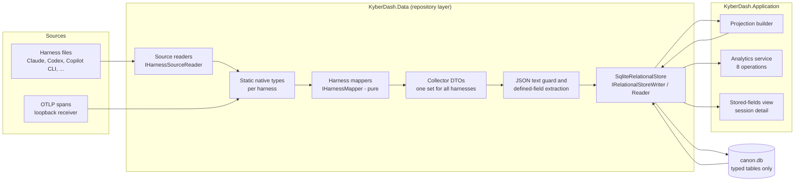
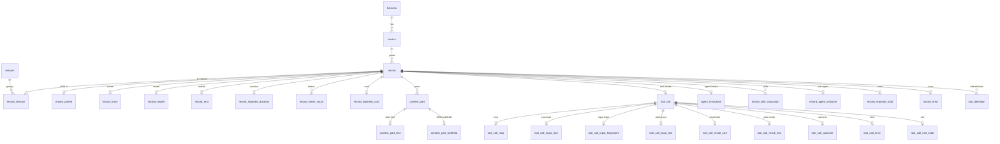

# Design Document

**Status:** Archived, 2026-11-20. Superseded by and fully delivered through [the relational-store plan](../../plans/2026-11-19-kyberdash-relational-store.md); every design decision below shipped as plan tasks T1–T56.


## Overview

The store becomes a set of typed tables with every column `NOT NULL`. One static schema catalog
describes all of them, and the catalog generates the DDL, the column list on the Copilot detail
page, and the structure tests. Data reaches the store along one path:

1. A **source reader** in the data layer finds a harness's files (or receives its OTLP spans) and
   deserializes them into **static native types** for that harness. A native field with no property
   is ignored, and the field register records it as dropped.
2. A **harness mapper** converts the native types into **collector DTOs**. It is a pure function
   with no file system, clock or database. Every harness uses the same DTOs (OD-1).
3. The **collector writer** passes the DTOs to `IRelationalStoreWriter`. No JSON document is ever
   stored, in any form. When a harness value is a JSON document, whether a native object or text
   that parses as one (a tool input, a tool result, a tool-definition list, a content part), the
   mapper extracts only the fields on the closed list of defined, shared-meaning fields in
   [DD-3](#design-decisions), plus the measurements of the original that detectors use. It drops
   the rest, and the field register gives the reason for each drop. The store's write guard refuses
   any `TEXT` value that is a JSON document (RQ-2).
4. The **projection builder** rebuilds sessions, turns, runs, executions, rollups, findings and
   predictions into typed projection tables from the record tables (RQ-5).
5. The **analytics service** answers the eight operations through `IRelationalStoreReader` alone.
   It parses no harness format and no JSON (OD-5), and every failure returns a non-empty envelope
   (RQ-10).

Nothing is migrated. When the engine opens a store older than the relational version, it deletes
the old store without reading it and re-ingests every source it can read (OD-7). No legacy database
is kept. History that reached the store only over OTLP has no harness file, so it cannot be
re-ingested. That conflicts with OD-7's "every harness's history is re-ingested", and is left open as
blocker **BL-1** ([DD-9](#design-decisions),
[Harness identities and recoverability](#harness-identities-and-recoverability)). This run writes
the specification only and deletes nothing. The Copilot CLI
journal reader is new. It produces `llm.invoke`, `tool.invoke` and `agent.invoke` records from event
shapes that GitHub documents (DD-7).

## Evidence

| Fact | Source |
|---|---|
| 22 tables at schema version 24; JSON in `records.tokens_json`, `content_json`, `cost_json`, `measurability_json`, `parts_json`, `raw` and in payload columns elsewhere | `dash/server/KyberDash.Domain/CanonSchema.cs` lines 34–331 |
| The empty HTTP 500: `content_json` is read as `Dictionary<string,string>` but holds numbers and booleans | `dash/server/KyberDash.Data/Repositories/CanonStoreRepository.Queries.cs` lines 110–131; `KyberBridgeEngine.ExecuteAnalytics` calls `EnsureProjected` before each operation |
| Rows reach the engine through `sqlite3 -batch -bail` in `.mode tabs` with hex-encoded text, not JSON. `ExecuteSqliteCore` is `protected virtual`, so a test can replace the process | `dash/server/KyberDash.Core/Repositories/BaseSqliteRepository.cs` lines 62–110; `CanonStoreRepository.Queries.cs` line 60 |
| The C# engine reads local files for Claude Code (`~/.claude/projects`) and Codex (`~/.codex/sessions`) only; `import-history` runs the same discovery | `TranscriptReaderRepository.DiscoverLocalSources` (line 245); `JobSchedulerService.ImportHistory` |
| OTLP adapters exist for `claude-code`, `codex`, `copilot`, `antigravity`, `gemini` (yields), `pi`, `opencode` (plugin contract 3) and `droid` (plugin contract 1). The generic op rule: `gen_ai.tool.name` gives `tool.invoke`, `gen_ai.operation.name = invoke_agent` gives `agent.invoke`, token keys give `llm.invoke` | `dash/server/KyberDash.Domain/CanonAdapters.cs` lines 558–570, 877–1400 |
| File synthesis emits `llm.invoke` parents and `tool.invoke` children with kind `internal`, never `agent.invoke` | `dash/server/KyberDash.Domain/CanonSynth.cs` lines 739, 860–861 |
| Harness ids after normalization | `CanonPricing.NormalizeHarnessName`, lines 720–764 |
| The retired TypeScript engine had file providers for many more harnesses, including `copilot.ts`, `cursor.ts`, `kilo-code.ts`, `commandcode.ts`, `devin.ts`, `warp.ts`, `droid.ts`, `antigravity-transcript.ts`, `pi.ts`, `roo-code.ts`, `cline.ts` and `kimicode.ts`, with content readers under `dash/src/synth/readers/` | `git ls-tree fc80ddf9^ dash/src/providers/ dash/src/synth/readers/` |
| Copilot CLI journal `~/.copilot/session-state/<id>/events.jsonl`. Every event has an envelope `id`, `timestamp`, `parentId`, optional `agentId` (a sub-agent instance), `type` and `data`. `assistant.message` has `messageId`, `content`, optional `toolRequests[]` (`toolCallId`, `name`, `arguments` object, `type`) and optional `outputTokens`. `tool.execution_start` has `toolCallId`, `toolName`, `arguments`, `mcpServerName` and `mcpToolName`. `tool.execution_complete` has `toolCallId`, `success`, `result{content, detailedContent, contents[]}`, `error{message, code}` and `model`. `subagent.started`, `subagent.completed` and `subagent.failed` have `toolCallId` (the tool call that spawned the sub-agent), `agentName`, `agentDisplayName`, `model`, `durationMs`, `totalTokens`, `totalToolCalls` and `error`. `session.shutdown` has per-model `modelMetrics`. `assistant.usage` is **ephemeral and not persisted** | GitHub Docs, [Streaming session events](https://docs.github.com/en/copilot/how-tos/copilot-sdk/features/streaming-events), read 2026-11-18 |
| The Copilot CLI journal holds only `outputTokens` per message, and from CLI 1.0.81 omits even that. Per-model input, cache and output counts come from `session.shutdown.modelMetrics[model].usage`; that input is cache-inclusive and resets at compaction | Deleted `fc80ddf9^:dash/src/providers/copilot.ts` lines 190–238, 803–1092; [copilot-cli-output-tokens-skipped-messages](../../../todo/copilot-cli-output-tokens-skipped-messages.md) |
| OpenCode and Droid turns arrive only as plugin OTLP spans; OpenCode has no file source | [Telemetry inventory](../../../dash/telemetry-inventory.md), "Verified harness outcomes" |
| Detectors read these values from tool content and raw attributes today. The skill name comes from tool input `skill` or `name` on a `Skill`/`skill` call, or from `kyber.skills.invoked`. Test counts are parsed from tool-result text. The fatal-exception check runs over tool-result text. Duplicate calls are found by a SHA-256 hash of the arguments. Oversized results are judged by tokens, characters and bytes. The raw keys used are `exitCode` / `exit_code` / `status_code`, `error` / `exception`, `editFailed`, `isCorrection` / `correctionRule` and `userMessage` | `CanonFindings.cs` lines 401–509, 1046–1063, 1184–1210, 2109–2180 |
| A file-synthesized tool record carries the tool name, call id, status (`ok`, `error`, `unset`), argument bytes, an argument hash when the arguments were truncated, result bytes, duration, and result text truncated at `MaxToolResultBytes` | `CanonSynth.cs` lines 752–860 |
| Tool definitions arrive as `tool_definitions` content-part text, which is split into (name, item text) with tokens counted per item | `CanonSessionProjectorEngine.cs` lines 2150–2180 |
| **Codex file tools.** The rollout reader handles `response_item` types `function_call` and `custom_tool_call` (`call_id` with fallback `id`, `name`, `arguments` with fallback `input`, entry timestamp). It pairs `function_call_output` and `custom_tool_call_output` by call id. It does not handle `local_shell_call` or `local_shell_call_output`. The pairs become `tool.invoke` children through `CanonSynth.SynthesizeToolCall`. The existing Codex fixture test has no tool items | `TranscriptReaderRepository.cs` lines 818–978; `TranscriptReaderRepositoryTests.cs` lines 101–129 |
| `local_shell_call` has `call_id`, `status` (`in_progress`, `completed`, `incomplete`) and `action` of type `exec`, with `command` (an array), `env`, `timeout_ms`, `user` and `working_directory`. `local_shell_call_output` has the call id and `output` text | OpenAI API reference, [Local shell](https://developers.openai.com/api/docs/guides/tools-local-shell), read 2026-11-18 |
| Codex emits OTel log events `codex.tool_decision` and `codex.tool_result`. `codex.tool_result` carries the tool name, success and duration, and per secondary sources also the call id, arguments and an output excerpt | Secondary: [Last9 Codex integration](https://last9.io/docs/integrations/codex/) and a Codex observability write-up, read 2026-11-18. The authoritative `openai/codex` telemetry document is confirmed in task 9.2's first step (DD-17) |
| **Codex OTLP tools.** The adapter keeps only an allowlist (`model`, `slug`, `conversation.id`, `event.timestamp`, `gen_ai.usage.*`, `codex.usage.*`). Tool arguments and output are dropped, and Codex `tool.invoke` over OTLP is deferred (#210) | `CanonAdapters.cs` lines 1146–1207; telemetry inventory lines 62 and 679–681 |
| Session projection: `payload` and `summary_json` are serialized from dictionaries built in the projector, and `turn_json` holds the payload's `turns` entries | `CanonSessionProjectorEngine.cs` lines 330–670, 1130–1276; `CanonStoreRepository.Queries.cs` lines 324–360 |
| `run.payload` and `execution.payload` are always null. `parent_linkage_json` is `{status, parentSession}` or `{status, reason}` | `CanonRollupsEngine.cs` lines 236–268, 1044–1054 |
| `harness_rollup.measurability_json` holds a per-dimension `measured` / `derived` / `{status: not_measurable, reason}`. `payload` holds `sessionCount`, `runCount`, `executionCount`, `unknownWindowSessions` and `windowSessionsTotal`. A row is written for each of 12 registered harnesses (`aider`, `antigravity`, `claude-code`, `cline`, `codex`, `copilot`, `cursor`, `droid`, `kilo-code`, `opencode`, `pi`, `windsurf`) and for every observed harness | `CanonRollupsEngine.cs` lines 62–76, 236–250, 627–855 |
| `finding.payload` holds `measurementClass`, `confidenceBasis` and `whatWouldRaiseIt`, or a detector's own `Payload`. The only detector that sets one is `compaction-hazard` (`contextLimit`, `contextLimitSource`). `FindingEvidenceLink` is `(SpanId, TurnIndex, Description)`, and `FindingErrorBar` is `(Lower, Upper)` | `CanonFindings.cs` lines 76–102, 1521–1552; `CanonStoreRepository.Queries.cs` lines 499–517 |
| The only prediction writer never sets `ErrorBar` or `Payload`. Comparison, observed delta and calibration score are read but not written in the engine | `KyberBridgeEngine.cs` lines 1016–1025; `CanonStoreRepository.cs` lines 1087–1098 |
| `metric_point.attributes_json`, `resource_json` and `scope_json` are written and never read | grep over `dash/server`: the only reference is the insert at `CanonStoreRepository.Queries.cs` line 955 |
| `metadata` keys: `schema_version`, `detector_version`, `records_write_seq`, `last_clean_at`, `projection_schema_version`, `projection_records_marker`, `projection_dirty_sessions` (JSON `{fromSeq, toSeq, keys}`), `projection_session_key_map` (JSON map), `content_retention_days`, `content_purged_through`, `model_context_window_catalog.status`, and `settings.*` (`folder_import.scheduled`, `jobs.paused`, `jobs.refresh_cadence_minutes`, `receiver.hosted`, `dashboard.port`) | `CanonStoreRepository.cs` lines 26–29, 754–817, 1635–1647; `CanonSchema.cs` 22–28; `CanonRefreshEngine.cs` 21–24; `PricingRepository.cs` 22; `SettingsRepository.cs` 16–28 |
| Harness ids that the normalizer can return: `claude-cli`, `claude-unclassified`, `claude-code`, `copilot-cli`, `copilot-vscode`, `copilot-jetbrains`, `copilot-agent`, `copilot`, `cursor`, `windsurf`, `roo-code`, `cline-cli`, `cline`, `aider`, `codex-cli`, `codex-desktop`, `codex-unclassified`, `codex`, `gemini` (excluded), `antigravity-cli`, `antigravity-ide`, `antigravity`, `opencode`, `kilo-vscode-legacy`, `kilo-shared-runtime`, `kimi-code`, `commandcode`, and any other input lowercased unchanged | `CanonPricing.cs` lines 153–154, 720–778 |
| TypeScript-era file sources and their native locations: Command Code `~/.commandcode/projects/<cwd>/<id>.jsonl`; Kilo `~/.local/share/kilo/kilo.db` and the legacy VS Code global storage; Devin `~/.local/share/devin/cli/transcripts/` and `sessions.db`; Warp's Group Containers SQLite; Factory `~/.factory/sessions` with `<id>.settings.json`; Cursor's SQLite storage; Cline and Roo Code `tasks/<id>/ui_messages.json`; the Copilot VS Code journal; Antigravity transcripts | Telemetry inventory lines 56–73; `git ls-tree fc80ddf9^ dash/src/providers/` |

All of this evidence is code, public documentation and synthetic analysis. No private session data
was read.

## Design decisions

| ID | Decision | Alternatives considered | Rationale | Confidence |
|---|---|---|---|---|
| DD-1 | One static **schema catalog** (`RelationalSchemaCatalog`) describes every table, column, key and foreign key. It generates the DDL, and both the detail page and the structure tests read it. | Hand-written DDL checked by regex. | One source cannot drift. Requirements 2.5, 3.4 and 9.3 become tests over the catalog. | high |
| DD-2 | Every column is `NOT NULL`. A value that may be missing gets its own child table keyed by the parent's key. | Nullable columns, with null meaning "not reported". | OD-3 states this; a catalog test enforces it. | high (owner) |
| DD-3 | **No JSON document is stored, decomposed or kept in any form.** When a harness value is a JSON document (a native object, or text whose trimmed whole value parses as a JSON object or array), the mapper keeps only (a) the fields on the closed [defined-field list](#defined-field-list) and (b) measurements of the original that a detector uses: UTF-8 bytes, characters, measured tokens, and a one-way SHA-256 fingerprint of the canonical form. Everything else in the document is dropped, and the field register gives the reason. Plain text that is not a JSON document is kept as it is. Adding a field to the list is a schema change (Requirement 1.3), never a generic mechanism. | (a) A generic `document` / `document_leaf` / path / typed-value structure. Rejected at design review: it is a catch-all for arbitrary input, it conflicts with OD-6, and it can reconstruct the original payload. (b) Per-tool typed tables for every tool's parameters. Rejected: the parameters have no shared meaning and the set is unbounded. (c) Keep the document as text. Forbidden by OD-2. | Every value a detector reads today has a typed home (see [Evidence](#evidence)). A fingerprint and sizes cannot reconstruct the payload. The owner's ban on catch-alls holds literally. | medium — revised at design review, 2026-11-18 |
| DD-4 | Token counts are one row per reported class: `record_token_count(record_id, token_class, count)`, with `token_class` in `input`, `cache_read`, `cache_write`, `output`, `reasoning`. Mappers convert to these disjoint classes, and inclusive totals are computed at read time. | One `record_tokens` row of five columns. | Copilot CLI reports output only, and Droid's plugin reports none. A wide row would need nulls or zeros for the missing classes. The harness's own inclusive totals (`TokenUsage.ReportedInput`, `ReportedOutput`), used for reconciliation, are a separate child `record_reported_total(record_id, direction ∈ input|output, count)`. | high |
| DD-5 | Timing is stored as `record.started_at` plus a child `record_end(ended_at)`. Duration is computed at read time. A harness duration with no end time (`subagent.completed.durationMs`) is stored as `record_reported_duration(duration_ms)` only when no end timestamp exists. | Store `duration_ms` beside the start time. | A duration derived from two stored times is a derivable value (OD-3). | medium |
| DD-6 | Only harness-reported cost is stored, in `record_reported_cost(amount, currency)`. Published-rate cost is computed by analytics (RQ-3). Copilot's `cost` multiplier and nano-AIU are not currency and are dropped with that reason. | Store a computed cost with a basis flag. | OD-3 and RQ-3. | low — RQ-3 |
| DD-7 | Copilot CLI is read from `events.jsonl` using only the event types and fields GitHub documents (table in [Copilot CLI mapping](#copilot-cli-mapping)). A field that is not documented and not seen in the deleted reader is not mapped. | Port the deleted TypeScript reader as it was. | The deleted reader dropped tool and agent records and skipped messages without `outputTokens`. Documented shapes are the authority. | medium |
| DD-8 | The parent of a Copilot CLI `agent.invoke` record is the `tool.invoke` named by `subagent.started.toolCallId`. The sub-agent's own records link to it through `record_agent_instance` **only** if a fixture built from documented shapes proves that the envelope `agentId` joins `subagent.started`. Until then the records keep their `agentId` and have no parent link. | Link by time window. | Requirement 8.4: no inferred links. | low |
| DD-9 | OD-7 stands as the owner stated it: the existing database is **deleted** (`canon.db`, `-wal`, `-shm`), unread, and every harness's history is re-ingested from its own files. No legacy database is kept, and nothing is migrated. History that reached the store only over OTLP has no harness file behind it and is lost; the owner accepted that loss (BL-1). | (a) Set the old store aside, renamed, until the owner confirms. Rejected at design review: it overrides OD-7. (b) Migrate the OTLP-only rows. Forbidden by OD-7. (c) Ship the deletion and accept the loss silently. Rejected: it would accept data loss for the owner. | An owner decision is not overridden autonomously, and a factual conflict inside it is raised, not settled. | high (owner, OD-7); BL-1 open |
| DD-10 | OTLP logs (`pending_logs`, `quarantined_logs`, `enriched_logs`) are removed. The C# engine stores logs but never correlates them. A future log mapper would map each log to collector DTOs on receipt, and a log it cannot map is counted in `ingest_problem`. | Keep the log tables with typed columns. | No reader uses the stored logs today, and keeping them typed would mean inventing their fields. | low — RQ-9 |
| DD-11 | Adapter SQL is tested by overriding `ExecuteSqliteCore` in a test subclass that records statements and returns canned tab-separated, hex-encoded output. No database file is opened. | Contract suite against a real SQLite file (ADR 0089). | OD-9 forbids it; the conflict is recorded in RQ-8. | low — RQ-8 |
| DD-12 | The collector DTOs and the native types live in `KyberDash.Data` (the repository layer, OD-1). The store interfaces live in `KyberDash.Contracts`. The analytics service depends only on the reader interface. | DTOs in `KyberDash.Domain`. | OD-1 names the repository layer. | high (owner) |
| DD-13 | Projection tables store only analysis outputs that cannot be got by a plain aggregate over record rows. That means context pressure per turn, schema ranking, timeline sub-agent and auxiliary marks, run grouping, execution linkage, rollup metrics, findings and predictions. Plain aggregates are computed at read time by `IRelationalStoreReader` queries: token totals, counts, model lists, tools offered and invoked, request lists, reconciliation, per-tool invocation counts and priced cost. | Store every field of today's `payload` dictionary. | Requirement 3.4 allows derived values only in projection tables. Storing aggregates that are also derivable from projection columns creates transitive dependencies. RQ-3 forbids stored priced cost. | medium |
| DD-14 | A projection's analysis verdict "not measurable, because …" is stored as a reason row in a table of its own, exclusive with the measured row (for example `session_context` versus `session_context_unmeasurable`). A harness value that was simply not reported has no row at all (OD-3). | Recompute every reason at read time. | A verdict is an output of the projector, not a harness value, and some reasons depend on analysis state that is not stored. Harness facts still follow "absence means not reported". | medium |
| DD-15 | Tool definitions are mapped to `tool_definition(record_id, position, tool_name, schema_tokens)` plus an optional server row. Tokens are counted once, at ingest, with the existing token counter. The definition text, which is a JSON schema, is dropped (DD-3). | Keep the definition text. | It is a JSON document (OD-2). Schema cost and the dormant-tool-schema detector need only the name, server and token size. | medium |
| DD-16 | **No evidenced harness is excluded without the owner's authorisation.** Every harness that had a reader before `fc80ddf9` gets a C# reader and mapper under the same contract. Each is ported test-first from the deleted TypeScript provider's evidenced shapes (`fc80ddf9^:dash/src/providers/*`). A field the deleted provider did not read, and that no public format document shows, is not mapped. A harness with no evidenced format (any unknown id) still gets typed coverage; `windsurf` and `aider` are excluded by the owner (BL-3). Discovery reports it with a `SOURCE_FORMAT_UNEVIDENCED` problem row, never as silent zero. Its reader task waits on format evidence and is not dropped. | Port only the readers the owner's list names. Rejected at design approval: it excludes evidenced harnesses without the owner's authorisation. | The approval requires coverage "rather than excluding them". Port cost is bounded by the deleted providers, which exist in git history. | medium |
| DD-17 | **Codex tool handling covers both paths.** (a) Files: `local_shell_call` and `local_shell_call_output` are mapped to `tool.invoke` with `tool_name = local_shell`. `action` is a JSON object, so only input size and fingerprint are kept (DD-3). `status` maps to `tool_call_outcome` (`completed` means success, `incomplete` means failure, `in_progress` means no row). `output` is kept as result text when it is plain text. The shape is taken from OpenAI's API reference "Local shell". (b) OTLP: the Codex `codex.tool_result` log event is mapped on receipt to a `tool.invoke` record. Only the attributes that Codex's own published telemetry documentation names are used (tool name, call id, success, duration); the documentation is cited in the field register. The arguments and output excerpt are dropped, as a JSON document or tool-specific text (OD-6). This replaces "#210 deferred". | Keep Codex OTLP tool data dropped. Rejected at design approval: it excludes evidenced support without the owner's authorisation. | Both shapes are publicly documented. (b) uses the log mapper DD-10 already foresees, without storing logs. | medium — (b) needs the authoritative `openai/codex` telemetry document confirmed in its first test-first step; secondary sources only so far |

## Architecture



The analytics service, the projection builder and the stored-fields view see only
`IRelationalStoreReader` and `IProjectionStore`. In tests those are the in-memory fake.

## Components and Interfaces

### Collector DTOs (`KyberDash.Data/Collector`)

Records with only static types (Requirement 1.4). The nullable properties are mapper-facing; the
writer turns each one into the presence or absence of a child row.

```csharp
public enum RecordOp { LlmInvoke, ToolInvoke, AgentInvoke, Unspecified }
public enum RecordKind { Internal, Client, Server }
public enum TokenClass { Input, CacheRead, CacheWrite, Output, Reasoning }

public sealed record CollectedSource(string HarnessId, SourceKind Kind, string Locator);
public sealed record CollectedSession(string SessionKey, string HarnessId, string NativeSessionId,
    CollectedWorkspace? Workspace, string? Title, IReadOnlyList<CollectedModelUsage> ReportedUsage);
public sealed record CollectedRecord(string RecordId, string HarnessId, RecordOp Op, RecordKind Kind,
    string Name, DateTimeOffset StartedAt, RecordStatus Status,
    string? SessionKey, string? ParentRecordId, string? TraceId, string? Model,
    DateTimeOffset? EndedAt, long? ReportedDurationMs,
    IReadOnlyList<CollectedTokenCount> Tokens, CollectedCost? ReportedCost,
    IReadOnlyList<CollectedContentPart> Parts, CollectedToolCall? Tool,
    CollectedAgentInvocation? Agent, IReadOnlyList<string> SkillsInvoked, string? AgentInstanceId,
    IReadOnlyList<CollectedToolDefinition> ToolDefinitions, CollectedRecordSignals Signals);
public sealed record CollectedToolCall(string CallId, string ToolName, string? McpServerName,
    string? McpToolName, CollectedToolContent? Input, CollectedToolContent? Result, bool? Succeeded,
    CollectedError? Error, long? ExitCode);
// Input or result: plain text is kept; a JSON document keeps only its measurements (DD-3).
public sealed record CollectedToolContent(string? PlainText, long Utf8Bytes, long Characters,
    string Sha256Fingerprint, long? OriginalUtf8BytesWhenTruncated);
public sealed record CollectedAgentInvocation(string AgentName, string? SpawningCallId,
    bool? Succeeded, string? Error);
public sealed record CollectedContentPart(int Position, ContentBucket Bucket, string? PlainText,
    CollectedWithheldText? Withheld, long? ReportedTokens, string? Server, string? Role,
    bool? Resident, long? OriginalUtf8BytesWhenTruncated);
public sealed record CollectedWithheldText(long Utf8Bytes, long Characters, long MeasuredTokens);
public sealed record CollectedToolDefinition(int Position, string ToolName, string? Server,
    long SchemaTokens);
public sealed record CollectedRecordSignals(string? ErrorMessage, long? EditFailures,
    string? CorrectionRule, long? DeclaredContextWindow);
```

Each DTO holds exactly one of `PlainText` or `Withheld`; a constructor guard enforces this. No DTO
property is `JsonElement`, `object`, or a dictionary keyed by field name, and a reflection test over
the assembly enforces that too (Requirement 1.4). A native reader may parse a document into a
`JsonElement` *inside* the mapper, but only to pull out the fields on the defined-field list and to
compute the measurements. No `JsonElement` crosses the DTO boundary.

### Source readers and mappers

```csharp
public interface IHarnessSourceReader          // I/O adapter: discovery and file reads
{
    string HarnessId { get; }
    IReadOnlyList<SourceUnit> Discover(DateTimeOffset? sinceUtc);
    NativeSourceUnit Read(SourceUnit unit);    // static native types, never JsonElement
}

public interface IHarnessMapper                // pure
{
    string HarnessId { get; }
    CollectedBatch Map(NativeSourceUnit unit); // sessions, records, problems
}
```

`TranscriptReaderRepository.DiscoverLocalSources` becomes a registry that holds one
`IHarnessSourceReader` per harness. The OTLP path has one mapper per adapter. That mapper consumes
the decoded `OtlpSpan` attributes through a static `OtlpSpanNative` type that holds only the keys
the adapter reads (the key lists in `CanonAdapters.cs`). Attributes outside those lists are dropped,
and the register records them.

### JSON text guard and defined-field list

`JsonDocumentText.IsDocument(string)` returns true when the trimmed text starts with `{` or `[` and
the whole of it parses as a JSON object or array. It is used in two places:

- The mappers call it, through `ToolContentMeasurer.Measure(string)`, on every tool input, tool
  result and content part. If the value is plain text, it is kept, truncated where a limit applies.
  If it is a document, the text is withheld and only its measurements are kept: UTF-8 bytes,
  characters, tokens for content parts, and the SHA-256 fingerprint of the canonical form for tool
  inputs (DD-3).
- The SQLite adapter's write guard and the fake's write guard both refuse any `TEXT` value for which
  `IsDocument` is true, with `STORE_JSON_TEXT_REFUSED` (Requirement 2.6). The guard covers every
  `TEXT` column, so a JSON-valued tool result, a JSON-valued argument, a JSON string inside a
  setting, or a JSON-looking title can never be stored.

The analytics path never calls it, because nothing it reads can be JSON. Text that only contains
JSON somewhere inside it, such as prose that quotes an object, stays plain text (Requirement 2.7).

A value whose whole text is a JSON scalar (for example `42`, `true` or `"x"`) is not a document. It
is plain text, unless the field on the defined-field list has a numeric or boolean meaning. In that
case the mapper converts it to that type.

#### Defined-field list

This list is closed. Each entry is a defined field with a shared meaning across harnesses, and each
names the consumer that reads it today. A harness field is stored only if it is on this list, is a
record-envelope field (ids, times, model, tokens, cost, MCP server, outcome, error), or is a
session-envelope field (working directory, repository, branch, title, model usage). Anything else is
dropped with a reason in the register (OD-6).

| Defined field | Where a harness supplies it | Stored in | Consumer today |
|---|---|---|---|
| Skill name | the `skill` or `name` argument of a call to a tool named `Skill` or `skill`; the Claude `kyber.skills.invoked` attribute; Copilot CLI `skill.invoked.name` | `record_skill_invocation(record_id, skill_name)` | inactive-skill-reference (`CanonFindings.cs` 2109–2180) |
| Tool input size | measured on the original input | `tool_call_input_size(utf8_bytes, characters)` | oversized and dormant-schema analysis; the duplicate detector's size check |
| Tool input fingerprint | SHA-256 over the canonical (sorted-key, minified) arguments, or over plain-text input | `tool_call_input_fingerprint(sha256)` | duplicate-tool-call (`CanonFindings.cs` 1046–1063) |
| Tool input text | only when the input is plain text, such as Codex `custom_tool_call.input` (a patch) or a shell command string | `tool_call_input_text(text)` | session detail; duplicate detection already uses the fingerprint |
| Tool result size | measured before any truncation or withholding | `tool_call_result_size(utf8_bytes, characters)` | oversized-tool-result (`CanonFindings.cs` 1184–1210, tokens estimated as (chars+3)/4) |
| Tool result text | only when the result is plain text; truncated at `MaxToolResultBytes` | `tool_call_result_text(text)` + `tool_call_result_truncation(original_utf8_bytes)` | test counts and the fatal-exception check (`CanonFindings.cs` 441, 498–509) |
| Tool exit code | `exitCode`, `exit_code`, `status_code` | `tool_call_exit_code(exit_code)` | failure classification |
| Tool definitions | a `tool_definitions` part, or a harness's declared tool list | `tool_definition(record_id, position, tool_name, schema_tokens)` + `tool_definition_server(server)` (DD-15) | schema cost; dormant-tool-schema (`CanonSessionProjectorEngine.cs` 2150–2180) |
| Content part that is a JSON document | any part | `content_part_withheld(utf8_bytes, characters, measured_tokens)` | context pressure buckets |
| Content part reported tokens, server, role, residency, truncation | `ContentPart.Tokens`, `Server`, `Role`, `Resident`, `Truncated` | `content_part_reported_tokens`, `content_part_server`, `content_part_role`, `content_part_residency`, `content_part_truncation` | context analysis |
| Record error | `error`, `exception` | `record_error(message)` | fatal-exception and failure analysis |
| Edit failures | `editFailed` | `record_edit_failure(count)` | outcome risk |
| Correction | `isCorrection`, `correctionRule` | `record_correction` + `record_correction_rule(rule)` | `CanonSynth.cs` correction rows |
| User message | `userMessage` | a `user_message` content part | context and timeline |
| Declared context window | `declaredContextWindow` | `record_declared_context_window(tokens)` | compaction-hazard; context limit source |
| Reported totals | `TokenUsage.ReportedInput`, `ReportedOutput` | `record_reported_total(direction, count)` | reconciliation |

Everything a JSON-valued tool input or result contains beyond these fields is dropped: command
lines, file paths and parameter values inside arguments, and structured result bodies. The register
row for each tool-content field says "JSON document withheld: OD-2 forbids JSON text and OD-6
forbids a catch-all; sizes and fingerprint kept for the detectors that need them". If a future
detector needs one of these fields, it is added to this list as a named, typed column, which is a
schema change, and the data is re-ingested from the harness files (OD-6).

### Store interfaces (`KyberDash.Contracts/Repositories`)

```csharp
public interface IRelationalStoreWriter
{
    void WriteBatch(CollectedBatch batch);            // one transaction per source unit
    void DeleteSource(string sourceId);               // cascades to its records
    void WriteProblem(IngestProblem problem);
}
public interface IRelationalStoreReader            // analytics, projection and the view read this only
{
    IReadOnlyList<RecordRow> Records(RecordQuery query);
    IReadOnlyList<TokenCountRow> TokenCounts(IReadOnlyCollection<string> recordIds);
    IReadOnlyList<ToolCallRow> ToolCalls(IReadOnlyCollection<string> recordIds);
    IReadOnlyList<ContentPartRow> ContentParts(IReadOnlyCollection<string> recordIds);
    StoredFieldsView StoredFields(string sessionKey);  // every catalog table reachable from the session
    // ... one typed method per child table the operations need
}
public interface IProjectionStore { /* typed read and replace for each projection table */ }
public interface IOperationalStore { /* settings, store state, checkpoints, refresh runs, problems */ }
```

`SqliteRelationalStore` implements all four over `BaseSqliteRepository`. `InMemoryRelationalStore`
in the test support project implements the same four. It enforces primary keys, foreign keys with
cascade, `NOT NULL`, the JSON write guard and the exclusive-pair rules, all using the same catalog
(Requirement 10.5). The exclusive pairs are: `content_part_text` or `content_part_withheld`, and a
measured projection row or its `_unmeasurable` row.

### Analytics service

`KyberBridgeEngine.ExecuteAnalytics` keeps its contract-v1 envelope and its eight operation names,
and reads through `IRelationalStoreReader` and `IProjectionStore`. Two changes:

- `EnsureProjected` projects each dirty session on its own. A session that fails is recorded with
  `ingest_problem` code `PROJECTION_FAILED`, and the operation answers from the sessions that did
  project (Requirement 5.4).
- `ExecuteAnalytics` has one catch boundary that maps any exception to an error envelope with a
  stable `error.code` (`ANALYTICS_STORE_UNAVAILABLE`, `ANALYTICS_INVALID_ARGUMENT` or
  `ANALYTICS_INTERNAL`) and a message, and that never writes an empty body (Requirement 5.3).

Cost: where `record_reported_cost` exists, analytics reports it. Otherwise it prices the
`record_token_count` rows from `CanonPricing`'s rate table, or states why it cannot. The two bases
are reported separately and never added together (Requirement 5.5).

### Stored-fields view (Copilot session detail)

`GET /api/sessions/{sessionKey}/stored-fields` returns `StoredFieldsView`. It walks the catalog's
foreign-key graph from `session` and returns, for each table, its column names and the rows that
belong to the session. For each optional child table, it also returns the parent keys that have no
row. The web page renders the view generically and labels every value `table.column`
(Requirement 9.4). A missing optional row renders as "not reported" (Requirement 9.2). Because the
page is driven by the catalog, a new column appears without a page change. A web unit test over a
fake view built from the catalog fails if any catalog column reachable from a Copilot session has
no rendered label (Requirement 9.3). The page is mounted as a "Stored fields" panel on the
existing `/session/:sessionId` view, for every harness; OD-8 requires it for Copilot.

## Data Models

### Conventions

- Every column is `NOT NULL` (DD-2). Types are `INTEGER`, `REAL` or `TEXT` only, with timestamps as
  ISO-8601 UTC `TEXT` and booleans as `INTEGER` with `CHECK (x IN (0,1))`.
- No column is named `*_json`, `payload` or `raw`, and no column is `BLOB` (Requirement 2.5).
- Every foreign key is `ON DELETE CASCADE` (Requirement 3.5).
- Enumerations are `TEXT` with a `CHECK` list taken from the catalog.

### Record tables



| Table | Key | Columns (all NOT NULL) | Meaning of absence |
|---|---|---|---|
| `harness` | `harness_id` | `harness_id` | — |
| `source` | `source_id` | `harness_id` FK, `source_kind` (`file`, `otlp`), `locator` | — |
| `session` | `session_key` | `harness_id` FK, `native_session_id` | — |
| `session_workspace` | `session_key` | `cwd` | no working directory reported |
| `session_repository` | `session_key` | `repository` | not reported |
| `session_branch` | `session_key` | `branch` | not reported |
| `session_title` | `session_key` | `title` | not reported |
| `session_model_usage` | `session_key, snapshot_position, model, token_class` | `count` | the harness reports no session-level usage |
| `record` | `record_id` | `source_id` FK, `harness_id` FK, `op`, `kind`, `name`, `started_at`, `status` | — |
| `record_session` | `record_id` | `session_key` FK | orphan span |
| `record_parent` | `record_id` | `parent_record_id` FK | root |
| `record_trace` | `record_id` | `trace_id` | no trace |
| `record_model` | `record_id` | `model` | model not reported |
| `record_end` | `record_id` | `ended_at` | end not reported |
| `record_reported_duration` | `record_id` | `duration_ms` | no duration without an end (DD-5) |
| `record_token_count` | `record_id, token_class` | `count` | class not reported (DD-4) |
| `record_reported_total` | `record_id, direction` (`input`, `output`) | `count` | the harness reports no inclusive total |
| `record_reported_cost` | `record_id` | `amount`, `currency` | no harness-reported cost |
| `record_skill_invocation` | `record_id, skill_name` | — | none invoked |
| `record_agent_instance` | `record_id` | `agent_instance_id` | root-agent record |
| `record_error` | `record_id` | `message` | no error reported |
| `record_edit_failure` | `record_id` | `count` | not reported |
| `record_correction` | `record_id` | — | not a correction |
| `record_correction_rule` | `record_id` FK `record_correction` | `rule` | no rule named |
| `record_declared_context_window` | `record_id` | `tokens` | not declared |
| `content_part` | `record_id, position` | `bucket` | — |
| `content_part_text` | `record_id, position` | `text` (never a JSON document) | the part is withheld |
| `content_part_withheld` | `record_id, position` | `utf8_bytes`, `characters`, `measured_tokens` | the part is plain text; exactly one of `_text` and `_withheld` exists |
| `content_part_reported_tokens` | `record_id, position` | `tokens` | not reported |
| `content_part_server` | `record_id, position` | `server` | not tied to a server |
| `content_part_role` | `record_id, position` | `role` | not reported |
| `content_part_residency` | `record_id, position` | `resident` | not reported |
| `content_part_truncation` | `record_id, position` | `original_utf8_bytes` | not truncated |
| `tool_definition` | `record_id, position` | `tool_name`, `schema_tokens` | no tools offered on this record |
| `tool_definition_server` | `record_id, position` | `server` | built-in tool |
| `tool_call` | `record_id` | `call_id`, `tool_name` | — |
| `tool_call_mcp` | `record_id` | `server_name`, `server_tool_name` | not an MCP tool |
| `tool_call_input_size` | `record_id` | `utf8_bytes`, `characters` | no input reported |
| `tool_call_input_fingerprint` | `record_id` | `sha256` (64 hex characters) | no input reported |
| `tool_call_input_text` | `record_id` | `text` | the input is a JSON document (withheld) or not reported |
| `tool_call_result_size` | `record_id` | `utf8_bytes`, `characters` | no result reported |
| `tool_call_result_text` | `record_id` | `text` | the result is a JSON document (withheld) or not reported |
| `tool_call_result_truncation` | `record_id` | `original_utf8_bytes` | not truncated |
| `tool_call_outcome` | `record_id` | `succeeded` | outcome not reported |
| `tool_call_error` | `record_id` | `message` | no error |
| `tool_call_error_code` | `record_id` | `code` | no code |
| `tool_call_exit_code` | `record_id` | `exit_code` | not reported |
| `agent_invocation` | `record_id` | `agent_name` | — |
| `agent_invocation_spawn` | `record_id` | `spawning_record_id` FK (the `tool.invoke`) | not reported |
| `agent_invocation_outcome` | `record_id` | `succeeded` | not reported |
| `agent_invocation_error` | `record_id` | `message` | no error |
| `record_provenance` (+ `_native_session`, `_native_record`) | `record_id` | see [store-state and operational tables](#store-state-settings-and-operational-tables) | — |

`record_id` is deterministic: the OTLP span id, or for file sources a SHA-256 hash of
`(harness_id, native session id, native item id, role)`. Re-ingest is therefore idempotent.

### Projection, operational and catalog tables

This section is the complete inventory. Every column of all 22 current tables, and every key of
every JSON column, has a typed home here or is dropped with a reason. Each table lists its key and
its `NOT NULL` columns, and each optional value is a child table whose absence means "not present".
"Read-time" means the reader interface computes the value from stored rows and nothing stores it
(DD-13).

#### Old-to-new map

| Today's table | Replaced by | Removed columns and reason |
|---|---|---|
| `records` | the record tables above | `tokens_json` → `record_token_count`, `record_reported_total`; `content_json` → `content_part*`, `tool_call*` and the signal children; `cost_json` → `record_reported_cost` (priced cost is read-time, RQ-3); `measurability_json` dropped (RQ-4); `parts_json` → `content_part*`; `raw` dropped (OD-6); `duration_ms` → `record_end` or `record_reported_duration` (DD-5) |
| `session` | `session` and its children (above); projection `session_projection` and children (below) | `summary_json` and `payload` → the projection tables or read-time; `problems_count` read-time; `context_limit_source` → `session_context`; `synced_at`, `sync_status`, `settled_at`, `transcript_path`, `transcript_offset` dropped because no code reads or writes them (they appear only in `CanonSchema.cs`); `parent_session` → `session_projection_parent`; `agent_name` → `session_projection_agent`; `repo`, `branch` → `session_repository`, `session_branch` |
| `session_turn` | `session_turn(session_key, turn_index, record_id)` | `turn_json` dropped: every one of its fields (`spanId`, `timestamp`, `model`, `input`, `output`, `fresh`, `cache_read`, `cache_creation`, `reasoning`) is read-time from the turn's record |
| `run` | `run` + `run_label`, `run_working_directory`, `run_bounds` | `payload` dropped (always null; no writer) |
| `execution` | `execution` + `execution_session`, `execution_parent`, `execution_agent`, `execution_bounds` | `payload` dropped (always null); `parent_linkage_json` read-time from `execution_parent` and the session's parent |
| `harness_rollup` | `harness_rollup` + `harness_rollup_metric` | `measurability_json` → presence of a metric row plus its `basis`; reasons are read-time templates; `payload` → typed columns; `sample_count`, `field_coverage` read-time |
| `finding` | `finding` + children (below) | `payload`, `error_bar_json`, `evidence_links_json` → children |
| `prediction` | `prediction` + children (below) | `error_bar_json` and `payload` dropped (the only writer never sets them) |
| `metadata` | the store-state tables (below) | key-value text removed |
| `quarantine` | `quarantined_span` + children | `namespaces` (a list) → `quarantined_span_namespace`; `raw_payload` dropped (OD-6) |
| `pending_logs`, `quarantined_logs`, `enriched_logs` | removed | DD-10 |
| `problems` | `ingest_problem` + children | — |
| `ingest_log` | `ingest_log` (kept, already typed and `NOT NULL`) | — |
| `token_cache` | `token_cache` + `token_cache_model` | nullable `model` → child |
| `model_context_window_catalog` | kept + `model_context_window_source_revision` | nullable `source_revision` → child |
| `model_context_window_catalog_vendor` | kept + `..._vendor_refresh`, `..._vendor_error` | nullable columns → children |
| `metric_point` | `metric_point` + children | `attributes_json`, `resource_json`, `scope_json` dropped: written and never read (see Evidence) |
| `source_checkpoint` | `source_checkpoint` + `source_checkpoint_success`, `source_checkpoint_error` | nullable columns → children |
| `record_provenance` | `record_provenance` + `record_provenance_native_session`, `record_provenance_native_record` | nullable columns → children; the key becomes `record_id` |
| `refresh_run` | `refresh_run` + `refresh_run_completion`, `refresh_run_summary`, `refresh_run_history_window` | nullable columns → children; `summary` is plain prose (`CanonRefreshEngine.cs` 222–223) |

#### Session projection tables

| Table | Key | Columns (all NOT NULL) | Absence means |
|---|---|---|---|
| `session_projection` | `session_key` FK `session` | `label`, `is_subagent`, `span_count`, `started_at`, `ended_at` | the session is not yet projected |
| `session_projection_parent` | `session_key` | `parent_session_key` FK `session` | root session |
| `session_projection_agent` | `session_key` | `agent_name` | no agent name |
| `session_projection_included_in_parent` | `session_key` | — | not rolled into the parent |
| `session_request` | `session_key, position` | `record_id` FK | — |
| `session_context` | `session_key` | `context_limit`, `context_limit_source`, `residual_total`, `fresh_jump_factor`, `accumulation_rate` | not measurable (see next row) |
| `session_context_unmeasurable` | `session_key` | `reason` | measurable; exactly one of the two rows exists (DD-14) |
| `session_context_observed_part` | `session_key, bucket` | — | bucket not observed |
| `session_context_derived_count` | `session_key, counter` | `count` | — |
| `session_context_flagged_turn` | `session_key, turn_index` | — | turn not flagged |
| `session_context_turn` | `session_key, turn_index` | `input_tokens`, `bucketed_tokens`, `residual_tokens`, `residual_attribution`, `builtin_tool_definition_tokens`, `fresh_input` | — |
| `session_context_turn_headroom` | `session_key, turn_index` | `headroom`, `pressure` | no context limit known |
| `session_context_turn_accumulation` | `session_key, turn_index` | `rate` | first turn |
| `session_context_turn_bucket` | `session_key, turn_index, bucket` | `tokens` | bucket empty |
| `session_context_turn_server_definitions` | `session_key, turn_index, server` | `tokens` | — |
| `session_context_turn_stripped_instructions` | `session_key, turn_index` | `block_count`, `tokens` | none stripped |
| `session_context_turn_fresh_jump` | `session_key, turn_index` | `previous_fresh_input`, `factor` | no jump |
| `session_context_turn_non_resident` | `session_key, turn_index` | `tokens` | all resident |
| `session_schema` | `session_key` | `invocation_count`, `turn_count` | not measurable (next row) |
| `session_schema_unmeasurable` | `session_key` | `reason` | measurable (DD-14) |
| `session_schema_ranked_tool` | `session_key, rank` | `tool_name`, `cost_tokens`, `invoked` | — |
| `session_schema_ranked_tool_server` | `session_key, rank` | `server` | built-in tool |
| `session_schema_server` | `session_key, server` | `tokens` | — |
| `session_schema_unused` | `session_key` | `token_residencies` | no unused range |
| `session_timeline_subagent` | `session_key, record_id` | — | record is not a sub-agent span |
| `session_timeline_auxiliary` | `session_key, record_id` | — | record is not auxiliary |

Read-time, not stored (DD-13): `turn_count`, `request_count`, `total_input`, `total_output`,
`total_cache_read`, `total_cache_creation`, `duration_ms`, `models`, `cost` (RQ-3),
`cache_hit_ratio`, `cache_creation_coverage`, `tool_calls`, `tools_invoked`, `tools_offered`, the
`tools`, `servers`, `requests`, `coverage`, `problems`, `costBasisMismatch`, `reconciliation`,
`subagents` and `auxiliary` payload members, the first and last context buckets, and the priced
`UnusedRange.Floor` and `Ceiling`. `measurability` is dropped (RQ-4).

#### Run, execution and rollup tables

| Table | Key | Columns (all NOT NULL) | Absence means |
|---|---|---|---|
| `run` | `run_id` | `harness_id` FK, `grouping_basis` (`explicit`, `derived`), `grouping_rule` (`explicit_run_id`, `session_fallback`), `execution_count` | — |
| `run_label` | `run_id` | `label` | no label |
| `run_working_directory` | `run_id` | `working_directory` | not known |
| `run_bounds` | `run_id` | `started_at`, `ended_at` | no timed session |
| `execution` | `execution_id` | `run_id` FK, `harness_id` FK, `is_root` | — |
| `execution_session` | `execution_id` | `session_key` FK | no session |
| `execution_parent` | `execution_id` | `parent_execution_id` FK `execution` | root, or parent not linked |
| `execution_agent` | `execution_id` | `agent_name` | no agent name |
| `execution_bounds` | `execution_id` | `started_at`, `ended_at` | not timed |
| `harness_rollup` | `harness_id` | `session_count`, `run_count`, `execution_count`, `unknown_window_sessions`, `window_sessions_total` | — |
| `harness_rollup_metric` | `harness_id, metric` (`context_pressure_median`, `context_pressure_p95`, `cache_hit_rate`, `tool_yield`, `delegation_overhead`) | `value`, `basis` (`measured`, `derived`) | not measurable; the reason is a read-time template |

#### Finding and prediction tables

| Table | Key | Columns (all NOT NULL) | Absence means |
|---|---|---|---|
| `finding` | `finding_id` | `detector_id`, `title`, `mechanism`, `confidence`, `recommendation`, `outcome_risk_caveat`, `rank_score` | — |
| `finding_estimated_waste` | `finding_id` | `tokens` | not estimated |
| `finding_error_bar` | `finding_id` | `lower`, `upper` | no error bar |
| `finding_evidence_link` | `finding_id, position` | `span_id` (text, no FK: it may name a quarantined or deleted span), `turn_index`, `description` | — |
| `finding_run` | `finding_id` | `run_id` | not run-scoped |
| `finding_session` | `finding_id` | `session_key` | not session-scoped |
| `finding_measurement_class` | `finding_id` | `measurement_class` | not stated |
| `finding_confidence_basis` | `finding_id` | `confidence_basis` | not stated |
| `finding_what_would_raise_it` | `finding_id` | `text` | not stated |
| `finding_compaction_hazard` | `finding_id` | `context_limit`, `context_limit_source` | detector is not `compaction-hazard` |
| `prediction` | `prediction_id` | `finding_id` (no FK, so it survives a findings rebuild), `run_id`, `predicted_waste_tokens`, `confidence`, `confidence_tier`, `created_at` | — |
| `prediction_comparison` | `prediction_id` | `comparison_run_id` | not compared |
| `prediction_observed_delta` | `prediction_id` | `tokens` | not observed |
| `prediction_calibration` | `prediction_id` | `score` | not calibrated |

`finding_compaction_hazard` is the only detector-specific table, because `compaction-hazard` is the
only detector that writes a payload today (see Evidence). The other six detectors need none.

#### Store-state, settings and operational tables

| Table | Key | Columns (all NOT NULL) | Replaces |
|---|---|---|---|
| `store_state` | single row (`id = 1`) | `schema_version`, `detector_version` | `metadata.schema_version`, `.detector_version` |
| `store_write_marker` | single row | `records_write_seq` | `metadata.records_write_seq` |
| `store_clean_stamp` | single row | `last_clean_at` | `metadata.last_clean_at` |
| `projection_state` | single row | `projection_schema_version`, `records_marker` | `metadata.projection_schema_version`, `.projection_records_marker` |
| `projection_dirty_range` | single row | `from_seq`, `to_seq` | `metadata.projection_dirty_sessions` (`fromSeq`, `toSeq`) |
| `projection_dirty_session` | `session_key` | — | `metadata.projection_dirty_sessions.keys` |
| `session_key_alias` | `alias_key` | `session_key` | `metadata.projection_session_key_map` |
| `content_retention` | single row | `retention_days` | `metadata.content_retention_days` |
| `content_purge_mark` | single row | `purged_through` | `metadata.content_purged_through` |
| `context_window_catalog_state` | single row | `status` | `metadata.model_context_window_catalog.status` |
| `operator_setting_folder_import` | single row | `scheduled` | `settings.folder_import.scheduled` |
| `operator_setting_jobs` | single row | `paused` | `settings.jobs.paused` |
| `operator_setting_refresh_cadence` | single row | `minutes` | `settings.jobs.refresh_cadence_minutes` |
| `operator_setting_receiver` | single row | `hosted` | `settings.receiver.hosted` |
| `operator_setting_dashboard` | single row | `port` | `settings.dashboard.port` |
| `quarantined_span` | `span_id` | `reason` | `quarantine` |
| `quarantined_span_namespace` | `span_id, namespace` | — | `quarantine.namespaces` |
| `quarantined_span_source`, `_name`, `_timestamp`, `_harness` | `span_id` | one column each | `quarantine` nullable columns |
| `ingest_problem` | `problem_id` | `problem_key`, `severity`, `code`, `message` | `problems` |
| `ingest_problem_span`, `_location`, `_session`, `_harness`, `_timestamp`, `_stack` | `problem_id` | one column each | `problems` nullable columns |
| `token_cache`, `token_cache_model` | `hash` | `count` / `model` | `token_cache` |
| `metric_point` | `point_id` | `point_key`, `name`, `kind` | `metric_point` |
| `metric_point_unit`, `_temporality`, `_time`, `_start_time`, `_timestamp`, `_value`, `_count`, `_sum`, `_source` | `point_id` | one column each | `metric_point` nullable columns |
| `source_checkpoint` | `harness_id, source_key` | `provider_id`, `parser_id`, `parser_contract_version`, `format`, `source_root_label`, `revision_token`, `covered_from_utc`, `covered_through_utc`, `last_attempt_utc`, `last_status`, `unit_count`, `record_count` | `source_checkpoint` |
| `source_checkpoint_success` / `_error` | `harness_id, source_key` | `last_success_utc` / `last_error_code` | nullable columns |
| `record_provenance` | `record_id` | `harness_id`, `source_key`, `source_revision`, `parser_version`, `imported_at_utc`, `location_token` | `record_provenance` |
| `record_provenance_native_session` / `_native_record` | `record_id` | one column each | nullable columns |
| `refresh_run` | `refresh_run_id` | `started_at`, `status`, `pid`, `trigger` | `refresh_run` |
| `refresh_run_completion`, `_summary`, `_history_window` | `refresh_run_id` | `completed_at` / `summary` / `history_weeks` | nullable columns |

A single-row table holds one row when the value is set, and no row when it is unset. This is the
same "absence means not present" rule. The setting names come from `SettingsRepository.cs` lines
16–28, and nothing is added.

### Per-harness support matrix

The matrix shows which ops and kinds each harness's evidenced format can produce, and so what its
fixtures contain (RQ-12). "No evidence" means no record of that op is produced and no fixture
pretends otherwise. The ids are those `NormalizeHarnessName` returns.

| Harness id(s) | C# source today | Re-ingest source after this feature | `llm.invoke` | `tool.invoke` | `agent.invoke` | Kinds | Evidence |
|---|---|---|---|---|---|---|---|
| `claude-code`, `claude-cli`, `claude-unclassified` | file `~/.claude/projects`; OTLP | file (kept) | yes | yes (file synthesis; OTLP `span.type=tool`) | OTLP only, when a span has `gen_ai.operation.name=invoke_agent`; files: no evidence | file `internal`; OTLP as sent (`client`, `internal`) | `CanonSynth.cs`, `CanonAdapters.cs` 1091–1144 |
| `codex`, `codex-cli`, `codex-desktop`, `codex-unclassified` | file `~/.codex/sessions`; OTLP (allowlist) | file (kept); OTLP `codex.tool_result` log events (DD-17) | yes | **confirmed for files**: `response_item` `function_call` / `custom_tool_call` paired with `function_call_output` / `custom_tool_call_output` by call id (`TranscriptReaderRepository.cs` 937–978). `local_shell_call` is added by DD-17 (OpenAI API reference). OTLP: `codex.tool_result` mapped by DD-17; today the allowlist drops it | no evidence | file `internal`; OTLP as sent | `TranscriptReaderRepository.cs` 818–978; `CanonAdapters.cs` 1146–1207 |
| `copilot-cli` | none | **new** journal reader `events.jsonl` | yes, one per `assistant.message` | yes, per `toolRequests[]` joined to `tool.execution_start` and `tool.execution_complete` | yes, per `subagent.started` | `internal` | GitHub Docs; deleted `copilot.ts` |
| `copilot`, `copilot-vscode` | OTLP adapter `copilot` | OTLP live only, unless a porting task (DD-9) ports `copilot-vscode.ts` | yes | when spans carry `gen_ai.tool.name` | when spans carry `invoke_agent`; not verified for Copilot Chat | as sent (`client`) | `CanonAdapters.cs` 935–994 |
| `antigravity`, `antigravity-cli`, `antigravity-ide` | OTLP adapter | OTLP live; transcript reader to port (DD-9) | yes | from transcript `PLANNER_RESPONSE.tool_calls` if ported | no evidence | as sent / `internal` | telemetry inventory |
| `opencode` | OTLP plugin | OTLP live only; **no file source**, so history is lost (RQ-7) | yes (`step`) | yes (`tool`) | yes (`request`) | as sent | `CanonAdapters.cs` 1210–1240 |
| `droid` | OTLP plugin | OTLP live; file source `~/.factory/sessions` to port (DD-9) | yes (`factory.turn`) | yes (`factory.tool`) | yes (`factory.session`) | as sent / `internal` | `CanonAdapters.cs` 1369–1400 |
| `pi` | OTLP adapter | OTLP live; `pi.ts` to port (DD-9) | yes | when spans carry `gen_ai.tool.name` | no evidence | as sent | `CanonAdapters.cs` 877–933 |
| `cursor`, `kilo-shared-runtime`, `kilo-vscode-legacy`, `commandcode`, `devin`, `warp`, `kimi-code`, `roo-code`, `cline`, `cline-cli` | none | C# port of the deleted provider (DD-16), under the same mapper contract and test-first | only what the deleted provider produced (usage-bearing calls) | only where the deleted provider extracted tools (for example `commandcode` `tool_use`) | no evidence | `internal` | `fc80ddf9^:dash/src/providers/*`; telemetry inventory lines 56–73 |
| `gemini` | attribution only | never stored | — | — | — | — | `IsExcludedHarnessIdentity` |

Together the fixtures cover every op (`llm.invoke` from all; `tool.invoke` from Claude, Codex files,
Copilot CLI and OpenCode; `agent.invoke` from Copilot CLI, OpenCode and Droid) and both kinds
(`internal` from file sources; `client` from OTLP fixtures). This satisfies Requirement 11.3 without any harness
being given an op it cannot produce.

The eight analytics operations do not depend on the harness. For a harness that produces no
`tool.invoke` or `agent.invoke`, the operations report the count as "not reported" for that
harness, never as zero. Every operation is tested over all the fixtures together.

### Harness identities and recoverability

The owner's store holds 17 harness ids. **Which 17 is an open evidence gap.** No indexed code or
repository document names them, and this specification reads no database or private file. The
table below lists every id the engine can **produce**, each with evidence. These are **candidates,
not proof**: the code being able to emit an id shows that the id is possible, not that it is in the
owner's store. One hypothesis is held at **low confidence and not asserted**: some of the 17 may be
rollup rows for the 12 registered harnesses that have no records (`CanonRollupsEngine.cs` 62–76).

The table classifies each candidate's history by what re-ingest from harness files could recover
after the old store is deleted (OD-7).

| Candidate id(s) the engine can produce | How it arrives today | What re-ingest from harness files recovers | Class |
|---|---|---|---|
| `claude-code`, `claude-cli`, `claude-unclassified` | C# file reader + OTLP | file history; OTLP-only spans (for example `invoke_agent`) are not recoverable | recoverable (files); OTLP part unrecoverable |
| `codex`, `codex-cli`, `codex-desktop`, `codex-unclassified` | C# file reader + OTLP allowlist | file history; OTLP-only metrics are not recoverable | recoverable (files); OTLP part unrecoverable |
| `copilot-cli` | none in C# today | the new journal reader's output from `~/.copilot/session-state/<id>/events.jsonl`, for files that still exist | recoverable after this feature |
| `copilot`, `copilot-vscode` | OTLP adapter; the TypeScript journal reader was deleted | nothing from OTLP; the VS Code journal only if `copilot-vscode.ts` is ported | port-dependent; OTLP part unrecoverable |
| `copilot-jetbrains`, `copilot-agent` | OTLP name normalization only | nothing; no file source is evidenced | unrecoverable |
| `antigravity`, `antigravity-cli`, `antigravity-ide` | OTLP adapter; TypeScript transcript reader deleted | transcripts only after a port | port-dependent; OTLP part unrecoverable |
| `opencode` | OTLP plugin; no file source | nothing | unrecoverable |
| `droid` | OTLP plugin; TypeScript `~/.factory/sessions` reader deleted | sessions only after a port | port-dependent; OTLP part unrecoverable |
| `pi` | OTLP adapter; TypeScript provider deleted | only after a port | port-dependent |
| `cursor`, `kilo-shared-runtime`, `kilo-vscode-legacy`, `commandcode`, `devin`, `warp`, `kimi-code`, `roo-code`, `cline`, `cline-cli` | TypeScript providers only (deleted at `fc80ddf9`) | only after a port, for native files that still exist | port-dependent |
| `gemini` | attribution only; excluded from storage | never stored | none |
| any other id | passed through lowercased by `NormalizeHarnessName` | unknown | unknown |

#### Resolved blockers BL-1, BL-2 and BL-3

The owner resolved all three on 2026-11-18 (requirements, decisions table):

- **BL-1:** OTLP-only history is lost when the database is deleted, and that is accepted. Nothing
  tries to recover it, warns about it or keeps a legacy copy.
- **BL-2:** the store holds 17 harness ids, recorded in the BL-2 row. Re-ingest acceptance is
  measured against that list.
- **BL-3:** `windsurf` and `aider` are excluded. Neither gets a reader, a mapper or a fixture.

#### Closing the 17-id gap

The gap can be narrowed without any agent reading private data. **Candidate discovery** and
**proof** are kept apart:

| Route | What it gives | Proof? |
|---|---|---|
| Code and documentation evidence (this section) | the ids the engine can produce | no — candidates only |
| The re-ingest's own per-harness counts (Requirement 7.5), produced after implementation on the owner's machine | the ids the readers find in harness files | proof of what re-ingest recovers; it says nothing about OTLP-only ids |
| The rollup registry and the normalizer outputs | ids that may appear with no records | no — candidates only |
| The owner's own statement of the 17, if they choose to give it | the actual ids | yes. Optional: one route among several, never required by this specification, and never obtained by an agent, test or engine code reading the store |

Until one of these gives proof, the support matrix covers every candidate. Requirement 11's
fixtures are written for every candidate that has an evidenced format, which is a superset of
whatever the 17 turn out to be (RQ-1).

### Copilot CLI mapping

| Journal item | Collector DTO | Stored as | Notes |
|---|---|---|---|
| directory name `<id>` | `CollectedSession.NativeSessionId` | `session.native_session_id` | exact match only; `pending-session:*` is skipped (archived plan D23) |
| `session.start`, `session.model_change` (current model) | `CollectedRecord.Model` on later `llm.invoke` records | `record_model` | the model rule follows the deleted reader; with no model event, no row |
| `session.context_changed` `cwd`, `repository`, `branch` | `CollectedWorkspace` | `session_workspace`, `session_repository`, `session_branch` | `gitRoot` dropped (derivable from the working directory; no shared meaning) |
| `assistant.message` | one `llm.invoke` record; `record_id` from `messageId`; envelope `timestamp` becomes `started_at` | `record` | is **not** skipped when `outputTokens` is missing |
| `assistant.message.outputTokens` | `TokenClass.Output` | `record_token_count` | missing means no row; input is never reported per message (`assistant.usage` is ephemeral) |
| `assistant.message.content` | a `conversation_history` part | `content_part_text`, or `content_part_withheld` if the whole text is a JSON document | |
| `assistant.message.reasoningText` | a `reasoning` part | `content_part_text` | `reasoningOpaque` and `encryptedContent` dropped (encrypted, session-bound) |
| `toolRequests[]` | one `tool.invoke` per request, parent = the message record; `call_id`, `tool_name` | `record`, `tool_call` | `type` dropped (no shared meaning) |
| `toolRequests[].arguments` (object) | `CollectedToolCall.Input` measurements; the skill name for a `skill` call | `tool_call_input_size`, `tool_call_input_fingerprint`, `record_skill_invocation` | the object itself is dropped: a JSON document (OD-2), and its parameters are tool-specific (OD-6). No `tool_call_input_text` row |
| `tool.execution_start` | `started_at` of the tool record; `mcpServerName` and `mcpToolName` | `record`, `tool_call_mcp` | |
| `tool.execution_complete` | `EndedAt`, `Succeeded`, `Result`, `Error` | `record_end`, `tool_call_outcome`, `tool_call_result_size`, `tool_call_result_text` (plain text only), `tool_call_result_truncation`, `tool_call_error(_code)` | `result.content` kept as text when plain; when it is a JSON document, only its size is kept. `detailedContent` dropped (a display copy of `content`). `contents[]` text blocks become parts; image, audio and resource blocks dropped (not text). `toolTelemetry` dropped (tool-specific, no shared meaning) |
| `skill` tool request, `skill.invoked.name` | `SkillsInvoked` | `record_skill_invocation` | `skill.invoked.content` dropped (a copy of the SKILL.md file) |
| `subagent.started` | `agent.invoke`; `agentName`; spawn = record of `toolCallId` | `agent_invocation`, `agent_invocation_spawn` | `agentDisplayName` and `agentDescription` dropped (display text; no shared meaning) |
| `subagent.completed`, `subagent.failed` | `EndedAt` (envelope timestamp), `Succeeded`, `Error` | `record_end`, `agent_invocation_outcome`, `agent_invocation_error` | `totalTokens` and `totalToolCalls` dropped: derivable from the sub-agent's own records, and keeping them would double-count. `durationMs` is used only when there is no end event (DD-5) |
| envelope `agentId` | `AgentInstanceId` | `record_agent_instance` | linked to `agent.invoke` only under DD-8 |
| `system.message` | a `system_prompt` part on the records of the same agent | `content_part_text` | the deleted reader's rule, keyed by `agentId` |
| `user.message.content` | a `user_message` part on the next `llm.invoke` | `content_part_text` | `attachments` dropped (references, not content) |
| `session.shutdown.modelMetrics[model].usage` | `CollectedModelUsage` per shutdown event | `session_model_usage` | stored as reported per snapshot; the cache-inclusive input is converted to disjoint classes by the mapper. `totalPremiumRequests`, `codeChanges`, `totalApiDurationMs` and `currentModel` dropped (no shared meaning, or derivable) |
| `session.compaction_*`, `permission.*`, `abort`, `session.idle` | — | dropped | lifecycle events with no record meaning; listed in the register |

Session token totals for Copilot CLI are reported on two separate bases, never added together: the
sums of record-level classes (output only), and the final `session_model_usage` snapshot.

### Field register

`docs/dash/field-register.md` (delivered with the feature, Requirement 12.2) has one section per
harness. Each native field the reader declares gets a row: `field | mapped to table.column | or
dropped: reason`. A unit test compares every native type's property names with the register rows
for that harness, so a field cannot be added to a native type without a register row
(Requirement 6.6).

## Error Handling

| Failure | Response |
|---|---|
| Store opened at a schema version older than the relational version | Delete `canon.db`, `-wal` and `-shm` without reading them (OD-7). No legacy copy is kept. Create the schema and run a full re-ingest. Log the path, both versions, the settings reset, and the classes of history that re-ingest cannot recover (Requirement 7). The task that ships this behaviour is blocked on BL-1 |
| Store opened at a newer version | Refuse with the existing message and do not delete it (Requirement 7.3) |
| A native file is malformed or a line will not deserialize | Skip that unit. Write `ingest_problem` with code `SOURCE_UNREADABLE`, the harness and the locator. Other units continue |
| A mapper meets an event type it does not know | Drop the event (the register lists known drops). An unknown type is counted per run, with no payload kept |
| A `TEXT` value is a JSON document at write time | `STORE_JSON_TEXT_REFUSED`. The batch for that source unit is rolled back and a problem row is written. This means a mapper bug, and tests catch it first |
| A foreign key or `NOT NULL` is violated | The same as above, with `STORE_CONSTRAINT_VIOLATED` |
| A session cannot be projected | `PROJECTION_FAILED` problem; the other sessions are still projected and answered (Requirement 5.4) |
| Any analytics exception | Contract-v1 error envelope with a stable code and a non-empty message; never an empty 500 (Requirement 5.3) |
| `sqlite3` is missing, busy or times out | The existing `SqliteExecutionException`, mapped to `ANALYTICS_STORE_UNAVAILABLE` |

## Testing Strategy

Every test is a unit test. No test opens, reads or writes a SQLite file, and none reads private
session data (OD-9). Development is test-first: each task's tests are written and seen to fail
before the code.

1. **Catalog tests.** Over `RelationalSchemaCatalog` and the generated DDL: every column `NOT NULL`;
   only `INTEGER`, `REAL` and `TEXT`; no `BLOB`, `*_json`, `payload` or `raw`; every foreign key
   cascades; all 22 old tables appear in the replacement map (Requirements 2.1, 2.2, 2.5, 3.4, 3.5
   and 4.1).
2. **JSON text guard and measurement tests.** Each value passes through `ToolContentMeasurer`: an
   object, an array, a nested JSON string, a JSON scalar, prose quoting a fragment of JSON, an
   empty value, and an oversized plain result. The tests assert that a document is withheld, with
   sizes, fingerprint and tokens kept and no text row, that prose is kept, and that the write guard
   refuses a document in every `TEXT` column the catalog lists (Requirements 2.4, 2.6 and 2.7). A
   reflection test fails if any DTO exposes `JsonElement`, `object` or a dictionary
   (Requirement 1.4).
3. **Mapper tests per harness.** Synthetic native input written in the test as JSONL strings, or as
   OTLP spans built with the existing builders. Only event types and fields from the support matrix
   are used. Each test asserts every DTO property the mapper fills and the absence of child rows for
   unreported values (Requirements 11.1, 11.6 and 11.7). Copilot CLI fixtures include: messages with
   and without `outputTokens`; `toolRequests` with object `arguments`; a `tool.execution_complete`
   whose `result.content` is a JSON document (asserting only `tool_call_result_size` is stored); a
   `skill` tool request (asserting `record_skill_invocation`); a failed tool with an error code; a
   sub-agent
   started, completed and failed; events with `agentId`; a session with two shutdown snapshots; and
   a `pending-session:*` directory.
4. **Writer tests over the fake.** `InMemoryRelationalStore` receives batches from every mapper; the
   tests prove the key, cascade, `NOT NULL` and guard rules (Requirement 10.5).
5. **Adapter SQL tests.** A `SqliteRelationalStore` subclass overrides `ExecuteSqliteCore`, records
   the statements and returns canned tab-separated hex output. The tests assert the statement text
   and the row parsing (RQ-8, DD-11).
6. **Analytics tests.** The real `KyberBridgeEngine` and analytics service run over the fake,
   populated with every harness fixture. For each of the eight operations the tests assert HTTP 200,
   the contract-v1 envelope and the expected values. They also cover the error-envelope path for an
   injected store failure, and one failed session projection (Requirements 5.2–5.5, 10.3 and 11.5).
   Today's tests that replace `IAnalyticsService` with a mock stay for routing, but they no longer
   count as analytics coverage.
7. **Re-ingest tests.** An older version deletes the old file set without opening it, keeps no copy,
   and re-ingests, all through a fake file system and a fake store, so no real file is touched. A
   newer version refuses. The run reports counts per harness (Requirement 7).
8. **Stored-fields view tests.** C# tests over the fake for a Copilot session. Web vitest tests over
   a fake API built from the catalog check that every reachable column has a label and that an
   absent row shows "not reported" (Requirement 9).
9. **Register test.** Native type properties are checked against the register rows (Requirement
   6.6).

Owner verification is outside the test suite: re-ingest on the owner's machine, then the Stored
fields panel on a Copilot CLI session (OD-8).

## Decisions

The full decision records are in [Design decisions](#design-decisions) above. This table traces them for closeout.

| ID | Question | Answer / decision | Status |
|---|---|---|---|
| DD-1, DD-2, DD-3, DD-4, DD-5, DD-6, DD-7, DD-8, DD-9, DD-10, DD-11, DD-12, DD-13, DD-14, DD-15, DD-16, DD-17 | Design decisions DD-1 to DD-17 as delivered: static schema catalog, NOT NULL columns, JSON-text guard, disjoint token rows, harness-reported cost, Copilot CLI journal mapping, proven spawn/agent joins, unread delete-and-re-ingest, OTLP log removal, test seams, DTO placement, read-time aggregates, exclusive unmeasurable tables, tool-definition columns, evidenced-harness porting, local-shell and tool-result mapping | Closed |

## Design harvest

The specification's items H1–H7 are declared in [the specification](README.md#design-harvest) and mapped there. This row traces this document's own content.

| ID | Design item | Target component | Target doc type | Harvested |
|---|---|---|---|---|
| DH-1 | Design decisions DD-1 to DD-17 as delivered, including the reconciled table inventory and the closed defined-field list | KyberDash | architecture | yes |

## Closeout mapping

| ID | Destination | Documentation impact | Status |
|---|---|---|---|
| DD-1, DD-2, DD-3, DD-4, DD-5, DD-6, DD-7, DD-8, DD-9, DD-10, DD-11, DD-12, DD-13, DD-14, DD-15, DD-16, DD-17 | [ADR 0090](../../../adr/0090-kyberdash-relational-store.md); [KyberDash architecture](../../../dash/architecture.md) | extends-component | archived |
| DH-1 | [KyberDash architecture](../../../dash/architecture.md) | extends-component | archived |
