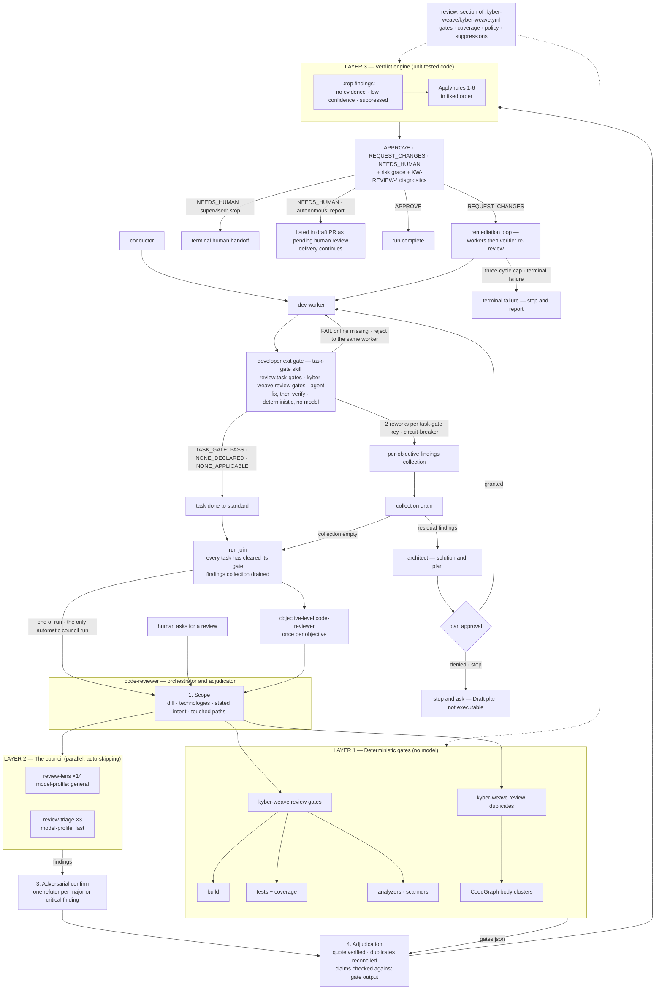
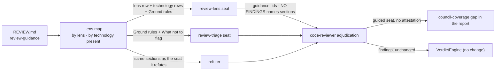
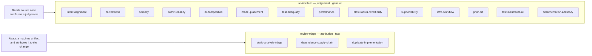
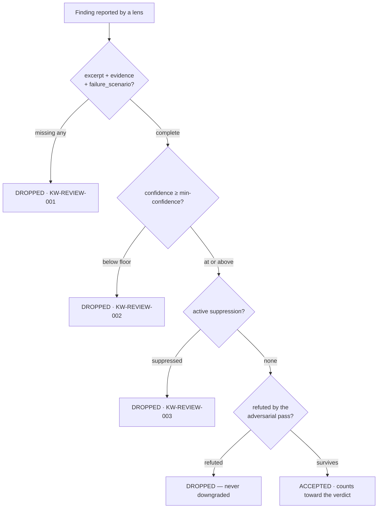
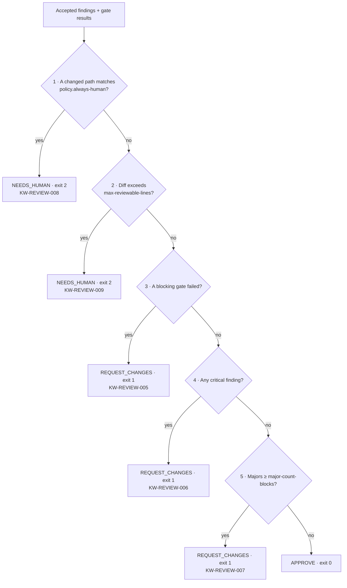

# Review council architecture

Code review here is not one agent reading a diff. It is three layers with different failure
modes, deliberately kept apart:

| Layer | What it is | Who decides | Fails by |
|---|---|---|---|
| **Gates** | Repeatable commands — build, tests, coverage, analyzers | Nobody. They measure. | Not being run |
| **Council** | Specialist lenses reading the diff in parallel | A model, per lens, within its remit | Being confidently wrong |
| **Verdict** | Fixed rules over findings and gate results | Unit-tested code, no model | Being mis-specified |

The separation is the design. The judgement in a review is the council's; **the gate that
judgement passes through is not a model**. A verdict produced by the same model that produced
the findings cannot be audited, cannot be regression-tested, and can legitimately differ
between two runs over one diff. So the last step is arithmetic instead.

## The whole system



Gates and council start **together** — they are independent and neither waits on the other.
Three lenses are the exception: `test-adequacy` consumes the coverage report,
`static-analysis-triage` consumes the analyzer output, and `duplicate-implementation` consumes
the duplicates report, so each is issued when its own gate completes rather than behind a
barrier on all gates.

`review duplicates` is a second command rather than a declared gate entry because its input is
not a host command at all: it reads the repository's CodeGraph index and clusters symbols whose
normalized bodies are identical. Hosts still declare it under `review.gates` so its execution
is recorded like any other evidence, and it exits 0 whether or not it finds anything — what
"blocking" buys there is that it must have *run*.

## The parts, and where they live

| Part | Kind | Location |
|---|---|---|
| `task-gate` | Canonical skill — the developer exit gate, ahead of the council | `products/kyber-squad/skills/task-gate/SKILL.md` |
| `code-reviewer` | Canonical agent — orchestrates, adjudicates, holds the skeptic | `products/kyber-squad/agents/code-reviewer.md` |
| `review-lens` | Canonical agent — one judgement seat, spawned N times | `products/kyber-squad/agents/review-lens.md` |
| `review-triage` | Canonical agent — one triage seat, `fast` model profile | `products/kyber-squad/agents/review-triage.md` |
| `code-review` | Skill — the procedure, the lens catalogue, the report format | `products/kyber-squad/skills/code-review/SKILL.md` |
| Lens files | 17 reference files, one per concern | `products/kyber-squad/skills/code-review/references/lenses/` |
| Host review guidance | `REVIEW.md` at the repository root, bound as `<review-guidance>` in Config Reg. Recurring defect classes, a lens map, and the attestation format (see [Review guidance](#review-guidance)) | `REVIEW.md` |
| Technology checklists | 11 reference files, loaded as lens *modifiers*; each points at the host's `<technology>-coding-standard` and states no rule of its own | `products/kyber-squad/skills/code-review/references/` |
| `dp-code-reviewer` | Skill — modes and the re-review loop | `products/kyber-squad/skills/dp-code-reviewer/SKILL.md` |
| `security-review` | Skill — invoked by the security lens, not duplicated | `products/kyber-squad/skills/security-review/SKILL.md` |
| `GateRunner` | Runs declared gates, normalizes results | `src/KyberWeave.Core/Review/GateRunner.cs` |
| `DuplicateDetector` | Clusters symbols by normalized body, from the CodeGraph index | `src/KyberWeave.Core/Review/DuplicateDetector.cs` |
| `ICodeGraphSymbolEnumerator` | Optional CodeGraph port: every indexed symbol of one kind | `src/KyberWeave.Core/CodeGraph/ICodeGraphSymbolEnumerator.cs` |
| `VerdictEngine` | The rules. Pure — no clock, no filesystem, no process | `src/KyberWeave.Core/Review/VerdictEngine.cs` |
| `PathGlob` | Matches changed paths against reserved patterns | `src/KyberWeave.Core/Review/PathGlob.cs` |
| `ReviewConfig` | The `review:` host configuration | `src/KyberWeave.Core/Configuration/ReviewConfig.cs` |

## Review guidance

A seat judges against rules the host owns, not against what the skill remembers about
failure. There are two sources, and neither copies the other.

- **Host guidance.** `REVIEW.md` at the repository root, bound as `<review-guidance>` in Config
  Reg. It holds the defect classes this repository has actually been caught on. Each rule is
  cited by id (`R2`–`R16`) or by section (`§N`). A new rule needs the same class of finding in
  three or more reviews, across at least two PRs; otherwise it becomes an example bullet under an
  existing section.
- **Technology checklists.** Eleven pointer checklists under
  `skills/code-review/references/`: C#, Python, React, SQL, Pulumi, Azure, GitHub Actions,
  TypeScript (Node), Rust, Tauri and Go. Each names the host's `<technology>-coding-standard`
  and states no rule of its own, so a host reverses a rule in its standard and the checklist
  follows. This repository declares Rust, Tauri and Go standards at
  `docs/standards/{rust,tauri,go}/README.md`. The shipped checklists keep the "no standard
  declared" fallback for host repositories that declare none, and invent no rules of their own.
  Tauri also loads the Rust checklist for `.rs` files and the
  React or TypeScript checklist for its WebView UI.

The lens map has two axes:

- **By lens**: each of the 17 catalogue lenses names the sections it takes. The three triage
  seats (`duplicate-implementation`, `static-analysis-triage`, `dependency-supply-chain`) take
  only the Ground rules and *What not to flag*, because they attribute tool output rather than
  judge code.
- **By technology present**: each checklist key lists the files that trigger it (for example
  `*.cs` selects `csharp`) and the sections it takes.



Every council path receives this selection. Step 2 gives each seat its rows. The refuter (step 3)
gets the same sections as the seat it challenges. On a harness that cannot delegate, such as
Devin, `code-reviewer` applies each lens itself and uses the same selection, and the report says
the council ran in-process. The developer's pre-push self-review gate walks the recurring defect
classes for the technologies present. If a host has no `REVIEW.md`, the reviewer reports that
rather than skipping guidance silently, and the portable checks in the skill still run.

**Attestation.** Each judgement finding carries `guidance:` with the REVIEW.md section ids it
derives from. A seat that finds nothing says so in its `NO FINDINGS` sentence and names the
sections it checked.

**Coverage gap, not a verdict input.** When a seat was given guidance and returns no
attestation, `code-reviewer` records a council-coverage gap in the report and keeps that seat's
findings. The verdict engine reads no attestation and is unchanged. The attestation shows the
human reader what the seat claimed to check. It does not prove the seat applied the sections
correctly, so a claim that does not hold is a review problem, not an engine rule.

### Council hardening and contract verification

The review council enforces explicit contract verification disciplines across its lenses:
- **Cross-document and prompt-to-prompt contract parity (`documentation-accuracy`):** Verifies parity across modified markdown instructions, runbooks, and reference contracts. Invariants, schemas, and rejection rules must agree across modified documents, not only doc-vs-code.
- **Contract assertion rigor (`test-adequacy`, `R14`):** Flags bare single-word `Assert.Contains` checks that match common boilerplate, unguarded boolean `||` assertions where one branch matches unrelated text, and non-contiguous `foreach` loops over multi-line schemas; requires contiguous block assertions.
- **Operational lifecycle state-machine walks (`correctness`, `supportability`):** Walks the complete resource lifecycle from `create` → `execute` → `integrate` → `cleanup`/`remove`/`prune`, and verifies error paths including `conflict` and `rollback` for concurrency primitives, worktrees, locks, and temp-paths.
- **Literal prompt parsing (`correctness`, `R16`):** Prohibits charitable reading of agent prompt instructions; parses prompt directives literally as executed by language models, flagging any gate deadlock, self-contradiction, or missing recovery step.

## Why lenses are files, not agents

Seventeen concerns, but only **two** canonical agents carry them. The lens is a reference file;
the agent is the seat that reads it.

Seventeen agents would push the canonical roster from 22 to 39, clutter every harness's agent
picker, and produce seventeen near-identical descriptions that would collide under
`KW-AGENT-LINT-001` and `KW-SKILL-LINT-011`. As files, adding a lens is a Markdown file rather
than a deployment — which is exactly what adding `prior-art` cost.

The two seats exist because they do different work, not because one is cheaper:



A triage seat's input is something a tool already produced. Its job — deciding which of that
output *this change* is responsible for — is bounded and checkable, which is what makes it
safe to run on the `fast` model profile. Fourteen lenses are not that, and would produce worse
findings cheaply, which costs more than it saves.

`prior-art` and `duplicate-implementation` sit on opposite sides of that line while holding one
concern between them, and the split is by evidence rather than by topic. A body duplicated
verbatim is a fact a gate established, so attributing it is triage. A *type* that duplicates
another is a judgement about responsibility that needs both types read, so it is not.

**Every lens auto-skips.** Each lens file opens with an applicability predicate and returns
`SKIPPED: <reason>` when the diff holds nothing it owns. That is what makes seventeen lenses
affordable — and the skip is *recorded*, because a dimension that was deliberately skipped and
one that was quietly never looked at must not read the same in a report.

## The skeptic, as a schema

The reviewer's standing demand — *show me the logs or it didn't happen* — is enforced by data
shape rather than by tone. Every finding must carry:

```yaml
excerpt: |
  _client = new HttpClient();      # verbatim source — required
evidence: "src/Foo/Bar.cs:42"      # how the reporter knows — required
failure_scenario: "Socket exhaustion under load; no handler rotation."   # required
```

`VerdictEngine` drops any finding missing one of the three, under `KW-REVIEW-001`, and names
the lens that produced it — because a lens doing this repeatedly is the real defect. A finding
the engine would have to complete on the reporter's behalf is one the engine would be
inventing.

The same rule applies upward. Any claim that something was built, tested, or verified with no
corresponding entry in `gates.json` is itself a `critical` finding. The agent whose purpose is
refusing unverified claims is not permitted to make one.

## How a finding survives



Suppressions carry a **mandatory expiry date**. There is no "never" value: a permanent
suppression is how a review system quietly stops reviewing, the reason ageing out of memory
while the exemption stays. On the day after it lapses the finding returns on its own, and
`KW-REVIEW-004` says why.

### Adversarial confirmation and refutation guardrails

Step 3 spends one more `review-lens` invocation attempting to refute every surviving finding of severity `major` or `critical`. However, to prevent adversarial refuters from invalidating verified standards through specious dismissals, the refutation pass enforces strict **refutation guardrails**:
- Refuters must adhere to Ground Rule 1: every finding stating a concrete failure scenario must be refuted with concrete proof of why that failure cannot occur, never an opinion or stylistic argument.
- Refuters cannot dismiss findings under 'repo-idiom' excuses or familiarity arguments.
- Refuters are strictly forbidden from dropping:
  1. Contract assertion rigor findings under `R14` (e.g., bare keyword substring checks, unguarded boolean `||` assertions matching unrelated text, or non-contiguous multi-line loops).
  2. Cross-document and prompt-to-prompt schema contradictions under `R16`.
  3. Missing operational lifecycle cleanup paths (unpruned worktree, orphaned temp-path, unreleased concurrency lock).

## How the verdict is computed

`VerdictEngine.Evaluate` is a pure function of (scope, findings, gates, config, date). Same
inputs, same verdict, every time. The order is the contract:



Three properties of that order are load-bearing:

**The escalation rules run first.** A reserved path and an unreviewable diff both say the same
thing — *this change is not the engine's to settle* — and that is true regardless of how clean
or how filthy the council's report was. Neither can be overridden by the engine; the policy
outranks it.

**`NEEDS_HUMAN` does not share an exit code with `REQUEST_CHANGES`.** Collapsing them would
make a change that merely touches a protected path indistinguishable, to any caller reading
the exit code, from one the review actually rejected.

**Risk is graded from findings, never from diff size.** A twelve-line migration dropping a
column outranks a three-thousand-line regeneration of a generated client. Size appears only as
an attention ceiling, and a large clean diff stays `LOW`.

Coverage is reported (`KW-REVIEW-010`) and **never decisive**. A verdict driven by a coverage
number rewards padding that number — which is precisely the defect the `test-adequacy` lens
exists to catch.

## Permissions

The council's shape is enforced by the capability lattice, not requested by prose. See
[Kyber-Squad architecture](../kyber-squad/architecture.md) for how profiles lower onto each
harness.

| Role | Profile | read | search | write | execute | delegate |
|---|---|---|---|---|---|---|
| `code-reviewer` | `reviewer` | allow | allow | **ask** | **allow** | **allow** |
| `review-lens` | `read-only` | allow | allow | deny | deny | deny |
| `review-triage` | `read-only` | allow | allow | deny | deny | deny |

`process.execute` is what makes the gate real; before it, the blocking pre-merge gate the
skill declared was unexecutable, and the one agent whose job is refusing unverified claims was
structurally forced to make one. It is exercised through a single declared entry point,
`kyber-weave review gates`.

`filesystem.write` stops at `ask` rather than following execute to `allow`. The reviewer writes
one artifact — its findings — and on harnesses that cannot express `ask` the lattice safely
narrows it to `deny` and the findings come back in the response instead. `network.publish`
stays `deny`. **The role that judges a change never ships it.**

`delegate` on the reviewer is what lets it fan out the council, and it is also what gives
`delegate: deny` on the other subagent profiles a meaning it previously lacked: delegation is a
per-role grant, not a property of being a subagent. The lens seats hold `deny`, so a council
seat cannot re-enter the council.

### Materialized diff contract (Option A)

Read-only council seats (`review-lens` and `review-triage`) have `process.execute: deny` and cannot execute `git diff`. Rather than granting git execution permissions across seventeen seats, `code-reviewer` materializes `git diff <base>...<head>` to task-scoped `.agent_scratchpad/<task-id>/review-diff.patch` before council fan-out, passes this path in each `review-lens` and `review-triage` packet, and removes it after the review council completes (including on failure). Seats read `.agent_scratchpad/<task-id>/review-diff.patch` via `view_file` (`filesystem.read: allow`) without executing git commands or mutating files. This preserves the strict capability lattice, prevents `index.lock` contention, and avoids redundant diff subprocess invocations across parallel seats.

## Configuration

Everything host-specific is one section of `.kyber-weave/kyber-weave.yml`:

```yaml
review:
  gates:
    - id: test
      run: [dotnet, test, -c, Release]     # argv, never a command line
      include: ["src/**/*.cs"]            # only changes touching these paths run this gate
      blocking: true
  coverage:
    file-line-percent: 85
  policy:
    strictness: balanced   # lenient | balanced | strict
    always-human: ["**/auth/**", "**/*secret*"]
    max-reviewable-lines: 10000
    # major-count-blocks: 3               # optional; overrides the strictness preset
    # min-confidence: 7                    # optional; overrides the strictness preset
    suppressions:
      - id: correctness/generated-nullable
        reason: Regenerated client, tracked separately.
        expires: 2026-11-18                # required
```

**Strictness.** `policy.strictness` selects a preset for the two numbers the verdict engine reads:
`lenient` (`min-confidence: 8`, `major-count-blocks: 5`), `balanced` (`7`, `3`, the default) or
`strict` (`5`, `1`, so one surviving major requests changes). An explicit `min-confidence` or
`major-count-blocks` in the same block overrides the preset. The code-review skill passes the
strictness to every lens so a strict host receives lower-confidence findings rather than having
them withheld at the source. Minor findings never block at any level, which keeps the
autonomous-gate rule that only critical and major findings gate a change.

`run` is **argv, not a command line**, because `ProcessRunner` refuses a shell and refuses a
concatenated argument string. A host cannot express a pipeline or a redirect here — and neither
can anything that later edits this file, nor any value arriving from a diff, a finding, or a
lens prompt. That is the injection surface closed at the point the value is written.

This repository reserves its own governance artifacts, which is the case worth copying:

```yaml
always-human:
  - "products/kyber-squad/profiles/capabilities.yml"
  - "products/kyber-squad/agents/**"
  - ".kyber-weave/kyber-weave.yml"
```

The artifacts that decide what agents may do are not approvable by an agent, and a change to
the review configuration escalates through the review configuration.

### Task gates

`review.task-gates` is the developer exit gate's counterpart to `review.gates`: a map from an
agent slug to that agent's ordered gates, run by `kyber-weave review gates --agent <slug>`
against the files that agent changed. It is optional; absent, no agent has task gates and
`--agent` reports `KW-REVIEW-027`.

```yaml
review:
  task-gates:
    csharp-dev:
      - id: format-whitespace
        include: ["**/*.cs", "**/*.csproj"]
        run: [dotnet, format, KyberWeave.sln, whitespace, --verify-no-changes, --include, "{changed}"]
        fix: [dotnet, format, KyberWeave.sln, whitespace, --include, "{changed}"]
      - id: dotnet-build
        include: ["**/*.cs", "**/*.csproj"]
        run: [dotnet, build, KyberWeave.sln, -c, Release, --artifacts-path, ".agent_scratchpad/{task}/artifacts"]
```

| Key | Required | Default | Meaning |
|---|---|---|---|
| `id` | yes | none | Lookup-name slug, unique within the agent |
| `include` | no | `[]`, which matches every changed file | Globs selecting the changed files the gate applies to |
| `os` | no | every platform | `windows` or `unix`; a gate on another platform is skipped (`KW-REVIEW-026`) |
| `run` | yes | none | The verifying command, argv |
| `fix` | no | none | The command `--fix` runs before `run`; when written it must not be empty |
| `blocking` | no | `true` | Whether a failure fails the run |
| `timeout` | no | `900` seconds | After this the runner kills the process tree; must be positive |
| `working-directory` | no | the repository root | Repository-relative directory the gate starts in; must exist and stay inside the root |
| `fail-on-output` | no | `false` | When `true`, the gate also fails if the command exits zero but writes anything other than whitespace to standard output; a non-zero exit fails as always. For tools that list problems and still exit zero, such as `gofmt -l` |

Both `run` and `fix` are argv for the same reason `review.gates` is. Two tokens expand, and only
in `TaskGateSelection`: `{changed}` must be an entire list element and becomes one argument per
changed file the gate's `include` matches; `{task}` is the `--task` slug and may sit inside an
argument. The program, the first element of `run` or `fix`, is always a literal: a token there is
refused, so a changed file or a task slug can never choose what executes. A gate whose `include`
matches no changed file is skipped, not passed. The loader refuses an unknown or embedded token,
a token in the program, an empty list, an empty argument, a duplicate gate id, a non-slug agent
or gate id, and an unrecognised `os`, at the point the operator wrote it. At run time a changed
path that is absolute, leaves the repository, begins with `-`, or passes through a symbolic link
whose target lies outside the repository, and a `--task` that is not a slug, refuse the whole run
(`KW-REVIEW-028`) before any process starts.

A YAML anchor is the way to share a gate between agents: define it on the first agent and alias
it under the others. This repository does so for:

- .NET: `format-whitespace`, `format-style` and `dotnet-build`, anchored under `csharp-dev`. `format-analyzers` was removed because `dotnet-build` immediately follows it and already runs all Roslyn analyzers under `AnalysisMode=all` with `TreatWarningsAsErrors=true` (D3), eliminating ~24s of redundant overhead per task completion with no loss of analyzer enforcement.
- TypeScript: `dash-typecheck` and `dash-lint`, anchored under `react-dev`; `tray-ui-typecheck` is anchored there too.
- Tray Rust: `cargo-fmt` and `cargo-clippy`, anchored under `tauri-dev`.

`typescript-dev` aliases the dash gates and `rust-dev` the cargo format and lint gates. `test-dev`
runs the .NET format and build gates, the dash gates and the cargo format and lint gates, because
its tests span all three. `go-dev` and `python-dev` declare no task gates, because this repository
has no Go or Python project for one to check. `cargo test` has no task gate: it runs in the council
only, because a whole-crate test run per task would fail on another worker's concurrent edit.

The shipped Go format gate (`gofmt -l`, council and task) sets `fail-on-output: true`. `gofmt -l` exits 0
on every Go version even when it lists files, and `gofmt -d` exits 1 on a diff only from Go 1.26, so a
gate that judged the exit code alone could not fail on older toolchains; any listed file fails this one
on all of them.

### Council gates

`review.gates` entries take `id`, `run`, `blocking` and `timeout-seconds` — and,
since the shipped catalogue, `include`, `os`, `working-directory` and `fail-on-output`:

| Key | Required | Default | Meaning |
|---|---|---|---|
| `id` | yes | none | Lookup-name slug, unique across `review.gates` |
| `run` | yes | none | The verifying command, argv; never a shell line |
| `blocking` | no | `true` | Whether a failure fails the run |
| `timeout-seconds` | no | `900` | After this the runner kills the process tree; must be positive |
| `include` | no | `[]`, which matches every change | Globs selecting the changed files the gate applies to; a gate with no `include` runs on every change |
| `os` | no | every platform | `windows` or `unix`; a gate on another platform is skipped (`KW-REVIEW-026`) |
| `working-directory` | no | the repository root | Repository-relative directory the gate starts in; must exist and stay inside the root |
| `fail-on-output` | no | `false` | When `true`, the gate also fails if the command exits zero but writes anything other than whitespace to standard output; a non-zero exit fails as always. For tools that list problems and still exit zero, such as `gofmt -l` |

`CouncilGateSelection` plans the run against the changed set and the host OS: a gate
whose `os` does not match is skipped, a gate whose `include` matches no changed file is
skipped (`KW-REVIEW-026`), and a gate with no `include` runs on every change.

The changed set is `--paths` when given, else the diff from the merge base of `--base`
to the working tree. `--base` and `--paths` scope the council gates too — they are
accepted without `--agent` (the default ref is `origin/HEAD`). The set is only computed
when at least one gate declares `include`. When git cannot list the changes, every gate
runs unscoped and the report says why (`KW-REVIEW-034`, Info): fetch the full history,
or name a base that exists with `--base`.

For whole-repository audits and CI verification, `--all` executes all declared gates matching
the host OS unconditionally (`changed = null`), bypassing `include:` path filtering. Combining
`--all` with contradictory scoping options (`--agent`, `--base`, or `--paths`) is refused before
any gate starts (`KW-REVIEW-028`, client-input error exit `2`).

### Repository gate scoping and caching in this repository

This repository configures `include:` globs on all 30 council gates in `.kyber-weave/kyber-weave.yml`,
partitioned by ecosystem:

- **Pure C# formatting and static analysis** (`format-whitespace`, `format-style`, `inspectcode`, `duplicates`): scoped to `&net-source-paths` (`["**/*.cs", "**/*.csproj", "**/*.props", "**/*.targets", "**/*.sln*", "**/NuGet.config", "**/.editorconfig"]`).
- **.NET build and test** (`build`, `test`): scoped to `&net-test-paths`, which extends C# source paths to cover tested non-C# repository assets and build/test configuration: `products/**` (tested by Squad canonical content, rendering, and preset tests, and verified by `KyberWeave.Core.csproj`'s pre-build SHA-256 hash guard), `REVIEW.md` (tested by review guidance council contract tests), `.kyber-weave/kyber-weave.yml`, `apm.yml`, `.apm/**`, `global.json`, `.config/dotnet-tools.json`, and `scripts/**` — while strictly excluding `dash/**` and `docs/**`. When `net-test-paths` match, the full .NET test suite runs to preserve ADR 0005 guarantees across solution dependencies.
- **APM skill gates** (`skill-*`, 15 gates): scoped to their respective `.apm/skills/<skill-name>/**`, `src/KyberWeave.Cli/**`, and `src/KyberWeave.Core/Skills/**`.
- **Documentation gates**: `docs-validate` scoped to `["docs/**", "**/*.md", ".kyber-weave/kyber-weave.yml", "src/**"]`; `docs-drift` adds `"dash/**"` so `KyberDash` `code-refs` and `api-endpoints` drift is caught when `dash/` changes (~0.8s).
- **TypeScript gates** (`ts-*`): scoped to `["dash/**"]` (which also keeps `display-layer.test.ts` active when `dash/tray/**` changes).
- **Rust gates** (`cargo-*`): scoped to `["dash/tray/src-tauri/**"]`.

ReSharper InspectCode (`inspectcode`) passes `--caches-home=artifacts/inspectcode-cache` (gitignored),
persisting the AST and project caches across local runs and reducing warm inspection duration by ~35% wall-clock and ~68% CPU.

#### Test and build gates run under the process watchdog

The two gates that run test suites declare their argv through `scripts/proc-guard.sh run --`:
the KyberDash `ts-test` gate (`npm --prefix dash run test`) and the .NET `test` gate (`dotnet test`). The
watchdog kills the command's whole tree at an absolute cap (64 descendants, or 128 JavaScript runtime
processes for this user: `node`, `nodejs`, `bun`, `deno`, `tsx`), and it fails the gate when a process the run started survives it. A
watchdog trip is a failed gate: the gate's exit code is the watchdog's 86 (cap) or 87 (leftover),
or 124 when a `--timeout` is set. The council reports it as any other non-zero exit.

The `test` gate also takes the machine-wide `dotnet-test` slot (`--slot dotnet-test --slot-wait 900`). Each
conductor's final council runs one full `dotnet test`, and several councils on one machine used to overlap; with the
slot they queue, and the queued gate prints who holds it. The gate's `timeout-seconds` is 1800, the 900-second wait plus
the 900 seconds the run had before, because the runner starts that clock when it starts the gate and cannot tell a queued
gate from a hung one. A wait that runs out is a failed gate with exit 88. No other gate takes a slot, so builds and
format checks never queue.

`ReviewGateProcGuardWiringTests` pins both declarations, so a change to the argv has to change the test with it. The
exit-code meanings and the local commands are in the
[KyberDash runbook](../dash/runbook.md#running-tests-safely). The guard's flags are `--max-node`, `--max-tree`,
`--timeout` and, for the slot, `--slot`, `--slot-count`, `--slot-wait` and `--task`; the runbook also covers `--tty`, the standard-input behaviour, and the rule to keep
`--timeout` at or below 540 when a run comes from an agent tool. Changing a `review.gates` entry in
`.kyber-weave/kyber-weave.yml` is a reserved-path change; it is reviewed as one.

No task gate covers a change that touches only workflow YAML, the review config or a shell
script; such a task runs no gate. That residual is tracked in
[the task-gates todo](../todo/task-gates-workflow-and-shell-edits.md).

#### Fast test git repository fixture template

Review gate integration and command tests (`ReviewGatesAgentCommandTests`, `ReviewGatesCouncilCommandTests`, `DocsInitReviewGatesTests`) initialize test repositories using a shared, pre-seeded template (`TestGitRepositoryTemplate`). The template is seeded once per template key (agent, council, and docs-init variants). Individual test fixtures perform a sub-millisecond filesystem copy of the whole pre-seeded working tree including `.git` via `TestGitRepositoryTemplate.CreateRepositoryCopy` rather than spawning repeated `git init`, `git add`, and `git commit` child processes. Untracked test configuration files (`.kyber-weave/`) are excluded via `.git/info/exclude` only for agent and council templates; docs-init templates commit the host config (`.kyber-weave/kyber-weave.yml`) as part of the fixture.

Unknown keys are not silently dropped: any key outside the tables above loads anyway but
is reported as `KW-CONFIG-002` (Warning), naming the gate and the key. A duplicate gate
id, a non-slug id, a missing or empty `run`, a non-positive timeout, or an unrecognised
`os` is refused where the operator wrote it.

### The shipped gate catalogue

`kyber-weave docs init` does not invent per-technology gates. It renders them
(`ReviewBlockWriter`, planned from `GateCatalogue`) from five embedded families, one per
version-1 technology set:

| Family | Technologies | Root marker | Nesting | Notes |
|---|---|---|---|---|
| `csharp` | `csharp` | `*.slnx`, `*.sln` (fallback `*.csproj`) | each solution | The test form follows the repository `global.json` (`vstest` or `mtp`) |
| `typescript` | `typescript`, `react` | `tsconfig.json` + `package.json` (pair) | each root | Every gate declares `os: unix`: `npm` and `npx` are `.cmd` shims on Windows |
| `rust` | `rust`, `tauri` | `Cargo.toml` | outermost | A root under `src-tauri` belongs to `tauri-dev` when `tauri` is declared, else to `rust-dev`; every other root belongs to `rust-dev` |
| `go` | `go` | `go.mod` | each module | Council gates run with `working-directory` at the module root. `golangci-lint` is third-party: it ships commented out (`when: optional`), to be enabled by hand |
| `python` | `python` | `pyproject.toml` | outermost | `pytest` exit 5 (no tests collected) fails the gate on purpose |

Each family entry carries a `role` (`format`, `lint`, `typecheck`, `build` or `test`), an
argv `run` (plus an optional argv `fix` for task gates), `include` globs for the task
gates, and an optional `when` condition: a required `package.json` script, the absence
of one, a file under the root, the test runner, or `optional` (always commented out,
with its note as the reason). Conditions are evaluated per root, because two roots of
one repository can differ — one `package.json` may define a `lint` script while another
does not. Entries sharing an id pick one form per root. Every command is argv, and every
gate id has a source URL in its family file.

Root detection (`ProjectRootDetector`) skips dependency, build-output and ignored
directories, orders roots by ordinal path so the same tree always yields the same
output, and writes one copy of each root-bound gate per root: the id is the family
prefix plus the entry id plus a suffix derived from the root's path (empty for a single
root), and a written task gate's `include` globs are limited to files under that root.
Placeholders render per root: `{{root}}` is the repository-relative root directory
(`.` at the repository root), `{{root-glob}}` is that directory plus a trailing slash
for glob prefixes (empty at the root), and `{{marker}}` is the marker path the root was
found by.

With no root, every gate stays commented with the marker the host should point at;
with more than eight roots in one family, every gate of that family stays commented
with the root list to pick from. Either way the render names the reason per gate, and
`docs init` prints the written ids per technology, the commented-out ids with their
reasons, and the technologies with no gates shipped for them.

Developer task gates are written per agent slug: `csharp-dev`, `dal-dev`, `maui-dev`
and `pulumi-dev` from the csharp family; `typescript-dev` and `react-dev` from
typescript; `rust-dev` and `tauri-dev` from rust; `go-dev` from go; `python-dev` from
python. `test-dev` gets a copy of every written format and lint gate. The written block
is host-owned from then on: re-running `docs init` never edits an existing `review:`
section, even with `--force` — it only lists catalogue ids missing from the host's
section, as information. `ReviewConfig.ProductDefaults` stays empty, so upgrading
Kyber-Weave never changes which gates a host runs. `kyber-weave review catalogue`
(`ReviewCatalogueCommand`) prints the same block to stdout without writing any file, so
gates shipped in a newer release can be copied in by hand.

Per-task gates take `include`, `os`, `fix`, `blocking` and `timeout`, as the table above describes.
Their timeout key is `timeout`, in seconds, with a default of 900. `timeout-seconds` is the council
key: written on a task gate it is an unknown key (`KW-CONFIG-002`), not a silent drop.

## Modes

The two principles this area answers to are stated in the
[review index](README.md#principles); this section is how they are implemented.

**One reviewer, and a deterministic gate ahead of it.** `code-reviewer` reviews the whole run,
once, at the end — and one task only when a human explicitly asks. There is no condition under
which a task summons the council: not a failed gate, not a reserved path, not a concern that
looks serious. Each of those would be a per-task council bill, and avoiding that bill is the
entire point of the split.

**Ahead of the council sits a layer with no model in it at all.** Each developer agent ends its
task with the `task-gate` skill: it runs the `review.task-gates` entry for that agent (formatting,
analyzer fixes, `cleanupcode` scoped to the changed files, build and tests), fixes what a machine
can fix, and verifies. The worker reports a `TASK_GATE:` line in its digest. The conductor rejects
a missing or `FAIL` line back to the same worker; after two reworks for the same
`task-gate/<gate-id>` key the circuit-breaker trips and the failure enters the conductor's
per-objective findings collection, which `architect` plans against before the end-of-run review
runs. See [ADR 0005](../adr/0005-task-level-fast-review.md).

The council's own modes are owned by the `dp-code-reviewer` skill, which wraps the review
rather than performing it.

| Mode | Behaviour | When |
|---|---|---|
| `shadow` | Full review, verdict recorded, **gates nothing** | First rollout on a repository |
| `enabled` | The verdict gates | Normal operation |
| `verifier` | Re-checks only the prior findings | After a fix push |
| `full` | Forces a complete council re-scan | Escalation, or a stale prior review |

`verifier` is the cost lever: gates re-run every cycle because their result *is* the evidence,
but only lenses owning an outstanding finding re-run. The loop escalates after three cycles
without the surviving-finding count falling — a loop that is not converging is not going to,
and the usual cause needs a person.

## Current limitations

All thirteen declared targets have a registered renderer. On the twelve native targets these permissions lower to their native representations and are enforced; `warp` is a fallback target whose deployed skills carry no capability enforcement, so there the council and the narrowing are instruction-only. On `devin` a subagent cannot delegate, so `code-reviewer` applies each lens itself, one at a time, runs the refutation pass itself, and says in its report that the council ran in-process, which is weaker evidence than independent seats — see
[rendering](../kyber-squad/architecture.md#8-rendering).

There is no cost measurement and no per-repository ceiling yet. The adversarial confirmation
pass in particular is unmeasured and may exceed the council itself on a findings-heavy diff.

## Related

- [Rule reference](../ci-pipelines/rule-reference.md) — every `KW-REVIEW-*` id
- [Kyber-Squad architecture](../kyber-squad/architecture.md) — how agents and skills deploy
- [Agent harness governance](../context-hygiene/agents.md) — capability profiles and parity
- [The review council plan](../archive/plans/2026-08-20-code-review-council.md) — why it is shaped this way
- [ADR 0002](../adr/0002-three-layer-review-council-verdict-engine.md) — three-layer review council and verdict engine
- [ADR 0003](../adr/0003-cross-file-duplication-and-prior-art-lenses.md) — cross-file duplication and prior art
