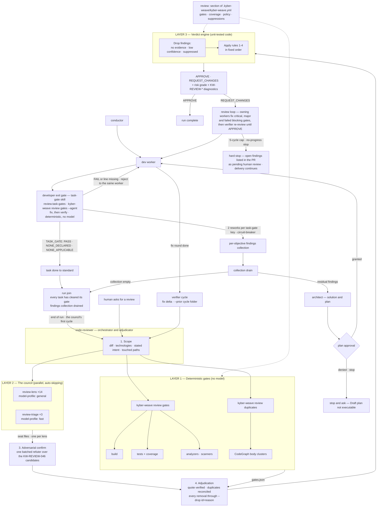
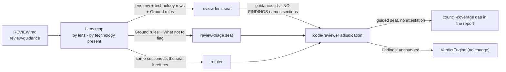
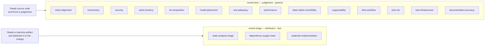
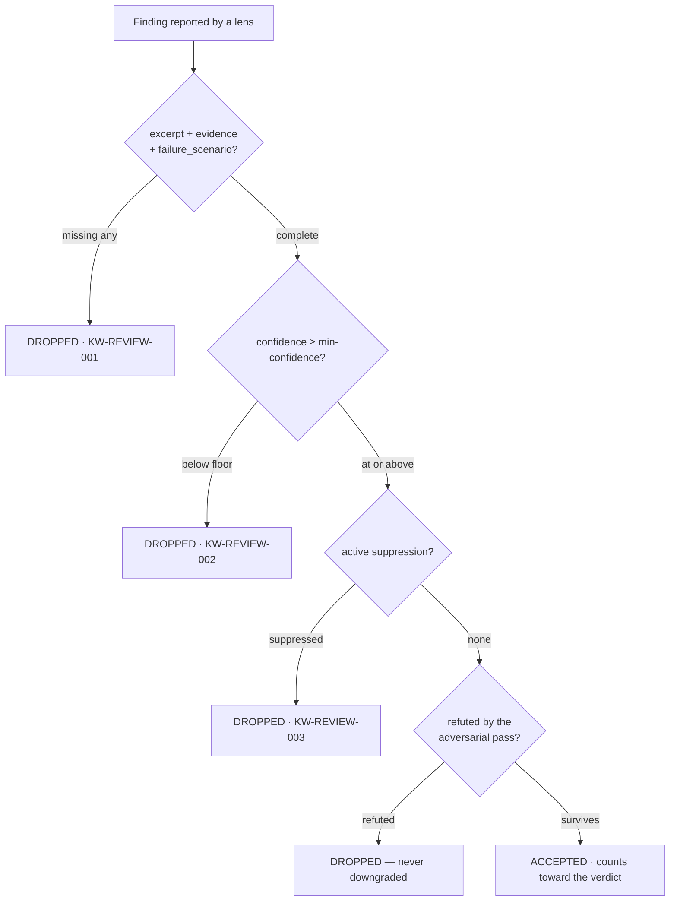
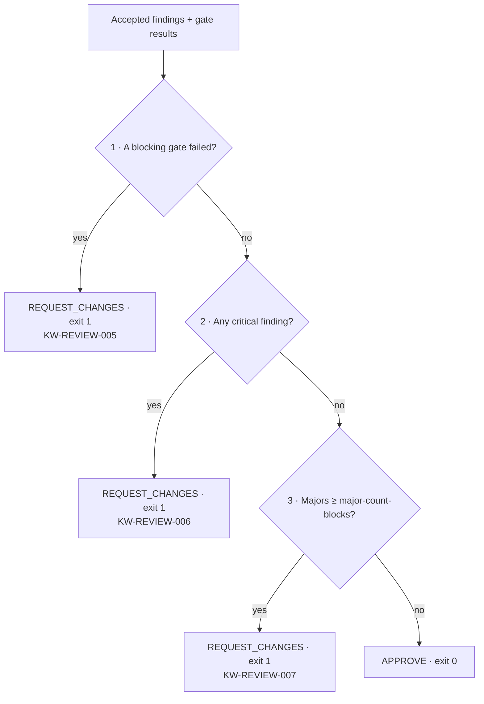
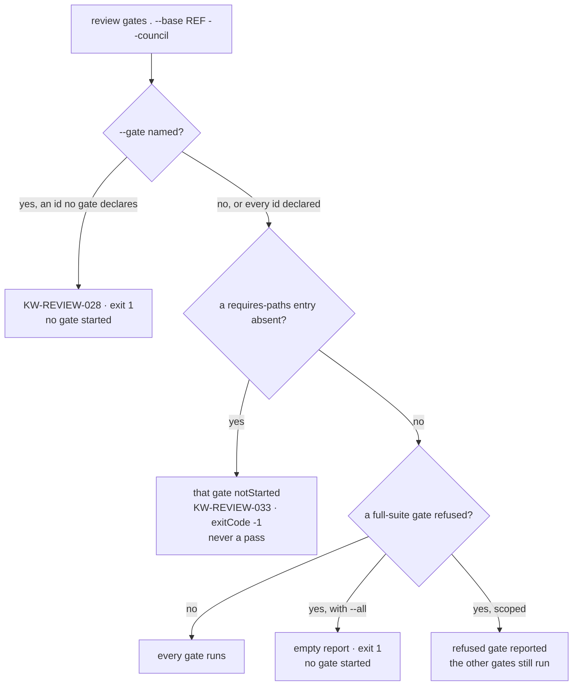

# Review council architecture

Code review here is not one agent reading a diff. It is three layers with different failure
modes, deliberately kept apart:

| Layer | What it is | Who decides | Fails by |
|---|---|---|---|
| **Gates** | Repeatable commands — build, tests, coverage, analyzers | Nobody. They measure. | Not being run |
| **Council** | Specialist lenses reading the diff in parallel | A model, per lens, within its remit | Being confidently wrong |
| **Verdict** | Fixed rules over findings and gate results | Unit-tested code, no model | Being mis-specified |

The separation is the design. The judgement in a review is the council's; **the gate that
judgement passes through is not a model**. A verdict produced by the same model that produced
the findings cannot be audited, cannot be regression-tested, and can legitimately differ
between two runs over one diff. So the last step is arithmetic instead.

## The whole system



Gates and council start **together** — they are independent and neither waits on the other.
Three lenses are the exception: `test-adequacy` consumes the coverage report,
`static-analysis-triage` consumes the analyzer output, and `duplicate-implementation` consumes
the duplicates report, so each is issued when its own gate completes rather than behind a
barrier on all gates.

`review duplicates` is a second command rather than a declared gate entry because its input is
not a host command at all: it reads the repository's CodeGraph index and clusters symbols whose
normalized bodies are identical. Hosts still declare it under `review.gates` so its execution
is recorded like any other evidence, and it exits 0 whether or not it finds anything — what
"blocking" buys there is that it must have *run*.

## The parts, and where they live

| Part | Kind | Location |
|---|---|---|
| `task-gate` | Canonical skill — the developer exit gate, ahead of the council | `products/kyber-squad/skills/task-gate/SKILL.md` |
| `code-reviewer` | Canonical agent — orchestrates, adjudicates, holds the skeptic | `products/kyber-squad/agents/code-reviewer.md` |
| `review-lens` | Canonical agent — one judgement seat, spawned N times | `products/kyber-squad/agents/review-lens.md` |
| `review-triage` | Canonical agent — one triage seat, `fast` model profile | `products/kyber-squad/agents/review-triage.md` |
| `code-review` | Skill — the procedure, the lens catalogue, the report format | `products/kyber-squad/skills/code-review/SKILL.md` |
| Lens files | 17 reference files, one per concern | `products/kyber-squad/skills/code-review/references/lenses/` |
| Host review guidance | `REVIEW.md` at the repository root, bound as `<review-guidance>` in Config Reg. Recurring defect classes, a lens map, and the attestation format (see [Review guidance](#review-guidance)) | `REVIEW.md` |
| Technology checklists | 11 reference files, loaded as lens *modifiers*; each points at the host's `<technology>-coding-standard` and states no rule of its own | `products/kyber-squad/skills/code-review/references/` |
| `dp-code-reviewer` | Skill — modes and the re-review loop | `products/kyber-squad/skills/dp-code-reviewer/SKILL.md` |
| `security-review` | Skill — invoked by the security lens, not duplicated | `products/kyber-squad/skills/security-review/SKILL.md` |
| `GateRunner` | Runs declared gates, normalizes results | `src/KyberWeave.Core/Review/GateRunner.cs` |
| `DuplicateDetector` | Clusters symbols by normalized body, from the CodeGraph index | `src/KyberWeave.Core/Review/DuplicateDetector.cs` |
| `ICodeGraphSymbolEnumerator` | Optional CodeGraph port: every indexed symbol of one kind | `src/KyberWeave.Core/CodeGraph/ICodeGraphSymbolEnumerator.cs` |
| `VerdictEngine` | The rules. Pure — no clock, no filesystem, no process | `src/KyberWeave.Core/Review/VerdictEngine.cs` |
| `PathGlob` | Matches changed paths against reserved patterns | `src/KyberWeave.Core/Review/PathGlob.cs` |
| `ReviewConfig` | The `review:` host configuration | `src/KyberWeave.Core/Configuration/ReviewConfig.cs` |

## Review guidance

A seat judges against rules the host owns, not against what the skill remembers about
failure. There are two sources, and neither copies the other.

- **Host guidance.** `REVIEW.md` at the repository root, bound as `<review-guidance>` in Config
  Reg. It holds the defect classes this repository has actually been caught on. Each rule is
  cited by id (`R2`–`R16`) or by section (`§N`). A new rule needs the same class of finding in
  three or more reviews, across at least two PRs; otherwise it becomes an example bullet under an
  existing section.
- **Technology checklists.** Eleven pointer checklists under
  `skills/code-review/references/`: C#, Python, React, SQL, Pulumi, Azure, GitHub Actions,
  TypeScript (Node), Rust, Tauri and Go. Each names the host's `<technology>-coding-standard`
  and states no rule of its own, so a host reverses a rule in its standard and the checklist
  follows. This repository declares Rust, Tauri and Go standards at
  `docs/standards/{rust,tauri,go}/README.md`. The shipped checklists keep the "no standard
  declared" fallback for host repositories that declare none, and invent no rules of their own.
  Tauri also loads the Rust checklist for `.rs` files and the
  React or TypeScript checklist for its WebView UI.

The lens map has two axes:

- **By lens**: each of the 17 catalogue lenses names the sections it takes. The three triage
  seats (`duplicate-implementation`, `static-analysis-triage`, `dependency-supply-chain`) take
  only the Ground rules and *What not to flag*, because they attribute tool output rather than
  judge code.
- **By technology present**: each checklist key lists the files that trigger it (for example
  `*.cs` selects `csharp`) and the sections it takes.



Every council path receives this selection. Step 2 gives each seat its rows. The refuter (step 3)
gets the same sections as the seat it challenges. On a harness that cannot delegate, such as
Devin, `code-reviewer` applies each lens itself and uses the same selection, and the report says
the council ran in-process. The developer's pre-push self-review gate walks the recurring defect
classes for the technologies present. If a host has no `REVIEW.md`, the reviewer reports that
rather than skipping guidance silently, and the portable checks in the skill still run.

**Attestation.** Each judgement finding carries `guidance:` with the REVIEW.md section ids it
derives from. A seat that finds nothing says so in its `NO FINDINGS` sentence and names the
sections it checked.

**Coverage gap, not a verdict input.** When a seat was given guidance and returns no
attestation, `code-reviewer` records a council-coverage gap in the report and keeps that seat's
findings. The verdict engine reads no attestation and is unchanged. The attestation shows the
human reader what the seat claimed to check. It does not prove the seat applied the sections
correctly, so a claim that does not hold is a review problem, not an engine rule.

### Council hardening and contract verification

The review council enforces explicit contract verification disciplines across its lenses:
- **Cross-document and prompt-to-prompt contract parity (`documentation-accuracy`):** Verifies parity across modified markdown instructions, runbooks, and reference contracts. Invariants, schemas, and rejection rules must agree across modified documents, not only doc-vs-code.
- **Contract assertion rigor (`test-adequacy`, `R14`):** Flags bare single-word `Assert.Contains` checks that match common boilerplate, unguarded boolean `||` assertions where one branch matches unrelated text, and non-contiguous `foreach` loops over multi-line schemas; requires contiguous block assertions.
- **Operational lifecycle state-machine walks (`correctness`, `supportability`):** Walks the complete resource lifecycle from `create` → `execute` → `integrate` → `cleanup`/`remove`/`prune`, and verifies error paths including `conflict` and `rollback` for concurrency primitives, worktrees, locks, and temp-paths.
- **Literal prompt parsing (`correctness`, `R16`):** Prohibits charitable reading of agent prompt instructions; parses prompt directives literally as executed by language models, flagging any gate deadlock, self-contradiction, or missing recovery step.
- **Input-site table (`correctness`):** For every changed code file the seat writes "no input site" or one row per site where a value from outside the process is parsed, converted, or passed to a file or collection API, with what the code does today for each hostile input class (absent or null, a null element in a list, empty, wrong type, zero or negative, the largest value, characters the API rejects, repeated or contradictory markers). Every `THROWS` or `accepted wrong` cell is a finding. The seat closes with an `Input sites:` count, and a correctness seat that reported findings or `NO FINDINGS` without it draws `KW-REVIEW-047`, and a `SKIPPED` correctness seat is exempt.
- **Rule subjects and side-by-side statements (`documentation-accuracy`):** Who a rule applies to ("a seat", "every gate") is a claim checked at the call site that decides it, and each rule id or command the changed prose states is quoted side by side from every document that states it; a different subject, condition or flag list is a finding.
- **Hand-off of malformed inputs (`test-adequacy` to `correctness`):** Test-adequacy says what the code does today for each malformed input it names, and hands one it cannot show is refused to correctness as a `test-adequacy/out-of-scope` finding, rather than reporting only the missing test.
- **No reviewer hunt list:** The reviewer hands each seat its lens file and guidance sections, not a list of its own things to hunt for. A list of areas narrows a seat to those areas, and an area is not an input. Named focus files must each be accounted for by the seat.

## Why lenses are files, not agents

Seventeen concerns, but only **two** canonical agents carry them. The lens is a reference file;
the agent is the seat that reads it.

Seventeen agents would push the canonical roster from 22 to 39, clutter every harness's agent
picker, and produce seventeen near-identical descriptions that would collide under
`KW-AGENT-LINT-001` and `KW-SKILL-LINT-011`. As files, adding a lens is a Markdown file rather
than a deployment — which is exactly what adding `prior-art` cost.

The two seats exist because they do different work, not because one is cheaper:



A triage seat's input is something a tool already produced. Its job — deciding which of that
output *this change* is responsible for — is bounded and checkable, which is what makes it
safe to run on the `fast` model profile. Fourteen lenses are not that, and would produce worse
findings cheaply, which costs more than it saves.

`prior-art` and `duplicate-implementation` sit on opposite sides of that line while holding one
concern between them, and the split is by evidence rather than by topic. A body duplicated
verbatim is a fact a gate established, so attributing it is triage. A *type* that duplicates
another is a judgement about responsibility that needs both types read, so it is not.

**Every lens auto-skips.** Each lens file opens with an applicability predicate and returns
`SKIPPED: <reason>` when the diff holds nothing it owns. That is what makes seventeen lenses
affordable — and the skip is *recorded*, because a dimension that was deliberately skipped and
one that was quietly never looked at must not read the same in a report.

## The skeptic, as a schema

The reviewer's standing demand — *show me the logs or it didn't happen* — is enforced by data
shape rather than by tone. Every finding must carry:

```yaml
excerpt: |
  _client = new HttpClient();      # verbatim source — required
evidence: "src/Foo/Bar.cs:42"      # how the reporter knows — required
failure_scenario: "Socket exhaustion under load; no handler rotation."   # required
```

`VerdictEngine` drops any finding missing one of the three, under `KW-REVIEW-001`, and names
the lens that produced it — because a lens doing this repeatedly is the real defect. A finding
the engine would have to complete on the reporter's behalf is one the engine would be
inventing.

The same rule applies upward. Any claim that something was built, tested, or verified with no
corresponding entry in `gates.json` is itself a `critical` finding. The agent whose purpose is
refusing unverified claims is not permitted to make one.

## How a finding survives

Findings reach the verdict from **seat files**, not from a findings file the reviewer writes.
Each seat's output is saved unchanged as `<lens>.md` in the cycle's `seats` folder (a finding
the reviewer raises itself goes in `reviewer.md`), and `kyber-weave review verdict . --seats
<cycle>/seats --gates <cycle>/gates.json --out <cycle>/findings.json` parses them
(`SeatOutputParser`). The reviewer's only action on a finding is `--drop <id>=<reason>`: it
never edits a finding and never changes its severity, so every removal appears in the Dropped
list with its reason, and a bad `--drop` is refused (`KW-REVIEW-042`). Two checks run before
the policy below:

- **Lens coverage (`KW-REVIEW-041`).** Every catalogue lens needs a seat file, a
  `--not-seated <lens>=<reason>`, or coverage carried from the prior cycle through `--prior`;
  otherwise the command refuses to compute. A file whose name is not a catalogue lens keeps its
  findings but covers no lens, and draws a warning. An unreadable seat file is refused
  (`KW-REVIEW-040`), and so is one that declares `NO FINDINGS:` or `SKIPPED:` and also holds
  findings: it is never counted clean.
- **Cited lines (`KW-REVIEW-043`, `CitedLineCheck`).** A finding whose cited line lies outside
  its file is moved to the one line that holds its excerpt, or dropped when no single line
  does. A line inside the file is never moved. A finding whose file is missing, outside the
  repository or unreadable is left as written and reported as unverified, one info line per file.

A findings or `NO FINDINGS` seat that wrote no `Discovery:` line, read files directly with no index lookup and no
`Index fallback:` line, or wrote an `Index fallback:` value outside the three modes, draws a
warning (`KW-REVIEW-044`); a `SKIPPED` seat is exempt, and the warning is never a verdict input.
The `correctness` seat also closes with `Input sites: N traced, M files with none`, above its
`Discovery:` line, after a Markdown input-site table that the parser skips; a correctness seat that
reported findings or `NO FINDINGS` and wrote no readable `Input sites:` line draws a warning
(`KW-REVIEW-047`), never a verdict input; a `SKIPPED` correctness seat is exempt.
A seat file that repeats its `Discovery:` or `Input sites:` line, as a lens split across two spawns
does, is read as the sum of the lines; a malformed or overflowing line makes the count unreadable.



Suppressions carry a **mandatory expiry date**. There is no "never" value: a permanent
suppression is how a review system quietly stops reviewing, the reason ageing out of memory
while the exemption stays. On the day after it lapses the finding returns on its own, and
`KW-REVIEW-004` says why.

### Adversarial confirmation and refutation guardrails

Step 3 sends every refutation candidate — the accepted `major` and `critical` findings the
verdict command lists under `KW-REVIEW-046` — to **one batched** `review-lens` spawn. Its single
`REFUTE:` header names the first candidate, because a repeated header would leave the Arbiter
without the fact it reads; the body carries every candidate's YAML, and the refuter answers once
per finding id. The reviewer drops each refuted finding with `--drop <id>=refuted: <reason>` and
computes the verdict again. A verifier cycle sends only the candidates no earlier cycle refuted.
However, to prevent adversarial refuters from invalidating verified standards through specious dismissals, the refutation pass enforces strict **refutation guardrails**:
- Refuters must adhere to Ground Rule 1: every finding stating a concrete failure scenario must be refuted with concrete proof of why that failure cannot occur, never an opinion or stylistic argument.
- Refuters cannot dismiss findings under 'repo-idiom' excuses or familiarity arguments.
- Refuters are strictly forbidden from dropping:
  1. Contract assertion rigor findings under `R14` (e.g., bare keyword substring checks, unguarded boolean `||` assertions matching unrelated text, or non-contiguous multi-line loops).
  2. Cross-document and prompt-to-prompt schema contradictions under `R16`.
  3. Missing operational lifecycle cleanup paths (unpruned worktree, orphaned temp-path, unreleased concurrency lock).

## How the verdict is computed

`VerdictEngine.Evaluate` is a pure function of (findings, gates, config, date, coverage). Same
inputs, same verdict, every time. The order is the contract:



The properties of that order are load-bearing:

**Gate failures outrank findings.** A failing blocking gate forces `REQUEST_CHANGES` immediately;
clean code cannot pass with failed build, test, or analyzer evidence.

**A gate that time stopped is NOT RUN, not failed.** A gate whose outcome is `TimedOut` (its
own limit) or `DeadlinePassed` (the council deadline) reached no result. The engine reports it as
`KW-REVIEW-039`, a warning that what it checks is unverified; it never trips rule 1 and never
grades risk `HIGH`. A gate whose program never started still blocks, because approving past it
would read as a gate that ran and passed. That is the verdict's reading; the `review gates` exit code
treats a timed-out blocking gate as a failure unless the run passed `--deadline` (see
[Reaching a verdict in one pass](#reaching-a-verdict-in-one-pass)).

**Exit codes are binary.** `0` for `APPROVE` and `1` for `REQUEST_CHANGES`. Former rules
`KW-REVIEW-008`, `KW-REVIEW-009`, and `KW-REVIEW-011` are retired in place; review policy no longer
escalates to a separate human verdict or exit code `2`.

**Risk is graded from findings, never from diff size.** A twelve-line migration dropping a
column outranks a three-thousand-line regeneration of a generated client. A large clean diff stays `LOW`.

Coverage is reported (`KW-REVIEW-010`) and **never decisive**. A verdict driven by a coverage
number rewards padding that number — which is precisely the defect the `test-adequacy` lens
exists to catch.

## Permissions

The council's shape is enforced by the capability lattice, not requested by prose. See
[Kyber-Squad architecture](../kyber-squad/architecture.md) for how profiles lower onto each
harness.

| Role | Profile | read | search | write | execute | delegate |
|---|---|---|---|---|---|---|
| `code-reviewer` | `reviewer` | allow | allow | **ask** | **allow** | **allow** |
| `review-lens` | `read-only` | allow | allow | deny | deny | deny |
| `review-triage` | `read-only` | allow | allow | deny | deny | deny |

`process.execute` is what makes the gate real; before it, the blocking pre-merge gate the
skill declared was unexecutable, and the one agent whose job is refusing unverified claims was
structurally forced to make one. It is exercised through a single declared entry point,
`kyber-weave review gates`.

`filesystem.write` stops at `ask` rather than following execute to `allow`. The reviewer writes
one artifact — its findings — and on harnesses that cannot express `ask` the lattice safely
narrows it to `deny` and the findings come back in the response instead. `network.publish`
stays `deny`. **The role that judges a change never ships it.**

`delegate` on the reviewer is what lets it fan out the council, and it is also what gives
`delegate: deny` on the other subagent profiles a meaning it previously lacked: delegation is a
per-role grant, not a property of being a subagent. The lens seats hold `deny`, so a council
seat cannot re-enter the council.

### Materialized diff contract (Option A)

Read-only council seats (`review-lens` and `review-triage`) have `process.execute: deny` and cannot execute `git diff`. Rather than granting git execution permissions across seventeen seats, `code-reviewer` materializes `git diff <base>...<head>` to task-scoped `.agent_scratchpad/<task-id>/review-diff.patch` before council fan-out, passes this path in each `review-lens` and `review-triage` packet, and removes it after the review council completes (including on failure). Seats read `.agent_scratchpad/<task-id>/review-diff.patch` via `view_file` (`filesystem.read: allow`) without executing git commands or mutating files. This preserves the strict capability lattice, prevents `index.lock` contention, and avoids redundant diff subprocess invocations across parallel seats.

## Configuration

Everything host-specific is one section of `.kyber-weave/kyber-weave.yml`:

```yaml
review:
  gates:
    - id: test
      run: [dotnet, test, -c, Release]     # argv, never a command line
      include: ["src/**/*.cs"]            # only changes touching these paths run this gate
      blocking: true
  coverage:
    file-line-percent: 85
  policy:
    strictness: balanced   # lenient | balanced | strict
    # major-count-blocks: 3               # optional; overrides the strictness preset
    # min-confidence: 7                    # optional; overrides the strictness preset
    suppressions:
      - id: correctness/generated-nullable
        reason: Regenerated client, tracked separately.
        expires: 2026-11-18                # required
```

**Strictness.** `policy.strictness` selects a preset for the two numbers the verdict engine reads:
`lenient` (`min-confidence: 8`, `major-count-blocks: 5`), `balanced` (`7`, `3`, the default) or
`strict` (`5`, `1`, so one surviving major requests changes). An explicit `min-confidence` or
`major-count-blocks` in the same block overrides the preset. The code-review skill passes the
strictness to every lens so a strict host receives lower-confidence findings rather than having
them withheld at the source. Minor findings never block at any level, which keeps the
autonomous-gate rule that only critical and major findings gate a change.

`run` is **argv, not a command line**, because `ProcessRunner` refuses a shell and refuses a
concatenated argument string. A host cannot express a pipeline or a redirect here — and neither
can anything that later edits this file, nor any value arriving from a diff, a finding, or a
lens prompt. That is the injection surface closed at the point the value is written.

### Task gates

`review.task-gates` is the developer exit gate's counterpart to `review.gates`: a map from an
agent slug to that agent's ordered gates, run by `kyber-weave review gates --agent <slug>`
against the files that agent changed. It is optional; absent, no agent has task gates and
`--agent` reports `KW-REVIEW-027`.

```yaml
review:
  task-gates:
    csharp-dev:
      - id: format-whitespace
        include: ["**/*.cs", "**/*.csproj"]
        run: [dotnet, format, KyberWeave.sln, whitespace, --verify-no-changes, --include, "{changed}"]
        fix: [dotnet, format, KyberWeave.sln, whitespace, --include, "{changed}"]
      - id: dotnet-build
        include: ["**/*.cs", "**/*.csproj"]
        run: [dotnet, build, KyberWeave.sln, -c, Release, --artifacts-path, ".agent_scratchpad/{task}/artifacts"]
```

| Key | Required | Default | Meaning |
|---|---|---|---|
| `id` | yes | none | Lookup-name slug, unique within the agent |
| `include` | no | `[]`, which matches every changed file | Globs selecting the changed files the gate applies to |
| `os` | no | every platform | `windows` or `unix`; a gate on another platform is skipped (`KW-REVIEW-026`) |
| `run` | yes | none | The verifying command, argv |
| `fix` | no | none | The command `--fix` runs before `run`; when written it must not be empty |
| `blocking` | no | `true` | Whether a failure fails the run |
| `timeout` | no | `900` seconds | After this the runner kills the process tree; must be positive |
| `working-directory` | no | the repository root | Repository-relative directory the gate starts in; must exist and stay inside the root |
| `fail-on-output` | no | `false` | When `true`, the gate also fails if the command exits zero but writes anything other than whitespace to standard output; a non-zero exit fails as always. For tools that list problems and still exit zero, such as `gofmt -l` |

Both `run` and `fix` are argv for the same reason `review.gates` is. Three tokens expand, and only
in `TaskGateSelection`: `{changed}` must be an entire list element and becomes one argument per
changed file the gate's `include` matches; `{task}` is the `--task` slug and may sit inside an
argument; `{tests}` is the fully qualified test classes that cover the change, described under
[the tests a task gate runs](#the-tests-a-task-gate-runs). The program, the first element of
`run` or `fix`, is always a literal: a token there is refused, so a changed file or a task slug
can never choose what executes. A gate whose `include` matches no changed file is skipped, not
passed. The loader refuses an unknown or embedded token,
a token in the program, an empty list, an empty argument, a duplicate gate id, a non-slug agent
or gate id, and an unrecognised `os`, at the point the operator wrote it. At run time a changed
path that is absolute, leaves the repository, begins with `-`, or passes through a symbolic link
whose target lies outside the repository, and a `--task` that is not a slug, refuse the whole run
(`KW-REVIEW-028`) before any process starts.

A YAML anchor is the way to share a gate between agents: define it on the first agent and alias
it under the others. This repository does so for:

- .NET: `format-whitespace`, `format-style` and `dotnet-build`, anchored under `csharp-dev`. `format-analyzers` was removed because `dotnet-build` immediately follows it and already runs all Roslyn analyzers under `AnalysisMode=all` with `TreatWarningsAsErrors=true` (D3), eliminating ~24s of redundant overhead per task completion with no loss of analyzer enforcement.
- TypeScript: `dash-typecheck` and `dash-lint`, anchored under `react-dev`; `tray-ui-typecheck` is anchored there too.
- Tray Rust: `cargo-fmt` and `cargo-clippy`, anchored under `tauri-dev`.
- SQL: `sql-format` (`sqlfluff lint`), declared under `sql-database-architect`. A migration or a schema file is frequently the one thing a build never touches, so a change to `*.sql` needs a gate of its own.
- Repository plumbing: `workflow-lint` (`actionlint`), `shellcheck` and `review-config` (`kyber-weave review catalogue .`), anchored under `github-devops`. `review-config` is aliased under `sql-database-architect` and `docs-dev` too, so a configuration change made in any of the three roles selects it.

The three plumbing gates exist because `include` alone decides whether a gate is selected, and no
gate covered those file kinds: a task that edited only a workflow, a shell script or the review
configuration selected nothing and reported `NONE_APPLICABLE`, which a reader of a completion
digest cannot tell apart from a change that was checked and passed.

`typescript-dev` aliases the dash gates and `rust-dev` the cargo format and lint gates. `test-dev`
runs the .NET format and build gates, the dash gates and the cargo format and lint gates, because
its tests span all three. `go-dev` and `python-dev` declare no task gates, because this repository
has no Go or Python project for one to check. `cargo test` has no task gate: it runs in the council
only, because a whole-crate test run per task would fail on another worker's concurrent edit.

`docs-dev` declares one gate, and it selects one file: `.kyber-weave/kyber-weave.yml`. A change
that touches only governed Markdown still selects nothing and still reports `NONE_APPLICABLE`, which
is why `docs-dev`'s entry is a configuration check rather than the documentation check
[the docs-dev task gate todo](../todo/docs-dev-task-gate-entry.md) asks for. `NONE_APPLICABLE` is
reported as a gate that did not apply, never as a pass; the difference between it and
`NONE_DECLARED` is that the agent has gates and none of them matched this change.

The shipped Go format gate (`gofmt -l`, council and task) sets `fail-on-output: true`. `gofmt -l` exits 0
on every Go version even when it lists files, and `gofmt -d` exits 1 on a diff only from Go 1.26, so a
gate that judged the exit code alone could not fail on older toolchains; any listed file fails this one
on all of them.

### The tests a task gate runs

A build that compiles is not evidence the change still passes its tests, and the product suite is too
slow to run per task. So a task gate can name the classes that cover the change instead, through the
third token. `{tests}` expands in the same step `{changed}` and `{task}` do, and becomes the
`--filter` value the runner takes:

```yaml
review:
  test-map:
    "src/KyberWeave.Core/Review/TaskGateSelection.cs":
      - KyberWeave.Tests.TaskGateSelectionTests
  task-gates:
    csharp-dev:
      - id: tests
        include: ["**/*.cs", "**/*.csproj", "**/*.props", "**/*.targets"]
        run: [dotnet, test, tests/KyberWeave.Tests/KyberWeave.Tests.csproj, -c, Release, --no-build, --filter, "{tests}", --artifacts-path, ".agent_scratchpad/{task}/artifacts"]
        timeout: 600
```

**`review.test-map` is the declaration, and the name convention is the fallback.** The map is a
source glob to the fully qualified test classes that cover it. A changed path is matched against the
declared globs first; a path no glob covers is tried as `<Stem>Tests`, the naming convention these
tests already follow. A candidate survives only when a test file of that name exists, and the name
emitted is the one the class declares itself — or the one its directory implies, for a file that
declares no namespace. A name assembled from a path is how a filter ends up matching nothing and
exiting success, which afterwards reads as a suite that ran and passed.

**Nothing mapped is a skip, never a pass.** A change no class covers skips the gate with
`KW-REVIEW-026`, which names the gate, rather than running a filter over nothing. The map is loaded
with the rest of the `review:` section, so a blank path pattern, an entry that lists no class, a blank
class name, and a name that is not dot-separated identifiers are each refused at the point the
operator wrote them.

**`{tests}` is refused in the program position** like the other two tokens, so a changed file can
never choose what executes. The `--no-build` in the example is deliberate: the gate is declared after
`dotnet-build`, which writes the per-task artifacts directory this gate then reuses, so the classes run
against the binaries the build produced.

### The suppression gate

`kyber-weave review suppressions [path]` fails a change that adds a warning suppression without saying
why. It judges added lines only — a `#pragma warning disable`, a `SuppressMessage` attribute, and the
`NoWarn` element of a project file are recognised — and each one needs `reason: <why>` on the same
added line or on the added line immediately above it. History is never re-litigated, so a committed
suppression passes untouched, and a change that adds none passes.

| Id | Severity | Meaning |
|---|---|---|
| `KW-REVIEW-036` | Error | A suppression the change added states no reason; the file, the line and the form are named |
| `KW-REVIEW-037` | Error | The change could not be read, so nothing was scanned — a failure, never a pass |
| `KW-REVIEW-028` | Error | The `--base` ref or the path is refused before anything is read (exit `2`) |

`--base <REF>` is the ref the working tree is diffed against, and defaults to `HEAD`. A suppression
found on a context line satisfies nothing, and an empty change is a pass. The command needs no
`review:` section, so it runs in a host that declares none.

Every .NET authoring role runs it as a task gate: `csharp-dev`, `dal-dev`, `maui-dev`, `pulumi-dev`,
`sql-database-architect` and `test-dev`. A suppression is the same defect wherever it is written, and a
test file is written by an author like any other. The gate's argv is bare — `review suppressions "."` —
and never carries `{changed}`: the command reads the change against its base itself, so a changed-file
list would scan those files twice and still miss a suppression added to a file the gate's `include` did
not list.

It is a task gate and not a `review.gates` entry, and that is deliberate rather than an omission. The
command measures the working tree against a base, so in a worker's tree the default `HEAD` is exactly the
change that worker made. A council gate runs inside a working tree the runner has already checked out and
usually committed, where the same default would compare `HEAD` with itself, find an empty change and pass
— a gate that always passes is worse than no gate, because it reads as a check that ran. Making it safe
there would mean a gate carrying an explicit `--base` per pipeline, and the task gate already covers the
author that adds the suppression.

The `csharp` family ships the same gate in its catalogue entry, so `docs init` scaffolds it into any host
that installs a .NET stack rather than leaving the check to this repository alone. Unlike the family's
three plumbing gates it carries no `os` restriction: a .NET authoring role writes a suppression on any
platform, and `kyber-weave` is a dotnet tool that resolves the way `dotnet` does, so restricting it would
leave a Windows host with every other csharp gate and not this one. Windows is not exercised. That entry
names the
five developers the catalogue's developer-slug vocabulary admits; `sql-database-architect` is not one of
them, so a host scaffolded from the catalogue gets the gate for the other five and
[sql-database-architect is not a catalogue developer slug](../todo/sql-database-architect-is-not-a-catalogue-developer-slug.md)
tracks the gap.

### Council gates

The council does not choose its own gates. They are declared in the `review.gates` list of the
repository's configuration, and the council runs the declared ones. What varies per review is which of
them *apply*: a gate whose `os` does not match the host is skipped, a gate whose `include` matches no
changed file is skipped (`KW-REVIEW-026`), a gate named by `requires-paths` whose paths are absent does
not start, and a `full-suite` gate is refused to any caller that is not the council or CI or a person at
a terminal (`KW-REVIEW-033`). Adding or removing a gate is an edit to the configuration, never a decision
the model makes during a review.

`review.gates` entries take `id`, `run`, `blocking` and `timeout-seconds` — and, since the
shipped catalogue, `include`, `os`, `working-directory`, `fail-on-output`, `full-suite`,
`requires-paths` and `concurrent`:

| Key | Required | Default | Meaning |
|---|---|---|---|
| `id` | yes | none | Lookup-name slug, unique across `review.gates` |
| `run` | yes | none | The verifying command, argv; never a shell line |
| `blocking` | no | `true` | Whether a failure fails the run |
| `timeout-seconds` | no | `900` | After this the runner kills the process tree; must be positive |
| `include` | no | `[]`, which matches every change | Globs selecting the changed files the gate applies to; a gate with no `include` runs on every change |
| `os` | no | every platform | `windows` or `unix`; a gate on another platform is skipped (`KW-REVIEW-026`) |
| `working-directory` | no | the repository root | Repository-relative directory the gate starts in; must exist and stay inside the root |
| `fail-on-output` | no | `false` | When `true`, the gate also fails if the command exits zero but writes anything other than whitespace to standard output; a non-zero exit fails as always. For tools that list problems and still exit zero, such as `gofmt -l` |
| `full-suite` | no | `false` | When `true`, the gate runs the full product suite. It runs only for the review council or CI (`--council`) or from a terminal; otherwise it is refused (`KW-REVIEW-033`) and not run |
| `requires-paths` | no | `[]`, which requires nothing | Repository-relative paths the gate needs before it can start. When one is absent the gate does not start: it is reported under `KW-REVIEW-033` with `exitCode: -1`, `passed: false` and `outcome: "notStarted"`, at Error when the gate is blocking and at Warning otherwise, and its summary carries the install hint. Never a pass, and never `KW-REVIEW-022` |
| `concurrent` | no | `false` | When `true`, the gate starts at its place in the declared order and runs alongside the gates declared after it instead of holding them up. Its result keeps its declared place in the report, and it is still stopped at its own `timeout-seconds` and reported as timed out. Only for a gate that neither reads nor writes what later gates produce; the runner does not check that |

`CouncilGateSelection` plans the run against the changed set and the host OS: a gate
whose `os` does not match is skipped, a gate whose `include` matches no changed file is
skipped (`KW-REVIEW-026`), and a gate with no `include` runs on every change.

`requires-paths` names what a gate needs installed before it can measure anything. The dash
gates in this repository (`ts-typecheck`, `ts-test`, `ts-lint`, `ts-reachable`) declare
`dash/node_modules`, so a review that runs in a worktree where the dependencies were never
installed reports the missing dependency rather than a compiler error. The summary reads:

```text
required path 'dash/node_modules' is missing, so the gate did not start. Install the dashboard dependencies with 'npm install --prefix dash', then run the gate again.
```

A path outside `dash/` gets the same first clause and a generic install sentence. The gate
stays a blocking failure, because a check that never ran is not a check that passed; the
reviewer installs what the hint names and re-runs that one gate with `--gate`. The loader
refuses an empty list, an empty entry, an absolute path, and a `..` escape where the operator
wrote them, so an entry that could never name something inside the repository never reaches a run.

The changed set is `--paths` when given, else the diff from the merge base of `--base`
to the working tree. `--base` and `--paths` scope the council gates too — they are
accepted without `--agent` (the default ref is `origin/HEAD`). The set is only computed
when at least one gate declares `include`. When git cannot list the changes, every gate
runs unscoped and the report says why (`KW-REVIEW-034`, Info): fetch the full history,
or name a base that exists with `--base`.

Before any repository gate starts, the runner prepares the CodeGraph index of the tree it was
pointed at: `codegraph init` when the tree has none, `codegraph sync` otherwise, through the same
code path as `kyber-weave doctor --ensure`. A git worktree does not share another checkout's index,
so a review in a fresh worktree would otherwise have none and its lenses would fall back to raw
file reads or be answered from another branch. The result is `KW-REVIEW-038`: Info when the index was created
or synced; Warning, naming `kyber-weave doctor --ensure <tree>`, when it could not be prepared. The
gates still run either way: a review is a read-only run, and
[ADR 0061](../adr/0061-code-editing-runs-stop-on-unusable-tools.md) keeps those going without an
index. A repository without governed docs is not checked. `--agent` runs are not checked either: a task gate measures
one worker's change and consults no index.

For whole-repository audits and CI verification, `--all` executes all declared gates matching
the host OS unconditionally (`changed = null`), bypassing `include:` path filtering. Combining
`--all` with contradictory scoping options (`--agent`, `--base`, `--paths` or `--gate`) is refused
before any gate starts (`KW-REVIEW-028`, client-input error exit `2`).

#### Reaching a verdict in one pass

A review cycle runs its gates **once**, then reports one verdict. The command the council runs
is `kyber-weave review gates . --base <ref> --council --deadline --out <cycle>/gates.json`:
`--base` scopes the gates to the change under review, `--council` admits the gates marked
`full-suite`, `--deadline` bounds the run, and `--out` writes the report the verdict reads into
the cycle folder. Four behaviours make a single run enough, and each is a rule rather than a
timing accident.

**A refused full-suite gate ends an `--all` run at once.** Under `--all` there is no per-gate
scoping and no other evidence to collect, so a suite the caller may not have cannot be
delivered at all: the command reports the refusal, writes an empty gate report, and exits `1`
with no gate started. A scoped call without `--council` is the opposite case — the pre-push
self-review reads the other gates as its evidence — so it keeps running them and reports the
refusal beside their results. That is the whole of the distinction: `--all` stops, a scoped
call does not.

**`--gate <id>` re-runs exactly the gate named.** It repeats, so several ids can be named at
once. The named list replaces the declared list *before* anything reads it, so include
matching, applicability, the full-suite admission rule and the report all see the same set; a
full-suite gate named without `--council` is refused exactly as it would be anywhere else. An id
that names no declared gate is refused with `KW-REVIEW-028` and exit `1` instead of a report of
zero gates, which a reader could take as a pass. `--gate` is exclusive with `--all` and with
`--agent` — both combinations are refused with `KW-REVIEW-028` and exit `2` — and combines with
`--paths`, `--base` and `--council`. A reviewer that reads `artifacts/gates.json`, fixes one
thing and needs that one gate re-checked pays for one gate, not the suite.

**The council deadline bounds the council's run, and only when asked for.** `--deadline` turns
on the run-level deadline `review.council-deadline-seconds` (default `600`). At the deadline, every
gate still running is cut, a `concurrent` gate declared earlier included, and every gate not yet
started is not started; all of them are recorded as `DeadlinePassed`. A gate its own
`timeout-seconds` stopped is `TimedOut`. Under `--deadline` either one is reported NOT RUN (`KW-REVIEW-039`, a
warning) and left out of the exit code, so the council goes on to a verdict on the evidence it
has instead of waiting on a slow suite. Without `--deadline` nothing changes: CI, task gates,
`--gate` re-checks and the pre-push self-review have no run deadline, and a blocking gate stopped
by its own `timeout-seconds` fails `review gates` (`KW-REVIEW-022`, exit `1`) as it always has.
`--deadline` is refused with `--gate` and with `--agent` (exit `2`). `review verdict` reads a
`TimedOut` or `DeadlinePassed` result as NOT RUN either way, never as a blocking failure.

**A gate whose dependency is absent does not start.** `requires-paths` turns "the tool was
never installed" into its own reported fact instead of a code failure the reviewer has to
diagnose. The reviewer installs what the hint names and re-runs that gate with `--gate`.



Two facts about how the review is run complete the picture, and neither is enforced by the gate
command:

- **The reviewer runs its gates and stops when it cannot seat its own lenses.** Where the
  harness cannot start subagents, `code-reviewer` reports `COUNCIL_SEATS_NEEDED` after its gates
  finish: the status names the lenses it needs and the role each one takes, the scope, the gate
  ids and results it already holds, and the findings whose refutation is outstanding. The
  session above it starts those seats in parallel and re-invokes the reviewer, which still
  adjudicates and still owns the verdict. Gates are not re-run to seat a lens.
- **The review runs alone, last, and in the foreground.** No documentation work and no edits
  land in the reviewed tree while it runs, and the documentation-impact review and any edit it
  causes finish before the council starts. A review racing an edit reviews a tree that no longer
  exists by the time its verdict is read.

### Repository gate scoping and caching in this repository

This repository configures `include:` globs on all 30 council gates in `.kyber-weave/kyber-weave.yml`,
partitioned by ecosystem:

- **Pure C# formatting and static analysis** (`format-whitespace`, `format-style`, `inspectcode`, `duplicates`): scoped to `&net-source-paths` (`["**/*.cs", "**/*.csproj", "**/*.props", "**/*.targets", "**/*.sln*", "**/NuGet.config", "**/.editorconfig"]`).
- **.NET build and test** (`build`, `test`): scoped to `&net-test-paths`, which extends C# source paths to cover tested non-C# repository assets and build/test configuration: `products/**` (tested by Squad canonical content, rendering, and preset tests, and verified by `KyberWeave.Core.csproj`'s pre-build SHA-256 hash guard), `REVIEW.md` (tested by review guidance council contract tests), `.kyber-weave/kyber-weave.yml`, `apm.yml`, `.apm/**`, `global.json`, `.config/dotnet-tools.json`, and `scripts/**` — while strictly excluding `dash/**` and `docs/**`. When `net-test-paths` match, the full .NET test suite runs to preserve ADR 0005 guarantees across solution dependencies.
- **APM skill gates** (`skill-*`, 15 gates): scoped to their respective `.apm/skills/<skill-name>/**`, `src/KyberWeave.Cli/**`, and `src/KyberWeave.Core/Skills/**`.
- **Documentation gates**: `docs-validate` scoped to `["docs/**", "**/*.md", ".kyber-weave/kyber-weave.yml", "src/**"]`; `docs-drift` adds `"dash/**"` so `KyberDash` `code-refs` and `api-endpoints` drift is caught when `dash/` changes (~0.8s).
- **TypeScript gates** (`ts-*`): scoped to `["dash/**"]` (which also keeps `display-layer.test.ts` active when `dash/tray/**` changes).
- **Rust gates** (`cargo-*`): scoped to `["dash/tray/src-tauri/**"]`.

ReSharper InspectCode (`inspectcode`) passes `--caches-home=artifacts/inspectcode-cache` (gitignored),
persisting the AST and project caches across local runs and reducing warm inspection duration by ~35% wall-clock and ~68% CPU.

The gate is declared straight after `build` and is `concurrent`, so it overlaps the test run. It passes
`--no-build`, because `build` has already restored and compiled the tree, and `--jobs=4`, to keep load off
the test run beside it. It declares `requires-paths` on a restore output, so run on its own on an unrestored
tree it does not start instead of exiting zero having resolved nothing. That check proves a restore
happened, not that it is current: a run of `--gate inspectcode` alone after package references changed
needs `--gate build` with it.

Its argv starts with `scripts/report-gate.sh`. On macOS 27.3 Beta the analyzer writes its whole report and
then never exits, because .NET does not return from closing a listening socket while another thread is
blocked accepting on it. The wrapper removes any report an earlier run left, then stops the analyzer only
when this run's report ends with `</Report>` and has not changed for 20 seconds, and exits zero. A hang
before the report is complete still runs to `timeout-seconds` and is reported as timed out, and a zero exit
with no complete report fails.

#### Test and build gates run under the process watchdog

The two gates that run test suites declare their argv through `scripts/proc-guard.sh run --`:
the KyberDash `ts-test` gate (`npm --prefix dash run test`) and the .NET `test` gate (`dotnet test`). The
watchdog kills the command's whole tree at an absolute cap (64 descendants, or 128 JavaScript runtime
processes for this user: `node`, `nodejs`, `bun`, `deno`, `tsx`), and it fails the gate when a process the run started survives it. A
watchdog trip is a failed gate: the gate's exit code is the watchdog's 86 (cap) or 87 (leftover),
or 124 when a `--timeout` is set. The council reports it as any other non-zero exit.

The `test` gate also takes the `dotnet-test` slot, machine-wide for one user account (the lock directory is under `$HOME`), (`--slot dotnet-test --slot-wait 900`). Each
conductor's final council runs one full `dotnet test`, and several councils on one machine used to overlap; with the
slot they queue, and the queued gate prints who holds it. The gate's `timeout-seconds` is 1800, the 900-second wait plus
the 900 seconds the run had before, because the runner starts that clock when it starts the gate and cannot tell a queued
gate from a hung one. A wait that runs out is a failed gate with exit 88. No other gate takes a slot, so builds and
format checks never queue.

`ReviewGateProcGuardWiringTests` pins both declarations, so a change to the argv has to change the test with it. The
exit-code meanings and the local commands are in the
[KyberDash runbook](../dash/runbook.md#running-tests-safely). The guard's flags are `--max-node`, `--max-tree`,
`--timeout` and, for the slot, `--slot`, `--slot-count`, `--slot-wait` and `--task`; the runbook also covers `--tty`, the standard-input behaviour, and the rule to keep
`--timeout` at or below 540 when a run comes from an agent tool. Changing a `review.gates` entry in
`.kyber-weave/kyber-weave.yml` is a reserved-path change; it is reviewed as one.

Every file kind this repository's agents edit now selects at least one task gate: a workflow, a
shell script, the review configuration and a `*.sql` file each have a gate whose `include` matches
them (`workflow-lint`, `shellcheck`, `review-config` and `sql-format`, described under
[Task gates](#task-gates)), and `TaskGatesRepositoryConfigTests` pins the three plumbing kinds by
file kind rather than by agent, so the next file kind to appear is a failing test rather than a
silently unchecked change.

#### Fast test git repository fixture template

Review gate integration and command tests (`ReviewGatesAgentCommandTests`, `ReviewGatesCouncilCommandTests`, `DocsInitReviewGatesTests`) initialize test repositories using a shared, pre-seeded template (`TestGitRepositoryTemplate`). The template is seeded once per template key (agent, council, and docs-init variants). Individual test fixtures perform a sub-millisecond filesystem copy of the whole pre-seeded working tree including `.git` via `TestGitRepositoryTemplate.CreateRepositoryCopy` rather than spawning repeated `git init`, `git add`, and `git commit` child processes. Untracked test configuration files (`.kyber-weave/`) are excluded via `.git/info/exclude` only for agent and council templates; docs-init templates commit the host config (`.kyber-weave/kyber-weave.yml`) as part of the fixture.

Unknown keys are not silently dropped: any key outside the tables above loads anyway but
is reported as `KW-CONFIG-002` (Warning), naming the gate and the key. A duplicate gate
id, a non-slug id, a missing or empty `run`, a non-positive timeout, or an unrecognised
`os` is refused where the operator wrote it.

### The shipped gate catalogue

`kyber-weave docs init` does not invent per-technology gates. It renders them
(`ReviewBlockWriter`, planned from `GateCatalogue`) from five embedded families, one per
version-1 technology set:

| Family | Technologies | Root marker | Nesting | Notes |
|---|---|---|---|---|
| `csharp` | `csharp` | `*.slnx`, `*.sln` (fallback `*.csproj`) | each solution | The test form follows the repository `global.json` (`vstest` or `mtp`) |
| `typescript` | `typescript`, `react` | `tsconfig.json` + `package.json` (pair) | each root | Every gate declares `os: unix`: `npm` and `npx` are `.cmd` shims on Windows |
| `rust` | `rust`, `tauri` | `Cargo.toml` | outermost | A root under `src-tauri` belongs to `tauri-dev` when `tauri` is declared, else to `rust-dev`; every other root belongs to `rust-dev` |
| `go` | `go` | `go.mod` | each module | Council gates run with `working-directory` at the module root. `golangci-lint` is third-party: it ships commented out (`when: optional`), to be enabled by hand |
| `python` | `python` | `pyproject.toml` | outermost | `pytest` exit 5 (no tests collected) fails the gate on purpose |

Each family entry carries a `role` (`format`, `lint`, `typecheck`, `build` or `test`), an
argv `run` (plus an optional argv `fix` for task gates), `include` globs for the task
gates, and an optional `when` condition: a required `package.json` script, the absence
of one, a file under the root, the test runner, or `optional` (always commented out,
with its note as the reason). Conditions are evaluated per root, because two roots of
one repository can differ — one `package.json` may define a `lint` script while another
does not. Entries sharing an id pick one form per root. Every command is argv, and every
gate id has a source URL in its family file.

**What a host receives is pinned, not reviewed by eye.** Each family has an approved
`expected-review.yml` under `tests/fixtures/gate-catalogue/<family>/`, and `DocsInitWritesTheApprovedReviewBlock`
asserts that the `review:` section `docs init` writes equals it, version stamp aside. A hand edit to a
family file that changes what an installing repository gets therefore fails a test rather than shipping
quietly, and a gate added to a family is delivered by regenerating that fixture through the real
`docs init` path so the diff is the new entries and nothing else.

**A gate whose `role` is `test` is rendered with `full-suite: true`, and no other gate is.** The
role is the catalogue's own definition of a whole-suite run, so a family that later ships a second
one — a separate integration or end-to-end suite — carries the key without a row being added
anywhere, and a single check keeps running for a developer agent. The key is what makes
`review gates` refuse the gate for a caller that is not the council or CI
([ADR 0059](../adr/0059-full-test-runs-are-reserved-for-the-council-and-ci.md)), so a host
scaffolded by `docs init` cannot hand a developer agent the whole suite. The generated command is
**not** wrapped in `scripts/proc-guard.sh`: the guard is this repository's own file and does not
ship to a host, while the key is the half that travels; host repositories rely on the gate runner's
`timeout-seconds` rather than repository-specific process tree caps or slot queuing.
`GateCatalogueRenderTests` pins both
directions of the rule in one comparison, so a scaffold that marked every gate full-suite and one
that marked none both fail.

**Three of the entries cover repository plumbing rather than a language.** `workflow-lint`
(`actionlint` over `.github/workflows/*.yml`), `shellcheck` (over `**/*.sh`) and `review-config`
(`kyber-weave review catalogue .`, which fails when the configuration no longer loads) live in the
csharp family but are written for `github-devops` and `docs-dev`, the two agents that edit those
files. Those two agents map to the `github-actions` technology, so a host that declares it receives
their gates and a host that does not receives none of them. Each of the three carries `os: unix`,
and the family's `sources` map carries the download or install page for its tool; a gate skipped
outside that restriction is reported rather than read as a pass.

Root detection (`ProjectRootDetector`) skips dependency, build-output and ignored
directories, orders roots by ordinal path so the same tree always yields the same
output, and writes one copy of each root-bound gate per root: the id is the family
prefix plus the entry id plus a suffix derived from the root's path (empty for a single
root), and a written task gate's `include` globs are limited to files under that root.
Placeholders render per root: `{{root}}` is the repository-relative root directory
(`.` at the repository root), `{{root-glob}}` is that directory plus a trailing slash
for glob prefixes (empty at the root), and `{{marker}}` is the marker path the root was
found by.

With no root, every gate stays commented with the marker the host should point at;
with more than eight roots in one family, every gate of that family stays commented
with the root list to pick from. Either way the render names the reason per gate, and
`docs init` prints the written ids per technology, the commented-out ids with their
reasons, and the technologies with no gates shipped for them.

Developer task gates are written per agent slug: `csharp-dev`, `dal-dev`, `maui-dev`
and `pulumi-dev` from the csharp family; `github-devops` from that family's plumbing entries
(the workflow linter, `shellcheck` and the review-config load check); `docs-dev` from the
review-config entry alone; `typescript-dev` and `react-dev` from
typescript; `rust-dev` and `tauri-dev` from rust; `go-dev` from go; `python-dev` from
python. `test-dev` gets a copy of every written format and lint gate. The written block
is host-owned from then on: re-running `docs init` never edits an existing `review:`
section, even with `--force` — it only lists catalogue ids missing from the host's
section, as information. `ReviewConfig.ProductDefaults` stays empty, so upgrading
Kyber-Weave never changes which gates a host runs. `kyber-weave review catalogue`
(`ReviewCatalogueCommand`) prints the same block to stdout without writing any file, so
gates shipped in a newer release can be copied in by hand.

Per-task gates take `include`, `os`, `fix`, `blocking` and `timeout`, as the table above describes.
Their timeout key is `timeout`, in seconds, with a default of 900. `timeout-seconds` is the council
key: written on a task gate it is an unknown key (`KW-CONFIG-002`), not a silent drop.

## Modes

The two principles this area answers to are stated in the
[review index](README.md#principles); this section is how they are implemented.

**One reviewer, and a deterministic gate ahead of it.** `code-reviewer` reviews the whole run
at the end, and again after each fix round of the review loop below — and one task only when a
human explicitly asks. There is no condition under
which a task summons the council: not a failed gate, not a reserved path, not a concern that
looks serious. Each of those would be a per-task council bill, and avoiding that bill is the
entire point of the split.

**Ahead of the council sits a layer with no model in it at all.** Each developer agent ends its
task with the `task-gate` skill: it runs the `review.task-gates` entry for that agent (formatting,
analyzer fixes, `cleanupcode` scoped to the changed files, build and tests), fixes what a machine
can fix, and verifies. The worker reports a `TASK_GATE:` line in its digest. The conductor rejects
a missing or `FAIL` line back to the same worker; after two reworks for the same
`task-gate/<gate-id>` key the circuit-breaker trips and the failure enters the conductor's
per-objective findings collection, which `architect` plans against before the end-of-run review
runs. See [ADR 0005](../adr/0005-task-level-fast-review.md).

The council's own modes are owned by the `dp-code-reviewer` skill, which wraps the review
rather than performing it.

| Mode | Behaviour | When |
|---|---|---|
| `shadow` | Full review, verdict recorded, **gates nothing** | First rollout on a repository |
| `enabled` | The verdict gates | Normal operation |
| `verifier` | Re-checks only the prior findings and the fix delta | Every review cycle after the first |
| `full` | Forces a complete council re-scan | Selected by a person: a disputed verdict, or a stale prior review |

**The review loop.** After `REQUEST_CHANGES`, every critical and major finding, and every
failed blocking gate, goes to the worker that owns its scope; the council then re-reviews, and
it keeps doing so until it returns `APPROVE`. Minor findings never start a cycle. Every cycle
after the first is a `verifier` cycle: it reviews the fix delta `git diff <prior head>...<head>`,
re-seats only the lenses that own an outstanding finding or whose predicate the delta newly
satisfies, and passes `--prior <prior cycle folder>` so the lenses it did not re-seat keep their
coverage. Gates re-run every cycle because their result *is* the evidence. A finding is FIXED only
when the fix refuses its whole class: the verifier states the class in one sentence, names at
least three other inputs of that class that the original failure scenario did not name, and
traces each through the fix. A fix that refuses only the input the finding named leaves the
finding open.

The loop has a hard stop: 5 review cycles, or 3 cycles in a row in which the count of
surviving critical and major findings does not fall. The findings still open are then listed in
the pull request as pending human review, and delivery continues — a loop that is not
converging is not going to, and the usual cause needs a person. A finding whose rework tripped
the circuit-breaker stays open and counts toward the stop. The loop runs on the open pull
request: ready stays decided by required CI alone.

Each cycle keeps its record in `.agent_scratchpad/<task-id>/review/cycle-<n>/` — the `seats`
folder, `gates.json`, the `findings.json` the verdict command writes, and `head` — until the run
ends. A verdict-command refusal (`KW-REVIEW-040`, `-041`, `-042`) is the reviewer's to fix in
the same cycle and never counts as one.

## Quick review, sibling sweep and seat confidence

**Quick review.** A change of at most 300 changed lines (added plus removed, from
`git diff --numstat <base>...HEAD`) gets the quick review before its pull request is opened; a
larger change gets the full pre-push council. The quick review is one pass by the session that
made the change: no seats, no gates beyond what the root `AGENTS.md` requires before a pull
request, and no verdict engine. It walks a fixed checklist (intent against the description, the
changed lines' correctness, the sibling sweep below, contract-assertion strength under `REVIEW.md`
R14, and the pre-push defect-class checklist), fixes every major-or-worse finding first, and puts
one line in the pull request description: `Quick review: <n> findings, <m> fixed, open: <ids or
none>`. It fires where a session reads the root `AGENTS.md` or the `create-pull-request` skill.
A pull request opened from a web interface, or by a session that never read either, is not
covered; bot review is the backstop there.

**Sibling sweep.** When a diff changes a rule's wording in one file, the `documentation-accuracy`
seat lists every other file carrying the same rule text, checks each one, and reports each sibling
the diff left stale. It finds them with Grep and `docs_find_duplicates_conflicts_ambiguous_terms`,
and names the siblings it checked in its `NO FINDINGS` sentence. The quick review walks the same
sweep.

**Seat confidence.** Every seat reports at or above the effective `min-confidence` its invocation
names (strict 5, balanced 7, lenient 8), and 7 when none is named; the rubric bands describe
certainty, not a cut-off. The reviewer never drops a finding for confidence itself, because the
verdict engine does. The security lens is the one exception: it keeps its own floor of 8, tuned in
the `security-review` skill against false positives.

## Gate applicability and Arbiter review gates

A gate may declare the paths it applies to, so a gate like `ts-typecheck` does not run on
a .NET-only change:

```yaml
- id: ts-typecheck
  run: [npm, run, --prefix, dash, typecheck]
  blocking: true
  applies-when:
    paths: ["dash/**"]
```

With `review gates --base <ref>`, a gate whose patterns match no changed path is not
executed and is reported with `KW-REVIEW-026` (Info) rather than omitted. The verdict
engine counts such a gate as neither passed nor failed, so a verdict with not-applicable
gates equals the verdict without them. Without `--base`, every gate runs. The Arbiter
evaluates the match through `KW-ARB-GATE-001`; code-reviewer passes `--base` so the
changed paths — recorded in the gate report — are the same ones lens-spawn facts reuse.

Where Arbiter hooks are installed, the council's fan-out is itself gated. Before spawning
lenses, code-reviewer carries `LENS: <name>` routing headers and the hook judges each lens's
applicability to the change: a lens that does not apply is recorded as `SKIPPED` with the
reason. Before the refutation pass, `REFUTE: <finding-id>` headers route each finding to
claim verification against its quoted code; a verified finding keeps its refutation
recorded as skipped. Quote fabrication and pre-existing code arrive as annotations that feed
the existing quote check. The Arbiter drops a finding only through the nitpick filter, and only
for a confident nitpick once that rule is enforced (see [Nitpick filter, duplicates and the review run](#nitpick-filter-duplicates-and-the-review-run-phase-3)).
A failed refutation, an unrun check or a shadowed rule never drops a finding. code-reviewer runs `kyber-weave arbiter audit --plan <PLAN_FILE>` at the end of a run and
cites the result. See the [Kyber Arbiter architecture](../kyber-arbiter/architecture.md).

### Hunk-level lens skipping (KW-ARB-LENS-002)

Where the Arbiter hook is installed, a lens spawn is judged against the change's hunks before the
lens starts. `KW-ARB-LENS-002` skips a lens only when the change has no code for that lens to judge,
and the skip needs positive evidence:

- every changed path is one of three kinds: **comment-only** (every hunk holds only comments in the
  file's language), **rename-only** (a rename at 100% similarity), or **Markdown** (`*.md`);
- the changed set is non-empty. An empty or unreadable set is `undecidable`, which allows, so the
  lens runs.

Comment-only is judged per file, and a file is comment-only only when every one of its hunks is. A
single code line in one hunk makes the file code, even when its other hunks are comments. The
comment syntax per extension is in the [Kyber Arbiter architecture](../kyber-arbiter/architecture.md#hunk-comment-syntax).
Untracked files count as one whole-file hunk.

The rule names six lenses that cannot find anything in such a change: `correctness`,
`test-adequacy`, `performance`, `di-composition`, `duplicate-implementation` and `model-placement`.
Every other lens is never skipped by this rule. In particular it never skips:

- `security`: a secret can be added in a comment;
- `documentation-accuracy`: comments are documentation;
- `blast-radius-revertibility`: a rename moves callers.

The rule is enforced, not shadowed. Its skips appear in the decision log like any other enforced
answer. The rule only applies where the hook runs, and code-reviewer's `LENS:` headers are what
let it judge each spawn.

### Nitpick filter, duplicates and the review run (phase 3)

Every lens and refutation dispatch of one review carries `REVIEW_RUN: <id>` in its routing header
block, with the same id on every seat. The id keys the review's findings in a run store under
`<arbiter-dir>/stores/`, so a later decision in the same review can read them back.

- **Nitpick filter (`KW-ARB-NITPICK-001`).** A `Critical` finding, or one a failed gate corroborates,
  is never dropped. Any other finding is asked once, and only a confident nitpick drops it. The
  finding is set aside and the hook adds `ARBITER_DROPPED: <id> rule=KW-ARB-NITPICK-001 decision=<id>`.
  The reviewer records it under **Dropped** in the report and does not re-raise it.
- **Refutation of a dropped finding (`KW-ARB-NITPICK-002`).** Skipped with `verify`, so no refuter runs.
- **Duplicate refutation (`KW-ARB-DUP-001`).** A finding that repeats an earlier finding of the same
  review, in the same file within 20 lines, is denied as `ARBITER_DUPLICATE: <id> of <earlier id>
  decision=<id>`. The reviewer records it under **Dropped** and does not re-raise it.
- **Shadow.** All three rules ship in shadow. Until a rule is enforced, no finding is dropped and every
  refuter runs; the decision log records each would-be drop or duplicate in `would-effect`.

## Current limitations

All thirteen declared targets have a registered renderer. On the twelve native targets these permissions lower to their native representations and are enforced; `warp` is a fallback target whose deployed skills carry no capability enforcement, so there the council and the narrowing are instruction-only. On `devin` a subagent cannot delegate, so `code-reviewer` applies each lens itself, one at a time, runs the refutation pass itself, and says in its report that the council ran in-process, which is weaker evidence than independent seats — see
[rendering](../kyber-squad/architecture.md#8-rendering).

There is no cost measurement and no per-repository ceiling yet. The adversarial confirmation
pass in particular is unmeasured and may exceed the council itself on a findings-heavy diff.

## Related

- [Rule reference](../ci-pipelines/rule-reference.md) — every `KW-REVIEW-*` id
- [Kyber-Squad architecture](../kyber-squad/architecture.md) — how agents and skills deploy
- [Agent harness governance](../context-hygiene/agents.md) — capability profiles and parity
- [The review council plan](../archive/plans/2026-08-20-code-review-council.md) — why it is shaped this way
- [ADR 0002](../adr/0002-three-layer-review-council-verdict-engine.md) — three-layer review council and verdict engine
- [ADR 0003](../adr/0003-cross-file-duplication-and-prior-art-lenses.md) — cross-file duplication and prior art
- [ADR 0064](../adr/0064-project-knowledge-lives-in-gates-and-standards-reached-through-tools.md) — why a repository's checks live in its gate configuration and its standards, and never in a portable agent or skill
