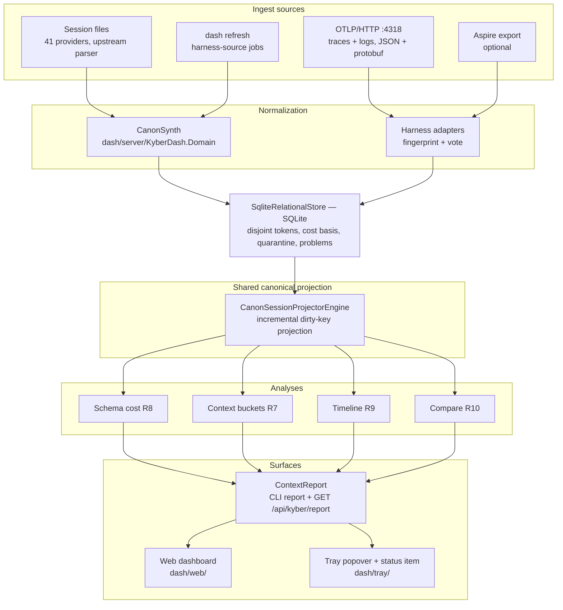
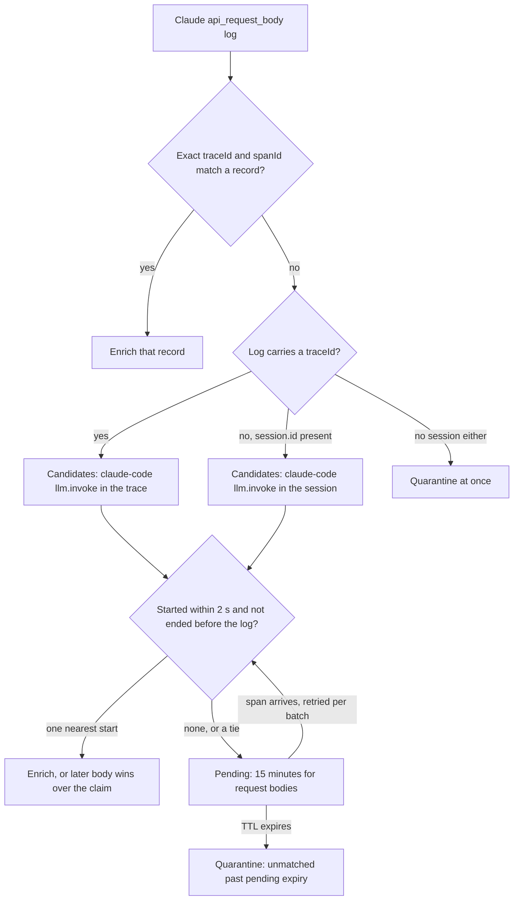
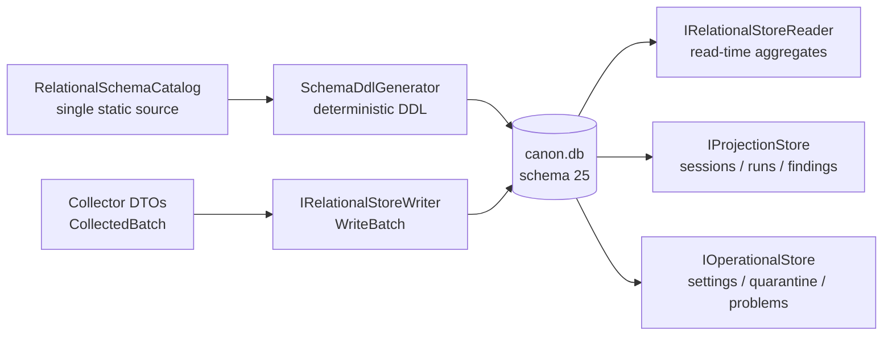
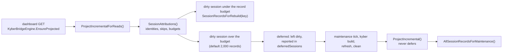
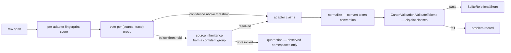
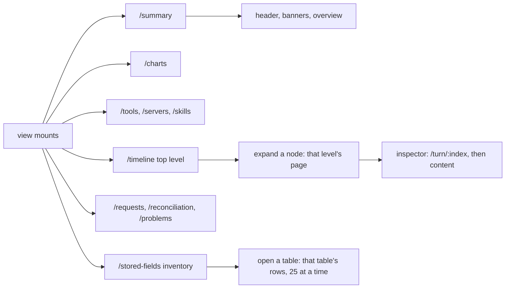

# KyberDash architecture

KyberDash is a locally-run product that answers three questions about coding agents: what
they cost, what filled their context windows, and whether a change to either actually helped.
It reads the session files that 41 agent tools already write to disk **and** receives
OpenTelemetry spans directly, then runs the same normalization and analysis over both.

It began as a soft fork of the MIT-licensed CodeBurn project and is now a **one-time fork**:
first-party code under `dash/`, with no upstream relationship
([ADR 0020](../adr/0020-kyberdash-one-time-fork.md)). The session-file breadth came from
CodeBurn; the span analysis depth — disjoint token accounting, basis-carrying cost, context
composition, tool and schema cost, quarantine — came from the retired Python pipeline
(`agent-session-analysis-dashboard`).

The measured failures that shape several requirements — a 5.8× cost understatement, negative
fresh input on 293 of 307 spans, 25 of 1,009 spans losing a parent, 2.9 GB for 37,623 stored
spans — are recorded in [KyberDash measurable rationale](../reference/kyberdash-rationale.md).
They are correctness constraints, not style choices: they document failures that already
occurred in the Python pipeline, and a reimplementation that drops a requirement reproduces the
failure. The foundational architecture decisions — the one-time fork, the embedded receiver,
the span-shaped canonical model, single-file distribution and the C# engine cutover — are recorded in
[ADR 0020](../adr/0020-kyberdash-one-time-fork.md).

## High-level architecture



One canonical model serves both ingest paths: the session-file providers are **span
synthesizers**, converting a parsed provider call into canonical records exactly as an OTLP
payload is decoded and normalized. No analysis knows or asks which path its data arrived by,
which is how Requirement 11.1 — one data path, not two parallel ones — is satisfied.

Both ingest paths also end in **one shared projection** (below): no surface derives sessions
from raw records, and no surface keeps a second derivation of the same figures.

## Repository layout

`dash/` is first-party code ([ADR 0020](../adr/0020-kyberdash-one-time-fork.md)): any file is
edited on its merits, under the repository's gates.

| Path | Contents |
|---|---|
| `dash/server/**` | The C# Clean Architecture solution (`dash/server/KyberDash.sln`). `KyberDash.Core`, `KyberDash.Domain`, `KyberDash.Contracts`, `KyberDash.Data`, and `KyberDash.Application` hold the engine: provider synthesis and readers, canonical store and projection, findings and rollups, pricing, OTLP collector, refresh orchestration, settings, and the REST endpoints |
| `dash/server/KyberDash.{Cli,Api,Mcp}/**` | The three presentation hosts: `kyberdash` (CLI router, reporter, diagnostics, menubar installer, e2e-seed launcher), `kyberdash-api` (the loopback `/api/kyber/*` server and OTLP collector), and `kyberdash-mcp` (the stdio MCP analytics server) |
| `dash/server.tests/**` | The engine's test projects (`KyberDash.Domain.Tests`, `KyberDash.Data.Tests`, `KyberDash.Application.Tests`, `KyberDash.Presentation.Tests`) |
| `dash/web/**` | The React web dashboard |
| `dash/tray/**` | The KyberDash tray — a Tauri 2 Rust shell (`src-tauri/`) plus a React popover UI (`ui/`) |

The former `dash/kyber/**` and `dash/src/**` TypeScript engine trees — along with the Electron desktop app,
the inherited Windows tray, the macOS menu-bar bundle, and the Ink TUI — were retired and replaced by
the C# Clean Architecture solution under `dash/server/**`. No copy of the retired engine is kept in the
tree; git history holds it, so the table above is the whole current layout.

## Ingest layer

| Component | Path | Contract |
|---|---|---|
| Provider parsers & readers | `dash/server/KyberDash.Domain/CanonSynth.cs` (`ParsedProviderCall`, `ReaderTurn`) and `dash/server/KyberDash.Data/Repositories/TranscriptReaderRepository.cs` | Produces parsed `ParsedProviderCall` and `ReaderTurn` models with native record and deduplication keys. |
| `CanonSynth` | `dash/server/KyberDash.Domain/CanonSynth.cs` | Consumes parsed calls; emits canonical records with a declared measurability map. Preserves cross-provider deduplication keys rather than adding a parallel mechanism (R3). Implements child `tool.invoke` span extraction, 64 KiB result truncation, and structured error status (contracts below). |
| `OtlpCollector` & `OtlpCollectorService` | `dash/server/KyberDash.Domain/OtlpCollector.cs`, `OtlpCollectorService.cs` | HTTP listener on the OTLP-standard port 4318 at `POST /v1/traces`, `POST /v1/logs`, and `POST /v1/metrics`. Decodes OTLP JSON and protobuf to span, log, and metric shapes. Each decoded log gets a unique `OtlpCollector.DeriveLogId` (correlation identity, timestamp, and payload digest) so duplicate deliveries of the same class do not collide. A log is mapped by `OtlpLogMapper.Map` (`dash/server/KyberDash.Data/Harnesses/Otlp/OtlpLogMapper.cs`) into `CollectedBatch` rows via `IRelationalStoreWriter.WriteBatch` or a standalone `CollectedProblem` via `IRelationalStoreWriter.WriteProblem`, and is never a parallel canonical record; the retired TypeScript engine enriched a correlated span-shaped record with it, and the C# engine does not. The session key reads `session_id`, falling back to `session.id`, in both JSON and protobuf decoders. |
| `BoundedIngestWriter` | `dash/server/KyberDash.Application/BoundedIngestWriter.cs` | Batches writes behind bounded admission (R2.5): the accepted backlog enforces configurable span/log and memory bounds; an oversize batch is permanently rejected (`413`) and a full backlog is shed transiently (`503` + `Retry-After`). Request bodies are capped at 64 MiB (`OtlpCollector.DefaultMaxBodyBytes`). |

### Collection-mechanism hierarchy and completeness contract

PRIMARY collection is OpenTelemetry (OTel), plugin hooks, and direct database reads;
file ingest (`dash refresh` synth and `dash import-history`) is backup and fallback
only — a fallback-derived value is never billed as a primary measurement. Completeness
is decided by the [harness collection standard](../rules/kyberdash-harness-collection.md):
every standard-named dimension measured where the source supplies it, otherwise
`not_measurable`/dash with a stated reason, never complete on a missing or empty dimension.

### Tool extraction and child-record contracts (issue #180)

During synthesis, tool calls and their associated results generate distinct child span-shaped records (`op: 'tool.invoke'`) linked to the parent turn's conversation session key:

- **Argument and result pairing:** Tool invocations extracted by provider readers (`TranscriptReaderRepository` / `CanonSynth`) pair each tool call with its matching tool result by call ID.
- **Structured error status:** Tool execution status (`ok` vs `error`) is determined strictly from structured metadata (`is_error === true` on the tool result object, or a non-zero `exit_code` in structured output). Heuristic regex scanning of tool output text (e.g. matching "error" or "exception") is prohibited to prevent false positives from compiler output or grep results.
- **64KiB storage bounds:** Tool result content stored in content parts (`part: 'tool_result_content'`) is bounded to 64KiB (`MAX_TOOL_RESULT_BYTES = 65_536`). When truncation occurs, the part is marked `truncated: true`, text is sliced cleanly at a valid UTF-8 boundary (`truncateUtf8`), and the pre-truncation byte length is recorded in `attributes['gen_ai.tool.result_bytes']`. Tool arguments in raw payloads are similarly bounded to 64KiB (`MAX_TOOL_ARGUMENTS_BYTES`), and truncated arguments record `attributes['gen_ai.tool.arguments_hash']` (SHA-256 digest of normalized arguments) and `attributes['gen_ai.tool.arguments_truncated'] = true`.
- **Relationship to unclipped inspection (ADR 0014):** ADR 0014 guarantees unclipped inspection and presentation of retained content in the UI and clipboard export. Ingest-time 64KiB bounding is a transport/storage management constraint that prevents database bloat while supplying exact payload size telemetry to finding detectors (such as `oversized-tool-result`); it does not clip the presentation of retained bytes.
- **Honest unobservability:** Offered tools (`tools_offered`) are never defaulted from static harness profiles. If a harness transcript does not explicitly export offered tool schemas, `tools_offered` remains unmeasured (`—` in UI) and `tool_yield` is not measurable.
- **Deferred subagent correlation:** `Task` subagent tool calls are treated as standard top-level tool invocations; nested child session trace correlation is deferred (tracked across follow-up issues #210–#215).

The receiver is embedded rather than relying on an external Aspire dashboard because the
dashboard is a ring buffer — eviction is a measured data-loss class (R2.7) — and because
Requirement 2 must hold without Docker, a container runtime, or a collector. The existing
collectors already post OTLP JSON to port 4318, so they work unchanged. Non-model and
unmatched telemetry is quarantined with an auditable reason instead of becoming a session.

Receiver activity is auditable in `ingest_log`: the span sink writes one row per distinct
span source in each decoded batch (`service.name`, `'otlp'` when unnamed), sized to the
arriving batch so quarantined traffic still counts as received, and the log sink writes
one `otlp:logs` row per log batch so last-received reflects any receiver request. Writes
join the writer's existing store handle after the ingest call returns; there is no schema
change and no second projection. An empty log reads as unknown downstream — "no receiver
activity recorded" — never as stopped or running, because receiver liveness is not
observable from the web server.

### Claude request-body log correlation

**This contract describes the retired TypeScript engine, and the C# engine does not implement it.**
In `dash/server/`, `BoundedIngestWriter` drains every accepted OTLP log through
`OtlpLogMapper.Map` into `IRelationalStoreWriter.WriteBatch` / `WriteProblem`; there is no `pending_logs` staging table, `IngestSpanNormalizer`
normalises spans only, and there is no raw-entry write path. A Claude Code `api_request_body` log
therefore neither enriches a record nor is correlated with one, and `telemetry-inventory.md`'s
"a log enriches one existing span-shaped record" holds only for the retired engine. The rest of this
section records the matcher that engine used, and is what a port would have to reproduce.

A Claude Code `api_request_body` log is written when a model request starts, but the
`llm_request` span it describes is exported only when the request ends, so the log usually
arrives first. The log is also stamped with the parent span that was active (the interaction, or
the tool execution a sub-agent call follows), not with the call's own span. The matcher therefore
scopes by trace, or by session for a body with no trace id, and never by parent. The contract:

- **Exact span first.** A body whose `(traceId, spanId)` names a record enriches that record.
- **Nearest start within the trace.** Otherwise the candidates are the `claude-code` `llm.invoke`
  records in the trace (or the session). A candidate qualifies when its start is within 2 s of the
  log and the call had not ended when the body was logged. The nearest start wins; a tie, or no
  candidate, leaves the body pending.
- **One body per record, later body wins.** A record already holding a body stays a candidate. The
  body with the later log timestamp supplies the body-derived parts; the earlier body is marked
  enriched as superseded and applies nothing. Neither waits or quarantines. The claim was stored in
  the record's `raw` under the key `kyber.claude_request_body` with the log id, its timestamp,
  the `request_body_id` when present, and `suppliedBuckets`, the buckets that body supplied. When a
  later body replaces an earlier claimed body, it drops exactly the buckets the earlier body
  supplied, even when the later body has no `tools` array, so the earlier body's tools or history
  cannot mask the not-measurable reason or stack on the new body. Parts in any other bucket came from
  the span or a transcript and stay. A claim written before `suppliedBuckets` existed falls back to
  dropping `system_prompt` and `tool_definitions` wholesale. Two bodies with an identical timestamp
  go to the higher log id, so arrival order never decides, and a claim whose timestamp does not parse
  counts as older than any valid body.
- **Pending lifetime.** `CLAUDE_REQUEST_BODY_PENDING_TTL_MS` (15 minutes) applies to body logs inside
  `reconcileExpiredPending`; every other log keeps `DEFAULT_PENDING_TTL_MS` (5 seconds).
- **Context-free bodies.** A body with no trace id but a `session.id` pends against its session for
  the full 15-minute window. Tool invocations are never candidates, so a tool record neither claims
  the body nor quarantines it. A body with no trace id, no span id, and no session id quarantines at
  once.
- **Tool definitions.** A parseable body with no `tools` array declares `tool_definitions` not
  measurable, naming the sender's omission; the turn inspector shows that reason, not an empty list.
- **Startup relink.** The retired engine ran a quarantined Claude request-body relink when the OTLP
  collector started, applying the same matcher to the quarantined backlog; its procedure is in the
  [runbook §2i](runbook.md#2i-claude-request-body-relink-and-quarantined-count). **The C# engine runs
  no such pass**: `CanonIngestPipeline` normalises spans and holds no log relink, so quarantined and
  pending log rows stay as written.

No schema changed: state lives in the existing `pending_logs`, `quarantined_logs`, `enriched_logs`,
`records.raw`, and `metadata` tables. The matcher decides from the trace or session candidates and the log timestamp alone, and it never
attaches a body to a call that had already ended. Expiry and replay are metadata-only
and paged: pending rows are listed without their payloads, and replay pages hold at
most 4 MiB of payload (16 MiB quarantine pages on the startup relink), so a large
pending backlog replays page by page within bounded working memory.



Measured behaviour, residuals, and the counts behind them are in the
[telemetry inventory](telemetry-inventory.md#claude-request-body-correlation).

### OpenCode V2 capture plugin pipeline (`kyberdash-opencode`)

KyberDash captures OpenCode through one pipeline, and it supports OpenCode 2.x only
([ADR 0048](../adr/0048-opencode-capture-is-a-v2-only-plugin-pipeline.md)):

```mermaid
flowchart LR
    Host["OpenCode 2.x<br/>hooks and bus events"] --> Plugin["kyberdash-opencode<br/>capture engine"]
    Plugin -->|"OTLP/HTTP JSON, contract 3"| Receiver["Loopback receiver<br/>127.0.0.1:4318"]
    Receiver --> Adapter["OpenCode adapter<br/>CanonAdapters"]
    Adapter --> Store["canon.db records<br/>SqliteRelationalStore"]
    Store --> Projection["Shared projection<br/>CanonSessionProjectorEngine"]
    Projection --> API["/api/kyber/*"]
    API --> Dashboard["Web dashboard"]
```



The plugin is a sender, not a surface. Each span is posted as OTLP/HTTP JSON to
`http://127.0.0.1:4318/v1/traces` using the V2 contract-3 format. Both raw content keys and compiled
`conversation_history` respect the OpenCode consent file before leaving OpenCode. The KyberDash
`opencode` adapter consumes those fields, validates them through `OtlpCollectorService` and
`CanonIngestPipeline.IngestBatch`, and the dashboard reads them only through `/api/kyber/*` (display-layer rule, KD-011).

**Capture writer and cutover.** `kyberdash kyber capture plugin install` (`dash/server/KyberDash.Cli/Program.cs`)
retains the CLI probe/flag surface (`--harness opencode`, `--if-installed`, `--config-dir`), resolving
`--config-dir`, else `$OPENCODE_CONFIG_DIR`, else `~/.config/opencode`, while the legacy TypeScript
OpenCode plugin bundler under `dash/src/capture/` was retired in the C# cutover
([ADR 0048](../adr/0048-opencode-capture-is-a-v2-only-plugin-pipeline.md),
[ADR 0084](../adr/0084-kyberdash-csharp-engine.md)).

**Engine and projection.** `kyberdash engine ensure --if-running` (`dash/server/KyberDash.Cli/Program.cs`) attaches
only when a live engine holds the endpoint (ADR 0039) and starts nothing when none runs. `kyber-weave update`
runs it after the binaries commit, then the tray step. The detector generation is `SqliteRelationalStore.DetectorVersion`
`5` (`dash/server/KyberDash.Data/Repositories/SqliteRelationalStore.cs`). `CanonSessionProjectorEngine.IsProjectionCurrent`
(`dash/server/KyberDash.Application/CanonSessionProjectorEngine.cs`) treats a store stamped with any other value as stale,
so derived findings are rebuilt with the current rules rather than kept. Under `kyberdash web`, `JobSchedulerService`
runs maintenance ticks that invoke `TranscriptIngestionService.PurgeExpiredContent` and call
`CanonSessionProjectorEngine.ProjectIncremental` when `IsProjectionCurrent` is false. A store stamped with an older
detector version is therefore re-projected to `SqliteRelationalStore.DetectorVersion` on startup/tick, and a current
stamp skips redundant projection with no separate `kyber build`.

The contract-3 envelope. The claim and the mapping live in `CanonAdapters` (`IsOpencodeEnvelopeSpan`,
`IsSupportedOpencodeEnvelope`, `OpencodeContractVersion = "3"`,
`OpencodeContractVersionKey = "opencode.contract_version"` in `dash/server/KyberDash.Domain/CanonAdapters.cs`).

- **Version.** Every envelope span names its contract under `opencode.contract_version`, currently
  `'3'`. A span with any other or missing version quarantines under the fixed reason
  `unknown opencode contract version` before the adapter vote, so no adapter claims it. Contract-2
  rows built before the bump stay in quarantine. The owner's old OpenCode rows are removed only by
  the command in the [runbook](runbook.md#1b-opencode-capture-enable-and-verify).
- **Claim rule.** The `opencode` adapter claims only a contract-3 envelope span. Native OpenCode
  spans (`Session.*`, OpenInference, AI SDK and the legacy `ai.*` names) carry no envelope marker and
  are not claimed by any harness. They fall to the unclaimed quarantine.
- **Trace shape.** One trace per OpenCode session. `opencode.request` is parentless and covers one
  execution, from `session.execution.started` to its terminal event. `opencode.step` is one model
  call, a child of its request. `opencode.tool` is one tool call, a child of the step whose message id
  it names. Each span carries `opencode.contract_version`, `opencode.session.id` and
  `opencode.span.kind`. Span ids are SHA-256 derivations of the session and an anchor (the
  execution-started event id, the step's message id, or the tool call id), so a re-delivered span is
  the same row.
- **Usage.** A step carries OpenCode's own integers: `opencode.usage.input`, `.output`, `.reasoning`,
  `.cache_read` and `.cache_write`. OpenCode's token classes are disjoint, so the canonical mapping
  is: fresh input = `input`; cache read = `cache.read`; cache creation = `cache.write`;
  output = `output + reasoning`; reasoning = `reasoning`.
- **Cost.** Cost is OpenCode's reported figure, carried verbatim as a harness-basis block, and a
  reported `0` stays a priced `0`. A step with no reported cost is `unknown` with status `no_rate`.
  There is no published-rate fallback for OpenCode. The currency is recorded as USD,
  which is an assumption: OpenCode's cost field names no currency.
- **Request duration.** Every span uses OpenCode's own `created` timestamps. The session's
  `duration_ms` sums the request roots when its records nest (see **Projection** below).
- **Content (consent only).** Content goes to parts and never to `record.raw`. Under consent a request
  carries the prompt text of each execution (`conversation_history`) and the session title
  (`kyber.session.label`). A step carries the system prompt (`system_prompt`), the tool catalogue as a
  JSON array of `{name, description, input}` (`tool_definitions`), and the listed skill ids. Tool
  inputs and results are not captured.
- **Metadata (always).** Usage, cost, timings, request and turn structure, model, agent, tool name,
  call id, status, error type, byte sizes and invoked skill ids flow with or without consent.
- **Skills invoked.** Three sources feed `kyber.skills.invoked` on the step: the `skill` tool's input
  id, the skills attached to a prompt, and `session.skill.activated` when it fires. The projection's
  per-turn maximum stops the same skill being counted twice.
- **Raw metadata and timeline.** `record.raw` holds metadata keys only. Timeline evidence matching
  ignores the `kyber.*` namespace, so a session titled "fix subagent title" does not regroup the
  timeline.
- **Plugin entry.** The loadable entry (`entry.ts`) exports one value, `default`:
  `{ id: 'kyberdash-opencode', setup }`. `setup` returns OpenCode's `Cleanup`, which stops the bus
  subscription and flushes the outbox. Nothing runs at import, and a `setup` that fails resolves to a
  no-op cleanup rather than failing OpenCode.
- **Skills listing.** The listed skill ids come from `opencode.context.skills` (the context hook's
  listing). When that is absent or empty, they are parsed from the `<available_skills>` block of the
  system prompt (`opencode-plugin/skills-block.ts`, shared by the plugin and the adapter). A malformed
  or missing block yields a named not-measurable reason, never an empty measured list.
- **Ownership and duplicates.** One global plugin loads once per directory instance, and again
  on hot reload. The bus delivers every session to every instance. Three guards stop one event being
  emitted twice or to the wrong project. An instance emits a session only after one of its own hooks
  fired for it, or when the event names its directory; events for other sessions wait in a small
  bounded buffer and are dropped. Span ids are deterministic, so re-delivery is idempotent. A new
  `setup` for a directory stops the older generation.
- **Bounds and terminal events.** A request span is emitted only at `session.execution.succeeded`,
  `failed` or `interrupted`. `experimental.idle` never closes one. An execution with no terminal event
  is emitted once with outcome `unknown`, ending at its last observed event, after 30 minutes with no
  events for that session or at `Cleanup`. Per-session state is capped at 64 sessions, with the oldest
  evicted first. Every hook and event handler swallows its own errors.
- **Consent.** The consent file `~/.kyberdash/opencode-plugin.json` (`{ "version": 1, "content":
  <boolean> }`) decides whether content flows, and the env override `KYBERDASH_OPENCODE_CONTEXT=1` (on)
  or `0` (off) takes precedence over it. The plugin reads consent on every event, so a change needs no
  reinstall. Install never turns content on; the Settings switch does. Session titles are model
  summaries of the prompt, so they count as content. Invoked skill ids are identifiers, so they are
  metadata.
- **Projection (shared rules, generic to any nested harness).** `summary.duration_ms` sums the
  request roots when a session's records nest, and sums every record otherwise.
  `requests[i].turns` counts the turn records under request `i`. `label` is the latest
  `kyber.session.label`, else the existing fallback. `requests[i].prompt` is a preview of at most
  200 characters of the request's prompt, taken literally: nothing unquotes or rewrites it. With content withheld it is the not-measurable object
  `{ availability: 'not_measurable', reason }`, never zero or an empty string. The same object stands for `summary.tools_offered` when tool definitions are withheld.
- **Measurability.** Token usage, cost and the cache counters come from the step's reported
  figures. The plugin exports cache read and cache write whenever OpenCode reports them.
  A step that reports no counter stays `not_measurable` with the OpenCode reason, never zero. Tool and
  pressure dimensions keep their existing evidence rules.
- **Absent versus zero (D8, ADR 0033).** In `KyberBridgeEngine.GetReport` (`dash/server/KyberDash.Application/KyberBridgeEngine.cs`), a
  context bucket whose part was never observed is `unmeasurable` with a named reason. It is not
  `measured(0)`. Only a bucket with an observed part is `measured`. The tray renders that state and
  does not decide it. An OpenCode session with no system prompt observed therefore shows the reason
  text, not "0 tokens".
- **Assembly.** `entry.ts` subscribes to the bus and registers the hooks. `plugin.ts` (the capture
  engine) joins them into request, step and tool records, `mapper.ts` turns each finished record into
  an OTLP span, and the outbox delivers it (`transport/`). One codebase serves Desktop and CLI.

Usage flows on this path. A step's usage and reported cost are metadata and always flow, and the
session totals are sums of OpenCode's own counters. Prompt text, the system prompt, tool definitions
and the skills listing flow only under consent, and assembled text honours the 14-day content purge.
A session with no counters and no content still projects as a visible session. Its unmeasured
dimensions carry reasons, and its unchartable turns are counted (`unmeasuredTurns`); see
[the shared canonical projection](#the-shared-canonical-projection). Operator steps are in the
[runbook](runbook.md#1b-opencode-capture-enable-and-verify).

The end-to-end check of live capture is the OpenCode live gate: a scripted two-prompt session on the owner's
machine whose figures must equal OpenCode's own totals. It passed on 2026-10-31 (OpenCode CLI 2.2.3), with the
session title waived. The `dash/e2e/harness-collection.spec.ts` OpenCode
scenario replays recorded OpenCode 2.2.1 events through the production plugin, receiver, adapter and
projection. It proves what the dashboard renders from that replay. It is not proof of live capture.

**Known limits.**

- Versions below 2.2.1 are unverified.
- Tool inputs and results are not captured, only the tool's name, status and sizes.
- Subagent child sessions are not linked to their parent session.
- The plugin sends no context window. `opencode.model.context_limit` is declared in `contract.ts`,
  but no code produces it in this build, so the window follows the existing catalog and declared-window
  rules ([ADR 0030](../adr/0030-kyberdash-declared-context-window-provenance.md)).
- OpenCode did not reload an edited global plugin file without a restart in the 2026-10-31 live gate: no plugin
  load line followed the install, and the running service's file watcher had stopped. Restart OpenCode after an
  install or upgrade. The install guidance says the same when new sessions do not appear.
- A session whose project instance loads late can miss its title. The plugin then labels it "OpenCode session"
  (the 2026-10-31 live gate waived this row).

### OpenCode native OpenTelemetry is not collected

On OpenCode 2.2.x, native OpenTelemetry carried no usage in the 2026-10-30 measurement (0 of 55,261
spans), and OpenCode ignores the `experimental.openTelemetry` key that older KyberDash builds wrote.
KyberDash therefore maps no native OpenCode span. The AI SDK, OpenInference and legacy `ai.*` mappings
and their fixtures are removed, and native spans fall to the unclaimed quarantine. The V1 table import
(`opencode.db` and JSON session files) is removed too, so the plugin is the one source of OpenCode data.
The decision and the alternatives it rejected are in
[ADR 0048](../adr/0048-opencode-capture-is-a-v2-only-plugin-pipeline.md). The per-source outcome is in the
[telemetry inventory](telemetry-inventory.md).

### Factory (Droid) capture plugin pipeline (`kyberdash-factory`)

KyberDash captures Factory through one hooks-plugin pipeline
([ADR 0055](../adr/0055-factory-capture-is-a-hooks-plugin-pipeline.md)):

```mermaid
flowchart LR
    Host["Factory (Droid)<br/>hook events"] --> Plugin["kyberdash-factory<br/>the harness's cached plugin"]
    Plugin -->|"OTLP/HTTP JSON, contract 1"| Receiver["Loopback receiver<br/>127.0.0.1:4318"]
    Receiver --> Adapter["droid adapter<br/>CanonAdapters (C#)"]
    Adapter --> Store["canon.db records<br/>SqliteRelationalStore (C#)"]
    Store --> Projection["Shared projection<br/>CanonSessionProjectorEngine (C#)"]
    Projection --> API["/api/kyber/* (DashEndpointMappings)"]
    API --> Dashboard["Web dashboard (dash/web/)"]
```



Factory reaches KyberDash through a **marketplace** the harness installs from, not through a
configuration key (`kyberdash`, from `dash/server/KyberDash.Cli/Program.cs`, manages consent via `kyber capture plugin consent` while
`FactoryHookMapper` / `CanonAdapters` map and normalize the v1 wire contract).

**The owned marketplace tree.** KyberDash owns one whole tree under its own state directory,
published and then installed by the harness's own commands:

```text
<the marketplace tree>/
├── .factory-plugin/
│   └── marketplace.json     # the marketplace manifest: names the plugin, points at it by a relative path
└── kyberdash-factory/      # the plugin payload
    ├── .factory-plugin/
    │   └── plugin.json      # Factory plugin manifest
    └── hooks/
        ├── hooks.json       # registers the script on the six hook events
        └── kyberdash-factory.mjs # the bundled capture script
```

The install is `droid plugin marketplace add <the marketplace tree>` followed by
`droid plugin install kyberdash-factory@kyberdash --scope user`, and the teardown is
`droid plugin uninstall kyberdash-factory@kyberdash --scope user` followed by
`droid plugin marketplace remove kyberdash`. The registered marketplace name is the tree
directory's basename rather than the manifest's own `name` field, so the directory name is
load-bearing and the plugin identity is `kyberdash-factory@kyberdash`. The plugin that runs is
the **harness's cached copy** of the tree, and `${DROID_PLUGIN_ROOT}` expands to that cached
path. The tree's `hooks/hooks.json` is keyed **directly by event name**, the shape Factory's own
documentation shows for a plugin's hooks file; the top-level `hooks` wrapper KyberDash first
shipped was the shape Factory documents for the `hooks` key inside `settings.json`, and it worked
only through undocumented tolerance.

The receipt is `~/.kyberdash/factory-plugin-receipt.json` — one digest per owned file, because
the owned unit is a tree and not a single file, and the tree KyberDash owns is not the harness's
cache copy. Removal requires every recorded digest to match, so an edited file is left in place.

**The upgrade path.** A tree the receipt proves KyberDash wrote, whose bytes still match that
receipt, and whose content is **not** the current bundle is an **upgrade** — the sixth kind
beside `absent`, `unreadable`, `foreign`, `edited` and `same`. A tree whose bytes drifted stays
`edited` (the owner's edit is the owner's). A tree no receipt proves whose content is an
**older** bundle stays `foreign`, because matching an older bundle's bytes never establishes
ownership; a tree no receipt proves whose content is **exactly the current bundle** is not
foreign — the install writes the receipt that proves KyberDash wrote it, so the next upgrade is
provable. On an upgrade the
Kyber-owned tree and its receipt are rewritten with the current bundle, and the harness's
**cached copy** is then refreshed through the harness's own command, chosen from the harness's
own registry rather than guessed: the plugin **installed** → `droid plugin update
kyberdash-factory@kyberdash --scope user`; the plugin **not installed** and the marketplace
**registered** → `droid plugin install kyberdash-factory@kyberdash --scope user`; and the
plugin **installed** while the marketplace is **not** registered → the registration is restored
**first**, because `droid plugin update` fails without it ("Marketplace \"kyberdash\" not
found"). `droid plugin install` is **never** run against an installed plugin, because the harness
refuses it ("already installed at user scope"). `unchanged` therefore means **both** a current
tree and an installed harness copy, so a routine `kyber-weave update` or Squad call that finds
everything current runs no harness command and mutates nothing.

KyberDash never creates, reads, merges, rewrites or restores the owner's
`~/.factory/settings.json`, `~/.factory/hooks.json` or the project equivalents; the harness's
own commands change the settings file during an install KyberDash requested, and the restore
criterion is therefore semantic — no entry the install added remains, no entry the owner had is
lost, and every other key is unchanged in content.

**The wire contract.** Contract version `1`, in the `factory.*` attribute namespace, with its own
span names (`factory.session`, `factory.turn`, `factory.tool`) and deterministic mapping rules
(`FactoryKeys` and `FactoryHookMapper` in `dash/server/KyberDash.Domain/FactoryHookMapper.cs`, tested in `dash/server.tests/KyberDash.Domain.Tests/CanonIngestTests.cs`). The
OpenCode contract-3 keys are deliberately not reused: the OpenCode adapter claims every span
carrying them, so an `opencode.*` key here would attribute every Factory row to OpenCode. The
six registered hook events are `SessionStart`, `UserPromptSubmit`, `PreToolUse`, `PostToolUse`,
`Stop` and `SessionEnd`; `PreCompact` produces no span in this contract, so no
process is spent on it. `SubagentStop` is not registered: Factory's documented payload for that
event carries `task_name`, `task_result`, `task_error` and `stop_hook_active`, and **no child
session id** — the common `session_id` is the session the hook fires in, which for a subagent's
stop is the **parent's** session, so a span there would name the parent as the child, and a
registration would cost a process per subagent stop for no span. `FactoryHookMapper.MapHookEvent` is
pure: an attribute the payload does not carry is absent, never zero and never an empty string,
and the prompt text is capped at 64 KiB and marked when it is cut.

**Cutover and consent contract.** The legacy TypeScript plugin bundler and hook transport leaves under `dash/src/capture/` were retired in the C# cutover ([ADR 0084](../adr/0084-kyberdash-csharp-engine.md)). The CLI retains `kyberdash kyber capture plugin install --harness factory` (directory probe for `$FACTORY_DIR/plugins/kyberdash` or `~/.factory/plugins/kyberdash`) and `kyberdash kyber capture plugin consent --harness factory --on|--off` (`Program.RunCapturePluginConsent` in `dash/server/KyberDash.Cli/Program.cs`), which writes `~/.kyberdash/factory-plugin.json` (`{ "version": 1, "content": <boolean> }`). `FactoryHookMapper.MapHookEvent` omits `factory.turn.prompt.text` unless `FactoryMapOptions.ContentAllowed` is true.

**What the consent governs, and what it does not.** Consent governs `factory.turn.prompt.text` and Factory's native OpenTelemetry content attributes at emission and ingest. It does **not** govern the Factory **file source**, which reads the owner's first user-message fragment out of the owner's own transcript. On ingest, `CanonIngestPipeline.IngestBatch` (`dash/server/KyberDash.Application/CanonIngestPipeline.cs`) validates the `droid` envelope (`CanonAdapters.IsSupportedDroidEnvelope`) and quarantines unsupported or missing contract versions under `unknown droid contract version`, while `FactoryWireSpan` tool attributes carry byte counts (`factory.tool.input.bytes`, `factory.tool.result.bytes`) rather than raw content.

**The prompt reaches the session payload.** When `factory.turn.prompt.text` is present, the `droid` adapter files it as the
record's `conversation_history` part (`dash/server/KyberDash.Domain/CanonAdapters.cs`), the way the OpenCode
adapter files its prompt, so the session's own content carries what was asked and the dashboard's
session view shows it. The **prompt turn** whose prompt the consent withheld declares the prompt
`not_measurable` with a reason that names the consent, so the absence is stated rather than shown
as a blank; the plugin's **completion turn** for the same turn carries no prompt by construction,
so it says nothing about one. The projected prompt is a content part like every other, so the
14-day content purge applies to it; the raw copy the plugin's span carries is not purged.

**A turn stored before the mapping is repaired on rebuild.** Re-projecting derived tables via
`CanonSessionProjectorEngine.ProjectIncremental` recalculates attribution, token derivation, and
content parts from stored raw payloads cleanly without losing collected rich content.

**Install modes.** The OpenCode installer's semantics, extended from one file to a tree:

- **Strict** (`capture enable`): refuses a foreign tree (one holding a file KyberDash did not
  write) or an owner-edited tree (one whose bytes no longer match the receipt) with exit 1, and
  writes nothing at all. An unreadable tree is refused in both modes.
- **Preserve** (`--preserve`, used by Squad and `kyber-weave update`): keeps such a tree with a
  warning and exits 0.
- **`--if-installed`** decides from the **harness's own registry**, not from the tree on disk.
  When the registry reports the plugin installed, the install runs — and it refreshes the
  harness's cached copy even when KyberDash's own tree is absent and has to be written for the
  first time, because the harness's copy is then the stale one. When the registry does not report
  it installed, nothing is written and no harness command runs.

**The status surface's fixed words.** `capture status` and the Settings row report the **tree's**
state, in fixed words: `plugin: installed`, `plugin: not installed`, `plugin: unreadable` (not a
regular directory, or a file in it is not a regular file), `plugin: modified since install or
not written by KyberDash`, and — for a tree KyberDash wrote that holds the **previous** bundle —
`plugin: installed (an older version than this build)`. That last word is the `upgrade`
classification, and it is deliberately distinct from `plugin: modified since install or not
written by KyberDash`: a tree KyberDash wrote and still owns, whose bytes are simply an older
bundle, is neither an owner edit nor a foreign tree. The install is what resolves it — the
install rewrites the tree with the current bundle and then refreshes the harness's cached copy,
the same refresh the `--if-installed` clause above promises — so the row reads
`plugin: installed` again once the install has run.

**The install's own verdict names the tree.** The disposition and the printed line say what
happened to the **tree**, not to the harness's copy of it: a tree written fresh is `installed` and
prints `factory plugin: installed <dir>`, and a superseded tree is `upgraded` and prints
`factory plugin: upgraded <dir>`. The harness's **cached copy** is refreshed whenever the tree's
content changed — and also when the tree was written fresh while the harness already held the
plugin, because the copy the harness runs is then the stale one. The refresh rides along with
either verdict, so a fresh tree the harness already had installed still ends with the harness
running the current bundle.

**The install lifecycle's vocabulary.** External Factory installations classify the harness-side state into
`marketplace-tree-written` (the Kyber-owned tree landed; the harness does not have it yet),
`marketplace-registered` (the harness registered the marketplace; the plugin is not installed),
`plugin-installed` (the plugin is installed and enabled), `conflict` (the harness holds a
marketplace name or a plugin identity KyberDash does not own), and `unknown` (the harness's own
state could not be read).

In the C# CLI, `kyberdash kyber capture plugin install --harness factory` probes `$FACTORY_DIR/plugins/kyberdash` (or `~/.factory/plugins/kyberdash`) without spawning external marketplace commands during status reads.

Every partial state is named, and every one of them is resumable by re-running the install. An
interrupted harness-side step is never repaired by hand: the harness's cache copy and its own
plugin record are the harness's files, and the repair is to re-run the harness's own command. A
missing `droid` CLI reads as `unknown` with the named cause, never as an install that succeeded.

**The refusal vocabulary.** A refusal names its cause: `conflict` (a name the harness holds that
KyberDash does not own), `drift` (the tree the owner edited) and `unreadable` (the tree, or the
harness's own state, could not be read). Strict mode refuses with exit 1 and writes nothing;
preserve mode keeps the state with a warning and exits 0.

**The tree or the receipt proves the plugin identity.** What makes a plugin identity KyberDash's
own is **either** the tree KyberDash wrote **or** the receipt that proves it — an OR, not a
fallback order. The tree's presence proves the identity ours when KyberDash wrote that tree; the
receipt proves it when the tree is gone but the receipt survives, and a receipt proves an identity
only when it names **this** tree, **this** marketplace and **this** identity
(`kyberdash-factory@kyberdash`); every part of that has to hold, so a receipt naming another
tree, another marketplace or no identity at all proves nothing, and an arbitrary plugin identity is
never treated as ours. The receipt is the proof that survives the harness's own teardown — the
harness removes a marketplace registration **without** removing the plugin, so a plugin can
outlive the registration that named it. Ownership therefore does not rest on the tree's presence
alone: a tree that is absent while the receipt still proves the plugin identity is **ours**, not a
conflict, and the install then runs the sequence the harness's own registry dictates — the
marketplace registration is restored **first** when it is missing, and `plugin update` refreshes
the harness's cached copy against the installed plugin, because `plugin install` is refused for an
installed plugin. The tree's presence is what proves a marketplace ours when the harness names no
source to compare against; the tree's presence **or** the receipt is what proves the plugin
identity ours.

**The same rule applies at the uninstall.** The uninstall reads the receipt it already has to
remove and derives the same proven identity from it — the receipt names **this** tree, **this**
marketplace and **this** identity, and is not the previous route's legacy receipt — so a plugin
the receipt proves is ours is removed through the harness's own
`droid plugin uninstall kyberdash-factory@kyberdash --scope user` instead of being classified as
a conflict. A conflict answer there would run no harness command, delete the receipt and report
success while the plugin stayed installed and kept capturing. A marketplace named `kyberdash` that
somebody else registered is still a conflict, and it is still left alone.

**The residue rule — report, never patch.** If the harness's own uninstall leaves an entry
behind, KyberDash names it (which registry, which entry) and prints the exact `droid plugin …`
command that removes it, and never writes the owner's settings file to clean it up. The teardown
removes KyberDash's own tree on a conflict and leaves the foreign entry alone: the tree is
KyberDash's and the receipt proves it, while the entry that holds KyberDash's **name** is
somebody else's.

**An organisation's hard controls can refuse the route.** `strictKnownMarketplaces` makes the
higher-level list the ceiling for marketplace sources, `strictEnabledPlugins` makes the
`enabledPlugins` map the exhaustive plugin allowlist — so a user-scope install is rejected — and
`allowManagedHooksOnly` drops user- and project-level hooks, so the plugin can install, register
as enabled and never fire a hook. KyberDash works around **none** of them: the only way to add a
marketplace or an enablement without the harness's commands is to write the owner's settings
file, which this section forbids. The first two are **visible** — the harness's command fails and
the refusal is reported with the harness's own stderr quoted; the third is **silent**, and the
surfaces must not read "installed" as "capturing".

**The shared `droid` harness id.** Factory is one harness under one canonical id, `droid` — the
id the Factory file source and adapters use (`CanonAdapters` in `dash/server/KyberDash.Domain/CanonAdapters.cs`), so the dashboard shows
Factory once and the plugin's rows sit beside the file source's rows. One adapter, named
`droid`, claims the plugin envelope, and only the plugin envelope: it recognises a span by its
attribute fingerprint alone, never by the span's source name (R6.2), and Factory's **native** span
surface is not among the fingerprints it recognises (see
[the native path](#factorys-native-opentelemetry-path-authorized-complementary)). An envelope span
naming an unsupported or missing contract version scores zero and quarantines under the fixed
reason `unknown droid contract version` (`CanonAdapters.UnknownDroidContractVersionReason`), the same guard the OpenCode envelope carries
(`CanonAdapters.UnknownOpencodeContractVersionReason`).

### The Factory source-precedence rule

Factory is one harness reached through two capture sources, and a session both sources observed
has to say which source owns which half of it. The rule is decided in one place —
`CanonSessionProjectorEngine.SplitDroidSessionRecords` (`dash/server/KyberDash.Application/CanonSessionProjectorEngine.cs`) — and it **splits by what each source can measure**; it never merges the two.

| The session's figure | Read from | Why |
|---|---|---|
| turn count, timeline turns, request roots, per-turn model, context turns | the **plugin rows** | the plugin is the PRIMARY mechanism and alone observes the turn boundary |
| tool invocations | the **file rows' tool records** when the transcript has any tool record for the session; otherwise the **plugin rows** | the plugin's tool spans cannot tell two calls of one session apart, because Factory's hook payload carries no call id ([ADR 0055](../adr/0055-factory-capture-is-a-hooks-plugin-pipeline.md), amended 2026-11-09), so the transcript is the tool source wherever it has one |
| duration | the **file rows' durations**, summed | the transcript carries each call's timestamp and the boundary it is measured from; the plugin's spans start and end at the same instant, so they measure no duration |
| token totals (input, output, cache read, cache creation) and the availability that gates them | the **file rows** | the file source is the only source of counters, and its counters are a session-level total split evenly across assistant calls — a session fact, never a turn fact |
| cost | the turn records **and** the counter records | the file row carries the only priced cost — the plugin rows carry none — and the two record sets are disjoint, so pricing the union prices nothing twice |

The split is **total over two buckets**: every Factory record lands in exactly one of them, the
**turn records** or the **counter records**, and `SplitDroidSessionRecords` is the one place that
assigns them. The two buckets are disjoint, so nothing is priced twice.

- **Turn records** — the plugin's records, and any Factory record of neither source, so a record
  is never dropped.
- **Counter records** — the file source's records, identified by the `codeburn/` source prefix.

The **file tool records** are not a third bucket. They are a view into the counter records: the
file source's `tool.invoke` records, returned alongside the split so the session derivation can
decide the tool-call source (the transcript's tool records when there are any, otherwise the
plugin's). The session derivation excludes `tool.invoke` records from the counter records it uses
for duration, tokens, cost, models and context. Tool records carry no tokens or cost, and their
time lies inside the parent llm call, so only the tool count reads them.

The file row in a paired session is a **counter carrier**: it contributes its counters and its
cost, and, for a session whose transcript has tool calls, its tool invocations and its duration.
It is not a turn, not a timeline entry and not a request root. A paired session's tool source is
one source only: the file tool records when there are any, otherwise the plugin's tool records.
Its duration is the sum of the file source's llm (non-tool) counter records' active durations,
which the active-duration rule in
[the Factory file source](telemetry-inventory.md#what-the-file-source-measures) defines. Tool
records are excluded, because their time already lies inside those durations.

Two more figures follow the same split. The **cost** is one figure over the union of the turn
records and the counter records — disjoint sets, so nothing is priced twice — and the cost-basis
verdict is computed over that same union. The **context analysis** reads the turn records, and
where no turn record carries a measured input — a paired Factory session's plugin turns report
no counter at all — it falls back to the counter records, so the session keeps the context
figure the file source gave it before the plugin arrived.

The session's **model** follows the same split: the turn records' model where a turn record
names one, the counter record's model where none does. See
[the model a Factory session publishes](telemetry-inventory.md#the-model-a-factory-session-publishes).

The rule is **inert for every other harness**: a record of another harness belongs to neither
list, so every other session keeps the derivation it has. A **plugin-only** Factory session
keeps the plugin's own declarations, so its totals read `not_measurable` with the reason the
plugin adapter gives; a **file-only** session keeps the file source's. The pairing is
**exact-match only** — no fuzzy join, no time window, no counter-equality join — and it never
fabricates: a paired session's totals are the file row's counters, and a plugin-only session's
totals are absent, never zero.

### Where the Factory file rows come from

The file source is read over, and both reads write the **same** rows.

- The **refresh** reads every Factory session under the history window — and only when a run is
  allowed to read folder sources at all (`settings.folder_import.scheduled` is off by default, so
  an unattended run reads none).
- **Live counter and file refresh (`CanonRefreshEngine`, `JobSchedulerService`):** Explicitly enabled folder imports and scheduled maintenance run `TranscriptIngestionService.RefreshHarnessSources` and `CanonSessionProjectorEngine.ProjectIncremental` under `JobsLease` so file-sourced counter rows pair cleanly against `kyberdash-factory-plugin` turn rows without double-counting.

Both reads go through the same provider and the same synthesizer, so the rows carry the same
identity: a later folder import **replaces** the live rows rather than adding a second copy of
the same counters, and the split above still prices and counts nothing twice. The pass reads
only sessions the plugin captured — it never invents a Factory session the capture did not see —
and it holds the refresh lock while it writes, so a refresh never runs under it.

The pass says what it read. A sessions root that exists and cannot be read **fails** the pass
and names the root, because "no Factory sessions" and "the sessions root cannot be read" are
different statements. A session whose id is not a plain file name is not a session of ours: the
id comes out of a span, so it is data and never a path. The project's name comes from the
session's own file, the way the file source derives it, so the two paths file one session the
same way.

### Factory's native OpenTelemetry path (authorized, complementary)

Factory's own native export can be pointed at the KyberDash receiver:
`export OTEL_TELEMETRY_ENDPOINT="http://localhost:4318"` is Factory's own documented example,
and Droid pushes OTLP/HTTP directly, so no collector is needed and KyberDash is simply the
customer's own collector. The path is authorized as a **second, complementary** path
([ADR 0055](../adr/0055-factory-capture-is-a-hooks-plugin-pipeline.md)), never as the primary
one.

**The organisation's pin is read from the harness's own directory.** An organisation's managed
settings reach the machine two ways: the **cached view** the harness writes into its own
directory — `<home>/.factory/org-managed-settings.cache.json`, whose `managedSettings.telemetry`
carries the pinned values — and the **system-managed copy** (`settings.json` under the platform's
system-managed directory), whose `telemetry` block carries them. Both are read, so a machine that
holds only one of them still reports the organisation's pin. The cached view is **not** read from
the directory `FACTORY_DIR` moves: that variable moves the harness's **sessions tree** and
nothing else, so the harness keeps its own settings and its cached organisation settings in its
Nothing moves `$FACTORY_DIR` over the organisation-settings boundary (`FACTORY_DIR` scopes Factory's sessions tree only).

**The receiver.** `POST /v1/metrics` sits beside `POST /v1/traces` and `POST /v1/logs`
(`OtlpCollectorService` in `dash/server/KyberDash.Application/Services/OtlpCollectorService.cs`, wired by `OtlpEndpointMappings` in `dash/server/KyberDash.Api/Endpoints/OtlpEndpointMappings.cs`). OTLP/JSON and OTLP protobuf metrics are decoded (`OtlpCollector.DecodeMetricsJson`, `OtlpCollector.DecodeMetricsProtobuf`) and queued through `BoundedIngestWriter.TryEnqueueMetrics` (`dash/server/KyberDash.Application/BoundedIngestWriter.cs`) with the same admission, shedding and size-ceiling discipline as the span
path. Only OTLP/HTTP is documented for Factory — port 4318, no gRPC, no 4317 — so no other
protocol is added. Logs are never exported by Droid, so `/v1/logs` receives nothing from Factory.

**Where the metric points go.** Decoded metric points target the relational store's own `metric_point` table (`RelationalSchemaCatalog` in `dash/server/KyberDash.Domain/Schema/RelationalSchemaCatalog.cs`, written via `IOperationalStore.PutMetricPoints`). A point's identity digests everything the row carries — **including the interval the point's measurement covers** — so a re-delivered point lands on the row it already occupies instead of beside it.
row carries the metric's name, kind and unit, its aggregation temporality, the point's timestamp,
**the start of the interval the point's measurement covers**, and its value or its count and sum,
the point's attributes, the resource attributes, the scope,
and the exporter's `service.name` as the row's **source**. A point that carried no value of its
own keeps the value absent, never zero, and a point that declared no interval carries none —
absent, never a fabricated zero.

**What the row stores is the exporter's own content.** `attributes_json` holds the point's own
attributes and `resource_json` the resource attributes, and the store writes both **verbatim** —
it redacts nothing. The receiver is what decides, at the decode seam and before anything is
stored: it strips account identity from the metric **resource** and from the metric **point's own
attributes**, exactly as it does for spans and logs. So `resource_json` carries the exporter's
resource attributes (`service.name`, `service.version`, `os.type`, …), `attributes_json` carries
the point's own attributes, and neither carries `user.id`, `user.email` or `organization.id` —
Factory's native export puts those identity keys on every data point (the vocabulary table below
is the exporter's own, not the stored row's), and the receiver is where they are dropped, so they
never reach the stored row. The keys that survive are the correlation and usage evidence:
`session.id`, `conversation.id`, the whole `gen_ai.*` namespace, and the point's own measurement
attributes such as `model.id` or `skill.name`. Those are not identity, so they are kept.

The `metric_point` table and its `metric_point_start_time` child are declared in `RelationalSchemaCatalog`
and created by `SchemaDdlGenerator`; the interval start (`start_time_unix_nano`) is a first-class
child row (`metric_point_start_time`), absent when the point declared no interval, never a fabricated zero.

A metric point has **no span**, so its row carries **no harness attribution** — there is no span
to fingerprint — and the exporter's `service.name` is a source, not an attribution. That is also
why a **scoped per-harness wipe cannot clear these rows**: it cannot claim a row it cannot
attribute. The full corpus wipe clears them with everything else.

**Nothing projects them yet.** The canon projection and the dashboard have no metric concept, so
a metric point is a stored fact and not a figure the dashboard shows, and no reader is told a
metric was measured and shown as one. The projection that would read them is later work.

The writer's rule is **unchanged**: a sink that cannot persist metrics does not offer the port,
and the writer **refuses** the batch rather than accepting one it would drop. The arrival is
recorded as receiver activity under the single `otlp:metrics` key, carrying the number of points
the batch carried, and that audit write is fenced exactly like the span and log audit writes: a
failed audit row never fails the ingest it audits and never requeues the batch.

**The native span claim is withdrawn.** **No adapter claims a native span.** The `droid` adapter
recognises only the plugin envelope. It used to recognise the native `genai` fingerprint by
attribute — never by source name — and that fingerprint (`gen_ai.agent.name` = `droid`) sits on
the trace **root alone**. The registry normalises a group's score by the group's span count, so a
trace of one root and `k` children scores `1/(1+k)` against the registry's **0.6** threshold: a
real turn's trace has at least one child, scores at most **0.5**, and is quarantined. Measured
against real captured spans: **accepted 0, quarantined 2**. The `legacy` format's content-shaped
spans carry no attribute fingerprint at all — only span names, which no adapter may claim. A
native span therefore leaves the corpus for quarantine as **`unclaimed`**, and the quarantine row
keeps the whole decoded packet as the audit evidence. The native **metrics** path is untouched by
this: it is what remains of the native path.

The vocabulary Factory's own export uses is:

| Aspect | Value |
|---|---|
| Root span | `invoke_agent droid` (Internal) |
| Children | `chat <model>` (Client); `execute_tool <tool>` (Internal) — tool spans are siblings of the chat spans, never nested |
| Operation | `gen_ai.operation.name` ∈ `invoke_agent` \| `chat` \| `execute_tool` |
| Agent | `gen_ai.agent.name` = `droid`, on the root |
| Session | `gen_ai.conversation.id` = the Droid session id; `session.id` on every data point |
| Model | `gen_ai.request.model` (chat span) |
| Provider | `gen_ai.provider.name` ∈ `anthropic` \| `openai` \| `gcp.gemini` \| `x_ai` \| `deepseek` \| `mistral_ai` |
| Tool | `gen_ai.tool.name`, `gen_ai.tool.call.id`, `gen_ai.tool.type` = `function` |
| Outcome | `error.type` = `rejected` for a policy-denied tool call; `gen_ai.response.finish_reasons` (array) |
| Server | `server.address`, `server.port` |
| Content (gated) | `gen_ai.input.messages` (root), `gen_ai.output.messages` (chat), `gen_ai.tool.call.arguments`, `gen_ai.tool.call.result` |
| Common (every data point) | `user.id`, `user.email`, `organization.id`, `session.id`, `model.id`, `parent_session.id` |
| Resource | `service.name` = `cli`, `service.version`, `os.type`, `os.version`, `host.arch`, `terminal.type`, `telemetry.granularity` |

**Plugin-first precedence.** The plugin envelope is the only Factory span KyberDash claims, so
there is nothing for a native span to be counted with: every native span is quarantined as
`unclaimed` and never reaches the corpus.

**What the native path cannot do.** Its metrics carry **no token or cost counters** — Factory's
own documentation states that token and cost data "are not exported as customer OTEL metrics" —
and the export carries **no subagent lineage**. A Factory session's counters therefore still come
from the file source, and the native path replaces neither the plugin rows nor the file source's
counters.

**Where it is silently absent.** Factory's endpoint is configured by machine environment
variables (`OTEL_TELEMETRY_ENDPOINT` and its siblings); there is no personal `settings.json`
telemetry key. An organisation-managed `telemetry` block **overrides** those variables, so a
deployment under such an override exports nothing locally and the plugin path is the only
capture path in that deployment. KyberDash reports what it observes and never claims the native
path is available when none arrives.

## Local harness-source refresh

Session files also enter the store through `kyberdash kyber refresh` (`dash/server/KyberDash.Cli/Program.cs`,
calling `TranscriptIngestionService.RefreshHarnessSources` (`dash/server/KyberDash.Application/Services/TranscriptIngestionService.cs`).
That path is the production local-history ingest; OTLP remains a separate receiver.

The command opens `~/.kyberdash/canon.db` (or `--db`) and processes each harness `RefreshSourceInput` unit
for native files or database records. Inclusion uses a UTC record window
`[commandStartedAt − N×7 days, commandStartedAt]`; `--history-weeks` is a positive integer
and defaults to **2**. There is no public `--provider` flag. Invalid `--history-weeks`
exits **2** before the store opens. Failed harness jobs or derivation failure exit **1**.
Success, including absent (`unavailable`) sources, exits **0**.

Each accepted unit is persisted with `IRelationalStoreWriter.WriteBatch`: source, session, record, and `ingest_problem` rows with `record_provenance` and `source_checkpoint` children in one transaction, plus `IOperationalStore.UpsertSourceCheckpoint` and `UpsertRefreshRun`. Every
refresh run additionally records its coverage window in `refresh_run.history_weeks` — the
`--history-weeks` value of that run. Rows predating window tracking read as `null`, which
every surface renders as unknown with the reason "recorded before window tracking", never
coerced to a default or to zero
([honest unobservability](../rules/honest-unobservability.md)). A changed unit that
yields no records persists its reason on the checkpoint's `last_error_code` (status stays
`ok`): `window_filtered` when the parser produced calls that all predate the coverage
window, `no_recordable_events` when it produced none (for Codex,
no `token_count` or model events). A unit with records, or with problems, carries no such
reason. The Codex OTLP adapter (`CanonAdapters` in `dash/server/KyberDash.Domain/CanonAdapters.cs`) is the sixth fingerprint voter; see the Codex OTLP note in [telemetry-inventory](telemetry-inventory.md). When parser extraction rules change or a parser defect is repaired, bumping `RefreshSourceInput.ParserContractVersion` (e.g. `'4'` for Kilo sources) invalidates reusable checkpoints without deleting historical metadata, forcing `RefreshHarnessSources` to re-parse units and commit newly extracted records. When a unit's stored `parserContractVersion` differs from the input's, `RefreshHarnessSources` rebuilds `recordCount` from live records attributed to that source (`record_provenance` joined to `records`, so quarantined or deleted rows do not count) plus records created in this pass; revision-token and `lastStatus` changes carry the previous count forward because a revision change re-parses within the current window only. A true source-unreadable denial (typically macOS TCC on Group Containers)
is not retried as another user and does not fabricate rows: discovery reports `exists: true` with `accessError: permission-denied`, and doctor's `emptyVerdict`
names the path as not readable — permission denied — with a platform-specific remedy (Full
Disk Access on macOS, owner/permissions otherwise). A zero-record checkpoint remains a truthful count of *parsed* records
([honest unobservability](../rules/honest-unobservability.md)). After jobs
drain, `TranscriptIngestionService.PurgeExpiredContent` marks content older than 14 days without touching
`records.raw` ([ADR 0018](../adr/0018-kyberdash-content-retention-purge.md)), then the store
is projected through `CanonSessionProjectorEngine.ProjectIncremental` — the same shared entry the live receiver uses
(see [The shared canonical projection](#the-shared-canonical-projection)). Gemini is never a
stored harness id; split client surfaces stay distinct. A Gemini **selector label** may still
appear in the UI as usage / survey chrome; it is not `harness=gemini` in `canon.db`. A
surface's **Refresh data** asks the engine to run this lifecycle over
`POST /api/kyber/refresh`; it does not choose what is read — folder sources come from
`settings.folder_import.scheduled`, off by default, and a terminal `kyberdash kyber refresh` is the one
run that always imports ([ADR 0033](../adr/0033-kyberdash-surfaces-are-display-layers.md)).

The contract is [ADR 0016](../adr/0016-kyberdash-harness-source-refresh.md).

**A present-but-unreadable store is a problem, not an empty history.** Discovery does not silently skip
a SQLite store that exists but will not open, or that fails its required-table check: the recorded
unreadable error surfaces during parsing, and `TranscriptIngestionService.RefreshHarnessSources` records a
`PROVIDER_PARSE_ERROR` problem row via `IRelationalStoreWriter.WriteProblem` attributed to the harness and
naming the database while continuing other harnesses. An **absent** store stays silent, because
absence is a negative existence check. The Kilo databases read through the same rule.

**Job rows persist until cleaned.** `IRelationalStoreWriter.WriteProblem` persists problem rows without pruning
previously healed job-level entries, so a per-harness Clean is used to clear resolved job-level
problem rows alongside records, provenance and checkpoints.

### Claude Desktop and CLI file-synth content

`claude-cli` and `claude-desktop` share the Claude JSONL path: counter envelopes
from the session file are synthesized into `synth:` records, and
`CanonSynth.SynthesizeEnvelopes` / `CanonSynth.Synthesize` attach `ReaderTurn` parts when a turn pairs.
Buckets the transcript supplies — `conversation_history` and
`tool_result_content` — land on the record; `system_prompt` and
`tool_definitions` remain `not_measurable` from session files alone (raw API
body logging is a separate owner gate). Pairing uses `nativeRecordId`
(Claude `message.id`) matched to the call `turnId`. Id-less calls and
id-map misses fall back to `turns[index]` unless the reader declares
`positionalPairingUnsafe`. A positional fallback whose turn carries its own
`nativeRecordId` still requires that id to equal the call's `turnId`, so
readers that stamp ids only reach the positional arm for id-less calls.
Cursor is never paired positionally. The reader honors the refresh
`dateRange` so window-sliced calls stay aligned, and advancing the Claude family `ParserContractVersion`
invalidates stale checkpoints so a subsequent `kyberdash kyber refresh` re-synthesizes historical
empty desktop rows that still fall inside the 14-day content-retention window. Older rows stay
counters-only: `TranscriptIngestionService.PurgeExpiredContent` marks their parts in the same run
([ADR 0018](../adr/0018-kyberdash-content-retention-purge.md)). The
bucket table and repair boundary are in the
[telemetry inventory](telemetry-inventory.md#claude-desktop-and-cli-file-synth-parts-issue-216).

### Kilo Code content reader and id-based pairing

Kilo's shared runtime stores one `message` row per turn and one `part` row per fragment in
`~/.local/share/kilo/kilo.db` (`<kilo.db>:<sessionId>`). `TranscriptReaderRepository` (`dash/server/KyberDash.Data/Repositories/TranscriptReaderRepository.cs`) supports one turn per
**token-bearing** assistant message, in `time_created, id` order, with `nativeRecordId` equal to
the Kilo `message.id`. A missing store or session yields zero turns without throwing; a store that
exists but will not open keeps the open error, so the ingest seam reports it instead of reading an
empty history.

Pairing is by id, never by index: a zero-token assistant message (such as a router reply) makes the call list and reader turn list different lengths, so pairing uses `pairingId = message.id` and `positionalPairingUnsafe` rather than index alignment.

Measurability follows the store rather than the harness's ambition. `kilo`, `kilo-code` and
`kilo-shared-runtime` declare `['schema_cost', 'system_prompt', 'tool_definitions',
'instruction_context']` unmeasurable by default, while `kilo-vscode-legacy` declares every canonical
content key because the legacy task tree carries no reader-compatible parts. The buckets and what
supplies them are tabulated in the
[telemetry inventory](telemetry-inventory.md#kilo-code-capture-plugin-and-why-not-otlp).
When parser contract version is `'4'`, counters-only checkpoints under `'3'` are re-read rather than migrated, per ADR 0016's repair contract.

**Per-record measurability keys on the harness id for `kilo-vscode-legacy` only.**
`CanonSynth.SynthesizeCall` (`dash/server/KyberDash.Domain/CanonSynth.cs`) stamps measurability by `call.Provider` except for `kilo-vscode-legacy`, where it selects the envelope's harness id (`HarnessIdFor`) because `kilo-vscode-legacy` shares `kilo-code`'s provider string while reading the legacy task tree.

### Record identity and the window-independent ordinal

`CanonSynth.NativeRecordIdentity` (`dash/server/KyberDash.Domain/CanonSynth.cs`) picks a call's record identity from the first of these that exists:

1. the envelope's `nativeRecordId`, which falls back from `turnId`;
2. `turnId`;
3. `ParsedProviderCall.RecordIdentity` (`dash/server/KyberDash.Domain/CanonSynth.cs`), an identity-only field. Kilo sets it to the message id on every assistant call, in root and child sessions. Pairing and twin collapse never read it, so `PairingId` and collapse keys are unchanged;
4. the part of the deduplication key after `<provider>:<sessionId>:`;
5. otherwise a hash of session, timestamp, `llm.invoke` and an ordinal.

Kilo child-session (subagent) messages used to reach step 5. Their key starts with the child's session id, not the root's, so the prefix rule in step 4 missed.

The hash's ordinal is the call's occurrence index among the batch's kept calls with the same harness, the same native session id and the same timestamp, in source order (`CanonSynth.SynthesizeEnvelopes` and `CanonSynth.Synthesize`). It used to be the call's index in the whole windowed batch. The refresh window is cut by timestamp, so every call that shares a timestamp is either wholly in or wholly out. The ordinal therefore no longer moves when the window's start moves or when another session leaves the batch. Two distinct calls at the same instant still get distinct ids (occurrence 0, 1, …).

Before this change a re-read could mint a new id for the same hash-backed call on each run, and the old row stayed beside it. One Kilo session held 15,136 rows for its calls, up to four copies of each. Commits now supersede stale hash-backed copies; the retired v24 duplicate-record repair is recorded in [ADR 0016](../adr/0016-kyberdash-harness-source-refresh.md) (amended 2026-11-10) and the [runbook's schema 24 section](runbook.md#2e1-upgrading-the-store-to-schema-24-duplicate-record-repair).

## The shared canonical projection

Static dot-folder refresh and live OTLP are two ingress adapters over ONE canonical store,
and both end in the same projection of it
(`CanonSessionProjectorEngine.ProjectIncremental` in `dash/server/KyberDash.Application/CanonSessionProjectorEngine.cs`).
`CanonSessionProjectorEngine` is the sole full projection: it rebuilds dirty derived `session`,
`session_turn`, `run`, `execution`, `harness_rollup`, and `finding` rows via `CanonRollupsEngine` and
`CanonFindings`. Nothing else derives sessions — a second derivation or a second database is the
divergence this seam exists to prevent, and the manual `kyberdash kyber build` command runs the
exact same projection.

Inside the running `kyberdash web` server, `OtlpCollectorService` accepts span/log/metric batches into
`BoundedIngestWriter` (which enforces 64 MiB request / 256 MiB pending bounds and 64 KiB
UTF-8-safe content truncation via `CanonValidation`), notifies `JobSchedulerService` / `DashEndpointMappings` on
updates, and relies on `JobSchedulerService` (coordinated via `JobsLease` on `jobs.lock`) and incremental
dirty-key projection (`projection_dirty_sessions` / `projection_session_key_map`) rather than
recomputing the whole corpus on every incoming OTLP request. Unchanged runs skip projection via the
monotonic `records_write_seq` marker, schema version, and `SqliteRelationalStore.DetectorVersion`, while
unchanged session/run/execution rows avoid redundant writes.

The C# canonical engine under `dash/server/` owns the schema-25 relational SQLite layout:
- **Storage & transport (`CanonDbPath`, `RelationalSchemaCatalog`, `SchemaDdlGenerator`, `SqliteRelationalStore`)**:
  reads and writes `canon.db` through bounded `ProcessRunner` batches to `sqlite3` (avoiding the
  native `SQLitePCLRaw.lib.e_sqlite3` package) under `CanonDbPath.Resolve`.
- **Ingestion & normalization (`CanonicalRecord`, `CanonValidation`, `CanonAdapters`, `CanonIngestPipeline`, `OtlpCollector`, `BoundedIngestWriter`)**:
  decodes OTLP JSON and Protobuf wires, validates token invariants, runs eight harness adapters,
  and routes unmatched traffic to quarantine.
- **Pricing, analysis, and projection (`CanonPricing`, `CachedTokenCounter`, `CanonContextAnalysis`, `CanonFindings`, `CanonRollupsEngine`, `CanonSessionProjectorEngine`)**:
  applies embedded pricing snapshots and overrides, token memoization, context composition,
  D5/D6/D8 findings, run/execution rollups, twin-turn deduplication, and `session_turn` rows
  (`IProjectionStore.ReplaceSessionTurns`).
- **Server & job hosting (`MapDashApiEndpoints`, `OtlpCollectorService`, `SettingsService`, `CleanService`, `JobSchedulerService`, `KyberBridgeEngine`, `DashEndpointMappings`)**:
  serves `/api/kyber/*`, `/api/events` SSE, and embedded web UI assets (`KyberDash.Api.web.json`)
  while keeping `JobSchedulerService` and `OtlpCollectorService` in-process under `JobsLease` and `EngineOwner`.
- **Fallback synthesis & checkpointed refresh (`CanonSynth`, `CanonSynthDedup`, `TranscriptReaderRepository`, `CanonRefreshEngine`)**:
  synthesizes provider transcripts, enforces OTLP precedence with `DEDUP_DISAGREEMENT` audit
  problems, and tracks `UpsertSourceCheckpoint` checkpoints plus 14-day rolling `PurgeExpiredContent` sweeps (`TranscriptIngestionService`).
Raw `records` are never synthesized into sessions for reporting: until the
projection has turned accepted spans into derived rows, a record-only group is not a session
and appears on no report surface or selector inventory.

A record group with no model-call turn is not a session, but a **recognized model call is a
session even when it carries no counters and no content**. Recognition is the adapter's
attribution, not the presence of a measurable field: `buildSessions` treats an `llm.invoke`
non-roll-up record as a turn (`turnsOf`), so a group holding one is projected as a visible
session whose absent dimensions are stated rather than fabricated. `analyzeContext` answers
`measurable: false` with a reason — `no_message_structure` when no *measured* turn supplied
parts — each content bucket the records cannot supply is `not_measurable` with a reason, and
`buildSessionRow` counts the turns it could not chart as `unmeasuredTurns`. No recognized
model call is skipped silently: an unattributed-only group with no evidence still increments
`skipped`, and a markerless boundary or context span quarantines with no session diagnostic. A turn
that carries no counters projects instead of being dropped. A turn
whose harness normalizes to `unattributed` keeps the older evidence test: the legacy collector
stamped `llm.invoke` on spans no adapter claimed, so a bare unattributed turn with no counters
and no content is still ambient telemetry, while an unattributed turn that carries counters
still builds. `turnsOf` is unchanged, so HTTP and other structural spans still cannot become
turns and the ambient-telemetry protection holds.

A counter-less turn's captured content is not charted today. `buildSessionRow` passes only
turns with a measured input to `analyzeContext`, because a content-bearing turn with no input
counter would produce a negative residual and a pressure figure computed from the absent
counter rather than from the model's context. Projecting that content needs an analysis-layer
contract that separates the buckets from the missing counter; until then such a turn shows no prompt
content in the composition chart. OpenCode steps carry usage whenever OpenCode reports it, so
OpenCode sessions are not in this case.

The one harness-scoped exception to that derivation is Factory's: a session both capture sources
observed is **split** between them — the plugin rows are its turns, the file rows are its
counters and, where the transcript has them, its tool calls and duration — and the rule that splits
it is in
[the Factory source-precedence rule](#the-factory-source-precedence-rule).

### Run-outcome step memory bound

`CanonRollupsEngine.ProjectRunsAndHarnesses` (`dash/server/KyberDash.Application/CanonRollupsEngine.cs`) derives each execution's outcome from its records via `CanonFindings.DeriveOutcome`. It reads each record's content and parts and releases them cleanly so outcome derivation scales cleanly.

Session projection (`CanonSessionProjectorEngine.ProjectIncremental`) collapses duplicate twin turns per session and writes normalized `session` and compressed `session_turn` rows.

## Relational store and schema catalog (schema 25)

The live store is the normalized relational schema at schema 25.
`RelationalSchemaCatalog` (`dash/server/KyberDash.Domain/Schema/RelationalSchemaCatalog.cs`) is the
single static source of every table, column, key, foreign key, check, and index;
`SchemaDdlGenerator` emits the deterministic `CREATE TABLE` DDL from it, and the stored-fields
view and catalog tests read it directly. `SqliteRelationalStore`
(`dash/server/KyberDash.Data/Repositories/SqliteRelationalStore*.cs`) implements all four store
seams — `IRelationalStoreWriter`, `IRelationalStoreReader`, `IProjectionStore`,
`IOperationalStore` — against `canon.db` (`CanonDbPath.Resolve`) through bounded `ProcessRunner`
calls to the system `sqlite3` CLI, stamped at `SchemaVersion = 25`.



Catalog rules, enforced by `RelationalSchemaCatalogTests`:

- Every column is `NOT NULL` and typed only `INTEGER`, `REAL`, or `TEXT` (booleans are
  `INTEGER CHECK (x IN (0, 1))`, timestamps are ISO-8601 UTC `TEXT`, enums are `TEXT CHECK`).
  There are no `BLOB`, `*_json`, `payload`, `raw`, or EAV columns.
- Optional values live in 0..1 child tables keyed to the parent: a missing row means
  "not reported", never `""`, `0`, `NULL`, or a status flag.
- Every foreign key is `ON DELETE CASCADE`. Ordered multi-item children carry a non-null
  `position` (`IsRepeatedItem`); non-repeated composite keys are allow-listed instead.
- Projection tables store only non-derivable outputs. Turn counts, token totals, durations,
  models, costs, cache ratios, tool counts, coverage, problems, and reconciliation are computed
  at read time (DD-13) by the purpose-named figures reads — `IRelationalStoreReader.SessionListFigures`,
  `SessionSummaryFigures`, `SessionTurnFigures`, `TurnFigures` — and never stored.
- Mutually exclusive verdicts use exclusive pairs: `session_context` vs
  `session_context_unmeasurable`, `session_schema` vs `session_schema_unmeasurable`, and
  `content_part_text` vs `content_part_withheld`.
- `LegacyTableReplacementMap`
  (`dash/server/KyberDash.Domain/Schema/LegacyTableReplacementMap.cs`) maps all 22 v24
  retired v24 tables to typed replacement tables or documented removals (OTLP raw log tables
  removed, priced cost read at read time, measurability maps dropped).

`AddDashDataServices` registers only `SqliteRelationalStore`; the live read path
(`KyberBridgeEngine`, projection, rollups, refresh) runs on the relational seams above.
`LegacyTableReplacementMap` records how the retired v24 tables map to the relational tables.

## Collector boundary and mapping pipeline

Harness formats never reach SQLite directly. They are normalized into static collector DTOs
(`CollectedTypes.cs` in `dash/server/KyberDash.Domain/Collector/`, kept under
`namespace KyberDash.Data.Collector` so `KyberDash.Contracts` can reference them without
depending on `KyberDash.Data`):

- Enums `RecordOp` (`llm.invoke` / `tool.invoke` / `agent.invoke` / `unspecified`),
  `RecordKind`, `RecordStatus`, `TokenClass`, `SourceKind` (`file` / `otlp`), and
  `ContentBucket` map 1:1 to `record` / `record_token_count` / `source` / `content_part` columns.
- `CollectedSource(HarnessId, Kind, Locator)` feeds `source`;
  `CollectedSession(SessionKey, HarnessId, NativeSessionId, Workspace, Title, ReportedUsage)`
  feeds `session` plus `session_title` / `session_workspace` / `session_repository` /
  `session_branch` / `session_model_usage`; `CollectedRecord` fans out to `record` and its
  `record_*`, `content_part*`, `tool_definition*`, `tool_call*`, and `agent_invocation*`
  children; `CollectedProblem` feeds `ingest_problem` and its optional child tables.

The pipeline seam lives in `dash/server/KyberDash.Data/Collector/Sources/`:
`IHarnessSourceReader` discovers native units over the `IHarnessFileSystem` seam (symlink-safe,
test-scriptable), `IHarnessMapper` maps one `NativeSourceUnit` to one `CollectedBatch` without
touching the filesystem or clock, and `HarnessSourceRegistry` owns registration — BL-2 harness
coverage, `CanonPricing.NormalizeHarnessName` alias folding (`claude-desktop -> claude-code`,
`cursor-agent -> cursor`), the `antigravity-cli` statusline cache, BL-3 exclusions (`windsurf`,
`aider`), and the `SOURCE_FORMAT_UNEVIDENCED` verdict for `zcode` and other unevidenced formats.
`IRelationalStoreWriter.WriteBatch` persists one batch (`source`, `session`, `record`,
`ingest_problem` rows and children) atomically; `DeleteSource` cascades by `ON DELETE CASCADE`;
`WriteProblem` persists a single diagnostic.

## Analytics read path, error envelope, and stored-fields surface

`KyberBridgeEngine` (`dash/server/KyberDash.Application/KyberBridgeEngine.cs`) reads only the
relational seams: session aggregates and records from `IRelationalStoreReader`, runs,
executions, harness rollups, findings, and predictions from `IProjectionStore`, and settings,
quarantine, problems, and audit rows from `IOperationalStore`, with published pricing supplied
as the read-time `IModelPricingLookup`. A session whose read fails is isolated: the answer
carries `projection_status = "PROJECTION_FAILED"` while the remaining sessions answer normally,
and the fault is surfaced through `GetCoverage`. Harness-reported and read-time published costs
stay separate (`cost_reported` vs `cost`, plus a `cost_basis_mismatch` verdict) and are never
blended.

Analytics computation stays in the shared engine service (`ExecuteAnalytics`); the HTTP routes
under `/api/kyber/analytics/*` and the MCP stdio adapter (`McpStdioHost`, eight additive
loopback routes) share the same schemas, results, and errors. The MCP adapter never opens
SQLite and never derives a domain figure. The versioned envelope (`contractVersion: 1`) carries
`scope`, `data` (a measured empty result is distinct from unavailable data), `measurement`,
`coverage`, `freshness` (engine instance and store/projection generation — request time is
never substituted), `evidence`, `pagination`, and `error` (stable code, safe message, hint —
never raw DB payloads). Status follows the envelope error: 200 when `error` is null; 400 for
`invalid_request` / `unsupported_query`; 404 for `not_found`; 409 for `stale_cursor`; 413 for
`budget_exceeded`; 503 for `ANALYTICS_STORE_UNAVAILABLE` / `incompatible_engine` / `cancelled`;
500 for `internal_error`. Operations are `status`, `catalog`, `query`, `search-sessions`,
`inspect`, `findings`, `compare`, and `outcomes`.

The stored-fields inspection surface is two routes under
`GET /api/kyber/session/{sessionKey}/stored-fields` (never `/api/sessions/...`),
mapped in `DashEndpointMappings.StoredFieldsInventoryAsync` and
`DashEndpointMappings.StoredFieldRowsAsync` and served via
`IDashboardQueryService` from `KyberBridgeEngine.GetStoredFieldsInventory` and
`KyberBridgeEngine.GetStoredFieldsRows`. The inventory route answers the
content-free inventory alone — a `StoredFieldsInventoryView(SessionKey, Tables)` of
`StoredTableFields` entries (`tableName`, `columnNames`, `rows`, `missingParentKeys`)
walked from `RelationalSchemaCatalog` in catalog order by
`IRelationalStoreReader.StoredFieldsInventory`. A table's rows load only when the
viewer opens that table, one page of 25 at a time, through
`IRelationalStoreReader.StoredFieldsRows(sessionKey, table, page, limit)`, which
reads that table's rows in SQL; `table` must be one the inventory lists (a
catalog-table allowlist), else the route answers 404. Every reachable catalog
column is labeled `table.column`; a parent key with no row in an optional child table is listed
in `missingParentKeys` and rendered as "not reported" (never `0` or `""`). An unknown session
answers HTTP 404.

## Read-path invariants and the read-model register

A read is shaped by its consumer. Every dashboard read answers from one purpose-named store
method whose result **is** the page's shape, so a page cannot over-fetch by accident and a new
page gets a new named read instead of borrowing a broad one. On a small store this is invisible;
on a store where one session holds half a gigabyte of captured text it is the difference between
a page that paints and a request that materializes the corpus before discarding most of it.

The contract lives in `IRelationalStoreReader`
(`dash/server/KyberDash.Contracts/Repositories/IRelationalStoreReader.cs`), whose XML docs state
each read's scope and content policy. Three invariants hold over it:

- **Selecting a session never materializes its content.** The list, summary, section and turn
  reads carry figures computed from record scalars only.
- **Selecting a turn never materializes the session.** `TurnFigures` is scoped to one turn index.
- **Content text is read by coordinate, not by session.** `TurnContentParts` reads
  `(session_key, span, position)`, so the content view pays for the parts it renders.

The broad reads this replaced — `Records`, `GetRecord`, `ContentParts`, `GetSessionAggregate`,
`ListSessionAggregates`, `SessionTurnSummaries` — are retired from the interface and from all four
implementers. `StoreInterfaceShapeTests.TheReaderInterfaceCarriesNoBroadReads` fails if one comes
back.

### The read-model register

| Endpoint(s) | Read model (scoping key) | Content text |
|---|---|---|
| `GET /api/kyber/sessions` (and the `/session` alias) | `SessionHeaderPage(harness?, search?, page, limit)` — projection header columns only, with root resolution, the harness filter, the `q` substring match and `LIMIT/OFFSET` in SQL plus a `COUNT(*)` total — then `SessionChildPreview(pageKeys, 25)` (one window-function statement for the page's first-25 subagent rows plus each root's child total) and the keyed `SessionListFigures(keys)` for the page's figures only. `limit` defaults to 100 roots (clamp 1..100); roots carry their first 25 subagents and a `subagentTotal` | No |
| `GET /api/kyber/session/{id}` | **Retired** — answers 404. One route per section below replaced the monolithic payload; the report moved to `SessionReportFigures` and the run page to `SessionTurnFigures` ([ADR 0092](../adr/0092-dashboard-views-load-by-section-and-page.md)) | — |
| `GET /api/kyber/session/{id}/summary` | `SessionSummaryFigures(sessionKey)` — the widened summary the header strip, banners and overview strip render: `span_count`, `request_count`, cost blocks by basis and model, reconciliation totals, `problems_count`, tool counts (`offered`, `invoked`, `unused`), `skills_count`, aux-call fields and schema waste fields | No |
| `GET /api/kyber/session/{id}/charts` | `SessionTurnFigures(sessionKey)` plus the stored context projection — today's detail `turns` and `context` for the whole session. Not paged by design: charts need the session's shape | No |
| `GET /api/kyber/session/{id}/tools` | `SessionToolFigures(sessionKey)` — ranked rows (never-invoked included) plus the `aggregate` priced over every row before paging (`measurable`/`reason`, `maxCost`, `residentCostTotal`, `invocationCount`, `unusedCount`, `unusedRange`, `byServer`, `definitionsSpanId`) | No |
| `GET /api/kyber/session/{id}/servers` | `SessionToolFigures(sessionKey)` — the same read's server rollups, paged at 25 | No |
| `GET /api/kyber/session/{id}/skills` | `SessionSkillFigures(sessionKey)` — skill rows paged at 25 with the session total; whole-session counts come from the summary's `skills_listed`/`skills_invoked` | No |
| `GET /api/kyber/session/{id}/requests` | `SessionRequestFigures(sessionKey, page, limit)` plus `RequestPromptPreviews(sessionKey, requestSpanIds)` — the page's request rows, with prompt previews for the page's spans only | **Yes — the page's prompt previews only, fetched because the rows on screen show them** |
| `GET /api/kyber/session/{id}/reconciliation` | `SessionReconciliationFigures(sessionKey, page, limit)` — reconciliation rows paged at 25 | No |
| `GET /api/kyber/session/{id}/problems` | `SessionProblems(sessionKey, page, limit)` — problem rows paged at 25 | No |
| `GET /api/kyber/session/{id}/subagents` | `SessionChildHeaderPage(parentId, page, limit)` plus the keyed `SessionListFigures(keys)` — one root's subagent rows, 25 per page | No |
| `GET /api/kyber/session/{id}/turn/{index}` | `TurnFigures(sessionKey, turnIndex)` plus the stored context turn — one turn's spans, tool calls, token and cost facts with that turn's `context` buckets | No |
| `GET /api/kyber/timeline` | `SessionRecordsContentFree(sessionKey)` — linked records with token counts, models, timestamps, signals, tool-call metadata and tool definitions, and no content part, tool input text or tool result text. The global timeline is unchanged; the session view reads its own paged level route above | No |
| `GET /api/kyber/session/{id}/timeline` | `SessionTimelineRecords(sessionKey)` — the record-header columns the timeline tree's nodes read (span, parent, harness, timestamp, duration, kind, name, status, cost, model, declared window), hydrated into the `BuildTimeline` tree once per page; the per-request cost is the session's metadata tree, never its content | No |
| `GET /api/kyber/span/{id}/attributes` | `RecordContentFree(spanId)` — one record's metadata — plus `SpanPromptText(spanId)`: the one span's consent-allowed captured prompt, so the inspector the viewer opened shows what the stall fix lost | **Yes — one span's prompt, only for the inspector the viewer opened** |
| `GET /api/kyber/session/{id}/turn/{index}/content`, `GET /api/kyber/session/{id}/content` | `TurnContentParts(sessionKey, turnIndex?, spanId?, part?, budget, full)` — parts by `(session_key, span, position)`, honouring the response budget and the `full` flag; the turn route adds `TurnContentPartCount(sessionKey, turnIndex?, spanId?, part?)`, a content-free `COUNT(*)` that decides its `truncated` flag | **Yes — the one request-path content read, scoped to that turn or request** |
| `GET /api/kyber/session/{sessionKey}/stored-fields` | `StoredFieldsInventory(sessionKey)` — catalog-driven inventory of the named session's stored columns, row counts and missing parent keys. No row values, no content read | No |
| `GET /api/kyber/session/{sessionKey}/stored-fields/{table}` | `StoredFieldsRows(sessionKey, table, page, limit)` — that catalog table's rows, limited in SQL to one page of 25; `table` outside the inventory answers 404 | **Yes — one table's page, only when the viewer opens it** |
| `GET /api/kyber/coverage` | `SourceRecordCounts()` and `Sources()` — every source count is answered in the store rather than by materializing records — plus the projection store's harness rollups and the operational store's refresh runs, ingest log, checkpoints, quarantine rows and settings | No |
| `GET /api/kyber/harnesses`, `/harness/{id}` | `Sessions()` for the per-harness session counts, plus the projection store's harness rollups, runs and findings and the operational store's checkpoints | No |
| `GET /api/kyber/report` | `Sessions(harnessId?)` for the session count, one keyed `SessionReportFigures(keys)` read for every session in the report's scope and window, and `SessionTurnFigures` once for the latest session's turns, plus the projection store's findings and harness rollups; no per-session read loop | No |
| `GET /api/kyber/analytics/*` | `Sessions(harnessId?)` for the grouped, search and outcome answers, `CountRecords()` and `Harnesses()` for `status` and `catalog`, `SessionSummaryFigures` for `inspect`, and the projection store's findings and harness comparison; the list, section and turn figures are not read | No |
| `/api/kyber/runs`, `/run/{id}` | `SessionListFigures` for the per-session figures those views price, `SessionTurnFigures` for a run's turn list, plus the projection store's runs, executions, findings and scorecard | No |
| `/api/kyber/findings`, `/finding/{id}`, `/meta` | `Sessions()` for the `/findings` harness filter and the `/meta` session count, `CountRecords()` on `/meta`, and the projection store's findings | No |
| `/api/kyber/compare*`, `/problems`, `/quarantine*`, `/jobs`, `/settings`, `/version`, `/capture`, `/model-catalog`, `/predictions`, `/calibration`, `/review*`, `/api/events` | The projection store, the operational store or the model pricing repository only — no relational-reader read. `/api/events` reads no store: it forwards the collector's store-changed event | No |

**How the boundary is held.** `AnalyticsReadPathTests.EveryOtherPathLeavesContentUnread` sweeps
29 request paths over an instrumented fake and fails on the first materialized content byte — a path
test measured 1,048,607 bytes before the list, detail and summary reads were shaped, and zero
after. The sweep also pins the two sanctioned scoped content reads to the paths that display
them: `SpanPromptText` only on the span-attributes path and `RequestPromptPreviews` only on the
requests path. `AnalyticsReadPathTests.TurnContentReadsOnlyTheRequestedTurnsParts` pins the scoped read's
budget, `full` flag and coordinate scoping; the `StoredFieldsRows*` tests pin the rows route to one
SQL-limited page of the named table scoped to the session, with 404 for a table outside the
catalog. Every section route carries the same pin in `SessionSectionEndpointsTests`
(`The<Section>Section...` — zero content bytes and a read log naming only its own reads).
The checkable rules that keep a new read in this shape are
`KW-STD-SQL-001..003` and `KW-STD-TEST-001..002` in the
[SQLite standard](../standards/sqlite/sqlite.standards.md) and the
[test standard](../standards/test/test.standards.md); the register above is their worked example.

### The maintenance-read boundary

Whole-store reads exist, are off the request path, and are named so they cannot be mistaken for a
page read:

- `AllSessionRecordsForMaintenance()` — every stored record and child row in one query. Reserved
  for `kyber build` (`CanonProjectionService.ProjectAll`), a wildcard projection rebuild, and
  doctor.
- `SessionRecordsForRebuild(sessionKey)` — full records, content included, for the one session a
  projection pass rebuilds (token counting, timeline, findings and previews need the part text).
- `SessionAttributions()` — distinct `(session key, harness)` pairs with record counts from one
  grouped query over `record` joined to `record_session_link`. It feeds the pass's identities,
  skip decisions and per-session record budgets without materializing a record. Its ordering
  (session key, then harness) is load-bearing: attribution-driven id claiming must assign the
  same session ids as sorted-key record iteration, or every stored projection's id churns.

`ArchitectureBoundaryTests.RequestPathsCannotReachMaintenanceReads` scans `dash/server` and fails,
naming the file, when anything outside the contract, the SQLite adapter, `CanonSessionProjectorEngine.cs`,
the CLI `Program.cs` and `DoctorService.cs` names the maintenance read. `Sessions`, `Sources`,
`CountRecords` and `SessionModelUsages` stay because each is already
purpose-named, cheap and scoped; the child-table query members (`TokenCounts`, `ReportedTotals`,
`ReportedCosts`, `SkillsInvoked`, `ToolCalls`, `ToolDefinitions`, `AgentInvocations`,
`RecordSignals`) stay where a named maintenance consumer remains.

### Read-path deferral and single-flight

`CanonSessionProjectorEngine` has two entries, and which one a caller uses is the whole contract:



- `ProjectIncremental()` is the maintenance entry: the scheduler's tick, CLI `kyber build`, refresh
  and clean. It never defers.
- `ProjectIncrementalForReads()` is the request path. It defers a dirty session whose record count
  exceeds the budget (default 2,000, constructor-injectable), writes the key back as still dirty so
  the next pass retries it, and reports it. The bounded GET latency is a property of the deferral,
  not of the store being small.
- A single-flight guard inside the projector pass entry makes a concurrent caller return a skipped
  report and serve the current projections instead of stacking a second pass; waiting would make
  the second GET as slow as the first, and the polling UI already tolerates slightly stale
  projections.
- `KyberBridgeEngine.BuildProjectionHealth` reports `deferredSessions` from the dirty state while
  `status` stays `"ok"`: deferral is expected behaviour, not a fault. The same object already
  reports `failedSessions` and `lastError`, and it is the `projection` block of
  `GET /api/kyber/coverage`.

What an operator sees when a session is deferred — and what each section shows while its
page loads — is in the [runbook](runbook.md#11-slow-dashboard-responses-on-a-large-store).

### Sanctioned exceptions

Three reads stay heavier than the page they serve, each named so a reader does not mistake it for
a defect:

- **The section-scoped content reads** answer only the screen that shows them: the request
  prompt previews of the shown requests page (`RequestPromptPreviews`, through the `/requests`
  route), the one consent-allowed prompt of the inspected span (`SpanPromptText`, through the
  span-attributes route), and the rows of the one stored table the viewer opened
  (`StoredFieldsRows`, through the per-table route, one SQL-limited page of 25). Scoping them to
  the displayed page is the contract; pre-reading them would change what they cost.
- **The maintenance reads above** are whole-store or whole-session by definition and are reachable
  only from the paths `RequestPathsCannotReachMaintenanceReads` allows.
- **The projection rebuild** reads content for the dirty sessions it rebuilds, because token
  counting, timeline derivation and findings consume the part text.

Nothing else on a request path may read a content-text column. A new page adds a read model to the
register above; it does not widen an existing one.

## Normalization layer




Every `IHarnessAdapter` (`dash/server/KyberDash.Domain/CanonAdapters.cs`) implements the same interface:
`Name`, `Namespaces`, `Detect`, `Normalize`, and `Validate`. The normalization seam converts each
harness's inclusive or exclusive token counts cleanly into canonical disjoint fields and declares what
the harness does not export, turning missing telemetry into a stated limitation rather than a zero (R7.6, R8.5, R10.2).

Attribution is a two-pass vote in `AdapterRegistry`: a fingerprint vote per `(source, trace)` group,
then source inheritance for still-undecided spans belonging to a source already confidently mapped
(R6.2). `harness` is voted, never read from the telemetry source name — the source carries
per-instance suffixes, does not track content, and is not stable across reconfiguration
(the rationale is in [KyberDash measurable rationale](../reference/kyberdash-rationale.md)). Records no adapter claims with sufficient confidence are
**quarantined** with their observed attribute namespaces and never guessed at (R6.1).

- **Antigravity OTLP attribution (issue #195):** `AntigravityAdapter` (`CanonAdapters.cs`) claims OTLP spans asserting `gen_ai.agent.name === 'antigravity'`, mapping them to canonical harness `antigravity`. When that fingerprint is present, `GeminiAdapter` yields to Antigravity so valid Antigravity telemetry is never quarantined under Gemini's dev-harness exclusion. The file-side `kyberdash kyber antigravity-statusline` recorder appends to `antigravity-statusline.jsonl` and attributes to harness `antigravity-cli`; it is distinct from OTLP `antigravity`. Spans are not attributed to Antigravity merely because the source is named `agy`.
- **Copilot Chat attribution (issue #192):** `copilot_chat/gen_ai` spans are claimed and attributed to harness `copilot` rather than falling through to `excluded_harness` quarantine.

### The status rule at the normalization seam

A record's outcome, once the adapter has determined one, is **never downgraded** by the later
timing step. Ingest timing (`CanonIngestPipeline.IngestBatch` in `dash/server/KyberDash.Application/CanonIngestPipeline.cs`)
applies receiver timestamps while preserving adapter-assigned error status (such as `droid`
spans carrying `error.type`) rather than overwriting `'error'` with the exporter status code.
Every other adapter emits default status `'unspecified'` unless an error attribute applies, so its
stored status preserves the exporter's status code.

### Provider call extraction contracts

Provider readers and synthesizers (`CanonSynth` and `TranscriptReaderRepository`) produce `ParsedProviderCall`
turns with finite numeric validation, substantive markdown/text retention on zero-token turns, and
transcript-paired activity:

- **Antigravity.** Tool calls and `SKILL.md` reads come from conversation transcript steps paired by `last_step_index` (`agy-step:<lsi>`). See the [telemetry inventory](telemetry-inventory.md#antigravity-transcript-pairing).
- **Copilot CLI.** The reader yields one turn per journal `assistant.message`, keyed by `messageId`, with the latest `system.message` attached. See [Copilot CLI journal](telemetry-inventory.md#copilot-cli-journal-and-system-prompt).

Declared limits that a reader can measure on some records only are lifted per record, as described
in [per-record lift](#per-record-lift-child-records-and-non-resident-parts).

## Canonical model

The canonical record, `TokenUsage`, `CostBlock`, `Measurability`, `Problem` and the canonical
content keys are defined on `CanonicalRecord` in `dash/server/KyberDash.Domain/CanonModels.cs`. Field names follow the Python
pipeline's contract so the parity gate can compare like with like.

### `TokenUsage` and the disjoint-class invariant

| Field | Meaning |
|---|---|
| `freshInput` | Input neither read from nor written to cache |
| `cacheRead` | Input served from cache |
| `cacheCreation` | Input written to cache |
| `output` | Generated tokens |
| `reasoning` | A subset of `output`, never an addition to it |
| `reportedInput`, `reportedOutput` | What the harness itself claimed |

The invariant is `freshInput + cacheRead + cacheCreation === reportedInput`, checked by
`validateTokens` on **every** record, orphans included (R4.3). Storing the classes disjointly
is what makes the invariant checkable at all; a model that stored "input" as one number could
not detect the pi/Copilot convention inversion of R4.2 — the same `gen_ai.usage.input_tokens`
attribute key with opposite meanings across harnesses. Adapters convert each harness's
convention on the way in. When inclusive subtraction is impossible — cache exceeds the
input that supposedly contains it — the counters are exclusive-shaped and convert that
way rather than being stored as negative fresh or clamped to zero. File-side exclusive
reasoning (Antigravity-cli thinking counted separately from response) is folded into
`output` so the subset invariant holds; Copilot rows that carry reasoning with output
absent stay unfolded so that absence stays visible. Copilot shutdown rollups carry output 0
by design (excluded to prevent double-counting per-turn calls) while reasoning rides alongside;
these rows declare `output` as `not_measurable` on `measurability`, allowing `validateTokens`
to surface measured reasoning without manufacturing output or failing the subset invariant
(issue #241). A decomposition that is still negative, or that does not reconcile to the reported
total, rejects the record and writes a problem rather than storing it (R4.4).

### `CostBlock` and cost basis

A cost figure travels with its `basis` — a published table, or the harness's own arithmetic —
and figures of different bases are never blended into one total without saying so (R5.1). A
harness-reported figure is carried verbatim in preference to a derived one (R5.2). `status`
separates `no_rate` from `not_billed` from `out_of_scope` (R5.4, R5.5), and tier resolution
selects context tiers by measured input size (R5.6). The scoping failure this prevents — a
table pricing a harness it does not name — is in the [rationale](../reference/kyberdash-rationale.md).

**Repricing at projection time.** Ingest freezes a turn's cost as it arrived, often
`{unknown, no_rate}`. `buildSessions` reprices every turn record whose block is not
`basis:'harness'` and writes changed `cost_json` back in the same pass, so the session list, the
cost tile and the report path (`costContributionsForSessions`) share one answer. The pricing
architecture required no schema bump (leaving the store schema version unchanged at introduction);
existing stores and later `priceOverrides` / `modelAliases` changes take effect on the next projection.

The write-back is the one exception to "every derived table is a cache over `records`". Each
session's changed blocks go through `IProjectionStore` replacements in **one transaction** (`BEGIN`/`COMMIT`,
rolled back whole on failure; an empty list is a no-op), so a failing session cannot leave a
half-repriced one. `records.cost_json` is the derived, re-derivable cost cache: the report path
reads it, the next projection reprices it, and a re-ingest overwrite self-heals on that next
projection. Reprojecting a correct store writes nothing, and `harness` blocks are never touched.
`CanonPricing.IsCopilotHarness` (`dash/server/KyberDash.Domain/CanonPricing.cs`) is the single Copilot-family predicate used to route a turn
to the credits table.

**Published-path rules.**

- An absent model is `{published, no_rate}` from `pricePublishedTurn`, not `unknown`: mixing
  `unknown` with `published` turns makes `sumCosts` refuse the total (`COST_BASIS_MISMATCH`).
- Cache writes: an absent cache-write rate is billed at the input rate. `gpt-6-luna` has no
  published cache-write rate, so cache creation is billed as input on both the LiteLLM path and the
  Copilot credits table (base $0.10, long-context $0.20 per 1M).
  `claude-sonnet-5-5` keeps its explicit $2.50/M.
- `gpt-6-luna` long-context tier: one shared `GPT_6_LUNA_PROMPT_TOKEN_THRESHOLD` (272,000,
  `pricing/models.ts`). Both paths choose the tier by measured input (fresh + cacheRead +
  cacheCreation); 272,000 stays on the base tier and 272,001 is long.
- The Copilot reader sets `costHarnessReported` only when `cost_usd` is a finite number. Copilot
  without the marker defaults to `published`, so a parser that forgets the flag is repriced from the
  credits table instead of keeping a LiteLLM-derived figure at API list rates.
- `claude-sonnet-5-5` and `gpt-6-luna` also live in the embedded pricing snapshots
  (`KyberDash.Data.Pricing.litellm-snapshot.json` at `dash/server/KyberDash.Data/Pricing/litellm-snapshot.json` and
  `KyberDash.Data.Pricing.pricing-fallback.json` at `dash/server/KyberDash.Data/Pricing/pricing-fallback.json`),
  which `CanonPricing` loads at runtime into `kyberdash` single-file builds with no runtime
  network fetch. See the [runbook](runbook.md#build-workflow). The fallback
  file (`pricing-fallback.json`) shrank from
  ~205 to 52 keys after the 2026-10-01 primary refresh absorbed most former fallback rows; it
  remains a last-resort backstop, not a broad catalog.

| Harness (normalized) | Priced from | Notes |
|---|---|---|
| `claude-code` (`claude-cli`, `claude-desktop`), `codex` (`codex-*`) | The embedded published table: `KyberDash.Data.Pricing.litellm-snapshot.json` plus `KyberDash.Data.Pricing.pricing-fallback.json`, through `CanonPricing.PricePublishedTurn` (`dash/server/KyberDash.Domain/CanonPricing.cs`) | Cache-aware. `claude-sonnet-5-5` and `gpt-6-luna` (with its >272K tier) are included with cited sources. `priceOverrides`, `modelAliases` and `flatRateModels` act on this path. |
| `copilot` (`copilot-*`) | The Copilot credits table (`CanonPricing.PriceCopilotTurn` in `dash/server/KyberDash.Domain/CanonPricing.cs`; 1 credit = $0.01; GitHub models-and-pricing) | Per-class rates (input, cached input, cache write, output) and input-size tiers. Where the table says cache write is "Not applicable" (`gpt-6-luna`), the input rate is used. A model the table omits is `{published, no_rate}`; overrides and aliases do not reach this path. |
| Any harness outside the two above | Unchanged: the upstream parser's figure | Additive scope; a harness the LiteLLM table does not name is `out_of_scope` for it (R5.3). |

A genuine harness-reported figure is never repriced (R5.2). For Copilot, only the genuine
reader's `cost_usd` (marked `costHarnessReported` in `synth/readers/copilot.ts`) is `harness`;
figures the Copilot parser derives through LiteLLM are `published` and are repriced from the
credits table. `costBlockFor` returns `{published, no_rate}` for a zero or non-finite figure from
a published-rate source (`costIsEstimated === true`), and `unknown` only where no pricing was
attempted.

**Devin rate (issue #197).** `devin.acuUsdRate` in `~/.kyberdash/config.json` prices Devin ACU
usage; it does not gate discovery or parsing. A missing, non-positive, or non-finite rate
(including a JSON literal such as `1e400` that parses as `Infinity`) still emits sessions and
token fields. `costUSD` is then `0` with `costIsEstimated: true` — unknown, never a measured
zero — and doctor appends `costs unpriced — set devin.acuUsdRate in ~/.kyberdash/config.json`
rather than reporting `sessions.db` as holding no sessions. Set a finite positive rate to
price; do not invent one.

**Session totals.** `buildSessionRow` sums only turn records; a non-turn span makes no cost
claim. A session with some unpriced published turns totals `partial` with the priced share. A
genuine mix of `harness` and `published` turns records `COST_BASIS_MISMATCH` in the payload's
`problems` (where the cost tile reads it) instead of silently becoming `no_rate`.

**Display.** `KyberBridgeEngine.GetSessions` maps the canonical `CostBlock` (basis, status, value,
currency) onto each row as `cost`; `cost_usd` is the block's value only when `status` is `priced`
and the currency is USD. `AgentSessionRow` renders the cost tile's formatter text ("partially
priced", "no published rate", "not billed", "out of scope", or the formatted figure); `—` appears
only when the server sent no cost.

**Rate metadata.** `getMeta().rates` keeps its flat Copilot-credits fields and adds `tables`
(`published` and `copilot_credits`), each with `source`, `retrieved` and `applies_to`.

**Measured session payload and scorecard contracts (issues #183, #185, #187).**
- *Cache metric derivation:* `buildSessionRow` is the single writer for `cache_hit_ratio` and `cache_creation_coverage`. `cache_hit_ratio` is computed as `totals.cacheRead / summaryTotalInput`, where `summaryTotalInput` is the measured total (`fresh + cache_read + cache_creation`); payload `total_input` already includes the cache components, so no additional adding is performed. `cache_creation_coverage` is the count of turns with `cache_creation > 0`. When total input is unmeasurable, both fields are omitted or marked unavailable rather than emitted as misleading zeros.
- *Measured residual and reported_input:* Context composition charts and heatmaps compute residual context as `reported_input - sum(bucketed_tokens)`. The engine emits `reported_input` on serialized context turns (`KyberContextTurn`) to convey the measured input basis. A fully bucketed turn has a measured residual of 0.0%; not-measurable treatment applies only when no measured input basis exists.
- *Run turns and scorecard:* `KyberBridgeEngine.ExtractRunTurns` serves per-turn rows (`RunTurnRow` with measured model, tokens, pressure, `cacheHitRatio`, timestamp, and per-turn `costUsd`) from `SessionTurnFigures` per execution, and `CanonRollupsEngine.BuildScorecard` derives the run-scoped scorecard by aggregating the run's sessions through the shared harness rollup and dimension calculation machinery.

### Skills view contract

The Sessions page shows which skills a session, and each of its turns, had access to (listed)
and which were actually invoked. Listed and invoked are joined per skill, the way offered and
invoked tools are. In C#, `CanonSynth` stamps `kyber.skills.listed` (`SkillsListedKey`) and
`kyber.skills.invoked` (`SkillsInvokedKey`), `CanonFindings` detects inactive skill references
(`DetectInactiveSkillReference`), and `CanonSessionProjectorEngine` (`dash/server/KyberDash.Application/CanonSessionProjectorEngine.cs`) projects the skills view into the stored session projection. All of this lives in
`dash/server/`; the web renders the served values only ([ADR 0033](../adr/0033-kyberdash-surfaces-are-display-layers.md)),
and no value is counted in the browser.

Skills share the `instruction_context` content bucket. `CANONICAL_CONTENT_KEYS` is unchanged, and skill identity comes from raw attributes and part text, not from bucket membership.

There is no `canon.db` schema change. The session payload is a JSON blob that is rebuilt on
projection, so a session row stored before this change has no `skills` key and renders
"not yet projected" until it is rebuilt ([runbook §2g](runbook.md#2g-skills-view-rebuild-and-capture-fixtures)).

In the C# engine, `CanonIngestPipeline.ToCollectedRecord` (`dash/server/KyberDash.Application/CanonIngestPipeline.cs`) and `OtlpLogMapper.ToCollectedRecord` (`dash/server/KyberDash.Data/Harnesses/Otlp/OtlpLogMapper.cs`) populate `SkillsInvoked` from `gen_ai.skill.name`, `skill.name`, `skill_name`, `kyber.skills.invoked`, and `Skill`/`skill` tool call arguments. `KyberBridgeEngine.BuildSkillsPayload` projects `{ measurable: true, rows }` with `listed` marked `{ availability: 'not_measurable', reason }` when invocations exist without a listing export, or `{ availability: 'not_measurable', reason }` when neither side is recorded.

**Measurability.** Listing and invocation are measured separately, and an unmeasured side is
never reported as zero. It is declared in one of two ways: a key is absent (the summary's
`skills_invoked` array), or it carries `{availability: 'not_measurable', reason}` (the whole
`skills` view, and each row's `invocations`). `[]` is a measured none. Per-harness sources are in the [telemetry inventory](telemetry-inventory.md#skill-availability-by-harness).

**Skills section** (`GET /api/kyber/session/:id/skills`, additive). The route serves one page of
the session's skill rows with the page envelope (`rows`, `total`, `page`, `limit`), or the
whole-block `{availability: 'not_measurable', reason}` verdict when the harness measured neither
side. The whole-session counts live on the summary: `skills_count`, always served. (The engine
also emits the `skills_invoked` name array, which the summary validator does not carry; the
panel tiles that read the arrays therefore render "not measurable" — see the known limit below.)

- `skills.rows` is sorted by name. Each row is `{name, listed, invocations, turns_listed,
  description?, derived_tokens?}`.
    - `listed` is always a boolean. It is `true` when a measured listing named the skill on at
      least one turn, and `false` for a skill that was only invoked.
    - `invocations` is a number when invocation is measured, and `0` is a measured none. For
      Copilot CLI and Antigravity it is that
      object when no record of the session carries `kyber.skills.invoked`, and a number otherwise.
      Antigravity counts over the measured turns (see `invocationsCoverage`).
      An unmeasured side is never omitted from the row and never reported as `0`.
    - `turns_listed` holds 0-based transport indices (the issue #184 numbering), and is `[]` when
      the skill was listed on no turn.
    - `description` is the first listing text observed for that skill in the session, stored
      once. `derived_tokens` is estimated from the description and is labelled derived. Both are
      absent when no listing carried a description.
- `measurability.skills` is set only when the whole `skills` view is `not_measurable`, and then
  carries that same reason. A partly measured view (Antigravity when no
  record of the session carries the invoked key, or Copilot CLI when a listing is measured but no
  record carries the invoked key) leaves `measurability.skills` unset. Its unmeasured side shows per row (the
  `invocations` object) and by the absent `summary.skills_invoked` key.

**Turn content** (`GET /api/kyber/session/:id/turn/:index/content`). The restored C# route serves
the byte-budgeted parts alone and carries no `skills` entry: `skills` stays optional in the web
type and the views render without it. The narrow turn-content route never walks session records.

**Known limits.**

- A listing read from a Claude request body (`system`-role message) is used only when the record has no
  transcript listing, and never from a body cut at the sender's size limit, which does not parse. Records
  enriched before the role field existed carry no role and show no body listing until re-enriched.
- If a later listing in the same session changes a skill's description, earlier turns still show
  the first text observed.
- After the 14-day content purge ([ADR 0018](../adr/0018-kyberdash-content-retention-purge.md)),
  Claude descriptions survive because they are kept in raw attributes. Copilot descriptions that
  came from stored system-prompt parts are absent, while the skill names remain.
- Antigravity descriptions are read from each skill's `SKILL.md` when the session payload is built.
  The cache is keyed by file path and valid while the file's mtime and size are unchanged, so an
  edited description shows at the next payload build without a restart, and an absent file is never
  cached. A skill that no Antigravity root holds has no description
  ([telemetry inventory](telemetry-inventory.md#antigravity-skill-descriptions)).
- The skills section route serves no whole-list aggregate yet. The section forwards the page's
  rows alone, so the headline, the harness-reported aggregate and the coverage note stay hidden
  and the token bars scale to the loaded page — even though `SkillsPanel` already accepts a
  whole-list `aggregate.maxTokens` and the summary already serves `skills_count`. Serving the
  aggregate from `SessionSkillFigures` (the way the tools section serves its own) and forwarding
  it through `SessionSkillsSection` is the named follow-up.

**Analysis inputs.** The `skillUtilisation` signal and the `inactive-skill-reference` finding take
their listed and invoked sets from `CanonSynth` / `CanonSessionProjectorEngine` (see [Pure Signals and Findings Engine](#pure-signals-and-findings-engine-canonfindings)).
On a partly covered Antigravity session the invoked set is the names read on the covered turns,
since an uncovered turn carries no key. The finding does not state that coverage.
Finding detail follows ADR 0013 D15/D16: the wording is "listed with N recorded turns and 0
invocations", with no deletion or waste claim.

**Detector version.** `SqliteRelationalStore.DetectorVersion` is `5` (`dash/server/KyberDash.Data/Repositories/SqliteRelationalStore.cs`). Stores stamped with
an older generation (for example `3` or `4`) report their findings as outdated; `CanonSessionProjectorEngine`
re-projects them to the current generation on maintenance/build.

**Web.** The Sessions page section **4 · Skills** renders one page of skill rows with the
shared pager (`SessionSkillsSection`, one query per the
[data-loading contract](#web-dashboard-data-loading-by-section-and-page)). Each row shows
listed and invoked badges and the turns listed (displayed 1-based), with derived tokens labelled
as derived. The tiles and headline read whole-list figures: the tiles read the summary's
`skills_listed` / `skills_invoked` arrays and the headline reads the block's
`listed_uninvoked_count` / `listed_count`. The section route serves neither — the summary
carries `skills_count` only, and the section forwards the page's `rows` alone — so the tiles
and the headline render "not measurable" and the harness-reported aggregate stays hidden until
the route serves them (known limit below). Token bars scale to the loaded page for the same
reason: `SkillsPanel` accepts the whole-list `aggregate.maxTokens`, but no caller passes one
yet. Clicking a row opens a skill drawer with the listed and invoked state, the turns listed,
and the listing text for the first turn listed, fetched through the turn route and then the
turn-content route — never from a session-wide payload. The unit tests render these states in a
simulated DOM and the bundle builds. The states have not yet been checked against a live
dashboard session.

### Message role on content parts

`ContentPart` carries an optional `role` (`'system' | 'user' | 'assistant'`). `parseClaudeApiRequestBody`
sets it on parts derived from a request-body message, and only when that message carries one of those
three roles. Parts from top-level fields (`system`, `tools`) and parts from role-less messages carry no
role. The field is additive: it does not change any bucket, the compressed `parts_json` gains one
optional key, and readers that predate it ignore it. The skills reader is the consumer: it trusts a
listing only in a `system`-role message, so quoted text in a user or assistant message is not read as
a listing. The rule is in the [telemetry inventory](telemetry-inventory.md#tool-definitions-and-skill-listings-from-request-bodies).

### `Measurability` and honest unobservability

Each source declares per-metric availability independent of value (R10.1). A metric a source
cannot report renders as "not measurable" (`null` with a machine- and human-readable `reason`),
never as zero — rendering an unreported metric as `0` would make the harness that reports least look
most efficient. The same rule applies at discovery: a missing Devin price rate is unpriced
cost, not "no sessions"; an unreadable Warp database is permission denied, not "tool not
installed" and not an empty history. Content readers (such as `copilotVscodeReader` and `cursorReader`) map native evidence
into input-side `ReaderTurn` snapshots without attributing current response text to input context or
inventing unobserved prefix history. Where total tokens and context window are known, pressure is
measured independently from whether individual composition buckets are available.

### Per-record lift, child records, and non-resident parts

- **Per-record lift (D8).** A key a reader declares not measurable (`READER_UNMEASURABLE`) is lifted
  to `measured` on a record only where that record's paired reader turn carries parts of the key.
  This applies to `copilot-cli`, `antigravity`, `antigravity-cli` and `antigravity-ide`
  (`CanonSessionProjectorEngine` / `CanonSynth` in `dash/server/`). A
  sibling turn the reader did not pair keeps the declared reason. Copilot CLI lifts only
  `system_prompt`; `tool_definitions` is never lifted. Other readers keep their declaration whole.
- **Child records (D29).** A `tool.invoke` child is not a paired reader turn, so it does not inherit
  its parent's lifted state. For a harness in the per-record lift set, `measurabilityForChild` gives
  each child the declared reason for every key it does not carry itself. `tool_result_content` is
  measured on a child only when the tool result it was handed carries a `content` value. Other
  harnesses copy the parent's map unchanged.
- **Stored text can be gone.** Measurability is stamped at ingest and not re-derived, so a record
  can read as measured while no text is stored for it: clearing a store
  ([the runbook's clean section](runbook.md#2b-database-clean-dash-clean)) leaves `measurability_json` as it was.
  The 14-day purge ([ADR 0018](../adr/0018-kyberdash-content-retention-purge.md)) does not yet
  empty `content_json` and `parts_json` on the relational engine — it records the retention mark
  and deletes nothing, which the [runbook's retention policy](runbook.md#4-content-retention-policy)
  states.
- **Non-resident parts.** `ContentPart.resident: false` marks a tool definition the turn was offered
  but did not keep resident. It adds no tokens to the context composition (`CanonContextAnalysis.AnalyzeContext`),
  is counted in `TurnPressure.nonResidentToolDefinitions`, and stays on the part for the turn-content
  route. The session inspector labels such a catalogue entry `offered (MCP catalogue)`.

### Store


`SqliteRelationalStore` (`dash/server/KyberDash.Data/Repositories/SqliteRelationalStore*.cs`) persists `canon.db`
via bounded `ProcessRunner` calls to the system `sqlite3` CLI, avoiding the native `SQLitePCLRaw.lib.e_sqlite3`
dependency (`GHSA-2m69-gcr7-jv3q`). The schema is the relational catalog at `SqliteRelationalStore.SchemaVersion`
(`25`): `RelationalSchemaCatalog` (`dash/server/KyberDash.Domain/Schema/RelationalSchemaCatalog.cs`) is the
single static source of every table, column, key, and index, and `SchemaDdlGenerator` emits the deterministic
DDL. The store implements `IRelationalStoreWriter` (`WriteBatch`, `DeleteSource`, `WriteProblem`),
`IRelationalStoreReader` (`SessionListFigures`, `SessionSummaryFigures`, `SessionTurnFigures`,
`TurnFigures`, `SessionRequestFigures`, `SessionToolFigures`, `SessionSkillFigures`,
`SessionRecordsContentFree`, `RecordContentFree`, `TurnContentParts`, `StoredFieldsInventory`,
`StoredFieldsRows` — the
[read-model register](#the-read-model-register) names each read's scope and content policy),
`IProjectionStore` (sessions, runs, executions, findings, predictions), and `IOperationalStore` (settings,
checkpoints, quarantine, problems, ingest log). `LegacyTableReplacementMap`
(`dash/server/KyberDash.Domain/Schema/LegacyTableReplacementMap.cs`) records how the retired v24 document
tables map to the relational tables. History before the relational cutover (schemas 11-24, including the
retired schema-21 materialized columns and the schema-22 turn split) is retired with that layout; the upgrade
path for pre-relational stores is a rebuild, and behavioral detail lives in
[ADR 0016](../adr/0016-kyberdash-harness-source-refresh.md) and the runbook.

Writes are atomic batches: `IRelationalStoreWriter.WriteBatch` persists one `CollectedBatch` (source, session,
record, and content-part children) with its provenance, and `IOperationalStore.UpsertSourceCheckpoint` /
`UpsertRefreshRun` record the unit checkpoint and coverage window. Reads are read-time aggregates over the
relational tables; priced cost is read at read time and measurability is stamped at ingest, never stored as
a parallel document.


#### Subagent session hierarchy and read-time spend rollups (ADR 0038)

Subagent executions dispatched by orchestrators are projected during session build (`CanonSessionProjectorEngine` in `dash/server/KyberDash.Application/CanonSessionProjectorEngine.cs`) into first-class derived session rows with stable, deterministic identities ([ADR 0038](../adr/0038-post-run-transcript-sync-subagent-hierarchy.md)):
- **Identity format**: Claude Code subagents are assigned the deterministic session ID `<parentSessionId>#agent-<agentId>` (e.g. `claude-sess-001#agent-researcher-001`, not doubling an `agent-` prefix already on attributes such as `agent_id` or `subagent_id`), scoped by the parent so two parents reusing an agent id keep separate rows. Copilot subagent invocations receive `<parentSessionId>#<invoke_agent_span_id>` (e.g. `copilot-sess-001#invoke-agent-span-1`).
- **Database representation**: Subagent rows in `session` record `is_subagent = 1`, `parent_session = <parentSessionId>` (pointing to the root session), and `agent_name = <agentName>`. Subagent records are reparented under the root invoke span (`parentSpanId = null` for the root invoke span, child spans reparented beneath it), ensuring a clean single-root execution tree in the ASAD payload.
- **Dual spend accounting and read-time rollups**: Stored session rows persist only their own granular, unaggregated counters (`turn_count`, `request_count`, `total_input`, `total_output`, `cost_usd`) in `payload.summary`. On read (`KyberBridgeEngine.GetSessionPage` in `dash/server/KyberDash.Application/KyberBridgeEngine.cs`), child subagent sessions whose parent exists in the store are omitted from the top-level list and nested into their parent's `subagents` array. The parent session carries a read-time `rollup` object aggregating spend across the orchestrator and all nested children:
  $$\text{rollup.metric} = \text{parent.metric} + \sum_{c \in \text{subagents}} c\text{.metric}$$
  The sum is recursive and leaf-first (a chain A ← B ← C nests two deep, and B's rollup is B + C). A projected subagent row is built from a subset of the records its parent row is built from, so the parent's own counters already include it; the projection marks such a row `payload.summary.included_in_parent`, and the rollup adds neither it nor anything beneath it. Only an independent child (one whose records are not in the parent) is summed. A parent cycle in stored ancestry is never attached, so no session drops out of the list.
  Both parent and child sessions preserve their own granular counters unaggregated at their respective levels. Orphan subagent sessions (whose parent session is absent from the store) remain visible at the top level with self-derived rollups.
- **Honest session title synthesis (`CanonPricing.FormatSessionTitle`)**: Titles follow a deterministic precedence ladder: `<agent name> · <task summary>`, `<agent name> · <human label>`, `<agent name> · session`, `<task summary>`, `<human label>`, falling back to `<harness> session` or a shortened session ID. Machine labels (`CanonPricing.IsMachineLabel`) are rejected so synthetic span labels never clutter user-facing titles.

### Canonical Run and AgentExecution Entities (ADR 0012)

Single-session views obscure multi-agent collaboration overhead (tokens and latency spent
handing off tasks to subagents). KyberDash introduces two first-class derived entities in
`canon.db` (`CanonRollupsEngine` in `dash/server/KyberDash.Application/CanonRollupsEngine.cs`):

- **`Run` (`RunRow`)**: Represents a single user-initiated task or unit of work. It aggregates
  all executions participating in that task, recording token totals, estimated waste,
  duration, and outcome signals (`exit_code`, `test_status_delta`, `outcome_status`).
- **`AgentExecution` (`ExecutionRow`)**: Represents an individual agent invocation within a
  run, tracking `parent_execution_id` and execution role (`root`, `child`, `delegated`).

#### Derived Run Identity (Decision D13)

When a harness natively emits a run or task identifier, that identity is preserved directly.
Where run identity is absent, `CanonRollupsEngine.DeriveRunIdentity` computes a **derived grouping** based on
working-directory affinity and bounded inter-session time gaps (`grouping_basis = 'derived'`).
Rebuilding via `kyberdash kyber build` re-projects both tables deterministically from retained records.

`KyberBridgeEngine` (`dash/server/KyberDash.Application/KyberBridgeEngine.cs`) reads `canon.db` through `IRelationalStoreReader` / `IProjectionStore` / `IOperationalStore`
and serves derived sessions, runs, harness rollups, findings, and unclipped content without opening
any legacy `sessions.db` ([ADR 0008](../adr/0008-kyberdash-single-canonical-store.md)). Derived
session queries serve only projected sessions — record-only groups are excluded until projected.

The session projection emits the ASAD payload directly ([ADR 0011](../adr/0011-asad-only-context-view-and-payload-contract.md)).
It preserves per-bucket measurability and reasons, so a source that cannot supply content, schemas,
structure, or counters produces `not_measurable` rather than a misleading zero.

Derived token counts (R4.6) come from `CachedTokenCounter` (`dash/server/KyberDash.Application/CachedTokenCounter.cs`),
backed by `token_cache` in `canon.db`, and are tagged as derived so consumers present them as a lower bound.

### Part-text boundary rule (`ContentPart.Text` is a string at derivation)

`ContentPart.Text` (`dash/server/KyberDash.Domain/CanonModels.cs`) is a non-null string by contract,
validated across `CanonContextAnalysis` and `CanonSessionProjectorEngine` so corrupt/missing part payloads
degrade per session cleanly with a `derivation_failed` problem row rather than crashing the pass.

### Per-session derivation degrade contract

`CanonSessionProjectorEngine.ProjectIncremental` isolates derivation per session so a corrupted session
records a `SpanProblemRow` (`derivation_failed`) and continues with the remaining sessions. A
batch/source failure is recorded on the `RefreshReport` by `TranscriptIngestionService.RefreshHarnessSources`.

## Diagnostic Spine and Progressive Disclosure (ADR 0012)

KyberDash structures agent context analysis into a six-level progressive-disclosure hierarchy:

```
Level 1: All Harnesses (Context Doctor)
   └── Level 2: Harness
          └── Level 3: Run
                 └── Level 4: AgentExecution (Session)
                        └── Level 5: Turn
                                └── Level 6: ContextItem (Block / Part)
```

The web app lands on Context Doctor (`App` default `initialPage` / `spineReducer` stack
`{ level: 'context-doctor' }`). Top navigation (`NAV_TABS`) carries **Context Doctor**,
**Sessions**, **Compare**, **Quarantine** and **Problems**, and it is the whole navigation:
the entire left rail and the mobile hamburger/toggle that opened it are gone, so no second
navigation surface can drift from the tabs and main content takes the full width of the shell.
There is no Context tab: session browsing is the **Sessions** top-navigation destination
wrapping `ContextExplorer` / `AgentSessionDashboard` (D17). Compare is a top-navigation peer
that mounts `CompareRuns` (D20). Density tokens live in the dashboard `@theme` (D22). The single shell harness strip
(`data-testid="harness-selector"`) changes the shared scope of Context Doctor and Sessions in
place and clears the selected session when the harness changes. It does not navigate to harness
detail. Explicit harness drill-down routes remain separate: they push `{ level: 'harness',
harnessId }` and load `runs?harness=`. Gemini may appear as a selector **label**; canonical rows
and rollups do not use harness id `gemini`.

Live gates G1–G7 and G4a have passed on a local host against a real store: drill the six
levels, one diagnostic harness selector, canonical ids (including Claude Code), no
decision-id copy, empty charts marked empty rather than plotted as zero, layout inside the
shell. Findings-first Context Doctor, Turn inspector, and live Compare are
reachable through the spine. Derived runs show a labelled grouping basis (`derived run` / `explicit run`,
`data-testid="run-grouping-basis"`) and are never silent clusters (D19). Calibration is
wired on Finding detail (`CalibrationSummary`). Content older than 14 days is purged after
refresh ([ADR 0018](../adr/0018-kyberdash-content-retention-purge.md)). Scorecard cells use
`formatDimensionDisplay`: unmeasurable or absent values render as `—`
with a reason, never as a fabricated `0`. A genuine measured zero is still `0`.

1. **All Harnesses (`ContextDoctor.tsx`)**: Cross-harness landing view ranking harnesses by
   aggregate context pressure, cache invalidation volume, and top telemetry-grounded findings.
2. **Harness (`HarnessDetail.tsx`)**: Deep dive into a single agent harness (e.g. Claude Code,
   Copilot, Cursor) showing harness rollups, coverage percentages, and run inventory.
3. **Run (`RunDetail.tsx`)**: Task-level view showing the hierarchical execution tree,
   delegation overhead, phase breakdown, run scorecard, and ranked run findings.
4. **AgentExecution (`AgentSessionDashboard.tsx`)**: The full single-session ASAD view,
   visualizing per-turn token spend, context composition, and tool schema cost. The view loads
   by section and by page ([web dashboard data loading by section and page](#web-dashboard-data-loading-by-section-and-page)):
   header, banners and overview render from `/summary` while every other section fetches its
   own endpoint and pages its own lists.
5. **Turn (`SessionSpendCharts`, `ContextPressureStrip`)**: Granular turn breakdown exposing
   composition bands, fresh input spikes (cache invalidation), and schema residency.
6. **ContextItem (`ContextInspector.tsx`)**: Full unclipped plain-text inspection per semantic
   bucket, subdivided by part, with whole-turn and per-block copy out ([ADR 0014](../adr/0014-unclipped-turn-inspection-and-copy-out-protocol.md)).
   The inspector is reachable from Turn on the spine.

### Web dashboard data loading by section and page

The sessions list and the session view load in small, independent pieces
([ADR 0092](../adr/0092-dashboard-views-load-by-section-and-page.md)). No view waits on a
monolithic payload: the retired `GET /api/kyber/session/:id` answers 404, and no component outside `lib/kyberApi.ts` calls `fetch`.



- **One section, one query.** Every paged section of the session view reads through the shared
  `useSectionPage` hook (`dash/web/src/components/session/useSectionPage.ts`): the page the
  viewer is on, and the one query that reads it, with the previous page held on screen while the
  next loads. Each section component owns its query and renders its own loading, error, empty
  and data states, so a slow section never blanks another. The header, subagent notice,
  reconciliation badge, harness notes, requests banner, aux banner and overview strip render
  from `/summary` alone.
- **Issued in page order, served in parallel.** All section queries mount with the view and are
  issued in the order the sections appear — summary, charts, tools, servers, skills, timeline
  top level, cost (from the summary, no query), requests, reconciliation, problems,
  stored-fields inventory — so the top of the page arrives first. The store serves the reads in
  parallel (WAL journal mode, a fresh connection per read, no read lock); the browser's
  per-origin connection limit queues the overflow in issue order, which is page order.
- **Every list pages.** The sessions list pages at 100 roots (`page`, `limit`, `harness`, `q`
  on the query string; roots carry their first 25 subagents and a `subagentTotal`, further
  pages through `/session/:id/subagents`). Every list section pages at 25 rows through the one
  shared `Pager` (`dash/web/src/components/ui/Pager.tsx`): tools, servers, skills, requests,
  reconciliation, problems, timeline levels (by level, with `childCount` and `bounds`; node ids
  URL-encoded, synthetic `(auxiliary)` and `(orphan:…)` ids included) and stored-fields rows
  per table. Cost blocks are not lists and never page. Charts are not paged by design: the
  spend and composition charts need the whole session to be correct.
- **Content only on display.** Opening a session issues no content route and no stored-fields
  rows request. Conversation text arrives when the viewer asks for it: the inspector drawer
  resolves a turn through `/turn/:index` (widened with that turn's context) and only then its
  content; a tool opens its definitions through the tools `aggregate.definitionsSpanId`; a
  skill through its row's `turns_listed`; a span from the loaded timeline node or
  `/span/:id/attributes` (with the consent-allowed prompt). Request rows carry the prompt
  previews of the shown page only; a stored-fields table's rows load when the viewer opens it.
- **Paging envelope.** Paged routes reuse the existing `{ entries, data, total, page, limit }`
  envelope (`data` is the existing alias of `entries`); section routes default and clamp
  `limit` to 25, and a page past the end answers empty `entries` with the true `total`. A 404
  check reads the projection header row only, never turns or content. Under live capture a new
  session can shift the sessions list by one row between pages; accepted for a monitoring view.

### Independent Dimension Vectors — No Composite Score (Decision D3)

KyberDash explicitly rejects composite efficiency scores, letter grades, or single-number
indexes. Agent performance is evaluated across six orthogonal dimensions:
- **Context Hygiene**: Proportion of context occupied by active instructions vs redundant history.
- **Cache Efficiency**: Cache read ratio, prefix stability, and cache breakpoint invalidation.
- **Tool Yield**: Ratio of tool invocations producing utilized results vs resident schema weight.
- **Skill Utilisation**: Empirical invocation frequency of declared capabilities. Listed and invoked skills are measured per harness; where either side is not measurable the dimension says so rather than reporting zero ([skills view contract](#skills-view-contract)).
- **Delegation Overhead**: Tokens and latency dedicated strictly to orchestrating child handoffs.
- **Continuity**: Turn-over-turn context stability and retention across compaction events.

A dimension lacking telemetry renders as a dash (`—`) with an explicit reason, never as zero
and never as a passing grade.

### Display families and source display names

Split client surfaces stay distinct in stored data — and, except for the two
evidenced twin front-ends below, in rollup keys and API filters.
`CanonPricing.HarnessFamily` (`dash/server/KyberDash.Domain/CanonPricing.cs`) is a display-level grouping only:
`claude-cli`, `claude-desktop`, and `claude-code` share the `claude-code` family label
while each canonical id and its per-origin count stays visible beside it, so grouping
never fabricates an aggregate. Twin front-ends fold one step earlier, at the
derived layer (issue #182): `claude-desktop` onto `claude-code` and `cursor-agent`
onto `cursor`, so those two surfaces share one canonical id, one rollup row, and one
API filter namespace. Derived rows persist canonical ids: rolling back the fold
after a rebuild requires rebuilding derived tables again under the reverted code.
Reads normalise too, because
[upgrading the binary does not rebuild derived tables](runbook.md#2-derived-projection-rebuilding-kyber-build):
a rollup row written before the fold still carries its raw front-end id, so the
per-harness checkpoint join on `/api/kyber/harnesses` is canonical on both sides
and such a row still reports its own coverage counts until a rebuild rewrites it.
That normalisation is what makes a miss after it a measured zero — the read
succeeded and this harness recorded no units — rather than an unknown, which is
reserved for an unreadable `source_checkpoint` table
([honest unobservability](../rules/honest-unobservability.md)).
Unmapped ids render verbatim.

Stored source names keep their namespace (`codeburn/<provider>` for file-sourced rows,
OTLP names verbatim, legacy `unattributed` rows retained). Surfaces render them through
`sourceDisplayName`, which strips the `codeburn/` prefix, labels the kind
(`local-file`, `otlp`, `legacy-unattributed` — the last displayed as
"unattributed (legacy)"), and keeps the raw value alongside the display value for
auditability. Raw `codeburn/` names never reach a user-facing surface.

## Analysis Layer

The analysis layer contains pure C# analysis modules under `dash/server/KyberDash.Domain/` that operate over canonical records:

| Analysis | C# Module | Realizes |
|---|---|---|
| Context bucketing, residual, pressure, cache-invalidation flag | `CanonContextAnalysis.AnalyzeContext` | R7 |
| Schema-cost ranking, never-invoked cost, bounded unused range | `CanonContextAnalysis.RankSchemas` | R8 |
| Hierarchical timeline, subagent and auxiliary separation | `CanonContextAnalysis.BuildTimeline` | R9 |
| Cross-harness metric table, run comparison & calibration | `KyberBridgeEngine` | R10, ADR 0012 |
| Telemetry-grounded finding engine & waste ranking | `CanonFindings.DetectFindings` | ADR 0013 (D5, D6, D8) |
| Context & token estimation helpers | `CachedTokenCounter`, `CanonPricing` | ADR 0012, R4.6 |

### Pure Signals and Findings Engine (`CanonFindings`)

`CanonFindings` (`dash/server/KyberDash.Domain/CanonFindings.cs`) computes deterministic finding detectors
(`DetectDormantToolSchema`, `DetectDuplicateToolCall`, `DetectOversizedToolResult`,
`DetectPrefixCacheBreak`, `DetectCompactionHazard`, `DetectUnboundedDelegation`, and
`DetectInactiveSkillReference`) with explicit unobservability rules:
- `inactive-skill-reference`: a listed skill with no observed invocation is ranked last per D16,
  worded as "listed with N recorded turns and 0 invocations", and suppressed whenever either listed or
  invoked skills are unmeasured (for instance OpenCode without content consent). See the
  [skills view contract](#skills-view-contract).

### Context-Item Classification (Decision D15)

Context items are classified strictly by empirical observability rather than value judgements:
`evidence of use: strong / weak / none / unobserved`.
- `unobserved` indicates the harness does not emit sufficient telemetry to determine whether the
  block was read, and is never merged with `none`.
- Unattributed residuals (difference between reported usage tokens and reconstructed parts) form
  an isolated block, never distributed across other buckets.

### Telemetry-Grounded Finding Contracts and Waste Ranking (ADR 0013)

Every diagnostic finding satisfies the strict **Finding Contract (Decision D5)**:
1. **Mechanism prose**: Explains the technical cause and impact of the observed pattern.
2. **Evidence rows (≥2)**: Every finding links to at least two concrete telemetry records with IDs.
3. **Measurement class**: Declared as `deterministic`, `inferred`, or `coverage-gap`.
4. **Stated confidence basis**: Written justification for assigned confidence and what would raise it.
5. **Recommendation**: Actionable guidance adhering to **Relocation Over Deletion (Decision D8)**.
6. **Expected improvement & error bar**: Estimated token/latency savings with uncertainty bounds.
7. **Outcome-risk caveat**: Mandatory disclosure of potential execution risks.

Findings are ordered by the **Waste Ranking Formula (Decision D6)**:
$$\text{Rank Score} = \text{Estimated Recoverable Waste} \times \text{Outcome Risk} \times \text{Confidence}$$
An inferred finding can never outrank a deterministic finding of comparable size. Recoverable
waste is an estimate tied to a specific recommended action.

Two honest-measurement contracts govern what the engine will not claim. The compaction-hazard
detector fires only against a reported context window: an unreported window suppresses the
finding (pressure surfaces as unmeasurable instead), and a single-turn peak above the reported
window is downgraded to inferred with an aggregate-attribution caveat rather than printed as a
deterministic percentage. Twin front-end collectors (`claude-desktop` onto `claude-code`,
`cursor-agent` onto `cursor`) fold onto one canonical harness id, and same-turn observations
with byte-identical counters collapse per ADR 0009 source precedence (OTLP counters win; values are never
summed across sources for the same turn) instead of double-counting one conversation.
After that fold and exact-counter collapse, overlapping twin observations whose counters
differ but stand in a complementary or subset relation within `TWIN_TURN_MAX_SKEW_MS`
join inside `dedupeTwinTurns` (issue #231): the merge takes the per-dimension max and
prefers the fuller row as keeper, and joined counters are never summed. File+file twin
pairs under the folded `cursor` share are admitted, not only OTel+file. Raw ingest rows
remain provenance; the join applies when derived tables rebuild.

**File-synthesized turn deduplication (issue #232).** For file-synthesized turns (such as Claude Desktop where request and response halves produce twin lines for one turn), `TranscriptReaderRepository` and `CanonSynth` group contiguous request/response blocks into a single `ReaderTurn` / `llm.invoke` record, and `CanonSessionProjectorEngine.DedupeTwinTurns` (`dash/server/KyberDash.Application/CanonSessionProjectorEngine.cs`) collapses same-turn duplicate rows even when no OTLP mate exists while preserving distinct part buckets. Incremental refresh invalidates checkpoints cleanly via source parser contract versions (`CanonRefreshEngine`).

Copilot OTLP sessions are excluded from the `tool_yield` digest deliberately. No Copilot
producer path can yet vouch that tool-call telemetry is complete, so an absent
`tools_invoked` is not a measured zero — the session stays out of the denominator rather than
reporting yield `0` ([honest unobservability](../rules/honest-unobservability.md)).
Re-inclusion requires both of the following; either alone would fabricate a measurement:

1. A Copilot producer path that can vouch for completeness declares `tool_calls: 'measured'`
   on its records. `buildSessionRow` then emits `tools_invoked: []` for span-less sessions and
   the digest counts a measured zero.
2. Tool spans (`execute_tool` / `tool.invoke`) must join the conversation's session key. Today
   those spans lack session-identity attributes, so they key by `trace_id` while chat spans key
   by conversation id — different session rows. Declaring `tool_calls: 'measured'` without
   fixing that attribution would report `toolYield 0` for sessions that invoked tools.

Findings are materialized in `canon.db` at session/run build time with a `detector_version` schema
stamp (Decision D17): an informational mark of which detector semantics built the rows, so
tooling and operators can tell a stale finding table from a fresh one. Recomputation itself
comes from the authoritative rebuild, which rewrites derived rows and prunes what detectors no
longer emit.

### Run Comparison and Phase Alignment (Decision D11)

Comparing runs across prompt revisions or harness configurations requires phase alignment.
`alignByPhase` aligns runs by logical task phase (exploration, implementation, verification,
resolution) rather than chronological turn index. The comparison loader must read the same
canonical share that created each execution — the same rule `buildRuns` and `buildFindings`
already follow — not join a derived execution's persisted `sessionId` directly to
`records.session_id` when a split native key stores rows under their native id while the
derived row carries a qualified id such as `cursor:<native-key>`.

`KyberBridgeEngine` (`dash/server/KyberDash.Application/KyberBridgeEngine.cs`) resolves each
execution's session once per run and reads its turns through the content-free read models:
`SessionTurnFigures` for the per-turn token and cost figures, and `SessionRecordsContentFree`
for the reported totals and the tool names each turn invoked. It hands the turns to
`CanonRunComparison.Compare` (`dash/server/KyberDash.Application/CanonRunComparison.cs`), which
infers each turn's phase from its tool names (verification, resolution, implementation,
exploration, then turn position), aligns the two runs phase by phase, and answers every figure
the page renders: each turn's canonical total `tokens.all` (measured input plus measured output,
or withheld with a not-measurable reason, never a zero), per-pair deltas, signals and readings,
per-phase summaries and run totals. The web page and `TurnAlignedDiff` render those values and
compute none of them. Per-phase
`phaseSummaries` token fields follow the totals rule: a phase with any unmeasurable turn omits
`tokensA`/`tokensB`/`tokenDelta` and carries the first coverage gap as `tokensUnavailableReason`.

**Current-pair measurement vs recommendation history.** Token totals, per-run turn counts, and
phase-aligned pairs describe the two runs the user selected now. They are independent of
recommendation-history sufficiency: the n ≥ 5 completed-pair guard in Decision D11 applies
only when a trusted caller supplies an explicitly measured `completedPairCount` (internal
analysis and unit tests). The public `GET /api/kyber/compare/runs` route does not accept a
caller-supplied historical count as measured fact; when no store-backed history exists the
verdict omits `completedPairCount`, sets `historyAvailability: 'unavailable'`, and keeps
`canPromote: false` so the pair stays manual-only. Absent comparable turns or token coverage
returns a first-class unavailable state with a reason — never a fabricated zero turn count,
token delta, or `0 / 5` history display ([honest unobservability](../rules/honest-unobservability.md)).
Diagnostic predictions are logged and scored via `IProjectionStore.ReplacePrediction` (`prediction` table family) and `KyberBridgeEngine.GetCalibration` (`dash/server/KyberDash.Application/KyberBridgeEngine.cs`).

### Opt-In LLM Context Review Seam (ADR 0015)

When developers request subjective analysis of prompt quality, the LLM review seam provides
an on-demand second opinion:
- **Strictly Opt-In (Decision D10)**: No prompt text leaves the machine without a discrete user action.
- **Configurable Providers**: Supports Anthropic, OpenAI-compatible (including local Ollama / vLLM), and `NullProvider`.
- **System Prompt Guardrails**: Strictly enforces separation of measurement from inference, forbids calling unobserved context waste, enforces relocation over deletion (D8), and requires outcome risk statements.
- **Finding Isolation**: LLM review output is ephemeral and is never written into the canonical `finding` table.

## Surface Layer

> **THE TRAY AND THE WEB DASHBOARD ARE DISPLAY LAYERS. NEITHER CONTAINS ISOLATED FEATURE
> LOGIC, SCHEDULERS OR JOBS. ALL LOGIC AND JOBS (REFRESH SCHEDULING, CLEAN, IMPORT, PAUSE)
> LIVE IN THE SHARED KYBERDASH APPLICATION (THE CLI ENGINE AND THE `kyberdash web` SERVER
> BUILT FROM IT) THAT BOTH SURFACES SHARE. BOTH SURFACES USE ONE DATASTORE (canon.db,
> resolved by `CanonDbPath.Resolve` in `dash/server/KyberDash.Domain/CanonDbPath.cs`) AND ONE API LAYER
> (/api/kyber/*). NO AGENT OR DESIGN MAY VIOLATE THIS.**

The governing rule document is
[`rules/kyberdash-display-layer`](../rules/kyberdash-display-layer.md); the decision is
[ADR 0033](../adr/0033-kyberdash-surfaces-are-display-layers.md); display-layer and
reachability boundaries are enforced by `tests/KyberWeave.RepoPolicy.Tests` and
`dash/scripts/unreachable.mjs`.

Every reporting surface consumes one versioned `ContextReport` produced by `KyberBridgeEngine.GetReport`
(`dash/server/KyberDash.Application/KyberBridgeEngine.cs`). The CLI prints it (`kyberdash report`), the REST API
serves it at `GET /api/kyber/report`, and the tray renders the same document fetched over
loopback — report, API and tray agree because they share one builder, not because a test
compares three implementations (design D2, Requirement 11.14;
`dash/server.tests/KyberDash.Presentation.Tests/MinimalApiEndpointTests.cs` verifies report/server parity).

The builder reads only what the shared projection derived. The latest-session section reads
the materialized columns (`summary_json` and the columns the report consumes) instead of
the payload blob — the report response is unchanged, and the tray's `/api/kyber/report`
endpoint no longer reaches a full payload read — so a measurable session shows
measured latest-turn context while a truly absent context keeps the honest
"harness exported no message structure" reason rather than a fabricated figure.
`coverage.harnesses` is selector/navigation metadata required by Requirement 8.8: the
canonical harnesses that have a derived session inside the report's active day window, with
unscoped window counts, stable under harness selection. Findings, dimensions, latest session,
and cost remain scoped to the selected harness and window — the inventory is how you
navigate, not a second analytic report.

In a release, `DashEndpointMappings` (`dash/server/KyberDash.Api/Endpoints/DashEndpointMappings.cs`) serves the SPA from the
`KyberDash.Api.web.json` embedded resource (`dash/dist-sea/web.json`, packed from `dash/dist/dash`
by `dash/scripts/pack-sea-web.mjs`); in a source checkout it serves `dash/dist/dash` when present.
`KYBERDASH_DASH_DIR` overrides either source.

`KyberBridgeEngine` (`dash/server/KyberDash.Application/KyberBridgeEngine.cs`) serves `/api/kyber/*` queries over
`SqliteRelationalStore` (`~/.kyberdash/canon.db`, resolved by `CanonDbPath.Resolve`), checking projection currency
(`CanonSessionProjectorEngine.IsProjectionCurrent`) before reading derived summaries. A fixed `SqliteRelationalStore`
instance (such as from `kyberdash report` or an in-memory store in tests) shares that instance directly.

### Jobs and shared settings (ADR 0033)

The `kyberdash web` server hosts the background work in-process (`dash/server/`). `JobSchedulerService`
(`dash/server/KyberDash.Application/Services/JobSchedulerService.cs`) runs scheduled maintenance (content retention purge and
incremental projection) and manual refresh/import/clean triggers, while `OtlpCollectorService`
(`dash/server/KyberDash.Application/Services/OtlpCollectorService.cs`) serves the local OTLP listener when `settings.receiverHosted`
is enabled. Exactly one host schedules: `JobsLease` (`~/.kyberdash/jobs.lock`) prevents concurrent
scheduled maintenance across engine instances, reporting `running-elsewhere` if the lock is already held.

**Folder import is opt-in and shared.** `settings.folder_import.scheduled` — off by
default — decides whether a *scheduled* web or tray maintenance pass imports folder sources
(`SettingsService.FolderImportScheduledKey` in `dash/server/KyberDash.Application/Services/SettingsService.cs`). With it off, a tick
runs maintenance only (retention purge then incremental projection). A terminal `kyberdash kyber refresh`
always imports, because a person typing it asked for their own history back;
so does `POST /api/kyber/import-history` / `kyberdash kyber import-history`, which never reads or
changes the setting.

The five shared settings live in `canon.db` metadata
(`SettingsService` in `dash/server/KyberDash.Application/Services/SettingsService.cs`), so all surfaces see one answer: reads fail closed
to the default on an unrecognised stored value, writes refuse an unrecognised one, and a
wipe-all leaves them alone because they describe how the operator wants the tool to behave,
not the captured data. **Pause** (`settings.jobs.paused`) stops the host scheduling and
nothing else: manual refresh, import and clean, the receiver's continued ingest, and the
retention purge all continue.

**The dashboard port is a persisted setting, not a fallback.** `settings.dashboard.port`
(default `4747`) is what `kyberdash web` binds unless that run passed an explicit `--port`,
which wins for the run only and is never stored. Saving the setting never rebinds the
running server; the next startup takes the persisted value. When the configured port is
taken, `kyberdash web` fails (`SocketException` on bind) and exits rather than sliding onto
a random port — a silent move would strand the tray, which attaches
by the configured URL, and every bookmark aimed at it. The bind, the `server.json` attach
point, and the listening line all happen only after a successful bind, so a refused start
publishes nothing for a tray to chase.

#### Post-run transcript synchronization and in-process maintenance (ADR 0038)

`JobSchedulerService` (`dash/server/KyberDash.Application/Services/JobSchedulerService.cs`) hosts scheduled maintenance inside
`kyberdash web` under an exclusive `JobsLease` (`jobs.lock`). Combined with `TranscriptReaderRepository`
(`ReadClaudeTurns`, `ReadCodexTurns`), it synchronizes on-disk transcript deltas against session
telemetry while yielding if another command holds the lease ([ADR 0033](../adr/0033-kyberdash-surfaces-are-display-layers.md)).

### Bounded process launches and spawn audit (ADR 0047)

With the C# cutover, `JobSchedulerService` (scheduled maintenance under `JobsLease`) and `OtlpCollectorService`
(loopback OTLP/HTTP receiver) run in-process inside `kyberdash web`, eliminating Node worker and
receiver child spawns ([ADR 0047](../adr/0047-kyberdash-self-spawns-through-one-guarded-chokepoint.md)).

- **Allow-listed C# spawns (`ProcessSpawnSitesTests`):** The remaining OS spawns — the browser
  opener (`Program.RunDetached`, 5 s timeout via `ProcessRunner.Run`), tray codesign/app helpers
  (`TrayMenubarInstaller`, bounded timeouts via `ProcessRunner.Run`), `SqliteRelationalStore` `sqlite3` CLI
  batches (`ProcessRunner.Run`), and detached engine handoff (`Program.TrySpawnDetachedEngine`,
  bounded to one instance by `EngineOwner` on `engine.sock`) — must all be declared with explicit
  bounds in `tests/KyberWeave.RepoPolicy.Tests/Fixtures/spawn-sites-allowlist.json`.
- **JS/Playwright isolation:** `dash/` UI and Playwright runs use
  `dash/playwright.isolated.config.ts` (`harness-collection.spec.ts`, `workers: 1`), and the spec
  boots and tears down its own C# engine.
- **No wrapper and no process cap any more:** `scripts/proc-guard.sh`, the absolute process-cap
  watchdog, and the JS process ledger it worked with (`dash/tests/setup/process-ledger.ts`) were
  retired with the Node engine, once nothing under `dash/server/` spawned recursive `job` or
  `receiver` children, and the retired engine is no longer kept in the tree. Commands run directly,
  and the static allow-list above is the bound on the process sites that remain. The retired guard's
  residuals are recorded at
  [the archived spawn-guard residuals todo](../archive/todo/kyberdash-spawn-guard-residuals.md).

**.NET side of the audit.** The .NET project runs the same kind of audit over the `tests/` projects,
`dash/server.tests`, `src/`, and `dash/server/`, and its product process starts carry their own timeouts. The bounds and the one
deliberate exception (`ProcessRunner.RunInteractive`, unbounded by design) are in the
[test standard](../standards/test/test.standards.md#tests-that-start-processes).

### Web Dashboard (dash/web/)

The React web dashboard provides progressive-disclosure views matching the 6-level spine.
Top navigation carries **Context Doctor**, **Sessions**, **Compare**, **Quarantine** and
**Problems**. It is the only navigation surface: the whole left rail and the mobile
hamburger/toggle that opened it were removed, so nothing duplicates a tab and the main
content column takes the full width of the shell.

The header's **Harness:** strip is the single main harness selector. It scopes **Sessions**
and **Context Doctor** together and narrows whichever of those two pages is open in place,
rather than navigating away from the page you are reading. Its entries are the harness
summaries the store reports (`GET /api/kyber/harnesses`) plus an **All Harnesses** all-scope
entry; a selected harness with no sessions keeps its selection and shows the scoped empty
state rather than falling back to All. **Compare** deliberately sits outside that scope and
keeps its own per-side harness filters, so narrowing a page's scope never touches the A/B
selectors.

The top-right **Status** and **Maintenance** buttons open mutually exclusive right-side
panels — opening one closes the other, so only one is on screen at a time. **Status** is
read-only: it renders the ingest coverage payload from `GET /api/kyber/coverage` (refresh
window, per-source ingest activity, per-reason quarantine counts, checkpoint statuses), with
close and retry controls that re-read the same route; it starts no job and writes nothing.
**Maintenance** holds every operator action, each an `/api/kyber/*` call: pause/resume,
manual refresh, folder import, the shared settings, the model context-window catalog
refresh, and the confirmed wipe with its optional import window. Neither coverage nor
maintenance is embedded in Context Doctor any more, and neither panel adds engine behaviour —
both ask the same routes the tray already asks
([ADR 0033](../adr/0033-kyberdash-surfaces-are-display-layers.md)).

The individual views:

- **`ContextDoctor.tsx`**: Findings and recommendations — the ranked headline findings and
  the full workspace findings browser. Scoped by the shared harness selector with optional
  session narrowing; drilling harness → run → execution → turn →
  context item, and into a finding, is unchanged.
- **`Sessions.tsx`**: Top-navigation destination wrapping `ContextExplorer` (ASAD +
  timeline); not a Context tab, and scoped by the same harness selector as Context Doctor.
  Its section **4 · Skills** shows listed and invoked skills per session and per row
  ([skills view contract](#skills-view-contract)); the Execution Timeline is section
  **5 · Execution Timeline**.
  A session row's title is `<agent> · <session name>` (`formatSessionTitle`,
  `dash/web/src/lib/labels.ts`). The agent is the recorded agent identity, omitted when it only
  repeats the harness. The session name is the stored label when it is a human title, else the
  session id when the harness chose a readable one. With neither part the title is
  `<Harness> session`. GenAI span names (`chat gpt-4o-mini`, `invoke_agent architect`,
  `execute_tool view`) are operations and are never shown as a title.
- **`HarnessDetail.tsx`**: Per-harness rollups, coverage indicators, labelled grouping basis, and run browser.
- **`RunDetail.tsx`**: Multi-agent run topology, execution tree, run scorecard, and grouping label.
- **`FindingDetail.tsx`**: In-depth finding view with evidence table, confidence basis, risk caveats, and calibration summary.
- **`CompareRuns.tsx`**: Phase-aligned run diffing with outcome regression guards, reached
  from the top navigation. Run A and Run B both begin at
  **Select a run** unless the route supplies explicit `a`/`b` deep-link ids; kyberdash fetches
  comparison data only after two distinct ids are chosen. Each selector carries an independent
  harness filter (`All harnesses` plus observed canonical ids), unaffected by the shared
  selector, that narrows the newest-first inventory without inferring subagent role from id,
  label, or size — harness filtering excludes a harness such as ZCode only when the user selects
  it, not because kyberdash classifies parent vs subagent runs. Options render
  as ISO date (or `date unknown`), harness, measured turn count (or `turns unknown`), then
  human label plus a shortened distinguishing id; the full run id remains the option value.
  Unavailable turn totals, token delta, and recommendation history render as `—` with the API
  reason, never as numeric zero or a threshold such as `0 / 5`.
- **`ContextInspector.tsx`**: Full unclipped context viewer with part tabs and copy-out protocol.
- **`ContextReviewPanel.tsx`**: Opt-in LLM review console with credential safety.
- **`ScorecardMatrix.tsx`**: Cross-harness six-dimension matrix on Context Doctor.
- **`SettingsDrawer.tsx`** (`dash/web/src/components/settings/`): Header **Settings** button opens a slide-out over the shared `SlideOutDrawer` shell. It lists each harness (`HarnessCollectionList.tsx`) with its collection state from `GET /api/kyber/capture`, previews every switch as a dry run before **Confirm**, and carries the OTLP receiver switch. Display only: every state shown is the server's report and every change is an `/api/kyber/*` call ([runbook](runbook.md#harness-opentelemetry-capture)).

The workspace findings browser pages on what the **server** served, not on what is painted:
the next offset is the extent of the contiguous run of the scope's stored pages that starts at
offset 0, walked in offset order, so a page whose first row repeats its predecessor's last row
does not re-request a row already fetched. A page stored beyond a gap is not counted until that
gap is refetched, and a page that serves zero rows ends the run — neither advances the offset, so
paging past them would skip rows the server never served. Each stored page keeps the envelope it
was served under, and a `total` that moves
invalidates the scope's pages and restarts the offset at 0 — a ranking that has been rebuilt
underneath rows already on screen cannot be re-ranked into place. Consequently a failed page
never rewrites a count: the heading, the detector chips and the suppression banner keep the last
successful envelope, the failure renders as an inline retryable banner above the retained rows
rather than the no-rows panel, and while the envelope is unavailable the suppression count is
stated in words as unknown, never as `0` ([honest unobservability](../rules/honest-unobservability.md)).

### Harness OpenTelemetry capture (ADR 0031)

Capture configuration and status routes run through `DashEndpointMappings` (`GET|POST /api/kyber/capture`)
and `kyberdash kyber capture` (`dash/server/KyberDash.Cli/Program.cs`), keeping `dash/web/` a pure display
layer over HTTP. Factory hook mapping (`FactoryHookMapper` / `FactoryKeys`) and OpenCode envelope
normalization (`CanonAdapters`) are tested in C# (`dash/server.tests/`). On the web UI
client side, `readHarness` (`dash/web/src/lib/kyberApi.ts`) falls back cleanly for unknown harness
modes without coupling UI rendering to backend capture internals.

**Kilo Code is not a key writer, by decision** (ADR 0031, 2026-10-21 amendments): its row is a
file plugin, switched from Settings or the CLI as above. Kilo
has no config key that turns on local telemetry export: `OTEL_EXPORTER_OTLP_ENDPOINT` is
environment-only and no config field sets it, while the one on/off key,
`experimental.openTelemetry`, gates Kilo's PostHog product analytics. Writing that key would breach
decision 1's "only the keys that enable telemetry export" and could re-enable vendor analytics for
an owner who opted out. Install detection probes three traces — the config directory
`<home>/.config/kilo`, the shared-runtime database `<home>/.local/share/kilo/kilo.db`, and the VS
Code Stable globalStorage directory `kilocode.kilo-code` (win32 under the application-data root,
darwin under `~/Library/Application Support`, linux under `~/.config`, through the same platform
seam Copilot's settings paths use) — and its single manual step, `kilo-folder-import`, carries no
`env` because a folder import is a setting or a command rather than a variable. Only those three
paths count as detected; VS Code Insiders, JetBrains and a Windows `%APPDATA%` Kilo config are not
probed. The `statusLines` are fixed facts and never echo text the owner wrote in `kilo.jsonc`.

### Turn inspection numbering and resolution contracts (issue #184)

The turn inspection drawer and turn-content endpoints follow explicit numbering and resolution conventions:
- **0-based transport and 1-based display:** URL routes, router state, and API payloads carry 0-based `turnIndex` (`/api/kyber/session/:id/turn/:index/content`), matching payload `turns[].index`. All user-facing interfaces render 1-based display labels (`Turn #N`), converted strictly at the presentation click boundary. Engine `TurnPressure.index` preserves its documented 1-based contract.
- **Strict resolver:** `KyberBridgeEngine.GetTurnContent` strictly resolves 0-based index or positional matches (and legacy `turn - 1` rows). Out-of-bounds indices return HTTP 404 rather than falling back to neighbouring turns.
- **Diagnosable empty state:** The turn content pane distinguishes an existing turn with no recorded content (`200 OK` with empty content parts, disclosing `spanId` and 0-based `turnIndex`) from an invalid or nonexistent turn (`404 Not Found`).
- **Measured inspector figures:** Turn inspector headers display measured per-turn token figures only, never text-length estimates. Unmeasured values render honest not-measured treatments per [honest unobservability](../rules/honest-unobservability.md).

#### Ordered, API-seen turn context

Selecting a turn opens the whole-turn view over `GET /api/kyber/session/:id/turn/:index/content`,
whose explicit `?full=true` path is lossless: no default-budget truncation and no large-number
sentinel. The restored C# route serves the byte-budgeted parts alone — the web parser builds the
blocks, part labels, and assembled text from them, so the shared-context and recurrence handling
below stays ready for those optional type fields while the route serves neither. Blocks and parts
render in API order, every part included — unknown kinds and zero-token
blocks among them — with exact truncation notices when a budget applied.

- **Order is the API's, not the parser's.** `parseReadableXmlChunks` and the formatted view
  preserve every occurrence in source order with its exact inner bytes. Nothing is deduplicated,
  reordered, or re-serialized between the endpoint and the DOM.
- **Turn-indexed repeats stay repeated.** Shared context carries every captured occurrence, and
  `resolveSharedDisplay` suppresses only what the selected turn already renders in its own
  blocks. Overlap pairs off by source turn index **with multiplicity**, never by span id or text
  globally, so identical text from distinct earlier spans remains visible and copyable. An
  earlier-turn occurrence is a distinct API-seen occurrence even when it shares text and span id
  with the selected turn.
- **Session-scope prompts are distinguished.** Provenance comes from the server's `turnIndex`
  alone: a shared-context card reads `Turn N` when the part carries one and `Session scope` when
  it does not, never inferred from text or span id. Entries without a `turnIndex` are never
  suppressed — absent is not a turn and must not be guessed as one.
- **Formatted tag recognition preserves literal angle-bracket expressions.** A generic XML-like
  name counts as structural only with a matching open/close pair or as self-closing. An unclosed
  open folds only for the known Copilot/harness wrapper allowlist
  (`READABLE_XML_UNCLOSED_ALLOWLIST`, stored lowercase so unclosed camel/upper variants still
  fold), so any other unclosed name — `List<string>`, `<void>`, or an `if (a<b && c>d)`
  comparison whose `&&` is not a plausible attribute name — stays literal and cannot swallow a
  later real section. Stray `<`, `>`, `<>`, `< 3`, and denylisted HTML-active tags stay literal
  text, and whitespace-only inter-section chunks survive with every code point intact so section
  boundaries and order read truthfully.
- **Raw and Copy stay exact.** The formatted view is a display transform; the Raw toggle and
  every Copy path (Copy Turn covers shared context, all blocks, and orphaned parts) return the
  exact original source bytes. Nested JSON strings expand in the formatted view only, to a bounded
  10 layers, leaving the tail visible as an escaped string. No view claims cache attribution for
  an individual block: recurrence badges are text-labelled against earlier captured turns, and
  measured per-turn fresh/cache-read/cache-creation totals stay separate from the blocks.

### Backend REST API Contract (dash/server/KyberDash.Api/Endpoints/DashEndpointMappings.cs)

The web dashboard server wires HTTP requests directly to `KyberBridgeEngine`:

| Endpoint | Method | Response Schema | Description |
|---|---|---|---|
| `/api/kyber/harnesses` | `GET` | `{ harnesses: HarnessRollupRow[] }` | List harness rollups with 6-dimension availability. Each row carries its display-level `family`, the verbatim rollup `noDataReason` for zero-data harnesses, and a `source_checkpoint` summary (`ok` / `partial` / `failed` / `unavailable` counts). |
| `/api/kyber/harness/:id` | `GET` | `HarnessRollupRow` | Detail for a single harness including coverage metrics. |
| `/api/kyber/runs` | `GET` | `{ runs: RunRow[] }` | List runs newest-first; supports `?harness=`. Each row carries `started`, `harness`, measured `turnCount` when derivable, and optional `label` for Compare inventory labels. |
| `/api/kyber/run/:id` | `GET` | `{ run, executionTree, executions, findings, turns, scorecard }` | Complete run detail with parent/child execution tree, executions enriched with `turnCount` and `costUsd`, `turns` list (`RunTurnRow[]` with model, tokens, pressure, `cacheHitRatio`, timestamp, and per-turn `costUsd`), and run-scoped `scorecard` (`RunScorecard`). |
| `/api/kyber/sessions` | `GET` | `{ sessions: SessionSummary[], total, page, limit }` | Paged roots, 100 per page by default (`limit` clamp 1..100); supports `?page=`, `?limit=`, `?harness=` and `?q=` (case-insensitive substring over label and session id, with `%`, `_` and `\` matched literally). Each root carries its first 25 subagents and a `subagentTotal`. Root resolution, filtering, search, ordering (`started_at_utc` descending, then session id) and the `COUNT(*)` total run in SQL; only the page is priced. |
| `/api/kyber/session/:id` | `GET` | 404 | **Retired.** The monolithic session payload is gone; the session view reads one route per section (below). The report prices its window with one keyed batched read and the run page reads turn figures. |
| `/api/kyber/session/:id/summary` | `GET` | Widened bounded session summary | The header strip, banners and overview strip source: identity fields plus `span_count`, `request_count`, cost blocks by basis and model, `costBasisMismatch`, reconciliation totals, `problems_count`, tool counts (`tools_offered_count`, `tools_invoked_count`, `unused_tools_count`), `skills_count`, aux-call fields and schema waste fields. 404 for an unknown id; no run or execution linkage, deliberately. |
| `/api/kyber/session/:id/charts` | `GET` | Whole-session `turns` and `context` | Exactly the retired payload's `turns` array shape and `context` object (flagged turns, accumulation rate, derived counts, fresh-jump factor, residual total, unmeasured turns, context limit, per-turn tool definitions, residual, headroom, first, last). Not paged by design. |
| `/api/kyber/session/:id/tools` | `GET` | `{ entries, data, total, page, limit, aggregate }` | Ranked tool rows (never-invoked included and flagged), 25 per page, with the page-independent `aggregate` (`measurable` / `reason`, `maxCost`, `residualCostTotal`, `invocationCount`, `unusedCount`, `unusedRange`, `byServer`, `definitionsSpanId`) priced over every row before paging. |
| `/api/kyber/session/:id/servers` | `GET` | `{ entries, data, total, page, limit }` | Server rollup rows, 25 per page. |
| `/api/kyber/session/:id/skills` | `GET` | `{ rows, total, page, limit }` or the not-measurable verdict | Skill rows, 25 per page; the whole-block `{availability: 'not_measurable', reason}` verdict when neither side is measured. Whole-list aggregates are not served yet ([skills view contract](#skills-view-contract)). |
| `/api/kyber/session/:id/requests` | `GET` | `{ entries, data, total, page, limit }` | Request rows (`request`, `timestamp`, `turns`, `model`, `prompt` preview), 25 per page. Prompt previews are read for the page's spans only. |
| `/api/kyber/session/:id/reconciliation` | `GET` | `{ entries, data, total, page, limit }` | Reconciliation rows (today's snake-case fields, null-match rows omitted as before), 25 per page. |
| `/api/kyber/session/:id/problems` | `GET` | `{ entries, data, total, page, limit }` | Problem rows, 25 per page. |
| `/api/kyber/session/:id/subagents` | `GET` | `{ entries, data, total, page, limit }` | One root's subagent rows, 25 per page. |
| `/api/kyber/session/:id/timeline` | `GET` | `{ entries, data, total, page, limit, bounds }` | One tree level's nodes (today's node fields without `children`, plus `childCount`), 25 per page, with the whole tree's `bounds`. `parent` omitted answers the top level; otherwise the URL-decoded node id — synthetic `(auxiliary)` and `(orphan:…)` ids included. |
| `/api/kyber/session/:id/turn/:index` | `GET` | Bounded per-turn figures with context | One turn's figures served from a single `session_turn` row — 404 for an unknown turn under the strict 0-based identity lookup — plus that turn's `context` buckets. The turn page's counters and the drawer drill-down read kilobytes here instead of the whole payload (up to 10,933 turns) they once fetched for one row's counters. |
| `/api/kyber/timeline` | `GET` | Session timeline | The global timeline, built from the session's content-free record metadata; unchanged by the section split. |
| `/api/kyber/session/:id/content` | `GET` | `SessionContent` | Full canonical content for an inspected session part. |
| `/api/kyber/session/{sessionKey}/stored-fields` | `GET` | `StoredFieldsInventoryView` (`sessionKey`, `tables[]` of `{ tableName, columnNames, rows, missingParentKeys }`) | Content-free inventory of every applicable `RelationalSchemaCatalog` table for one session: every reachable column labeled `table.column`, absent optional rows listed in `missingParentKeys` as not reported (never `0` or `""`); 404 when the session is unknown; never `/api/sessions/...`. No row values cross on this route ([analytics read path, error envelope, and stored-fields surface](#analytics-read-path-error-envelope-and-stored-fields-surface)). |
| `/api/kyber/session/{sessionKey}/stored-fields/{table}` | `GET` | `{ entries, data, total, page, limit }` | That catalog table's rows, one SQL-limited page of 25; `table` must be one the inventory lists, else 404. Rows load only when the viewer opens the table. |
| `/api/kyber/session/:id/turn/:index/content` | `GET` | `TurnContentResult` | Byte-budgeted turn content for a specific turn ([ADR 0014](../adr/0014-unclipped-turn-inspection-and-copy-out-protocol.md)). Uses 0-based `:index`; strict resolution returns 404 for out-of-bounds turn indices, and 200 with empty parts when the turn exists but recorded no content. `?full=true` is the explicit lossless path — no default-budget truncation, no large-number sentinel — backing the whole-turn inspector. The route serves the scoped parts alone — `{spanId, part, text, tokens?, server?, resident?, truncated?}` per part — plus `spanId`, `model?` (omitted when the turn recorded none), `rawPacket: { spanAttributesPath: /api/kyber/span/{spanId}/attributes }`, and the legacy `content`/`turn`/`budget`/`totalBytes` fields; `truncated` is true only when the budgeted parts read left at least one scoped part behind (decided by the content-free `TurnContentPartCount` read), never on `?full=true`. Blocks, part labels, and assembled text are built by the web parser from the served parts, so no text is duplicated on the wire ([ordered, API-seen turn context](#ordered-api-seen-turn-context)). The retired TypeScript server's recurrence annotations, `sharedContext`, `parentSpanId`, `interactionPath`, and `skills` entry are not restored: each stays optional in the web type and the views render without it ([skills view contract](#skills-view-contract)). |
| `/api/kyber/findings` | `GET` | `{ findings: Finding[], total, limit, offset, detectorCounts, unknownWindowSessions }` | Ranked findings; supports `?runId=`, `?sessionId=`, `?harness=`, `?detector=`, `?limit=`, `?offset=`. `total` describes the narrowed set; `detectorCounts` cover the run/session/harness scope ignoring paging and the detector filter so filter chips never evaporate; `unknownWindowSessions` counts sessions with an unreported context window in scope. |
| `/api/kyber/finding/:id` | `GET` | `Finding` | Single finding detail with evidence rows and risk caveats. |
| `/api/kyber/predictions` | `GET`, `POST` | `{ predictions: Prediction[] }` | Query or record prediction calibration entries. |
| `/api/kyber/calibration` | `GET` | `CalibrationSummary` | Calibration curve and scoring summary. |
| `/api/kyber/compare` | `GET` | `ComparisonTableResult` | Cross-harness comparison matrix. |
| `/api/kyber/compare/runs` | `GET` | `RunComparisonResult` | Phase-aligned comparison between two runs. Requires `?runA=` and `?runB=` (aliases `a`, `b`). Loads turns through canonical share resolution and `llm.invoke` dedupe as above. Response includes phase-aligned `pairs`, per-run sides with optional `availability`/`metricsReason`, aggregate `totals` with `availability: 'measured' \| 'unavailable'` (token delta exists only when both runs resolve comparable turns), and a `verdict` with `historyAvailability`, `canPromote`, and `completedPairCount` present only when history was explicitly measured. The public route never treats a query parameter as store-backed recommendation history. |
| `/api/kyber/review` | `POST` | `ReviewResponse` | Opt-in LLM context review invocation (D10). |
| `/api/kyber/review/status` | `GET` | `{ provider, isConfigured }` | Review provider configuration status. |
| `/api/kyber/quarantine` | `GET` | `{ entries: QuarantineRow[], data: QuarantineRow[], total, page, limit }` | Quarantined spans; supports `?limit=`, `?offset=`, `?page=`. Rows carry `source`, `name`, `timestamp`. The list stays light and never serves payloads. |
| `/api/kyber/quarantine/:spanId` | `GET` | `{ spanId, source, name, reason, timestamp, namespaces, harness, rawPayload, evidenceAvailable }` | One quarantined span's audit row plus the packet it kept ([ADR 0035](../adr/0035-kyberdash-quarantine-raw-packet-evidence.md)). 200 for a known id; 404 for an unknown one; 405 for a non-GET method; 400 with `{ error: 'Missing span id' }` for an empty id. A row that predates the payload column answers `rawPayload: null, evidenceAvailable: false` — never an invented packet. |
| `/api/kyber/problems` | `GET` | `{ problems: ProblemRow[], data: ProblemRow[], total, page, limit }` | Recorded problems; supports `?limit=`, `?offset=`, `?page=`. Rows carry `session_id`, `harness`, `timestamp`. |
| `/api/kyber/meta` | `GET` | `MetaResult` | Tokenizer configuration, rates, span counts, and sources. |
| `/api/kyber/version` | `GET` | `{ version, apiVersion }` | The engine's version (`KYBERDASH_VERSION`, read from `dash/package.json`, which a release stamps with the release version) and the report schema version (`apiVersion`). Store-free on purpose: it never reads `canon.db`, so it stays fast while a projection runs, where `/api/kyber/meta` measured 23 s. The web Settings drawer reads it once on open, with no polling. The tray core fetches it on its existing poll and carries it as `ViewState.kyberdashVersion`, passed through unchanged, or `null` when the fetch fails, so the tray shows `unknown`. Non-GET methods answer 405. |
| `/api/kyber/coverage` | `GET` | `{ refresh, ingest, quarantineByReason, checkpoints }` | Ingest coverage: persisted refresh window (`history_weeks`, null = unknown), per-source ingest activity (`records` counts joined with `ingest_log` sums and `lastReceivedAt`; `{ status: 'unknown' }` when nothing is recorded), per-reason quarantine counts, and `source_checkpoint` statuses including `partial` and the persisted zero-record reason (`lastErrorCode`). |
| `/api/kyber/report` | `GET` | `ContextReport` | The versioned context report for the query scope (`harness`, `session`, `run`, `limit` 1..200 default `50`, `days` positive integer default `7`; HTTP 400 on invalid `days` or `limit`), excluding `gemini` and unprojected sessions and emitting `kyberdashVersion`, `scope`, `coverage` (`storePath`, `harnesses`, `refresh`, `quarantineCount`, `problemCount`, `hints`), `findings`, `harnesses[].dimensions`, `latestSession`, and non-blended `cost[]`; the same document `kyberdash report` prints. |
| `/api/kyber/settings` | `GET`, `PUT` | `SettingsView` | The four shared switches as JSON booleans and a number: `folderImportScheduled`, `jobsPaused`, `refreshCadenceMinutes`, `receiverHosted` ([ADR 0033](../adr/0033-kyberdash-surfaces-are-display-layers.md)). A `PUT` is partial; an unknown key or a value of the wrong type is refused whole (400), leaving every switch as it was. |
| `/api/kyber/jobs` | `GET` | `{ refresh, paused, storeGeneration, hostedElsewhere }` | What the job host is actually doing — state, last success, last failure, next due, whether it is paused, and whether another process holds `jobs.lock`. The flat host status is mapped here once, so both surfaces read the same shape. |
| `/api/kyber/capture` | `GET`, `POST` | `GET`: `{ platform, receiver: { hosted, liveness, detail }, harnesses: CaptureHarnessStatus[] }` · `POST`: `{ action, harness, dryRun, outcome, events, harnessState, receiver: { hosted, willEnable, enabled, enableFailed, lastManagedHarnessDisabled } }` | Harness OpenTelemetry collection ([ADR 0031](../adr/0031-kyberdash-capture-command-owns-harness-telemetry-keys.md)). `GET` is read-only: per-harness `state` (`on` / `off` / `partial` / `unknown` / `not-applicable`), install detection, files with expected and present keys, drift, warnings, manual steps, and receiver liveness probed at `/healthz` (`unknown`, not probed, when this server does not host the receiver). `POST` body is exactly `{ action: 'enable' \| 'disable', harness, dryRun }` for a managed harness (Copilot, Claude Code, OpenCode); any other key or harness is 400. A dry run returns the exact per-file changes and writes nothing. A real `enable` that ends `wrote` or `noop`, or that wrote at least one file before a later file refused, turns `settings.receiver.hosted` on afterwards; `disable` never turns it off and only reports `lastManagedHarnessDisabled`. 200 result; 400 invalid payload; 404 when the server has no store; 405 other methods; 409 `{ error, outcome: 'refused', reason, events }` on drift, conflict, unparseable, unreadable or busy; a refusal before any write changes no files (a drift refusal on disable says so), but files are written one at a time, so a later file's refusal or host error can follow earlier files already written, and `events` keeps those `wrote` events; 413 body over 64KB; 415 non-JSON content type; 500 fixed `{ error: 'Capture failed' }` (no path or host error text crosses the wire). |
| `/api/kyber/refresh` | `POST` | `202 { accepted: true }` · `409 { error }` · `500 { error }` | Ask the host to run a refresh; the body names the asking surface (`{ surface: 'tray' \| 'web' }`). `scheduled` and `cli` are not accepted from a client: the host owns the schedule, and a client-triggered run must name the surface that asked. Answers as soon as the job is taken, not when it finishes, so the outcome is read from `GET /api/kyber/jobs`. 400 invalid body; 409 `{ error }` when this server started nothing (job declined, busy, or hosted elsewhere); 500 `{ error }` when the spawn itself failed (a fixed string — no paths cross the wire). |
| `/api/kyber/clean` | `POST` | `CleanReport` | User-initiated database clean ([ADR 0032](../adr/0032-kyberdash-user-initiated-clean.md)). Body carries exactly one scope (`all: true` or a non-empty `harnesses` list), explicit `confirm: true`, and the optional `reingestWeeks` window (1–52; absent or null means no re-ingest, which is the default). 200 with the wipe counts and re-ingest summary; 400 invalid body/scope; 405 non-POST; 409 lock busy; 413 body over 64KB; 500 bounded failure. |
| `/api/kyber/import-history` | `POST` | `202 { accepted: true }` · `409 { error }` · `500 { error }` | One-off folder history import ([§2c](../dash/runbook.md#2c-import-folder-history-dash-import-history) of the runbook). The **request body** is `{ weeks?, harness? \| harnesses? }` — `weeks` defaults to 1 and is capped at 52, and the singular and plural harness keys are mutually exclusive (either may be omitted, meaning every readable harness). Never reads or changes `settings.folder_import.scheduled`. 400 invalid payload; 409 `{ error }` when a job is already running here; 500 `{ error }` when the spawn itself failed. Like refresh, it answers once the job is taken, so the outcome is read from `GET /api/kyber/jobs`. |

All `/api/kyber/*` responses return standard headers (`content-type: application/json; charset=utf-8`, `cache-control: no-store`). Unrecognized `/api/kyber/*` routes return HTTP 404 JSON (guaranteed never to fall through to SPA HTML), and non-GET requests return HTTP 405 Method Not Allowed. `GET /api/kyber/context` and `GET /api/kyber/schema` are gone — deleted with no live caller ([ADR 0041](../adr/0041-kyberdash-retire-legacy-context-schema-routes.md)) — and answer this generic 404 like any unknown path; a non-GET on either answers 404 rather than 405.

### Conversational analytics over MCP (`kyberdash mcp`)

**Setup and harness wiring** — client key `kw-dash`, repository `required-servers`, and
user-scope files for every harness — live on [KyberDash MCP (`kw-dash`)](mcp.md). This
section is the **tool contract**. It is not the Kyber-Weave documentation server
([`kw-docs`](../docgraph/mcp-runbook.md)).

An assistant can interrogate the same engine through a read-only MCP surface instead of
the dashboard. `kyberdash mcp` (`McpStdioHost` in `dash/server/KyberDash.Mcp/McpStdioHost.cs`)
speaks MCP stdio and reaches the running engine over
eight additive loopback routes under `/api/kyber/analytics/` (`DashEndpointMappings` in
`dash/server/KyberDash.Api/Endpoints/DashEndpointMappings.cs`). Computation stays in the shared engine service
(`KyberBridgeEngine.ExecuteAnalytics` in `dash/server/KyberDash.Application/KyberBridgeEngine.cs`); the MCP stdio
adapter never opens SQLite and never derives a domain figure. The HTTP routes and the MCP tools
share the same schemas, results, and errors, so identical scoped requests through either path
return identical domain data and measurement/coverage/evidence, apart from transport timing metadata.

The server registers in a client under the MCP configuration key `kw-dash`. Only that key
and the eight tool names changed: the executable and its argv stay `kyberdash mcp`, the
`serverInfo` name the adapter reports stays `kyberdash-analytics`, and the
`analyticsToolNames` symbol keeps its name. There is no alias map — an old tool name is an
unknown tool, not a redirect to its replacement.

| Tool | Route | What it answers |
|---|---|---|
| `dash_list_available_analytics_operations` | `GET /api/kyber/analytics/status` | Connection, analytics contract/catalog identity, available derived capabilities, recorded freshness, and coverage limitations. Callable with no corpus scan, and the only tool that reports `engine_unavailable` with startup guidance when no engine is attached. |
| `dash_list_queryable_metrics_dimensions_limits` | `GET /api/kyber/analytics/catalog` | The authoritative machine-readable vocabulary: entity grains, metric and dimension ids, filter operators, compatible combinations, units, aggregation operators, measurability rules, supported comparison forms, content/retention policy, and every limit below. A mismatched catalog version requires rediscovery. |
| `dash_query_session_cost_tokens_and_duration` | `POST /api/kyber/analytics/query` | Catalog-driven typed aggregates over the session grain with own-session figures (never sums of parent totals that include children). No SQL, expressions, arbitrary columns, filesystem paths, or script execution in inputs. |
| `dash_search_sessions_by_text_and_scope` | `POST /api/kyber/analytics/search-sessions` | Metadata-only search: matches label, agent name, repo, and branch against literal text (max 200 characters — no regex, SQL wildcards, embeddings, or transcript text). Never returns captured text. |
| `dash_read_captured_run_session_or_turn_context` | `POST /api/kyber/analytics/inspect` | One body shared with MCP: `mode: 'manifest' \| 'content'` plus an explicit `target` (`run` / `session` / `turn`); no `includeContent` flag and no extra approval. `manifest` discovers without text bodies — run executions with parent/child/session linkage and `isSubagent`, turn identities, part/block identities with `role` and `origin`; `content` returns `chunks` (`partId`, `blockId`, `sessionId`, `turnIndex`, `spanId`, `origin`, `text`, `byteOffset`, `complete`, `role`, `order`, `resident`) paged by `pagination.nextCursor` / `hasMore`, following continuations to reach all retained context. `limit` (manifest only; default 25, max 100) and `byteLimit` (content only; default and max 16384) bound a page and working memory, never the total retrievable transcript. `coverage.completeness` is `captured_only` with `coverage.gaps` naming what is missing; `representation: 'assembled_turn'` (turn targets only) is a labelled reconstruction, never the exact model input. `run` scope includes child/subagent sessions; `session` scope stays local. Cursors bind target, representation, limits, and projection generation: a reused, tampered, cross-target, or post-purge cursor answers `stale_cursor`; capacity answers `budget_exceeded`; cancellation answers `cancelled`. The historical `includeContent: true` turn/block form and the metadata-only session inspection are retained legacy forms, not the way to retrieve context. A field outside the recognized set for its form answers `invalid_request`, never a silent drop: the manifest/content form allows `mode`, `target`, `representation`, `cursor`, `limit`, `byteLimit`, `scope`; the legacy turn form allows `kind`, `includeContent`, `sessionId`, `turnIndex`, `blockId`, `byteLimit`, `cursor`, `scope`; the legacy session form allows `kind`, `id`, `scope`. Never silently returns a neighboring turn or dumps a whole payload. |
| `dash_list_detected_context_and_tool_problems` | `POST /api/kyber/analytics/findings` | The canonical ranked findings with mechanism, evidence rows, confidence basis, recommendations, risk, and expected improvement. `model_review` prose is never promoted into canonical findings. |
| `dash_compare_metrics_between_two_scopes` | `POST /api/kyber/analytics/compare` | Exactly two explicit run ids, or two query scopes using identical metrics, grain, units, and grouping, reusing run pairing where runs are compared. Reports per-side availability, sample sizes, grouping basis, and confounders. Relative deltas with a zero/missing denominator are unavailable, and no causal or automatic before/after-change claim is made. |
| `dash_get_run_success_or_failure_outcomes` | `POST /api/kyber/analytics/outcomes` | The existing observed outcome signals with status distribution including unavailable and inconclusive, observable denominators, and supporting ids. No success inferred from silence, cost, or speed, and regex corrections or a clean tool exit are never read as proof of task quality. |

Every response uses the versioned common envelope (`contractVersion: 1`): `scope` (echoed
filters, normalized UTC `[from,to)` interval, grouping timezone — unsupported filters are
rejected, never silently dropped), `data` (typed result or null; a measured empty result
is distinguishable from unavailable data), `measurement` (definitions, units,
numerator/denominator for ratios, measured/derived/inferred/unavailable classification,
cost basis and currency partitions — never blended across bases or currencies, no
composite score), `coverage` (candidate, included, and eligible counts, exclusion and
linkage reasons; unknown counts stay null with a reason), `freshness` (generated-at,
engine instance and store/projection generation, last ingest/projection timestamps when
recorded — request time is never substituted), `evidence` (stable session/run/execution/
turn/finding/span references; aggregates carry a bounded deterministic sample with a
contributor count, not an exhaustive claim), `pagination` (deterministic ordering, limit,
cursor or null, truncation flags; totals describe the whole admitted scope), and `error`
(stable code, safe message, hint; never raw DB payloads or credentials). Cursors bind the
contract/catalog version, normalized query, ordering key, engine instance, and projection
generation: a changed projection, replaced server, or changed query rejects the cursor
rather than continuing across a changed snapshot. The HTTP status follows the envelope
error code: 200 when `error` is null; 400 for `invalid_request` and `unsupported_query`;
404 for `not_found`; 409 for `stale_cursor`; 413 for `budget_exceeded`; 503 for
`engine_unavailable`, `incompatible_engine`, and `cancelled`; 500 for `internal_error`
and any code the route does not know.

Bounds are published in the catalog and enforced by schema and engine together — no
silent clamping, sampling, or partial totals. Scope defaults to the previous seven days
on an engine-injected clock; explicit windows run to 365 days. `windowDays` (an integer
from 1 to 365) is the MCP-surface convenience advertised by
`dash_query_session_cost_tokens_and_duration`, `dash_search_sessions_by_text_and_scope`,
`dash_list_detected_context_and_tool_problems`, and
`dash_get_run_success_or_failure_outcomes`: a valid value fills an
absent `scope.from`/`scope.to` pair with a window ending now while an explicit scope
range wins, the key is always stripped before the engine sees it, and a non-integer or
out-of-range value answers `invalid_request` instead of being silently dropped. Row limits default to 25
and cap at 100; at most 8 metrics and 2 grouping dimensions per query. At most 10,000
sessions are admitted per request (candidates are counted to 10,001 first), derived
summaries are scanned in batches of at most 100, a single decoded summary over 256 KiB
and cumulative decoded input over 16 MiB are refused, and budget failure returns no
partial total. The request body cap is 64 KiB, the encoded MCP reply cap is 64 KiB (an
oversized reply becomes a `budget_exceeded` envelope, not a truncation), and each content
page is at most 16 KiB UTF-8 — a page and working-memory bound, not a transcript total
(`byteLimit` caps content pages; `limit` caps manifest rows). Unknown session timestamps are excluded from time-scoped
results and counted, never assigned to today; missing counters exclude that row only
from that metric and appear in its denominator/coverage, and per-session ratios are
never averaged.

Attach-only lifecycle: the adapter discovers the running engine through the
`server.json` receipt in the standard configuration directory (or an explicit
`--server-url`, or `--state-dir` naming another directory holding an existing receipt)
and never launches or stops it — starting `web` can start jobs and a receiver, which a
read-only attachment must not do. Only literal loopback origins are contacted
(`http://127.0.0.1:<port>` or `http://[::1]:<port>`, no userinfo/query/fragment, no
redirects); the explicit URL wins over the receipt, and DNS names or a guessed port
fallback are refused. The analytics contract identity/version and the engine
instance/store-generation identity are verified before any data call; a missing or stale
receipt yields actionable `engine_unavailable` ("run `kyberdash web --no-open`"), and an
unknown analytics contract version yields `incompatible_engine`, never an empty corpus.
Client cancellation aborts active fetches; EOF/SIGTERM drains accepted requests within a
bounded deadline and exits without stopping the shared engine, and a client closing its
read end does not produce an unhandled EPIPE. Stdout carries only JSON-RPC once
connected; logs and diagnostics use stderr. The tool declarations carry
read-only/idempotent/non-destructive/closed-world hints, but allowlisting — not the
annotations — is the enforcement: the adapter can reach only its eight analytics routes
and never passes user-provided URLs or route names to fetch.

The content and outcome caveats of the engine apply unchanged: content coverage is
`captured_only` (retained evidence, never a claim that all provider input was
observed), `assembled_turn` is a labelled reconstruction rather than the exact model
input, plaintext older than the
14-day rolling retention window reads as absent/expired (raw packets outlive assembled
turn text until a harness wipe), conflicting or missing outcome signals stay explicit,
and every recommendation traces to stable evidence ids plus the limitations that qualify
it. Lower cost or fewer tokens alone never establish better work. Retrieval never
recaptures or manufactures absent text.

### User-initiated database clean (ADR 0032)

`CleanService.CleanDatabase` (`dash/server/KyberDash.Application/Services/CleanService.cs`) is the single implementation behind `kyberdash kyber clean` and `POST /api/kyber/clean`; a surface asks for it over the API and holds no clean logic of its own. One clean invokes the injected pause/resume ingestion callbacks around the wipe (`OtlpCollectorService` in `dash/server/KyberDash.Application/Services/OtlpCollectorService.cs`), acquires the refresh lock (exit 3 / 409 when busy), wipes the scope in one store transaction — records (fold-expanded to raw front-end names), provenance, checkpoints, and harness-scoped derived caches — projects the derived tables (`CanonSessionProjectorEngine.ProjectIncremental`, `CanonRollupsEngine.ProjectRunsAndHarnesses`), re-ingests the scope **only when the caller asked for a window** (`--reingest-weeks <n>`, 1–104; absent means none, which is the default), and resumes ingestion in a `finally`. Kept in all cases: `ingest_log`, `refresh_run`, `metadata` (stamped `last_clean_at`/scope), `token_cache`, and the model-window catalog. Wipe-all clears `quarantine` and the log-enrichment tables. A per-harness wipe scopes the `quarantine`, `pending_logs`, and `quarantined_logs` rows whose `harness` matches the wiped raw names — the nullable column schema v19 added for exactly this ([ADR 0035](../adr/0035-kyberdash-quarantine-raw-packet-evidence.md)); a row with no harness is "unknown", never "matches", so unclaimed rows survive a per-harness wipe and are cleared only by the complete wipe. Assembled turn text is purged after 14 days. The raw packet keeps exactly what the sender sent until you wipe the `claude-code` harness or the whole database ([ADR 0018](../adr/0018-kyberdash-content-retention-purge.md)). No backup is taken, by design: the data is ephemeral point-in-time telemetry, re-derivable from source logs except OTLP-collected records, which both confirm surfaces disclose as permanently gone. Nothing re-imports after the clean on its own either: the next scheduled refresh reads folder sources only while `settings.folder_import.scheduled` is `on` ([ADR 0033](../adr/0033-kyberdash-surfaces-are-display-layers.md) decision 6). Automatic paths (refresh, retention purge) keep the ADR 0016/ADR 0018 no-delete contracts; only the confirmed clean deletes rows, and only an explicitly requested re-ingest repopulates from source logs.

Coverage after a wipe: `refresh_run` rows older than the last wipe are ignored when coverage is computed. They are audit history of runs whose records are gone, and counting them would claim coverage the store no longer has.

### Browser opener and route admission contracts

When launching the web dashboard (`kyberdash web`) or navigating to a specific view (`--view <path>`), the engine opens the default system browser via `Program.TryOpenBrowser` (`dash/server/KyberDash.Cli/Program.cs`). Defense in depth requires strict URL validation and `ProcessRunner` execution across platforms:

- **Platform browser opener (`ProcessRunner.Run`):** On macOS `TryOpenBrowser` launches `open`, on Linux `xdg-open`, and on Windows `cmd /c start "" <url>`, all with `UseShellExecute = false` and a 5-second timeout via `ProcessRunner.Run`.
- **Loopback origin and view route validation:** Before joining a `--view` path (`JoinViewUrl`) or launching a browser (`TryOpenBrowser`), `MatchesViewPath` and `Program` enforce loopback and route admission rules matching the Rust tray's `open_view_url` / `loopback_origin` (`dash/tray/src-tauri/src/ipc.rs` and `dash/tray/src-tauri/src/api.rs`):
  - HTTP hosts bind strictly to loopback (`127.0.0.1` / `localhost` / `[::1]`).
  - The relative view (`pathname?query`) must match a declared pattern in `Program.ViewPatterns` (`dash/web/src/lib/view-paths.json`) via `MatchesViewPath`.
  - `kyberdash web` refuses any `--view` route that fails `MatchesViewPath` without starting the server or invoking `TryOpenBrowser`.

### The KyberDash Tray (dash/tray/)

> **THE TRAY AND THE WEB DASHBOARD ARE DISPLAY LAYERS. NEITHER CONTAINS ISOLATED FEATURE
> LOGIC, SCHEDULERS OR JOBS. ALL LOGIC AND JOBS (REFRESH SCHEDULING, CLEAN, IMPORT, PAUSE)
> LIVE IN THE SHARED KYBERDASH APPLICATION (THE CLI ENGINE AND THE `kyberdash web` SERVER
> BUILT FROM IT) THAT BOTH SURFACES SHARE. BOTH SURFACES USE ONE DATASTORE (canon.db,
> resolved by `CanonDbPath.Resolve` in `dash/server/KyberDash.Domain/CanonDbPath.cs`) AND ONE API LAYER
> (/api/kyber/*). NO AGENT OR DESIGN MAY VIOLATE THIS.**

The tray is a Tauri 2 app: a Rust shell (`dash/tray/src-tauri/`) plus a React popover UI
(`dash/tray/ui/`). Like the web dashboard it is a display layer over the engine
([ADR 0033](../adr/0033-kyberdash-surfaces-are-display-layers.md)); the Rust core owns
pixels, lifecycle and loopback HTTP, and nothing else. It resolves the `kyberdash` binary
through a validated-path resolution and either **attaches to** the `kyberdash web` server
published in `~/.kyberdash/server.json` (`{ pid, url, apiVersion }`) or, when there is no
compatible one, launches exactly one `kyberdash web --no-open` child of its own
(`dash/tray/src-tauri/src/supervisor.rs`); only a server it launched is one it reaps. It
polls the bounded loopback report and `/api/kyber/*` URLs to repaint the popover — a display
poll, not a job cadence — and publishes `ViewState` snapshots through `get_view_state` and
`view-state-changed`.

It holds no scheduler, no refresh worker, no cadence setting, no receiver, and no CLI job
argv: `JobSchedulerService` (`dash/server/KyberDash.Application/Services/JobSchedulerService.cs`) and `OtlpCollectorService`
(`dash/server/KyberDash.Application/Services/OtlpCollectorService.cs`) are hosted by the `kyberdash web` server, and at most one
host schedules because at most one holds `jobs.lock`
([`rules/kyberdash-display-layer`](../rules/kyberdash-display-layer.md)). Its registered
commands are capability-granted and one-for-one with a user gesture or a render request
(`get_view_state`, `refresh_now`, `open_view`, `set_settings`, `set_shared_settings`,
`clean_database`, `import_folder_history`, `quit`, `hide_popover`) alongside the narrow
`core:event:allow-listen`/`core:event:allow-unlisten` grants; the webview holds no network
permission and no analysis logic, and the tray/web TypeScript code contains only UI display components
calling the C# engine over loopback `/api/kyber/*` (`KyberWeave.RepoPolicy.Tests` and `dash/scripts/unreachable.mjs`). The macOS status item is the
KyberDash lightsaber projected as a monochrome template image
(`icons/tray-template.svg`/`.png`).

### macOS tray placement and launchd

On macOS, tray click positions are converted from backing pixels using the status
item window's scale before monitor lookup. Cursor fallback uses the primary display's
scale, matching Tao's global cursor encoding. Work-area bounds and final placement
use logical desktop coordinates, so
moving the card between differently scaled monitors does not apply its previous
monitor's scale to the new position. Negative and zero coordinates remain valid.

On macOS the tray runs as a per-user launchd agent (label `io.github.dpalfery.kyberdash`)
that starts at login and restarts only after an unsuccessful exit
(`KeepAlive { SuccessfulExit = false }`); an intentional **Quit** releases the server and is
not restarted — and it stops collection only when the tray was the process that launched
that server, since an attached server keeps running. On Windows the tray ships as an NSIS installer and starts at login through a
per-user `HKCU\Software\Microsoft\Windows\CurrentVersion\Run` value
(`dash/tray/src-tauri/src/autostart.rs`). The [runbook](runbook.md) documents running and
deploying it. [ADR 0023](../adr/0023-kyberdash-report-model-and-tray-ownership.md) records
the report model and Rust-side HTTP; its decision 3 — the tray owning the server, the
scheduled refresh and the receiver — is superseded by
[ADR 0033](../adr/0033-kyberdash-surfaces-are-display-layers.md).

### Report parity

The one seam every surface depends on is the `ContextReport` itself. The tray, the web
dashboard, and the CLI render the same document, so parity is structural; CLI and REST `/api/kyber/report`
parity is pinned by `dash/server.tests/KyberDash.Presentation.Tests/MinimalApiEndpointTests.cs` (Requirement 11.14).

### Collector attribution and read-side API projection

The OTLP ingest seam and read-side query engine align raw harness telemetry with both Web Dashboard and Tray UI display contracts:

- **Pi session correlation (`PiAdapter` and `PiSpanMapper`):** Both `PiAdapter.Normalize` (`dash/server/KyberDash.Domain/CanonAdapters.cs`) and `PiSpanMapper.Parse` (`dash/server/KyberDash.Data/Harnesses/Otlp/PiSpanMapper.cs`) fall back to a trimmed non-whitespace `pi.session.id` attribute when standard session keys (`CanonicalSessionId` / `OtlpSpanNative.SessionId`) are absent; whitespace-only values resolve to `null`.
- **OTLP `SkillsInvoked` ingest (`CanonIngestPipeline` and `OtlpLogMapper`):** `CanonIngestPipeline.ToCollectedRecord` and `OtlpLogMapper.ToCollectedRecord` populate `CollectedRecord.SkillsInvoked` from `gen_ai.skill.name`, `skill.name`, `skill_name`, and `kyber.skills.invoked` (scalar string, JSON array string, or string array) plus `Skill`/`skill` tool call argument properties (`skill`, `skill_name`, `name` across `ToolArgumentKeys`) instead of leaving `SkillsInvoked` empty.
- **Web Dashboard session section projections (one route per section):** the retired `GET /api/kyber/session/:id` payload is gone; each section endpoint serves the fields the payload used to carry, from its own purpose-named read ([the read-model register](#the-read-model-register), [ADR 0092](../adr/0092-dashboard-views-load-by-section-and-page.md)). `KyberBridgeEngine.GetSessionSummary` emits the header strip, banners and overview strip; `GetSessionCharts` the whole-session `turns` and `context`; `GetSessionTools` / `GetSessionServers` the ranked tool rows, server rollups and the page-independent aggregate; `GetSessionSkills` the paged skill rows; `GetSessionTimeline` one tree level with `childCount` and `bounds`; `GetSessionRequests` / `GetSessionReconciliation` / `GetSessionProblems` the paged rows (requests with the page's prompt previews); `GetSessionSubagents` the subagent pages; and `GetStoredFieldsInventory` / `GetStoredFieldsRows` the inventory and the opened table's page. Field names and shapes are unchanged from the retired payload; only the route that serves them moved.
- **Tray `ContextReport` alignment and windowing (`GET /api/kyber/report`):**
  - `IDashboardQueryService` (`dash/server/KyberDash.Contracts/Services/IDashServices.cs`) and `DashboardQueryService` preserve the 4-argument `GetReport(harness, sessionId, runId, limit)` signature (defaulting `days: 7`) for CLI `ReportService` and test mock compatibility while adding a 5-argument overload `GetReport(harness, sessionId, runId, limit, days)`.
  - `DashEndpointMappings.ReportAsync` (`dash/server/KyberDash.Api/Endpoints/DashEndpointMappings.cs`) trims `harness`/`session`/`run` (normalizing `harness`), clamps `limit` to `1..200` (default `50`), parses optional positive whole-number `days` (blank/whitespace treated as unset `7`), and returns HTTP 400 (`"days must be a positive whole number"` / `"limit must be a positive whole number"`) on invalid values.
  - `ServiceCollectionExtensions.RegisterEngines` passes `DashOptions.DatabasePath` as `storePath` into `KyberBridgeEngine` (defaulting to `CanonDbPath.Resolve()`), emitted at `coverage.storePath`.
  - `KyberBridgeEngine.GetReport` excludes excluded harnesses (`CanonPricing.CanonicalHarnessId(...) is null`, including `gemini`) and unprojected sessions, scopes sessions/runs/findings to the `days` window, preserves compatibility scalars (`schemaVersion`, `generatedAt`, `storeGeneration`, `sessionCount`, `findingCount`, `harnessCount`), emits `kyberdashVersion`, `scope`, `coverage` (`storePath`, `refresh`, `harnesses`, `quarantineCount`, `problemCount`, `hints`), `findings` (`recoverableTokens`, `view`, `errorBar`, `evidenceIds`), `harnesses[].dimensions` via `CanonRollupsEngine.BuildHarnessScorecard` from `StoredHarnessRollup` or bounded window rollups without N+1 `ReadSessionFigures` scans, `latestSession` (hydrating `ReadSessionFigures` at most once for that single newest session with `latestTurn` buckets, pressure, and residual or honest absent reasons), and non-blended `cost[]`.

## Parity suite and C# engine verification (R15)

The C# parity suite in `dash/server.tests/` (`CanonIngestTests.cs`,
`CanonSynthTests.cs`, `CanonAnalysisTests.cs`,
`MinimalApiEndpointTests.cs`, `ApplicationParityTests.cs`, and `CliDispatchTests.cs`)
pins the ported C# pipeline across ingest, storage, synthesis, analysis, findings, pricing, and
REST/MCP endpoints. The measured rationale behind the architecture is preserved in
[`docs/reference/kyberdash-rationale.md`](../reference/kyberdash-rationale.md) (R15.4).

## Related

- [KyberDash runbook](runbook.md) — local development, CLI operations, the tray deployment, and test suites across all surfaces.
- [KyberDash measurable rationale](../reference/kyberdash-rationale.md) — the measured
  failures behind Requirements 4, 5, 6 and the other quantified constraints.
- [ADR 0020](../adr/0020-kyberdash-one-time-fork.md) — the one-time fork and the foundational
  decisions it restates from the archived ADR 0006, with their rejected alternatives.
- [ADR 0007](../adr/0007-kyberdash-agent-session-analysis-integration.md) — Agent Session Analysis
  integration and navigation topology; its dual-database decision is superseded by
  [ADR 0008](../adr/0008-kyberdash-single-canonical-store.md), and its dual Context
  rendering path is amended by
  [ADR 0011](../adr/0011-asad-only-context-view-and-payload-contract.md).
- [ADR 0008](../adr/0008-kyberdash-single-canonical-store.md) — single canonical store with derived sessions.
- [ADR 0009](../adr/0009-multi-signal-ingestion-span-shaped-record.md) — logs enrich one
  span-shaped record; non-model spans and unmatched logs are quarantined.
- [ADR 0010](../adr/0010-keywords-prefix-coverage-and-oov-idf.md) — `keywords` on this
  document are retrieval identity, not body mentions.
- [ADR 0011](../adr/0011-asad-only-context-view-and-payload-contract.md) — ASAD-only Context view and payload contract.
- [ADR 0012](../adr/0012-progressive-disclosure-6-level-diagnostic-spine.md) — progressive disclosure 6-level diagnostic spine, first-class runs, and independent dimension vectors.
- [ADR 0013](../adr/0013-telemetry-grounded-finding-contracts-and-waste-ranking.md) — telemetry-grounded finding contracts, waste ranking formula, and relocation discipline.
- [ADR 0014](../adr/0014-unclipped-turn-inspection-and-copy-out-protocol.md) — unclipped turn context inspection, rolling retention window, and copy-out protocol.
- [ADR 0015](../adr/0015-opt-in-llm-context-review-seam.md) — opt-in LLM context review seam and finding isolation.
- [ADR 0016](../adr/0016-kyberdash-harness-source-refresh.md) — harness-source jobs, split client identity, schema-11 checkpoints, and `dash refresh`.
- [ADR 0018](../adr/0018-kyberdash-content-retention-purge.md) — stored content with a 14-day automatic purge after refresh.
- [ADR 0038](../adr/0038-post-run-transcript-sync-subagent-hierarchy.md) — post-run transcript synchronization, stable-identity subagent session hierarchy, Schema v20, and read-time spend rollups.
- [ADR 0041](../adr/0041-kyberdash-retire-legacy-context-schema-routes.md) — the legacy context and schema routes are deleted with no live caller; the timeline clause of ADR 0007 D3 stands.
- [Relocation over context deletion standard](../rules/relocation-over-deletion.md) — diagnostic recommendations prioritize moving and progressive disclosure over context removal (D8).
- [Honest unobservability standard](../rules/honest-unobservability.md) — missing telemetry and coverage gaps are explicit and never coerced to zero.
- [Secondary cost display standard](../rules/secondary-cost-display.md) — cost is strictly a derived secondary metric behind token and latency health (D9).
- [Ban on composite efficiency scores](../rules/composite-efficiency-ban.md) — evaluation strictly preserves independent dimension vectors (D3).
- [KyberDash display-layer rule](../rules/kyberdash-display-layer.md) — the tray and the web dashboard render and request; the engine holds every job.
- [ADR 0033](../adr/0033-kyberdash-surfaces-are-display-layers.md) — the surfaces are display layers, `kyberdash web` hosts the jobs, folder import is opt-in.
- [KyberDash index](README.md) — the product story.
- [Component catalog](../catalog.md)
