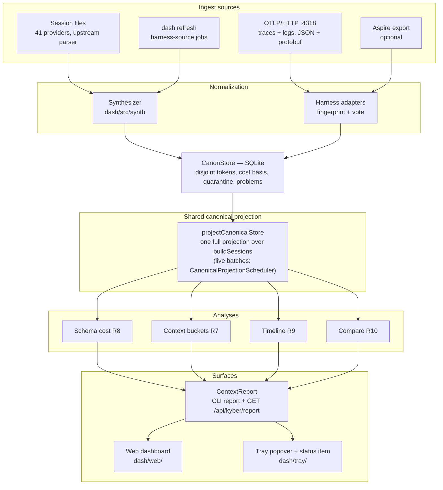
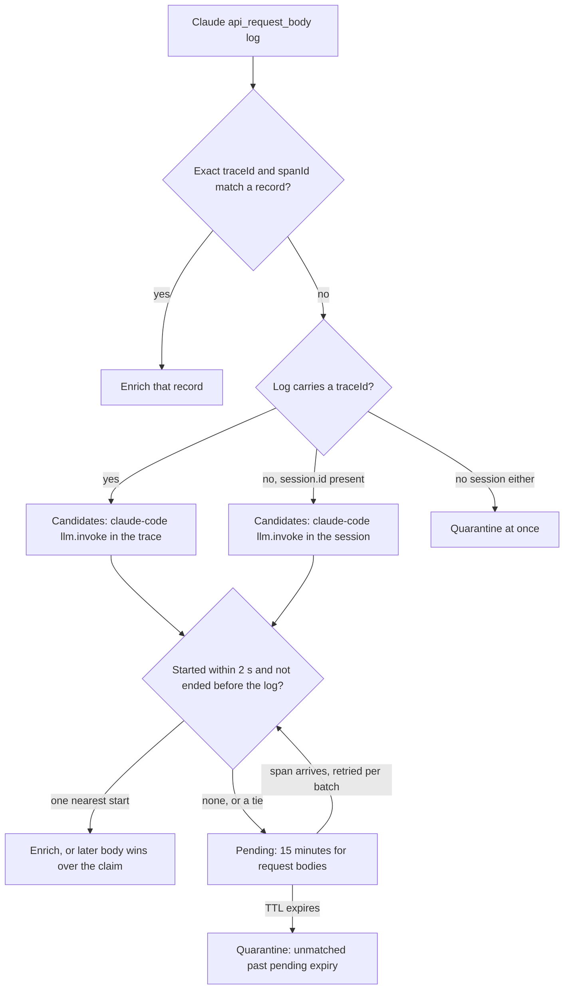
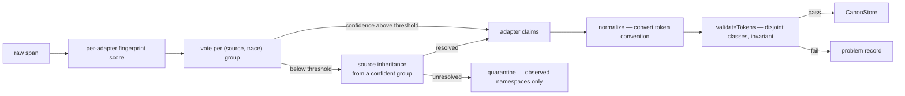

# KyberDash architecture

KyberDash is a locally-run product that answers three questions about coding agents: what
they cost, what filled their context windows, and whether a change to either actually helped.
It reads the session files that 41 agent tools already write to disk **and** receives
OpenTelemetry spans directly, then runs the same normalization and analysis over both.

It began as a soft fork of the MIT-licensed CodeBurn project and is now a **one-time fork**:
first-party code under `dash/`, with no upstream relationship
([ADR 0020](../adr/0020-kyberdash-one-time-fork.md)). The session-file breadth came from
CodeBurn; the span analysis depth — disjoint token accounting, basis-carrying cost, context
composition, tool and schema cost, quarantine — came from the retired Python pipeline
(`agent-session-analysis-dashboard`).

The measured failures that shape several requirements — a 5.8× cost understatement, negative
fresh input on 293 of 307 spans, 25 of 1,009 spans losing a parent, 2.9 GB for 37,623 stored
spans — are recorded in [KyberDash measurable rationale](../reference/kyberdash-rationale.md).
They are correctness constraints, not style choices: they document failures that already
occurred in the Python pipeline, and a reimplementation that drops a requirement reproduces the
failure. The foundational architecture decisions — the one-time fork, the embedded receiver,
the span-shaped canonical model, SEA distribution and the engine language — are recorded in
[ADR 0020](../adr/0020-kyberdash-one-time-fork.md).

## High-level architecture



One canonical model serves both ingest paths: the session-file providers are **span
synthesizers**, converting a parsed provider call into canonical records exactly as an OTLP
payload is decoded and normalized. No analysis knows or asks which path its data arrived by,
which is how Requirement 11.1 — one data path, not two parallel ones — is satisfied.

Both ingest paths also end in **one shared projection** (below): no surface derives sessions
from raw records, and no surface keeps a second derivation of the same figures.

## Repository layout

`dash/` is first-party code ([ADR 0020](../adr/0020-kyberdash-one-time-fork.md)): any file is
edited on its merits, under the repository's gates.

| Path | Contents |
|---|---|
| `dash/src/**` | The CLI engine: provider session parsers, canonical store and projection, analyses, OTLP receiver, harness-source refresh, server, and CLI commands |
| `dash/web/**` | The React web dashboard |
| `dash/tray/**` | The KyberDash tray — a Tauri 2 Rust shell (`src-tauri/`) plus a React popover UI (`ui/`) |

The former `dash/kyber/**` tree was folded into `dash/src/**`, and the Electron desktop app,
the inherited Windows tray, the macOS menu-bar bundle, and the Ink TUI were deleted as the
[context-surfaces specification](../archive/specs/kyberdash-context-surfaces/README.md) delivered;
the table above is the whole layout.

## Ingest layer

| Component | Path | Contract |
|---|---|---|
| Upstream provider parser | `dash/src/` | Existing. Produces parsed calls plus its deduplication set. Not modified. |
| `Synthesizer` | `dash/src/synth/synth.ts` | Consumes parsed calls; emits canonical records with a declared measurability map. Extends upstream's cross-provider deduplication key rather than adding a parallel mechanism (R3). Implements child `tool.invoke` span extraction, 64KiB result truncation, and structured error status (contracts below). |
| `OtlpReceiver` | `dash/src/otel/receiver.ts` | HTTP listener on the OTLP-standard port 4318 at `POST /v1/traces` and `POST /v1/logs`. It decodes JSON and protobuf to span and log shapes. Each decoded log gets a unique `deriveLogId` (correlation identity, timestamp, and payload digest) so duplicate deliveries of the same class do not collide. A log enriches its correlated span-shaped record and is never a parallel canonical record. The session key is read from `session_id`, falling back to `session.id` (the key Claude Code sends), in both the JSON and protobuf decoders. |
| `AspireSource` | `dash/src/otel/aspire.ts` | Optional. Reads spans exported from a running Aspire dashboard (R2.6), supervised with backoff. Records whose parent is missing are grouped by attribute rather than ancestry (R2.7). |
| `IngestWriter` | `dash/src/otel/writer.ts` | Batches writes and owns backpressure so no record is dropped under load (R2.5). |

### Tool extraction and child-record contracts (issue #180)

During synthesis, tool calls and their associated results generate distinct child span-shaped records (`op: 'tool.invoke'`) linked to the parent turn's conversation session key:

- **Argument and result pairing:** Tool invocations extracted by provider readers (such as Claude reader `dash/src/synth/readers/claude.ts`) pair each tool call with its matching tool result by call ID.
- **Structured error status:** Tool execution status (`ok` vs `error`) is determined strictly from structured metadata (`is_error === true` on the tool result object, or a non-zero `exit_code` in structured output). Heuristic regex scanning of tool output text (e.g. matching "error" or "exception") is prohibited to prevent false positives from compiler output or grep results.
- **64KiB storage bounds:** Tool result content stored in content parts (`part: 'tool_result_content'`) is bounded to 64KiB (`MAX_TOOL_RESULT_BYTES = 65_536`). When truncation occurs, the part is marked `truncated: true`, text is sliced cleanly at a valid UTF-8 boundary (`truncateUtf8`), and the pre-truncation byte length is recorded in `attributes['gen_ai.tool.result_bytes']`. Tool arguments in raw payloads are similarly bounded to 64KiB (`MAX_TOOL_ARGUMENTS_BYTES`), and truncated arguments record `attributes['gen_ai.tool.arguments_hash']` (SHA-256 digest of normalized arguments) and `attributes['gen_ai.tool.arguments_truncated'] = true`.
- **Relationship to unclipped inspection (ADR 0014):** ADR 0014 guarantees unclipped inspection and presentation of retained content in the UI and clipboard export. Ingest-time 64KiB bounding is a transport/storage management constraint that prevents database bloat while supplying exact payload size telemetry to finding detectors (such as `oversized-tool-result`); it does not clip the presentation of retained bytes.
- **Honest unobservability:** Offered tools (`tools_offered`) are never defaulted from static harness profiles. If a harness transcript does not explicitly export offered tool schemas, `tools_offered` remains unmeasured (`—` in UI) and `tool_yield` is not measurable.
- **Deferred subagent correlation:** `Task` subagent tool calls are treated as standard top-level tool invocations; nested child session trace correlation is deferred (tracked across follow-up issues #210–#215).

The receiver is embedded rather than relying on an external Aspire dashboard because the
dashboard is a ring buffer — eviction is a measured data-loss class (R2.7) — and because
Requirement 2 must hold without Docker, a container runtime, or a collector. The existing
collectors already post OTLP JSON to port 4318, so they work unchanged. Non-model and
unmatched telemetry is quarantined with an auditable reason instead of becoming a session.

Receiver activity is auditable in `ingest_log`: the span sink writes one row per distinct
span source in each decoded batch (`service.name`, `'otlp'` when unnamed), sized to the
arriving batch so quarantined traffic still counts as received, and the log sink writes
one `otlp:logs` row per log batch so last-received reflects any receiver request. Writes
join the writer's existing store handle after the ingest call returns; there is no schema
change and no second projection. An empty log reads as unknown downstream — "no receiver
activity recorded" — never as stopped or running, because receiver liveness is not
observable from the web server.

### Claude request-body log correlation

A Claude Code `api_request_body` log is written when a model request starts, but the
`llm_request` span it describes is exported only when the request ends, so the log usually
arrives first. The log is also stamped with the parent span that was active (the interaction, or
the tool execution a sub-agent call follows), not with the call's own span. The matcher therefore
scopes by trace, or by session for a body with no trace id, and never by parent. The contract:

- **Exact span first.** A body whose `(traceId, spanId)` names a record enriches that record.
- **Nearest start within the trace.** Otherwise the candidates are the `claude-code` `llm.invoke`
  records in the trace (or the session). A candidate qualifies when its start is within 2 s of the
  log and the call had not ended when the body was logged. The nearest start wins; a tie, or no
  candidate, leaves the body pending.
- **One body per record, later body wins.** A record already holding a body stays a candidate. The
  body with the later log timestamp supplies the body-derived parts; the earlier body is marked
  enriched as superseded and applies nothing. Neither waits or quarantines. The claim is stored by
  `CanonStore.setRawEntry` under `raw['kyber.claude_request_body']` with the log id, its timestamp,
  the `request_body_id` when present, and `suppliedBuckets`, the buckets that body supplied. When a
  later body replaces an earlier claimed body, it drops exactly the buckets the earlier body
  supplied, even when the later body has no `tools` array, so the earlier body's tools or history
  cannot mask the not-measurable reason or stack on the new body. Parts in any other bucket came from
  the span or a transcript and stay. A claim written before `suppliedBuckets` existed falls back to
  dropping `system_prompt` and `tool_definitions` wholesale. Two bodies with an identical timestamp
  go to the higher log id, so arrival order never decides, and a claim whose timestamp does not parse
  counts as older than any valid body.
- **Pending lifetime.** `CLAUDE_REQUEST_BODY_PENDING_TTL_MS` (15 minutes) applies to body logs inside
  `reconcileExpiredPending`; every other log keeps `DEFAULT_PENDING_TTL_MS` (5 seconds).
- **Context-free bodies.** A body with no trace id but a `session.id` pends against its session for
  the full 15-minute window. Tool invocations are never candidates, so a tool record neither claims
  the body nor quarantines it. A body with no trace id, no span id, and no session id quarantines at
  once.
- **Tool definitions.** A parseable body with no `tools` array declares `tool_definitions` not
  measurable, naming the sender's omission; the turn inspector shows that reason, not an empty list.
- **Startup relink.** `relinkQuarantinedClaudeLogs` (`dash/src/tools/backfill.ts`) runs once when the
  OTLP collector service starts, applying the same matcher to the quarantined backlog. Its procedure
  is in the [runbook §2i](runbook.md#2i-claude-request-body-relink-and-quarantined-count). A log whose
  enrichment throws is counted and left in quarantine without stopping the pass, the watermark is
  written after every page, and a relink that enriched anything requests the derived-session
  projection, as the live batch paths do.

No schema changed: state lives in the existing `pending_logs`, `quarantined_logs`, `enriched_logs`,
`records.raw`, and `metadata` tables. The matcher decides from the trace or session candidates and the log timestamp alone, and it never
attaches a body to a call that had already ended.



Measured behaviour, residuals, and the counts behind them are in the
[telemetry inventory](telemetry-inventory.md#claude-request-body-correlation).

### OpenCode plugin span/turn envelope (`kyberdash-opencode`)

The dash-CLI-managed plugin (`dash/src/capture/harnesses/opencode-plugin/`, one codebase
for opencode Desktop and CLI v2 installed by file into opencode's plugin dirs) is a
**sender**, not a surface: it emits span-anchored OTLP/HTTP spans to the loopback receiver
(`POST /v1/traces` + `/v1/logs` on `127.0.0.1:4318`) through a bounded outbox (offline
spool with retry, backoff, and drop-oldest accounting), and every hook is best-effort with
a 250 ms delivery budget, so a delivery failure never fails the host session. It writes no
database directly and serves no API: rows reach `canon.db` only through the receiver →
`ingestBatch` path addressed by `resolveCanonDbPath`, and read back only through
`/api/kyber/*` (display-layer rule, KD-011). Capture owns the plugin keys declare-only:
`enable` writes only `experimental.openTelemetry`; the `plugins` registration key and
`OTEL_EXPORTER_OTLP_ENDPOINT` never enter a receipt.

The envelope contract (`dash/src/canon/adapters/opencode-envelope.ts`):

- **Version key.** Every envelope span names its emitting contract under
  `opencode.contract_version` (`OPENCODE_CONTRACT_VERSION`, currently `'2'`); a contract
  bump invalidates stale checkpoints, following the parser-contract invalidation precedent.
- **Version guard.** `ingestBatchWithAdapters` (`dash/src/canon/ingest.ts`) quarantines an
  envelope span with an unknown or missing version under the fixed reason
  `unknown opencode contract version` before the adapter vote, so no adapter claims it
  and it is never misattributed to any harness. Spans stamped `'1'` by a pre-upgrade
  plugin quarantine after the bump — intended; stale checkpoints invalidate and re-emit
  under `'2'`. The decoded packet stays as the audit
  evidence, as on every other quarantine path.
- **Context keys (contract `'2'`).** New marker prefix `opencode.context.` with
  `opencode.context.system` (string), `opencode.context.tools` (JSON-serialized tool
  definitions array), and `opencode.context.skills` (JSON array of skill names). A span
  carrying any `opencode.context.*` key is the envelope. The v2 `session.context` hook
  payload (system, tools, skills, session/model identity, pinned in
  `fixtures/context-payload.json` at `@opencode/plugin` 2.1.4) rides these attributes
  via the mapper; `eventToSpan` includes them on the wire span. Model markers map when
  the payload names them.
- **Entry.** The loadable entry (`entry.ts`) exports both the v2 CLI shape
  (`Plugin.define({ id, setup })` registering `ctx.session.hook("context", …)`) and the
  v1 Desktop default-export hooks map (including `session.context`), both bridging to
  `createInstalledOpencodePlugin` + `registerOpencodePlugin`. `session.context` is
  registered on both the v2 namespaced and v1 dotted host surfaces; lifecycle kinds are
  unchanged. Context capture extends this in-repo envelope plugin; a standalone plugin
  POSTing raw JSON is rejected — the wrong port and body bypass the version guard, the
  bounded outbox, and the never-fail-host contract.
- **Consent.** System prompt, tool definitions, and the skills listing are content and
  flow only under the sender-owned env consent `KYBERDASH_OPENCODE_CONTEXT=1` (off by
  default; true only for exactly `1`). With consent absent the context event still emits
  identity/markers with content fields dropped pre-emit. Capture never writes or receipts
  the key (declare-only, the `OTEL_EXPORTER_OTLP_ENDPOINT` pattern).
- **Claim rule.** The `opencode` adapter claims only the supported envelope (a supported
  envelope span scores 1; an envelope span under any other version scores 0). A bare
  `opencode.session.id` with no turn/model/tool/prompt/call/message/hook marker is not
  the envelope and keeps the legacy non-model path — that is why the envelope is opt-in
  by marker rather than by namespace.
- **Mapping.** Session identity rides verbatim and is never synthesized. A tool marker
  (`opencode.tool.name`) wins over the model markers and maps to `tool.invoke`; model
  markers map to `llm.invoke`. A context span with context markers but no model identity
  still maps `llm.invoke` (a context event is pre-LLM-call request assembly), never
  fabricating counters. Context content buckets after every existing part: system text
  as `system_prompt`, tools JSON as `tool_definitions` (the `legacyAiParts` pattern).
  The skills listing reads from raw `opencode.context.skills` (the `skills.ts` listing
  source, measurable only under consent; a malformed value yields a named
  `notMeasurable` reason).
  Prompt text (`opencode.prompt.text`) buckets as
  conversation history. Lifecycle boundaries that carry no model or tool marker quarantine
  as non-model — the correct taxonomy for a boundary, not a rejection — with zero
  fabricated counters and session anchoring.
- **Assembly.** The installed entry (`plugin.ts`, reached via the `opencode.ts`
  declare-only re-export) wires hook→mapper→turn→outbox→sender
  (`createInstalledOpencodePlugin`): every hook boundary maps through the mapper and turn
  stages onto bounded evidence, then delivers through the outbox (or the sender directly
  when unspooled). Either way the never-fail-host contract holds, and one codebase serves
  both Desktop and CLI v2 targets.

Content follows the sender-opt-in rule: counters always flow; prompt text flows only
under sender opt-in, and assembled text honors the 14-day content purge. Operator steps
(enable, restart matrix, green-enable≠capture) are in the
[runbook](runbook.md#harness-opentelemetry-capture); the per-harness outcome row and the
T0 hook-catalog survey live in the [telemetry inventory](telemetry-inventory.md). Live
verification on Desktop and CLI v2 (owner enablement, plugin install, live turn) is still
open — [NOT LIVE-VERIFIED]: nothing here is live-verified on this checkout.

## Local harness-source refresh

Session files also enter the store through `kyber-weave dash refresh` (`registerKyberCommands`
in `dash/src/cli/register.ts`, `refreshHarnessSources` in `dash/src/refresh/orchestrator.ts`).
That path is the production local-history ingest; OTLP remains a separate receiver. The
scheduler, source reader, writer queue, and registry live under `dash/src/refresh/**`.

The command opens `~/.kyberdash/canon.db` (or `--db`), audits the harness-source registry
against `getAllProviders()`, and runs **one logical job per harness source type**. Native
files or database records are the units of work. Inclusion uses a UTC record window
`[commandStartedAt − N×7 days, commandStartedAt]`; `--history-weeks` is a positive integer
and defaults to **2**. There is no public `--provider` flag. Invalid `--history-weeks`
exits **2** before the store opens. Failed harness jobs or derivation failure exit **1**.
Success, including absent (`unavailable`) sources, exits **0**.

Each accepted unit is persisted with `CanonStore.commitSourceUnit`: canonical rows,
`record_provenance`, and `source_checkpoint` in one transaction (schema **15**). Every
refresh run additionally records its coverage window in `refresh_run.history_weeks` — the
`--history-weeks` value of that run. Rows predating window tracking read as `null`, which
every surface renders as unknown with the reason "recorded before window tracking", never
coerced to a default or to zero
([honest unobservability](../rules/honest-unobservability.md)). A changed unit that
yields no records persists its reason on the checkpoint's `last_error_code` (status stays
`ok`): `window_filtered` when the parser produced calls that all predate the coverage
window (`sliceCallsToWindow`), `no_recordable_events` when it produced none (for Codex,
no `token_count` or model events). A unit with records, or with problems, carries no such
reason. The Codex OTLP adapter (`canon/adapters/codex.ts`) is the sixth fingerprint voter; see the Codex OTLP note in [telemetry-inventory](telemetry-inventory.md). When parser extraction rules change or a parser defect is repaired, bumping the harness descriptor's `parserContractVersion` (e.g. `KILO_PARSER_CONTRACT_VERSION = '4'` in `dash/src/refresh/registry.ts` for `kilo-shared-runtime` and `kilo-vscode-legacy`, raised from `'3'` when the kilo.db reader began attaching conversation and tool-result parts) invalidates reusable checkpoints without deleting historical metadata, forcing the orchestrator to re-parse units and commit newly extracted records. When a unit's stored `parserContractVersion` differs from the descriptor's, `refreshHarnessSources` rebuilds `recordCount` from live records attributed to that source (`record_provenance` joined to `records`, so quarantined or deleted rows do not count) plus records created in this pass; revision-token and `lastStatus` changes carry the previous count forward (`(previous?.recordCount ?? 0) + created`) because a revision change re-parses within the current window only. Warp's Group Containers
sqlite is opened through `openDatabase`. A copyfile(2) `EPERM`/`EACCES` on the cache copy
falls back to read/write (`copyFileBestEffort`, issue #194 / PR #257), so records are produced whenever the
bytes are readable. A true source-unreadable denial (typically macOS TCC on Group Containers)
is not retried as another user and does not fabricate rows: discovery returns `[]`, the probe
path stays `exists: true` with `accessError: permission-denied`, and doctor's `emptyVerdict`
names the path as not readable — permission denied — with a platform-specific remedy (Full
Disk Access on macOS, owner/permissions otherwise). A kyberdash cache-directory
mkdir/copy/rename `EACCES` is not a Warp TCC denial and is not rethrown as one. A
zero-record checkpoint remains a truthful count of *parsed* records
([honest unobservability](../rules/honest-unobservability.md)). After jobs
drain, `purgeExpiredContent` empties content older than 14 days without touching
`records.raw` ([ADR 0018](../adr/0018-kyberdash-content-retention-purge.md)), then the store
is projected through `projectCanonicalStore` — the same shared entry the live receiver uses
(see [The shared canonical projection](#the-shared-canonical-projection)). Gemini is never a
stored harness id; split client surfaces stay distinct. A Gemini **selector label** may still
appear in the UI as usage / survey chrome; it is not `harness=gemini` in `canon.db`. A
surface's **Refresh data** asks the engine to run this lifecycle over
`POST /api/kyber/refresh`; it does not choose what is read — folder sources come from
`settings.folder_import.scheduled`, off by default, and a terminal `dash refresh` is the one
run that always imports ([ADR 0033](../adr/0033-kyberdash-surfaces-are-display-layers.md)).

The contract is [ADR 0016](../adr/0016-kyberdash-harness-source-refresh.md).

**A present-but-unreadable store is a problem, not an empty history.** Discovery
(`discoverSqliteSessions` in `dash/src/providers/sqlite-session-parser.ts`) no longer `continue`s
past a SQLite store that exists but will not open, or that fails its required-table check. It
returns a marker source carrying `unreadableStoreError`, and `parse()` throws that recorded reason
**unconditionally** rather than re-opening: a transient cause (a `SQLITE_BUSY` lock) may have
cleared by parse time, and a second successful open would present the failure as an empty store.
The job-level catch in `refreshHarnessSources` (`dash/src/refresh/orchestrator.ts`) then records
exactly one `PROVIDER_PARSE_ERROR` on `harness:<harnessId>:job`, attributed to the harness and
naming the database, and the run continues for every other harness. This is the R1.2/R1.3 split
documented in `dash/src/synth/provider.ts` applied to a database rather than a file: an **absent**
store stays silent, and a store discovered earlier but gone by open time stays silent too, because
absence is a negative existence check. The shape is the same for the OpenCode databases.

**The job row is not reconciled after a repair.** `reconcileSourceProblems`
(`dash/src/canon/store.ts`) owns `harness:<harnessId>:<sourceKey>:<code>` rows only (#243), so a
job-level row survives the store healing and stays in the Problems list until that harness is
cleaned. Per-harness Clean deletes the harness's problem rows along with its records, provenance
and checkpoints. This is a recorded gap, not a measured zero and not a reconciliation contract:
the repair is deliberately deferred, and the runbook carries the workaround.

### Claude Desktop and CLI file-synth content

`claude-cli` and `claude-desktop` share the Claude JSONL path: counter envelopes
from the session file are synthesized into `synth:` records, and
`ingestProviders` attaches `ClaudeContentReader` parts when a turn pairs.
Buckets the transcript supplies — `conversation_history` and
`tool_result_content` — land on the record; `system_prompt` and
`tool_definitions` remain `not_measurable` from session files alone (raw API
body logging is a separate owner gate). Pairing uses `nativeRecordId`
(Claude `message.id`) matched to the call `turnId`. Id-less calls and
id-map misses fall back to `turns[index]` unless the reader declares
`positionalPairingUnsafe`. A positional fallback whose turn carries its own
`nativeRecordId` still requires that id to equal the call's `turnId`, so
readers that stamp ids only reach the positional arm for id-less calls.
Cursor is never paired positionally. The reader honors the refresh
`dateRange` so window-sliced calls stay aligned, and the orchestrator
fallback keeps `filePath` so a zero-record retry does not strip the reader
([issue #216](https://github.com/dpalfery/kyber-weave/issues/216)). Advancing
the Claude family `parserContractVersion` invalidates stale checkpoints so a
subsequent `dash refresh` re-synthesizes historical empty desktop rows that
still fall inside the 14-day content-retention window. Older rows stay
counters-only: `purgeExpiredContent` empties their parts in the same run
([ADR 0018](../adr/0018-kyberdash-content-retention-purge.md)). The
bucket table and repair boundary are in the
[telemetry inventory](telemetry-inventory.md#claude-desktop-and-cli-file-synth-parts-issue-216).

### Kilo Code content reader and id-based pairing

Kilo's shared runtime stores one `message` row per turn and one `part` row per fragment in
`~/.local/share/kilo/kilo.db`. `kiloReader` (`dash/src/synth/readers/kilo.ts`) reads the session
tree through the parser's own recursive CTE and the parser's own source shape
`<kilo.db>:<sessionId>` (the final colon segment is the session id). It yields one turn per
**token-bearing** assistant message, in `time_created, id` order, with `nativeRecordId` equal to
the Kilo `message.id`. A missing store or session yields zero turns without throwing; a store that
exists but will not open keeps the open error, so the ingest seam reports it instead of reading an
empty history.

Pairing is by id, never by index. `createSqliteSessionParser` also emits a call for a zero-token
assistant message that still carries text (a router reply), so the call list and the reader's turn
list are different lengths, and index pairing would attach each turn's content to its neighbour's
call. The `pairingIdFromMessageId` opt-in on `SqliteProviderConfig` stamps
`pairingId = message.id`; only `kilo-code` sets it, and OpenCode's parser output stays
byte-identical. `turnId` remains span identity and `pairingId` is pairing-only, which is the key
`matchingTurns` already honours. The reader declares `positionalPairingUnsafe` for the same reason.

Measurability follows the store rather than the harness's ambition. `kilo`, `kilo-code` and
`kilo-shared-runtime` declare `['schema_cost', 'system_prompt', 'tool_definitions',
'instruction_context']` in `READER_UNMEASURABLE` as the default, and the synthesizer drops
`system_prompt` and `tool_definitions` from a Kilo record's measurability when the reader supplied
them for that turn from the capture plugin's store (`dash/src/synth/readers/kilo-capture.ts`), and `kilo-vscode-legacy` declares every canonical
content key because the legacy task tree carries no reader-compatible parts. The buckets and what
supplies them are tabulated in the
[telemetry inventory](telemetry-inventory.md#kilo-code-capture-plugin-and-why-not-otlp).
`KILO_PARSER_CONTRACT_VERSION` is `'4'`: the reader now attaches conversation and tool-result
parts, so counters-only checkpoints under `'3'` are re-read rather than migrated, per ADR 0016's
repair contract.

**Per-record measurability keys on the harness id for `kilo-vscode-legacy` only.**
`synthesizeRecord` (`dash/src/synth/synth.ts`) stamps `measurabilityFor(call.provider)` because the
reader rows are declared per provider. `kilo-vscode-legacy` shares `kilo-code`'s provider string
and reader registration but reads the legacy task tree, so keying on `call.provider` alone would
make those records measurable-by-absence — a content claim the store cannot support. The stamp
therefore selects the envelope's harness id (`harnessIdFor`) for that one id, while
`call.provider`, `deduplicationKey`, `nativeRecordIdentity` and every other harness's stamps stay
untouched: re-keying on `harness` for every record would re-stamp other split surfaces
(`claude-cli`, `copilot-vscode`) whose providers already carry the right row. `call.provider`
itself must not be renamed, because `nativeRecordIdentity` slices the deduplication key on the
provider prefix.

## The shared canonical projection

Static dot-folder refresh and live OTLP are two ingress adapters over ONE canonical store,
and both end in the same projection of it
(`dash/src/canon/projection.ts`). `projectCanonicalStore` is the sole full projection: a
thin, awaitable entry over the authoritative `buildSessions()`, which rebuilds every derived
`session`, `run`, `execution`, `harness_rollup`, and `finding` row. Nothing else derives
sessions — a second derivation or a second database is the divergence this seam exists to
prevent, and the manual `kyberdash build` command runs the same derivation.

The live collector does not call the projection inline. Accepted span batches and successful
log enrichment mark a serialized `CanonicalProjectionScheduler` dirty instead:

- The scheduler **debounces**: a pass starts only after the ingest stream has been quiet for
  `DEFAULT_PROJECTION_IDLE_MS` (10s), at the staleness cap `DEFAULT_PROJECTION_MAX_WAIT_MS`
  (10min) if dirt never quiesces, and never sooner than `DEFAULT_PROJECTION_MIN_INTERVAL_MS`
  (10min) after the previous pass started. Sustained traffic therefore costs at most one full
  pass per 10 minutes; `request()` never starts one immediately.
- At most one pass runs at a time; a burst of dirty marks costs one pass plus **one trailing
  (scheduled, not immediate) pass**, never one projection per batch.
- A failed pass rolls nothing back — records the writer already committed stay committed —
  reports the error, and leaves the work dirty; the next request or `drain()` retries it. A
  slow or failing projection can therefore never block, reject, or drop accepted ingestion.
- Shutdown orders receiver stop, writer stop, projection drain, then store close: `drain()`
  and `close()` bypass the debounce/floor schedule, attempt any owed work immediately,
  and resolve once no pass is in flight and no trailing pass is owed — a failed pass
  can still leave work dirty, to be retried by the next request or `drain()`. Those
  knobs limit
  when a projection pass may START, not how fresh derived sessions are: a batch that
  arrives just after a pass started can wait nearly the full minimum interval (the 10s
  idle window plus a floor up to 10min) for the next pass, and slow or failed passes can
  delay visible results further. Under saturation, at most one new pass starts per
  10 minutes, so derived sessions trail the last accepted batch by roughly the idle
  window after the stream quiets, and worst-case by the 10-minute caps.

The scheduled maintenance pass — the retention purge followed by the shared
projection — once held the main thread for ~26 s every 30 s: a full corpus
re-projection blocking every HTTP handler, so a request's latency was `max(handler
cost, time left in the current block)`. It now yields between units of work (per
session, per run key, per finding batch), so a handler waits on at most one unit plus
its own cost; it skips the projection entirely when the corpus is unchanged, through a
change-detection gate over a records-write marker (bumped by every records write —
ingest, wipe, and the projection's own repricing write-back, which converges because
a stable corpus writes nothing), the detector version, a parser-contract fingerprint,
a pricing fingerprint, and the store's schema version; and it purges expired content
in one set-based transaction rather than a per-record N+1. The purge keeps its
time-based cadence — its trigger is the retention deadline, not a records change. A
failed child refresh no longer records bundled source as its summary: the recorded
`lastFailure` names the actual error from the child's captured stderr, retained in a
bounded on-disk artifact.

The projection holds one decompressed payload and one decompressed parts set at a
time; the per-run readers are the exception — they still hold a run's parts while
serving it.

`KyberBridge.listSessions()` (`dash/src/server/bridge.ts`) reads only the canonical derived
`session` cache — and only the twelve columns the `session_denorm_idx` covering index
carries, never `payload` (see [Materialized session summary columns and the sessions-list covering index](#materialized-session-summary-columns-and-the-sessions-list-covering-index-schema-21)).
Raw `records` are never synthesized into sessions for reporting: until the
projection has turned accepted spans into derived rows, a record-only group is not a session
and appears on no report surface or selector inventory.

## Normalization layer



Every `HarnessAdapter` (`dash/src/canon/adapters/base.ts`) implements the same interface:
detect, relevance, normalize, group, resolve a root, validate, and declare what the harness
does not export. The last method is what turns a blank view into a stated limitation rather
than a zero (R7.6, R8.5, R10.2).

Attribution is a two-pass vote: a fingerprint vote per source-and-trace group, then source
inheritance for still-undecided spans belonging to a source already confidently mapped
(R6.2). `harness` is voted, never read from the telemetry source name — the source carries
per-instance suffixes, does not track content, and is not stable across reconfiguration
(the rationale is in [KyberDash measurable rationale](../reference/kyberdash-rationale.md)). Records no adapter claims with sufficient confidence are
**quarantined** with their observed attribute namespaces and never guessed at (R6.1).

- **Antigravity OTLP attribution (issue #195):** `antigravityAdapter` (`dash/src/canon/adapters/antigravity.ts`) claims OTLP spans asserting `gen_ai.agent.name === 'antigravity'`, mapping them to canonical harness `antigravity`. When that fingerprint is present, `geminiAdapter` yields to Antigravity so valid Antigravity telemetry is never quarantined under Gemini's dev-harness exclusion. The file-side `kyberdash kyber antigravity-statusline` recorder appends to `antigravity-statusline.jsonl` and attributes to harness `antigravity-cli`; it is distinct from OTLP `antigravity`. Spans are not attributed to Antigravity merely because the source is named `agy`. Legacy records from the `agy` source are re-attributed through source-scoped repair (`node dash/dist/cli.js kyber renormalize --source agy`): records with Antigravity evidence become `antigravity`, while agent-name-less spans remain quarantined as `excluded_harness`.
- **Copilot Chat attribution (issue #192):** `copilot_chat/gen_ai` spans are correctly claimed and attributed to harness `copilot` rather than falling through to `excluded_harness` quarantine.

### Provider call extraction contracts

Upstream provider parsers produce `ParsedProviderCall` turns consumed by `Synthesizer`. Two contracts govern turn extraction and filtering in `session-message.ts` and `sqlite-session-parser.ts`:

- **Token extraction precedence and finite validation:** Nested usage structures (`data.tokens` or `data.usage`) take precedence over flat counters (`tokens_input`, `tokens_output`, `tokens_reasoning`, `tokens_cache_read`, `tokens_cache_write`) used by stores such as KiloCode. Every candidate — nested or flat — passes through `finiteOrUndefined` on its own: strings, `NaN`, and `Infinity` are rejected as absent so the next candidate (and finally 0) applies, rather than corrupting downstream token and cost arithmetic.
- **Substantive part recognition:** Assistant turns with zero-token and zero-cost values are retained as substantive activity if they contain text output. Both `type: 'text'` and `type: 'markdown'` parts are recognized as substantive text in `hasTextOutput` and `hasAnySubstantiveParts`, preventing assistant markdown responses from being dropped as silent no-op calls. User prompt extraction similarly accepts markdown parts, and model resolution normalizes both string identifiers and `{ id, providerID }` object descriptors.

### Transcript-paired and journal-paired activity

Two readers attach activity to records by pairing, and neither pairs by time.

- **Antigravity.** Tool calls and `SKILL.md` reads come from the conversation transcript. Each model
  call owns the transcript steps whose index lies in `(lsi[N], lsi[N+1]]`, where `lsi` is its
  `gen_metadata.last_step_index`. The last call's range is open above. Each call carries the pairing
  id `agy-step:<lsi>`, and a call before the transcript's first step gets nothing. The provider
  (`dash/src/providers/antigravity.ts`) and the content reader
  (`dash/src/synth/readers/antigravity.ts`) share one segmentation. The reader reaches file-based
  sessions only. OTLP-only sessions get no transcript activity unless their conversation database is
  imported under the `antigravity-cli` harness. The contract, the coverage rule, and the
  owner-store observation are in the [telemetry inventory](telemetry-inventory.md#antigravity-transcript-pairing).
- **Copilot CLI.** The reader yields one turn per journal `assistant.message`, keyed by its
  `messageId`, and each turn carries the latest `system.message` the agent (root or subagent) wrote
  before it. The provider pairs each call with the turn of its own message. Journal tool invocations
  are not yet ingested as records; that follow-up is a todo. See the
  [Copilot CLI journal](telemetry-inventory.md#copilot-cli-journal-and-system-prompt).

Declared limits that a reader can measure on some records only are lifted per record, as described
in [per-record lift](#per-record-lift-child-records-and-non-resident-parts).

## Canonical model

The canonical record, `TokenUsage`, `CostBlock`, `Measurability`, `Problem` and the canonical
content keys are defined in `dash/src/canon/types.ts`. Field names follow the Python
pipeline's contract so the parity gate can compare like with like.

### `TokenUsage` and the disjoint-class invariant

| Field | Meaning |
|---|---|
| `freshInput` | Input neither read from nor written to cache |
| `cacheRead` | Input served from cache |
| `cacheCreation` | Input written to cache |
| `output` | Generated tokens |
| `reasoning` | A subset of `output`, never an addition to it |
| `reportedInput`, `reportedOutput` | What the harness itself claimed |

The invariant is `freshInput + cacheRead + cacheCreation === reportedInput`, checked by
`validateTokens` on **every** record, orphans included (R4.3). Storing the classes disjointly
is what makes the invariant checkable at all; a model that stored "input" as one number could
not detect the pi/Copilot convention inversion of R4.2 — the same `gen_ai.usage.input_tokens`
attribute key with opposite meanings across harnesses. Adapters convert each harness's
convention on the way in. When inclusive subtraction is impossible — cache exceeds the
input that supposedly contains it — the counters are exclusive-shaped and convert that
way rather than being stored as negative fresh or clamped to zero. File-side exclusive
reasoning (Antigravity-cli thinking counted separately from response) is folded into
`output` so the subset invariant holds; Copilot rows that carry reasoning with output
absent stay unfolded so that absence stays visible. Copilot shutdown rollups carry output 0
by design (excluded to prevent double-counting per-turn calls) while reasoning rides alongside;
these rows declare `output` as `not_measurable` on `measurability`, allowing `validateTokens`
to surface measured reasoning without manufacturing output or failing the subset invariant
(issue #241). A decomposition that is still negative, or that does not reconcile to the reported
total, rejects the record and writes a problem rather than storing it (R4.4).

### `CostBlock` and cost basis

A cost figure travels with its `basis` — a published table, or the harness's own arithmetic —
and figures of different bases are never blended into one total without saying so (R5.1). A
harness-reported figure is carried verbatim in preference to a derived one (R5.2). `status`
separates `no_rate` from `not_billed` from `out_of_scope` (R5.4, R5.5), and tier resolution
selects context tiers by measured input size (R5.6). The scoping failure this prevents — a
table pricing a harness it does not name — is in the [rationale](../reference/kyberdash-rationale.md).

**Repricing at projection time.** Ingest freezes a turn's cost as it arrived, often
`{unknown, no_rate}`. `buildSessions` reprices every turn record whose block is not
`basis:'harness'` and writes changed `cost_json` back in the same pass, so the session list, the
cost tile and the report path (`costContributionsForSessions`) share one answer. The pricing
architecture required no schema bump (leaving the store schema version unchanged at introduction);
existing stores and later `priceOverrides` / `modelAliases` changes take effect on the next projection.

The write-back is the one exception to "every derived table is a cache over `records`". Each
session's changed blocks go through `CanonStore.setCosts` in **one transaction** (`BEGIN`/`COMMIT`,
rolled back whole on failure; an empty list is a no-op), so a failing session cannot leave a
half-repriced one. `records.cost_json` is the derived, re-derivable cost cache: the report path
reads it, the next projection reprices it, and a re-ingest overwrite self-heals on that next
projection. Reprojecting a correct store writes nothing, and `harness` blocks are never touched.
`isCopilotHarness` (`copilot-rates.ts`) is the single Copilot-family predicate used to route a turn
to the credits table.

**Published-path rules.**

- An absent model is `{published, no_rate}` from `pricePublishedTurn`, not `unknown`: mixing
  `unknown` with `published` turns makes `sumCosts` refuse the total (`COST_BASIS_MISMATCH`).
- Cache writes: an absent cache-write rate is billed at the input rate. `gpt-6-luna` has no
  published cache-write rate, so cache creation is billed as input on both the LiteLLM path and the
  Copilot credits table (base $0.10, long-context $0.20 per 1M).
  `claude-sonnet-5-5` keeps its explicit $2.50/M.
- `gpt-6-luna` long-context tier: one shared `GPT_6_LUNA_PROMPT_TOKEN_THRESHOLD` (272,000,
  `pricing/models.ts`). Both paths choose the tier by measured input (fresh + cacheRead +
  cacheCreation); 272,000 stays on the base tier and 272,001 is long.
- The Copilot reader sets `costHarnessReported` only when `cost_usd` is a finite number. Copilot
  without the marker defaults to `published`, so a parser that forgets the flag is repriced from the
  credits table instead of keeping a LiteLLM-derived figure at API list rates.
- `claude-sonnet-5-5` and `gpt-6-luna` also live in `MANUAL_ENTRIES` of
  `dash/scripts/bundle-litellm.mjs` (guarded by a test), so a regeneration reproduces them. The
  bundler writes both generated snapshots to `dash/src/pricing/data/`, which is what
  `dash/src/pricing/models.ts` imports. `npm --prefix dash run build` runs that networked refresh
  first; `build:cli`, Node SEA packaging, and `npm publish` (`prepublishOnly` → `build:cli`)
  embed the committed files without re-snapshotting. Networked refresh is the explicit
  `npm run bundle-litellm` only. See the [runbook](runbook.md#build-workflow). The gap-fill
  file (`pricing-fallback.json`) shrank from
  ~205 to 52 keys after the 2026-10-01 primary refresh absorbed most former fallback rows; it
  remains a last-resort backstop, not a broad catalog.

| Harness (normalized) | Priced from | Notes |
|---|---|---|
| `claude-code` (`claude-cli`, `claude-desktop`), `codex` (`codex-*`) | The bundled published table: the LiteLLM snapshot plus `pricing-provenance.json`, through `pricePublishedTurn` (`dash/src/canon/published-pricing.ts`) | Cache-aware. `claude-sonnet-5-5` and `gpt-6-luna` (with its >272K tier) were added 2026-09-30 with cited sources. `priceOverrides`, `modelAliases` and `flatRateModels` act on this path. |
| `copilot` (`copilot-*`) | The Copilot credits table (`dash/src/canon/copilot-rates.ts`; 1 credit = $0.01; GitHub models-and-pricing) | Per-class rates (input, cached input, cache write, output) and input-size tiers. Where the table says cache write is "Not applicable" (`gpt-6-luna`), the input rate is used. A model the table omits is `{published, no_rate}`; overrides and aliases do not reach this path. |
| Any harness outside the two above | Unchanged: the upstream parser's figure | Additive scope; a harness the LiteLLM table does not name is `out_of_scope` for it (R5.3). |

A genuine harness-reported figure is never repriced (R5.2). For Copilot, only the genuine
reader's `cost_usd` (marked `costHarnessReported` in `synth/readers/copilot.ts`) is `harness`;
figures the Copilot parser derives through LiteLLM are `published` and are repriced from the
credits table. `costBlockFor` returns `{published, no_rate}` for a zero or non-finite figure from
a published-rate source (`costIsEstimated === true`), and `unknown` only where no pricing was
attempted.

**Devin rate (issue #197).** `devin.acuUsdRate` in `~/.kyberdash/config.json` prices Devin ACU
usage; it does not gate discovery or parsing. A missing, non-positive, or non-finite rate
(including a JSON literal such as `1e400` that parses as `Infinity`) still emits sessions and
token fields. `costUSD` is then `0` with `costIsEstimated: true` — unknown, never a measured
zero — and doctor appends `costs unpriced — set devin.acuUsdRate in ~/.kyberdash/config.json`
rather than reporting `sessions.db` as holding no sessions. Set a finite positive rate to
price; do not invent one.

**Session totals.** `buildSessionRow` sums only turn records; a non-turn span makes no cost
claim. A session with some unpriced published turns totals `partial` with the priced share. A
genuine mix of `harness` and `published` turns records `COST_BASIS_MISMATCH` in the payload's
`problems` (where the cost tile reads it) instead of silently becoming `no_rate`.

**Display.** `KyberBridge.listSessions` maps the canonical `CostBlock` (basis, status, value,
currency) onto each row as `cost`; `cost_usd` is the block's value only when `status` is `priced`
and the currency is USD. `AgentSessionRow` renders the cost tile's formatter text ("partially
priced", "no published rate", "not billed", "out of scope", or the formatted figure); `—` appears
only when the server sent no cost.

**Rate metadata.** `getMeta().rates` keeps its flat Copilot-credits fields and adds `tables`
(`published` and `copilot_credits`), each with `source`, `retrieved` and `applies_to`.

**Measured session payload and scorecard contracts (issues #183, #185, #187).**
- *Cache metric derivation:* `buildSessionRow` is the single writer for `cache_hit_ratio` and `cache_creation_coverage`. `cache_hit_ratio` is computed as `totals.cacheRead / summaryTotalInput`, where `summaryTotalInput` is the measured total (`fresh + cache_read + cache_creation`); payload `total_input` already includes the cache components, so no additional adding is performed. `cache_creation_coverage` is the count of turns with `cache_creation > 0`. When total input is unmeasurable, both fields are omitted or marked unavailable rather than emitted as misleading zeros.
- *Measured residual and reported_input:* Context composition charts and heatmaps compute residual context as `reported_input - sum(bucketed_tokens)`. The engine emits `reported_input` on serialized context turns (`KyberContextTurn`) to convey the measured input basis. A fully bucketed turn has a measured residual of 0.0%; not-measurable treatment applies only when no measured input basis exists.
- *Run turns and scorecard:* `KyberBridge.getRunTurns` serves per-turn rows (`RunTurnRow`) with measured model, tokens, pressure, `cacheHitRatio`, timestamp, and per-turn `costUsd` (priced via `createCostBlock`). `KyberBridge.getRunScorecard` derives a run-scoped scorecard by aggregating the run's sessions through the shared harness rollup and dimension calculation machinery.

### Skills view contract

The Sessions page shows which skills a session, and each of its turns, had access to (listed)
and which were actually invoked. Listed and invoked are joined per skill, the way offered and
invoked tools are. The engine is `dash/src/canon/skills.ts`, a pure module: `extractListedSkills`
and `extractInvokedSkills` read the canonical records, `buildSkillsView` joins them into one
`SkillRow` per skill (`name`, `listed`, `invocations`, `turnsListed`, `turnSpanIds`, and an
optional `derivedTokens`), and `listedByTurn` gives the per-turn listing. `buildSessionRow`
(`dash/src/canon/sessions.ts`) projects the result into the session payload. All of this lives in
`dash/src`; the web renders the served values only ([ADR 0033](../adr/0033-kyberdash-surfaces-are-display-layers.md)),
and no value is counted in the browser.

Skills share the `instruction_context` content bucket. `CANONICAL_CONTENT_KEYS` is unchanged, and skill identity comes from raw attributes and part text, not from bucket membership.

There is no `canon.db` schema change. The session payload is a JSON blob that is rebuilt on
projection, so a session row stored before this change has no `skills` key and renders
"not yet projected" until it is rebuilt ([runbook §2g](runbook.md#2g-skills-view-rebuild-and-capture-fixtures)).

**Measurability.** Listing and invocation are measured separately, and an unmeasured side is
never reported as zero. It is declared in one of two ways: a key is absent (the `summary` and
per-turn keys), or it carries `{availability: 'not_measurable', reason}` (the whole `skills`
view, and each row's `invocations`). `[]` is a measured none. Per-harness sources are in the [telemetry inventory](telemetry-inventory.md#skill-availability-by-harness).

**Session payload** (`GET /api/kyber/session/:id`, additive):

- `summary.skills_listed` and `summary.skills_invoked` are name arrays. Each key is absent when
  that side is not measured.
- `skills` is either `{availability: 'not_measurable', reason}`, or
  `{measurable: true, reported_skill_tokens?, listed_count, listed_uninvoked_count?, invocationsCoverage?, rows}`.
  - `reported_skill_tokens` is a single per-turn resident size, taken from the latest turn that
    carries it. It is never summed across turns and never split across skills. Antigravity
    reports it as `gen_ai.usage.skill_tokens`.
  - `listed_count` is always present when the view is measurable. `listed_uninvoked_count` is
    absent when invocation is not measured, which is the same case in which every row's
    `invocations` is the `not_measurable` object. A row is never counted while one of its
    sides is unmeasured.
  - `invocationsCoverage` is `{measuredTurns, totalTurns}`. It is set only for an Antigravity
    session where some turns carry `kyber.skills.invoked` and some do not, so `0 < measuredTurns <
    totalTurns`. The invocation figures and `listed_uninvoked_count` then cover the measured turns
    only. It is absent when every turn is measured, and absent when no turn is.
  - `rows` is sorted by name. Each row is `{name, listed, invocations, turns_listed,
    description?, derived_tokens?}`.
    - `listed` is always a boolean. It is `true` when a measured listing named the skill on at
      least one turn, and `false` for a skill that was only invoked.
    - `invocations` is a number when invocation is measured, and `0` is a measured none. For
      Copilot CLI and Antigravity it is that
      object when no record of the session carries `kyber.skills.invoked`, and a number otherwise.
      Antigravity counts over the measured turns (see `invocationsCoverage`).
      An unmeasured side is never omitted from the row and never reported as `0`.
    - `turns_listed` holds 0-based transport indices (the issue #184 numbering), and is `[]` when
      the skill was listed on no turn.
    - `description` is the first listing text observed for that skill in the session, stored
      once. `derived_tokens` is estimated from the description and is labelled derived. Both are
      absent when no listing carried a description.
- `turns[i].skills_listed` is present only for measured turns. `turns[i].skills_invoked` lists
  names, with `[]` as a measured none, and is absent when invocation is not measured. For an
  Antigravity turn it is absent unless that turn's record carries `kyber.skills.invoked` as an array,
  so a turn the transcript did not cover is never shown as a measured none.
- `measurability.skills` is set only when the whole `skills` view is `not_measurable`, and then
  carries that same reason. A partly measured view (Antigravity when no
  record of the session carries the invoked key, or Copilot CLI when a listing is measured but no
  record carries the invoked key) leaves `measurability.skills` unset. Its unmeasured side shows per row (the
  `invocations` object) and by the absent `summary.skills_invoked`, turn `skills_invoked`, and
  `listed_uninvoked_count` keys.

**Turn content** (`GET /api/kyber/session/:id/turn/:index/content`, additive). The result carries
a `skills` entry, `{listed: [{name, text?}], invoked: [names]}`. Either side, or the whole entry,
may be `{availability: 'not_measurable', reason}`. The entry is built only from the stored
session payload; the narrow turn-content route never walks session records. A payload without
`skills` gives `not_measurable` with the reason `session not yet projected with skills`.

**Known limits.**

- A listing read from a Claude request body (`system`-role message) is used only when the record has no
  transcript listing, and never from a body cut at the sender's size limit, which does not parse. Records
  enriched before the role field existed carry no role and show no body listing until re-enriched.
- If a later listing in the same session changes a skill's description, earlier turns still show
  the first text observed.
- After the 14-day content purge ([ADR 0018](../adr/0018-kyberdash-content-retention-purge.md)),
  Claude descriptions survive because they are kept in raw attributes. Copilot descriptions that
  came from stored system-prompt parts are absent, while the skill names remain.
- Antigravity descriptions are read from each skill's `SKILL.md` when the session payload is built.
  The cache is keyed by file path and valid while the file's mtime and size are unchanged, so an
  edited description shows at the next payload build without a restart, and an absent file is never
  cached. A skill that no Antigravity root holds has no description
  ([telemetry inventory](telemetry-inventory.md#antigravity-skill-descriptions)).

**Analysis inputs.** The `skillUtilisation` signal and the `inactive-skill-reference` finding take
their listed and invoked sets from `skills.ts` (see [Pure Signals Engine](#pure-signals-engine-dashsrcanalysissignalsts)).
On a partly covered Antigravity session the invoked set is the names read on the covered turns,
since an uncovered turn carries no key. The finding does not state that coverage.
Finding detail follows ADR 0013 D15/D16: the wording is "listed with N recorded turns and 0
invocations", with no deletion or waste claim.

**Detector version.** `DETECTOR_VERSION` is `4` (`dash/src/canon/store.ts`). Stores stamped with
generation `3` report their findings as outdated and need a rebuild.

**Web.** The Sessions page section **4 · Skills** has two tiles (skills listed, skills invoked) and
a headline, "X of Y listed skills had no observed invocation". The headline is rendered from the
served `listed_uninvoked_count` and `listed_count`, and reads "not measurable" when either is
absent. It is hidden when there are no rows. Each row shows listed and invoked badges and the
turns listed (displayed 1-based), with derived tokens labelled as derived. The harness-reported
aggregate appears where present, with no currency. A "Not measurable" card shows the reason. Clicking
a row opens a skill drawer with the listed and invoked state, the turns listed, and the listing
text for the first turn listed. The unit tests render these states in a simulated DOM and the
bundle builds. The states have not yet been checked against a live dashboard session.

### Message role on content parts

`ContentPart` carries an optional `role` (`'system' | 'user' | 'assistant'`). `parseClaudeApiRequestBody`
sets it on parts derived from a request-body message, and only when that message carries one of those
three roles. Parts from top-level fields (`system`, `tools`) and parts from role-less messages carry no
role. The field is additive: it does not change any bucket, the compressed `parts_json` gains one
optional key, and readers that predate it ignore it. The skills reader is the consumer: it trusts a
listing only in a `system`-role message, so quoted text in a user or assistant message is not read as
a listing. The rule is in the [telemetry inventory](telemetry-inventory.md#tool-definitions-and-skill-listings-from-request-bodies).

### `Measurability` and honest unobservability

Each source declares per-metric availability independent of value (R10.1). A metric a source
cannot report renders as "not measurable" (`null` with a machine- and human-readable `reason`),
never as zero — rendering an unreported metric as `0` would make the harness that reports least look
most efficient. The same rule applies at discovery: a missing Devin price rate is unpriced
cost, not "no sessions"; an unreadable Warp database is permission denied, not "tool not
installed" and not an empty history. Content readers (such as `copilotVscodeReader` and `cursorReader`) map native evidence
into input-side `ReaderTurn` snapshots without attributing current response text to input context or
inventing unobserved prefix history. Where total tokens and context window are known, pressure is
measured independently from whether individual composition buckets are available.

### Per-record lift, child records, and non-resident parts

- **Per-record lift (D8).** A key a reader declares not measurable (`READER_UNMEASURABLE`) is lifted
  to `measured` on a record only where that record's paired reader turn carries parts of the key.
  This applies to `copilot-cli`, `antigravity`, `antigravity-cli` and `antigravity-ide`
  (`PER_RECORD_LIFT_HARNESSES`, `measurabilityForRecord` in `dash/src/canon/measurability.ts`). A
  sibling turn the reader did not pair keeps the declared reason. Copilot CLI lifts only
  `system_prompt`; `tool_definitions` is never lifted. Other readers keep their declaration whole.
- **Child records (D29).** A `tool.invoke` child is not a paired reader turn, so it does not inherit
  its parent's lifted state. For a harness in the per-record lift set, `measurabilityForChild` gives
  each child the declared reason for every key it does not carry itself. `tool_result_content` is
  measured on a child only when the tool result it was handed carries a `content` value. Other
  harnesses copy the parent's map unchanged.
- **Stored text can be gone.** Measurability is stamped at ingest and not re-derived. The 14-day
  purge ([ADR 0018](../adr/0018-kyberdash-content-retention-purge.md)) empties `content_json` and
  `parts_json` and leaves `measurability_json` as it was, so a record can read as measured while no
  text is stored for it.
- **Non-resident parts.** `ContentPart.resident: false` marks a tool definition the turn was offered
  but did not keep resident. It adds no tokens to the context composition (`dash/src/analysis/context.ts`),
  is counted in `TurnPressure.nonResidentToolDefinitions`, and stays on the part for the turn-content
  route. The session inspector labels such a catalogue entry `offered (MCP catalogue)`.

### Store

`CanonStore` (`dash/src/canon/store.ts`) is SQLite through the runtime's built-in module —
upstream already depends on it for two providers, so no new dependency is introduced. The
schema is a version-controlled constant executed on construction, currently at version 22;
metadata carries the schema version, and a store built by an older version is migrated in
place on open rather than rebuilt. Idempotent upsert is keyed on the
record identifier, which makes re-ingest idempotent (R2.5). The tables are `records`,
`session`, `run`, `execution`, `token_cache`, `quarantine`, `pending_logs`,
`quarantined_logs`, `enriched_logs`, `problems`, `ingest_log`, `metadata`,
`harness_rollup`, `finding`, `prediction`, `source_checkpoint`, `record_provenance`, `refresh_run`,
and `session_turn`.
Schema 11 added checkpointing and provenance ([ADR 0016](../adr/0016-kyberdash-harness-source-refresh.md)),
schema 12 added `refresh_run`, schema 13 introduced `problem_key` with unique indexing, schema 14 rekeyed that identity by span, code, and location,
schema 15 made finding estimated waste nullable (`estimated_waste_tokens INTEGER` NULL for coverage-gap findings with unmeasured estimates),
schema 16 added `history_weeks INTEGER` to `refresh_run`,
schema 17 added trace metadata columns (`source`, `name`, `timestamp` to `quarantine`; `session_id`, `harness`, `timestamp` to `problems`),
schema 18 added `quarantine.raw_payload` — the decoded packet a quarantined span is filed with, kept after the record is deleted so the turn inspector can still show what the sender sent ([ADR 0035](../adr/0035-kyberdash-quarantine-raw-packet-evidence.md)),
schema 19 added a nullable `harness` to `quarantine`, `pending_logs`, and `quarantined_logs`, so a per-harness wipe can scope those rows rather than missing them, and
schema 20 added sync progress and settling columns (`synced_at TEXT`, `sync_status TEXT DEFAULT 'pending'`, `settled_at TEXT`, `transcript_path TEXT`, `transcript_offset INTEGER DEFAULT 0`) to `session` for post-run transcript synchronization ([ADR 0038](../adr/0038-post-run-transcript-sync-subagent-hierarchy.md)), and
schema 21 added the materialized session summary columns (`summary_json TEXT`, `problems_count INTEGER`, both nullable with no `DEFAULT`) to `session`, plus the `session_denorm_idx` covering index and planner statistics — see [Materialized session summary columns and the sessions-list covering index](#materialized-session-summary-columns-and-the-sessions-list-covering-index-schema-21) — and
schema 22 split turns into `session_turn` and added the `context_limit_source` column — see [Session turn split and the narrow-read columns](#session-turn-split-and-the-narrow-read-columns-schema-22).
Every `ADD COLUMN` in those steps is presence-guarded, so a store that already carries the column — such as one stamped by an off-main build — reaches the identical final shape instead of failing on a duplicate column ([ADR 0035](../adr/0035-kyberdash-quarantine-raw-packet-evidence.md)).
`commitSourceUnit` writes records, provenance, and the unit checkpoint together. The raw
column is compressed (R12.4); the measured cost of not doing
so is in the [rationale](../reference/kyberdash-rationale.md).

Two `records` columns carry the grouping and content model. `session_id` holds the harness's
own conversation id, promoted out of the raw payload so sessions group with a `GROUP BY`;
where the source names no session it falls back to the trace id. `parts_json` holds
deflate-compressed structured content parts, each with its canonical bucket, its text, an
optional harness-reported token count, and an optional ground-truth MCP server name. Where
parts are present they are the authority: the flat content map is derived from them on read,
so the same text is never stored twice. Turn rows and record parts share one codec
contract: content is stored compressed (deflate, level 6) and read back through a
tolerant codec, and a value whose deflated form is not smaller is stored as plain
text instead — the measured "does not pay" boundary is ~74 bytes. Measured on
40,621 realistic turns, level 6 stores 7.82 MB against 15.31 MB plain (0.51×), at
~364 ms of deflate and ~146 ms of inflate for a full-corpus read.

The `session` table holds derived sessions, one row per conversation. Each payload is built by
running the analysis layer (`analyzeContext`, `rankSchemas`, `buildTimeline`) over the
records, and the table is a cache: dropping every row and rebuilding loses nothing.

#### Materialized session summary columns and the sessions-list covering index (schema 21)

The sessions list once read the entire `payload` blob of every session row to compute two
values — `json_extract(payload, '$.summary')` and
`json_array_length(json_extract(payload, '$.problems'))` — with no SQL `LIMIT`. On a corpus
whose payloads total tens of megabytes, every list request demand-paged the whole payload
store (measured 15.6–26.1 s cold, intermittently, as the machine's own background I/O
evicted the page cache). Schema 21 materializes both values at write time so the list never
reads `payload`.

**Columns.** `session` gains `summary_json TEXT` and `problems_count INTEGER`, both nullable
with no `DEFAULT`. `NULL` is the per-column sentinel meaning "this column was not
materialized", never "this row is whole": a row that predates the columns keeps `NULL`
until the projection rewrites it, and the reader derives such rows from `payload` instead
of misreading them as an empty summary or a zero count. A `DEFAULT` would erase exactly
that distinction. The migration is presence-guarded and idempotent with no backfill; legacy
rows self-heal on the next projection rebuild, and the legacy state is never worse than the
pre-change baseline.

**The writer owns those columns.** `upsertSession` derives both values from the same
serialized payload it writes, in the same statement, so they cannot drift from `payload`.
The column-ownership split with the transcript-sync job is preserved: the upsert names none
of `synced_at`, `sync_status`, `settled_at`, `transcript_path`, or `transcript_offset`, so
a re-upsert leaves the sync job's columns intact.

**The reader reads those columns only.** `KyberBridge.listSessions` selects the twelve
index-covered columns and orders by `started DESC`, with a legacy fallback
(`WHERE summary_json IS NULL OR problems_count IS NULL`) that serves unmaterialized rows
from `payload`; the pre-existing full-payload read stays as the last resort when JSON
functions are unavailable. The `?limit` slice still applies after subagent nesting and
rollup — deliberately not pushed into SQL, because a SQL-level limit would cut the children
of returned parents and change the rollup output. `buildContextReport` inherits the fix
through this method, and `sessionTokenTotals` reads `summary_json` first with a per-row
payload fallback, keeping its `not_measurable`-stays-`undefined` contract.

**The covering index is the mechanism, not the columns alone.** `ALTER TABLE … ADD COLUMN`
appends the new columns after `payload`, so a table-row read for `summary_json` still
traverses the payload's overflow chain — the denormalization alone relocates the cost without
an index (cold unchanged, ~18 ms warm). `session_denorm_idx` over the reader's exact column
list turns the list into an index-only scan
(`SCAN session USING COVERING INDEX session_denorm_idx`, 211 pages / ~864 KB). The lesson
carries forward: every future payload-derived field needs the column *plus* an index that
covers its reader, and the reader's SELECT must stay inside the index's columns — adding a
column to one without the other silently brings the payload walk back. The index DDL lives
in one module-scope constant (`SESSION_DENORM_INDEX_SQL`), applied by the presence-guarded
`createSessionDenormIndex` helper from both the migration step and the constructor's
fresh-create path — never inline in `SCHEMA_SQL`, whose unconditional DDL would fail to open
a store whose `session` table predates the reader's columns. Planner statistics
(`ANALYZE session` in the migration and on fresh creation, maintained thereafter by the
existing close-time `PRAGMA optimize`) are hygiene and determinism for the planner's cost
model, not the index's unlock: the index alone flips the plan on the supported build. A
read-only connection cannot write `sqlite_stat1`, which is why the writer is the only place
the statistics are written.

**Rejected alternatives (all measured, do not revisit).** Extracting only `$.summary`
still materializes the whole blob (0.077 s vs 0.072 s warm); `PRAGMA cache_size`,
`mmap_size`, and `temp_store` tuning moved nothing on either end; an expression index
over `json_extract(payload, …)` matched the read but cost 3.5× per-refresh upserts and
hard-fails the INSERT on malformed JSON; a separate summary table and a payload-last
rebuild matched the read at higher migration or write-site cost; `VACUUM` halves the
file with list latency unchanged, because freelist pages are never read.

**One adjudicated exception to byte-identity.** A row carrying `problems` but no
`summary` — a shape the payload builder never writes — reports its true materialized
count, where the pre-change JSON-capable path reported `0` (that path's own bug; its
no-JSON fallback already reported the true count). The two columns are consumed
independently downstream and the legacy merge fills only what a row is missing, so a
materialized value is never overwritten by the payload.

**The bounded summary route.** `GET /api/kyber/session/:id/summary` serves the ten-key
bounded shape (`session_id`, `harness`, `label`, `is_subagent`, `parent_session`,
`agent_name`, `started`, `ended`, `summary`, `problems_count`) from the columns, with a
per-row legacy fallback and no `_clip` — the content is bounded by construction. The
fallback is per column, not whole-row: a row is incomplete when either materialized
column is NULL, and only the missing column is filled from the payload — through the
same `isMissingSessionColumn` / `fillMissingSessionColumns` mechanism the sessions list
uses, so the two surfaces cannot disagree on `problems_count`. It serves
no run or execution linkage, deliberately: those fields exist in neither the payload nor
the table, and serving them would push a `{level:'run'}` spine entry that does not exist
today. The web client's `fetchKyberSession` targets this route, so deep-link ancestry
lookup stops pulling the whole payload; the resolved spine stays
`[doctor, harness, execution]` with no run level. Deployment coupling: the web client
requires the engine's new route — against an older engine the request 404s and the client
degrades to a not-found spine rather than crashing, so server and client ship together.

**Measured result.** Cold list 37.5–47.2 ms against the < 1 s target; warm median 2.174 ms
against ≤ 10 ms. List output is byte-identical across the materialized, forced-legacy,
index-dropped, and pre-change-reader states (279,991 bytes), and all 7 harness-filtered
responses match the pre-change reader. The index is not a write tax (full projection within
0.5% with or without it), and the legacy state self-heals on the next projection rebuild.

#### Session turn split and the narrow-read columns (schema 22)

The sessions list no longer reads `payload` at all; the detail path still did — one
whole-blob read per session to reach a single turn. Schema 22 removes that read by
moving the turns out of the blob:

```sql
CREATE TABLE IF NOT EXISTS session_turn (
  session_id TEXT NOT NULL,
  turn_index INTEGER NOT NULL,
  turn_json TEXT NOT NULL
);
CREATE INDEX IF NOT EXISTS session_turn_by_session ON session_turn (session_id, turn_index);
ALTER TABLE session ADD COLUMN context_limit_source TEXT; -- presence-guarded; NULL = not materialized
```

`session_turn` holds one row per turn; `turn_json` is the deflated turn JSON (zlib,
level 6), compressed from birth. The column's declared type stays `TEXT` while SQLite's
dynamic typing keeps the deflated bytes a `BLOB` value in that column all the same, and
readers tell the two stored forms apart by the storage class the value comes back with;
the `(session_id, turn_index)` index is deliberately not unique because a legacy payload
may repeat an index. `session.payload` is rewritten without the `turns`
key — every other top-level key byte-identical, in its original order — so metadata
readers see the same document minus turns. The migration also populates
`context_limit_source` from `payload.context.contextLimitSource` on every row it
rewrites, and the writer materializes it on every write thereafter, so a fresh corpus
is never under-counted.

The table shape is the read shape: the detail path reassembles `{...metadata,
turns}` with one ordered range scan per session — no per-turn N+1 — and `_clip`
applies to the assembled document exactly as before. A per-turn read served from the
payload would still pay the whole-blob server cost (`json_extract` materializes the
row), so the bounded per-turn read below is born reading one `session_turn` row.
Readers discriminate the two stored turn forms by SQLite's storage class, so a row
written before the change still reads.

The migration is presence-guarded and idempotent — a row whose payload carries no
`turns` key is skipped, so re-running on a split store writes nothing — in one
transaction per step, like every migration before it. Older binaries refuse a v22
store by design (fail-closed).

The per-column `NULL` sentinel carries over from schema 21: a `NULL`
`context_limit_source` means "this column was not materialized", never "this row is
whole". A row with a NULL source is not counted by `countUnknownWindowSessions`,
matching the old `NULL IN ('default','absent')` behavior of the payload expression
the column replaced.

`session_denorm_idx` stays load-bearing: the split shrinks the largest payloads but
leaves their non-turn keys (`problems`, `reconciliation`, `timeline`, `requests`) at
MB scale, so the payload overflow chain persists and the list remains an index-only
scan. Steady-state passes skip unchanged turn rows, and the full-rebuild write budget
is ≤ baseline + 750 ms (deflate level 1 is the escape hatch if the gate misses).

**Measured corpus.** 336 sessions, 79.6 MB of payload holding 40,621 turns; after the
split the payload total is 48.3 MB and `session_turn` holds 40,719 rows over 9,031
pages (36,990,976 bytes).

**Deployment fact.** A store must be migrated to v22 by the new build before the list
is fast: the v21 migration added the materialized columns without backfilling them,
so until the new build's projection — or the v22 migration — rewrites a row, its
columns stay NULL and the reader serves it from payload. Deploy the new build first;
the migration lands on open.

**Operator reclamation.** `kyberdash dash vacuum` reclaims the freelist the split
leaves behind. `--dry-run` reports the reclaimable space from SQLite's own
`page_count`/`freelist_count`/`page_size` counters, opening the store read-only —
the file's size and mtime are unchanged afterwards. A real run reports the before
size, the after size, the reclaimed bytes, and the freelist count it reclaimed; it
holds the same writer lock a refresh holds, and it refuses a store it cannot open
with the store's own upgrade message. Measured: the live store is 3.33 GB with a
286,441-page freelist of 813,331 pages (~35% dead). There is no recurring vacuum
cadence — freelist pages are never read (`VACUUM` halves the file with list latency
unchanged), and the quarantine family is evidence retention by design under the
existing purge policy ([ADR 0018](../adr/0018-kyberdash-content-retention-purge.md)),
so retention is unchanged. The one-time live vacuum is an owner-operated step: stop
the engine, run `kyberdash dash vacuum`, start the engine. In WAL mode the main file
is rewritten only at the final checkpoint, so the engine must be stopped, not merely
idle.

#### Subagent session hierarchy and read-time spend rollups (ADR 0038)

Subagent executions dispatched by orchestrators are projected during session build (`dash/src/canon/sessions.ts`) into first-class derived session rows with stable, deterministic identities ([ADR 0038](../adr/0038-post-run-transcript-sync-subagent-hierarchy.md)):
- **Identity format**: Claude Code subagents are assigned the deterministic session ID `<parentSessionId>#agent-<agentId>` (e.g. `claude-sess-001#agent-researcher-001`, not doubling an `agent-` prefix already on attributes such as `agent_id` or `subagent_id`), scoped by the parent so two parents reusing an agent id keep separate rows. Copilot subagent invocations receive `<parentSessionId>#<invoke_agent_span_id>` (e.g. `copilot-sess-001#invoke-agent-span-1`).
- **Database representation**: Subagent rows in `session` record `is_subagent = 1`, `parent_session = <parentSessionId>` (pointing to the root session), and `agent_name = <agentName>`. Subagent records are reparented under the root invoke span (`parentSpanId = null` for the root invoke span, child spans reparented beneath it), ensuring a clean single-root execution tree in the ASAD payload.
- **Dual spend accounting and read-time rollups**: Stored session rows persist only their own granular, unaggregated counters (`turn_count`, `request_count`, `total_input`, `total_output`, `cost_usd`) in `payload.summary`. On read (`KyberBridge.listSessions` in `dash/src/server/bridge.ts`), child subagent sessions whose parent exists in the store are omitted from the top-level list and nested into their parent's `subagents` array. The parent session carries a read-time `rollup` object aggregating spend across the orchestrator and all nested children:
  $$\text{rollup.metric} = \text{parent.metric} + \sum_{c \in \text{subagents}} c\text{.metric}$$
  The sum is recursive and leaf-first (a chain A ← B ← C nests two deep, and B's rollup is B + C). A projected subagent row is built from a subset of the records its parent row is built from, so the parent's own counters already include it; the projection marks such a row `payload.summary.included_in_parent`, and the rollup adds neither it nor anything beneath it. Only an independent child (one whose records are not in the parent) is summed. A parent cycle in stored ancestry is never attached, so no session drops out of the list.
  Both parent and child sessions preserve their own granular counters unaggregated at their respective levels. Orphan subagent sessions (whose parent session is absent from the store) remain visible at the top level with self-derived rollups.
- **Honest session title synthesis (`formatSessionTitle`)**: Titles are synthesized following the deterministic precedence ladder: `<agent name> · <task summary>` when both are available; `<agent name> · <human label>` when task summary is absent; `<agent name> · session` when task summary is absent or machine-generated; `<task summary>` when agent name is absent; `<human label>` when both are absent; falling back to `<harness> session` or a shortened session ID. Telemetry machine labels (span operations matching `\.(?:llm_request|llm_invoke|generate|completion)$`, `chat <model>`, exact UUIDs, `synth:`/`derived:` prefixes, and `<synthetic/unknown>` tokens) are rejected by `isMachineLabel`, preventing machine clutter while upholding honest unobservability.

### Canonical Run and AgentExecution Entities (ADR 0012)

Single-session views obscure multi-agent collaboration overhead (tokens and latency spent
handing off tasks to subagents). KyberDash introduces two first-class derived entities in
`canon.db` (`dash/src/canon/runs.ts`):

- **`Run` (`RunRow`)**: Represents a single user-initiated task or unit of work. It aggregates
  all executions participating in that task, recording token totals, estimated waste,
  duration, and outcome signals (`exit_code`, `test_status_delta`, `outcome_status`).
- **`AgentExecution` (`ExecutionRow`)**: Represents an individual agent invocation within a
  run, tracking `parent_execution_id` and execution role (`root`, `child`, `delegated`).

#### Derived Run Identity (Decision D13)

When a harness natively emits a run or task identifier, that identity is preserved directly.
Where run identity is absent, KyberDash computes a **derived grouping** based on
working-directory affinity and bounded inter-session time gaps. Derived groupings are
explicitly recorded in `grouping_basis` as `derived` with the specific rule named. Heuristics
are never silently presented as reported fact. Rebuilding via `kyber build` re-projects both
tables deterministically from retained records.

`KyberBridge` (`dash/src/server/bridge.ts`) reads `canon.db` through public, DB-backed
queries (`getProblemCount()`, `getRefreshState()`, `getSessionCostContributions()`, `getQuarantineCount()`) 
and serves the derived sessions, runs, harness rollups, findings, and unclipped content without private-store
casts. That is the single-store end state in
[ADR 0008](../adr/0008-kyberdash-single-canonical-store.md): production code never opens a
Python `sessions.db`, and `AGENTDASH_DB` / `KYBER_DB` cannot expose a legacy session.
`dash/src/server/kyber-bridge.test.ts` proves those environment variables are ignored for
session listing and payload, and that listing serves only derived sessions — record-only
groups are excluded rather than synthesized
(see [The shared canonical projection](#the-shared-canonical-projection)).

The session projection emits the ASAD payload directly ([ADR 0011](../adr/0011-asad-only-context-view-and-payload-contract.md)).
It preserves per-bucket measurability and reasons, so a source that cannot supply content, schemas,
structure, or counters produces `not_measurable` rather than a misleading zero.

Derived token counts (R4.6) come from `dash/src/canon/tokens.ts`, a tokenizer wrapper with a
store-backed memo cache, and are tagged as derived with the model name so consumers present
them as a lower bound.

## Diagnostic Spine and Progressive Disclosure (ADR 0012)

KyberDash structures agent context analysis into a six-level progressive-disclosure hierarchy:

```
Level 1: All Harnesses (Context Doctor)
   └── Level 2: Harness
          └── Level 3: Run
                 └── Level 4: AgentExecution (Session)
                        └── Level 5: Turn
                                └── Level 6: ContextItem (Block / Part)
```

The web app lands on Context Doctor (`App` default `initialPage` / `spineReducer` stack
`{ level: 'context-doctor' }`). Top navigation (`NAV_TABS`) carries **Context Doctor**,
**Sessions**, **Compare**, **Quarantine** and **Problems**, and it is the whole navigation:
the entire left rail and the mobile hamburger/toggle that opened it are gone, so no second
navigation surface can drift from the tabs and main content takes the full width of the shell.
There is no Context tab: session browsing is the **Sessions** top-navigation destination
wrapping `ContextExplorer` / `AgentSessionDashboard` (D17). Compare is a top-navigation peer
that mounts `CompareRuns` (D20). Density tokens live in the dashboard `@theme` (D22). The single shell harness strip
(`data-testid="harness-selector"`) changes the shared scope of Context Doctor and Sessions in
place and clears the selected session when the harness changes. It does not navigate to harness
detail. Explicit harness drill-down routes remain separate: they push `{ level: 'harness',
harnessId }` and load `runs?harness=`. Gemini may appear as a selector **label**; canonical rows
and rollups do not use harness id `gemini`.

Live gates G1–G7 and G4a have passed on a local host against a real store: drill the six
levels, one diagnostic harness selector, canonical ids (including Claude Code), no
decision-id copy, empty charts marked empty rather than plotted as zero, layout inside the
shell. Findings-first Context Doctor, Turn inspector, and live Compare are
reachable through the spine. Derived runs show a labelled grouping basis (`derived run` / `explicit run`,
`data-testid="run-grouping-basis"`) and are never silent clusters (D19). Calibration is
wired on Finding detail (`CalibrationSummary`). Content older than 14 days is purged after
refresh ([ADR 0018](../adr/0018-kyberdash-content-retention-purge.md)). Scorecard cells use
`formatDimensionDisplay`: unmeasurable or absent values render as `—`
with a reason, never as a fabricated `0`. A genuine measured zero is still `0`.

1. **All Harnesses (`ContextDoctor.tsx`)**: Cross-harness landing view ranking harnesses by
   aggregate context pressure, cache invalidation volume, and top telemetry-grounded findings.
2. **Harness (`HarnessDetail.tsx`)**: Deep dive into a single agent harness (e.g. Claude Code,
   Copilot, Cursor) showing harness rollups, coverage percentages, and run inventory.
3. **Run (`RunDetail.tsx`)**: Task-level view showing the hierarchical execution tree,
   delegation overhead, phase breakdown, run scorecard, and ranked run findings.
4. **AgentExecution (`AgentSessionDashboard.tsx`)**: The full single-session ASAD view,
   visualizing per-turn token spend, context composition, and tool schema cost.
5. **Turn (`SessionSpendCharts`, `ContextPressureStrip`)**: Granular turn breakdown exposing
   composition bands, fresh input spikes (cache invalidation), and schema residency.
6. **ContextItem (`ContextInspector.tsx`)**: Full unclipped plain-text inspection per semantic
   bucket, subdivided by part, with whole-turn and per-block copy out ([ADR 0014](../adr/0014-unclipped-turn-inspection-and-copy-out-protocol.md)).
   The inspector is reachable from Turn on the spine.

### Independent Dimension Vectors — No Composite Score (Decision D3)

KyberDash explicitly rejects composite efficiency scores, letter grades, or single-number
indexes. Agent performance is evaluated across six orthogonal dimensions:
- **Context Hygiene**: Proportion of context occupied by active instructions vs redundant history.
- **Cache Efficiency**: Cache read ratio, prefix stability, and cache breakpoint invalidation.
- **Tool Yield**: Ratio of tool invocations producing utilized results vs resident schema weight.
- **Skill Utilisation**: Empirical invocation frequency of declared capabilities. Listed and invoked skills are measured per harness; where either side is not measurable the dimension says so rather than reporting zero ([skills view contract](#skills-view-contract)).
- **Delegation Overhead**: Tokens and latency dedicated strictly to orchestrating child handoffs.
- **Continuity**: Turn-over-turn context stability and retention across compaction events.

A dimension lacking telemetry renders as a dash (`—`) with an explicit reason, never as zero
and never as a passing grade.

### Display families and source display names

Split client surfaces stay distinct in stored data — and, except for the two
evidenced twin front-ends below, in rollup keys and API filters.
`harnessFamily` (`dash/src/canon/measurability.ts`) is a display-level grouping only:
`claude-cli`, `claude-desktop`, and `claude-code` share the `claude-code` family label
while each canonical id and its per-origin count stays visible beside it, so grouping
never fabricates an aggregate. Twin front-ends fold one step earlier, at the
derived layer (issue #182): `claude-desktop` onto `claude-code` and `cursor-agent`
onto `cursor`, so those two surfaces share one canonical id, one rollup row, and one
API filter namespace. Derived rows persist canonical ids: rolling back the fold
after a rebuild requires rebuilding derived tables again under the reverted code.
Reads normalise too, because
[upgrading the binary does not rebuild derived tables](runbook.md#2-derived-projection-rebuilding-kyber-build):
a rollup row written before the fold still carries its raw front-end id, so the
per-harness checkpoint join on `/api/kyber/harnesses` is canonical on both sides
and such a row still reports its own coverage counts until a rebuild rewrites it.
That normalisation is what makes a miss after it a measured zero — the read
succeeded and this harness recorded no units — rather than an unknown, which is
reserved for an unreadable `source_checkpoint` table
([honest unobservability](../rules/honest-unobservability.md)).
Unmapped ids render verbatim.

Stored source names keep their namespace (`codeburn/<provider>` for file-sourced rows,
OTLP names verbatim, legacy `unattributed` rows retained). Surfaces render them through
`sourceDisplayName`, which strips the `codeburn/` prefix, labels the kind
(`local-file`, `otlp`, `legacy-unattributed` — the last displayed as
"unattributed (legacy)"), and keeps the raw value alongside the display value for
auditability. Raw `codeburn/` names never reach a user-facing surface.

## Analysis Layer

The analysis layer contains pure, hermetic analysis modules that operate over canonical records:

| Analysis | Module | Realizes |
|---|---|---|
| Context bucketing, residual, pressure, cache-invalidation flag | `dash/src/analysis/context.ts` (`analyzeContext`) | R7 |
| Schema-cost ranking, never-invoked cost, bounded unused range | `dash/src/analysis/schema.ts` (`rankSchemas`) | R8 |
| Hierarchical timeline, subagent and auxiliary separation | `dash/src/analysis/timeline.ts` (`buildTimeline`) | R9 |
| Cross-harness metric table with availability | `dash/src/analysis/compare.ts` (`compareHarnesses`) | R10 |
| Pure signal engine (8 detectors) | `dash/src/analysis/signals.ts` (`computeSignals`) | ADR 0012, ADR 0013 |
| Context-item classification (evidence of use) | `dash/src/analysis/classify.ts` (`classifyContextItem`) | ADR 0013 (D15) |
| Telemetry-grounded finding engine & waste ranking | `dash/src/analysis/findings.ts` (`detectFindings`) | ADR 0013 (D5, D6, D8) |
| Run & turn comparison by task phase | `dash/src/analysis/compare.ts`, `pairing.ts` | ADR 0012 (D11) |
| Prediction logging & calibration curve | `dash/src/analysis/calibration.ts` | ADR 0012 (D11) |
| Opt-in LLM context review seam | `dash/src/analysis/review.ts` | ADR 0015 (D10) |

### Pure Signals Engine (`dash/src/analysis/signals.ts`)

The signal engine computes deterministic diagnostic signals as pure, testable detectors. Each
detector declares its numerator, denominator, measurement class, and explicit unobservability rule:
- `contextReuseRatio`: Turn-over-turn token overlap via whitespace-normalized hashing.
- `cachePrefixStability`: Byte-prefix preservation before cache breakpoints; falls back to counter ratio if prefix bytes are unavailable.
- `toolYield`: Ratio of invoked tool calls to offered tool schemas. Credits on weak evidence, debits only on strong evidence.
- `duplicateCallRate`: Frequency of byte-identical tool invocations within the same turn phase.
- `oversizedResultShare`: Proportion of turn input consumed by large tool output blocks.
- `compactionPressure`: Rate of context window growth relative to model context limits.
- `delegationOverhead`: Percentage of run tokens spent on parent-child coordination.
- `skillUtilisation`: Observed activation frequency of declared skills (ranked last per D16). Its listed and invoked sets come from `dash/src/canon/skills.ts`, not from tool names or text matching. A `Skill` tool call credits the skill it loads, never a skill named `Skill`. When invocations are not measurable (Copilot, Antigravity) or no listing is measurable (Pi, unknown harnesses — and OpenCode absent the `KYBERDASH_OPENCODE_CONTEXT` consent, whose listing then reads from raw `opencode.context.skills`), the signal is reported as not measurable and no finding is raised. See the [skills view contract](#skills-view-contract).
- `inactive-skill-reference` (finding detector): A listed skill with no observed invocation. It is a low-confidence, heuristic finding ranked last, worded as "listed with N recorded turns and 0 invocations". It states what was observed and does not use deletion or waste wording (ADR 0013 D15/D16). The same measurability rule applies: no finding when either side is not measured.

### Context-Item Classification (Decision D15)

Context items are classified strictly by empirical observability rather than value judgements:
`evidence of use: strong / weak / none / unobserved`.
- `unobserved` indicates the harness does not emit sufficient telemetry to determine whether the
  block was read, and is never merged with `none`.
- Unattributed residuals (difference between reported usage tokens and reconstructed parts) form
  an isolated block, never distributed across other buckets.

### Telemetry-Grounded Finding Contracts and Waste Ranking (ADR 0013)

Every diagnostic finding satisfies the strict **Finding Contract (Decision D5)**:
1. **Mechanism prose**: Explains the technical cause and impact of the observed pattern.
2. **Evidence rows (≥2)**: Every finding links to at least two concrete telemetry records with IDs.
3. **Measurement class**: Declared as `deterministic`, `inferred`, or `coverage-gap`.
4. **Stated confidence basis**: Written justification for assigned confidence and what would raise it.
5. **Recommendation**: Actionable guidance adhering to **Relocation Over Deletion (Decision D8)**.
6. **Expected improvement & error bar**: Estimated token/latency savings with uncertainty bounds.
7. **Outcome-risk caveat**: Mandatory disclosure of potential execution risks.

Findings are ordered by the **Waste Ranking Formula (Decision D6)**:
$$\text{Rank Score} = \text{Estimated Recoverable Waste} \times \text{Outcome Risk} \times \text{Confidence}$$
An inferred finding can never outrank a deterministic finding of comparable size. Recoverable
waste is an estimate tied to a specific recommended action.

Two honest-measurement contracts govern what the engine will not claim. The compaction-hazard
detector fires only against a reported context window: an unreported window suppresses the
finding (pressure surfaces as unmeasurable instead), and a single-turn peak above the reported
window is downgraded to inferred with an aggregate-attribution caveat rather than printed as a
deterministic percentage. Twin front-end collectors (`claude-desktop` onto `claude-code`,
`cursor-agent` onto `cursor`) fold onto one canonical harness id, and same-turn observations
with byte-identical counters collapse per ADR 0009 source precedence (OTLP counters win; values are never
summed across sources for the same turn) instead of double-counting one conversation.
After that fold and exact-counter collapse, overlapping twin observations whose counters
differ but stand in a complementary or subset relation within `TWIN_TURN_MAX_SKEW_MS`
join inside `dedupeTwinTurns` (issue #231): the merge takes the per-dimension max and
prefers the fuller row as keeper, and joined counters are never summed. File+file twin
pairs under the folded `cursor` share are admitted, not only OTel+file. Raw ingest rows
remain provenance; the join applies when derived tables rebuild.

**File-synthesized turn deduplication (issue #232).** For file-synthesized turns (specifically Claude Desktop where request and response halves produce twin lines for one turn), the reader/synth layer (`dash/src/synth/readers/claude.ts`) groups contiguous request/response blocks into a single `ReaderTurn` / `llm.invoke` record. As a derived-layer safeguard, `dedupeTwinTurns` in `dash/src/canon/twin-dedupe.ts` collapses same-turn duplicate file rows for Claude Desktop even when no OTLP mate exists (`otels.length === 0`). Other file sources preserve proximate identical counters as genuine retries per ADR 0009 D4. Distinct parts from both halves are fused (`contentFromParts`, keeper parts first, donor parts merged), preserving prompt/context and tool execution/reply text. Parser contracts use per-harness constants in `dash/src/refresh/registry.ts` (`CLAUDE_PARSER_CONTRACT_VERSION`, `CODEX_PARSER_CONTRACT_VERSION`, `KILO_PARSER_CONTRACT_VERSION`, `DEFAULT_PARSER_CONTRACT_VERSION`): Claude was bumped to 3 in issue #232, then to `4` for issue #216 (PR #276, synth parts), and the current Claude contract is `7` (bumped for skill listings; see the [skills view contract](#skills-view-contract)), with Codex at `3` and Kilo at `4` (bumped when the kilo.db reader began attaching content), invalidating older checkpoints so `dash refresh` cleanly re-synthesizes historical sessions without manual cache deletion.

Copilot OTLP sessions are excluded from the `tool_yield` digest deliberately. No Copilot
producer path can yet vouch that tool-call telemetry is complete, so an absent
`tools_invoked` is not a measured zero — the session stays out of the denominator rather than
reporting yield `0` ([honest unobservability](../rules/honest-unobservability.md)).
Re-inclusion requires both of the following; either alone would fabricate a measurement:

1. A Copilot producer path that can vouch for completeness declares `tool_calls: 'measured'`
   on its records. `buildSessionRow` then emits `tools_invoked: []` for span-less sessions and
   the digest counts a measured zero.
2. Tool spans (`execute_tool` / `tool.invoke`) must join the conversation's session key. Today
   those spans lack session-identity attributes, so they key by `trace_id` while chat spans key
   by conversation id — different session rows. Declaring `tool_calls: 'measured'` without
   fixing that attribution would report `toolYield 0` for sessions that invoked tools.

Findings are materialized in `canon.db` at session/run build time with a `detector_version` schema
stamp (Decision D17): an informational mark of which detector semantics built the rows, so
tooling and operators can tell a stale finding table from a fresh one. Recomputation itself
comes from the authoritative rebuild, which rewrites derived rows and prunes what detectors no
longer emit.

### Run Comparison and Phase Alignment (Decision D11)

Comparing runs across prompt revisions or harness configurations requires phase alignment.
`alignByPhase` aligns runs by logical task phase (exploration, implementation, verification,
resolution) rather than chronological turn index. The comparison loader must read the same
canonical share that created each execution — the same rule `buildRuns` and `buildFindings`
already follow — not join a derived execution's persisted `sessionId` directly to
`records.session_id` when a split native key stores rows under their native id while the
derived row carries a qualified id such as `cursor:<native-key>`.

`KyberBridge.recordsForRun` (`dash/src/server/bridge.ts`) resolves each execution's session
key through the store's `SessionIdentities.shareOf`; when a share resolves it reads
`recordsForShare`, otherwise it retains the legitimate unsplit-session lookup. Within each
share it applies the existing `dedupeTwinTurns` rule, keeps only `op === 'llm.invoke'` model
turns (auxiliary and tool records do not inflate turn counts), and deduplicates by span id
when repeated execution keys appear in one run. Phase alignment and token totals operate on
that deduped turn set only.

The share-miss fallback goes through the same `recordsForShare` harness predicate as a share
hit. When that predicate drops every record under a key (an excluded identity such as Gemini,
or a sibling harness), the side's `metricsReason` names the drop and the bridge warns once per
key and harness rather than on every Compare request. `SessionIdentities` is memoized on the
bridge per database handle and store generation — `PRAGMA data_version` (commits from other
connections, such as ingest or backfill) plus `total_changes()` (any write through the bridge's
own connection, including in-place `UPDATE`s like `setSessionId`) — so the
`SELECT DISTINCT … FROM records` scan reruns only after the store changes. Per-phase
`phaseSummaries` token fields follow the totals rule: a phase with any unmeasurable turn omits
`tokensA`/`tokensB`/`tokenDelta` and carries the first coverage gap as `tokensUnavailableReason`.

**Current-pair measurement vs recommendation history.** Token totals, per-run turn counts, and
phase-aligned pairs describe the two runs the user selected now. They are independent of
recommendation-history sufficiency: the n ≥ 5 completed-pair guard in Decision D11 applies
only when a trusted caller supplies an explicitly measured `completedPairCount` (internal
analysis and unit tests). The public `GET /api/kyber/compare/runs` route does not accept a
caller-supplied historical count as measured fact; when no store-backed history exists the
verdict omits `completedPairCount`, sets `historyAvailability: 'unavailable'`, and keeps
`canPromote: false` so the pair stays manual-only. Absent comparable turns or token coverage
returns a first-class unavailable state with a reason — never a fabricated zero turn count,
token delta, or `0 / 5` history display ([honest unobservability](../rules/honest-unobservability.md)).
Diagnostic predictions are logged and scored in `dash/src/analysis/calibration.ts`.

### Opt-In LLM Context Review Seam (ADR 0015)

When developers request subjective analysis of prompt quality, the LLM review seam provides
an on-demand second opinion:
- **Strictly Opt-In (Decision D10)**: No prompt text leaves the machine without a discrete user action.
- **Configurable Providers**: Supports Anthropic, OpenAI-compatible (including local Ollama / vLLM), and `NullProvider`.
- **System Prompt Guardrails**: Strictly enforces separation of measurement from inference, forbids calling unobserved context waste, enforces relocation over deletion (D8), and requires outcome risk statements.
- **Finding Isolation**: LLM review output is ephemeral and is never written into the canonical `finding` table.

## Surface Layer

> **THE TRAY AND THE WEB DASHBOARD ARE DISPLAY LAYERS. NEITHER CONTAINS ISOLATED FEATURE
> LOGIC, SCHEDULERS OR JOBS. ALL LOGIC AND JOBS (REFRESH SCHEDULING, CLEAN, IMPORT, PAUSE)
> LIVE IN THE SHARED KYBERDASH APPLICATION (THE CLI ENGINE AND THE `kyberdash web` SERVER
> BUILT FROM IT) THAT BOTH SURFACES SHARE. BOTH SURFACES USE ONE DATASTORE (canon.db,
> resolved by dash/src/canon/paths.ts resolveCanonDbPath) AND ONE API LAYER
> (/api/kyber/*). NO AGENT OR DESIGN MAY VIOLATE THIS.**

The governing rule document is
[`rules/kyberdash-display-layer`](../rules/kyberdash-display-layer.md); the decision is
[ADR 0033](../adr/0033-kyberdash-surfaces-are-display-layers.md); the guard that enforces it
is `dash/src/architecture/display-layer.test.ts`, which runs in
`npm --prefix dash run test`.

Every reporting surface consumes one versioned `ContextReport` produced by `buildContextReport`
(`dash/src/analysis/report/build.ts`). The CLI prints it (`kyberdash report`), the REST API
serves it at `GET /api/kyber/report`, and the tray renders the same document fetched over
loopback — report, API and tray agree because they share one builder, not because a test
compares three implementations (design D2, Requirement 11.14;
`dash/src/cli/report-api-parity.test.ts` proves CLI and REST equality).

The builder reads only what the shared projection derived. The latest-session section reads
the materialized columns (`summary_json` and the columns the report consumes) instead of
the payload blob — the report response is unchanged, and the tray's `/api/kyber/report`
endpoint no longer reaches a full payload read — so a measurable session shows
measured latest-turn context while a truly absent context keeps the honest
"harness exported no message structure" reason rather than a fabricated figure.
`coverage.harnesses` is selector/navigation metadata required by Requirement 8.8: the
canonical harnesses that have a derived session inside the report's active day window, with
unscoped window counts, stable under harness selection. Findings, dimensions, latest session,
and cost remain scoped to the selected harness and window — the inventory is how you
navigate, not a second analytic report.

In a release, the web server (`dash/src/cli/web.ts`) serves the SPA from a `web.json` SEA
asset embedded in the binary at build time, parsed once at server start; in a source
checkout it serves `dash/dist/dash` instead. `KYBERDASH_DASH_DIR` overrides either source.

The `KyberBridge` (`dash/src/server/bridge.ts`) that `kyberdash web` owns follows the file
currently at its store path (`canonPath`) rather than the handle it first opened: it opens
`canon.db` read-only once the file exists, checks its device and inode at most once a second
(`reopenCheckIntervalMs`, default 1000 ms) while serving queries, closes the old handle and
opens the new one when the file is replaced by a different one, and drops the handle —
serving empty results rather than the removed file's data — when the file is removed. A
handle injected by `kyberdash report`, and a `:memory:` store, are never probed or swapped.

### Jobs and shared settings (ADR 0033)

The `kyberdash web` server hosts the background work. `JobHost`
(`dash/src/jobs/host.ts`) runs the scheduled refresh, the maintenance pass, the
manual/import/clean children, and post-run transcript synchronization; `ReceiverHost`
(`dash/src/jobs/receiver-host.ts`) owns the OTLP receiver child. A job is
`kyberdash dash refresh …` spawned by the server, so a crash or a long import cannot take the
server down and the in-child refresh lock (`dash/src/refresh/lock.ts`, exit code 3) keeps
arbitrating with a terminal-started command. Exactly one host schedules: `dash/src/jobs/lease.ts`
takes `jobs.lock` in the state directory, and a host that cannot take it runs nothing and reports
`running-elsewhere`.

**Folder import is opt-in and shared.** `settings.folder_import.scheduled` — off by
default — decides whether a *scheduled*, tray, or web run reads folder sources
(`folderSourcesAllowed` in `dash/src/refresh/folder-import.ts`). With it off, such a tick
runs the maintenance pass only (retention purge then projection), writes no `refresh_run`
row, and prints a skip line naming the command that turns it on. A terminal `dash refresh`
(trigger `cli`) always imports, because a person typing it asked for their own history back;
so does `POST /api/kyber/import-history` / `dash import-history`, which never reads or
changes the setting.

The five shared settings live in `canon.db` metadata
(`dash/src/settings/shared-settings.ts`), so all surfaces see one answer: reads fail closed
to the default on an unrecognised stored value, writes refuse an unrecognised one, and a
wipe-all leaves them alone because they describe how the operator wants the tool to behave,
not the captured data. **Pause** (`settings.jobs.paused`) stops the host scheduling and
nothing else: manual refresh, import and clean, the receiver's continued ingest, and the
retention purge all continue.

**The dashboard port is a persisted setting, not a fallback.** `settings.dashboard.port`
(default `4747`) is what `kyberdash web` binds unless that run passed an explicit `--port`,
which wins for the run only and is never stored. Saving the setting never rebinds the
running server; the next startup takes the persisted value. When the configured port is
taken, the start fails with a `DashboardPortOccupiedError` naming the port and the remedy
instead of sliding onto a random port — a silent move would strand the tray, which attaches
by the configured URL, and every bookmark aimed at it. The bind, the `server.json` attach
point, and the listening line all happen only after a successful bind, so a refused start
publishes nothing for a tray to chase.

#### Post-run transcript synchronization engine job (ADR 0038)

Live OpenTelemetry streams frequently capture operational span metrics without complete conversation histories. To reconcile asynchronous on-disk session transcripts with live telemetry, the engine hosts `runTranscriptSync` (`dash/src/sync/transcript-sync.ts`), executed by `JobHost` (`dash/src/jobs/host.ts`) on scheduling ticks ([ADR 0038](../adr/0038-post-run-transcript-sync-subagent-hierarchy.md)):
- **Delta byte streaming**: The job queries active sessions from `session` (`WHERE sync_status NOT IN ('settled', 'unavailable') OR sync_status IS NULL`). For each session referencing a valid `transcript_path`, it stats the file. If `fileSize > oldOffset`, it reads incremental delta bytes from `transcript_offset` to `fileSize`.
- **Enrichment by request ID**: Delta bytes are parsed line-by-line as JSONL. Matching lines containing `requestId` and message content enrich canonical records in `records` table by joining on `request_id`, appending conversation history parts into `parts_json` and updating `content_json`. The session is updated with `transcript_offset = fileSize`, `synced_at = nowIso`, and `sync_status = 'synced'`.
- **Truncation handling**: If a file is truncated (`fileSize < oldOffset`), the job rewinds to offset 0, re-reads the full file from the beginning, updates canonical records, and resets the offset.
- **Inactivity settlement lifecycle**: When file size remains unchanged (`fileSize === oldOffset`) and status is `synced`, the engine checks session inactivity. If at least 30 minutes have elapsed since the session's latest activity (`ended` or `started` timestamp) across unchanged passes (`(now - lastActivity) >= 30 * 60_000`), the session transitions to `sync_status = 'settled'` with `settled_at = nowIso`. Settled sessions are excluded from future sync passes, keeping ticks lightweight.
- **Missing transcript timeout**: If `transcript_path` is null or missing on disk, and more than 24 hours have elapsed since the session ended or started, the session transitions to `sync_status = 'unavailable'`.
- **Lock arbitration**: Before delta processing, `runTranscriptSync` probes the store refresh lock (`STORE_LOCK_FILE`, `dash/src/refresh/lock.ts`). If an active store refresh holds the lock, transcript sync yields immediately with `{ outcome: 'busy' }`, avoiding database contention.
- **Display layer boundary**: Following [ADR 0033](../adr/0033-kyberdash-surfaces-are-display-layers.md), the transcript sync job runs strictly in the engine (`JobHost`), never in the tray or web frontend.

### Web Dashboard (dash/web/)

The React web dashboard provides progressive-disclosure views matching the 6-level spine.
Top navigation carries **Context Doctor**, **Sessions**, **Compare**, **Quarantine** and
**Problems**. It is the only navigation surface: the whole left rail and the mobile
hamburger/toggle that opened it were removed, so nothing duplicates a tab and the main
content column takes the full width of the shell.

The header's **Harness:** strip is the single main harness selector. It scopes **Sessions**
and **Context Doctor** together and narrows whichever of those two pages is open in place,
rather than navigating away from the page you are reading. Its entries are the harness
summaries the store reports (`GET /api/kyber/harnesses`) plus an **All Harnesses** all-scope
entry; a selected harness with no sessions keeps its selection and shows the scoped empty
state rather than falling back to All. **Compare** deliberately sits outside that scope and
keeps its own per-side harness filters, so narrowing a page's scope never touches the A/B
selectors.

The top-right **Status** and **Maintenance** buttons open mutually exclusive right-side
panels — opening one closes the other, so only one is on screen at a time. **Status** is
read-only: it renders the ingest coverage payload from `GET /api/kyber/coverage` (refresh
window, per-source ingest activity, per-reason quarantine counts, checkpoint statuses), with
close and retry controls that re-read the same route; it starts no job and writes nothing.
**Maintenance** holds every operator action, each an `/api/kyber/*` call: pause/resume,
manual refresh, folder import, the shared settings, the model context-window catalog
refresh, and the confirmed wipe with its optional import window. Neither coverage nor
maintenance is embedded in Context Doctor any more, and neither panel adds engine behaviour —
both ask the same routes the tray already asks
([ADR 0033](../adr/0033-kyberdash-surfaces-are-display-layers.md)).

The individual views:

- **`ContextDoctor.tsx`**: Findings and recommendations — the ranked headline findings and
  the full workspace findings browser. Scoped by the shared harness selector with optional
  session narrowing; drilling harness → run → execution → turn →
  context item, and into a finding, is unchanged.
- **`Sessions.tsx`**: Top-navigation destination wrapping `ContextExplorer` (ASAD +
  timeline); not a Context tab, and scoped by the same harness selector as Context Doctor.
  Its section **4 · Skills** shows listed and invoked skills per session and per row
  ([skills view contract](#skills-view-contract)); the Execution Timeline is section
  **5 · Execution Timeline**.
  A session row's title is `<agent> · <session name>` (`formatSessionTitle`,
  `dash/web/src/lib/labels.ts`). The agent is the recorded agent identity, omitted when it only
  repeats the harness. The session name is the stored label when it is a human title, else the
  session id when the harness chose a readable one. With neither part the title is
  `<Harness> session`. GenAI span names (`chat gpt-4o-mini`, `invoke_agent architect`,
  `execute_tool view`) are operations and are never shown as a title.
- **`HarnessDetail.tsx`**: Per-harness rollups, coverage indicators, labelled grouping basis, and run browser.
- **`RunDetail.tsx`**: Multi-agent run topology, execution tree, run scorecard, and grouping label.
- **`FindingDetail.tsx`**: In-depth finding view with evidence table, confidence basis, risk caveats, and calibration summary.
- **`CompareRuns.tsx`**: Phase-aligned run diffing with outcome regression guards, reached
  from the top navigation. Run A and Run B both begin at
  **Select a run** unless the route supplies explicit `a`/`b` deep-link ids; kyberdash fetches
  comparison data only after two distinct ids are chosen. Each selector carries an independent
  harness filter (`All harnesses` plus observed canonical ids), unaffected by the shared
  selector, that narrows the newest-first inventory without inferring subagent role from id,
  label, or size — harness filtering excludes a harness such as ZCode only when the user selects
  it, not because kyberdash classifies parent vs subagent runs. Options render
  as ISO date (or `date unknown`), harness, measured turn count (or `turns unknown`), then
  human label plus a shortened distinguishing id; the full run id remains the option value.
  Unavailable turn totals, token delta, and recommendation history render as `—` with the API
  reason, never as numeric zero or a threshold such as `0 / 5`.
- **`ContextInspector.tsx`**: Full unclipped context viewer with part tabs and copy-out protocol.
- **`ContextReviewPanel.tsx`**: Opt-in LLM review console with credential safety.
- **`ScorecardMatrix.tsx`**: Cross-harness six-dimension matrix on Context Doctor.
- **`SettingsDrawer.tsx`** (`dash/web/src/components/settings/`): Header **Settings** button opens a slide-out over the shared `SlideOutDrawer` shell. It lists each harness (`HarnessCollectionList.tsx`) with its collection state from `GET /api/kyber/capture`, previews every switch as a dry run before **Confirm**, and carries the OTLP receiver switch. Display only: every state shown is the server's report and every change is an `/api/kyber/*` call ([runbook](runbook.md#harness-opentelemetry-capture)).

The workspace findings browser pages on what the **server** served, not on what is painted:
the next offset is the extent of the contiguous run of the scope's stored pages that starts at
offset 0, walked in offset order, so a page whose first row repeats its predecessor's last row
does not re-request a row already fetched. A page stored beyond a gap is not counted until that
gap is refetched, and a page that serves zero rows ends the run — neither advances the offset, so
paging past them would skip rows the server never served. Each stored page keeps the envelope it
was served under, and a `total` that moves
invalidates the scope's pages and restarts the offset at 0 — a ranking that has been rebuilt
underneath rows already on screen cannot be re-ranked into place. Consequently a failed page
never rewrites a count: the heading, the detector chips and the suppression banner keep the last
successful envelope, the failure renders as an inline retryable banner above the retained rows
rather than the no-rows panel, and while the envelope is unavailable the suppression count is
stated in words as unknown, never as `0` ([honest unobservability](../rules/honest-unobservability.md)).

### Harness OpenTelemetry capture (ADR 0031)

`runCaptureAction` (`dash/src/capture/actions.ts`) is the engine entry the web dashboard uses; the
`kyberdash kyber capture` commands run the same capture core. `handleCaptureRequest`
(`dash/src/server/capture-routes.ts`) mounts `GET|POST /api/kyber/capture` over it in process.
The route is the only place the capture engine meets the settings store, because the CLI has
none: a real `enable` ends by switching `settings.receiver.hosted` on, a failed setting write is
reported in the receiver block of a 200 rather than as a 5xx (the config is already written),
and `disable` never stops the receiver. State is built by `buildCaptureStatus`
(`dash/src/capture/status.ts`) from the engine's own primitives rather than by parsing CLI
text. Enable passes an applicability filter so a multi-file harness (Copilot's two VS Code
editions) writes only files that exist or whose host directory exists. Actions run under a
per-process mutex (`dash/src/capture/lock.ts`) that queues overlapping requests, so a repeated
enable becomes a no-op rather than a race; another process is not covered.
Paths resolve through a platform seam (`dash/src/capture/paths.ts`), so macOS, Linux and
Windows are all supported, and JSON/JSONC edits preserve BOM and CRLF.

**The registry is seven harnesses.** `CAPTURE_HARNESS_REGISTRY`
(`dash/src/capture/harnesses/registry.ts`) declares three managed writers — `copilot`,
`claude-code` and `opencode` — and four `kind: 'pending'` writers: `codex`, `pi`, `antigravity`,
and `kilo` appended last. A pending writer is status-only: `buildCaptureStatus`
(`dash/src/capture/status.ts`) renders its `installEvidence`, `statusLines` and `manualSteps`,
`enable` and `disable` write nothing and leave no receipt, and `POST /api/kyber/capture` answers
**400** because `MANAGED_IDS` excludes it. Adding one needs no web change: `readHarness`
(`dash/web/src/lib/kyberApi.ts`) falls back to `status-only` for a `mode` it does not recognise,
and `CAPTURE_MAX_HARNESSES` bounds the list.

**The exception is a pending writer that declares a `filePlugin` (Kilo).** `enable` installs the
capture plugin file and `disable` removes it, each with its own digest receipt
(`~/.kyberdash/kilo-plugin-receipt.json`, never the key receipt). `MANAGED_IDS` includes any writer
with a `filePlugin`, so the route accepts `kilo`; `GET` reports it as `managed` with its state from
`kiloPluginState` (`on`, `off`, `partial` for an older plugin of ours, `unknown` for an edited,
foreign or unreadable file); and the web drawer needs no change, because a managed row with a state
gets Enable and Disable. A file plugin never turns the OTLP receiver on, never promises to in its
preview, and is excluded from `lastManagedHarnessDisabled`. A corrupt shared key receipt does not
block a run that selects only file plugins, because they never read it.

**Kilo Code is not a key writer, by decision** (ADR 0031, 2026-10-21 amendments): its row is a
file plugin, switched from Settings or the CLI as above. Kilo
has no config key that turns on local telemetry export: `OTEL_EXPORTER_OTLP_ENDPOINT` is
environment-only and no config field sets it, while the one on/off key,
`experimental.openTelemetry`, gates Kilo's PostHog product analytics. Writing that key would breach
decision 1's "only the keys that enable telemetry export" and could re-enable vendor analytics for
an owner who opted out. Install detection probes three traces — the config directory
`<home>/.config/kilo`, the shared-runtime database `<home>/.local/share/kilo/kilo.db`, and the VS
Code Stable globalStorage directory `kilocode.kilo-code` (win32 under the application-data root,
darwin under `~/Library/Application Support`, linux under `~/.config`, through the same platform
seam Copilot's settings paths use) — and its single manual step, `kilo-folder-import`, carries no
`env` because a folder import is a setting or a command rather than a variable. Only those three
paths count as detected; VS Code Insiders, JetBrains and a Windows `%APPDATA%` Kilo config are not
probed. The `statusLines` are fixed facts and never echo text the owner wrote in `kilo.jsonc`.

### Turn inspection numbering and resolution contracts (issue #184)

The turn inspection drawer and turn-content endpoints follow explicit numbering and resolution conventions:
- **0-based transport and 1-based display:** URL routes, router state, and API payloads carry 0-based `turnIndex` (`/api/kyber/session/:id/turn/:index/content`), matching payload `turns[].index`. All user-facing interfaces render 1-based display labels (`Turn #N`), converted strictly at the presentation click boundary. Engine `TurnPressure.index` preserves its documented 1-based contract.
- **Strict resolver:** `KyberBridge.assembleTurnContent` strictly resolves 0-based index or positional matches (and legacy `turn - 1` rows). Out-of-bounds indices return HTTP 404 rather than falling back to neighbouring turns.
- **Diagnosable empty state:** The turn content pane distinguishes an existing turn with no recorded content (`200 OK` with empty content parts, disclosing `spanId` and 0-based `turnIndex`) from an invalid or nonexistent turn (`404 Not Found`).
- **Measured inspector figures:** Turn inspector headers display measured per-turn token figures only, never text-length estimates. Unmeasured values render honest not-measured treatments per [honest unobservability](../rules/honest-unobservability.md).

#### Ordered, API-seen turn context

Selecting a turn opens the whole-turn view over `GET /api/kyber/session/:id/turn/:index/content`,
whose explicit `?full=true` path is lossless: no default-budget truncation and no large-number
sentinel. Blocks and parts render in API order, every part included — unknown kinds and zero-token
blocks among them — with exact truncation notices when a budget applied.

- **Order is the API's, not the parser's.** `parseReadableXmlChunks` and the formatted view
  preserve every occurrence in source order with its exact inner bytes. Nothing is deduplicated,
  reordered, or re-serialized between the endpoint and the DOM.
- **Turn-indexed repeats stay repeated.** Shared context carries every captured occurrence, and
  `resolveSharedDisplay` suppresses only what the selected turn already renders in its own
  blocks. Overlap pairs off by source turn index **with multiplicity**, never by span id or text
  globally, so identical text from distinct earlier spans remains visible and copyable. An
  earlier-turn occurrence is a distinct API-seen occurrence even when it shares text and span id
  with the selected turn.
- **Session-scope prompts are distinguished.** Provenance comes from the server's `turnIndex`
  alone: a shared-context card reads `Turn N` when the part carries one and `Session scope` when
  it does not, never inferred from text or span id. Entries without a `turnIndex` are never
  suppressed — absent is not a turn and must not be guessed as one.
- **Formatted tag recognition preserves literal angle-bracket expressions.** A generic XML-like
  name counts as structural only with a matching open/close pair or as self-closing. An unclosed
  open folds only for the known Copilot/harness wrapper allowlist
  (`READABLE_XML_UNCLOSED_ALLOWLIST`, stored lowercase so unclosed camel/upper variants still
  fold), so any other unclosed name — `List<string>`, `<void>`, or an `if (a<b && c>d)`
  comparison whose `&&` is not a plausible attribute name — stays literal and cannot swallow a
  later real section. Stray `<`, `>`, `<>`, `< 3`, and denylisted HTML-active tags stay literal
  text, and whitespace-only inter-section chunks survive with every code point intact so section
  boundaries and order read truthfully.
- **Raw and Copy stay exact.** The formatted view is a display transform; the Raw toggle and
  every Copy path (Copy Turn covers shared context, all blocks, and orphaned parts) return the
  exact original source bytes. Nested JSON strings expand in the formatted view only, to a bounded
  10 layers, leaving the tail visible as an escaped string. No view claims cache attribution for
  an individual block: recurrence badges are text-labelled against earlier captured turns, and
  measured per-turn fresh/cache-read/cache-creation totals stay separate from the blocks.

### Backend REST API Contract (dash/src/server/routes.ts)

The web dashboard server wires HTTP requests directly to `KyberBridge`:

| Endpoint | Method | Response Schema | Description |
|---|---|---|---|
| `/api/kyber/harnesses` | `GET` | `{ harnesses: HarnessRollupRow[] }` | List harness rollups with 6-dimension availability. Each row carries its display-level `family`, the verbatim rollup `noDataReason` for zero-data harnesses, and a `source_checkpoint` summary (`ok` / `partial` / `failed` / `unavailable` counts). |
| `/api/kyber/harness/:id` | `GET` | `HarnessRollupRow` | Detail for a single harness including coverage metrics. |
| `/api/kyber/runs` | `GET` | `{ runs: RunRow[] }` | List runs newest-first; supports `?harness=`. Each row carries `started`, `harness`, measured `turnCount` when derivable, and optional `label` for Compare inventory labels. |
| `/api/kyber/run/:id` | `GET` | `{ run, executionTree, executions, findings, turns, scorecard }` | Complete run detail with parent/child execution tree, executions enriched with `turnCount` and `costUsd`, `turns` list (`RunTurnRow[]` with model, tokens, pressure, `cacheHitRatio`, timestamp, and per-turn `costUsd`), and run-scoped `scorecard` (`RunScorecard`). |
| `/api/kyber/sessions` | `GET` | `{ sessions: SessionSummary[] }` | List sessions; supports `?limit=` and `?harness=`. |
| `/api/kyber/session/:id` | `GET` | `SessionPayload` | Full session payload with turns, context, tools, and timeline. Summary emits `cache_hit_ratio` and `cache_creation_coverage` from single engine writer. Additively carries `summary.skills_listed`, `summary.skills_invoked`, `skills`, and per-turn `turns[i].skills_listed` / `turns[i].skills_invoked` ([skills view contract](#skills-view-contract)). Since schema 22 the served document is assembled — the metadata payload plus one ordered `session_turn` scan — with identical content and unchanged `_clip` bounds. |
| `/api/kyber/session/:id/summary` | `GET` | Bounded session summary (`session_id`, `harness`, `label`, `is_subagent`, `parent_session`, `agent_name`, `started`, `ended`, `summary`, `problems_count`) | Bounded ancestry lookup served from the materialized columns without touching `payload`; 404 for an unknown id. No run or execution linkage is served, deliberately ([below](#materialized-session-summary-columns-and-the-sessions-list-covering-index-schema-21)). |
| `/api/kyber/session/:id/turn/:index` | `GET` | Bounded per-turn figures | One turn's figures served from a single `session_turn` row — 404 for an unknown turn under the strict 0-based identity lookup. The turn page's counters query reads kilobytes here instead of the whole payload (up to 10,933 turns) it once fetched for one row's counters. |
| `/api/kyber/timeline` | `GET` | Session timeline | The stored session `timeline` served from the payload directly, without the whole-blob `getSessionPayload` reassembly; the shape the client already parses is unchanged. |
| `/api/kyber/session/:id/content` | `GET` | `SessionContent` | Full canonical content for an inspected session part. |
| `/api/kyber/session/:id/turn/:index/content` | `GET` | `TurnContentResult` | Full unclipped assembled context for a specific turn ([ADR 0014](../adr/0014-unclipped-turn-inspection-and-copy-out-protocol.md)). Uses 0-based `:index`; strict resolution returns 404 for out-of-bounds turn indices, and 200 with empty parts when the turn exists but recorded no content. `?full=true` is the explicit lossless path — no default-budget truncation, no large-number sentinel — backing the whole-turn inspector; each part annotates recurrence against earlier captured turns by whole-text sha256 with no normalization, and `sharedContext` unions turn-span system prompts with non-turn session prompts, each tagged with its contributing `turnIndex` ([ordered, API-seen turn context](#ordered-api-seen-turn-context)). Additively carries `parentSpanId` and `rawPacket: { spanAttributesPath, interactionPath? }` — the packet pointers the turn view discloses; `interactionPath` is present only when the parent's quarantine row kept a payload ([ADR 0035](../adr/0035-kyberdash-quarantine-raw-packet-evidence.md)). Additively carries a `skills` entry, `{listed: [{name, text?}], invoked: [names]}`, where either side or the whole entry may be `{availability: 'not_measurable', reason}` ([skills view contract](#skills-view-contract)). |
| `/api/kyber/findings` | `GET` | `{ findings: Finding[], total, limit, offset, detectorCounts, unknownWindowSessions }` | Ranked findings; supports `?runId=`, `?sessionId=`, `?harness=`, `?detector=`, `?limit=`, `?offset=`. `total` describes the narrowed set; `detectorCounts` cover the run/session/harness scope ignoring paging and the detector filter so filter chips never evaporate; `unknownWindowSessions` counts sessions with an unreported context window in scope. |
| `/api/kyber/finding/:id` | `GET` | `Finding` | Single finding detail with evidence rows and risk caveats. |
| `/api/kyber/predictions` | `GET`, `POST` | `{ predictions: Prediction[] }` | Query or record prediction calibration entries. |
| `/api/kyber/calibration` | `GET` | `CalibrationSummary` | Calibration curve and scoring summary. |
| `/api/kyber/compare` | `GET` | `ComparisonTableResult` | Cross-harness comparison matrix. |
| `/api/kyber/compare/runs` | `GET` | `RunComparisonResult` | Phase-aligned comparison between two runs. Requires `?runA=` and `?runB=` (aliases `a`, `b`). Loads turns through canonical share resolution and `llm.invoke` dedupe as above. Response includes phase-aligned `pairs`, per-run sides with optional `availability`/`metricsReason`, aggregate `totals` with `availability: 'measured' \| 'unavailable'` (token delta exists only when both runs resolve comparable turns), and a `verdict` with `historyAvailability`, `canPromote`, and `completedPairCount` present only when history was explicitly measured. The public route never treats a query parameter as store-backed recommendation history. |
| `/api/kyber/review` | `POST` | `ReviewResponse` | Opt-in LLM context review invocation (D10). |
| `/api/kyber/review/status` | `GET` | `{ provider, isConfigured }` | Review provider configuration status. |
| `/api/kyber/quarantine` | `GET` | `{ entries: QuarantineRow[], data: QuarantineRow[], total, page, limit }` | Quarantined spans; supports `?limit=`, `?offset=`, `?page=`. Rows carry `source`, `name`, `timestamp`. The list stays light and never serves payloads. |
| `/api/kyber/quarantine/:spanId` | `GET` | `{ spanId, source, name, reason, timestamp, namespaces, harness, rawPayload, evidenceAvailable }` | One quarantined span's audit row plus the packet it kept ([ADR 0035](../adr/0035-kyberdash-quarantine-raw-packet-evidence.md)). 200 for a known id; 404 for an unknown one; 405 for a non-GET method; 400 with `{ error: 'Missing span id' }` for an empty id. A row that predates the payload column answers `rawPayload: null, evidenceAvailable: false` — never an invented packet. |
| `/api/kyber/problems` | `GET` | `{ problems: ProblemRow[], data: ProblemRow[], total, page, limit }` | Recorded problems; supports `?limit=`, `?offset=`, `?page=`. Rows carry `session_id`, `harness`, `timestamp`. |
| `/api/kyber/meta` | `GET` | `MetaResult` | Tokenizer configuration, rates, span counts, and sources. |
| `/api/kyber/coverage` | `GET` | `{ refresh, ingest, quarantineByReason, checkpoints }` | Ingest coverage: persisted refresh window (`history_weeks`, null = unknown), per-source ingest activity (`records` counts joined with `ingest_log` sums and `lastReceivedAt`; `{ status: 'unknown' }` when nothing is recorded), per-reason quarantine counts, and `source_checkpoint` statuses including `partial` and the persisted zero-record reason (`lastErrorCode`). |
| `/api/kyber/report` | `GET` | `ContextReport` | The versioned context report for the query scope (`harness`, `session`, `run`, `days`); the same document `kyberdash report` prints. |
| `/api/kyber/settings` | `GET`, `PUT` | `SettingsView` | The four shared switches as JSON booleans and a number: `folderImportScheduled`, `jobsPaused`, `refreshCadenceMinutes`, `receiverHosted` ([ADR 0033](../adr/0033-kyberdash-surfaces-are-display-layers.md)). A `PUT` is partial; an unknown key or a value of the wrong type is refused whole (400), leaving every switch as it was. |
| `/api/kyber/jobs` | `GET` | `{ refresh, paused, storeGeneration, hostedElsewhere }` | What the job host is actually doing — state, last success, last failure, next due, whether it is paused, and whether another process holds `jobs.lock`. The flat host status is mapped here once, so both surfaces read the same shape. |
| `/api/kyber/capture` | `GET`, `POST` | `GET`: `{ platform, receiver: { hosted, liveness, detail }, harnesses: CaptureHarnessStatus[] }` · `POST`: `{ action, harness, dryRun, outcome, events, harnessState, receiver: { hosted, willEnable, enabled, enableFailed, lastManagedHarnessDisabled } }` | Harness OpenTelemetry collection ([ADR 0031](../adr/0031-kyberdash-capture-command-owns-harness-telemetry-keys.md)). `GET` is read-only: per-harness `state` (`on` / `off` / `partial` / `unknown` / `not-applicable`), install detection, files with expected and present keys, drift, warnings, manual steps, and receiver liveness probed at `/healthz` (`unknown`, not probed, when this server does not host the receiver). `POST` body is exactly `{ action: 'enable' \| 'disable', harness, dryRun }` for a managed harness (Copilot, Claude Code, OpenCode); any other key or harness is 400. A dry run returns the exact per-file changes and writes nothing. A real `enable` that ends `wrote` or `noop`, or that wrote at least one file before a later file refused, turns `settings.receiver.hosted` on afterwards; `disable` never turns it off and only reports `lastManagedHarnessDisabled`. 200 result; 400 invalid payload; 404 when the server has no store; 405 other methods; 409 `{ error, outcome: 'refused', reason, events }` on drift, conflict, unparseable, unreadable or busy; a refusal before any write changes no files (a drift refusal on disable says so), but files are written one at a time, so a later file's refusal or host error can follow earlier files already written, and `events` keeps those `wrote` events; 413 body over 64KB; 415 non-JSON content type; 500 fixed `{ error: 'Capture failed' }` (no path or host error text crosses the wire). |
| `/api/kyber/refresh` | `POST` | `202 { accepted: true }` · `409 { error }` · `500 { error }` | Ask the host to run a refresh; the body names the asking surface (`{ surface: 'tray' \| 'web' }`). `scheduled` and `cli` are not accepted from a client: the host owns the schedule, and a client-triggered run must name the surface that asked. Answers as soon as the job is taken, not when it finishes, so the outcome is read from `GET /api/kyber/jobs`. 400 invalid body; 409 `{ error }` when this server started nothing (job declined, busy, or hosted elsewhere); 500 `{ error }` when the spawn itself failed (a fixed string — no paths cross the wire). |
| `/api/kyber/clean` | `POST` | `CleanReport` | User-initiated database clean ([ADR 0032](../adr/0032-kyberdash-user-initiated-clean.md)). Body carries exactly one scope (`all: true` or a non-empty `harnesses` list), explicit `confirm: true`, and the optional `reingestWeeks` window (1–52; absent or null means no re-ingest, which is the default). 200 with the wipe counts and re-ingest summary; 400 invalid body/scope; 405 non-POST; 409 lock busy; 413 body over 64KB; 500 bounded failure. |
| `/api/kyber/import-history` | `POST` | `202 { accepted: true }` · `409 { error }` · `500 { error }` | One-off folder history import ([§2c](../dash/runbook.md#2c-import-folder-history-dash-import-history) of the runbook). The **request body** is `{ weeks?, harness? \| harnesses? }` — `weeks` defaults to 1 and is capped at 52, and the singular and plural harness keys are mutually exclusive (either may be omitted, meaning every readable harness). Never reads or changes `settings.folder_import.scheduled`. 400 invalid payload; 409 `{ error }` when a job is already running here; 500 `{ error }` when the spawn itself failed. Like refresh, it answers once the job is taken, so the outcome is read from `GET /api/kyber/jobs`. |

All `/api/kyber/*` responses return standard headers (`content-type: application/json; charset=utf-8`, `cache-control: no-store`). Unrecognized `/api/kyber/*` routes return HTTP 404 JSON (guaranteed never to fall through to SPA HTML), and non-GET requests return HTTP 405 Method Not Allowed. `GET /api/kyber/context` and `GET /api/kyber/schema` are gone — deleted with no live caller ([ADR 0041](../adr/0041-kyberdash-retire-legacy-context-schema-routes.md)) — and answer this generic 404 like any unknown path; a non-GET on either answers 404 rather than 405.

### Conversational analytics over MCP (`kyberdash mcp`)

An assistant can interrogate the same engine through a read-only MCP surface instead of
the dashboard. `kyberdash mcp` speaks stdio with the installed MCP SDK
(`createAnalyticsMcpServer` in `dash/src/mcp/server.ts`) and reaches the engine only
through eight additive routes under `/api/kyber/analytics/` (`handleAnalyticsRequest` in
`dash/src/server/analytics-routes.ts`). Computation stays in the shared engine service
(`dash/src/analysis/query/`); the adapter never opens SQLite and never derives a domain
figure. The HTTP routes and the MCP tools share the same schemas, results, and errors,
so identical scoped requests through either path return identical domain data and
measurement/coverage/evidence, apart from transport timing metadata.

| Tool | Route | What it answers |
|---|---|---|
| `dash_status` | `GET /api/kyber/analytics/status` | Connection, analytics contract/catalog identity, available derived capabilities, recorded freshness, and coverage limitations. Callable with no corpus scan, and the only tool that reports `engine_unavailable` with startup guidance when no engine is attached. |
| `dash_catalog` | `GET /api/kyber/analytics/catalog` | The authoritative machine-readable vocabulary: entity grains, metric and dimension ids, filter operators, compatible combinations, units, aggregation operators, measurability rules, supported comparison forms, content/retention policy, and every limit below. A mismatched catalog version requires rediscovery. |
| `dash_query` | `POST /api/kyber/analytics/query` | Catalog-driven typed aggregates over the session grain with own-session figures (never sums of parent totals that include children). No SQL, expressions, arbitrary columns, filesystem paths, or script execution in inputs. |
| `dash_search_sessions` | `POST /api/kyber/analytics/search-sessions` | Metadata-only search: matches label, agent name, repo, and branch against literal text (max 200 characters — no regex, SQL wildcards, embeddings, or transcript text). Never returns captured text. |
| `dash_inspect` | `POST /api/kyber/analytics/inspect` | One body shared with MCP: `mode: 'manifest' \| 'content'` plus an explicit `target` (`run` / `session` / `turn`); no `includeContent` flag and no extra approval. `manifest` discovers without text bodies — run executions with parent/child/session linkage and `isSubagent`, turn identities, part/block identities with `role` and `origin`; `content` returns `chunks` (`partId`, `blockId`, `sessionId`, `turnIndex`, `spanId`, `origin`, `text`, `byteOffset`, `complete`, `role`, `order`, `resident`) paged by `pagination.nextCursor` / `hasMore`, following continuations to reach all retained context. `limit` (manifest only; default 25, max 100) and `byteLimit` (content only; default and max 16384) bound a page and working memory, never the total retrievable transcript. `coverage.completeness` is `captured_only` with `coverage.gaps` naming what is missing; `representation: 'assembled_turn'` (turn targets only) is a labelled reconstruction, never the exact model input. `run` scope includes child/subagent sessions; `session` scope stays local. Cursors bind target, representation, limits, and projection generation: a reused, tampered, cross-target, or post-purge cursor answers `stale_cursor`; capacity answers `budget_exceeded`; cancellation answers `cancelled`. The historical `includeContent: true` turn/block form and the metadata-only session inspection are retained legacy forms, not the way to retrieve context. A field outside the recognized set for its form answers `invalid_request`, never a silent drop: the manifest/content form allows `mode`, `target`, `representation`, `cursor`, `limit`, `byteLimit`, `scope`; the legacy turn form allows `kind`, `includeContent`, `sessionId`, `turnIndex`, `blockId`, `byteLimit`, `cursor`, `scope`; the legacy session form allows `kind`, `id`, `scope`. Never silently returns a neighboring turn or dumps a whole payload. |
| `dash_findings` | `POST /api/kyber/analytics/findings` | The canonical ranked findings with mechanism, evidence rows, confidence basis, recommendations, risk, and expected improvement. `model_review` prose is never promoted into canonical findings. |
| `dash_compare` | `POST /api/kyber/analytics/compare` | Exactly two explicit run ids, or two query scopes using identical metrics, grain, units, and grouping, reusing run pairing where runs are compared. Reports per-side availability, sample sizes, grouping basis, and confounders. Relative deltas with a zero/missing denominator are unavailable, and no causal or automatic before/after-change claim is made. |
| `dash_outcomes` | `POST /api/kyber/analytics/outcomes` | The existing observed outcome signals with status distribution including unavailable and inconclusive, observable denominators, and supporting ids. No success inferred from silence, cost, or speed, and regex corrections or a clean tool exit are never read as proof of task quality. |

Every response uses the versioned common envelope (`contractVersion: 1`): `scope` (echoed
filters, normalized UTC `[from,to)` interval, grouping timezone — unsupported filters are
rejected, never silently dropped), `data` (typed result or null; a measured empty result
is distinguishable from unavailable data), `measurement` (definitions, units,
numerator/denominator for ratios, measured/derived/inferred/unavailable classification,
cost basis and currency partitions — never blended across bases or currencies, no
composite score), `coverage` (candidate, included, and eligible counts, exclusion and
linkage reasons; unknown counts stay null with a reason), `freshness` (generated-at,
engine instance and store/projection generation, last ingest/projection timestamps when
recorded — request time is never substituted), `evidence` (stable session/run/execution/
turn/finding/span references; aggregates carry a bounded deterministic sample with a
contributor count, not an exhaustive claim), `pagination` (deterministic ordering, limit,
cursor or null, truncation flags; totals describe the whole admitted scope), and `error`
(stable code, safe message, hint; never raw DB payloads or credentials). Cursors bind the
contract/catalog version, normalized query, ordering key, engine instance, and projection
generation: a changed projection, replaced server, or changed query rejects the cursor
rather than continuing across a changed snapshot. The HTTP status follows the envelope
error code: 200 when `error` is null; 400 for `invalid_request` and `unsupported_query`;
404 for `not_found`; 409 for `stale_cursor`; 413 for `budget_exceeded`; 503 for
`engine_unavailable`, `incompatible_engine`, and `cancelled`; 500 for `internal_error`
and any code the route does not know.

Bounds are published in the catalog and enforced by schema and engine together — no
silent clamping, sampling, or partial totals. Scope defaults to the previous seven days
on an engine-injected clock; explicit windows run to 365 days. `windowDays` (an integer
from 1 to 365) is the MCP-surface convenience advertised by `dash_query`,
`dash_search_sessions`, `dash_findings`, and `dash_outcomes`: a valid value fills an
absent `scope.from`/`scope.to` pair with a window ending now while an explicit scope
range wins, the key is always stripped before the engine sees it, and a non-integer or
out-of-range value answers `invalid_request` instead of being silently dropped. Row limits default to 25
and cap at 100; at most 8 metrics and 2 grouping dimensions per query. At most 10,000
sessions are admitted per request (candidates are counted to 10,001 first), derived
summaries are scanned in batches of at most 100, a single decoded summary over 256 KiB
and cumulative decoded input over 16 MiB are refused, and budget failure returns no
partial total. The request body cap is 64 KiB, the encoded MCP reply cap is 64 KiB (an
oversized reply becomes a `budget_exceeded` envelope, not a truncation), and each content
page is at most 16 KiB UTF-8 — a page and working-memory bound, not a transcript total
(`byteLimit` caps content pages; `limit` caps manifest rows). Unknown session timestamps are excluded from time-scoped
results and counted, never assigned to today; missing counters exclude that row only
from that metric and appear in its denominator/coverage, and per-session ratios are
never averaged.

Attach-only lifecycle: the adapter discovers the running engine through the
`server.json` receipt in the standard configuration directory (or an explicit
`--server-url`, or `--state-dir` naming another directory holding an existing receipt)
and never launches or stops it — starting `web` can start jobs and a receiver, which a
read-only attachment must not do. Only literal loopback origins are contacted
(`http://127.0.0.1:<port>` or `http://[::1]:<port>`, no userinfo/query/fragment, no
redirects); the explicit URL wins over the receipt, and DNS names or a guessed port
fallback are refused. The analytics contract identity/version and the engine
instance/store-generation identity are verified before any data call; a missing or stale
receipt yields actionable `engine_unavailable` ("run `kyberdash web --no-open`"), and an
unknown analytics contract version yields `incompatible_engine`, never an empty corpus.
Client cancellation aborts active fetches; EOF/SIGTERM drains accepted requests within a
bounded deadline and exits without stopping the shared engine, and a client closing its
read end does not produce an unhandled EPIPE. Stdout carries only JSON-RPC once
connected; logs and diagnostics use stderr. The tool declarations carry
read-only/idempotent/non-destructive/closed-world hints, but allowlisting — not the
annotations — is the enforcement: the adapter can reach only its eight analytics routes
and never passes user-provided URLs or route names to fetch.

The content and outcome caveats of the engine apply unchanged: content coverage is
`captured_only` (retained evidence, never a claim that all provider input was
observed), `assembled_turn` is a labelled reconstruction rather than the exact model
input, plaintext older than the
14-day rolling retention window reads as absent/expired (raw packets outlive assembled
turn text until a harness wipe), conflicting or missing outcome signals stay explicit,
and every recommendation traces to stable evidence ids plus the limitations that qualify
it. Lower cost or fewer tokens alone never establish better work. Retrieval never
recaptures or manufactures absent text.

### User-initiated database clean (ADR 0032)

`cleanDatabase` (`dash/src/clean/clean.ts`) is the single implementation behind `kyberdash dash clean` and `POST /api/kyber/clean`; a surface asks for it over the API and holds no clean logic of its own. One clean pauses the OTLP receiver (loopback admin routes on `dash/src/otel/receiver.ts`; 503 + Retry-After while paused, `/healthz` stays 200 with `paused`, lease TTL auto-resumes), holds the refresh lock (exit 3 / 409 when busy), wipes the scope in one store transaction — records (fold-expanded to raw front-end names), provenance, checkpoints, and harness-scoped derived caches — projects the derived tables, re-ingests the scope **only when the caller asked for a window** (`--reingest-weeks <n>`, 1–52; absent means none, which is the default), and resumes ingestion in a `finally`. Kept in all cases: `ingest_log`, `refresh_run`, `metadata` (stamped `last_clean_at`/scope), `token_cache`, and the model-window catalog. Wipe-all clears `quarantine` and the log-enrichment tables. A per-harness wipe scopes the `quarantine`, `pending_logs`, and `quarantined_logs` rows whose `harness` matches the wiped raw names — the nullable column schema v19 added for exactly this ([ADR 0035](../adr/0035-kyberdash-quarantine-raw-packet-evidence.md)); a row with no harness is "unknown", never "matches", so unclaimed rows survive a per-harness wipe and are cleared only by the complete wipe. Assembled turn text is purged after 14 days. The raw packet keeps exactly what the sender sent until you wipe the `claude-code` harness or the whole database ([ADR 0018](../adr/0018-kyberdash-content-retention-purge.md)). No backup is taken, by design: the data is ephemeral point-in-time telemetry, re-derivable from source logs except OTLP-collected records, which both confirm surfaces disclose as permanently gone. Nothing re-imports after the clean on its own either: the next scheduled refresh reads folder sources only while `settings.folder_import.scheduled` is `on` ([ADR 0033](../adr/0033-kyberdash-surfaces-are-display-layers.md) decision 6). Automatic paths (refresh, retention purge) keep the ADR 0016/ADR 0018 no-delete contracts; only the confirmed clean deletes rows, and only an explicitly requested re-ingest repopulates from source logs.

Coverage after a wipe: `refresh_run` rows older than the last wipe are ignored when coverage is computed. They are audit history of runs whose records are gone, and counting them would claim coverage the store no longer has.

### Browser opener and route admission contracts

When launching the web dashboard (`kyberdash web`) or navigating to a specific view (`--view <path>`), the engine opens the default system browser via `openBrowser` (`dash/src/cli/web.ts`). Defense in depth requires strict URL validation and shell-free process execution across platforms:

- **Windows browser opener without shell dispatch (D1):** On Windows (`win32`), `openBrowser` launches URLs via `execFile('rundll32.exe', ['url.dll,FileProtocolHandler', safeUrl])`, while macOS uses `open` and Linux uses `xdg-open`. Invoking `rundll32.exe` directly avoids spawning `cmd.exe /c start`, which both eliminates the indirect command-line injection sink (`js/indirect-command-line-injection`) and preserves `&` in multi-parameter query strings (such as `/compare?a=:runId&b=:runId`) that `cmd.exe` would otherwise split as a command separator.
- **Loopback origin and view route validation (D2, D4):** Before launching a browser (`openBrowser`) or joining a `--view` path (`joinViewUrl`), `validateDashboardUrl` enforces the same loopback and route admission rules as the Rust tray's `open_view_url` / `loopback_origin` (`dash/tray/src-tauri/src/ipc.rs` and `dash/tray/src-tauri/src/api.rs`):
  - Origin must be strictly `http://127.0.0.1:<port>` with integer port `1..65535` and no credentials (`@`, `\`, `%`).
  - The relative view (`${pathname}${search}`) must not contain `://` (scheme injection), leading `//` (protocol-relative injection), or `..` traversal segments, and must match a declared route in `dash/src/server/view-paths.json` via `matchesViewPath`.
  - `openBrowser` refuses any URL that fails `validateDashboardUrl` without invoking `execFile`.

### The KyberDash Tray (dash/tray/)

> **THE TRAY AND THE WEB DASHBOARD ARE DISPLAY LAYERS. NEITHER CONTAINS ISOLATED FEATURE
> LOGIC, SCHEDULERS OR JOBS. ALL LOGIC AND JOBS (REFRESH SCHEDULING, CLEAN, IMPORT, PAUSE)
> LIVE IN THE SHARED KYBERDASH APPLICATION (THE CLI ENGINE AND THE `kyberdash web` SERVER
> BUILT FROM IT) THAT BOTH SURFACES SHARE. BOTH SURFACES USE ONE DATASTORE (canon.db,
> resolved by dash/src/canon/paths.ts resolveCanonDbPath) AND ONE API LAYER
> (/api/kyber/*). NO AGENT OR DESIGN MAY VIOLATE THIS.**

The tray is a Tauri 2 app: a Rust shell (`dash/tray/src-tauri/`) plus a React popover UI
(`dash/tray/ui/`). Like the web dashboard it is a display layer over the engine
([ADR 0033](../adr/0033-kyberdash-surfaces-are-display-layers.md)); the Rust core owns
pixels, lifecycle and loopback HTTP, and nothing else. It resolves the `kyberdash` binary
through a validated-path resolution and either **attaches to** the `kyberdash web` server
published in `~/.kyberdash/server.json` (`{ pid, url, apiVersion }`) or, when there is no
compatible one, launches exactly one `kyberdash web --no-open` child of its own
(`dash/tray/src-tauri/src/supervisor.rs`); only a server it launched is one it reaps. It
polls the bounded loopback report and `/api/kyber/*` URLs to repaint the popover — a display
poll, not a job cadence — and publishes `ViewState` snapshots through `get_view_state` and
`view-state-changed`.

It holds no scheduler, no refresh worker, no cadence setting, no receiver, and no CLI job
argv: `JobHost` (`dash/src/jobs/host.ts`) and `ReceiverHost`
(`dash/src/jobs/receiver-host.ts`) are hosted by the `kyberdash web` server, and at most one
host schedules because at most one holds `jobs.lock`
([`rules/kyberdash-display-layer`](../rules/kyberdash-display-layer.md)). Its registered
commands are capability-granted and one-for-one with a user gesture or a render request
(`get_view_state`, `refresh_now`, `open_view`, `set_settings`, `set_shared_settings`,
`clean_database`, `import_folder_history`, `quit`, `hide_popover`) alongside the narrow
`core:event:allow-listen`/`core:event:allow-unlisten` grants; the webview holds no network
permission and no analysis logic, and the popover's TypeScript takes no value import from
`dash/src/**` beyond the commented allowlist in the guard test. The macOS status item is the
KyberDash lightsaber projected as a monochrome template image
(`icons/tray-template.svg`/`.png`).

On macOS, tray click positions are converted from backing pixels using the status
item window's scale before monitor lookup. Cursor fallback uses the primary display's
scale, matching Tao's global cursor encoding. Work-area bounds and final placement
use logical desktop coordinates, so
moving the card between differently scaled monitors does not apply its previous
monitor's scale to the new position. Negative and zero coordinates remain valid.

On macOS the tray runs as a per-user launchd agent (label `io.github.dpalfery.kyberdash`)
that starts at login and restarts only after an unsuccessful exit
(`KeepAlive { SuccessfulExit = false }`); an intentional **Quit** releases the server and is
not restarted — and it stops collection only when the tray was the process that launched
that server, since an attached server keeps running. On Windows the tray ships as an NSIS installer and starts at login through a
per-user `HKCU\Software\Microsoft\Windows\CurrentVersion\Run` value
(`dash/tray/src-tauri/src/autostart.rs`). The [runbook](runbook.md) documents running and
deploying it. [ADR 0023](../adr/0023-kyberdash-report-model-and-tray-ownership.md) records
the report model and Rust-side HTTP; its decision 3 — the tray owning the server, the
scheduled refresh and the receiver — is superseded by
[ADR 0033](../adr/0033-kyberdash-surfaces-are-display-layers.md).

### Report parity

The one seam every surface depends on is the `ContextReport` itself. The tray, the web
dashboard, and the CLI render the same document, so parity is structural; the remaining risk —
the CLI and REST paths drifting apart — is pinned by
`dash/src/cli/report-api-parity.test.ts`, which runs `kyberdash report --format json` and
`GET /api/kyber/report` against the same seeded store and scope and asserts deep equality
(Requirement 11.14). A figure that diverges between surfaces fails CI rather than shipping.

## Parity gate and migration (R15)

`dash/src/tools/parity.ts` runs the ported pipeline over a span corpus and emits the same
content-free digest shape as the Python pipeline; the digest test fails when the two differ
and reports which section diverged (R15.1, R15.2). `dash/src/tools/reingest.ts` reconstructs
a fresh store from existing span exports, so the corpus is re-ingestible without carrying the
old derived store forward (R15.3). The parity gate is the authorization to retire the Python
project; the measured rationale the retirement would otherwise take with it is preserved in
[`dash/../reference/kyberdash-rationale.md`](../reference/kyberdash-rationale.md) (R15.4).

## Related

- [KyberDash runbook](runbook.md) — local development, CLI operations, the tray deployment, and test suites across all surfaces.
- [KyberDash measurable rationale](../reference/kyberdash-rationale.md) — the measured
  failures behind Requirements 4, 5, 6 and the other quantified constraints.
- [ADR 0020](../adr/0020-kyberdash-one-time-fork.md) — the one-time fork and the foundational
  decisions it restates from the archived ADR 0006, with their rejected alternatives.
- [ADR 0007](../adr/0007-kyberdash-agent-session-analysis-integration.md) — Agent Session Analysis
  integration and navigation topology; its dual-database decision is superseded by
  [ADR 0008](../adr/0008-kyberdash-single-canonical-store.md), and its dual Context
  rendering path is amended by
  [ADR 0011](../adr/0011-asad-only-context-view-and-payload-contract.md).
- [ADR 0008](../adr/0008-kyberdash-single-canonical-store.md) — single canonical store with derived sessions.
- [ADR 0009](../adr/0009-multi-signal-ingestion-span-shaped-record.md) — logs enrich one
  span-shaped record; non-model spans and unmatched logs are quarantined.
- [ADR 0010](../adr/0010-keywords-prefix-coverage-and-oov-idf.md) — `keywords` on this
  document are retrieval identity, not body mentions.
- [ADR 0011](../adr/0011-asad-only-context-view-and-payload-contract.md) — ASAD-only Context view and payload contract.
- [ADR 0012](../adr/0012-progressive-disclosure-6-level-diagnostic-spine.md) — progressive disclosure 6-level diagnostic spine, first-class runs, and independent dimension vectors.
- [ADR 0013](../adr/0013-telemetry-grounded-finding-contracts-and-waste-ranking.md) — telemetry-grounded finding contracts, waste ranking formula, and relocation discipline.
- [ADR 0014](../adr/0014-unclipped-turn-inspection-and-copy-out-protocol.md) — unclipped turn context inspection, rolling retention window, and copy-out protocol.
- [ADR 0015](../adr/0015-opt-in-llm-context-review-seam.md) — opt-in LLM context review seam and finding isolation.
- [ADR 0016](../adr/0016-kyberdash-harness-source-refresh.md) — harness-source jobs, split client identity, schema-11 checkpoints, and `dash refresh`.
- [ADR 0018](../adr/0018-kyberdash-content-retention-purge.md) — stored content with a 14-day automatic purge after refresh.
- [ADR 0038](../adr/0038-post-run-transcript-sync-subagent-hierarchy.md) — post-run transcript synchronization, stable-identity subagent session hierarchy, Schema v20, and read-time spend rollups.
- [ADR 0041](../adr/0041-kyberdash-retire-legacy-context-schema-routes.md) — the legacy context and schema routes are deleted with no live caller; the timeline clause of ADR 0007 D3 stands.
- [Relocation over context deletion standard](../rules/relocation-over-deletion.md) — diagnostic recommendations prioritize moving and progressive disclosure over context removal (D8).
- [Honest unobservability standard](../rules/honest-unobservability.md) — missing telemetry and coverage gaps are explicit and never coerced to zero.
- [Secondary cost display standard](../rules/secondary-cost-display.md) — cost is strictly a derived secondary metric behind token and latency health (D9).
- [Ban on composite efficiency scores](../rules/composite-efficiency-ban.md) — evaluation strictly preserves independent dimension vectors (D3).
- [KyberDash display-layer rule](../rules/kyberdash-display-layer.md) — the tray and the web dashboard render and request; the engine holds every job.
- [ADR 0033](../adr/0033-kyberdash-surfaces-are-display-layers.md) — the surfaces are display layers, `kyberdash web` hosts the jobs, folder import is opt-in.
- [KyberDash index](README.md) — the product story.
- [Component catalog](../catalog.md)
