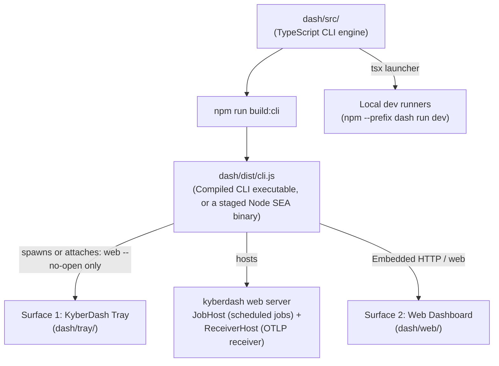
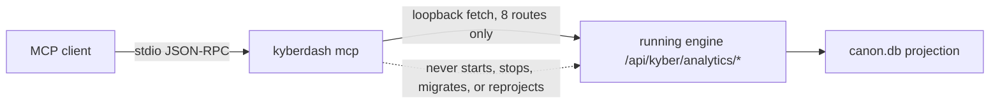

# KyberDash runbook — Local development, execution, and testing

KyberDash provides multi-surface observability and context tuning for agentic coding workflows.
First-party code under `dash/` since a one-time fork of CodeBurn
([ADR 0020](../adr/0020-kyberdash-one-time-fork.md)), it runs as **three local surfaces**
today:

> **THE TRAY AND THE WEB DASHBOARD ARE DISPLAY LAYERS. NEITHER CONTAINS ISOLATED FEATURE
> LOGIC, SCHEDULERS OR JOBS. ALL LOGIC AND JOBS (REFRESH SCHEDULING, CLEAN, IMPORT, PAUSE)
> LIVE IN THE SHARED KYBERDASH APPLICATION (THE CLI ENGINE AND THE `kyberdash web` SERVER
> BUILT FROM IT) THAT BOTH SURFACES SHARE. BOTH SURFACES USE ONE DATASTORE (canon.db,
> resolved by dash/src/canon/paths.ts resolveCanonDbPath) AND ONE API LAYER
> (/api/kyber/*). NO AGENT OR DESIGN MAY VIOLATE THIS.** See
> [`rules/kyberdash-display-layer`](../rules/kyberdash-display-layer.md) and
> [ADR 0033](../adr/0033-kyberdash-surfaces-are-display-layers.md).

1. [KyberDash Tray (`dash/tray/`)](#6-the-kyberdash-tray-dashtray) — the macOS and Windows tray: a Tauri 2 shell whose popover renders the context report. It attaches to a live `kyberdash web` server, launching one with `--no-open` only when there is none to attach to, and it reaches the engine over `/api/kyber/*`.
2. [Web Dashboard (`dash/web/`)](#web-dashboard-dashweb) — Standalone React browser interface served by the CLI over HTTP.
3. [CLI engine (`dash/src/`)](#telemetry-ingest-canonical-store-and-cli-operations) — `kyberdash report`, `web`, `dash refresh`, `dash import-history`, `dash clean`, `dash settings`, `kyber otel`, and the store operations documented below. This is where the jobs, the settings, and the receiver live.

This runbook covers the local prerequisites, build workflows, dev runners, CLI operations, and test suites
for each surface.

---

## Installing the released binary

Everything below builds KyberDash from this repository, which is what contributors want. To
*run* a released KyberDash instead, take the `kyberdash` single-executable from the standard
install path — it needs no Node toolchain and no checkout:

```bash
curl -fsSL https://raw.githubusercontent.com/dpalfery/kyber-weave/main/scripts/install.sh \
  | sh -s -- --prerelease
```

`--prerelease` is required until 0.1.7 is promoted to stable: `kyberdash-<rid>` assets first
appear in 0.1.7-rc.9, and the installer skips KyberDash on any release below that floor. See
[Installing Kyber-Weave](../install.md#kyberdash-and-the-version-floor) for the flags, the
Node SEA RID names, and how `kyber-weave update` treats an installed `kyberdash`.

The released binary is the CLI engine — `kyberdash report`, `kyberdash web`, and
`kyberdash kyber otel`. The web dashboard is embedded in the released binary as a packed SEA
asset, so `kyberdash web` needs no `npm` and no checkout to serve it; `KYBERDASH_DASH_DIR`
still overrides it with a directory of your own build. The tray ships as its own release asset from `0.1.7-rc.13`:
`kyberdash menubar` installs it, after checking its SHA-256 and — on macOS — its code
signature, team id and Gatekeeper acceptance (`install.sh --with-menubar` does the same on
macOS). `kyber-weave update` updates an installed tray by delegating to
`kyberdash menubar --update`, which quits the running tray, replaces it and relaunches it,
restoring the previous app if any step fails. On Linux, `kyberdash menubar` exits 1: the tray
ships for macOS and Windows only.

---

## Architectural overview & execution model

All surfaces consume telemetry and analyses generated by the KyberDash core CLI engine.
Before launching the tray or the browser dashboard, understand the dependency flow:



- **CLI Distribution (`dash/dist/cli.js`)**: The tray and the HTTP web server interact with
  KyberDash by executing the compiled CLI. Building this file is a mandatory prerequisite for
  running the tray from source; the deployed tray instead points `kyberdashPath` in
  `~/.kyberdash/tray.json` at a staged self-contained binary (see the tray section below).
- **Who hosts what**: the tray spawns (or attaches to) `web --no-open` and nothing else — it
  never starts `kyber otel`. The OTLP receiver is a `ReceiverHost` child of the
  `kyberdash web` server, run only while `settings.receiverHosted` is on, and the scheduled
  refresh/import jobs run in that server's `JobHost`.
- **One shared projection**: whichever entry fills the store — `dash refresh`, live OTLP
  ingest, or a manual `kyber build` — the derived data every surface reads is produced by the
  same `projectCanonicalStore()` projection over `buildSessions()`. There is no second
  derivation and no raw-record reporting path. The live collector's scheduler runs that
  projection on a debounced cadence (10s idle window, 10min staleness cap, 10min minimum
  pass interval; `drain()`/`close()` bypass it) — see
  [The shared canonical projection](architecture.md#the-shared-canonical-projection).
- **No upstream remote**: `dash/` no longer tracks CodeBurn. A clone made while it did
  may still carry the `codeburn` git remote; nothing uses it, so remove it with
  `git remote remove codeburn`.

### Build workflow

KyberDash splits **compiled output** from **pricing data refresh**:

| Script | Pricing re-snapshot | Produces |
|---|---|---|
| `npm --prefix dash run build` | Yes — runs `scripts/bundle-litellm.mjs` over the network (LiteLLM, models.dev, OpenRouter) into `dash/src/pricing/data/`, then `tsup` and `build:web` | CLI, web bundle, refreshed committed pricing JSON |
| `npm --prefix dash run build:cli` | No — `tsup` only | `dash/dist/cli.js` from committed sources |
| `npm --prefix dash run build:web` | No | Web dashboard static assets |
| `npm --prefix dash run bundle-litellm` | Yes — networked refresh only | Updated committed pricing JSON (commit the diff) |

Node SEA packaging (`tsup` via `release-local.sh`) and `npm publish` both embed the
committed files under `dash/src/pricing/data/` without re-snapshotting:
`prepublishOnly` runs `build:cli` only. Networked pricing refresh is the explicit
`npm --prefix dash run bundle-litellm` step (or full `npm --prefix dash run build`);
commit the resulting JSON diff before a release when upstream list prices have moved.

---

## Telemetry Ingest, Canonical Store, and CLI Operations

KyberDash maintains all normalized data in SQLite at `~/.kyberdash/canon.db` ([ADR 0008](../adr/0008-kyberdash-single-canonical-store.md)).
`KYBER_CANON_DB` overrides the store path. Older database schemas migrate in place on open.

### 1. Starting the OTLP Ingest Receiver

There is exactly one KyberDash engine per user ([ADR 0039](../adr/0039-single-instance-engine.md)),
and the OTLP receiver is its child, listening for OTLP over HTTP on `127.0.0.1:4318` at
`POST /v1/traces` and `POST /v1/logs`, then persisting to `canon.db`. Logs enrich their
correlated span-shaped record ([ADR 0009](../adr/0009-multi-signal-ingestion-span-shaped-record.md)).

The engine holds a local IPC endpoint (`~/.kyberdash/engine.sock`, a named pipe on Windows)
and records itself in `~/.kyberdash/engine.json` (pid, executable, version, URL). The CLI and
the tray both ensure-or-attach through it, from the same executable:

```bash
# Start the engine, or attach to the one that is running (exit 0 either way)
kyberdash web --no-open

# Turn the hosted receiver on and ensure the engine; never binds a second receiver
kyberdash otel
```

A second `kyberdash web` attaches to the running engine instead of starting another. An
engine from a different build is asked to shut down and replaced by the newer one. A custom
`--port` or `--host` on `kyberdash otel` is refused: the receiver is `127.0.0.1:4318`.
`kyberdash otel --serve` is the internal form the engine uses for its receiver child; do not
start it by hand.

### 1a. Enabling Claude Code content on the sender

Claude Code sends its prompt and request-body text only when the sender opts in. KyberDash
never applies these settings automatically: they are the sender's consent, set for the
Claude Code process or written into `~/.claude/settings.json` by
`kyberdash kyber capture` when the owner runs it
([ADR 0031](../adr/0031-kyberdash-capture-command-owns-harness-telemetry-keys.md)).

| Setting | Effect | Exposure |
|---|---|---|
| `OTEL_LOGS_EXPORTER=otlp` | Sends Claude Code event logs — including `api_request_body` — to the receiver. Without it, only traces arrive and no request body is sent. | Enables the two settings below; on its own it sends counters and metadata only. |
| `OTEL_LOG_USER_PROMPTS=1` | Exports the interaction span's `user_prompt` as text instead of `<REDACTED>`. | Exports the user's prompt text verbatim. |
| `OTEL_LOG_RAW_API_BODIES=1` | Inlines the raw API request body in the log event. `file:` would spill untruncated bodies onto disk instead. | Exports the full system prompt, tool definitions, and message history verbatim. |
| `CLAUDE_CODE_OTEL_CONTENT_MAX_LENGTH` | Raises Claude Code's 61,440 UTF-16-unit inline-body ceiling (the capture writer sets 1,048,576). | Larger bodies mean more prompt text stored; the ceiling is a size limit, not a privacy control. |

**Data-exposure warning.** With these enabled, the receiver stores the system prompt, tool
definitions, message history, and the user's prompt as plaintext content parts, served on the
loopback-only `/api/kyber/*` API. Assembled turn text is purged after 14 days; the raw packet
keeps exactly what the sender sent until you wipe the `claude-code` harness or the whole
database ([§4](#4-content-retention-policy),
[ADR 0035](../adr/0035-kyberdash-quarantine-raw-packet-evidence.md)). Set them only when you
accept that exposure. What the receiver then does with the text — and the reasons it declares
when a body is redacted, truncated, or arrives as a `body_ref` it will not open — is in the
[telemetry inventory](telemetry-inventory.md#claude-code-otlp-content-live).

### 2. Derived Projection Rebuilding (`kyber build`)

The `session`, `run`, `execution`, and `finding` tables are derived projections over raw canonical
records. If detector algorithms change or migrations are applied, rebuild projections without re-ingesting:

```bash
node dash/dist/cli.js kyber build --db ~/.kyberdash/canon.db
```

Upgrading the binary does not itself rebuild derived tables: opening an existing store serves
the rows its `detector_version` stamp describes until the next build, refresh, or live-collector
projection runs. After deploying a release whose detectors changed, run the rebuild above once.

This rebuilds:
- Derived sessions from canonical records.
- First-class `run` tasks and `execution` parent/child delegation trees ([ADR 0012](../adr/0012-progressive-disclosure-6-level-diagnostic-spine.md)).
- Finding materializations stamped with `detector_version` ([ADR 0013](../adr/0013-telemetry-grounded-finding-contracts-and-waste-ranking.md)).

`kyber build` calls `buildSessions` directly — the same derivation the shared projection
entry `projectCanonicalStore()` wraps — so a manual rebuild and an automatic projection
produce identical derived rows.

### 2a. Local harness-source refresh (`dash refresh`)

Fill or update `canon.db` from installed native session stores, then purge expired content
and rebuild derived tables:

```bash
node dash/dist/cli.js dash refresh
node dash/dist/cli.js dash refresh --history-weeks 2
node dash/dist/cli.js dash refresh --db /tmp/canon.db
```

`--db` selects the store (default `~/.kyberdash/canon.db`). `--history-weeks <n>` is a
positive integer; omission is **2**. There is no public `--provider` flag. Usage errors
exit **2** before the database is opened. Any failed harness job or derivation failure
exits **1**. Complete success, including sources that are not installed, exits **0**.

The command runs one job per harness-source descriptor ([ADR 0016](../adr/0016-kyberdash-harness-source-refresh.md)),
commits with `commitSourceUnit`, then runs `purgeExpiredContent` (14-day content window;
`records.raw` kept) and projects the store through `projectCanonicalStore` — the shared full
projection over `buildSessions` that the live OTLP receiver also drives. Output is a
per-harness table plus a derived summary; diagnostics for `failed`/`partial` rows go to
stderr without chat content or raw paths. Use a temporary `--db` when experimenting.

A terminal `dash refresh` always reads folder sources. The scheduled, tray, and web runs do
not: they honour the shared setting `settings.folder_import.scheduled`, which is **off** by
default ([§2d](#2d-shared-settings-and-pause)); with it off, a scheduled tick runs only the
maintenance pass — the retention purge plus the projection — writes no `refresh_run` row
(so the audit trail never claims a source read that did not happen), and prints the skip line
`Folder sources skipped (scheduled folder import is off)`. A dashboard or tray refresh asks
the engine over `POST /api/kyber/refresh`; it runs the same refresh and is gated by the same
setting ([ADR 0016](../adr/0016-kyberdash-harness-source-refresh.md) decision 1,
[ADR 0033](../adr/0033-kyberdash-surfaces-are-display-layers.md)).

Parser-contract bumps: each harness-source descriptor carries a
`parserContractVersion`. When Claude family parsing output changes — for example
attaching conversation/tool-result parts on Desktop/CLI file-synth records
([issue #216](https://github.com/dpalfery/kyber-weave/issues/216)) — that version
advances and the next `dash refresh` treats prior `source_checkpoint` rows as
stale, re-reads transcript files, and re-synthesizes affected units still
inside the 14-day content-retention window. Rows older than that floor are
not rewritten — the same refresh would empty their parts via
`purgeExpiredContent`. No separate repair command is required; prefer a
temporary `--db` when validating a bump.
Capturable versus inherent-empty Claude buckets are recorded in the
[telemetry inventory](telemetry-inventory.md#claude-desktop-and-cli-file-synth-parts-issue-216).

Coverage window persistence: every refresh run records its window in
`refresh_run.history_weeks` (added in schema 16). The value is the `--history-weeks` argument of
that run (default 2). Rows written before window tracking read as `null`, which surfaces
render as "coverage window unknown (recorded before window tracking)" — never as 2 and
never as 0, per [honest unobservability](../rules/honest-unobservability.md). A scoped
window with no session names the widening command
(`kyberdash dash refresh --history-weeks <n>`), not just the bare refresh.

Ingest activity audit: the live OTLP receiver writes one `ingest_log` row per distinct
span source in each decoded batch (source is `service.name`, `'otlp'` when unnamed), sized
to the arriving batch so quarantined traffic still counts as received, plus one
`otlp:logs` row per log batch so last-received reflects any receiver request. When
`ingest_log` holds no rows, the dashboard says "no receiver activity recorded" — receiver
liveness is never inferred, because the receiver is a separate process this page cannot
observe.

Coverage route: `GET /api/kyber/coverage` returns the refresh window, per-source ingest
activity (record counts from `records`, log sums and `lastReceivedAt` from `ingest_log`),
per-reason quarantine counts, and `source_checkpoint` statuses including `partial`. An
empty log and empty table yield `{ status: 'unknown' }` with a reason, never a zero.
The dashboard's **Status** panel reads that route and lists sources discovered but not
ingested, grouped by their persisted reason: `window_filtered` (all native records predate the
refresh window; widen `--history-weeks` to ingest them) or `no_recordable_events` (the file
holds no usage or model events, so there is nothing to ingest).

### 2b. Database clean (`dash clean`)

Wipe bad or stale telemetry — double-counting, mis-attribution, test noise — by harness
scope or for all harnesses
([ADR 0032](../adr/0032-kyberdash-user-initiated-clean.md)):

```bash
node dash/dist/cli.js dash clean --all --yes
node dash/dist/cli.js dash clean --harness pi --harness cursor --yes
node dash/dist/cli.js dash clean --all --yes --reingest-weeks 4
node dash/dist/cli.js dash clean --all --yes --no-reingest
```

`--all` or at least one `--harness <id>` is required, and so is `--yes`: without the
flag the command exits **2** before the store opens (the CLI is non-interactive, so there
is no prompt). A held refresh lock exits **3** with nothing written; clean failure exits
**1**; success exits **0**.

**A clean does not re-import folder history.** The window is opt-in: pass
`--reingest-weeks <n>` (a whole number of weeks, 1 to 52) to get the source logs back in
the same run, or leave it off and run [`dash import-history`](#2c-import-folder-history-dash-import-history)
afterwards. `--no-reingest` is still accepted and is now just the stated default, so a
script written against it keeps working. Nothing re-imports on its own later either: the
next scheduled refresh reads folder sources only while
`settings.folder_import.scheduled` is `on`.

One clean pauses the OTLP receiver (loopback admin routes; export paths answer 503 +
Retry-After while paused, `/healthz` stays 200 with `paused`), holds the refresh lock,
wipes the scope in one store transaction (records including `records.raw`, provenance,
checkpoints, and harness-scoped derived caches), projects the derived tables, re-ingests
the scope **only if a window was requested**, and resumes ingestion. `ingest_log`,
`refresh_run`, `metadata` (stamped `last_clean_at`/scope), `token_cache`, and the
model-window catalog are never wiped. Wipe-all clears `quarantine` and the
log-enrichment tables. A per-harness wipe now deletes the `quarantine`, `pending_logs`,
and `quarantined_logs` rows whose `harness` matches the wiped raw names — the nullable
column schema v19 added for exactly this
([ADR 0035](../adr/0035-kyberdash-quarantine-raw-packet-evidence.md)). A row with no
harness is "unknown", never "matches", so unclaimed rows survive a per-harness wipe and
are cleared only by the complete wipe.

There is no backup and no undo: the data is ephemeral point-in-time telemetry, and
file-backed harnesses re-derive it from source logs. OTLP-collected records have no
source logs and do not come back — the web dialog and the tray confirm both say so
before anything is wiped. Prefer a temporary `--db` when validating a wipe.

Both surfaces reach the same operation at `POST /api/kyber/clean` (confirmed dialog in the
dashboard's Maintenance panel and in the tray's two-step confirm), passing the scope, the
explicit confirmation, and a `reingestWeeks` window or its absence. Neither spawns a clean
child, and neither holds clean logic.

### 2c. Import folder history (`dash import-history`)

The one-off backfill, kept as its own command so "import this once" stays visibly a
different decision from "keep importing":

```bash
node dash/dist/cli.js dash import-history
node dash/dist/cli.js dash import-history --weeks 4
node dash/dist/cli.js dash import-history --harness pi --harness cursor
node dash/dist/cli.js dash import        # alias
```

`--weeks <n>` is a whole number of weeks, 1 to 52; omission means **1** (the last 7 days).
`--harness <id>` narrows the import, repeatably. The command never reads or changes
`settings.folder_import.scheduled` and is always allowed: whatever the setting says, an
explicit import imports. Usage errors exit **2** before the store opens; a held refresh
lock exits **3**; a failed import exits **1**; success exits **0**.

The dashboard reaches it at `POST /api/kyber/import-history` with a body carrying
`{weeks?, harness | harnesses}`, from the Maintenance panel's **Import folder history**
control; the tray reaches the same route from its popover.

**Importing `antigravity-cli`.** `--harness antigravity` selects only the `~/.gemini/antigravity`
descriptor. `antigravity-cli` and `antigravity-ide` are separate descriptors, so name them
explicitly. To import the `antigravity-cli` conversations, name that harness and use a window of at
least 2 weeks. The window is counted in whole weeks back from the run, so an older conversation is
not read:

```bash
node dash/dist/cli.js dash import-history --weeks 2 --harness antigravity-cli
```

The dashboard's import picker offers only harnesses that already hold samples (`sampleCount > 0`,
`dash/web/src/components/maintenance/MaintenancePanel.tsx`). Until `antigravity-cli` holds samples,
the command above is the way to import it. The picker cannot offer it today (todo
[antigravity-cli-backfill-import-picker](../todo/antigravity-cli-backfill-import-picker.md)).

A `--harness antigravity` import, or a refresh run with that id, does not include `antigravity-cli`
or `antigravity-ide`. The family scope is shadowed by the descriptor id (todo
[antigravity-family-scope-resolve-harness](../todo/antigravity-family-scope-resolve-harness.md)), so
name each descriptor. Use a window of at least two weeks, so that the chosen conversation falls inside it.
After an import, the transcript activity appears only for sessions whose conversation database was
imported. OTLP-only sessions with no conversation database, and those with a slug session id, get
no transcript activity (see the [telemetry inventory](telemetry-inventory.md#antigravity-transcript-pairing)).

### 2d. Shared settings and Pause

For the user-facing configure surface — the shipped `kyberdash dash settings` commands and
the dashboard's Settings drawer — see the [adoption guide](onboarding.md#configure). This
section is the operator detail beneath it.

Five settings, stored in `canon.db` metadata (`dash/src/settings/shared-settings.ts`), so a
change made in one place is the change every other surface sees. Reads fail closed: an
unrecognised stored value reads as the default rather than being coerced, and an
unrecognised value is refused before anything is written.

```bash
node dash/dist/cli.js dash settings show
node dash/dist/cli.js dash settings show --json
node dash/dist/cli.js dash settings set folder_import.scheduled on
node dash/dist/cli.js dash settings set jobs.paused off
node dash/dist/cli.js dash settings set jobs.refresh_cadence_minutes 10
node dash/dist/cli.js dash settings set dashboard.port 4848
```

| Setting (short form) | Metadata key | Default | Effect |
|---|---|---|---|
| `folder_import.scheduled` | `settings.folder_import.scheduled` | `off` | Whether **scheduled**, tray, and web refreshes read folder sources. A terminal `dash refresh` and `dash import-history` are never gated by it. |
| `jobs.paused` | `settings.jobs.paused` | `off` | Pauses the scheduled jobs — see below. |
| `jobs.refresh_cadence_minutes` | `settings.jobs.refresh_cadence_minutes` | `5` | How often the job host looks for work; a whole number of minutes, 1 to 1440. |
| `receiver.hosted` | `settings.receiver.hosted` | `off` | Whether the `kyberdash web` server runs the OTLP receiver child. |
| `dashboard.port` | `settings.dashboard.port` | `4747` | The loopback port `kyberdash web` listens on. Takes effect on the next engine restart — see below. |

Both spellings are accepted on input — the short name and the `settings.`-prefixed key — and
`show` reports the short name. A usage error on either leaf exits **2** before the store is
opened, so a refused value leaves the filesystem as it found it.

Over HTTP the same five settings are `GET /api/kyber/settings` and `PUT /api/kyber/settings`,
with the JSON keys `folderImportScheduled`, `jobsPaused`, `refreshCadenceMinutes`,
`receiverHosted`, and `dashboardPort`. A `PUT` is partial — a body naming one setting leaves
the other four untouched — and a body with an unknown key or a value of the wrong type is
refused whole.

**The dashboard port applies on the next engine restart.** Saving `dashboard.port` — from
`dash settings set`, the web Settings drawer, or `PUT /api/kyber/settings` — never rebinds
the running server: the current process keeps serving its port, and the next `kyberdash web`
start binds the persisted one. Precedence at startup is an explicit `--port` for that run,
then the persisted `dashboard.port`, then `4747`. A persisted port must be a TCP port,
1 to 65535: `0` and anything outside the range are refused, because a stored `0` would land
every later startup somewhere unannounced. When the configured port is already taken, the
start is refused with an error naming the port and the remedy (stop the holder, pass `--port`
for this run, or persist another port and restart) — the server never slides silently onto a
random port, which would strand the tray and every bookmark aimed at the configured URL.

**Pause covers scheduled jobs only.** `jobs.paused` stops the job host from scheduling: no
scheduled refresh runs while it is set. Manual **Refresh**, **Import folder history**, and
**Clean**, the OTLP receiver's continued ingest, and the retention purge all carry on — pausing must not silently stop collection. The dashboard's
Maintenance panel offers Pause/Resume and reads the *host's* answer from `GET /api/kyber/jobs`,
not the echo of the setting it just wrote.

### 2e. Upgrading from an earlier tray

Two things change on the first launch after an upgrade, both of them deliberate
([issue #319](https://github.com/dpalfery/kyber-weave/issues/319),
[ADR 0033](../adr/0033-kyberdash-surfaces-are-display-layers.md)):

- **Scheduled folder import is off until you turn it on.** Turn it on from the dashboard's
  Maintenance panel, the tray's settings view, or
  `dash settings set folder_import.scheduled on`. Until then, scheduled refreshes still run
  the maintenance pass and collect OTLP telemetry — they just do not read your harness
  folders.
- **The refresh cadence resets to 5 minutes.** It moves from tray-local state into the
  shared settings, and the old tray value is not migrated. The tray's own refresh-cadence
  and receiver settings are no longer read; both now answer from the shared settings, which
  every surface sees.

The tray now attaches to a running `kyberdash web` server rather than owning one, so if the
dashboard was already running before the upgrade, the tray joins that server and collection
continues even after you quit the menu bar.

### 2f. Seeing a turn's raw packet

A Claude Code turn can be inspected down to the packets that carried it. Open the turn in the
Context Inspector: a **Raw packet** disclosure appears whenever the turn-content result carries
one, and fetching nothing until it is opened. It shows two payloads
([ADR 0035](../adr/0035-kyberdash-quarantine-raw-packet-evidence.md)):

- the request span's own harness-emitted attributes, from
  `GET /api/kyber/span/<spanId>/attributes`; and
- when the server named the link — which it does only when the parent interaction span's
  quarantine row kept a payload — the quarantined parent packet, from
  `GET /api/kyber/quarantine/<parentSpanId>`.

The turn view renders only the links the server returns: an absent `interactionPath` means the
parent row kept no payload, never a disclosure to render empty. The same two routes are
callable directly:

```bash
# The request span's attributes
curl -s "http://127.0.0.1:4747/api/kyber/span/<spanId>/attributes" | jq .

# The quarantined parent interaction packet, as filed
curl -s "http://127.0.0.1:4747/api/kyber/quarantine/<parentSpanId>" | jq .
```

The quarantine detail route answers 200 for a known span, 404 for an unknown one, 405 for a
non-GET method, and 400 `{ error: 'Missing span id' }` for an empty id. A row that predates the
payload column reads `rawPayload: null, evidenceAvailable: false` — never an invented packet.
The quarantine **list** stays light and never serves payloads.

### 2g. Skills view: rebuild and capture fixtures

The Sessions **4 · Skills** section reads the `skills` block of the session payload. That block
is built on projection and stored in the derived `session` row
([skills view contract](architecture.md#skills-view-contract)). The skills work set
`DETECTOR_VERSION` to **4** (`dash/src/canon/store.ts`). A store stamped with generation **3**
reports its findings as outdated until they are rebuilt. A session row stored before the change
has no `skills` key, so it renders "not yet projected".

Run the rebuild once against the store:

```bash
node dash/dist/cli.js kyber build --db ~/.kyberdash/canon.db
```

`kyber build` re-projects the derived rows from the stored records, so the `skills` block and
the new finding stamps are written without re-ingesting. It cannot add data that the stored
records never held. The Claude `skill_listing` listing (`kyber.skills.listed`) and the invoked
names (`kyber.skills.invoked`) reach a record only when `dash refresh` re-synthesizes its unit,
which the parser-contract bumps trigger for the affected harnesses. Whether older sessions gain
those attributes after a refresh is **unverified**. Prefer a temporary `--db` when you want to
validate before touching the live store:

```bash
node dash/dist/cli.js kyber build --db /tmp/canon.db
```

**Antigravity descriptions after an edit.** Antigravity skill descriptions are read from each skill's
`SKILL.md` when its session payload is built. The lookup is cached by file path and revalidated by
the file's mtime and size, so an edited `SKILL.md` is read again with no engine restart. The new
text appears on the next projection pass that rebuilds the session. To see an edit at once, run
`kyber build`, which calls `buildSessions` directly. The maintenance pass alone may skip projection
while the corpus is unchanged, so it may not show the edit until the next pass.

**Capture fixtures.** The sanitized G0 captures live in `dash/src/canon/fixtures/skills/<harness>/`,
one folder for each of `claude-code`, `copilot-chat`, `copilot-cli`, `antigravity`, `pi`, and
`opencode`. Each folder has a README stating what was found or not found. The `copilot-cli`,
`pi`, and `opencode` folders hold only the README, because the owner's store had no separate
Copilot CLI, Pi, or OpenCode skill records. The captures are sanitized: ids, paths, and timestamps
are replaced. The Claude `skill_listing` parser test reads `claude-code/capture-listing.jsonl`.
The per-harness status is in the [telemetry inventory](telemetry-inventory.md#skill-availability-by-harness).

### 2h. Subagent session hierarchy and post-run transcript synchronization

Subagent execution is modeled as a first-class session hierarchy with dual spend accounting,
honest title formatting, and background transcript synchronization
([ADR 0038](../adr/0038-post-run-transcript-sync-subagent-hierarchy.md)).

#### Subagent session hierarchy and Sessions explorer nesting

Subagents spawn with stable session IDs derived from their harness telemetry:
- Primary Claude sessions: `claude-code/<session-id>`
- Claude subagents with a known agent ID: `<parent-session-id>#agent-<agentId>`
- Copilot subagents (and fallbacks): `<parent-session-id>#<span-id>`

The web dashboard Sessions explorer (`page-sessions`) renders subagent sessions nested beneath
their parent session in a tree hierarchy rather than interleaving them as disconnected top-level
sessions.

#### Dual spend accounting via read-time rollups

KyberDash maintains dual spend visibility across the delegation tree:
- **Direct unaggregated metrics**: The parent session row in SQLite (`canon.db`) preserves its own
  unaggregated `turn_count`, `request_count`, `total_input`, `total_output`, and `cost_usd`. This
  ensures direct parent execution work is not overwritten or inflated in the raw store.
- **Read-time rollup object**: When parent sessions are queried over `/api/kyber/sessions` or
  `/api/kyber/session/:sessionId`, the API dynamically calculates a `rollup` summary aggregating
  turns, requests, token counts, and cost USD across the parent and all nested subagent children.
- Both surfaces (Web and Tray) display the rolled-up totals alongside direct metrics without
  double-counting.

#### Honest title formatting (`formatSessionTitle`)

Session titles in the explorer are synthesized via `formatSessionTitle` (`dash/src/canon/naming.ts`
and `dash/web/src/lib/labels.ts`), adhering to honest unobservability:
- **Title format**: `<agent name> · <task summary>` when both are available from telemetry.
- **Machine-label suppression**: `isMachineLabel` detects and suppresses raw telemetry identities
  (such as span operations like `.llm_request`, model labels like `chat claude-3-5-sonnet`, raw
  UUID strings, `synth:` prefixes, and `<synthetic>` or `<unknown>` model tags) so they never
  masquerade as human titles.
- **Fallbacks**: If task summary is absent or machine-generated, the title falls back to
  `<agent name> · session`, `<task summary>`, `<human label>`, `<harness> session`, or shortened
  session ID (`formatSessionId`). When telemetry is completely absent, it renders a clean fallback
  rather than fabricating prompt summaries or fake agent identities.

#### Engine-hosted transcript sync job lifecycle (`runTranscriptSync`)

For harnesses where subagent turns and spend are recorded in secondary transcript files on disk
(e.g., Claude Code subagent JSONL transcripts), the CLI engine runs an incremental synchronization
job (`dash/src/sync/transcript-sync.ts`):

- **Job lifecycle and state machine**:
  1. `pending`: A new session with a transcript path is registered awaiting ingestion.
  2. `synced`: `runTranscriptSync` reads newly appended bytes from `transcript_offset`, parses
     turns with `processDelta`, updates `transcript_offset = fileSize`, `synced_at = nowIso`, and
     recalculates session spend.
  3. `settled`: If no new bytes are appended and the session has been inactive for >= 30 minutes
     (`(now - lastActivity) >= 30 * 60_000`), the session transitions to `settled` with `settled_at`
     stamped. Settled sessions are bypassed on future sync passes.
  4. `unavailable`: If the transcript file is missing or unreadable and more than 24 hours have elapsed
     since session start/end, `sync_status` transitions to `unavailable`.
- **Lock arbitration**: Before starting a sync pass, `runTranscriptSync` inspects `STORE_LOCK_FILE`
  (`~/.kyberdash/canon.lock`). If the store lock is held by `dash clean`, `dash refresh`, or manual
  rebuild (`readLockHolder !== null`), `runTranscriptSync` yields immediately with `{ outcome: 'busy' }`.
  It never attempts to force a lock, wait indefinitely, or block user operations.
- **Display layer boundary**: Following [ADR 0033](../adr/0033-kyberdash-surfaces-are-display-layers.md),
  the sync job runs exclusively inside the CLI engine's `JobHost` under `kyberdash web`. The tray and
  the web dashboard contain no job runners or schedulers; they query the resulting sessions and rollups
  via `/api/kyber/*`.

### 2i. Claude request-body relink and quarantined count

Before the request-body correlation fix, a Claude Code `api_request_body` log that arrived before
its model call was quarantined and never reconnected. The rule that now matches it is described in
the [architecture](architecture.md#claude-request-body-log-correlation) and the
[telemetry inventory](telemetry-inventory.md#claude-request-body-correlation).

**What runs on start.** When the OTLP collector service starts (the receiver that `kyberdash web`
hosts, or `kyberdash otel`), it runs `relinkQuarantinedClaudeLogs` once, after the store opens. The pass:

- reads the `quarantined_logs` rows with `harness = 'claude-code'` above the watermark, in log
  timestamp order, and applies the same matcher as the live path;
- on a match, enriches the record, removes the quarantined row, and marks the log enriched;
- skips a body whose matched record is older than the 14-day content window. Its row stays
  quarantined, because the content it would attach has already been purged;
- leaves unmatched, tied, and skipped rows in quarantine;
- isolates each log: one whose matching or enrichment throws is counted, its row stays in quarantine,
  and the pass continues. One warning at the end gives the count and up to ten log ids, never a
  payload;
- treats a matched record whose timestamp does not parse as expired, so its row stays quarantined;
- prints one line, `Relinked N of M quarantined Claude request bodies in T ms`, and, when N is above
  zero, requests the derived-session projection as the live batch paths do. A failure is logged and
  does not stop the service.

**Startup cost.** The pass is synchronous and runs once per start, before the receiver accepts traffic.
It reads quarantined rows in bounded pages: at most 100 rows and 16 MiB of stored payload per page. A
page always holds at least one row, so one oversized payload cannot stall the pass, and memory stays
flat however large the quarantine is. A store with a large backlog pays one scan; later starts scan
nothing past the watermark. The elapsed time is in the `Relinked N of M ... in T ms` line. A
quarantined row whose stored payload is not valid JSON is skipped and kept in quarantine. The pass
prints one warning per start with the count and up to ten log ids, never the payload. The skip does
not stop the pass, and the watermark still moves past such a row, so later starts do not retry it.

**The watermark.** The pass stores the highest rowid it left in quarantine in `metadata` under
`claude_body_relink_watermark` (never lower than the previous value), written after every page so a
crash mid-pass keeps the progress made. A later start scans only rows
above it, so a row the pass left in quarantine is **not retried by later starts**. The live path
handles bodies that arrive while the service runs, and it does not re-match rows already in
quarantine. No shipped command resets the watermark.

**Checking the quarantined count.** Snapshot the store first, so the query does not read a live WAL
database (the same method the T0 measurement used):

```bash
sqlite3 ~/.kyberdash/canon.db ".backup /path/to/canon-copy.db"

# Quarantined Claude request bodies, and why they were left there
sqlite3 /path/to/canon-copy.db "SELECT reason, COUNT(*) FROM quarantined_logs WHERE harness = 'claude-code' GROUP BY reason;"

# Bodies still waiting for a call
sqlite3 /path/to/canon-copy.db "SELECT COUNT(*) FROM pending_logs WHERE harness = 'claude-code';"

# The relink watermark (absent before the first pass)
sqlite3 /path/to/canon-copy.db "SELECT value FROM metadata WHERE key = 'claude_body_relink_watermark';"
```

The per-reason counts are also in the Status panel and in `GET /api/kyber/coverage`. After a restart
with a healthy sender, expect the count to fall to the accepted residual: about 0.44% of trace-bearing
body logs, plus any context-free body that carries no session id, which quarantines at once. A
context-free body that names a session pends for the 15-minute window and is counted only if it
outlasts it. Bodies older than the 14-day window stay quarantined, so a store with older history keeps
a higher count. This is expected, not a fault.

**Derived session rows.** The relink changes stored records, not the derived session rows (the session
payload, which includes the Skills view). A relink that enriched at least one call requests the
projection itself; otherwise a `dash refresh`, an accepted OTLP batch, or a manual build rebuilds
them. If a session still shows no skill listing after a restart,
run the build against the store:

```bash
node dash/dist/cli.js kyber build --db ~/.kyberdash/canon.db
```

### 2j. Conversational analytics over MCP (`kyberdash mcp`)

`kyberdash mcp` serves the eight read-only analytics tools over stdio for an MCP
client. `runMcpCommand` (`dash/src/cli/mcp.ts`) builds the adapter
(`createAnalyticsMcpServer`) on a client that only fetches the eight
`/api/kyber/analytics/*` routes — the adapter never imports the canonical store and
never owns the server lifecycle:

```bash
kyberdash web --no-open     # the engine must already be running; mcp never starts it
kyberdash mcp                                       # discover via the server.json receipt
kyberdash mcp --server-url http://127.0.0.1:4747   # explicit receipt override (wins)
kyberdash mcp --state-dir /path/to/state           # read an existing receipt elsewhere
```



**Attach-only ownership.** The MCP process starts no engine, acquires no job lease,
mutates no config, imports no content, and triggers no migration or projection; it
never stops the engine it attached to. Discovery reads the existing receipt without
rewriting it, and there is no `--db` flag because the running engine owns the
datastore selection. Only literal loopback origins are contacted
(`http://127.0.0.1:<port>` or `http://[::1]:<port>`, port required, no
userinfo/query/fragment, no redirects); anything else, a missing receipt, or a stale
one yields `engine_unavailable` telling the operator to run `kyberdash web --no-open`.
An unknown analytics contract version (or a non-conforming body) yields
`incompatible_engine`, never an empty corpus. Rediscovery happens once after an
unavailable connection; the adapter never silently attaches to a different store
mid-query, and a changed engine instance or projection generation rejects the cursor.

**Stdio and shutdown discipline.** Help/version before transport activation keep normal
CLI behavior. Once connected, every stdout line is valid JSON-RPC; logs, pricing
messages, and diagnostics go to stderr, and nothing else is printed on stdout. Tool
results carry the full analytics envelope as structured content with `isError: true`
on tool-domain errors; JSON-RPC errors are reserved for protocol failures. Client
cancellation aborts active fetches (10 s abortable HTTP cap); EOF/SIGTERM drains
accepted requests within a bounded deadline, closes stdio/fetch resources, and exits
without stopping the shared engine. A client closing its read end does not produce an
unhandled EPIPE. Status reports a store identity token, never the DB contents or an
unnecessary absolute path.

**Limits the operator will meet.** Request bodies cap at 64 KiB and MCP replies at 64
KiB (an oversized reply becomes a `budget_exceeded` envelope naming the narrowing
step, not a silent truncation); each content page caps at 16 KiB UTF-8 — a page and
working-memory bound, not a transcript total (`byteLimit` caps content pages;
`limit` caps manifest rows). Queries admit
at most 10,000 sessions, scan derived summaries in batches of at most 100, refuse a
single decoded summary over 256 KiB or cumulative decoded input over 16 MiB, and
return no partial total on budget failure. A 5 s cooperative computation deadline is
checked between bounded batches. The refused request names the narrowing step
(`stale_cursor` says restart from the first page; `unsupported_query` says what to
narrow, including the unsupported-dimension hint toward `dash_inspect`). Over HTTP, the
status follows the envelope error code — 400 for `invalid_request`/`unsupported_query`,
404 for `not_found`, 409 for `stale_cursor`, 413 for `budget_exceeded`, 503 for
`engine_unavailable`/`incompatible_engine`/`cancelled`, and 500 for `internal_error` or
any code the route does not know — so a 500 means the engine returned a code the route
does not know.

**Content and outcome caveats are operational facts.** Search is metadata-only;
`dash_inspect` and `POST /api/kyber/analytics/inspect` share one body —
`mode: 'manifest' | 'content'` plus an explicit `target` (`run` / `session` /
`turn`) — and content needs no additional flag or approval. `mode: 'manifest'`
discovers without returning text bodies (run executions with parent/child/session
linkage and `isSubagent`, turn identities, part/block identities with `role` and
`origin`); `mode: 'content'` returns `chunks` (`partId`, `blockId`, `sessionId`,
`turnIndex`, `spanId`, `origin`, `text`, `byteOffset`, `complete`, `role`, `order`,
`resident`) paged by `pagination.nextCursor` / `hasMore`, following continuations to
reach all retained context. `limit` (manifest only; default 25, max 100) and
`byteLimit` (content only; default and max 16384) bound a page and working memory,
never the total retrievable transcript. `coverage.completeness` is `captured_only`
with `coverage.gaps` naming what is missing; `representation: 'assembled_turn'`
(turn targets only) is a labelled reconstruction, never the exact model input. `run`
scope includes child/subagent sessions; `session` scope stays local. Cursors bind
target, representation, limits, and projection generation: a reused, tampered,
cross-target, or post-purge cursor answers `stale_cursor`; capacity answers
`budget_exceeded`; cancellation answers `cancelled`. Canonical content older than the
retention window reads as absent or expired — retrieval never recaptures or
manufactures absent text. The historical `includeContent: true` turn/block form and
the metadata-only session inspection are retained legacy forms, not the way to
retrieve context. A field outside the recognized set for its form answers
`invalid_request`; unknown fields are never silently dropped. Outcomes stay sparse and empirical: missing data and conflicting signals are
reported, never smoothed over, and comparisons are descriptive, never causal. Tool
annotations (read-only/idempotent/non-destructive/closed-world hints) do not replace
the route allowlist.

**Verifying it.** Focused suites plus the release smoke:

```bash
npm --prefix dash exec -- vitest run src/analysis/query      # engine contracts, budgets, cursors
npm --prefix dash exec -- vitest run src/server/analytics-routes.test.ts src/server/analytics-parity.test.ts
npm --prefix dash exec -- vitest run src/mcp                 # tools, discovery, stdio, clean exit
npm --prefix dash exec -- vitest run scripts/sea-mcp-smoke.test.ts
```

`dash/scripts/sea-mcp-smoke.mjs` stages the real single-executable binary outside any
checkout (`HOME`, config, and state all point at a temp dir), initializes over stdio,
lists exactly the eight tools, calls `dash_status` against an isolated loopback
fixture, then closes the child and asserts a clean exit. It runs beside the web smoke
in `scripts/release-local.sh` and `.github/workflows/release.yml`. It proves protocol,
tool list, and the attach-only boundary — not host-client compatibility (see the
[adoption guide](onboarding.md#3-what-is-and-is-not-validated)).

### 3. Raw Content Backfill and Re-normalization

```bash
# Re-derive canonical content parts from raw stored payloads
node dash/dist/cli.js kyber backfill

# Re-evaluate harness attribution voting and token conventions
node dash/dist/cli.js kyber renormalize

# Re-evaluate attribution for one source's traces only (repeatable)
node dash/dist/cli.js kyber renormalize --source agy
```

`--source <name>` restricts renormalization to traces containing that source
and restricts the excluded-harness remediation sweep the same way, so traces
from other sources — and their derived sessions — are left untouched.
Prefer it whenever the repair is scoped to one source (for example,
re-attributing live Antigravity rows after an adapter change).

#### Tool Result Truncation and Parser Checkpoint Re-synthesis (issues #180, #232)

Tool execution outputs captured during file or OTLP ingest are bounded to 64KiB (`MAX_TOOL_RESULT_BYTES = 65_536`) in stored parts (`part: 'tool_result_content'`). Truncated records carry `truncated: true`, with pre-truncation byte length stored in `attributes['gen_ai.tool.result_bytes']`.

When reader extraction or normalization contracts change (such as tool extraction in #180 or request/response turn deduplication in #232), the source's `PARSER_CONTRACT_VERSION` in `dash/src/refresh/registry.ts` is incremented. Running `kyberdash dash refresh` detects that existing `source_checkpoint` entries carry an older contract version, marks them stale, and automatically re-reads and re-synthesizes historical sessions without requiring manual database deletion.

> **Warning:** unscoped `kyber renormalize` quarantines every row the
> fingerprint vote cannot claim, including file-sourced rows (`codeburn/*`),
> which carry no OTLP attributes to vote on. Never run it unscoped on a
> store whose file corpus matters without a backup; restore the backup to
> roll back.

### 4. Content Retention Policy

Retaining unclipped plaintext of every prompt, tool parameter, and file snippet creates a
standing privacy and storage liability ([ADR 0014](../adr/0014-unclipped-turn-inspection-and-copy-out-protocol.md),
[ADR 0018](../adr/0018-kyberdash-content-retention-purge.md)):

- **Default 14-day rolling retention**: Full plaintext in `content_json` / `parts_json` is
  retained for 14 days to support the Context Inspector.
- **Automatic purge on refresh**: `dash refresh` calls `purgeExpiredContent` after source
  jobs drain, and the maintenance pass calls it too, so the window still advances on a
  schedule that is not reading folder sources. Rows older than 14 days have content emptied
  in place (`'{}'` / NULL parts). Token metrics, timestamps, findings, and `records.raw`
  stay.
- **The window does not cover raw packets.** Assembled turn text is purged after 14 days.
  The raw packet keeps exactly what the sender sent until you wipe the `claude-code` harness
  or the whole database ([§2b](#2b-database-clean-dash-clean),
  [ADR 0035](../adr/0035-kyberdash-quarantine-raw-packet-evidence.md)). Never read the 14-day
  window as "all prompt text expires"; raw packets outlive it by design
  ([ADR 0018](../adr/0018-kyberdash-content-retention-purge.md)).
- There is no shipped `kyber purge-content` CLI. Re-run `dash refresh` to apply the window.

### 5. LLM Review Provider Configuration & Privacy Guardrails

The Context Review Seam ([ADR 0015](../adr/0015-opt-in-llm-context-review-seam.md)) allows developers
to request subjective analysis of prompt quality from an LLM.

- **Strictly Opt-In**: Telemetry never leaves localhost without an intentional click in the UI.
- **Provider Environment Variables**:
  - *Anthropic*: Set `ANTHROPIC_API_KEY` (and optional `ANTHROPIC_MODEL`, default `claude-3-5-sonnet-20241022`).
  - *OpenAI-compatible*: Set `OPENAI_API_KEY` (and optional `OPENAI_BASE_URL` or `OPENAI_MODEL`).
  - *Local Ollama / vLLM*: Set `OPENAI_BASE_URL=http://localhost:11434/v1` and `OPENAI_API_KEY=ollama`.
  - *Unconfigured*: If no provider is configured, KyberDash activates `NullProvider` and the UI explains how to configure one without erroring.
- **Credential Handling**: API keys are read directly from process environment variables and are never stored in `canon.db` or written to log files.

### 6. The KyberDash Tray (`dash/tray/`)

The tray is a Tauri 2 Rust shell plus a React popover UI. It resolves the `kyberdash`
binary, attaches to the `kyberdash web` server published in `~/.kyberdash/server.json`
(`{ pid, url, apiVersion }`) when one is live, launches exactly one `web --no-open` child
(default loopback port **4747**) when there is none, and polls `/api/kyber/*` over loopback
to render the popover. It holds no scheduler, no cadence setting, no receiver, and no job
argv; `JobHost` and `ReceiverHost` live in the engine and are hosted by that server. The
webview holds no network permission and no analysis logic of its own
([`rules/kyberdash-display-layer`](../rules/kyberdash-display-layer.md)).

The macOS menu bar and Windows notification area show one diagonal lightsaber, with
its handle at the bottom left and blade pointing to the top right. The blade is green
only when the shared coverage API reports a healthy, enabled, listening, unpaused
collector with no recent failures and a current health check. Otherwise it is red,
including startup before coverage is available. Both colours use the same silver
handle and silhouette; macOS template tinting is disabled to preserve the colour.
Windows shows the saber instead of a pressure number or status dot; pressure remains
available in the tooltip and popover. Flat fills keep the icon legible at small sizes.

#### Native development prerequisites

The released tray needs no Rust installation. To build or test `dash/tray/`, install
the stable Rust toolchain, Cargo, rustfmt, and Clippy. Use current stable Rust: the
crate's `rust-version` is a minimum for its own source, not a pin for all locked
dependencies. Node.js and npm are also required for the React UI.

On macOS, install the Xcode Command Line Tools if `xcode-select -p` fails, then use
Homebrew to install rustup, the Rust toolchain manager:

```bash
xcode-select -p || xcode-select --install
brew install rustup
export PATH="$(brew --prefix rustup)/bin:$PATH"
rustup default stable
rustup component add rustfmt clippy
rustc --version
cargo --version
```

Homebrew's rustup is keg-only. Add that `export PATH=...` line to `~/.zprofile`
and `~/.zshrc` so both login shells and interactive terminals can find Cargo.
It does not provide `rustup-init`; use `rustup default stable` to install the toolchain.
If Xcode opens an installation dialog, finish it before building.

On Windows, follow the [Tauri prerequisites](https://v2.tauri.app/start/prerequisites/)
to install Microsoft C++ Build Tools with the **Desktop development with C++** workload
and WebView2, then install Rust through [rustup](https://rustup.rs/) using the MSVC
toolchain. In a fresh terminal, run `rustup default stable`,
`rustup component add rustfmt clippy`, `rustc --version`, and `cargo --version`.

From the repository root, prepare the frontend before a direct Cargo build or test:

```bash
npm --prefix dash/tray/ui ci
npm --prefix dash/tray/ui run build
```

The frontend build creates the `ui/dist` assets embedded by `tauri.conf.json`.
Build the native shell with `cargo build --locked --manifest-path dash/tray/src-tauri/Cargo.toml`.

#### Local gates

```bash
npm --prefix dash/tray/ui run typecheck
npm --prefix dash/tray/ui run test
cd dash/tray/src-tauri && cargo fmt --check && cargo clippy -- -D warnings && cargo test
```

`npm --prefix dash run lint` also covers the tray UI. To run the shell against a locally
built CLI, build `dash/dist/cli.js` first (`npm --prefix dash run build:cli`) and point
`KYBERDASH_BIN` at it.

For a multi-monitor smoke check, open the card from each monitor's menu bar, including
displays above or left of the primary and displays with different scaling. The card
should open on the clicked display. Repeat after moving between 1× and 2× displays.
The card closes when another app gains focus, so inspect its placement before switching apps.

Deployed shape (per-user, no administrator rights). The Windows installer is unsigned; see
[Windows: unsigned binaries and SmartScreen](../install.md#windows-unsigned-binaries-and-smartscreen)
for verification and SmartScreen guidance.

The Linux source build uses GTK 0.18 through Tauri. Its `glib 0.18.5` dependency is
patched locally for [GHSA-wrw7-89jp-8q8g](https://github.com/advisories/GHSA-wrw7-89jp-8q8g):
`src-tauri/Cargo.toml` points Cargo at `tray/vendor/glib-0.18.5`, and
[`tray/vendor/README.md`](../../dash/tray/vendor/README.md) records the verified source
archive and upstream fix. The tray CI job builds and tests the Linux source and checks
that Cargo resolves the local crate. The published tray remains macOS and Windows only.
Remove the patch only after a Tauri update resolves the Linux graph to `glib >= 0.20.0`
and the Linux gates pass.

On Windows the NSIS installer installs
for the current user and a `HKCU\Software\Microsoft\Windows\CurrentVersion\Run` value starts
the tray at login (`dash/tray/src-tauri/src/autostart.rs`). On macOS:

- The app lives at `~/Applications/KyberDash.app`; launchd owns it as the per-user agent
  `~/Library/LaunchAgents/io.github.dpalfery.kyberdash.plist` (label
  `io.github.dpalfery.kyberdash`) with `RunAtLoad=true` and crash-only
  `KeepAlive { SuccessfulExit = false }`: it starts at login, launchd restarts it after an
  abnormal exit, and an intentional **Quit** stays stopped.
- `~/.kyberdash/tray.json` names the CLI through `kyberdashPath`, which records the absolute
  path of the `kyberdash` binary that ran `menubar` — typically `~/.local/bin/kyberdash`,
  `install.sh`'s default install path, not a copy staged elsewhere — so the launchd
  environment needs no `node`, Homebrew, checkout, or `KYBERDASH_BIN`. An older record, or one
  recorded before this fix as a bare `kyberdash` with no directory, is not migrated in place:
  the next `kyber-weave update` (which hands off to `kyberdash menubar --update`) and
  `kyberdash menubar --force` both rewrite it, but a plain `kyberdash menubar` run against an
  already-installed tray leaves an existing record alone.
- **Quit** through the tray stops it; it also stops a `web` child it launched itself, and
  leaves an attached server running. An abnormal tray exit produces a fresh
  launchd-started tray that rebinds the same loopback ports.

Automatic reconciliation: `refresh_run` rows left in `running` after their refresh process dies or times out (older than 15 minutes) are automatically reconciled to `failure` with an audit summary before subsequent refreshes start — see
[the closed todo](../archive/todo/stale-refresh-run-rows.md).

---

## Web Dashboard (`dash/web/`)

The standalone React web dashboard runs in any modern browser, rendering interactive charts
and telemetry summaries directly from the local HTTP server.

### Prerequisites

- **Node.js**: `>= 22.13.0`
- **npm**: `>= 10.0.0`

### Step-by-Step Setup and Execution

#### Option A: Vite Development Runner (Hot Module Replacement)

For rapid frontend styling and component development:

1. Install web dashboard dependencies:
   ```bash
   npm --prefix dash/web install
   ```
2. Launch Vite dev server:
   ```bash
   npm --prefix dash/web run dev
   ```
3. Open `http://127.0.0.1:5173` in your browser.

#### Option B: Standalone CLI Web Server

To run the complete production bundle served directly by the KyberDash CLI engine:

1. Build the web dashboard bundle:
   ```bash
   npm --prefix dash run build:web
   ```
2. Build the CLI binary:
   ```bash
   npm --prefix dash run build:cli
   ```
3. Start the web server via the CLI:
   ```bash
   node dash/dist/cli.js web --port 3000 --period week
   ```

   **Supported CLI Options & Environment Variables**:
   - `--port <number>`: HTTP port for this run only (overrides the persisted `dashboard.port`; default `4747`). A taken port refuses the start with an actionable error — it never falls back to a random port.
   - `--period <today|week|month|all>`: Pre-filter metrics and cost aggregations.
   - `KYBER_CANON_DB`: Path to the canonical store (default: `~/.kyberdash/canon.db`).

#### Navigating the web dashboard

Every view has its own URL, so a view can be bookmarked, shared, or opened directly.
`dash/src/server/view-paths.json` lists them — `/`, `/harness/:harnessId`, `/run/:runId`,
`/session/:sessionId`, `/session/:sessionId/turn/:turnIndex`, `/finding/:findingId`,
`/compare?a=:runId&b=:runId`, `/quarantine`, `/problems` — and the web router
(`dash/web/src/lib/router.ts`), `kyberdash web --view`, and the tray's open actions all read
that one list. Browser back and forward restore the spine.

Top navigation (`nav-tabs`) offers five: **Context Doctor**, **Sessions**, **Compare**,
**Quarantine**, **Problems**. Next to the theme toggle the header carries a **Settings** button
(not a tab) that opens the Settings drawer ([Harness OpenTelemetry capture](#harness-opentelemetry-capture)).
It is the whole navigation — the entire left rail and the
mobile hamburger/toggle that opened it were removed, so there is no second surface to keep in
step and the main content takes the full width of the shell. Views reached by drilling — a
run, an execution, a turn, a finding — stay reachable from the pages that lead to them.

There is **one main harness selector** — the **Harness:** strip under the header — and it
scopes **Sessions** and **Context Doctor** together. Choosing a harness narrows whichever of
those two pages is open, in place: it never navigates away from the page you are on, and both
pages read the same selection. **Compare** keeps its own independent per-side harness
filters, so narrowing one page's scope never touches the A/B selectors.

- **Context Doctor**: findings and recommendations. It opens scoped to all sessions for the
  selected harness, with session selection available when you want to narrow further; the
  drilldowns are unchanged — harness → run → execution → turn → context item, plus the
  finding detail view and the ranked findings lists. Neither ingest coverage nor maintenance
  is embedded here any more: coverage is read-only in the **Status** panel, and every
  operator action lives in the **Maintenance** panel
  ([below](#status-and-maintenance-panels)).
- **Sessions**: Session explorer (`page-sessions`) wrapping the Agent Session Analysis
  Dashboard from `canon.db` — not a restored Context tab:
  - *Overview Strip*: Spans, turns, total tokens, cache hit ratio, cost USD/credits, exact reconciliation status, and subagent links.
  - *Subagent Session Hierarchy*: Nested tree display of child subagent sessions underneath parent sessions, with dual spend visibility (rolled-up totals across the delegation tree alongside unaggregated direct parent metrics; see [§2h](#2h-subagent-session-hierarchy-and-post-run-transcript-synchronization) and [ADR 0038](../adr/0038-post-run-transcript-sync-subagent-hierarchy.md)).
  - *Per-Turn Spend Chart (`SessionSpendCharts`)*: Stacked token breakdown per turn (fresh input, cache read, cache creation, output).
  - *Context Composition Heatmap & Chart*: Semantic token distribution by part type (`system_prompt`, `instruction_context`, `tool_definitions`, `conversation_history`, `tool_result_content`, `residual`).
  - *Tool & Schema Cost Table*: Ranked tool schema sizes, resident turns, invocations, and unused schema waste range.
  - *Skills (`4 · Skills`)*: Two tiles (skills listed, skills invoked) and a headline,
    "X of Y listed skills had no observed invocation", rendered from the served counts. The
    headline reads "not measurable" when either count is absent and is hidden when there are
    no skill rows. Each row shows listed and invoked badges, the turns listed (1-based), and
    derived tokens labelled as derived. A "Not measurable" card shows the reason when a side is
    unmeasured. Clicking a row opens a drawer with the listed and invoked state and the listing
    text for the first turn listed. Per-harness availability is in the
    [telemetry inventory](telemetry-inventory.md#skill-availability-by-harness); the payload is in
    the [skills view contract](architecture.md#skills-view-contract).
    - *Antigravity and Copilot CLI.* Antigravity shows the listed names, and each skill's description
      and derived tokens when its `SKILL.md` is on this machine. Its invoked counts are the `SKILL.md`
      reads the conversation transcript recorded; a read is not proof the skill was followed. Copilot
      CLI shows the listed names, descriptions and derived tokens from the `<available_skills>` block
      of the system prompt in its journal, which `dash refresh` reads. Its invoked counts come from the
      `skill` tool requests the parser reads on each message; a session with none shows not measurable.
      Copilot CLI tool invocations are not ingested yet (todo
      [copilot-cli-tool-invocations-per-message](../todo/copilot-cli-tool-invocations-per-message.md)).
    - *Not measurable or empty.* A "Not measurable" card means the source was not read: no transcript
      for an Antigravity session, or no system prompt in the journal for Copilot CLI (a session older than
      the 14-day content purge keeps no prompt). For that
      side the payload carries a not-measurable object, not a count. A count of `0` is a measured
      none: the transcript or journal was read and no skill was invoked.
    - *Partly covered Antigravity sessions.* A turn the transcript does not cover shows no
      `skills_invoked` and is not counted as a none. When only some turns are covered, the invoked
      figures cover those turns, and the panel reads "Invocations measured on X of Y turns". A fully
      covered session shows no such line; the coverage rule is in the
      [telemetry inventory](telemetry-inventory.md#antigravity-transcript-pairing).
  - *Execution Timeline / Call Tree* (`5 · Execution Timeline`): Hierarchical span call tree with duration, status badges, and auxiliary flags.
  - *Inspector Drawer (`SessionInspectorDrawer`)*: Slide-out drawer with XML tag folding (`<instructions>`, `<environment_info>`, `<context>`) and formatted tool call/result trees.
- **Compare**: Phase-aligned run comparison (`page-compare`), reached from the top
  navigation or its own URL. Navigate directly to
  `/compare?a=:runId&b=:runId` to pre-select
  two runs; without explicit `a`/`b` query ids, **Run A** and **Run B** both start at
  **Select a run** and kyberdash issues no comparison request until two distinct run ids are
  chosen. Each selector has its own harness filter (**All harnesses** plus every harness id
  observed in the inventory); filters are independent so cross-harness A/B comparisons remain
  possible and narrowing one side does not affect the other. Harness filters use measured
  canonical ids only — kyberdash does not infer ZCode (or any harness) subagent vs parent role
  from id, label, or run size. The run inventory stays newest-first (`started DESC` from
  `/api/kyber/runs`); within each filtered list, options read
  `YYYY-MM-DD · <harness> · <n> turns · <label or id>` (`date unknown` / `turns unknown` when
  the server omits those fields). Same-run selection does not fetch. When turns, token delta, or
  recommendation history are unavailable, the UI shows `—` and the API reason — never fabricated
  `0` turns, a zero token delta, or `0 / 5` completed pairs; promotion stays disabled
  (`canPromote: false`) until history is explicitly measured. See
  [Run Comparison and Phase Alignment](architecture.md#run-comparison-and-phase-alignment-decision-d11).
- **Quarantine**: Quarantined spans holding unrecognized namespaces or malformed attributes.
- **Problems**: Recorded token reconciliation mismatches, validation anomalies, and parser errors.

#### Status and Maintenance panels

Two right-side panels hang off the top-right **Status** and **Maintenance** buttons. They are
**mutually exclusive** — opening one closes the other, so only one is on screen at a time.
Both are display-layer views over the same `/api/kyber/*` routes the tray already uses, and
neither holds a scheduler or an engine rule of its own
([`rules/kyberdash-display-layer`](../rules/kyberdash-display-layer.md)).

**Status is read-only.** It carries the ingest coverage payload from
`GET /api/kyber/coverage` ([§2a](#2a-local-harness-source-refresh-dash-refresh)): the
persisted refresh window and last successful run, per-source ingest activity with
last-received, per-reason quarantine counts, `source_checkpoint` statuses including `partial`,
and the zero-record reasons grouped by their persisted cause. It starts no job and writes
nothing: its close and retry controls dismiss the panel and read the same route again. Any
action that changes the store belongs in **Maintenance**, not here.

**Maintenance is where the dashboard asks the engine to do things.** Every control here is
an `/api/kyber/*` call; the panel holds no scheduler of its own
([`rules/kyberdash-display-layer`](../rules/kyberdash-display-layer.md)):

- **Scheduled jobs**: Pause/Resume (writes `jobsPaused` over `PUT /api/kyber/settings`) and
  **Refresh data** (`POST /api/kyber/refresh`, which returns as soon as the host has taken
  the job, not when it finishes). The button label and the paused state read from
  `GET /api/kyber/jobs` — what the host is actually doing — not from the setting echo.
  Nothing is disabled while paused: manual refresh, import, and clean still work
  ([§2d](#2d-shared-settings-and-pause)).
- **Import folder history**: `POST /api/kyber/import-history` with a week window and optional
  harness scope ([§2c](#2c-import-folder-history-dash-import-history)). It never changes the
  scheduled-import setting.
- **Shared settings**: **Import folder history on a schedule**
  (`folderImportScheduled`), **Refresh cadence** (`refreshCadenceMinutes`), and the
  **OTLP receiver** (`receiverHosted`), alongside the job host's status — scheduled state,
  last success, last failure, next due.
- **Model catalog refresh**: `POST /api/kyber/model-catalog/refresh` re-reads the model
  context-window catalog (declared context windows per model, not prices). Its status line is
  built from the row count, the refresh timestamp and the vendor names, including which
  vendors failed on a partial refresh — never from a raw refresh error string, which can carry
  a remote body. A failed refresh leaves the catalog as it was and says so.
- **Clean (database wipe)**: wipe all or per harness, confirmed, with the **Import folder
  history** checkbox carrying the post-wipe window (`reingestWeeks`); unchecked means no
  re-ingest ([§2b](#2b-database-clean-dash-clean)). The confirmation and its scope are
  unchanged — both surfaces say plainly that there is no undo and that OTLP-collected records
  do not come back.

Open tabs follow the store: the browser polls `storeGeneration` (the store's identity plus
wipe marker) every ~10 seconds and refetches when it changes, so a wipe or an import started
from the tray or a terminal shows up without a manual reload. Coverage likewise ignores
`refresh_run` rows older than the last wipe — those describe runs whose rows are gone, and
keeping them would claim coverage the store no longer has
([ADR 0032](../adr/0032-kyberdash-user-initiated-clean.md)).

#### The harness selector

The **Harness:** strip under the header is the single main harness selector. It scopes
**Sessions** and **Context Doctor** together, and selecting a harness narrows whichever of
those two pages is open without leaving it — it is never a navigation away from the page you
are reading. **Compare** is deliberately outside this scope: its Run A and Run B selectors
keep their own independent harness filters.

**All Harnesses** is the selector's all-scope entry: the first entry in the strip, and the
label for every session in the store. Selecting it restores the unscoped view on both pages.
The remaining entries come from the harness summaries the store reports
(`GET /api/kyber/harnesses`): a harness the store holds records for gets an entry labelled by
its metadata name, and a harness with none gets no entry. The all-scope entry is the selector's
own `all` scope, not a stored harness id — `agent-all` is the sentinel of the older Sessions
explorer's own tabs, not a header entry.

**Sessions** shows sessions across every harness with **All Harnesses** selected, and only
sessions with that exact harness ID when a harness is selected. Open a session row to inspect
its dashboard, or use a child session's parent link to open its parent. Changing the harness
collapses the expanded session.

**Context Doctor** opens scoped to all sessions of the selected harness, and session
selection is optional: choose one to narrow the page further. Its drilldowns are unchanged —
harness → run → execution → turn → context item — so a harness chosen in the strip and a
harness reached by drilling into one are the same scope.

Under the harvested #182 twin fold, client front-ends fold onto their primary
harness: Claude Desktop folds onto Claude Code (and Cursor Agent onto Cursor) for derived
rows, rollups, and API filters, so Claude Desktop turns appear under the Claude Code entry
rather than a duplicate surface. The two evidenced exceptions where variants stay separate
are: (1) file-side
standalone sessions that lack OTLP twins remain directly retrievable by session ID, and
(2) unclipped content inspection preserves the raw origin. Other client variants stay
separate: Codex Desktop and Codex CLI; Antigravity CLI and Antigravity IDE; and each
Copilot client.

A scope with no sessions shows the scoped empty state (**No sessions found.**) and **keeps
the selected harness** — it does not fall back to All. Selecting **All Harnesses** is how you
widen the scope again.

#### Querying REST Endpoints Directly

You can inspect the backend JSON endpoints directly via curl or any HTTP client:
```bash
# Harness rollups with 6-dimension availability
curl -s http://127.0.0.1:3000/api/kyber/harnesses | jq .

# List runs and inspect specific run with execution tree
curl -s http://127.0.0.1:3000/api/kyber/runs | jq .
curl -s http://127.0.0.1:3000/api/kyber/run/run-copilot-001 | jq .

# List available sessions and inspect a specific session
curl -s http://127.0.0.1:3000/api/kyber/sessions | jq .
curl -s http://127.0.0.1:3000/api/kyber/session/sess-copilot-001 | jq .

# Inspect unclipped assembled turn context (ADR 0014, issue #184; 0-based turn index)
curl -s "http://127.0.0.1:3000/api/kyber/session/sess-copilot-001/turn/0/content" | jq .

# Query ranked telemetry findings (Task F3 / Decision D5 / D6)
curl -s http://127.0.0.1:3000/api/kyber/findings | jq .
curl -s http://127.0.0.1:3000/api/kyber/finding/find-001 | jq .

# Query calibration curve and prediction scoring (Task F4 / Decision D11)
curl -s http://127.0.0.1:3000/api/kyber/calibration | jq .

# Check review provider configuration status (Task G5 / Decision D10)
curl -s http://127.0.0.1:3000/api/kyber/review/status | jq .

# Cross-harness comparison matrix
curl -s http://127.0.0.1:3000/api/kyber/compare | jq .

# Phase-aligned run comparison (requires two run ids; no caller-supplied history count)
curl -s "http://127.0.0.1:3000/api/kyber/compare/runs?runA=run-a&runB=run-b" | jq .

# Quarantine entries and problems with pagination (issue #192; supports ?limit= with ?offset= or ?page=; offset takes precedence when both are supplied)
curl -s "http://127.0.0.1:3000/api/kyber/quarantine?limit=50&offset=0" | jq .
curl -s "http://127.0.0.1:3000/api/kyber/problems?limit=50&page=1" | jq .

# Coverage route (refresh window, ingest activity, checkpoints)
curl -s http://127.0.0.1:3000/api/kyber/coverage | jq .

# Shared settings (read all, or change one)
curl -s http://127.0.0.1:3000/api/kyber/settings | jq .
curl -s -X PUT http://127.0.0.1:3000/api/kyber/settings \
  -H 'Content-Type: application/json' -d '{"folderImportScheduled": true}' | jq .

# Job host status: scheduled state, last success/failure, next due, paused
curl -s http://127.0.0.1:3000/api/kyber/jobs | jq .

# Telemetry metadata and rate definitions
curl -s http://127.0.0.1:3000/api/kyber/meta | jq .
```

### Running Unit & Contract Tests

The dash suites are co-located with the code they cover. The canonical gates are:

```bash
npm --prefix dash run typecheck
npm --prefix dash run lint
npm --prefix dash run test        # excludes the refresh-lock files; run test:locks for those
npm --prefix dash run test:locks  # refresh lock takeover/heartbeat behaviour, forked pool
npm --prefix dash run check:reachable
```

Focused runs use the same runner:

```bash
# /api/kyber/* backend contract tests
npm --prefix dash exec -- vitest run src/server/kyber-api.test.ts

# SQLite query bridge tests
npm --prefix dash exec -- vitest run src/server/kyber-bridge.test.ts

# CLI/REST report parity (Requirement 11.14)
npm --prefix dash exec -- vitest run src/cli/report-api-parity.test.ts

# Web dashboard component tests
npm --prefix dash exec -- vitest run web/src
```

These suites validate:
- Hermetic SQLite in-memory bridge querying and cross-harness aggregation.
- Standard HTTP 200 responses with `content-type: application/json; charset=utf-8` and `cache-control: no-store`.
- Edge cases: 400 on missing session IDs, 404 on nonexistent sessions/routes, 405 on non-GET methods.
- Resilient error handling (returns HTTP 400 on invalid query params without crashing the long-running server process).
- That the CLI report and the REST report are equal for the same store and scope.

### Harness OpenTelemetry capture

`kyberdash kyber capture` points a harness's OTLP exporter at the KyberDash receiver by
editing the harness's own user-level config, and the dashboard's Settings drawer drives the
same engine. Both run the one implementation
([ADR 0031](../adr/0031-kyberdash-capture-command-owns-harness-telemetry-keys.md)); the web
dashboard holds no capture logic of its own
([ADR 0033](../adr/0033-kyberdash-surfaces-are-display-layers.md)).

**CLI.** Three leaves, each taking a repeatable `--harness <id>` (default: all seven) and
`--endpoint <url>` (OTLP/HTTP only; default `http://127.0.0.1:4318`):

```bash
kyberdash kyber capture status                      # per-harness state + receiver liveness
kyberdash kyber capture enable  --dry-run           # print the exact per-file change, write nothing
kyberdash kyber capture enable  --harness claude-code
kyberdash kyber capture disable --harness claude-code   # restore per key; refuse on drift
```

`enable` writes only the telemetry keys and records, per key, the prior value and the file's
pre- and post-edit hashes in a receipt. `disable` restores only keys that still hold what
`enable` wrote and otherwise refuses, naming the drift. The CLI has no store, so it never
touches the receiver setting.

**Which harnesses are written.** Three are managed and can be switched: **Copilot** (VS Code
and VS Code Insiders `settings.json`), **Claude Code**, and **OpenCode** (`opencode.jsonc`).
**Codex**, **pi** and **Antigravity** are status-only: status reports them, `enable` and
`disable` do not write them, and the drawer shows them read-only. **Kilo Code** is a file plugin
rather than a key writer: `enable` installs one plugin file, `disable` removes it, and the drawer
shows it with Enable and Disable. OpenCode reads its
OTLP endpoint from the process environment, so `enable` writes only its flag; the drawer and
`status` show `OTEL_EXPORTER_OTLP_ENDPOINT` and the receiver origin as a manual step, and
KyberDash cannot see whether the shell that launches OpenCode has it set.

**Kilo Code row.** The `kilo` row is not a key writer (ADR 0031, 2026-10-21 amendments): Kilo
has no config key that turns on local telemetry export, and `experimental.openTelemetry` is its
product-analytics switch, so the row's Enable installs the capture plugin file instead and never
touches `kilo.jsonc` or the OTLP receiver. The row reports whether Kilo is installed and carries one manual step,
`kilo-folder-import`, with no environment variable:

```bash
# either turn on Maintenance → Scheduled folder import,
# or import once from the shared-runtime store:
kyberdash dash import-history --harness kilo-shared-runtime
```

It is detected from any **one** of three traces, and nothing else counts as detected:

| Probe | Path |
|---|---|
| config directory | `<home>/.config/kilo` |
| shared-runtime database | `<home>/.local/share/kilo/kilo.db` |
| VS Code Stable globalStorage directory | `…/Code/User/globalStorage/kilocode.kilo-code` (`%APPDATA%` on Windows, `~/Library/Application Support` on macOS) |

VS Code Insiders, JetBrains and a Windows `%APPDATA%` Kilo config directory are not probed. A Kilo
installed only there has none of the three traces, so the row says not detected while Kilo itself
works — run the import above and ignore the row.
**OpenCode capture plugin (`kyberdash-opencode`).** KyberDash installs one plugin file,
`kyberdash-opencode.js`, into OpenCode's global plugin directory, `<root>/plugins/`. The root is
`--config-dir` when given, else `$OPENCODE_CONFIG_DIR`, else `~/.config/opencode`. You do not copy
the file by hand; the `kyberdash` binary carries it. OpenCode 2.1.4 loads its default export
`{ id: 'kyberdash-opencode', setup }`, and `setup` registers one `context` hook that sends each
request's identity, system prompt, tool definitions and skills listing to the loopback receiver
through the bounded outbox. The hook only reads OpenCode's request. OpenCode 1.x is not supported yet.

**Install and update: one command.**

- `kyber-weave squad install --global` or `kyber-weave squad update --global` with the OpenCode
  target installs or upgrades the plugin after the Squad step. Pass `--no-capture-plugin` to skip
  it. Project-scope runs do not install it.
- `kyber-weave update` installs the new `kyberdash`, restarts the engine and tray, and upgrades
  the plugin only if it is already installed. See [Updating](../install.md#updating). Pass
  `--no-restart` to skip the restart.
- Both paths run `kyberdash kyber capture plugin install --harness opencode --preserve`. Preserve
  mode keeps a plugin file you edited or a file KyberDash did not write, prints a warning, and
  exits 0. It never touches `opencode.jsonc`.
- Strict mode (no `--preserve`) refuses to overwrite such a file and exits 1. Add `--dry-run` to
  preview either mode without writing.

**Restart OpenCode after every install or upgrade.** KyberDash cannot restart your OpenCode
process. The install prints `restart OpenCode to load the upgraded capture plugin` when the file
changed. Until you restart, OpenCode runs the old plugin or none.

**Content consent.** Consent controls whether the system prompt, tool definitions and skills
listing are sent. It lives in `~/.kyberdash/opencode-plugin.json` (`{ "version": 1, "content": <bool> }`).

- Install creates that file with `content: false` only if it does not exist. An existing file is
  never rewritten by install or update.
- **On:** turn OpenCode on in the KyberDash Settings drawer, or run
  `kyberdash kyber capture enable --harness opencode`. This sets `content: true`, writes
  `experimental.openTelemetry`, and ensures the engine is running.
- **Off:** turn OpenCode off in the Settings drawer, or run
  `kyberdash kyber capture disable --harness opencode`. This sets `content: false` and removes the
  plugin file and its JSONC key.
- The plugin reads the consent file on each request, so a change applies without reinstalling. A
  restart is still needed for an upgraded plugin file, not for consent.
- `KYBERDASH_OPENCODE_CONTEXT=1` forces content on and `0` forces it off. Unset defers to the file.
  This is a debugging override only: a Desktop app started from the Dock does not inherit shell variables.
- While consent is off, identity and token counts still flow. The system prompt, tool definitions
  and skills read "not measurable".

**Confirm it works.** Restart OpenCode, run one turn, and open the session in the dashboard. The
Context view should show the system prompt and tool definitions, and the Skills view the listing.
The tray should show token counts and a context window. The window comes from the plugin when
OpenCode reports its model limit; otherwise KyberDash's model-window catalog supplies it and the
view labels it as catalog-derived. A green `capture enable` is still not capture: confirm with a turn.

**Engine check.** `kyberdash engine ensure --if-running` replaces a live engine of another version and
starts nothing when none runs. It prints one line: `engine: not-running`, `engine: attached <version>`,
or `engine: replaced <old> -> <new>`. It exits 1 with `engine: unresponsive` or `engine: failed` when it
cannot act. `kyber-weave update` runs it after the binaries commit.

**Re-projection after an upgrade.** The engine re-projects the store on its own start. The job host
runs one maintenance tick at once, and when the store's detector stamp is older than this build's
(`DETECTOR_VERSION`), that tick projects the store to the new rules. You do not need `kyber build`.
Rows from an older build, including OpenCode buckets that showed a measured zero, refresh on that tick.
A current stamp means the tick does nothing.

**Quarantined spans from before this change.** Test runs sent 41 spans (test session
`opencode-session-7f3a`) into `canon.db` at contract `'1'`. They stay in quarantine under
`unknown opencode contract version` as evidence, and nothing relinks them. To clear the OpenCode
rows, wipe the harness scope:
`kyberdash dash clean --harness opencode --no-reingest --yes`. The scope wipe also removes
quarantine rows for `opencode`.

**Tests.** A test cannot reach the live OTLP receiver. `dash/tests/setup/network-guard.ts` refuses
any fetch to `127.0.0.1:4318` or `localhost:4318` with a named error. Inject `fetchFn` into plugin
code under test instead.

**Settings drawer.** The header **Settings** button opens a right slide-out. It reads
`GET /api/kyber/capture` on open and offers **Refresh status**. Each managed harness row shows
its state (On, Off, Partly on, Unknown, Read-only), whether it was detected, the config files
and how many expected keys are set, any warnings (for example a differing endpoint that was
kept), and manual steps. A click never writes directly: the first request is a dry run, the
drawer shows the exact keys it would change, and only **Confirm** sends the real request.
A row is not switchable, with the reason printed, when its state is unknown, when it is `on`
but KyberDash recorded no receipt (the keys were set elsewhere, so there is nothing to
restore), or when it is not detected and has no receipt. A harness with a receipt can always
be switched off. A refusal that happens before any write (drift on a disable, an unparseable or unreadable
config, a conflict, busy) leaves every file unchanged and is shown on the row with the drifted
keys. A harness with several files is written file by file, so a refusal or host error on a
later file can follow earlier files that were already written and receipted; the response keeps
those files' events, and a real enable that wrote anything still turns the receiver on.

**Receiver coupling.** A real `enable` that ends written or already-set turns the shared
`settings.receiver.hosted` on after the config write, so the harness has somewhere to send.
A failed setting write is reported in the drawer (the config is already on disk) rather than
as an error. `disable` never turns the receiver off, because other exporters may still post
to the port; when the last managed harness is switched off the drawer says the receiver is
still hosted and points at the receiver switch, which lives in the same drawer and in the
Maintenance panel. The receiver block shows liveness probed at `/healthz`; when this server
does not host the receiver, liveness is `unknown` and not probed. A newly started receiver
can take several seconds to answer, so use **Refresh status**. An enabled harness is not
collecting until it is restarted and emits a turn; a green enable is not capture.

**Windows.** Capture runs on macOS, Linux and Windows. Paths are joined with the platform's
separator; Copilot's VS Code settings are under the `%APPDATA%` directory, and the other
harnesses under the user profile. JSON and JSONC edits preserve a byte-order mark and CRLF
line endings. For Copilot, an edition's file is written only when it exists or its host
directory exists, so enable never creates a VS Code Insiders profile on a machine without it.

**Limits.** Overlapping actions in one server are queued, but a CLI run and a drawer run
are not serialized against each other. OpenCode's `XDG_CONFIG_HOME` is not consulted.

### Optional Cursor hook collection

`kyberdash kyber cursor-hook` reads Cursor hook JSONL on standard input and posts one
deterministic OTLP trace per completed turn to the local receiver. It preserves
hook-supplied token counters and tool order; prompt and tool-schema data a hook does not
supply remains explicitly not measurable.

This command is implemented and synthetically verified, but it is not active until the
owner registers it in their Cursor hook configuration and runs a turn. Do not replace or
edit existing hooks as part of this setup.

### Optional Antigravity status-line collection

`kyberdash kyber antigravity-statusline` reads an Antigravity CLI (`agy`) status-line JSON
payload on standard input and hands it to KyberDash's Antigravity recorder. It writes
**nothing to stdout** and always exits **0**, whether it records, ignores, or rejects the
payload: the status-line host renders stdout and may disable a command that keeps failing,
so the recorder has to stay invisible to the line it feeds. On a recorder I/O failure it
writes at most one line to stderr and still exits 0.

An accepted payload appends one JSON line to `antigravity-statusline.jsonl` under
KyberDash's cache directory (`~/.kyberdash/cache`, overridable with `KYBERDASH_CACHE_DIR`),
created with directory mode `0700` and file mode `0600`. Refresh discovers that file as a
source with `project: 'antigravity-cli'`, so `agy` status-line data is attributed to harness
`antigravity-cli`, never `gemini` (see
[telemetry inventory](telemetry-inventory.md)).

Wire this command through **Kyber Utilities' `agy` status-line variant**, which invokes it
as a detached background hand-off — it cannot delay or corrupt the status line — and skips
it silently when `kyberdash` is not on `PATH`. Do not edit `agy` settings to call it
directly, and do not replace or edit an existing status-line implementation as part of this
setup.

The recorder writes no transcript path, and a status-line row carries no pairing id, so a
status-line row gets no transcript tool calls or skill reads.

The command is implemented and synthetically verified, but it collects nothing until the
owner deploys the `agy` variant and activates it by hand. No live collection is claimed
here.

---

## Common Troubleshooting & Environment Validation

### 1. `Cannot find module 'dist/cli.js'`
- **Symptom**: Running a surface before the CLI is built — the tray's child exits immediately, or the web server never starts.
- **Fix**: Run `npm --prefix dash run build:cli` in the `dash` directory prior to launching it.

### 2. Port Collisions (`5173`, `4747`, `4318`)
- **Port 5173**: Used by default for the web dashboard's Vite development server. If occupied, pass `--port <number>` to Vite or kill the stale process.
- **Port 4747**: The default `kyberdash web` port (persisted as `settings.dashboard.port`;
  override per run with `web --port`). The tray attaches to whatever server
  `~/.kyberdash/server.json` names and starts its own only when none is live. A start that
  reports the port is already in use means exactly that — stop the holder, pass `--port`
  for this run, or persist another `dashboard.port` and restart (`lsof -i :4747` names the
  holder). The server never moves to a random port on its own.
- **Port 4318**: Standard OTLP HTTP receiver port. Ensure no conflicting OpenTelemetry collectors or Aspire instances hold this port exclusively.

### 3. Tauri / Rust Build Errors on Windows or macOS
- **Symptom**: `cargo build` fails when compiling `@tauri-apps/cli`.
- **Fix**: Verify your Rust toolchain is up to date:
  ```bash
  rustup update stable
  rustc --version # Must be >= 1.80.0
  ```
- On macOS, ensure Xcode command line tools are installed: `xcode-select --install`.

### 4. Stale Refresh Runs and Dead PID Reconciliation

- **Symptom**: Report footer displays `inProgress: pid X since <timestamp>` indefinitely.
- **Remediation**: KyberDash automatically reconciles runs whose PID is dead or whose elapsed duration exceeds 15 minutes before starting each refresh. To inspect runs directly:
  ```bash
  sqlite3 ~/.kyberdash/canon.db "SELECT id, status, pid, started_at, completed_at, history_weeks, summary FROM refresh_run ORDER BY started_at DESC LIMIT 5;"
  ```
  A `null` `history_weeks` means the window is unknown (recorded before window
  tracking), not 2 and not 0.

### 5. Store Schema Migration and Problem Deduplication

- **Details**: Schema v13 added a unique `problem_key` on `problems` and collapsed historical duplicates on database open. Schema v14 rekeys that identity by span, code, and location, so diagnostics at distinct locations stay separate.
- **Backup**: Always verify and retain pre-migration backups (e.g. `~/.kyberdash/canon.db.backup-*`).

### 6. A running `kyberdash web` and a `canon.db` that appears, is replaced, or is removed

- **Behavior**: A running `kyberdash web` server picks up a `canon.db` that appears after it
  started, one that is replaced by a different file, and one that is removed — all within
  about a second of its next request, with no restart. Before that, it serves empty results
  rather than an error.
- **Replacement must be a complete database**: checkpoint the writer
  (`PRAGMA wal_checkpoint(TRUNCATE)`) and close it, build the replacement at a sibling path,
  checkpoint and close that too, then rename it over `canon.db` and remove any leftover
  `canon.db-wal` or `canon.db-shm` from the old file. A replacement that leaves those sidecars
  behind can make SQLite misread the new file; the server has no way to detect that case.

### 7. Devin doctor says costs unpriced, or cost shows $0

- **Cause**: `~/.kyberdash/config.json` has no finite positive `devin.acuUsdRate` (absent,
  non-numeric, `<= 0`, or a JSON literal such as `1e400` that parses as `Infinity`).
- **Behavior**: transcripts still ingest. Token fields parse. Cost is unknown (`costUSD: 0`
  with `costIsEstimated: true`), never a measured zero. Doctor's Devin verdict names the
  missing rate instead of "holds no sessions".
- **Fix**: set `devin.acuUsdRate` to the USD-per-ACU rate. Do not invent a figure to make
  the tile look priced.

### 8. Warp doctor says permission denied, or Warp checkpoints stay at 0 records

- **Cause**: the Warp sqlite path exists but the process cannot read it (typically macOS
  TCC on Group Containers), *or* kyberdash could not write its own sqlite cache copy.
- **Behavior**: a readable database that only failed `copyfile(2)` is copied via read/write
  and produces records. A true source-unreadable `EPERM`/`EACCES` is surfaced as
  `<path> is not readable — permission denied` (Full Disk Access on macOS; owner/permissions
  otherwise). Discovery returns no sessions; the 0-record checkpoint is the parsed count.
  An unwritable `KYBERDASH_CACHE_DIR` is kyberdash's cache, not a Warp TCC denial — doctor
  must not prescribe Full Disk Access for that case.
- **Fix**: on macOS grant Full Disk Access to the process reading Warp. There is no TCC
  workaround and no retry as another user. Check cache-directory ownership if the denial
  is kyberdash's own write.

### 9. A model shows "no published rate"

- **Cause**: Claude Code and Codex turns are priced from the bundled published table, and Copilot
  turns from the Copilot credits table. A model in neither table is honestly unpriced; rates are
  never inferred from a sibling model.
- **Fix (Claude Code, Codex)**: Price the model with `priceOverrides` (rates per model) or point
  it at a priced model with `modelAliases` in the KyberDash config. Both apply on the next
  projection, with no re-ingest. A Copilot model missing from the credits table cannot be priced
  this way; overrides and aliases act on the published path only. A `priceOverrides` entry without
  a cache-creation rate bills cache writes at its input rate (no 1.25x surcharge); set the
  cache-creation rate to state a surcharge.
- **Other statuses**: "partially priced" means some turns are unpriced (no figure is shown),
  "not billed" is a flat-rate model, and "out of scope" means the table does not name the harness.

### 10. Kilo shows no data

- **Cause, most often:** scheduled folder import is off. Kilo's usage and messages reach KyberDash
  only through a harness-source job over kilo.db (no OTLP adapter claims its spans).
  `settings.folder_import.scheduled` is off by default, and the last manual import may predate the
  sessions you are looking at.
- **Fix:** import once, or turn scheduled import on in Maintenance:
  ```bash
  kyberdash dash import-history --harness kilo-shared-runtime
  ```
  Then check the harness's checkpoint: `source_checkpoint` rows for `kilo-shared-runtime` and
  `kilo-vscode-legacy` are the evidence that a job actually read the store.
- **Check the store is where KyberDash looks:** `~/.local/share/kilo/kilo.db` (the XDG data home is
  honoured). The legacy Cline-style task tree under
  `…/Code/User/globalStorage/kilocode.kilo-code` is a separate harness, `kilo-vscode-legacy`; it
  carries no reader-compatible content, so its turns show counters with honest not-measured
  content rather than empty content.
- **A `PROVIDER_PARSE_ERROR` naming kilo.db** means the file exists but will not open, or is
  missing an expected table (`session`, `message`, `part`). That is a reported problem, not an
  empty history — an absent store stays silent. A store that was locked or corrupt and has since
  healed leaves the old job-level row behind: `reconcileSourceProblems` reconciles source-unit rows
  only, so the row stays until that harness is cleaned. Workaround: a per-harness
  [`dash clean`](#2b-database-clean-dash-clean) removes the harness's problem rows — it also wipes
  its records and checkpoints, so the next refresh re-reads them.
- **System prompt, tool definitions or skills show "not measurable":** those come from the Kilo
  capture plugin, not kilo.db. Install it with the **Enable** button on the Kilo Code row in
  Settings, or `kyberdash kyber capture enable --harness kilo`,
  restart Kilo (CLI, VS Code window or desktop app), and check `kyberdash kyber capture status
  --harness kilo`: `plugin: installed` and `captured calls: N` mean it is recording. Only turns made
  after the install carry the buckets. `disable` removes the plugin and keeps what it captured under
  `~/.kyberdash/capture/kilo`; delete that directory to discard it, since the prompt can contain text
  from your instruction files.
- **Do not set `OTEL_EXPORTER_OTLP_ENDPOINT` for Kilo to "turn OTel on".** Kilo's OTLP stream
  carries no model spans, usage or content (AI SDK span recording is off upstream), and its
  `Session.*` spans are claimed by the OpenCode adapter, so they land as quarantined non-model
  spans attributed to the **OpenCode** source. That is noise, not Kilo records. The Settings row
  says the same and deliberately offers no endpoint variable.
- **Settings row says "not detected":** see the three probe paths under
  [Harness OpenTelemetry capture](#harness-opentelemetry-capture). A Kilo installed only under VS
  Code Insiders, JetBrains or a non-standard Windows location is not detected by design; the
  import above still works.

---

## Related Documentation

- [KyberDash Architecture](architecture.md) — Telemetry ingest pipeline, canonical store, analyses, and surfaces.
- [KyberDash display-layer rule](../rules/kyberdash-display-layer.md) — why the tray and the dashboard hold no jobs.
- [KyberDash Overview](README.md) — Product vision, motivation, and capabilities.
- [ADR 0038](../adr/0038-post-run-transcript-sync-subagent-hierarchy.md) — Subagent session hierarchy, post-run transcript synchronization, and read-time spend rollups.
- [Feature Local Run and Test Standard](../rules/feature-runbooks.md) — Standards governing local execution runbooks across all features.
- [Component Catalog](../catalog.md) — Canonical inventory of components and owners.
