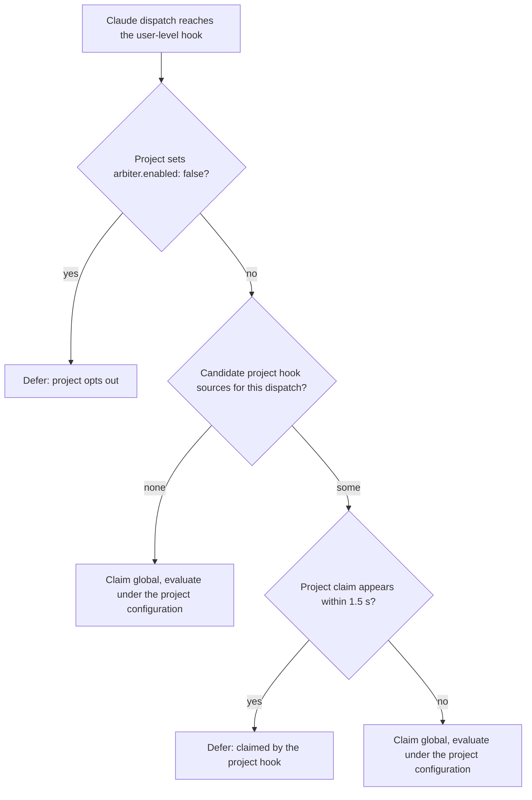

# Kyber Arbiter architecture

The Arbiter is a rule engine that gates Squad delegations and review fan-out. It evaluates
each decision in up to three steps inside the hook process, then gets out of the way: step 2
— the reasoning agent — always runs after the block, outside the Arbiter. Decided by
[ADR 0053](../adr/0053-kyber-arbiter-three-step-decision-gates.md).

## Terminology

This repository has no managed glossary, so the two overloaded names are fixed here:

- **Arbiter** — the feature: the rule engine, the `kyber-weave-arbiter` hook binary, and the
  `kyber-weave arbiter` CLI surface. Commands are `kyber-weave arbiter …`, the binary is
  `kyber-weave-arbiter`, rule ids are `KW-ARB-*`, and the configuration section is `arbiter:`.
  The **MCP server key** is a fourth name and the only one that changed: `kw-arbiter`, taken from
  `McpServerNames.Arbiter` in `src/KyberWeave.Core/Configuration/` rather than restated here. A
  key, an executable, and a CLI verb are three contracts, so they do not share a spelling.
- **JEV** — one decision-model provider behind the Arbiter (TypeSafe's cloud `jev-*`
  models), alongside local Ollama decision models (`nimble`, `tev1`). JEV never names the
  feature.

## Reference material

TypeSafe's skill is linked as reference and nothing more: it is not installed, vendored, or
shipped. Whoever implements the provider client or writes model rules installs it at that
time:

- [TypeSafe's skill](https://github.com/typesafe-ai/skills/blob/main/skills/typesafe-ai/SKILL.md)

## The engine

`ArbiterEvaluator` is the single entry point for the hook host and the offline `eval`
command. For each event it appends a ledger event first — so a hook killed mid-evaluation
still leaves an entry for `audit` — then builds the trigger's facts, runs step 0 over every
enabled rule bound to the trigger, makes at most one batched step-1 provider call, combines
the answers, and appends one decision record.

- **Step 0** (`RuleEngine` over `ArbiterRule` `decide` clauses) uses a closed predicate set:
  `all`, `any`, `not`, `exists`, `equals`, `in`, `matches`, `subset-of`, `intersects`,
  `count`. First match wins; no match is `undecidable`. Path predicates match through the
  review engine's `PathGlob`.
- **Step 1** (`SystemOneClient`) carries every enabled step-1 rule of the trigger whose
  `ask.when` holds in one `POST <endpoint>/systemone` call keyed by rule id. It is skipped
  once step 0 has produced the trigger family's strongest effect (`escalate`, `skip`, or
  `verify`): step 1 can add a red flag but never overturns plain code. Over budget, on
  provider error, or on timeout, answers are `undecidable` — and with provider `none`,
  step-1 rules report not evaluated, which is not `undecidable`.
- **Combination.** Any escalating rule escalates the trigger; signals are never averaged.
  `undecidable` escalates on conductor and investigate triggers and allows on review
  triggers. Non-allow conductor outcomes render an `ArbiterEscalationEnvelope` in the style
  of the Squad's status handoffs; review outcomes render skip/verify/annotation notes for
  code-reviewer.

A trigger's secondary triggers are evaluated behind it, as described in
[Secondary triggers, families and effects](#secondary-triggers-families-and-effects).

Facts come from `TriggerFactBuilder`: the plan parser over `PLAN_FILE` at evaluation time
(nothing cached or written), git snapshots and diffs, the gate report, the ledger, and the
embedded Squad catalog. `HeaderBlock` parses the closed routing-header set
(`KYBER-ARBITER:`, `PLAN_FILE:`, `TASK:`, `LENS:`, `REFUTE:`); `CallerResolver` ranks the
harness payload above the rendered `--caller`, then header inference. Plan and task identity
come from the headers only — never inferred from the plan index.

`PLAN_FILE:` is a repository-relative path. A value that starts with `/`, contains a
backslash, a space or a tab, has an empty or `..` segment, or appears twice is rejected.
A rejected name goes to `HeaderBlock.RejectedNames` with its value discarded, so a header
that was sent and rejected is distinct from one that was never sent: the planner rule
reads it as `delegation.plan-file-rejected`. A second sighting of a name leaves it absent
whichever sighting was valid. On a planner dispatch, a rejected
`PLAN_FILE:` answers `plan-file-invalid` before any body marker is read, so a marker in
the body cannot rescue it.

The hook route fills the facts step 1 reads. All of it runs in `HookGitFacts`, except the
finding, which `TriggerFactBuilder` reads from the prompt:

- **`review.diff-summary`** is each changed path followed by its hunk headers, measured from
  the same base as `review.changed-paths`. It is never shortened: a summary missing the one
  file that makes a lens apply could skip that lens, so an oversized one goes over budget and
  answers `undecidable` instead. It is absent when nothing changed or the base cannot be read.
- **`finding.*`** on a refutation come from the finding block whose `id` equals the `REFUTE:`
  header. A prompt with no such block leaves them absent.
- **`file.surroundings`** is the 20 lines either side of `finding.line`, from the working tree.
  It is absent when the path falls outside the repository, the file is over 16 MiB, or the
  line is past the end of the file.
- **Lens instructions.** `instructions-from: lens:` sends the whole embedded lens file, with
  the lens named by `lens.name` when the rule names none. An unknown lens sends the rule's
  own question.

Limits on those facts:

- A repository-relative `instructions-from` path has no resolver, so such a rule sends its own
  question.
- `arbiter eval` is an offline dry run with no repository state, so these git and file facts
  stay absent there.
- Facts that have no filler yet are listed under [Phase 1 facts](#phase-1-facts). A rule that
  reads one of them answers `undecidable`.

`InFlightLedger` and `DecisionLog` persist `artifacts/arbiter/ledger.jsonl`
(`kyber-arbiter.ledger/v1`) and `artifacts/arbiter/decisions.jsonl`
(`kyber-arbiter.decision/v1`) as append-only lines under one lock file. Only the hook
appends; the CLI only reads. Prompts and code are logged as digests, never in full.
Each step-1 rule entry records what the model scored, so thresholds can be tuned from the log:
`probabilities` (in the rule's answer order; for `noul`, one value for the first answer),
`confidence`, and `threshold`, the floor or ceiling the score was compared against. A score
below its floor is still recorded, beside the `undecidable` it produced. Entries are null when
the answer could not be read, and `probabilities` is null unless every option has a value.

A worker's return reaches the rules through the ledger. The post event records the report's
`RESULT:`, `RED_EVIDENCE:` and `STATUS:` lines, and only a planner return may record
`ATTESTED:`. It pairs with its dispatch by call id, or by a digest of the target and the
prompt with its headers removed, and a specialist's return takes its `TASK` from that dispatch
because its headers were stripped before it ran. On each `delegate`, `ledger.completed-tasks`
is the tasks of this plan whose report read `RESULT: PASS`, `ledger.red-evidence` is present
when this task or one it depends on reported RED evidence, and `ledger.in-flight.paths` is the
files of this session's dispatches that have not returned. A refused dispatch holds no files.
A task counts as complete on its worker's own report: no separate reviewer confirms it.

## The rules

Thirty-two rules ship with permanent `KW-ARB-*` ids, tuned by id through `enabled`,
thresholds, `shadow` where the rule supports it, and per-answer `effects`. Host rules use the
same shape under non-`KW-ARB-` ids and may not use an effect that only a shipped rule may use.

| Rule | Trigger | Step | Question |
|---|---|---|---|
| `KW-ARB-PLAN-001` | `delegate` | 0 | Does `PLAN_FILE` name an artifact with parseable tasks? |
| `KW-ARB-SCOPE-001` | `delegate` | 0 | Does `TASK` name a plan task, and do named paths stay inside its files? |
| `KW-ARB-SCOPE-002` | `delegate` | 1 (`choice`, ≥ 0.8) | Does the delegation ask for work the task does not describe? |
| `KW-ARB-READY-001` | `delegate` | 0 | Are dependencies complete and files clear of work in flight? |
| `KW-ARB-OWNER-001` | `delegate` | 0 | Is the target the named specialist or the file-kind-map owner? |
| `KW-ARB-OWNER-002` | `delegate` | 1 (`choice`, ≥ 0.8) | Which roster specialist owns this task? |
| `KW-ARB-MODE-001` | `delegate` | 0 | In test-first mode, does RED evidence exist first? |
| `KW-ARB-ROSTER-001` | `delegate`, `investigate` | 0 | Is the target in the caller's `delegates-to`? |
| `KW-ARB-PLANREAD-001` | `delegate` | 0 | Does the dispatch send the worker into a plan, specification or todo path? |
| `KW-ARB-DIFF-001` | `delegate.returned` | 0 | Did the delegation change only its task's files? |
| `KW-ARB-GATE-REPORT-001` | `delegate.returned` | 0 | Does the returned digest's `TASK_GATE` line agree with the gate report it names? |
| `KW-ARB-PLANNER-001` | `delegate.planner` | 0 | Is this a recognised planner invocation? |
| `KW-ARB-PLANNER-DIFF-001` | `delegate.planner.returned` | 0 | Did the planner write only plan, spec, and todo directories? |
| `KW-ARB-READONLY-001` | `investigate.returned` | 0 | Did the read-only dispatch leave the tree unchanged? |
| `KW-ARB-LENS-001` | `lens.spawn` | 0, then 1 (`noul`, skip below P 0.1) | Does the lens apply to this change? |
| `KW-ARB-QUOTE-001` | `lens.returned` | 0 | Is each finding's excerpt present at its `file:line`? |
| `KW-ARB-PREEX-001` | `lens.returned` | 0 | Is the excerpt inside a changed hunk? It reads `finding.changed-lines`. |
| `KW-ARB-CLAIM-001` | `refute.spawn` | 1 (`choice`, ≥ 0.9) | Do the quoted code and surroundings support the claim? |
| `KW-ARB-GATE-CORROBORATED-001` | `refute.spawn` | 0 | Does a failed gate already corroborate the finding? |
| `KW-ARB-GATE-001` | `gate.select` | 0 | Does any changed path match the gate's `applies-when.paths`? |
| `KW-ARB-LENS-002` | `lens.spawn` | 0 | Is this lens one that has nothing to judge in a change with no code in it? See [hunk-level lens skipping](../code-review/architecture.md#hunk-level-lens-skipping-kw-arb-lens-002). |
| `KW-ARB-DIFFICULTY-001` | `delegate.model` | 1 (`choice`, ≥ 0.8) | How hard is this task: `easy`, `standard` or `hard`? Governed by `model-targeting.mode`; see [model targeting](#model-targeting-phase-2). |
| `KW-ARB-LADDER-001` | `delegate.model` | 0 | Did the previous attempt fail below the top of the ladder? Governed by `model-targeting.mode`; see [model targeting](#model-targeting-phase-2). |
| `KW-ARB-NITPICK-001` | `lens.returned` | 0, then 1 | Is a lens finding a nitpick or a substantive defect? Shadow. See [phase 3 facts](#phase-3-facts-review-shortcuts-stores-and-comments). |
| `KW-ARB-NITPICK-002` | `refute.spawn` | 0 | Did the nitpick filter drop this finding? Shadow. |
| `KW-ARB-DUP-001` | `refute.spawn` | 1 | Does an earlier finding of this review name the same defect at the same place? Shadow. |
| `KW-ARB-TRIAGE-001` | `triage.shortcut` | 1 | Is this defect a trivial single-site fix that needs no architect? Shadow. |
| `KW-ARB-INTAKE-001` | `intake.shortcut` | 1 | Does this request call for a written plan or a written specification? Shadow. |
| `KW-ARB-DOCIMPACT-001` | `docs-impact.shortcut` | 0, then 1 | Does this change need no documentation change? Shadow. |
| `KW-ARB-FAILURE-001` | `delegate.failure` | 0, then 1 | Is the current rework failure the same failure as the previous attempt of its cluster? Shadow. |
| `KW-ARB-TRIM-001` | `sections.select` | 1 | Does this section of a document bear on the task? Shadow. |
| `KW-ARB-COMMENT-001` | `comment.triage` | 1 | Is this bot review comment a real defect, a nitpick, or already fixed? Shadow. |

**The plan-read ban is enforced at dispatch (`KW-ARB-PLANREAD-001`).** Workers treat their dispatch
packet as their whole context and do not open plan or specification files, and until this rule the
only enforcement was a Read guard — advisory wherever a harness's hooks are. On a `delegate` trigger
the rule removes the routing header block, then asks whether what remains names a path under
`config.planning-dirs`; if it does, the dispatch escalates. The header is removed first because that
block names the plan by design, so a rule reading the raw prompt would fire on every dispatch. A
documentation-profile target answers `closeout` and is allowed, because a `docs-dev` dispatch that
names the plan while archiving it is the correct behaviour. The rule shares one detector with the
authoring-time prompt check (`KW-DOC-TASKS-005`), so the two cannot drift apart, and it may not fire
where dispatch hooks are unconfirmed: a harness with no hook runs no rule, and a decision claiming
otherwise would report a check that never executed ([ADR 0053](../adr/0053-kyber-arbiter-three-step-decision-gates.md),
decision 23).

**A claimed gate result is checked against the report it names (`KW-ARB-GATE-REPORT-001`).** A worker
ends its task with a `TASK_GATE:` line naming the report its gate run wrote, and until this rule
nothing read that path at task end: the fact existed and only the review council consumed it. On a
`delegate.returned` trigger the rule reads the named report — an absolute path from a worktree
worker, or one resolved against the event's working directory — and answers three ways. `verified`
means the claim was `PASS` and the report corroborates it: at least one gate passed and none failed.
`disagrees` means the report contradicts the claim, and it includes a claim no report can back — any
status other than `PASS`, and a `PASS` over a run whose every gate was not applicable, because a
skipped gate is evidence neither way (`KW-REVIEW-026`). `missing` means the claim names no readable
report, or the return carries no claim at all. Only `verified` allows; the other two escalate, because
a claim whose evidence cannot be found is exactly the case the rule exists for. The comparison spans
two facts — the claim and the report — which the closed step-0 predicate set cannot express, so
`GateReportFacts` makes it and the rule reads a single boolean. Where a harness cannot observe returns
the post-dispatch hook never fires and the rule cannot run; the end-of-run gates catch that case
instead, and no decision claims otherwise.

**Changed paths are committed plus dirty, and an empty set is not Markdown-only.** `review.changed-paths`
is the review base against the working tree — the committed diff plus the dirty tree, computed by
`GitFacts.GetChangedPathsSinceBase` — not the dirty list alone. Per-task commits are the normal case
in a Squad run, and a dirty-only basis made a committed change invisible, so `KW-ARB-LENS-001` saw an
empty set, treated it as "no code to judge", and skipped `correctness` and `test-adequacy` exactly
when the run started committing each task. The rule now skips those two lenses only when the set is
non-empty **and** positively Markdown-only, so a tree the Arbiter cannot read is judged rather than
skipped (ADR 0053, decision 9). `KW-ARB-PLANNER-DIFF-001` evaluates `git.changed-paths.since-dispatch` on `delegate.planner.returned` — computed by `HookGitFacts` against the pre-dispatch snapshot via `GitFacts.GetChangedPathsSinceSnapshot` and left absent when git cannot observe the repository — so an empty planner diff allows while out-of-scope writes or unobservable git state escalate.

Two answers are return-dependent: on a harness whose adapter declares returns unobservable
(today only Antigravity), `READY-001`'s completion check and `MODE-001`'s RED check answer
`returns-unobservable`, which allows and is logged. The in-flight overlap check finds nothing
there, because a dispatch that never reports back would otherwise hold its files for the
whole session.

Diagnostics are permanent too: `KW-ARB-CONFIG-001`…`-015` and `KW-ARB-INSTALL-001`
for configuration and scope validation (`-012` to `-015` cover model targeting, the store
limits, the bot logins and the savings-only keys), `KW-ARB-MODEL-001` for a missing or stale
model targets file, `KW-ARB-KEY-001` for a missing key,
`KW-ARB-LOG-001` for an un-ignored log directory,
`KW-ARB-BIN-001` for a missing binary, `KW-ARB-GUARD-001` for undeclared planning indexes,
`KW-ARB-PARSE-001`/`-002` for plan parsing, `KW-ARB-AUDIT-001`…`-004` for the ledger audit,
and `KW-ARB-HOOK-001` for a fail-closed hook error. See the
[rule reference](../ci-pipelines/rule-reference.md).

**Hook guards sit beside the read guard, outside the rules.** `ReadGuard` (the worker plan-read guard) and
`ConductorGuard` are stateless checks that run in a harness hook and write no ledger event. On Claude,
`ArchitectShellGuard` (`KW-ARB-SHELL-001`) joins them: it denies an architect `Bash` or `PowerShell` call
outside the command set `architect.md` documents, before the call runs. It is not a shipped rule, because the
rule engine evaluates dispatch triggers only, every decision becomes a ledger event, and a shell call has no
claim key, so a global and a project hook could both record one call. Hosts cannot tune or disable a guard by id; the only off switch is `arbiter.enabled: false`, which turns the whole
Arbiter off, and with it the guard. The rule-engine count above is unchanged. See the [runbook](runbook.md#the-architect-shell-guard) and
[ADR 0071](../adr/0071-the-arbiter-enforces-the-architect-shell-allowlist-on-claude.md).

## Secondary triggers, families and effects

Every trigger belongs to one family. `ArbiterTriggerFamilies` fixes the effects the family's
rules may use, the effect an `undecidable` answer maps to, and how the answers combine. A host
cannot change any of it.

| Family | Triggers | Effects its rules may use | `undecidable` maps to | Combines to |
|---|---|---|---|---|
| Conductor | `delegate`, `delegate.returned`, `delegate.planner`, `delegate.planner.returned` | `allow`, `escalate` | `escalate` | `escalate` when any rule escalates |
| Investigate | `investigate`, `investigate.returned` | `allow`, `escalate` | `escalate` | `escalate` when any rule escalates |
| LensSpawn | `lens.spawn` | `allow`, `skip` | `allow` | `skip` when any rule skips |
| RefuteSpawn | `refute.spawn` | `allow`, `verify`, `drop`, `duplicate` | `allow` | `verify`, else `drop`, else `duplicate`, else `allow` |
| LensReturned | `lens.returned` | `allow`, `annotate`, `drop` | `allow` | `annotate` when any rule annotates (a `drop` on the same finding is then suppressed and logged), else `drop`, else `allow` |
| Gate | `gate.select` | `applies`, `not-applicable` | `applies` | `applies` when any rule applies |
| ModelTarget | `delegate.model` | `keep`, `retarget` | `keep` | `retarget` when any rule retargets, else `keep` |
| Shortcut | `intake.shortcut`, `triage.shortcut`, `docs-impact.shortcut` | `spawn`, `answer` | `spawn` | `answer` only when every rule answers `answer`, else `spawn` |
| FailureCluster | `delegate.failure` | `allow`, `same-failure` | `allow` | `same-failure` when any rule answers it, else `allow` |
| Advice | `sections.select`, `comment.triage` | `keep`, `advise` | `keep` | `advise` only when every rule advises, else `keep` |

The catalogue also accepts the family names `model.target`, `shortcut`, `failure.cluster` and
`advice` as trigger names. Phase 1 emits none of them.

Phase 1 catalogued the seven new triggers and their facts. Since phase 2, `SecondaryTriggers.For`
derives `delegate.model` from every `delegate` event whose target is an implementation-class agent.
Phase 3 adds four more derivations from the same event: `delegate.failure` for an implementation
dispatch carrying a `FAILURE-CLUSTER:` marker, `triage.shortcut` for a `bug-crusher` investigate of
`bug-crusher-investigator`, `intake.shortcut` for a planner dispatch carrying the `INTAKE:` marker,
and `docs-impact.shortcut` for a `docs-dev` dispatch carrying the `DOCS-IMPACT: true` line. The two
remaining phase 3 triggers have no dispatch: `sections.select` comes from the section tool and
`comment.triage` from the comment tool. Every trigger can be dry-run offline with `arbiter eval --trigger <t>`.

A non-allow outcome on a red-flag family is what ends the step-1 call early. The
short-circuit signal is unchanged: `escalate`, `skip` and `verify` only. The new effects never
short-circuit, because each removes or changes work and must come from the rule that produced it.

**Secondary triggers.** A secondary trigger is derived from the primary trigger of the same event,
never classified from its own payload. The evaluator takes the derivation as
`SecondaryTriggers.For(primaryTrigger, ev)`. It returns `delegate.model` for a `delegate` dispatch to
an implementation-class target and nothing for any other dispatch, so those evaluate their primary
alone. When a derivation returns one, the evaluator:

1. skips the secondary when the primary's step 0 already short-circuits, and makes no step-1 call;
2. otherwise sends the primary's and the secondary's step-1 questions in one provider call;
3. keeps the primary outcome as the event outcome, lists each secondary outcome beside it in the
   dispatch's `Secondary` list, and writes one decision record per secondary, carrying
   `primary-ledger-id` back to the primary record;
4. delivers a secondary outcome only when the primary outcome is `allow`. Otherwise each secondary
   rule is recorded as neutral, with `would-effect` and the evidence `suppressed: primary <outcome>`.

**Over budget (known gap).** When a batch that includes secondary questions returns `error` or
`over-budget`, the evaluator sends the primary questions again alone. One event can therefore make
two provider calls. The design's split, which removes the secondary questions first and keeps one
call, is not implemented in phase 1.

## Phase 1 facts

These facts are filled on the hook path. Each is `derived` unless noted.

- **`review.changed-hunks`** on `lens.spawn`, `lens.returned` and `refute.spawn`: the ordered
  `{path, old-start, old-count, start, count}` ranges of the change, measured from the review base
  against the working tree, untracked files read whole. Never shortened. Absent offline and when
  the base cannot be read.
- **`review.comment-only-paths`**: a path is comment-only when every one of its hunks is
  comment-only under [`CommentSyntax`](#hunk-comment-syntax).
- **`review.rename-only-paths`**: paths whose only change is a rename at 100% similarity.
- **`review.no-code-change-paths`**: the union of comment-only paths, rename-only paths and changed
  `*.md` paths. A code change must never land in it.
- **`finding.changed-lines`** on `lens.returned`: the new-side line numbers of `finding.file` that
  fall inside a changed hunk. Absent without a finding file. `KW-ARB-PREEX-001` reads it.
- **`harness.model-override`** on `delegate.model`: the dispatch field that carries a sub-agent's model,
  as the harness's adapter declares it (`model` on Claude). Null where the harness offers no
  per-dispatch model.

Phase 2 fills the `delegate.model` facts: `delegation.model`, `plan.task.file-kinds`,
`ledger.task.prior-attempt`, `model-targeting.ladder.next`, `model-targeting.prior-result` and
`model-targeting.prior-profile` (see [model targeting](#model-targeting-phase-2)). Still catalogued but
not filled, so a rule that reads them answers `undecidable`: `gates.report`. Phase 3 fills
`finding.severity`, `finding.gate-corroborated`, `review.prior-findings`, `file.text-at-line` (comment
triage), the failure, comment, section and docs facts. See [phase 3 facts](#phase-3-facts-review-shortcuts-stores-and-comments).

### Hunk comment syntax

`CommentSyntax` keys comment rules by file extension. A file is comment-only when every added and
removed line of every hunk is blank, is a line comment, or lies inside a block comment that opens
and closes in the same hunk. A `*` continuation line counts only inside such a block, so `*p = x`
in C, Go or Rust stays code. An unknown extension, an empty hunk or any code line is not
comment-only.

| Line comment | Block comment | Extensions |
|---|---|---|
| `//` | `/* … */` | `.c` `.h` `.cc` `.cpp` `.cxx` `.hpp` `.cs` `.java` `.kt` `.kts` `.swift` `.go` `.rs` `.ts` `.tsx` `.js` `.jsx` `.mjs` `.cjs` `.scala` `.dart` |
| `#` | none | `.py` `.sh` `.bash` `.yml` `.yaml` `.toml` `.rb` |
| `#` | `<# … #>` | `.ps1` `.psm1` `.psd1` |
| `--` | none | `.sql` `.lua` |
| none | `<!-- … -->` | `.html` `.htm` `.xml` `.xaml` `.csproj` `.props` `.targets` |

## Phase 3 facts: review, shortcuts, stores, and comments

Phase 3 adds nine rules. All nine ship with `shadow: true`: each is evaluated and logged with the
effect it would have had (`would-effect`), and the host sees no effect until the rule is enforced
by setting `shadow: false` under `arbiter.rules`. The rules are `KW-ARB-NITPICK-001`,
`KW-ARB-NITPICK-002`, `KW-ARB-DUP-001`, `KW-ARB-TRIAGE-001`, `KW-ARB-INTAKE-001`,
`KW-ARB-DOCIMPACT-001`, `KW-ARB-FAILURE-001`, `KW-ARB-TRIM-001` and `KW-ARB-COMMENT-001`.

- **Nitpick filter (`KW-ARB-NITPICK-001`, `-002`).** A `Critical` lens finding, or one a failed gate
  corroborates, is substantive without a question. Any other finding is asked once, and only a
  confident `nitpick` (≥ 0.85) drops it. A drop never blocks: after the lens returns, the hook adds
  `ARBITER_DROPPED: <id> rule=KW-ARB-NITPICK-001 decision=<id>`. A refutation of a dropped finding is
  skipped (`-002`, effect `verify`).
- **Duplicate findings (`KW-ARB-DUP-001`).** The candidates are the earlier findings of the same review
  in the same file within 20 lines, at most three, oldest first. The first candidate answered
  `same-defect` at ≥ 0.9 makes the refutation a duplicate: it is denied with
  `ARBITER_DUPLICATE: <id> of <earlier id> decision=<id>`. Lens and refute dispatches identify their
  review with a `REVIEW_RUN: <id>` header, so the findings of one review share a store.
- **Run stores (`<arbiter-dir>/stores/`).** Finding text and worker failure text are held in stores
  under `<arbiter-dir>/stores/`, outside the decision log and the ledger. A review store is keyed by a
  digest of its `REVIEW_RUN` id. A failure store is keyed by the plan file and its content digest, or by the
  session when there is no plan. Each item is one JSON line. An item over
  `arbiter.stores.max-item-bytes` is refused as `TooLarge` and never shortened. Defaults are 16384 bytes
  and 14 days (`ArbiterStoreOptions`). Retention is best-effort: each append removes sibling store
  directories whose newest file was last written more than `retain-days` ago (a directory with no
  file falls back to its own write time), so an active run appended to in place is not swept.
  `retain-days` is clamped to 1 through 3650 when swept. A write failure is reported as
  `Unavailable`, never thrown.
- **Triage, intake and docs-impact shortcuts (`KW-ARB-TRIAGE-001`, `-INTAKE-001`, `-DOCIMPACT-001`).**
  An answered shortcut withholds its worker: the dispatch is denied with a substitute digest, and the
  caller takes that digest as the result. The triage digest carries `VERDICT: TRIVIAL` and
  `ARBITER_DECISION: <id>`. The intake digest is `STATUS: INTAKE_RECOMMENDATION` with `RECOMMENDATION`
  set to `PLAN` or `SPEC`. The docs-impact digest is `DOCS_REVIEW: no doc change with justification`
  with `RECOMMENDATIONS: none`. A docs change that touches a governed path always keeps the dispatch,
  and the provider is not asked. Each shortcut is derived only from its marker, as described under
  secondary triggers.
- **Same-failure advisory (`KW-ARB-FAILURE-001`).** A rework dispatch carries `FAILURE-CLUSTER: <key>`
  as its first body line and a `FAILURE:` section. The first failure of a cluster is only recorded.
  A later failure the rule judges `same` returns `ARBITER_SAME_FAILURE: yes prior=<id> decision=<id>`
  as an advisory with the dispatch allowed. It never denies, and it is the signal to escalate sooner.
- **Section trimming (`KW-ARB-TRIM-001`, `arbiter_select_relevant_document_sections`).** The section
  selector lists the sections of one repository markdown document (at most 1 MiB) and asks about each
  candidate. Only a confident (≥ 0.9) `not-relevant` answer trims a section, and any unsure answer keeps
  it. With no provider every section is listed. When the provider is unsure or fails, every section is
  listed and the result is marked `failedSafe`. The same selector runs as `kyber-weave arbiter sections --path <FILE> --task <TEXT>`.
- **Bot review comments (`KW-ARB-COMMENT-001`, `arbiter_classify_bot_review_comment`).** One comment is
  classified as `real`, `nitpick` or `already-fixed` against the code at the cited line as it is now
  (≥ 0.85). Anything unsure, below the floor, or not obtained stays `real`, so the comment is fixed.
  Each call records a decision and returns its id. While the rule is in shadow the class handed back is
  always `real`; the result carries `shadow` and `wouldClass`, the class the model gave (null when it gave none). The CLI form is
  `kyber-weave arbiter comment --path <FILE> --line <N> --body <TEXT> [--commit-sha <SHA>]`.
- **Bot summary tables (summary mode).** A bot's PR-level summary comment has no inline thread. With
  `summary: true` (CLI `--summary`), `body` is that summary and each row of its first findings table
  (`Severity | File | Line | Issue`, matched by header name) is classified through the same rule. The
  `author` parameter (CLI `--author`) decides whether any row is classified: only a login listed in
  `arbiter.comment-triage.bot-logins`, or one ending `[bot]`, is classified. Callers always pass
  `author`. Every other row is `real` with no provider call. At most 50 rows (`MaxSummaryRows`) are
  classified per call; rows past that are `real` and unasked. A table that cannot be read in full
  (no table, or any malformed data row) yields no items, and the caller keeps the rows `real`. Each
  classified row records its own decision, and while the rule is in shadow every row is `real` with `shadow` and `wouldClass` beside it. An absent `author` is never treated as a bot, so every row
  is `real`. As built, the per-row fixing-commit check of Requirement 20.5 is not delivered: summary
  rows reach the rule with no commit, so an `already-fixed` answer for a summary row rests on the model
  alone.
  `comment-triage.bot-logins` is read by the triage service on both the served tool and the CLI
  ([configuration](../configuration.md#savings-keys)). With no logins configured, no summary row is
  classified.
- **Evidence lines (log-only, never a drop).** A decision record's notes carry `review-run-missing:` when
  a lens dispatch has no `REVIEW_RUN` header, and `findings-over-cap:` with the count when a return
  carries more findings than the 64-question budget. The findings past the budget are kept, not dropped.
- **Not filled.** `gates.report` is catalogued but no filler sets it, so any rule that reads it
  answers `undecidable`.

## Shadow and the model-targeting switch

**Per-rule shadow.** A host sets `shadow: true` or `shadow: false` on a shipped rule under
`arbiter.rules`. A shadowed step-1 rule is evaluated and logged in full. Its entry records
`shadow: true` and the effect it would have had as `would-effect`. The combined outcome uses the
family's neutral effect (`keep`, `spawn`, `allow`), so no adapter ever sees a shadowed effect.
Phase 1 shipped no rule in shadow. Phase 3 ships nine rules in shadow, listed under [phase 3 facts](#phase-3-facts-review-shortcuts-stores-and-comments); `KW-ARB-LENS-002` enforces.

**Model-targeting switch.** `arbiter.model-targeting.mode` is `off`, `shadow` (the default) or
`enforce`. It owns the shadow state of `KW-ARB-DIFFICULTY-001` and `KW-ARB-LADDER-001`. A `shadow`
override on either one fails `KW-ARB-CONFIG-014`, so there is one switch to read. `off` disables both
rules. `shadow` evaluates and logs them and delivers nothing. `enforce` lets a retarget reach the
dispatch. The mode also controls the `KW-ARB-MODEL-001` doctor check.

## Fail-safe points

| Situation | Result | Recorded as |
|---|---|---|
| Provider `none`, error, over budget, below floor, or undecidable | The family's neutral effect, as before | The existing provider status and `undecidable` |
| Primary outcome not `allow` | Secondary not delivered | `would-effect` and the evidence `suppressed: primary <outcome>` |
| No hook and no `serve` call | Nothing runs, nothing logged | None |
| `serve` call | Outcome labelled advisory | `source: serve` |
| Invalid new configuration | **Known gap.** The config loader throws on an invalid `arbiter:` key, so the hook fails closed for the whole hook with `KW-ARB-HOOK-001`. The design intended to skip only the affected rule. | `validate` and `doctor` name `KW-ARB-CONFIG-012` to `-015` |
| Model targets table missing or unreadable | The dispatch is kept on its model | `model.reason: model-targets-unreadable`; `KW-ARB-MODEL-001` at doctor time |
| Claude model write throws | The dispatch runs with its routing header stripped and no model field | `delivered: false`, `model.reason: model-write-failed`; hook log line `model-write-failed` |
| Run store write fails | The store reports `unavailable` and never throws; the append is best-effort | The store status; see [phase 3 facts](#phase-3-facts-review-shortcuts-stores-and-comments) |

## Model targets

Squad resolves each profile to its model token at render time and writes one table per hooked
target. The hook host never resolves a profile itself. `ArbiterModelTargetsFile` in
`KyberWeave.Core.Squad` builds the table with `ResolveToken`, and `ArbiterModelTargets.TryRead` in
Core parses it with no Squad types. Resolution happens at render time because the hook host cannot
reference the Squad assemblies, and the bundled model matrix is not on disk at hook time
([ADR 0053](../adr/0053-kyber-arbiter-three-step-decision-gates.md), decision 27).

| Scope | Path | Written when |
|---|---|---|
| Project | `artifacts/arbiter/model-targets.<harness>.json`, under the project root | The Arbiter is enabled and the scope is project |
| Global | `~/.kyber-weave/arbiter/model-targets.<harness>.json`, under the user's home directory | The Arbiter is enabled and the scope is global |
| Instance | None | Never. Targeting keeps every model. |

A table is written for every hooked target, whatever the `model-targeting.mode` value. Warp and
ZCode are fallback-only and get none.

```json
{
  "schema": "kyber-arbiter.model-targets/v1",
  "harness": "claude",
  "preset": { "name": "work", "digest": "…" },
  "bundle-digest": "…",
  "profiles": { "fast": "claude-haiku-5-5", "general": "claude-sonnet-5-5", "architect": "opus" },
  "agents": { "csharp-dev": { "profile": "general", "token": "claude-sonnet-5-5" } }
}
```

- `preset.name` is `bundled` when no preset is applied.
- `profiles` holds the token for each profile; `null` where a profile resolves to `inherit` or is
  undefined. `agents` holds each rendered agent's profile and the token it was rendered with.
- `ArbiterModelTargets.SchemaName` is the constant `kyber-arbiter.model-targets/v1`. The instance
  property `Schema` holds the id the file declares.
- `TryRead(arbiterDirectory, harness)` fails closed. An absent, unreadable, malformed file, a
  different schema id, or a different harness returns null. It never throws.
- `kyber-weave squad preset use` and `squad preset clear` rewrite the table in the same pass as the
  agent files, so the table cannot lag the agents.

## Per-dispatch model

`IHarnessHookAdapter.ModelOverride` declares whether one dispatch can name its own model. It gives
the supported flag, the field that carries the model, the accepted value forms and the vendor
source. The default is unsupported, so an adapter must declare support from vendor documentation.

Only the Claude adapter declares support: the `model` field on the `Agent` input, with the aliases
`sonnet`, `opus`, `haiku` and `fable`. Phase 2 uses that declaration to write the model: see
[model targeting](#model-targeting-phase-2) for the alias rule and the delivery write.

The declaration is also copied into the `harness.model-override` fact. The
[harness facts table](#harness-facts) has a "Per-dispatch model" column with each harness's
verdict and its source.

## Model targeting (phase 2)

The Arbiter can point a `delegate` dispatch at a different model: a cheaper profile for an easy task, or
one rung up the ladder after a failed attempt. It only retargets. No model call picks the profile, except
that `KW-ARB-DIFFICULTY-001` is a step-1 rule and asks the decision model its question as every step-1
rule does.

**Eligibility.** Only an implementation-class target reaches `delegate.model`. `ArbiterSquadCatalog.TargetClassFor`
maps the `worker`, `publishing-worker` and `documentation` capability profiles to `implementation`. A planner classifies as
`delegate.planner`, a reviewer and every other caller as `investigate`, and an unidentified target as
`not-squad`. So bug-crusher's dispatches to specialists are not retargeted in this version.

**Profile choice.** Each `delegate.model` decision resolves one target in this order:

1. If `KW-ARB-LADDER-001` wants a retarget and `model-targeting.ladder.next` exists, its profile is the
   target (source `ladder`).
2. Otherwise, if the prior attempt failed, there is no target and no `model` block. A failed retry is never
   sent to a cheaper profile by difficulty, so this holds even when `KW-ARB-DIFFICULTY-001` wants a retarget.
3. Otherwise, if `KW-ARB-DIFFICULTY-001` wants a retarget, its answer `easy`, `standard` or `hard` maps
   through `model-targeting.difficulty-profiles` (source `difficulty`). Difficulty therefore applies only on a
   first attempt or after a pass.
4. Otherwise there is no target and no `model` block.

A rule wants a retarget when it is enforced to retarget, or when it is in shadow and its would-be effect
is a retarget. Shadow therefore still records the choice the enforced mode would make.

The target then passes the reason steps in order. The first step that holds sets `model.reason` and stops
delivery:

| Reason | Set when |
|---|---|
| `caller-named-model` | The dispatch already names a model; the Arbiter does not change it |
| `model-targets-unreadable` | The harness's model targets table is absent, unreadable or not a valid v1 table |
| `no-token` | The targeted profile has no token in the table |
| `same-as-rendered` | The token equals the one the target agent is already rendered with |
| `unsupported-harness` | The harness declares no model override field |
| `token-not-accepted` | The harness has an override field but would not write the token: it is neither an accepted alias nor a full `claude-<family>-...` id of an accepted family |
| `shadow` | `model-targeting.mode` is `shadow`; the choice is recorded only |

With no reason, the hook path asks the Claude adapter to write the token before the decision is recorded.
The record's `delivered` is `true` only when that write held. A write that throws is recorded afterwards as
`delivered: false` with reason `model-write-failed`. See [Delivery](#model-targeting-phase-2) below.

**Ladder.** `KW-ARB-LADDER-001` decides from the ledger alone, in this order: `returns-unobservable` when
the harness cannot observe returns; `first-attempt` when there is no prior attempt or it passed;
`profile-unrecorded` when the failed attempt's profile was not recorded; `top-of-ladder` when no rung
is above it; otherwise `step-up`, the only answer that retargets. Every answer except `step-up` keeps the model,
and a failed prior attempt that does not step up also blocks the difficulty answer (see the profile choice above).
Two catalogued facts feed the rule from the same prior attempt: `model-targeting.prior-result` (`pass` or `fail`)
and `model-targeting.prior-profile`. No model call is made.

The ledger's `delegate` pre events record `model-profile`, `model-token` and `model-source`. They are absent on
other triggers. `model-source` is:

- `caller` when the caller named a model. That model is the token, and no profile is recorded.
- `rendered` when a rendered token is known: one already on the event, or else the token of the target's
  entry in the model targets table. The profile and token come from that entry.
- `unknown` otherwise, including an entry whose token is null.

`same-as-rendered` is reachable: when the event carries no rendered token, the rendered token is the target
agent's table entry, so a retarget to a profile whose token equals it is kept.

**Delivery (Claude only).** The Claude adapter writes the model in the same `updatedInput` that strips
the routing header from `prompt`. Every other tool-input field is copied unchanged. The written `model`
value follows the alias rule:

- An accepted alias (`sonnet`, `opus`, `haiku`, `fable`) is written as it is.
- A full id whose family is an accepted alias (`^claude-(haiku|sonnet|opus|fable)-`) writes the family
  alias, and the hook log records `model.reason: alias-derived (<token> -> <family>)`.
- Any other token is not written. The decision records `delivered: false` with reason `token-not-accepted`,
and no model field is written.

On the hook path the decision asks the adapter to write before it records `delivered`, so the record says
`true` only for a write that held. The hook log records `model: <alias>; delivered: true` on a write. When the
write throws, the decision records `delivered: false` with reason `model-write-failed`, the hook log records
`model-write-failed: <message>; delivered: false`, and the dispatch runs with its routing header stripped and no
model field for every target. Other harnesses have no model override in this phase, so a
retarget there records `unsupported-harness` and nothing is written.

**`delivered` is a claim about the write, not the run.** Claude documents settings that override the
requested model, such as an installed `agent.spawn` hook and `CLAUDE_CODE_SUBAGENT_MODEL_FORCE`. A
`delivered: true` therefore shows the field was written, not that the model ran.

The `model` block is written on the decision record. `arbiter tune` reads the profile and delivered
flag from it; see the [runbook](runbook.md#tuning-thresholds-arbiter-tune).

**Serve path.** The `serve` call (the MCP evaluation tool used when no hook fires) never writes a model.
Its outcome is labelled advisory, and a would-be retarget is reported as one line:

```text
advisory (source: serve): would retarget to profile <profile> token <token> (reason: <reason>). Not written: the serve path changes no model.
```

Such a decision records `source: serve`.

## Decision record fields in phase 1

Each decision record in `decisions.jsonl` carries the existing fields plus these phase 1 additions.
Each is omitted when it has no value.

- `model`: an object, `{profile, token, rendered-token, source, delivered, reason}`, written on a
  `delegate.model` decision that resolved a target. Null fields are omitted. It records what the
  dispatch was pointed at, not a model that ran. This replaces the phase 1 string, which
  named the decision model. (Phase 2 introduced this object; it is not a phase 1 field.)
- `substitute`: a boolean. The design's structured `{kind, digest}` object is deferred. No code
  path writes `substitute` in phase 1.
- `primary-ledger-id`: on a secondary-trigger record, the ledger id of the primary record. No
  secondary trigger is derived in phase 1, so no record carries it yet.
- `duplicate-of`: a string on a `duplicate` outcome. No phase 1 rule produces a `duplicate`, so
  no record carries it yet.
- Per rule: `shadow` (boolean, set on shadowed rules), `would-effect` (the suppressed effect), and
  `candidate` (one `for-each` expansion). No phase 1 shipped rule uses `for-each`.

## Configuration

The `arbiter:` section is merged by `ArbiterConfigLoader` into the host configuration; with
no section the Arbiter is disabled, the provider is `none`, and all shipped rules are
enabled. A host may tune a shipped rule's `enabled`, confidence/probability threshold, and
`effects`, and set `shadow` on the rules that support it. Anything else is a hint to add a host rule. The per-user
`~/.config/kyber-weave/arbiter.yml` override may hold `provider:` and nothing else. The key
never appears in any configuration file: `ArbiterKeyResolver` reads `TYPESAFE_API_KEY`,
then the OS credential-store entry for the endpoint origin. Full shape and merge rules are
in [configuration](../configuration.md).

The install surface defaults to global scope. `kyber-weave arbiter install --target <t>`
stores the target list in `~/.kyber-weave/kyber-weave.yml` under `arbiter.global.targets`,
while `--project` opts into repository scope and `--path` is valid only with that flag. The
When the project config has `arbiter.enabled: true`, the global runtime hook decides by harness. For
Claude it evaluates the dispatch under the project's configuration unless the project opts out or a
project hook covers it ([the user-level Claude hook](#the-user-level-claude-hook)). For every other
harness it emits `deferred-to-project`, leaves the ledger untouched, and the project's own hooks decide.
Without a project config the user-level check is used, and the per-root ledger stays under
`~/.kyber-weave/arbiter/projects/<root-key>/`.
Declaring `arbiter.global` inside a repository configuration file is rejected as `KW-ARB-CONFIG-011`.
Passing mutually exclusive scope flags (`--global` and `--project`) or `--path` without
`--project` fails with client-input exit code `2` and `KW-ARB-INSTALL-001`.

## Provider and models

`SystemOneClient` speaks the same `/v1/systemone` API to TypeSafe's cloud, to OpenRouter, and
to a local Ollama 0.35 or later. Provider `none` is the default, and step 1 is then not evaluated.

| Model | Endpoint | Key | Usable input | Accuracy on Ollama's 3,880-decision comparison |
|---|---|---|---|---|
| `jev-1.14.0` (TypeSafe, default) | `https://api.typesafe.ai/v1` | Required (`TYPESAFE_API_KEY` or the credential store) | 32,000 tokens for the state plus the longest question | Not published |
| `jev-1.13.0` (TypeSafe) | `https://api.typesafe.ai/v1` | Required (`TYPESAFE_API_KEY` or the credential store) | 32,000 tokens for the state plus the longest question | 76.0% |
| `typesafe/jev-1.14`, `typesafe/jev-1.13` (OpenRouter) | `https://openrouter.ai/api/v1` | Required (the credential store) | The same budget as the TypeSafe ids | Not published |
| `nimble` (Ollama, 9B) | `http://localhost:11434/v1` | None | About 8,000 tokens per question | 74.8% |
| `tev1` (Ollama, 4B) | `http://localhost:11434/v1` | None | About 2,000 tokens | 73.3% |

`setup` suggests `nimble` when Ollama is detected and warns against `tev1`, whose input is
too small for most shipped rules. The figures are from Ollama's own benchmark, as cited in
[Ollama's Jev-style decision models post](https://ollama.com/blog/ollama-now-supports-jev-style-decision-models).
Each request is budgeted before it is sent. An over-budget state makes no call, and every
step-1 rule on the trigger answers `undecidable`.

### Step-1 threshold measurement

The shipped step-1 thresholds were measured on 2026-11-09 for Jev 1.13 and Jev 1.14. TypeSafe
publishes no accuracy or calibration comparison between the two, so the figures below are
this project's own.

**Method.** 120 invented cases, 30 for each of the four step-1 rules, in
`tests/KyberWeave.Tests/Fixtures/arbiter-calibration/cases.jsonl`. Two Claude models labelled
them independently and agreed on all 120; no person reviewed them. Each case went through the
production request builder, over OpenRouter, as `typesafe/jev-1.13` and `typesafe/jev-1.14`,
in four full runs. A direct TypeSafe run was not made, so OpenRouter and TypeSafe were not
compared.

**Result.** No threshold changed.

- `KW-ARB-SCOPE-002`, `KW-ARB-OWNER-002` and `KW-ARB-CLAIM-001`: no wrong answer cleared its
  floor on either model in any run, so the floors stay at 0.8, 0.8 and 0.9. Accuracy was 29 or
  30 of 30 per rule. Of 30 answers, Jev 1.14 cleared the floor on 24 (`SCOPE`), 26 to 28
  (`OWNER`) and 22 or 23 (`CLAIM`). Jev 1.13 cleared it on 22 or 23, 19 to 21 and 23 to 25.
- `KW-ARB-LENS-001`: the ceiling stays at 0.1. No lens that applies was skipped at 0.1. The
  rule written before the measurement proposed raising it to 0.6 or 0.63, and that was not
  adopted. A repeat run scored an applying lens at 0.55 on Jev 1.14. Without the diff summary,
  every lens scored between 0.12 and 0.45 on both models, so a ceiling of 0.6 would skip all
  of them.

Confidence on one case can differ noticeably between the models (0.89 and 0.67 on the same
case), so a floor set for one model is not assumed to hold for another.

**Model ids.** `tuned-for` is an exact match and holds TypeSafe's `jev-1.14.0` and
`jev-1.13.0`, and OpenRouter's `typesafe/jev-1.14` and `typesafe/jev-1.13`, the ids the
measurement used. Any other `typesafe/` id, including a dated snapshot, warns in `doctor`.
The state budget for a `typesafe/jev-1.*` id is TypeSafe's published limit; OpenRouter's own
limit was not checked, and the measured cases were small. `jev-1.13.0` stays listed, and a configuration pinned to it keeps working with no
`doctor` warning. [TypeSafe says](https://typesafe.ai/blog/jev-1-14) it intends to give
60 days' warning before formally deprecating `jev-1.13.0`, and has set no date. Only a
configuration that names no model moves to the new default.

**Limits.**

- 30 cases per rule is small: one error is about 3%.
- The measurement sent no lens text, and production now sends the whole lens file, so
  `KW-ARB-LENS-001`'s ceiling of 0.1 has not been measured against what it now reads. The
  harness now sends that text too, so a repeat run measures it.
- `jev-1.13-free` does not appear in TypeSafe's models page, changelog or Jev 1.14 post.

To repeat the measurement, set `KW_ARBITER_CALIBRATE_OUT` to a new output file and run
`ArbiterCalibrationTests`. It makes paid calls, about one cent per run. By default it calls
TypeSafe directly with `jev-1.13.0` and `jev-1.14.0`. To repeat the runs reported here, also
set `KW_ARBITER_CALIBRATE_ENDPOINT` to `https://openrouter.ai/api/v1` and
`KW_ARBITER_CALIBRATE_MODELS` to `typesafe/jev-1.13,typesafe/jev-1.14`.

## Harness facts

One table covers every harness at project scope. Phase 1 hooks Claude, Copilot in VS Code, Copilot CLI and
OpenCode; Phase 2 adds Pi, Codex and Cursor; Phase 3 adds Kilo, Antigravity, Factory and
Devin, and leaves Warp and ZCode fallback-only at project scope, served by [`serve`](#the-mcp-fallback-serve).
The degradation records these outcomes produce are listed once, in the
[degradation taxonomy](../kyber-squad/requirements.md#degradation-taxonomy).

| Harness | Phase | What Squad renders | Dispatch tool | Caller identity | Target and prompt | Per-dispatch model |
|---|---|---|---|---|---|---|
| Claude | 1 | `hooks` in each dispatching agent's `.claude/agents/<agent>.md` frontmatter and the `/conductor` entry-point skill | `Agent`, matched exactly so task-list tools do not match | `agent_type` inside sub-agents, rendered `--caller` otherwise | `subagent_type`, `prompt` | Supported: `model` on the `Agent` input; aliases `sonnet`, `opus`, `haiku`, `fable` [CC-SUB], [CC-HOOK] |
| Copilot in VS Code | 1 | `hooks` in each `.github/agents/<agent>.agent.md` (Preview, Local harness) | `runSubagent` | Rendered `--caller`; the payload carries no caller field | `agentName` (absent means the calling agent), `prompt` | Unsupported (unverified): the custom-agent `model` is agent-level only [GH-HOOK], [GH-AGENT] |
| Copilot CLI | 1 | `.github/hooks/kyber-arbiter.json`, its own file | `task` | Header inference from the marker | `agent_type`, `prompt` | Unsupported (unverified): the custom-agent `model` is agent-level only [GH-HOOK], [GH-AGENT] |
| OpenCode | 1 | `.opencode/plugins/kyber-arbiter.ts` shim speaking the plugin envelope | `task` | Header inference from the marker | `args.subagent_type`, `args.prompt` | Unsupported: the task tool documents no per-call model; model is agent config [OC-AGENT] |
| Pi | 2 | Owned extension file `.pi/extensions/kyber-arbiter.ts` speaking the plugin envelope (`before`/`after`, tool `Agent`) | `Agent` | Header inference from the marker | `args.subagent_type`, `args.prompt` | Unsupported (unverified): no core subagent tool or model field is documented [PI-EXT] |
| Codex | 2 | Owned block in the shared `.codex/hooks.json` (`PreToolUse`/`PostToolUse` matcher groups) | `spawn_agent` (also matched as `Agent`, under any namespace prefix) | Header inference from the marker | `tool_input.agent_type`, `tool_input.message`; returns pair by `tool_use_id` | Unsupported (unverified): no `spawn_agent` model parameter is documented [CX-HOOK], [CX-SUB] |
| Cursor | 2 | Owned entries in the shared `.cursor/hooks.json` (`preToolUse`/`postToolUse`, `failClosed: true`) | `Task` | Header inference from the marker | `tool_input.prompt`; `tool_input.subagent_type` is undocumented, so when absent the rules answer `undecidable`. Returns pair by `tool_use_id` | Unsupported (unverified): whether `updated_input` applies to `Task` is undocumented [CU-SUB], [CU-HOOK] |
| Kilo | 3 | The `.kilo/plugin/kyber-arbiter.ts` shim speaking the plugin envelope | `task` | Header inference from the marker | `args.subagent_type`, `args.prompt`; returns pair by `callID` | Unsupported (unverified): the task tool documents no model [KI-SUB] |
| Antigravity | 3 | An owned top-level group `kyber-arbiter` in `.agents/hooks.json`, matching `^invoke_subagent$` | `invoke_subagent`; each element of `Subagents` is one dispatch | Header inference from the marker | `TypeName`, `Prompt`. Deny writes `{decision: "deny", reason}`; pass-through writes `{}`, since an explicit allow would bypass the user's approval prompts | Unsupported: `invoke_subagent` has no model field; tier is per custom subagent [AG-SUB], [AG-HOOK] |
| Factory | 3 | An owned block in `.factory/hooks.json`, matcher groups at the top level with no `hooks` wrapper, plus a `SubagentStop` group with no matcher (Factory runs `Task` in the background, so the worker report arrives at stop, not at `PostToolUse`), unless shadowed (below) | `Task` | Header inference from the marker | `tool_input.subagent_type`, `tool_input.prompt`; returns pair by `pair-digest` | Unsupported: the docs say the caller cannot choose a model for a single call [FA-DROID], [FA-HOOK] |
| Devin | 3 | An owned block in `.devin/hooks.v1.json` (the Claude Code format), matching `^run_subagent$` | `run_subagent` | Header inference from the marker | `tool_input.profile`, `tool_input.prompt`; returns pair by `pair-digest` | Unsupported (unverified): the `run_subagent` schema documents no model [DV-HOOK], [DV-LOG] |
| Warp, ZCode | 3 | No hooks: the MCP fallback | — | Asserted by the caller in `arbiter_evaluate_agent_dispatch_or_return` | — | Not applicable: no hooks |

Notes on the table:

On Claude and Copilot in VS Code the caller is trusted, so gating does not depend on the
marker — though Squad agents still write `KYBER-ARBITER: true` on every hooked dispatch,
and `audit` reports a missing one. Hooks render at user scope by default (recording installed
targets in `arbiter.global.targets`), or at project scope when `--project` is passed and
`arbiter.enabled: true`. At runtime the global hook's behaviour depends on the harness and the project's
configuration, as set out in [the user-level Claude hook](#the-user-level-claude-hook) below. Trust gates
(Claude's workspace dialog, VS Code's trusted workspace plus `chat.useHooks`) are surfaced at install
time — see the [runbook](runbook.md) and [Squad onboarding](../kyber-squad/onboarding.md).

On the Copilot CLI target post-dispatch outcomes are advisory only: `Deny`,
`PostBlock` and `PostAnnotation` all render as `additionalContext`, so a post-dispatch
finding is surfaced as context rather than enforced. Pre-dispatch denies still block.

### The user-level Claude hook

The user-level hook (`--scope global`) and a project hook can both receive one Claude dispatch. For a
project that enables Arbiter, the user-level hook decides in this order:



- **Opt-out.** `arbiter.enabled: false` in the project config logs
  `deferred-to-project (project opts out: arbiter.enabled: false)`.
- **Evaluation.** Otherwise the decision runs under the project's configuration, logging
  `evaluating under the project configuration`. The ledger and the decision log go to
  `<project>/artifacts/arbiter/`, the same folder a project hook writes, so `arbiter audit` and `arbiter tune`
  see one run in one place. Provider resolution is the project's, then the user override.
- **Coverage is probed per dispatch.** `ClaudeHookCoverage` lists the candidate sources, the hook definitions
  that would fire for this event and tool: the project's `.claude/settings.json` and `settings.local.json`;
  the effective agent file for `agent_type`, the project agent when it exists, else the user agent; and each
  effective skill, where a personal skill shadows a project skill of the same name. A source counts only under
  the exact `PreToolUse` or `PostToolUse` key, with a matcher that matches the event's tool (`Agent` or `Task`
  for a dispatch, `SubagentHandback` for a background return), and a command that runs the project-scope hook.
  Read-guard matchers do not count.
- **One evaluation per dispatch.** Only the dispatch events claim: the tool `Agent` or `Task`, on `PreToolUse`
  or `PostToolUse`, and the `SubagentHandback` return on `PreToolUse` (claim suffix `.handback`). The claim is `artifacts/arbiter/claims/<id>.pre` (or `.post`), where `<id>` is the
  `tool_use_id` (or its SHA-256 when that id is not a plain token; an id over 256 characters is not claimed, so that dispatch is evaluated without a claim). The project hook writes `project` and
  yields only to an existing `global` claim, logging `Arbiter: dispatch already claimed by the global hook;
  not evaluated twice.` The user-level hook, when candidates exist, waits up to 1.5 s for a `project` claim and
  logs `deferred-to-project (claimed by <owner>; ...)` if one appears; otherwise it claims `global` and evaluates,
  naming the candidates that did not fire. With no candidates it claims and evaluates at once. A claim is
  written to a temporary file and moved into place, so a reader never sees one without its owner. A payload
  with no `tool_use_id` cannot be claimed, so the user-level hook evaluates it. Claim files older than 24 hours
  are removed, at most once an hour.
- **Failure to claim.** If the claims folder cannot be written, the hook logs a line and evaluates without a
  claim, so the dispatch can be evaluated twice in that case. The rule favours gating over skipping.
- **Main thread.** A main-thread payload carries no `agent_type`, so agent-file hooks never apply. A project
  skill hook gates only when that skill is the effective one and was invoked this session; otherwise the
  user-level hook evaluates.
- **Unmarked dispatches** keep their existing behaviour: an `Explore` dispatch passes through, and an
  unmarked `architect` dispatch is refused by `KW-ARB-PLANNER-001`. The user-level hook runs the same adapter
  and engine as a project hook, so the answer is the same.
- **Other harnesses** keep deferring when the project enables Arbiter, logging
  `deferred-to-project (<harness>: no per-dispatch probe; the project's own <harness> hooks decide)`.

The probe reads Claude Code's documented precedence (project sub-agents outrank user sub-agents; personal
skills outrank project skills). Two points are not documented and are the design's assumptions: that
`agent_type` is present for a sub-agent and under `--agent`, and that a skill's hooks are active only once it is
invoked. The claim keeps one evaluation whichever way those points fall. The rationale and rejected
alternatives are in [ADR 0070](../adr/0070-the-user-level-claude-hook-evaluates-unless-a-project-hook-covers-it.md).

Claude's user-level block is written only under `hooks.PreToolUse` and `hooks.PostToolUse`. See
[Squad architecture](../kyber-squad/architecture.md) for the owned-block rule.

The architect's shell guard is not in this block. It is a `PreToolUse` entry with matcher `^(Bash|PowerShell)$`
in the architect's user-level agent file, and Claude Code runs a user-level sub-agent's frontmatter hooks without
the trust step while that sub-agent is active. A matcher in the user-level `settings.json` would start the hook
process for every shell call of every agent on the machine, and would fire twice beside a project agent-file hook.
In the agent file exactly one file's hooks fire, because a project sub-agent of the same name outranks the user
one. Rendering it there is an exception to the rule that user-scope agents carry no per-agent hooks
([ADR 0071](../adr/0071-the-arbiter-enforces-the-architect-shell-allowlist-on-claude.md)).

### Per-dispatch model sources

The verdicts in the "Per-dispatch model" column cite these vendor pages. They were read on
2026-11-10 and carried into this guide from the savings design's research. They were not
re-read live for this revision, so a changed vendor page is a defect to record, not a silent edit.

- [CC-SUB] Claude Code subagents: https://code.claude.com/docs/en/sub-agents
- [CC-HOOK] Claude Code hooks: https://code.claude.com/docs/en/hooks
- [CX-HOOK] Codex hooks: https://learn.chatgpt.com/docs/hooks
- [CX-SUB] Codex subagents: https://learn.chatgpt.com/docs/agent-configuration/subagents
- [GH-HOOK] Copilot CLI hooks reference: https://docs.github.com/en/copilot/reference/copilot-cli-reference/cli-hooks-reference
- [GH-AGENT] Copilot custom agents configuration: https://docs.github.com/en/copilot/reference/custom-agents-configuration
- [CU-SUB] Cursor subagents: https://cursor.com/docs/context/subagents
- [CU-HOOK] Cursor hooks: https://cursor.com/docs/hooks
- [OC-AGENT] OpenCode agents: https://opencode.ai/docs/agents/
- [PI-EXT] Pi extensions: https://pi.dev/docs/latest/extensions
- [KI-SUB] Kilo custom subagents: https://kilo.ai/docs/customize/custom-subagents
- [AG-HOOK] Antigravity hooks: https://antigravity.google/docs/hooks
- [AG-SUB] Antigravity subagents: https://antigravity.google/docs/subagents
- [FA-DROID] Factory custom droids: https://docs.factory.com/cli/configuration/custom-droids
- [FA-HOOK] Factory hooks reference: https://docs.factory.com/reference/hooks-reference
- [DV-HOOK] Devin lifecycle hooks: https://docs.devin.ai/cli/extensibility/hooks/lifecycle-hooks
- [DV-LOG] Devin CLI changelog: https://docs.devin.ai/cli/changelog

### Delivery and caller notes

Phase 2 and Phase 3 targets are project-wide hooks with no caller identity. They gate only
dispatches carrying the `KYBER-ARBITER: true` marker, infer the caller from the headers, and
pass anything else through, logged with `caller: unidentified`.

Caller inference from a planner target is one of those gates, and it applies only to a
marked dispatch or on a trusted harness (`claude`, `copilot-vscode`). So an unmarked
dispatch to a planner passes on `factory` and `antigravity`, and `KW-ARB-AUDIT-002`
reports it. An unmarked dispatch that carries `PLAN_FILE:` or `TASK:`, or any header that
was rejected, still infers the conductor and stays gated. The cost is that a conductor which drops its marker goes
ungated on those harnesses. That is the accepted risk the Arbiter design records, and the
audit rule is how it is seen.

Delivery differs per harness. On Pi a `block` before the call returns
`{block: true, reason}`, stripped arguments are assigned onto the event input, and a
spawn error or non-zero status blocks; after the call a `block` appends the reason as
text content. On Codex a deny writes the `hookSpecificOutput` deny shape with the
envelope as the reason, and a strip writes `allow` with `updatedInput` carrying the
complete arguments with the routing headers removed from `message`. On Cursor every
invocation answers JSON — deny as `{permission: "deny", agent_message, user_message}`,
pass as `{permission: "allow"}`, strip as `{permission: "allow", updated_input}`, and
post-dispatch as `{additional_context}` (or `{}`) — because `failClosed` blocks when
there is no output.

On Codex, Copilot CLI and Cursor, post-dispatch denials are advisory only
(`additionalContext` on the first two, `additional_context` on Cursor): on Codex a `decision: block` would replace the sub-agent's
result, so every post-dispatch outcome — deny, block, or annotation — is delivered
as `hookSpecificOutput.additionalContext`. Pre-dispatch denies still block on all
three targets, and `arbiter doctor` prints an informational line for each.

Trust steps for the new targets are surfaced at install time: Codex needs a trusted
`.codex/` layer plus per-hook review through `/hooks` (every `squad update` that
changes the hook needs trust again, or the changed hook is skipped); Pi needs
project trust so that `.pi/extensions/` loads. Cursor's hooks carry no trust gate
today. See the [runbook](runbook.md) and
[Squad onboarding](../kyber-squad/onboarding.md).

Claude observes background dispatches through a hand-back hook. Every agent a governed
dispatcher can target gets a frontmatter `PreToolUse` hook on `^SubagentHandback$`: it
records the return under the payload's `agent_id`, joined to the dispatch through the
`agentId` the dispatcher's `PostToolUse(Agent)` reports at the background launch, and then
runs the post-dispatch rules. A non-allow outcome never denies the hand-back — it returns
`allow` with `updatedInput`, the complete input with the envelope or note appended to
`message`, so the dispatcher receives the outcome inside the hand-back. Foreground calls
keep the `PostToolUse` path, and a return observed by neither is reported by `audit` as an
unpaired event (`KW-ARB-AUDIT-003`).

The user-level settings block carries the same hand-back hook (`PreToolUse` on `^SubagentHandback$`), so a
background return is recorded in a project whose agents carry no hand-back hook of their own. It follows the
same claim rule as a dispatch: when an agent's own hand-back hook claims the return, the user-level hook defers.
A machine whose block predates this entry gets it on the next `kyber-weave arbiter install --target claude`.

### Phase 3 notes

Per-harness notes:

- **Kilo** is a plugin harness like OpenCode: the rendered shim spawns the binary by argv,
  writes a `kyber-arbiter.plugin-event/v1` envelope, blocks by throwing, and strips the
  routing headers by assigning `output.args`. The target comes from `args.subagent_type`
  and the prompt from `args.prompt`; returns pair by `callID`. No trust gate is documented.
  Both harnesses' loaders read only the renderer's default export: OpenCode v2 accepts
  `{ id, setup }` while Kilo's fork accepts `{ id, server }`, so the shared generator
  parameterizes the default export by harness token (`ArbiterPluginShim.Render`) and
  keeps the named `KyberArbiter` export alongside it. A named-only render fails OpenCode
  v2's loader with `SchemaError` and the plugin silently never loads.
- **Antigravity** can dispatch several subagents in one call (`toolCall.args.Subagents`,
  each element with its own target and prompt); the call is denied when any element
  escalates. It documents no input-rewrite field for `hooks.json`, so routing headers are
  not stripped — only documented fields are written. Because `PostToolUse` output is `{}`,
  the adapter declares returns unobservable (`harness.observes-returns` is false):
  `READY-001`'s completion check and `MODE-001`'s RED check answer `returns-unobservable`,
  which allows and is logged, and the in-flight overlap check finds nothing because no
  dispatch ever closes — the other pre-dispatch gating (plan, scope, intent, ownership) is
  unaffected, and completion order is advisory there. The render records `arbiter-not-enforced` with
  `no-post-dispatch-feedback` for every rendered agent: post-dispatch outcomes are logged
  and reported by `audit`, never delivered back to the harness.
- **Factory** reads the `hooks` key of `.factory/settings.json` only while
  `.factory/hooks.json` is absent, so creating `hooks.json` would silently disable any
  hooks the user keeps in `settings.json`. When that shape is found the renderer drops its
  block and records `arbiter-not-enforced` with `settings-hooks-shadowed`, naming the fix:
  move the user's hooks into `.factory/hooks.json`, then run `squad update`. A strip writes
  `allow` with the complete `updatedInput` (every `tool_input` field copied, only `prompt`
  rewritten); no call id is documented, so returns pair by `pair-digest`. `Task` runs in the
  background by default, so `PostToolUse` fires at launch with no report and records nothing.
  The return is recorded on `SubagentStop`, which carries the report but names the task only
  by its description, so the adapter reads the target and prompt from the parent session's
  transcript. `SubagentStop` output reaches no conductor, so a non-allow outcome there is
  logged and reported by `audit`.
- **Devin** takes the target from `tool_input.profile` and the prompt from
  `tool_input.prompt`; when either is absent the dispatch is treated as unmarked and
  logged, so `audit` reports it. A strip writes `hookSpecificOutput.updatedInput:
  {prompt: …}`, which Devin merges into the arguments. Post-dispatch outcomes are logged
  and reported by `audit`, never delivered, so the render records `arbiter-not-enforced`
  with `no-post-dispatch-feedback` for every dispatcher agent.

On Factory, as on Codex, Copilot CLI and Cursor, post-dispatch denials are advisory only:
every post-dispatch outcome renders as `hookSpecificOutput.additionalContext`, so a
post-dispatch finding is surfaced as context rather than enforced. Pre-dispatch denies
still block. On Antigravity and Devin, post-dispatch outcomes are not delivered at all —
they are recorded and reported by `audit`. No trust gate is documented for any Phase 3
harness.

### Verified global-hook matrix

Research verified against vendor documentation governs the user-level global hook installation for each of the thirteen harnesses. Tiers distinguish enforced global hooks, project-only hooks, partial coverage, and MCP fallback (`kyber-weave-arbiter serve`).

| Harness | Global hook location (verified) | Owned artifact | Layers merge or override? | Block-on-dispatch / trust notes | Tier and group | Evidence |
|---|---|---|---|---|---|---|
| Claude Code | `~/.claude/settings.json` (user-owned settings) | owned marked block inside the user's settings file | project `.claude/settings.json` also runs, but waits on workspace trust | `preToolUse` deny: yes | enforced-global | [Claude settings](https://code.claude.com/docs/en/settings.md) · [Claude hooks](https://code.claude.com/docs/en/hooks.md) |
| Copilot CLI and Copilot in VS Code | `~/.copilot/hooks/kyber-arbiter.json` (or `$COPILOT_HOME/hooks`); JSON `version: 1` | owned file `~/.copilot/hooks/kyber-arbiter.json` | sources policy > user > project > plugins all run | `preToolUse` deny: yes; VS Code requires `chat.useHooks` and a trusted workspace (Preview). VS Code `runSubagent` tool dispatch unconfirmed by name → degraded `dispatch-unconfirmed` | enforced-global (CLI); enforced-global, degraded (VS Code) | [Copilot hooks reference](https://docs.github.com/en/copilot/reference/hooks-reference) · [VS Code agent hooks](https://code.visualstudio.com/docs/agent-customization/hooks) |
| Codex | `~/.codex/hooks.json` or `~/.codex/config.toml` | owned block in `~/.codex/hooks.json` | all sources load, none replaces | one-time user trust review required; `[features] hooks=false` disables; blocking applies to tool hooks | enforced-global | [Codex hooks](https://developers.openai.com/codex/hooks) |
| Cursor | `~/.cursor/hooks.json` | owned entries in `~/.cursor/hooks.json` | auto-reloads; global-vs-project precedence unstated | exit code 2 blocks; `preToolUse` supported | enforced-global | [Cursor hooks](https://cursor.com/docs/hooks) |
| Antigravity | `~/.gemini/config/hooks.json`; project `.agents/hooks.json` | owned group in `~/.gemini/config/hooks.json` | no merge policy documented | `PreToolUse` decision `deny` | enforced-global | [Antigravity hooks](https://antigravity.google/docs/hooks.md) |
| Factory | `~/.factory/hooks.json`; project `.factory/hooks.json` | owned block in `~/.factory/hooks.json` | `settings.json` `hooks` key read only if `hooks.json` is absent; existing renderer shadow handling preserved | per existing Factory hook renderer | enforced-global | [Factory hooks guide](https://docs.factory.ai/cli/configuration/hooks-guide) |
| Devin | `~/.config/devin/config.json` (also reads Claude-compatible config) | owned block in the Devin global config | all sources load | block via decision / exit 2 | enforced-global | [Devin hooks](https://docs.devin.ai/cli/extensibility/hooks/overview) |
| ZCode | global-only `~/.zcode/cli/config.json` with `hooks.enabled: true`; project hooks ignored | hooks are not rendered at project or global scope without manual harness flag enablement; falls back to `kyber-weave-arbiter serve` | n/a (global only) | `PreToolUse` deny: yes; hooks require manual `hooks.enabled: true` in harness config | fallback-only (degraded with fallback) | [ZCode hooks](https://zcode.z.ai/en/docs/hooks) |
| CommandCode | `cmd.hooks({ beforeToolCall })` mods vs `~/.commandcode/settings.json` | owned file or owned block only | n/a | design check evaluated mods vs settings; block-on-dispatch unproven, so degraded with recorded reason `dispatch-unconfirmed` at both scopes; next step register `kyber-weave-arbiter serve` in CommandCode's MCP configuration | degraded (`dispatch-unconfirmed`) | [CommandCode settings](https://commandcode.ai/docs/settings) · [CommandCode mods](https://commandcode.ai/docs/mods) |
| OpenCode | `~/.config/opencode/plugins/` (auto-loaded) | owned plugin file `~/.config/opencode/plugins/kyber-arbiter.ts` (ADR 0026 amendment) | arrays merge, none replace | before-hook blocks by throwing; `task` dispatch unconfirmed by name → degraded `dispatch-unconfirmed` | enforced-global, degraded | [OpenCode plugins](https://opencode.ai/v2/docs/plugins) |
| Kilo | `~/.config/kilo/plugin/` (auto-registered) | owned plugin file `~/.config/kilo/plugin/kyber-arbiter.ts` (ADR 0026 amendment) | order: builtins > global config > global plugin dir > project config > project plugin dir | block by throwing; `KILO_PURE=1` skips external plugins; `task` dispatch unconfirmed → degraded `dispatch-unconfirmed` | enforced-global, degraded | [Kilo plugins](https://kilo.ai/docs/automate/extending/plugins) |
| Pi | `~/.pi/agent/extensions/` | owned extension file `~/.pi/agent/extensions/kyber-arbiter.ts` under `SquadGlobalRoots` (`~/.pi/agent`) rendered only from the Pi body (`spawnSync` + `pi.on`), never `ArbiterPluginShim` | n/a | extension loader (`loader.js:486`) requires bare-function default export; tier partial until block-on-dispatch is proven, MCP fallback otherwise | partial | [Pi coding agent](https://github.com/gotgenes/pi-coding-agent) |
| Warp | none — no hooks | nothing written; user registers `kyber-weave-arbiter serve` in `~/.warp/.mcp.json` | n/a | MCP fallback only | fallback-only | [Warp documentation](https://docs.warp.dev) |

### Install output table

`kyber-weave arbiter install` prints a structured table for every target:
- **Tier**: `enforced-global`, `enforced-project`, `partial`, or `fallback-only`.
- **Written path & artifact**: the exact filesystem path and artifact type (own file, owned block, plugin file, or nothing).
- **Reason & next step**: for unenforced or degraded targets, the reason code (`fallback-only`, `project-only`, `dispatch-unconfirmed`, `hooks-disabled-by-harness`) and actionable next step (e.g. register `kyber-weave-arbiter serve` in MCP config).
- **Off-switches & trust steps**: harness-side trust requirements (e.g. Codex `/hooks` trust review, `[features] hooks=false`; Kilo `KILO_PURE=1`; VS Code `chat.useHooks` and trusted workspace; ZCode `hooks.enabled: true`; Claude workspace trust dialog).

`--dry-run` prints the identical table with "would write" and makes zero changes on disk.

## The MCP fallback (`serve`)

`kyber-weave-arbiter serve --repo-root <root>` is a stdio MCP server carrying the fallback
for harnesses without hooks or with degraded dispatch (such as Warp, CommandCode, or ZCode). Its server key is **`kw-arbiter`**
(`McpServerNames.Arbiter`), which is the name a client configuration declares and the name a
grant is built from; the executable and its argv are unchanged. Five tools:

- **`arbiter_evaluate_agent_dispatch_or_return(trigger, facts)`** — evaluates one event exactly as
  the hook would: the same facts, rules, ledger append and decision record, and the same allow,
  envelope or review note. The caller asserts the routing facts (`target`, `plan-file`, `task`,
  `prompt`, `lens`, `finding`, `phase`, `call-id`, `output`); the server derives the rest
  and records `caller-source: asserted`. The asserted `plan-file` is rendered as a
  `PLAN_FILE:` header, so the repository-relative rule and the `plan-file-invalid` answer
  apply to it as they do to a hook dispatch. Because the gated agent makes the call, this path
  is advisory.
- **`arbiter_list_effective_rules_by_trigger(trigger?)`** — lists the rule catalogue; read-only
  and closed-world.
- **`arbiter_check_configuration_and_key_readiness()`** — reports the root, the rule-set hash,
  the rule count and the provider state, never the key; read-only and closed-world.
- **`arbiter_select_relevant_document_sections`** — the section selector for one repository markdown
  document (`KW-ARB-TRIM-001`); read-only.
- **`arbiter_classify_bot_review_comment`** — the bot-comment triage (`KW-ARB-COMMENT-001`), per
  comment or, with `summary: true`, per summary row. It writes a decision record for each call, and its JSON carries `shadow` and `wouldClass` beside `class`.

Every response leads with a provenance line naming the root it answered from; the root is
resolved from `--repo-root`, then `KYBER_WEAVE_REPO_ROOT`, then the working directory. The
conductor calls `arbiter_evaluate_agent_dispatch_or_return` before each dispatch and after each
return, and
code-reviewer calls it once before the lens fan-out and once before the refutation
fan-out. Holding `arbiter_evaluate_agent_dispatch_or_return` is the agent's signal to use the
fallback: the
`decision.query` capability is allowed only for the `orchestrator` and `reviewer` profiles
and denied for the other ten, and on Warp and ZCode an `allow` lowers to the
`kw-arbiter` server alone. The setup step — Squad writes no MCP configuration for
either target — is in the [runbook](runbook.md#the-mcp-fallback-warp-commandcode-and-project-scope-zcode).

## Related

- [Runbook](runbook.md) — operating the Arbiter day to day
- [ADR 0053](../adr/0053-kyber-arbiter-three-step-decision-gates.md) — the decisions
- [ADR 0054](../adr/0054-squad-owned-blocks-in-shared-hook-files.md) — owned entries in shared hook files
- [Kyber-Squad architecture](../kyber-squad/architecture.md) — hook wiring per harness
- [Review council architecture](../code-review/architecture.md) — review triggers
- [Configuration](../configuration.md) — `arbiter:` and `applies-when`
