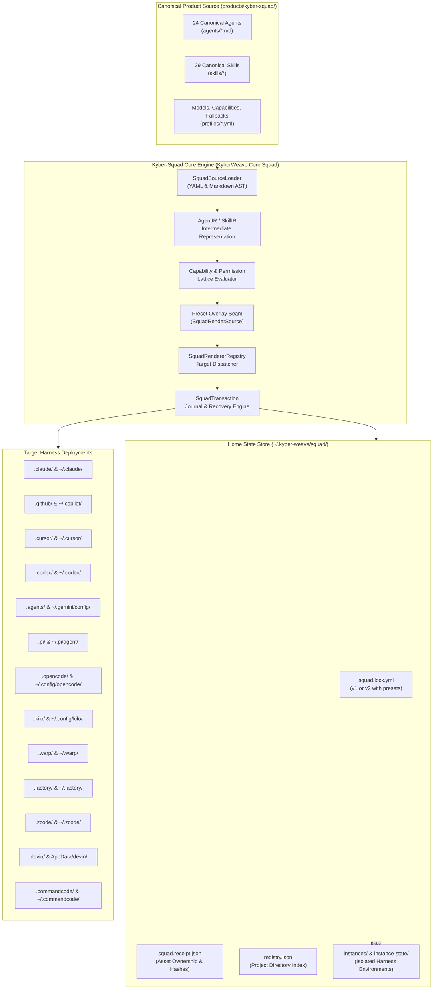
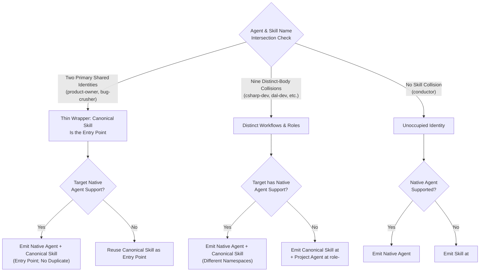
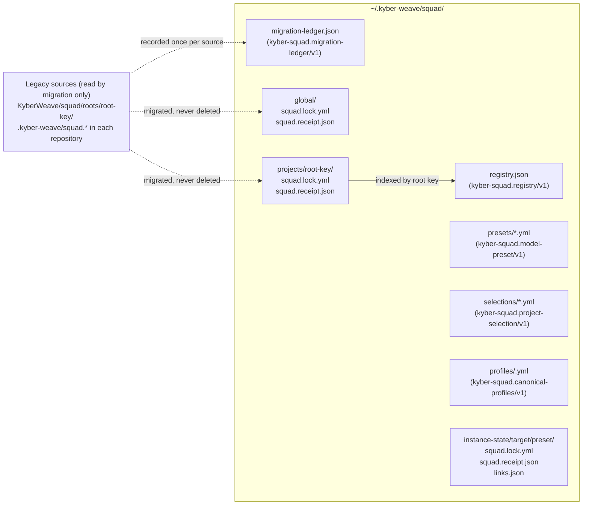
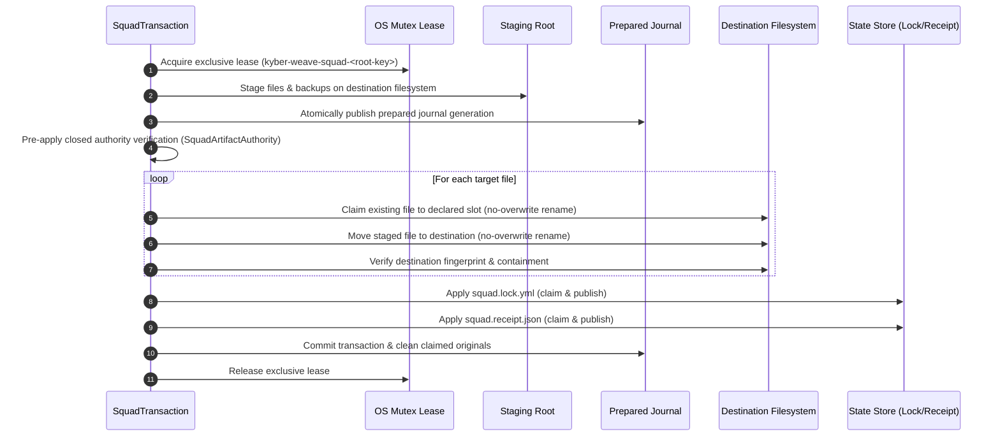
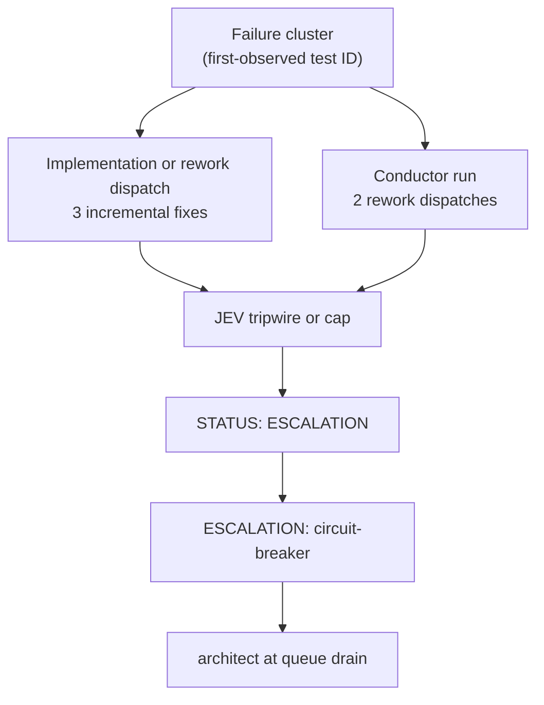

# Kyber-Squad architecture

Kyber-Squad is the multi-harness governance and deployment engine within Kyber-Weave.
It normalizes canonical agent and skill definitions into an intermediate representation (**AgentIR**),
evaluates capability and permission lattices, applies deterministic role-skill lowering, and executes
atomic, recoverable deployments. Its catalog declares thirteen target coding harnesses; all thirteen have
implemented and registered renderers today.

---

## High-Level Architecture



---

## 1. Canonical Source Normalization and IR Construction

Kyber-Squad treats `products/kyber-squad/` as the immutable, canonical source of truth:

- **Canonical Agent Definitions**: Authored in `products/kyber-squad/agents/<name>.md` with closed YAML frontmatter and LF-normalized UTF-8 bodies.
- **Normalization Pipeline**: `SquadSourceLoader` parses frontmatter against `schemas/agent.schema.json`, validates capability bindings, computes an immutable SHA-256 instruction digest over the normalized body, and emits a structured `AgentIR` model.
- **Strict Invariants**: Loaders reject undeclared profiles, missing capabilities, invalid invocation modes, path traversal attempts, or unrecognized frontmatter keys.
- **Canonical Skills and Resources**: `SquadSourceLoader` loads the 29 top-level `SKILL.md`
  identities. The canonical tree separately retains 87 supplemental files, giving 116 recursive
  skill-tree files; `SquadPacker` carries that complete recursive tree into both package formats.
- **Domain Models and IR Construction**: Markdown files parse into `SquadAgent` and `SquadSkill`
  domain models; frontmatter fields validate against strict schemas (e.g. `model-profile`,
  `capability-profile`, `tools`, `delegates-to`); concrete `AgentIR` / `SkillIR` representations
  are created with resolved tool references, evaluated capability mappings, and parsed
  instruction bodies.

---

## 2. Capability and Permission Lattice Evaluation

Agent permissions are evaluated through a strict multi-level lattice:

```
Grant (allow) > Review (ask) > Deny (deny) > Default (withhold)
```

1. **Capability Taxonomy**: Maps high-level operations (`filesystem.read`, `filesystem.write`, `process.execute`, `network.fetch`, `network.publish`) to platform-specific tools.
2. **Non-Broadening Guarantee**: Target-specific renderers may restrict or narrow permissions, but must **never** grant capabilities beyond what the canonical agent specification authorizes.
3. **Structured Degradations**: Where target platforms lack granular permissions or cannot enforce delegation boundaries, Squad emits explicit degradation records in the deployment receipt rather than guessing or silently granting ambient privileges.

### Architect documentation gates through MCP

The shared `architect` capability profile holds `process.execute: deny` on every target — not
`allow`. `Deny` withholds the shell with no prompt; it is the narrowest execute setting in the
lattice above. That grant is not how the architect satisfies its `PLAN_READY` documentation checks.

After plan writes, the architect obtains **schema conformance** and **entity drift** by
calling the read-only MCP tools `docs_validate` and `docs_drift` on the kyber-weave
documentation server bound to this checkout ([MCP runbook](../docgraph/mcp-runbook.md)). The
tools run the same gates as `kyber-weave docs validate` and `kyber-weave docs drift` against
the server's resolved root; they are not a shell grant, a new capability in the lattice, an
argv allow-list, or a Cursor read-only exception. Any client of that server may call them;
using them does not widen `process.execute`.

While the plan remains in the active plans folder, the architect leaves `mergeReady` false on
`docs_validate` so open-work rules such as `KW-DOC-LIFECYCLE-003` do not fire. It compares
the provenance `root=` to this checkout before trusting a pass. Target-scoped profiles such
as `architect-devin` and `architect-copilot` are unchanged: Devin still resolves
`architect-devin` for file creation on that target, and Copilot still resolves
`architect-copilot` where the shared profile withholds execution without granting a shell.

---

## 3. Role-Skill Lowering and Namespace Resolution

Harnesses differ in their native agent support. Platforms that lack native subagent execution
receive role-skill lowering, converting agents into executable skills with prefixed naming to avoid
distinct-body collisions. The primary shared identities reuse the canonical skill as their entry
point, so no `role-` projection is generated for them:



### Resolution Rules

1. **Primary Shared Identities (`product-owner`, `bug-crusher`)**:
   - The agent body is a thin wrapper that loads and follows the same-name canonical skill; the
     skill carries the role. The two bodies differ by design, and the source validator permits
     that only for a `primary`-invocation shared identity.
   - The canonical skill is the entry point and is always emitted. A target that renders a primary
     through an additional entry-point form (Claude, Factory) emits the agent file plus the
     canonical skill and no duplicate; a target that lowers a primary onto a skill or command
     (Cursor, Pi, ZCode, Devin, Warp) reuses the canonical skill and emits no projection of its own.
   - No `role-<name>` projection is generated, and no skill projection is suppressed.
2. **Distinct-Body Collisions (`csharp-dev`, `dal-dev`, `github-devops`, `go-dev`, `maui-dev`, `python-dev`, `rust-dev`, `test-dev`, `typescript-dev`)**:
   - The canonical skill and agent serve distinct functions.
   - On fallback targets, the canonical skill stays at `<name>`, and the agent instruction body is projected to `role-<name>`.
   - `role-` is reserved exclusively for generated projections; no canonical source file may use the `role-` prefix.
3. **Unoccupied Identities**:
   - Agents with no matching skill name lower directly to `<name>` as a skill on fallback targets.
   - `conductor` follows this rule because it has no canonical skill. The fallback profile's
     `shared-identities` list names only the two primary shared identities above, and the canonical
     catalog carries no version aliases.

### Native Branch: Pi with Primary-Agent Lowering

Pi is a native agent target ([ADR 0019](../adr/0019-pi-native-subagents-and-primary-lowering.md))
that projects subagents natively but lowers its primary-invocation
agents to a skill, per the fallback profile's `no-primary-agent: skill` value. Pi
core has no primary-agent primitive: `.pi/SYSTEM.md` or `--system-prompt` replaces the whole
session prompt. Rendering `conductor` as a subagent instead would place it at depth 1, pushing its
delegated specialists to depth 2 — where Pi's default `maxSubagentDepth: 2` removes the nested
delegation that `architect` and `code-reviewer` need. Lowering it to a top-level skill keeps it at
depth 0, where the extension's `Agent` tool is available, and its specialists' nested rosters
still work. The two primary shared identities lower the same way, except that their canonical skill
already exists and is reused as the entry point rather than a lowered copy being emitted.

### Native Branch: Claude with a Primary-Agent Entry-Point Skill

Claude is a native agent target that projects subagents natively to `.claude/agents/<name>.md` and
has a real primary-agent primitive only through `claude --agent <name>` or the `agent` setting —
the only modes where Claude Code enforces the agent's `tools` allow-list, `Agent(roster)` roster,
and model. A primary-invocation agent rendered as a subagent would run nested, where the roster
is ignored and the Agent tool may be unavailable (spawn depth 1 in cloud sessions).

When a primary agent's fallback profile declares `no-primary-agent: skill`, Claude renders **both**
the subagent at `.claude/agents/<name>.md` (kept for enforced invocation) **and** an entry-point
skill at `.claude/skills/<name>/SKILL.md`, invoked as `/<name>` in the main conversation. For a
non-shared primary the entry-point skill is derived from the agent: it is byte-identical to the
subagent body and carries exactly three frontmatter keys — `name`, `description` (collapsed to one
line), and `license: MIT`. Its resources project beside it as with other skills.

**A primary shared identity reuses its canonical skill as the entry point.** For `product-owner`
and `bug-crusher` the canonical skill already occupies `.claude/skills/<name>/SKILL.md` and carries
the role, so the renderer emits the subagent file plus the canonical skill and does **not** emit a
duplicate entry-point skill ([ADR 0036](../adr/0036-primary-agent-canonical-skill-entry-point.md)).
Emitting both would project one identity twice and would overwrite the role-carrying skill with the
wrapper body. The canonical skill's body differs from the subagent body by design here — the
wrapper points at the skill — so the "byte-identical" rule applies only to a derived entry point.

The skill's description stays in Claude's context, so Claude may auto-load `/<name>` into the main
conversation without the user typing it. The degradation records account for this unenforced
entry point: its details state that the session's tools, permission mode, MCP servers and model
apply to the skill, and that `claude --agent <name>` is the enforced alternative. The subagent
file is kept unchanged, and resources project to both principals.

Claude is the first native target where a single agent emits two distinct principals (subagent and
entry-point skill). Under `no-primary-agent: omit`, no entry-point skill is emitted and the agent's
records remain unchanged.

**Fail-closed on an unresolvable canonical skill collision.** If a canonical skill occupies the
entry-point identity and the agent is **not** a declared shared identity, the render fails with a
`SquadRenderValidationException` rather than resolving the collision through role-prefixing. The
canonical skill and the derived entry-point skill would both claim
`.claude/skills/<name>/SKILL.md`, and a native target has no role-prefixed escape hatch. A declared
shared identity is the resolvable case: the canonical skill is the entry point and no duplicate is
emitted. Separately, Claude resolves personal skills before project skills but project agents
before user agents, so mixed-scope installs can expose `/<name>` and `@agent-<name>` from different
versions.

---

## 4. Deployment Scopes and State Topology

Squad maintains deployment state under the user's home directory across three scopes:



- **Home state root**: `<home>/.kyber-weave/squad/`, where `<home>` is `ISquadUserPaths.HomeDirectory`
  (the user profile in production). Tests inject a temporary home and never touch the real one.
- **Global state**: `global/squad.lock.yml` and `global/squad.receipt.json`. The global anchor is the
  home directory. Under `--global`, the positional path, `--path`, and the working directory are
  not consulted.
- **Project state**: `projects/<root-key>/squad.lock.yml` and `projects/<root-key>/squad.receipt.json`.
  `<root-key>` is `SquadPhysicalRootIdentity.Key`, so lexical and symbolic-link spellings of one
  directory converge on one entry.
- **Instance state**: `instance-state/<target>/<preset>/squad.lock.yml` (v2), `squad.receipt.json`,
  and `links.json`. Deployed instance files live in `instances/<target>/<preset>/`. The transaction mutex
  is keyed by the lowercase SHA-256 of the physical instance root path (`SquadPhysicalRootIdentity.Key`),
  ensuring multiple concurrent executions of the same instance target are cleanly serialized.
- **Legacy sources**: the application-data tree `KyberWeave/squad/roots/<root-key>/` and each
  repository's in-repo `.kyber-weave/squad.lock.yml` and `squad.receipt.json`. Migration reads them and
  never deletes them. The application-data directory is no longer a state location; rendering's own
  user-scope directory is unchanged.
- **Canonical profile snapshots**: `profiles/<version>.yml` (schema
  `kyber-squad.canonical-profiles/v1`) carries one Squad release version's canonical model profiles
  — the `models.yml` shape plus the agent-name-to-category map — written atomically (temporary
  file, then rename) by `SquadLifecycleService` after a committed install or update, never on
  dry-run. `preset use` and `preset clear` read the snapshot keyed by the deployment lock's
  `SquadVersion`, falling back to the newest snapshot; `preset show` has no deployment context
  and reads checkout first, then the newest snapshot. A checkout `products/kyber-squad` source
  is preferred over any snapshot wherever one is present. A snapshot write that fails after the
  transaction has committed produces a warning naming the remedy (rerun `squad update`); the
  deployment is not failed. One file is kept per distinct version and snapshots are never
  pruned.

- **Task gates come from `docs init`, not from Squad.** Squad writes no configuration: a
  project-scope `squad install` or `squad update` that finds no `review.task-gates` in the
  project's host config prints one hint — run `kyber-weave docs init` to write the gates
  for the declared technologies — instead of writing them. The hint never changes the
  verb's exit code, and global scope never prints it, because there is no project.

### Cross-Process Mutex Lease

- **Named OS Mutex**: Every mutating operation acquires an exclusive OS-named mutex (`kyber-weave-squad-<root-key>`).
  For global scope the key is the hash of the physical home directory. For instance scope the key is
  the hash of the physical instance root directory.
- **Scope-Independent Contention**: Project-scoped and global-scoped operations targeting the same physical root contend for the exact same mutex, preventing concurrent corruption. A project installed at the home directory therefore shares the global mutex.
- **Per-Root Work Directory**: The transaction work directory and journal stay with the physical root. Project scope uses `<root>/.kyber-weave/.squad-transaction`; global scope uses `<home>/.kyber-weave/.squad-transaction`; instance scope uses `<instance-root>/.squad-transaction`. Only the receipt, lock, and link manifests move to the home state root.
- **Precondition Reverification**: After acquiring the lease, all preconditions and path containment assertions are re-evaluated immediately before filesystem operations.

### Transaction Engine and Disk Durability

Deployments execute through `SquadTransaction`, which stages writes, prepares rollback journals (`intent.json`), and commits state atomically:

- **Stable Storage Synchronization (`SquadTransaction.SyncToDisk`)**: In production, journal commits, artifact writes, receipt updates, instance link syncs (`SquadInstanceLinkSync`), and preset selections (`SquadModelPresetSelectionStore`) force all writes to stable storage via device flushes (`F_FULLFSYNC` on macOS, flush file buffers on Windows).
- **Flow-Isolated Durability Scope (`SquadTransaction.UseSyncToDiskScope`)**: Test harnesses can selectively disable device flushes without process-wide static mutation by entering an `AsyncLocal<bool?>` execution scope via `SquadTransaction.UseSyncToDiskScope(false)`. This guarantees durability test overrides never leak filesystem flush overhead onto concurrent test threads.

### Registry

`<home>/.kyber-weave/squad/registry.json` (schema `kyber-squad.registry/v1`) indexes project roots so
that a global update, `status --global`, and `doctor` can find them. Each entry is keyed by root key and
holds the physical path, the last update time in UTC, and the targets deployed.

- **Maintenance**: project install, update, and import upsert an entry; project uninstall removes it.
  Every write is atomic (temporary file, then rename). Global state is not registered.
- **Index, not authority**: `ListProjects` reads each entry and marks it `Stale` with a reason when
  the path is missing, the physical key no longer matches the path, or the receipt under
  `projects/<root-key>/` is missing. It also rebuilds an entry for any receipt under `projects/<root-key>/`
  that has no registry row. A deployment is never read from the registry alone.
- **Reconciliation**: `ListProjects` persists the rebuilt registry only when a caller lists it through
  the persisting path. In the CLI that is `squad status --global`, `squad update --global` (when it lists
  projects for its picker), and `squad doctor`. No other verb reconciles it. Lookups never write:
  resolving a named `--projects` path uses `FindProject`, and migration's single-root binding lookup uses
  `ListProjectsWithoutRebuild`. A receipt that does not parse is left out of the rebuild, so the other
  projects still list. An unreadable registry file makes `squad status --global` and `squad doctor` fail
  and name it.
- **Stale entries**: no command unregisters an entry. `SquadStateStore.UnregisterProject` is called only
  by project uninstall, so an entry whose directory no longer exists stays flagged until that path
  returns. `squad update --global --projects` warns about and skips a stale named path.
- **Write failure**: a registry write that fails after the transaction has committed produces a
  warning that names the remedy, rerunning `kyber-weave squad status --global`. The transaction is not
  failed.

### Lock and Receipt Files

Lock and receipt files are not committed to the repository. Squad writes them to the home state
root. The in-repo copies of earlier releases are read by migration and retained for rollback.

- **`squad.lock.yml`**: Contains bundle metadata, versions, target lists, exclusions, translation mode, bundle digests, and model preset mappings. Also carries a vestigial upstream-toolchain identity field, kept for schema stability now that rendering no longer depends on an external toolchain; it reads `unverified` on every install.
- **`squad.receipt.json`**: Records scope, installation timestamp, structured degradation records, and an ordered manifest of owned files with relative paths and SHA-256 digests. Its `targetRoot` is the canonical absolute physical root for a project receipt (receipts written with `"."` remain readable). A global receipt records the home anchor, or the resolved binding root for a migrated legacy single-root receipt.

#### Receipt version and layout contract

- **Global scope**: receipts serialize as `kyber-squad.receipt/v2` and carry a required `layout` field specifying `single-root` (all paths target-prefixed, legacy rc.9/rc.10 format) or `per-target-roots` (bare paths, rc.11+). There is one global receipt, at `global/squad.receipt.json` under the home state root; sibling global receipts are retired.
- **Project scope**: receipts remain v1 with no layout field. Since [ADR 0037](../adr/0037-squad-state-in-user-home.md) they record the canonical physical root in `targetRoot` instead of `"."`, which amends the byte-identical rule of [ADR 0024](../adr/0024-squad-global-receipt-layout-marker.md).
- **Legacy v1 global receipts** (pre-#91): classified by examining paths in the receipt. If every entry is target-prefixed (e.g., `.codex/agents/x.toml`), it is treated as `single-root` layout. If no entry is prefixed, it is `per-target-roots`. A receipt mixing both patterns is invalid. A v2 receipt whose declared `layout` contradicts its paths is rejected the same way.
- **Compatibility**: CLI versions before the v2 layout marker refuse a v2 global receipt with exit code 1 and do not modify any files. Upgrade the CLI to proceed.
- **Legacy recovery**: for an rc.9/rc.10 single-root install, `status` and `uninstall` operate against the recorded deployment root; `update` and same-target `install` refuse with guidance to run `kyber-weave squad uninstall --global` followed by `kyber-weave squad install --global`.

#### Home-owned files and the user-home response guidance

A global receipt also records the files Squad owns in the user's home rather than in a harness's
root, in an additive `homeFiles` array. Each entry carries a `relativePath` and the lowercase
SHA-256 `sha256` of the bytes Squad wrote. The field is written only on a global receipt and
only when it is non-empty, so a receipt written by an earlier CLI still parses and an
existing global deployment is not disturbed by the field's arrival.

The first such file is the user-home response guidance, `<home>/.kyber-weave/response-guidance.md`.
It belongs to no harness: every deployed entry file receives its text at install and update
(see [response preferences](#response-preferences-injected-at-deploy)), which is why it is owned as a home file rather than deployed beneath a target's global root.
`SquadResponseGuidanceDeployer` decides what a run does with it, and the refresh rules follow
the staging shape the canonical model-profile snapshot in `SquadCanonicalProfileStore` already
uses — a file whose bytes still match a recorded digest is Squad's own copy of what it shipped,
and anything else belongs to the operator:

- **Absent → deployed**: no file at the path means nothing is at risk, so the shipped default is
  written and read back, and its digest recorded.
- **Bytes already equal the shipped default → adopted**: nothing is written and nothing is
  reported; the digest is recorded, so the file becomes Squad's own copy from then on. Recording
  it cannot lose operator wording, because the bytes are already identical to what this release
  ships. This rule is also the self-repair path for a run that wrote the guidance and then failed
  before its receipt was committed.
- **Digest matches the recorded default → replaced**: a file whose bytes still hash to what the
  receipt recorded is Squad's own copy of the shipped default. A newer release replaces it and
  the receipt records the new digest.
- **Edited, or present with no ownership record → preserved and reported**: anything else is the
  operator's own wording. The run reports that it kept the file and why, and does not adopt it:
  overwriting it would discard the one customization the file exists to hold. A file that exists
  with no ownership record was written by the operator or by a release older than the receipt,
  so it is never claimed. Deleting the file is how an operator takes the shipped default back.

The skill-carried mandatory load that used to sit here is gone: response preferences are injected
into the `conductor` and `bug-crusher` entry files at deploy, so no load step precedes a reply. The
file is kept as the one place the operator edits preferences; `squad install` creates it when absent,
and `squad update` never overwrites an edit.

Ownership is recorded only from a digest this run read back from the deployed path, and the order
follows from that: the deployment plan is built and validated first, then the transaction takes
the home lease and re-checks the plan's preconditions against the live tree, and only then is the
guidance classified, written and read back, with the receipt committed under the same lease. The
plan is what decides whether the run may write at all, so a plan that fails preflight — an
unmanaged collision, an adoption check, a legacy-layout refusal — leaves the guidance exactly as it
found it, and a dry run writes nothing at all. The lease is what keeps two updates apart: one that
cannot take it has written nothing, so two runs shipping different defaults cannot interleave their
writes and leave a file the winning receipt does not describe. The record is attached to the
receipt after validation, through a path that can only be reached with a digest a write has
already produced, so a refused plan cannot describe a home file the run never delivered.

One window remains between the write and the commit: a transaction that fails after the guidance
write leaves the new default in place with the run failing loudly. A retry of the same release
repairs it by adopting bytes that already equal the shipped default. A later release that ships
different wording cannot tell those bytes from an operator edit, so it keeps the file and warns;
deleting the file takes the new default. A guidance write that degrades leaves the
run's exit status unchanged. The conditions that degrade rather than throw are the ones a
filesystem, a platform path form, or a host policy can impose on an otherwise healthy run: an I/O
failure, a permission denial, a path form the platform cannot represent, and a security policy
that refuses the write. A programming error still throws, because a warning an operator cannot act
on is how a defect survives. Resolving the file's path follows that policy too, since it probes the
attributes of each segment on the way: a host that refuses the probe degrades like any other
denial, while a path that resolves outside the home root, such as a guidance file that is a link
out of it, still fails the run. The shipped default is read under the same policy: a build that
carries no readable default writes nothing, records nothing, and warns to reinstall from a release
that ships the guidance rather than to retry — the defect travels inside the binary, so another
run of the same build would fail the same way. Nothing is ever written outside the home root.

#### Lock version and preset contract

- **Lock v2 (`kyber-squad.lock/v2`)**: When any target has a model preset applied, the lock file serializes with `schema: kyber-squad.lock/v2` and adds a top-level `model-presets` mapping:
  ```yaml
  schema: kyber-squad.lock/v2
  model-presets:
    claude:
      name: zai
      digest: 7f83b1657ff1fc53b92dc18148a1d65dfc2d4b1fa3d677284addd200126d9069
  ```
- **Conditional upgrade**: Lock v2 is written only when `model-presets` is non-empty. When no presets are applied, the lock remains byte-identical `kyber-squad.lock/v1`. Clearing all presets restores the lock to v1.
- **Fail-closed backward compatibility**: Deserialization reads both v1 and v2. Older CLI versions that lack preset support reject a v2 lock file immediately upon encountering the undeclared `model-presets` field (`RequireExactYamlFields`), preventing silent preset loss or unintended rollbacks.
- **Integrity verification**: The recorded SHA-256 hex digest represents the exact content of the preset file at the time it was applied. Status checks detect drift between the file on disk and the recorded digest (`changed since applied`), while updates verify preset existence before downloading or rendering.

#### Migration from earlier layouts

A single shared helper, `SquadStateMigration`, runs before every squad verb (`install`, `update`,
`status`, `uninstall`, and `doctor`). It is automatic, non-destructive, and idempotent. It deletes
no file, and running it again after it has succeeded changes nothing.

- **Empty roots** under the legacy application-data tree are ignored.
- **One legacy global receipt, no home global receipt**: the receipt and lock are copied to
  `global/`, and `targetRoot` is set as described above. The legacy files are left in place.
- **Per-target-roots legacy receipt**: needs no root. **Single-root legacy receipt**: its binding root
  is resolved in this order: an absolute `targetRoot`, then the registry, then a key match against the
  home directory or the invoking directory. A receipt whose root cannot be resolved is not migrated
  and is reported.
- **More than one non-empty legacy global receipt**: none is migrated. Each is reported with
  guidance. Migration does not guess.
- **Home global receipt already present**: migration does nothing.
- **Project import**: when a project-scope verb, or a picker-driven update, touches root `R`, and
  `projects/<root-key(R)>/` has no receipt while `R/.kyber-weave/squad.receipt.json` exists, the receipt
  and lock are imported, `targetRoot` is set, and `R` is registered. The in-repo files are left untouched.
  Home state takes precedence from then on, and `doctor` warns that the retained in-repo state should
  be removed from version control.
- **Dry run**: under `--dry-run` nothing is written, including the ledger. The run reports that the legacy
  state at each path will be migrated on the next invocation without `--dry-run`. Install, update, and
  uninstall stop after that report.
- **Lease**: every copy and import runs under the transaction lease for the root. A busy lease writes
  nothing, reports a warning, and leaves the legacy files in place for the next run.
- **Write order**: a global copy writes the lock and then the receipt, which is the completion marker.
  A lock with no receipt is completed on the next run when the home lock is byte-identical to the source
  lock; a different home lock blocks the copy and is reported.
- **Doctor writes**: `squad doctor` runs the same migration as the other verbs, so it can write.

#### Migration ledger

`<home>/.kyber-weave/squad/migration-ledger.json` (schema `kyber-squad.migration-ledger/v1`) records each
completed global copy and project import, so migration is one-shot per source:

```json
{ "globalMigratedFrom": ["<legacy-root-key>"], "projectsImported": ["<root-key>"] }
```

- A global copy records its legacy root key after the receipt is written. A project import records the
  project's root key inside the lease that writes its state.
- A recorded source is never copied or imported again. An uninstall of migrated state therefore stays
  uninstalled while the legacy files it was copied from are retained. Doctor lists such a global root
  among the unmigrated legacy roots, with the reason that it was already migrated.
- The ledger gates only legacy copies and imports. Every verb runs migration first, but home state is
  never blocked by the ledger, so a fresh install after an uninstall is unaffected.
- A malformed or unreadable ledger is treated as empty, and a warning says so. The next successful write
  replaces it with a valid one.

### Global OpenCode capture-plugin step

KyberDash's OpenCode capture plugin is global capture, not a Squad pack resource, so Squad does not
render it. After a successful `squad install --global` or `squad update --global` whose resolved
targets include OpenCode, the command runs one KyberDash verb through an injectable process runner:

```text
kyberdash kyber capture plugin install --harness opencode --preserve --config-dir <Squad-resolved OpenCode root>
```

- **Owner of the file.** KyberDash owns the plugin file, its receipt, and the consent file. Squad
  passes its resolved OpenCode global root as `--config-dir`, so both agree on the path. Squad keeps
  its own receipts for its own files and reads none of KyberDash's.
- **Non-overwrite (C4).** Preserve mode keeps an edited or foreign plugin file with a warning. It
  creates the consent file with content off only when that file is absent, and never touches an
  existing one. The step never writes `opencode.jsonc`.
- **Locating the verb.** `kyberdash` is found beside `kyber-weave` in the install directory, then on
  `PATH`. When it is absent, Squad logs one skip line that names `kyber-weave update`.
- **Failure isolation.** A non-zero exit from the verb prints a warning line that names the retry
  command. It does not change Squad's exit code, and nothing rolls back. An older `kyberdash` without the
  verb prints a named skip.
- **Scope and opt-out.** Project-scope runs do not run the step. `--no-capture-plugin` on `squad install`
  or `squad update` skips it, and `--dry-run` passes `--dry-run` through to the verb.
- **Consent.** Install never turns content capture on. The Settings switch (or `kyberdash kyber capture
  enable --harness opencode`) does that. Until then Squad's output says so in one line.

---

## 5. Write-Ahead Journal and Transaction Engine

Deployments use an atomic, write-ahead, compare-and-restore transaction engine (`SquadTransaction`):



### Claim and Publish Protocol

1. **No Destructive Overwrites**: Files are never updated with in-place overwrites or unrecorded deletions.
2. **Deterministic Claiming**: Pre-existing target files are atomically moved into unique, manifest-declared backup slots using same-filesystem no-overwrite renames.
3. **Atomic Publication**: Staged artifacts are reverified immediately before being moved into their destination paths.
4. **State Written Last**: Lock and receipt files are published only after all target files have been successfully applied and verified.

---

## 6. Idempotent Recovery and Conflict Preservation

When an interrupted deployment or crash occurs, `SquadTransaction.Recover` restores system consistency:

- **Dual Fingerprint Resolution**: Recovery inspects both the destination path and the claimed backup slot to determine whether a transition completed, failed, or was interrupted mid-flight.
- **External Modification Preservation**: If an external process or operator modified a file during or after the transaction, recovery leaves the modified file intact, preserves the journal and backup evidence, and emits actionable repair guidance.
- **Clean Reversibility**: Uncontended rollbacks restore the pre-transaction state, clean up empty directories created by the transaction, and restore application-data topologies.

---

## 7. Transaction Observers

Squad exposes two observer interfaces for lifecycle monitoring and deterministic test verification:

1. **`ISquadTransactionObserver` (Public Lifecycle Contract)**:
   Receives exactly 6 ordered events:
   - `IntentWritten`
   - `FileStaged`
   - `FileBackedUp`
   - `FileApplied`
   - `LockApplied`
   - `ReceiptApplied`
2. **`ISquadTransactionCheckpointObserver` (Internal Diagnostic Extension)**:
   Opt-in observer used for fine-grained crash simulation across checkpoint states:
   - `Prepared`
   - `ActiveTransitionWritten`
   - `OriginalClaimed`
   - `AfterImagePublished`

---

## 8. Rendering

Lowering AgentIR into a harness's native files is native Kyber-Weave code, not a call to an
external toolchain. `SquadLifecycleService` renders through `ISquadRenderer`, resolved by
`SquadCommandComposition` to a `SquadRendererRegistry` — the composite that gates, dispatches,
and validates.

- **Coverage gate first**: before the release is even downloaded, the registry checks every
  requested target against `ISquadRenderer.SupportedTargets`. Any target with no registered
  renderer fails the whole request — install and update are all-or-nothing across the
  requested target set, never a partial render of the targets that happen to be covered.
- **Dispatch**: each supported target's canonical source goes to the `ISquadRenderer` that
  owns it — `ClaudeRenderer` for `.claude/agents/*.md` and a primary-agent entry-point skill at
  `.claude/skills/conductor/SKILL.md`, `CopilotRenderer` for `.github/agents/*.agent.md` and
  `.github/skills/*/SKILL.md`, `CursorRenderer` for `.cursor/agents/*.md` and `.cursor/skills/*/SKILL.md`,
  `CodexRenderer` for `.codex/agents/*.toml` and `.codex/skills/*/SKILL.md`; a primary agent
  without a declared shared skill also gets an entry-point skill,
  `AntigravityRenderer` for native per-agent directory emission to `.agents/agents/*/agent.md` and canonical skills to `.agents/skills/*/SKILL.md` ([ADR 0022](../adr/0022-antigravity-native-agents.md)),
  `OpenCodeRenderer` for `.opencode/agents/*.md` and `.opencode/skills/*/SKILL.md`,
  `KiloRenderer` for `.kilo/agents/*.md` and `.kilo/skills/*/SKILL.md`,
  `PiRenderer` for native subagent projection to `.pi/agents/*.md` and `.pi/skills/*/SKILL.md` with primary-agent lowering ([ADR 0019](../adr/0019-pi-native-subagents-and-primary-lowering.md)),
  `FactoryRenderer` for `.factory/droids/*.md` and `.factory/skills/*/SKILL.md`,
  `WarpRenderer` for fallback role-skill lowering to `.warp/skills/*/SKILL.md`,
  `ZCodeRenderer` for `.zcode/agents/*.md` and `.zcode/skills/*/SKILL.md` with primary agents lowered to slash commands at `.zcode/commands/*.md` ([ADR 0021](../adr/0021-zcode-command-lowering-and-resource-relocation.md)),
  and `DevinRenderer` for Devin Desktop's local agent: per-agent directories at `.devin/agents/*/AGENT.md` and skills at `.devin/skills/*/SKILL.md`, with primary agents lowered to a skill ([ADR 0025](../adr/0025-devin-native-agents-and-skill-lowering.md)).

| Target | Renderer | Agent Output | Skill Output | Kind |
|---|---|---|---|---|
| `claude` | `ClaudeRenderer` | `.claude/agents/<name>.md`; primary agents also at `.claude/skills/<name>/SKILL.md` | `.claude/skills/<name>/SKILL.md` | Native |
| `copilot` | `CopilotRenderer` | `.github/agents/<name>.agent.md` | `.github/skills/<name>/SKILL.md` | Native |
| `cursor` | `CursorRenderer` | `.cursor/agents/<name>.md` | `.cursor/skills/<name>/SKILL.md` | Native |
| `codex` | `CodexRenderer` | `.codex/agents/<name>.toml` | `.codex/skills/<name>/SKILL.md` (canonical skills and derived primary entry points) | Native |
| `antigravity` | `AntigravityRenderer` | `.agents/agents/<name>/agent.md` | `.agents/skills/<name>/SKILL.md` | Native |
| `opencode` | `OpenCodeRenderer` | `.opencode/agents/<name>.md` | `.opencode/skills/<name>/SKILL.md` | Native |
| `kilo` | `KiloRenderer` | `.kilo/agents/<name>.md` | `.kilo/skills/<name>/SKILL.md` | Native |
| `pi` | `PiRenderer` | `.pi/agents/<name>.md` | `.pi/skills/<name>/SKILL.md` (conductor lowered here) | Native |
| `factory` | `FactoryRenderer` | `.factory/droids/<name>.md` | `.factory/skills/<name>/SKILL.md` | Native |
| `warp` | `WarpRenderer` | `.warp/skills/role-<name>/SKILL.md` (lowered; see [§3](#3-role-skill-lowering-and-namespace-resolution)) | `.warp/skills/<name>/SKILL.md` | Fallback |
| `zcode` | `ZCodeRenderer` | `.zcode/agents/<name>.md`; primary agents lower to `.zcode/commands/<name>.md` | `.zcode/skills/<name>/SKILL.md` | Native |
| `devin` | `DevinRenderer` | `.devin/agents/<name>/AGENT.md` | `.devin/skills/<name>/SKILL.md` (conductor lowered here) | Native |

- **Codex primary-agent entry points**: the renderer keeps every native agent at
  `.codex/agents/<name>.toml`. For a primary agent without a same-name canonical skill, it also
  derives `.codex/skills/<name>/SKILL.md` from the agent's description and instruction body, and
  projects the agent's resource closure beside that skill. The declared primary shared identities
  `product-owner` and `bug-crusher` reuse their canonical skills as entry points instead of
  producing duplicate skills. A same-name canonical skill on an identity not declared shared is
  an unresolved path collision; rendering fails closed rather than overwriting or renaming either
  artifact. Global scope removes the `.codex/` prefix from both output roots.
- **Target-scoped projection inputs**: each canonical agent declares exact `copilot-tools`, and may
  name a target-scoped `copilot-capability-profile` or `devin-capability-profile`. These fields
  validate and render that one target's allow-list and safety degradation only. They do not replace
  or widen the shared `capability-profile`, fallback metadata, description, or instruction body
  consumed by other renderers. `DevinRenderer` resolves `agent.DevinCapabilityProfile ??
  agent.CapabilityProfile` for every permission lookup it performs — granted tools, degradation
  records, MCP entitlement, and the pure-orchestrator exclusion — so an agent that names none
  renders exactly as before. Validation is what keeps the envelope scoped: a profile marked
  `target: devin` is rejected as an agent's shared `capability-profile`, a
  `devin-capability-profile` naming a profile without that marker is rejected,
  and a primary agent naming one is rejected because Devin lowers primaries to
  skills with no tool allow-list
  ([ADR 0028](../adr/0028-devin-target-scoped-authoring-capability-profiles.md)).
- **Pi per-target overlay (`pi-extensions` / `pi-tools`)**: a canonical agent may declare
  two optional flat frontmatter keys — `pi-extensions` (array of Pi extension ids) and
  `pi-tools` (array of additional Pi tool names). `pi-tools` entries must use the
  `ext:<extension>/<tool>` form; bare names are rejected so the overlay cannot smuggle a
  built-in past the capability lattice (read-only roles keep `process.execute: deny`),
  and every `ext:` entry's extension must be declared in `pi-extensions`. `PiRenderer`
  appends the declared `pi-tools` after the capability-derived `tools` CSV and emits the
  declared extensions as a YAML sequence (the live-verified form); agents without an
  overlay render `extensions: false` exactly as before. Only `research-agent` carries the
  overlay today, with the live-verified `pi-mcp-adapter` wiring
  ([ADR 0019](../adr/0019-pi-native-subagents-and-primary-lowering.md)).
- **Copilot tool order ([ADR 0017](../adr/0017-copilot-deterministic-tool-order.md))**:
  `CopilotRenderer` emits `CopilotToolCatalog.Normalize(agent.CopilotTools)` — membership from
  the agent, order from one global catalog sequence (`vscode`, `tool_search`, `read`, `todo`, MCP wildcards,
  then search/execute/web/edit/agent and the granular edit tools). Normalization never adds a
  tool the agent omitted and never reorders per agent. Capability bindings are an upper bound
  at load/validation time, not a second membership source. Wildcards remain single-quoted in
  the YAML flow sequence.
- **Resource projection**: after each principal file, the renderer appends the owner's validated
  resource closure beside it — each resource at its artifact-relative path under the principal's
  directory — so authored relative links resolve verbatim in the deployed tree. A resource that
  would alias another principal's output is a validation error, never an overwrite. The rule for
  a target whose agent discovery registers nested markdown is property-based: an agent-owned
  markdown resource must deploy in a form the harness scanner ignores, keeping it co-located
  with its principal, with the deviation recorded as a `resource-links-rewritten` degradation.
  The three target-specific forms of that rule today are:
  - **ZCode** relocates agent resources under `.zcode/skills/<owner>/…` and rewrites
    declared-resource links to `../skills/…` ([ADR 0021](../adr/0021-zcode-command-lowering-and-resource-relocation.md));
    the rewrite stays relative.
  - **OpenCode and Kilo** keep resources co-located beside their principal but deploy every
    agent-owned `.md` resource with a `.markdown` extension, rewriting in-closure authored links
    `.md` → `.markdown` ([ADR 0040](../adr/0040-flat-agent-dir-discovery-guarded-resources.md)).
    Both scanners match only `{agent,agents}/**/*.md` recursively, so `.markdown` is invisible
    to discovery while each file stays beside — and wholly owned by — its agent. An agent closure
    holding both `x.md` and `x.markdown` fails closed rather than merging one path.
  - **Copilot, global scope only.** A global-scope agent is read from outside any workspace, so
    a relative link has no base the model can resolve. Each link in the agent body whose target
    exactly equals one of that agent's declared resource paths is rewritten to an absolute
    forward-slash path under the resolved Copilot global root
    (`<root>/agents/<resource-path>`, Windows roots included). A `#anchor` or `?query` suffix and
    a link title are kept; an authored angle-form destination is matched too. Links outside the
    declared closure, links inside fenced code blocks or inline code spans, and prose that merely mentions a path are
    untouched; a target containing whitespace or parentheses uses the CommonMark angle form
    `(<…>)`. Resource files stay beside the
    principal and are not themselves rewritten. Each rewrite is recorded as a
    `resource-links-rewritten` degradation, as for ZCode. Project scope is unchanged and
    byte-identical: links stay relative and the files sit inside the workspace.

  The Copilot rewrite needs the machine's global root, so `SquadRenderRequest` carries an optional
  `ISquadGlobalRootResolver? GlobalRoots` render input, supplied by lifecycle install, lifecycle
  update, and `squad doctor` so install, receipt, and doctor see the same bytes. It **fails
  closed**: a Copilot global render with no resolver throws `SquadRenderValidationException`
  naming the missing input, rather than shipping relative links. Rendered global content therefore
  embeds the machine's resolved root (`$COPILOT_HOME` or `~/.copilot`). The closure-driven rewrite
  lives in the internal `SquadResourceLinkRewriter` helper (taking the resources and a
  target-path mapping), which ZCode, Copilot (global), OpenCode, and Kilo use today —
  OpenCode and Kilo through the `SquadAgentResourceDiscoveryGuard` extension-map wrapper,
  and `SquadResourceProjection` is unchanged. No ADR for the Copilot-global form — ADR waiver: a narrow, target-specific refinement of this rule following
  the ADR 0021 pattern; this bullet is its record.
- **An omitted permission is not a withheld one on `opencode`.** Agent permissions merge with
  OpenCode's global config, whose documented behaviour is that most permissions default to
  `allow` (`external_directory` and `doom_loop` are the stated exceptions). A renderer that
  emitted only the granted keys would therefore hand back every canonical `deny` and `ask` as
  an ambient allow, inverting the
  [non-broadening guarantee](requirements.md#non-broadening-guarantee). `OpenCodeRenderer`
  consequently pins every key in the taxonomy, writing `deny` wherever the lattice does not
  grant. A target whose permission model is an allow-list — Claude, ZCode, Pi — needs no such
  treatment, because omitting a name there withholds it.
- **MCP grants differ per target, and `zcode` and `devin` enumerate.** `ClaudeRenderer`
  grants three MCP server wildcards (`mcp__codegraph__*`, `mcp__kyber-weave__*`,
  `mcp__context7__*`) to any agent allowed to read the filesystem except the pure orchestrator.
  The pure-orchestrator MCP withholding applies to the subagent file only; an entry-point skill
  invoked as `/<name>` in the main conversation inherits the session's MCP servers. ZCode
  registers MCP tools by exact name and expands no wildcard, so `ZCodeRenderer` emits the fully
  qualified `mcp__<server>__<tool>` names declared by `toolchain.yml`'s `required-mcp-tools`.
  Those names are hard requirements in ZCode, so `squad doctor` fails a ZCode install that does
  not declare the servers — see [ADR 0021](../adr/0021-zcode-command-lowering-and-resource-relocation.md).
  The conductor has no MCP tools by default. Its only exception is the opt-in operator channel
  overlay, described in the next bullet.
  `DevinRenderer` appends the same fully qualified names to each subagent's `allowed-tools`,
  because that is the form Devin's permission rules name MCP tools in, and never grants Devin's
  generic MCP tools (`mcp_list_tools`, `mcp_call_tool`), which would reach every configured
  server; the servers themselves stay the operator's to configure in Devin's `mcp_config.json`.
  The roster lives in canonical source because it is an external contract that drifts, and because
  the renderer and the doctor check must read the same list.
- **Conductor operator-channel overlay ([ADR 0045](../adr/0045-conductor-operator-channel-opt-in.md))**:
  `CopilotRenderer` appends the `<name>/*` tool entry and the overlay text
  (`agents/conductor/overlays/operator-channel.md`) to the conductor only when the gate holds. The gate
  is `KYBER_SQUAD_OPERATOR_CHANNEL` exactly `true`, read by `SquadOperatorChannel` when install, update,
  or doctor renders; status never renders. The server name comes from `KYBER_SQUAD_OPERATOR_CHANNEL_SERVER`
  and must match `^[A-Za-z0-9._-]{1,64}$` (1 to 64 ASCII letters, digits, '.', '_' or '-'). The overlay takes the validated name in place of
  the placeholder `{{operator-channel-server}}`. The target must be Copilot CLI at global scope, and
  `CopilotMcpServerProbe` must find that name under `mcpServers` in `$COPILOT_HOME/mcp-config.json`. The
  probe resolves symlinks to their target, refuses a zero-length target before opening it (an approximation,
  since .NET cannot type-check a file without opening it), requires a regular file, caps the read at 1 MiB,
  skips a leading UTF-8 BOM, and returns absent on I/O, authorisation, or JSON errors. On Copilot CLI global
  scope with the gate on, failures record `operator-channel-server-name-missing`,
  `operator-channel-server-name-invalid` (the raw value is never written), or `operator-channel-server-absent`.
  Every other target or scope records only `operator-channel-not-rendered` on the conductor, with no name
  warning. Otherwise the output is byte-identical. The overlay is appended after the authored body, so the
  tool entry is last in the list.
- **`devin` withholds delegation from subagents.** Devin Local dispatches a named profile
  through `run_subagent`, and a profile reaches further subagents only through its
  `max-nesting` setting. Devin has no `allowed_subagents` equivalent, so granting nested
  delegation would reach every profile rather than the canonical `delegates-to` roster.
  `DevinRenderer` emits neither and records `permission-not-expressible` naming the roster.
  The lowered conductor is unaffected, because it runs in the main session. The delegating roles
  carry their own fallback: `code-reviewer` applies each lens itself, in turn, and says in its
  report that the council ran in-process; `architect` gathers its own sweeps and returns a live
  Azure question as `STATUS: BLOCKED`, which the conductor puts to `azure-reader` and answers.
  Agents use Devin's directory layout so each resource closure stays inside its own agent's
  directory and authored links resolve verbatim; see the `DevinRenderer` class remarks for the
  full evidence.
- **`devin` grants every tool that performs a capability.**
  Devin chooses tools per model — a GPT model edits through `apply_patch` when
  `agent.codex_tools` is on — so `filesystem.write` lowers to `edit`, `write`, `apply_patch`,
  and `notebook_edit`, and `process.execute` to `exec` with `get_output`, `write_to_process`,
  and `kill_shell`. `todo_write` and `skill` are the ungoverned base. A subagent without
  `model` runs on Devin's router-chosen default subagent model rather than the parent's, so
  every non-orchestration model profile pins an exact Devin model id. On a Devin skill,
  `allowed-tools` and `permissions.allow` pre-approve rather than restrict, so no skill carries
  either. `permissions.deny` could narrow the lowered conductor, but Devin does not document
  whether it reaches the subagents the conductor dispatches — which need exactly the tools the
  conductor is denied — so it is withheld pending a real-install check. The lowered conductor
  does carry `triggers: [user]`: Devin Cloud discovers the same skills but loads no custom
  subagents, so it must never start the conductor by description match. Devin also loads
  `.agents/` natively and imports `.claude/`, `.github/skills/`, and `.windsurf/skills/` by
  default, so `squad doctor` warns when a workspace would load a Squad identity twice.
- **`devin` cannot create a file with its write tools, so the authoring roles are granted a
  target-scoped shell** ([ADR 0028](../adr/0028-devin-target-scoped-authoring-capability-profiles.md)).
  The grant above is an upper bound on `allowed-tools`, not a statement about the tools the harness
  hands the model: on the Devin CLI the tool exposed for file changes is `edit`, `apply_patch`
  requires `agent.codex_tools`, and `edit` fails when the destination does not exist. A role whose
  only write path is that tool can edit an artifact but not create one, so `architect` stopped at
  `STATUS: PLAN_WRITE_ERROR` on a plan it had already drafted. Two grants produce that failure
  together — on Devin, `ask` narrows to withheld on subagents, and the shared profiles hold
  `process.execute: deny` (`architect`) or `deny` (`product-planning`). `architect-devin` and
  `product-planning-devin` mirror their shared profiles with `process.execute: allow`. Both roles
  carry the matching initialise-before-edit instruction: `architect` in its plan-authoring
  reference, and `product-owner` in its agent body and the skill's spec-authoring reference
  (it cannot own an agent sidecar: a same-named skill already occupies the ZCode skills
  directory that sidecar would need). Each tells the role to initialise a destination that
  does not exist before editing. `architect`'s `PLAN_READY`
  contract and `product-owner`'s `SPEC_FINALIZED` contract require the read-only MCP tools
  `docs_validate` and `docs_drift` on the kyber-weave documentation server (with `mergeReady`
  false while the artifact remains in its active folder). `docs-dev` needs no Devin profile: its shared `documentation` profile
  grants `process.execute: allow` on every target, for archival `git mv` and the two docs checks
  (ADR 0028, amended 2026-10-26), so on Devin it receives `exec` and its companions and records no
  `safety-narrowed`. On Antigravity it receives `run_command` beside `write_to_file` and records no
  `capability-not-isolable` (ADR 0022). With `filesystem.write: allow` beside the shell, these three roles
  (`architect`, `product-owner`, and `docs-dev`) also no longer raise `capability-not-isolable` on Devin. The conductor's `intake-path`, `plan-path`,
  and `spec-path` references pre-create an empty destination before dispatching, and again before
  redispatching a role that reported a write error on a nonexistent file — the harness-neutral
  fallback for any harness that withholds file creation from subagents.
- **The one target-local exception to verbatim links is `zcode`**: ZCode scans both
  `.zcode/agents/` and `.zcode/commands/` recursively, so a closure beside its principal would
  register as phantom agents and commands rather than as resources. `ZCodeRenderer` therefore
  projects an agent's closure under `.zcode/skills/<owner>/` and rewrites that owner's authored
  links to `../skills/…`, recording a `resource-links-rewritten` degradation so the deviation is
  visible in the receipt. Skill closures are unaffected; see
  [ADR 0021](../adr/0021-zcode-command-lowering-and-resource-relocation.md).
- **Validate**: the registry re-checks the merged output — portable paths stay inside the
  extraction root, every file's target was actually requested, the native/fallback
  single-projection rules from [section 3](#3-role-skill-lowering-and-namespace-resolution)
  hold, and every structured degradation record's instruction digest matches the canonical
  agent it names. A violation raises `SquadRenderValidationException` rather than deploying
  output that failed its own contract.
- **Degradation is the honest alternative to guessing**: a renderer with no way to express a
  canonical capability (Copilot's `tools` frontmatter key is a flat, platform-specific
  allow-list with no published mapping to the semantic capability vocabulary) records a
  structured degradation instead of a claimed mapping that might silently broaden or narrow
  what the deployed agent can actually do.
- **Copilot emit today**: `CopilotRenderer` writes each agent's
  `.github/agents/<name>.agent.md` and each skill's `.github/skills/<name>/SKILL.md`, then
  `SquadResourceProjection.Append` places every file that owner's Markdown links reach beside
  the principal. A fresh Copilot render is 149 files — 24 agents, 29 skills, plus projected
  closures — with authored relative links resolving in the output; every skill resource
  reaches this render except `skills/setup-dev-environment/agents/openai.yaml`, which stays
  packaged-only Codex skill-UI metadata. That count is the current
  contract in [requirements](requirements.md) (KS-001 and the render requirement). The
  earlier 48-file Copilot tree that omitted resources is historical, not current
  behaviour.
- **Skill canonical bytes and retained resources**: `code-review-loop` and `kilo-review-loop` are
  authored in Kyber-Squad.
  Every imported canonical raw `SKILL.md` except the
  five explicitly evolved skills (`bug-crusher`, `code-review`, `product-owner`,
  `create-pull-request`, and `pr-review-fix-comments`) still matches the canonical bytes;
  `create-pull-request-github` is retired into `create-pull-request`. Canonical source and both
  recursive package formats retain all 88 skill resources (116 files under
  `products/kyber-squad/skills/`, 28 of them `SKILL.md`) and resolve the retained references. The
  `response-format` skill is retired (see [response preferences](#response-preferences-injected-at-deploy)). Every retained resource
  now has a reviewed disposition in the
  [skill-resource dispositions audit](skill-resource-dispositions.md): non-policy content stays
  in its skill directory as its durable home, portable policy lives in the
  `products/kyber-squad/standards/` templates, and nothing was deleted.
- **Generated-output boundary**: target-rendered `.github` files are deployment output, not
  canonical product or package source, and this synchronization does not add a generated target
  tree to `products/kyber-squad/`.
- **Coverage today**: `claude` (native subagents with primary-agent entry-point skill), `copilot` (native), `cursor` (native), `codex` (native: `.codex/agents/*.toml` + `.codex/skills/*/SKILL.md`), `antigravity` (native: `.agents/agents/*/agent.md` + `.agents/skills/*/SKILL.md`, [ADR 0022](../adr/0022-antigravity-native-agents.md)), `opencode` (native: `.opencode/agents/*.md` + `.opencode/skills/*/SKILL.md`), `kilo` (native: `.kilo/agents/*.md` + `.kilo/skills/*/SKILL.md`), `pi` (native subagents with primary-agent lowering to `.pi/agents/*.md` and `.pi/skills/*/SKILL.md`), `factory` (native: `.factory/droids/*.md` + `.factory/skills/*/SKILL.md`, with the primary agent additionally exposed as an entry-point skill, [ADR 0034](../adr/0034-factory-droid-entry-point-skill.md)), `warp` (fallback role-skill lowering to `.warp/skills/`), `zcode` (native: `.zcode/agents/*.md` + `.zcode/skills/*/SKILL.md`, with primary agents lowered to `.zcode/commands/*.md`), `devin` (native: `.devin/agents/*/AGENT.md` + `.devin/skills/*/SKILL.md`, with primary agents lowered to a skill), and `commandcode` (native agents and skills, with primary agents also rendered as an entry-point skill) are implemented and registered. All thirteen declared targets are covered. `kyber-weave squad doctor` reports which
  targets are covered.
- **Authority and self-deployment boundary**: `products/kyber-squad/` is canonical and package
  authority. The repository carries no project-level self-deployment: root `.github/agents/`,
  `.github/skills/`, `.kyber-weave/squad.lock.yml`, and `.kyber-weave/squad.receipt.json` were
  removed.

### Render Source Loading and Preloaded Seams

Rendering operations resolve source definitions and environment overrides through non-mutating seams on `SquadRenderRequest`:

- **Preloaded Source Seam (`SquadRenderRequest.PreloadedSource`)**: Rendering requests carry an optional preloaded `SquadSource`. `SquadRenderSource.Load(request, target)` reuses `request.PreloadedSource ?? SquadSourceLoader.Load(request.SourceDirectory)`. `SquadRendererRegistry.RenderAsync` loads the canonical source once per render pass and threads it to all child renderer groups. Commands executing multi-target comparison renders — such as `SquadDoctorCommand.ReportGlobalCollisions` scanning all 13 supported targets for global collisions — preload `SquadSource` once before the target evaluation loop, eliminating redundant disk reads and YAML/Markdown parsing across all targets.
- **Isolated Environment Reader Seam (`SquadRenderRequest.EnvironmentReader`)**: Target renderers and operator channel probes resolve environment variables through an injected `Func<string, string?>` delegate on `SquadRenderRequest.EnvironmentReader` (defaulting to `Environment.GetEnvironmentVariable`). This isolates operator channel gates (`KYBER_SQUAD_OPERATOR_CHANNEL`, `KYBER_SQUAD_OPERATOR_CHANNEL_SERVER`, `COPILOT_HOME`) per render operation and prevents process-wide environment variable mutation.
- **Isolated Loader Seam (`SquadRenderSource`)**: All 13 renderers load their source through
  `SquadRenderSource.Load(request, target)`. It calls `SquadSourceLoader.Load(request.SourceDirectory)`
  (or reuses `request.PreloadedSource`) and applies the target's preset override:
  `source with { ModelProfiles = preset.ApplyTo(source.ModelProfiles) }`.
- **Pure Overlay Merge (`SquadModelPreset`)**: `SquadModelPreset.ApplyTo` merges preset profiles
  into bundled `SquadModelProfiles` key-by-key per profile category. Omitted categories remain
  unmodified; omitted harnesses within a category fall back to bundled tokens.
- **Preset Store (`SquadModelPresetStore`)**: Reads presets from `~/.kyber-weave/squad/presets/<name>.yml`.
  Naming strictly enforces `^[a-z0-9][a-z0-9-]{0,63}$`.
- **Fail-Closed Validation (`SquadModelPresetValidator`)**: Before any rendering or deployment write,
  `SquadModelPresetValidator.Validate` ensures every profile category referenced by the preset exists
  in the active release's `models.yml`. Unknown categories fail immediately with line numbers and
  remediation hints.
- **Diff Resolution (`SquadModelResolution`, `SquadModelDiff`)**:
  `SquadModelResolution.ResolveToken` resolves concrete model tokens for each category and harness,
  treating `inherit` as null. `SquadModelDiff.Compute` calculates changed model resolutions across all
  canonical agents between base and preset profiles, powering `--dry-run` and status diffs.

### Response preferences injected at deploy

Every user-facing reply from `conductor` and `bug-crusher` follows the operator's response
preferences. The shipped default owns the shape, and the operator changes it by editing one file.
Response preferences are not a skill any more. `squad install` and `squad update` copy the text
into each deployed entry file of the two agents, so the agent carries its preferences in its own
instructions on every turn with no load step.

**The shape owner.** The shipped default is `products/kyber-squad/response-guidance.default.md`.
It states the ordered shape: a title line naming the work, a bottom line of at most three sentences
for an experienced reader with no prior involvement, then the open decisions whenever a decision is
open. It also states the no-labels rule (a response never names the format it follows) and the
rule that digests stay machine-consumed: the conductor relays every specialist digest in that shape
and never drops, merges, or paraphrases a field. A content test holds the line that no other
agent or skill body restates the shape's vocabulary, so a second copy cannot drift.

**The operator's file.** The one place the operator edits preferences is
`<home>/.kyber-weave/response-guidance.md` (see [home-owned files](#home-owned-files-and-the-user-home-response-guidance)).
`squad install` creates it from the shipped default when it is absent, and `squad update` never
overwrites it once it has been edited. The text is pasted into the entry files verbatim: there is
no size cap and no style-only guard line. That is an accepted risk. The operator owns the text, and
an operator-written line can ask an agent to do anything; this is the same trust the operator
already places in their own repository instructions.

**Entry-file table.** Every rendered file that carries a `<response-preferences>` block is an entry
file. A file is classified from the render output, not from a path list: a body copied verbatim
from a carrier keeps its block, so a new derived file is injected automatically. The table below is
the project-scope set that the per-target theory pins; global scope uses the same files under each
target's home root (for Codex, `agents/<name>.toml` under `$CODEX_HOME`, default `~/.codex`).

| Target | Entry files that receive the block (project scope) |
|---|---|
| Codex | `.codex/agents/conductor.toml`, `.codex/agents/bug-crusher.toml`; `.codex/skills/conductor/SKILL.md`, `.codex/skills/bug-crusher/SKILL.md` |
| Cursor | `.cursor/skills/conductor/SKILL.md`, `.cursor/skills/bug-crusher/SKILL.md` (lowered) |
| Claude | `.claude/agents/conductor.md`, `.claude/agents/bug-crusher.md`; `.claude/skills/conductor/SKILL.md`, `.claude/skills/bug-crusher/SKILL.md` |
| Copilot | `.github/agents/conductor.agent.md`, `.github/agents/bug-crusher.agent.md`; `.github/skills/bug-crusher/SKILL.md` |
| OpenCode | `.opencode/agents/conductor.md`, `.opencode/agents/bug-crusher.md`; `.opencode/skills/bug-crusher/SKILL.md` |
| Kilo | `.kilo/agents/conductor.md`, `.kilo/agents/bug-crusher.md`; `.kilo/skills/bug-crusher/SKILL.md` |
| Antigravity | `.agents/agents/conductor/agent.md`, `.agents/agents/bug-crusher/agent.md`; `.agents/skills/bug-crusher/SKILL.md` |
| Pi | `.pi/skills/conductor/SKILL.md`, `.pi/skills/bug-crusher/SKILL.md` (lowered) |
| Factory | `.factory/droids/conductor.md`, `.factory/droids/bug-crusher.md`; `.factory/skills/conductor/SKILL.md`, `.factory/skills/bug-crusher/SKILL.md` |
| Warp | `.warp/skills/conductor/SKILL.md`, `.warp/skills/bug-crusher/SKILL.md` (role-skill lowering) |
| ZCode | `.zcode/commands/conductor.md` (lowered); `.zcode/skills/bug-crusher/SKILL.md` |
| Devin | `.devin/skills/conductor/SKILL.md`, `.devin/skills/bug-crusher/SKILL.md` (lowered) |
| Command Code | `.commandcode/agents/conductor.md`, `.commandcode/agents/bug-crusher.md`; `.commandcode/skills/conductor/SKILL.md`, `.commandcode/skills/bug-crusher/SKILL.md` |

The exact set is pinned by a theory over all 13 targets: the files that carry the block must equal
the table, each with exactly one block holding the operator's text. A renderer change that adds or
drops a derived file fails the test instead of diverging silently.

**Fail-closed rule.** Injection is all-or-nothing per render. Once any file in the render carries a
block, every target must carry a canonical carrier block, and a file with a block but no canonical
`conductor` or `bug-crusher` identity throws. A carrier that lost its block on one target throws
rather than shipping an empty preferences section.

**Pre-block corpus.** A render with no `<response-preferences>` block anywhere (older release
content, a third-party source, a test fixture) is returned byte-for-byte unchanged and does not
throw. Install and update then add exactly one lifecycle warning:
`The rendered Squad content has no <response-preferences> block; response preferences were not injected.`
`squad doctor` treats it as the same no-op and adds no finding.

**Install, update, and pack.**

- `squad install` fills the blocks with the effective text: the home file when it is present and
  non-blank, otherwise the shipped default. Global install creates the home file (`Global && !DryRun`,
  the same transaction step as update); dry run and project-scope install do not.
- `squad update` refills the blocks the same way. An unchanged home file reproduces the same bytes.
  A user-edited home file is never overwritten.
- `squad pack` fills every block with the shipped default, so the archive is deterministic and the
  home file is not read.

**Drift and refresh.** The receipt records the digest of every injected entry file as written, so
`squad status` compares disk bytes to the receipt, not to the template. Editing
`response-guidance.md` and running `squad update` refreshes every unedited entry file, and the
agents read the new text on their next turn. An entry file that was locally edited after deploy is
preserved and reported by update, and stops receiving updates until it is deleted or re-deployed.

**Preserved-file reporting.** A locally edited entry file is reported in the update warnings and
keeps its bytes. Known gap: under `ReplaceManaged` mode, preserved stale entries are not reported.

**Project-scope risk (D-B).** Project-scope installs commit the operator's own text into every
entry file on all 13 targets. That text is operator-owned, not a defect in the repository, and a
reviewer must not treat it as one. Review it the way you review any repository instruction.

**Accepted risk (H5).** The text is pasted verbatim, with no size cap and no style-only guard line.
The earlier style-only guard was deliberately removed. Restoring it is a design change, not a fix.

**Why injection and not a skill.** A skill that the agent is told to load was not reliable: in a
real session an agent loaded `response-format` and still did not read the home file. Injection
moves the text into the agent's own instructions. It is also why the earlier skill-carrier rules
(mandatory load, the skill's own closure, the shape-restating test) no longer exist.

**Enforcement is instruction-based, by necessity.** Nothing in the squad's release model can
intercept an assistant's prose, so the contract is carried by the agent instructions that include
the block. `schemas/agent.schema.json` has no hooks field, and a Factory `settings.json` has no
hooks key. Hooks observed on other harnesses intercept tool calls, not assistant prose. Instruction
adherence is therefore probabilistic. What keeps it checkable is the ordered shape itself: a title
line, a bounded bottom line, and an explicit decisions section are structure a reviewer can see is
present or absent. A deterministic prose-format gate is deferred future work, not a delivered claim.

**Session-title matrix (reference).** The shipped default carries a conditional session-title rule.
On `factory` a title is not agent-settable: it derives from the conversation's first message, and no
agent-facing mechanism to set one was found. On every other target the rule is to set the title to
reflect the work only where that target exposes a confirmed mechanism, and never to fabricate one. A
target that cannot set a title, or whose mechanism is unconfirmed, is treated as infeasible rather
than guessed at.

**No ADR — ADR waiver:** this reverses a skill-carrier choice inside the existing renderer and
receipt architecture. It adds no boundary, schema, or dependency.


---

## 9. Conductor execution circuit-breaker

The deployment engine in §1–§8 ships canonical agent bodies. Those bodies include a
two-level iteration circuit-breaker that stops thrashing test-fix loops during delivery.
The contract lives in `conductor`, `csharp-dev`, `test-dev`, and `github-devops`. No ADR
records it: the caps, tripwires, and escalation key constrain those four instruction
bodies, not the C# render or transaction engine, and they remain cheap to revise in the
agent specs. The durable product claim is here.



### Failure-cluster identity and dispatch tally

A **failure cluster** is keyed by the failing test ID first observed for that cluster,
recorded on the execution artifact when the cluster is created (when no test IDs exist,
the failing subsystem, job, or step label). A newly failing test joins the recorded
cluster whose key it most recently co-failed with; if it co-fails with none, or with more
than one, it forms a new cluster keyed by itself. Every resumed or replacement worker
receives the recorded key; it does not re-derive one from whatever is failing now. Distinct keys remain
distinct clusters for A/B oscillation detection.

The per-cluster **dispatch tally** lives on the run's persisted execution artifact
(or the task artifact until the run writes one), independently of session lifetime.
The conductor increments it for every rework dispatch, including a follow-up to the
original worker. Re-evaluating the queue reads the tally and never increments it.
A tally at or above the cluster limit trips the breaker before the dispatch.
Resumption, replacement, and compaction never reset the tally or oscillation history.
The worker's inner 3-iteration cap applies to each implementation or rework dispatch.

### Task session continuity

Each implementation task keeps its original worker session through task-gate rework and
verification when the current harness supports continuation. The conductor records
the task identity, specialist type, and actual `worker-session-id` on the execution
artifact. Calling the same role by name does not by itself resume a conversation.
No reviewer session exists: a missing or failing `TASK_GATE:` line is rejected back to
the original worker.

Self-contained packets define scope and support recovery; they do not require every
dispatch to discard history. The conductor retains a recovery brief with decisions,
failed approaches, evidence, findings, and retry tallies. It replaces a session only
when continuation is unsupported, the session cannot be recovered, or its context is
unreliable. A busy owner waits in the queue. Unrelated tasks use separate sessions,
and retained sessions stay available until task gates and run-level findings settle.

Continuation is a harness capability, not a guarantee made by a renderer or model.
Stateless delegation uses the recovery brief; resumable delegation uses its returned
session handle. Retaining context can reduce repeated investigation and support
prompt-cache reuse, but correctness and current verification take priority over
preserving a cache entry.

### Two-level caps (Q1)

| Level | Cap | Scope |
|---|---|---|
| Worker inner loop | 3 incremental test-fix-verify attempts | Same failing fixture or cluster, one implementation or rework dispatch |
| Conductor rework | 2 rework dispatches | Same cluster, entire delivery run |

A third unresolved worker attempt, or a third conductor dispatch of the same cluster,
trips `CIRCUIT_BREAKER_TRIGGER: ITERATION_CAP_EXCEEDED`.

### Oscillation (Q2)

The shipped rule is A→B→A, not a first one-way regression. A first one-way change
(fixing Failure Cluster A causes Failure Cluster B to fail) consumes one of the worker's
3 incremental iterations. The worker trips `THRASH_OSCILLATION_DETECTED` only when a
subsequent fix for B re-breaks A, or a failure signature repeats. The conductor trips
the same token when rework alternates between two cluster signatures. The original plan
wording ("A causes B to fail, **or** A → B → A") is historical; it would have burned the
breaker on the first one-way regression.

### Invariant contradiction (Q3)

Workers must not twist production code or weaken tests to satisfy contradictory
invariants. When a fixture asserts obsolete implementation details that conflict with
the approved task design, the worker halts production-code churn and trips
`INVARIANT_CONTRADICTION`.

### JEV checkpoints (Q4)

Every developer subagent (`csharp-dev`, `test-dev`, `github-devops`) runs these checks
before and after each fix attempt:

1. **Blast radius** — touched files stay inside authorized task scope. Out-of-scope work
    trips `BLAST_RADIUS_EXCEEDED`.
2. **Oscillation** — see Q2. Trips `THRASH_OSCILLATION_DETECTED`.
3. **Invariant consistency** — see Q3. Trips `INVARIANT_CONTRADICTION`.
4. **Iteration cap** — three attempts on this cluster in this dispatch. Trips
    `ITERATION_CAP_EXCEEDED`.

Any tripwire emits `STATUS: ESCALATION` with the trigger, failure cluster, contradictory
invariants, blast radius, and `RECOMMENDED_ACTION`.

The closed trigger set is `ITERATION_CAP_EXCEEDED`, `THRASH_OSCILLATION_DETECTED`,
`INVARIANT_CONTRADICTION`, and `BLAST_RADIUS_EXCEEDED`. Reject any other token; do not
invent a reason. `KS-001`–`KS-008` are unchanged; this contract does not add a `KS-009`.

### Escalation (Q5)

When the breaker trips — or a worker returns `STATUS: ESCALATION` — the conductor
immediately halts rework for that task, does not dispatch further workers for that
cluster, and records the finding with `ESCALATION: circuit-breaker` (same `ESCALATION:`
prefix as `ESCALATION: end-of-run`). Non-dependent queue tasks may continue. The run
cannot complete while an unresolved circuit-breaker finding exists in supervised mode. At queue drain,
`architect` investigates the cluster and authors an intake recommendation or Draft plan.
In autonomous mode the breaker is not a run stop. Its halt on rework is unchanged, and an
unresolved finding is listed in the draft pull request as an open finding while delivery
continues ([ADR 0045](../adr/0045-conductor-operator-channel-opt-in.md)).

Operational contracts remain in
`products/kyber-squad/agents/conductor.md`,
`products/kyber-squad/agents/conductor/references/execution-and-review.md`,
`products/kyber-squad/agents/csharp-dev.md`,
`products/kyber-squad/agents/test-dev.md`, and
`products/kyber-squad/agents/github-devops.md`.
Regression pins live in `tests/KyberWeave.Tests/SquadCanonicalContentTests.cs` and
`tests/KyberWeave.Tests/Squad/CopilotRendererTests.cs`.

## 10. Plan and specification lifecycle: documentation impact, design harvest, every-change review, closeout

Plans and specifications declare their documentation footprint at authoring time, every
completed change passes a `docs-dev` documentation-impact review, and plan/spec-backed
work additionally completes a closeout that migrates durable content into canonical
documentation before archival. The portable contract lives in the canonical agent and
skill sources; this section states what the engine's host documentation records.

### Scale and Design harvest declared at authoring time

Every plan and specification carries `documentation-impact: new-component |
extends-component | no-design-change` with `impact-components` naming the affected
catalog components (required and non-empty for the first two scales), plus a `Design
harvest` table mapping each durable design item to its target component and target doc
type. Plans declare it in governed frontmatter (`architect` plan-authoring); the design
phase carries the permanent `## Decisions` table (ID, Question, Answer / decision,
Mitigating and supporting information, Status / approval provenance), the scale, and the
`Design harvest` requirement-group it must satisfy. `PLAN_READY` and `SPEC_READY` verify
the scale and harvest alongside the mode contract and documentation checks, and
approve-and-execute restates the scale and components so the owner confirms them before
execution. The tasks-phase final task names the harvest and the scale it was declared
at, so the closeout task carries the authoring-time decisions.

### Every completed change gets a documentation-impact review

The conductor no longer limits `docs-dev` to plans and specifications: every completed
change receives a `docs-dev` review, and plan/spec-backed work additionally completes
closeout before the objective is reported complete. The review examines what it is sent
— the packet diff, not the plan or spec behind it — keeps a run record of
asked/decided+why/files changed, and returns machine-readable rows (`DOCS_REVIEW` with
the verdict, `RECOMMENDATIONS` naming the canonical documents to create or update).
Recommendations route by component and doc type, placing each update beside the
component's existing docs. The bar is high confidence with human approval before
anything is written; the review never adds ontology vocabulary (the best existing home
wins when nothing fits) and files a todo only if the owner accepts it.

The execution-and-review contract records the run record, the `DOCS_REVIEW` rows, the Q2
`CLOSEOUT_COMPLETE` marker, and carries the outcome in the PR description. Autonomous
delivery requires `DOCS_REVIEW` rows and, for plan/spec-backed work, `CLOSEOUT_COMPLETE`
evidence, and the draft PR carries both. The one-defect path is not exempt: `bug-crusher`
keeps a run record, routes the fix through a `docs-dev` review (`docs-dev` joins its
delegation roster), and reports the outcome in the report and the pull request. The
pull-request description states its Documentation impact verbatim (heading fallback when
the host supplies no template), and closeout is required before delivery rather than
after merge. The `code-reviewer` intent-alignment lens pins the archived-specification
contract: the D22 documentation items, and a critical finding for a missing or false PR
documentation section or an unjustified no-doc-change claim.

### Closeout migrates, then archives

Plan closeout keeps its mapping table and both waiver categories (ADR waiver,
Documentation waiver) and gains the harvest: every `Design harvest` requirement-group at
its declared scale migrates into canonical documentation alongside the decisions, each
item recorded with its documentation-impact, impact-components, last-reviewed date, and
a status-archived row; the artifact header reads `Status: Archived` only when the
mapping is complete. Specification closeout migrates durable architecture, behavior,
operations, configuration, interfaces, and consequential decisions — including the
declared `Design harvest` — into the component's detailed documentation, runbooks,
references, ADRs, and catalog entries, then moves the specification to the archive
register and runs the documentation validation and drift checks. The closeout digest
reports `MAPPED:`, `IMPACT:`, and `DOCS_REVIEW:` rows; a plan or specification closeout
ends in `STATUS: CLOSEOUT_COMPLETE`, or `STATUS: BLOCKED` naming what stopped the
archive.

### Delivery: draft first, ready on CI

Delivery is the same in both modes. The conductor commits to a feature branch, pushes it, and opens
a draft pull request before the whole-change council runs, so the council reviews a pull request that
already exists. `github-devops` then waits for required CI, for at most 60 minutes, and marks the pull
request ready once every required check passes. The council verdict is written into the pull request
description and does not gate readiness. Review that follows is ordinary post-ready pull request review,
not a conductor gate. The conductor never merges. Autonomous `NEEDS_HUMAN` verdicts and unresolved
circuit-breakers are listed as pending human review, not held back
([ADR 0045](../adr/0045-conductor-operator-channel-opt-in.md)).

### Host documentation side

The plans index policy section and the specifications index carry the same
authoring-time policy (scale declared, `Design harvest` and documentation-impact mapping
required before archival), and the host pull-request template carries a Documentation
impact section so the skill has a host heading to fill. The always-on change-scoped
merge gate `KW-DOC-LIFECYCLE-004` (`ArchiveCloseoutValidator`, diffed against `--base`
via `ChangedFiles.ResolveSinceMergeBase` per-path change kinds) requires that an archive
touching governed documents names its closeout evidence; the harvest declaration binds
off the document model (`documentation-impact`, `impact-components`). Portable contract
files never embed a literal `docs/` path: every documentation location resolves through
Config Reg properties such as `<docs-root>`, so a host that mounts documentation
elsewhere keeps working.

---

## 10. Harness Instances and Filesystem Linking

To support concurrent execution across projects with differing model presets without modifying
project directories (`git status` stays clean) and without altering global configuration,
Kyber-Squad establishes isolated harness instances under `SquadDeploymentScope.Instance`:

### Instance Catalog (`SquadInstanceCatalog`)

The static `SquadInstanceCatalog` encapsulates configuration parameters, environment variables,
executable names, and isolation mechanisms across all approved targets:

- **Row Structure (`SquadInstanceRow`)**:
  - `Target`: The target enum identifier.
  - `Executable`: Harness command-line binary.
  - `Kind`: `HomeReplace` (replaces entire home), `ConfigLayer` (secondary config directory), or `None`.
  - `Variable`: The redirection environment variable (`CLAUDE_CONFIG_DIR`, `CODEX_HOME`, `COPILOT_HOME`, `PI_CODING_AGENT_DIR`, etc.).
  - `ExtraLinks`: Specific auxiliary paths required by the harness (e.g. root configuration files).
  - `NeverLinked`: Paths that must never be linked into an instance (such as volatile lock files or credentials prone to split-link desynchronization).
  - `Status`: `Ready` (verified and supported), `SpikePending` (candidate variable identified, awaiting live platform spike verification), or `Unsupported` (no safe non-global redirection supported).
  - `Reason`: Diagnostic explanation for unsupported or pending targets.

### Pure Link Planning (`SquadInstanceLinkPlanner`)

`SquadInstanceLinkPlanner.Plan` is a pure function with zero filesystem I/O. It computes link
synchronization actions from five deterministic inputs:
1. Main home entry listing (`IReadOnlyList<SquadLinkRecord>`).
2. Set of paths rendered directly by Squad that must never be linked (`IReadOnlySet<string>`).
3. Catalog row rules (`ExtraLinks` and `NeverLinked`).
4. Previously recorded link manifests (`IReadOnlyList<SquadLinkRecord>`).
5. Current instance directory listing (`IReadOnlyList<string>`).

It emits a deterministic plan consisting of `Add`, `Remove`, and `Keep` actions:
- **Rendered Exclusion**: Any path rendered by Squad (e.g. `agents/`, `skills/`) is never linked.
- **Top-Level Linking**: All top-level directories and files not containing rendered outputs are linked.
- **Granular Sub-entry Linking**: Directories holding rendered files (such as `agents/`) are created as
  concrete directories in the instance; non-rendered entries within them (e.g. user-authored custom agents)
  are linked individually.
- **Stale Pruning**: Links recorded in prior executions whose targets in the main home no longer exist
  are scheduled for `Remove`.
- **Unmanaged File Preservation**: Files in the instance not tracked by `links.json` and not rendered by
  Squad are retained with a warning, preventing accidental data loss.

### Link Synchronization and Filesystem Abstraction (`SquadInstanceLinkSync`, `ISquadLinkFileSystem`)

`SquadInstanceLinkSync` executes the planned actions against `ISquadLinkFileSystem`:
- **Unix / macOS (`UnixSquadLinkFileSystem`)**: Creates POSIX symbolic links (`File.CreateSymbolicLink`).
- **Windows (`WindowsSquadLinkFileSystem`)**: Creates hard links for files (`CreateHardLinkW`) and
  directory junctions for folders (`CreateSymbolicLink` / junction reparse points). This operates
  without administrative privileges and without requiring Windows Developer Mode.
- **Manifest Persistence (`links.json`)**: Active links are serialized to `links.json` in the instance
  state directory (`instance-state/<target>/<preset>/`).
- **Safe Non-Destructive Removal**: When `squad instance remove` or instance refresh runs, recorded
  links are deleted directly without following link targets into the user's primary home directory.
- **Split-Link Detection**: On Windows, applications that update files by writing to a temporary file
  and renaming split the underlying hard link (changing file ID). Sync inspects file IDs; if both
  copies are byte-identical, the link is restored. If they diverge, both copies are preserved with a
  warning naming the split.

---

## Related

- [ADR 0017](../adr/0017-copilot-deterministic-tool-order.md) — Copilot tool membership and global emission order
- [ADR 0021](../adr/0021-zcode-command-lowering-and-resource-relocation.md) — ZCode command lowering and resource relocation
- [ADR 0022](../adr/0022-antigravity-native-agents.md) — Native per-agent Antigravity rendering and cross-target capability-not-isolable degradation
- [ADR 0028](../adr/0028-devin-target-scoped-authoring-capability-profiles.md) — Devin target-scoped authoring profiles and the conductor pre-creation fallback
- [ADR 0037](../adr/0037-squad-state-in-user-home.md) — Lock and receipt state in the user home, the project registry, the global anchor, and migration
- [ADR 0044](../adr/0044-squad-lock-v2-and-instance-deployment-scope.md) — Squad Lock v2 and Instance deployment scope
- [Kyber-Squad adoption guide](onboarding.md) — CLI commands, flags, and workflows
- [Requirements and degradation contract](requirements.md) — KS-001 through KS-008 specifications and the conductor execution circuit-breaker
- [Configuration](../configuration.md) — repository configuration options
- [The documentation ontology](../documentation-ontology.md) — governance framework
- [Issue #249 plan](../archive/plans/2026-10-02-issue-249-subagent-iteration-circuit-breaker.md) — archived harvest source; Q1–Q5 resolved; no ADR
