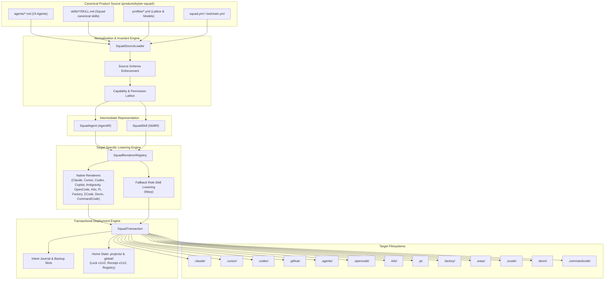
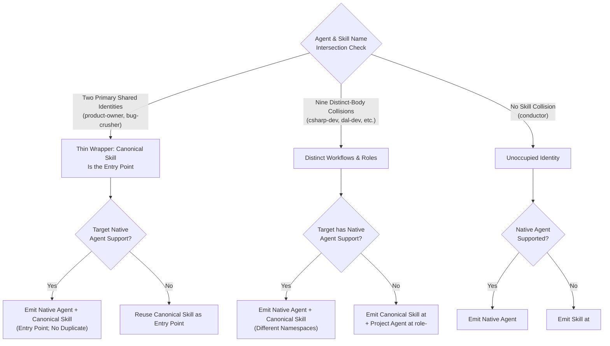
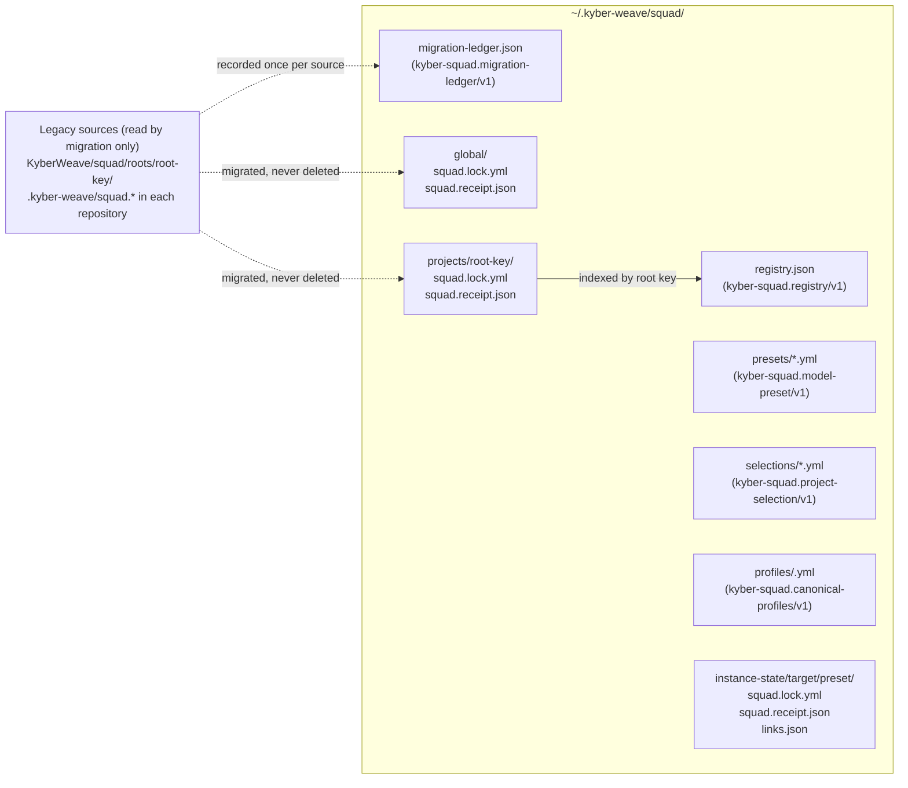
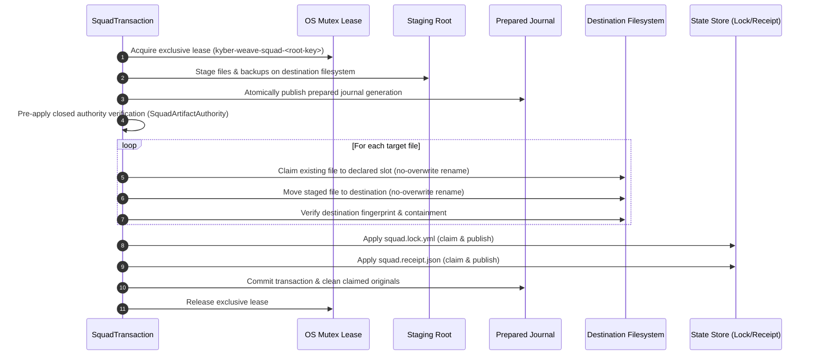
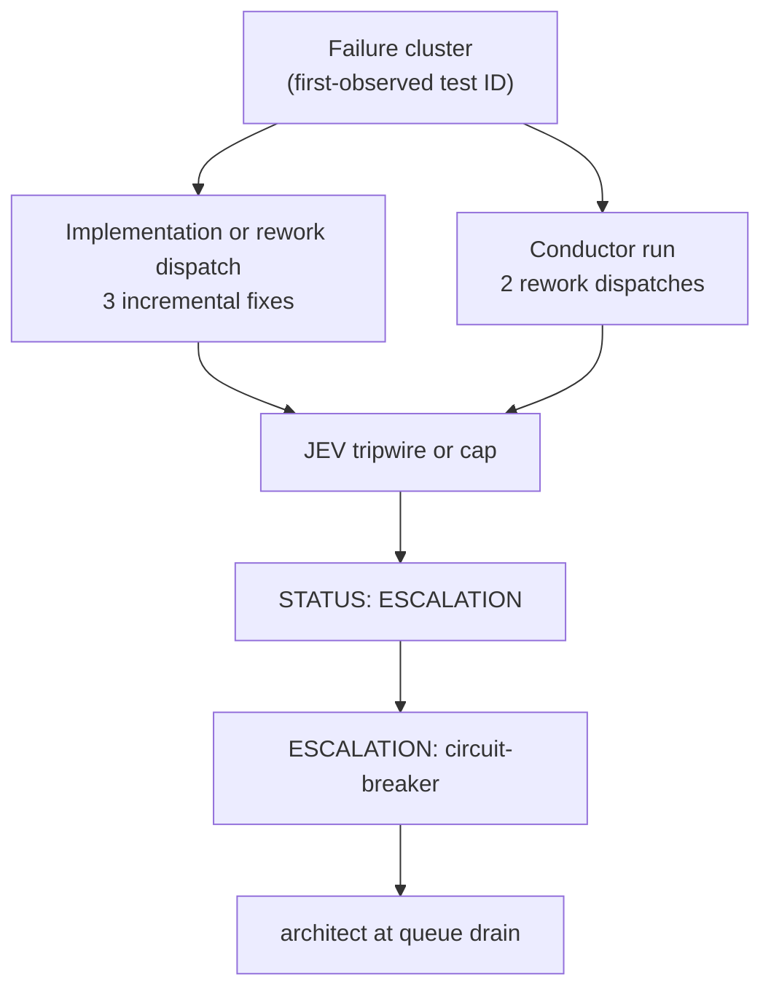
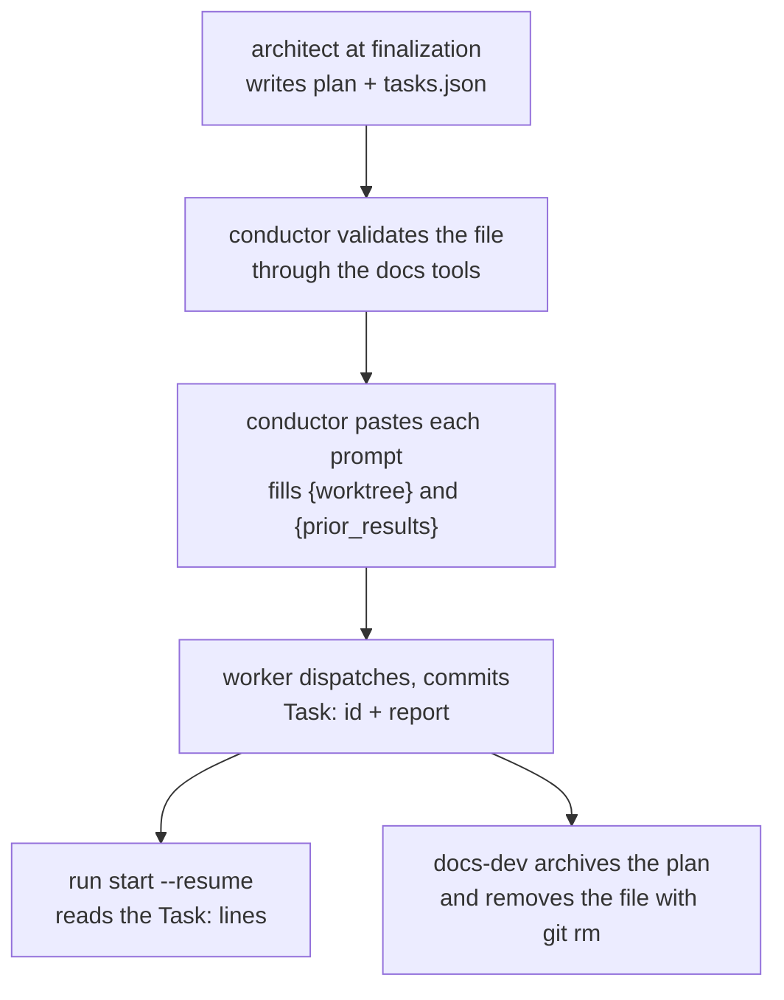
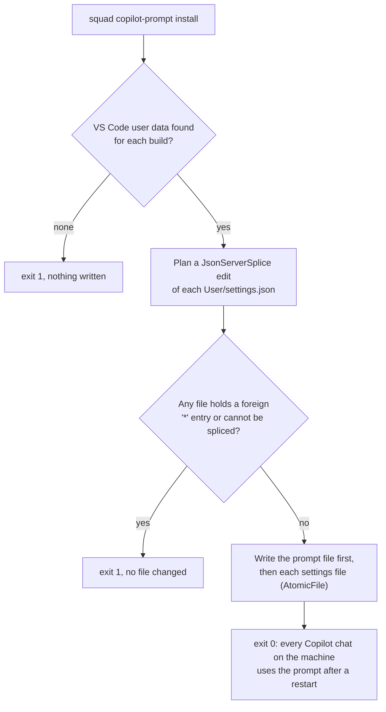

# Kyber-Squad architecture

Kyber-Squad is the multi-harness governance and deployment engine within Kyber-Weave.
It normalizes canonical agent and skill definitions into an intermediate representation (**AgentIR**),
evaluates capability and permission lattices, applies deterministic role-skill lowering, and executes
atomic, recoverable deployments. Its catalog declares thirteen target coding harnesses; all thirteen have
implemented and registered renderers today.

---

## Architectural Overview



---

## 1. Canonical Source Normalization and IR Construction

Kyber-Squad treats `products/kyber-squad/` as the immutable, canonical source of truth:

- **Canonical Agent Definitions**: Authored in `products/kyber-squad/agents/<name>.md` with closed YAML frontmatter and LF-normalized UTF-8 bodies.
- **Normalization Pipeline**: `SquadSourceLoader` parses frontmatter against `schemas/agent.schema.json`, validates capability bindings, computes an immutable SHA-256 instruction digest over the normalized body, and emits a structured `AgentIR` model.
- **Strict Invariants**: Loaders reject undeclared profiles, missing capabilities, invalid invocation modes, path traversal attempts, or unrecognized frontmatter keys.
- **Canonical Skills and Resources**: `SquadSourceLoader` loads the top-level `SKILL.md`
  identities under `products/kyber-squad/skills/`. The canonical tree separately retains
  supplemental files beside them; `SquadPacker` carries that complete recursive tree into both
  package formats. No count is stated here: the directories on disk are the inventory, so a
  skill added later changes no prose.
- **Composed Squad tree**: Pack and the checkout release source add the Kyber-Weave skills authored
  in `.apm/skills/` to the Squad tree as `skills/<name>/**`. Each release archive therefore holds the
  Squad skills and the Kyber-Weave skills with their resources. `SquadCompanionSkills` is the one type
  both callers use. It resolves `<repo>/.apm/skills` from a Squad root shaped
  `<repo>/products/kyber-squad`, and it takes every directory there that holds a `SKILL.md`. The
  companion skills are never copied into `products/kyber-squad/`, and `bundles/full.yml` lists only the
  Squad skills.
- **Fail-closed names and links**: A companion skill whose name equals a Squad skill directory or an
  `agents/<name>.md` file, ignoring letter case, is refused, and the error names both paths. A symbolic
  link at `.apm`, `.apm/skills`, a companion skill's directory, its `SKILL.md`, or any file or folder
  inside a companion skill is refused, and the error names the link. `squad pack` exits 1 and writes no
  archive. The checkout release source throws before it writes anything; a copy failure after that can
  leave partial files, which the Squad installer removes along with the destination.
- **Pack validation**: `squad pack` loads the real Squad tree, then packs the composed tree into a
  scratch folder, extracts it, and loads it. The scratch folder is removed on every path. A refused pack
  leaves the previous archive at the output path, and so does a failed write: each archive goes to a
  temporary file beside its target and replaces it only when complete.
- **Known limitation**: A symbolic link inside `products/kyber-squad/` that points outside the repository
  is still packed when no loaded file references it. The pack walk follows links, and the loader checks
  only the files it reads. The gap predates the composed tree. Closing it is a separate follow-up, not
  part of this design.
- **Domain Models and IR Construction**: Markdown files parse into `SquadAgent` and `SquadSkill`
  domain models; frontmatter fields validate against strict schemas (e.g. `model-profile`,
  `capability-profile`, `tools`, `delegates-to`); concrete `AgentIR` / `SkillIR` representations
  are created with resolved tool references, evaluated capability mappings, and parsed
  instruction bodies.

---

## 2. Capability and Permission Lattice Evaluation

Agent permissions are evaluated through a strict multi-level lattice:

```
Grant (allow) > Review (ask) > Deny (deny) > Default (withhold)
```

1. **Capability Taxonomy**: Maps high-level operations (`filesystem.read`, `filesystem.write`, `process.execute`, `network.fetch`, `network.publish`) to platform-specific tools.
2. **Non-Broadening Guarantee**: Target-specific renderers may restrict or narrow permissions, but must **never** grant capabilities beyond what the canonical agent specification authorizes.
3. **Structured Degradations**: Where target platforms lack granular permissions or cannot enforce delegation boundaries, Squad emits explicit degradation records in the deployment receipt rather than guessing or silently granting ambient privileges.

**MCP reach is not a capability.** No lattice entry names an MCP server:
`products/kyber-squad/profiles/capabilities.yml` declares exactly `filesystem.read`,
`filesystem.search`, `filesystem.write`, `process.execute`, `network.read`,
`network.publish`, and `delegate`. A per-agent MCP grant is renderer-derived from the
entitlement rule in §8, so which servers an agent can call is a rendering contract rather than a
lattice decision — and a grant that reaches past a profile's own decision is recorded as an
accepted widening where it is made, not folded into the taxonomy.

### Architect shell and documentation gates

The shared `architect` capability profile holds `process.execute: allow` on every target
(changed 2026-11-09; it was `deny`). The shell exists because the MCP servers stay bound to the
canonical checkout and cannot see a plan written into a run's worktree. In the worktree the
architect runs `kyber-weave docs validate . --merge-ready`, `kyber-weave docs drift .` and
`codegraph explore "…"` itself, and reads `git` state. It is not permission to implement:
`filesystem.write` stays instruction-scoped to the plan, spec and todo directories, the agent
body enumerates the only commands it may run and forbids edits to code, tests, configuration and
pipelines, and the Arbiter still classifies the role as planning-only.

This is an accepted widening with residual risk. The lattice has no command or path scoping, so
with `filesystem.write` and `network.read` allowed beside it, nothing but the agent body stops
the shell from building, installing, fetching or writing outside the plan, spec and todo
directories. The compensating controls are the body's command list, the Arbiter classification,
and code review of the resulting diff; none is enforced by the lattice.

In the canonical checkout the architect may equally call the read-only MCP tools
`docs_validate_governed_document_schema` and `docs_detect_drift_between_documents_and_code` on the
`kw-docs` server ([MCP runbook](../docgraph/mcp-runbook.md)); they run the same gates against the
server's resolved root. It leaves
`mergeReady` false while the plan is in the active plans folder so open-work rules such as
`KW-DOC-LIFECYCLE-003` do not fire. It trusts a pass only when the response `rev=` and `branch=` equal the packet's `RUN_BASE` and `RUN_BRANCH`; `repo=` (the git directory) must equal the architect's own `git rev-parse --git-common-dir`, which rejects another repository such as a fork; it cannot tell worktrees apart, which is why `rev=` and `branch=` are checked too. With no shell the comparison cannot run and only conductor-supplied `DOCS_CHECKS` are accepted. With a shell and a missing or mismatched result it runs the CLI gates in the checkout holding the plan. If the runtime withholds the shell anyway, the architect returns
`STATUS: BLOCKED` ("server root differs: run the docs checks in the worktree") and the conductor
runs the CLI gates. `architect-devin` and `architect-copilot` now match the shared profile.

---

## 3. Role-Skill Lowering and Namespace Resolution

Harnesses differ in their native agent support. Platforms that lack native subagent execution
receive role-skill lowering, converting agents into executable skills with prefixed naming to avoid
distinct-body collisions. The primary shared identities reuse the canonical skill as their entry
point, so no `role-` projection is generated for them:



### Resolution Rules

1. **Primary Shared Identities (`product-owner`, `bug-crusher`)**:
   - The agent body is a thin wrapper that loads and follows the same-name canonical skill; the
     skill carries the role. The two bodies differ by design, and the source validator permits
     that only for a `primary`-invocation shared identity.
   - The canonical skill is the entry point and is always emitted. A target that renders a primary
     through an additional entry-point form (Claude, Factory) emits the agent file plus the
     canonical skill and no duplicate; a target that lowers a primary onto a skill or command
     (Cursor, Pi, ZCode, Devin, Warp) reuses the canonical skill and emits no projection of its own.
   - No `role-<name>` projection is generated, and no skill projection is suppressed.
2. **Distinct-Body Collisions (`csharp-dev`, `dal-dev`, `github-devops`, `go-dev`, `maui-dev`, `python-dev`, `rust-dev`, `test-dev`, `typescript-dev`)**:
   - The canonical skill and agent serve distinct functions.
   - On fallback targets, the canonical skill stays at `<name>`, and the agent instruction body is projected to `role-<name>`.
   - `role-` is reserved exclusively for generated projections; no canonical source file may use the `role-` prefix.
3. **Unoccupied Identities**:
   - Agents with no matching skill name lower directly to `<name>` as a skill on fallback targets.
   - `conductor` follows this rule because it has no canonical skill. The fallback profile's
     `shared-identities` list names only the two primary shared identities above, and the canonical
     catalog carries no version aliases.

### Native Branch: Pi with Primary-Agent Lowering

Pi is a native agent target ([ADR 0019](../adr/0019-pi-native-subagents-and-primary-lowering.md))
that projects subagents natively but lowers its primary-invocation
agents to a skill, per the fallback profile's `no-primary-agent: skill` value. Pi
core has no primary-agent primitive: `.pi/SYSTEM.md` or `--system-prompt` replaces the whole
session prompt. Rendering `conductor` as a subagent instead would place it at depth 1, pushing its
delegated specialists to depth 2 — where Pi's default `maxSubagentDepth: 2` removes the nested
delegation that `architect` and `code-reviewer` need. Lowering it to a top-level skill keeps it at
depth 0, where the extension's `Agent` tool is available, and its specialists' nested rosters
still work. The two primary shared identities lower the same way, except that their canonical skill
already exists and is reused as the entry point rather than a lowered copy being emitted.

### Native Branch: Claude with a Primary-Agent Entry-Point Skill

Claude is a native agent target that projects subagents natively to `.claude/agents/<name>.md` and
has a real primary-agent primitive only through `claude --agent <name>` or the `agent` setting —
the only modes where Claude Code enforces the agent's `tools` allow-list, `Agent(roster)` roster,
and model. A primary-invocation agent rendered as a subagent would run nested, where the roster
is ignored and the Agent tool may be unavailable (spawn depth 1 in cloud sessions).

When a primary agent's fallback profile declares `no-primary-agent: skill`, Claude renders **both**
the subagent at `.claude/agents/<name>.md` (kept for enforced invocation) **and** an entry-point
skill at `.claude/skills/<name>/SKILL.md`, invoked as `/<name>` in the main conversation. For a
non-shared primary the entry-point skill is derived from the agent: it is byte-identical to the
subagent body and carries exactly three frontmatter keys — `name`, `description` (collapsed to one
line), and `license: MIT`. Its resources project beside it as with other skills.

**A primary shared identity reuses its canonical skill as the entry point.** For `product-owner`
and `bug-crusher` the canonical skill already occupies `.claude/skills/<name>/SKILL.md` and carries
the role, so the renderer emits the subagent file plus the canonical skill and does **not** emit a
duplicate entry-point skill ([ADR 0036](../adr/0036-primary-agent-canonical-skill-entry-point.md)).
Emitting both would project one identity twice and would overwrite the role-carrying skill with the
wrapper body. The canonical skill's body differs from the subagent body by design here — the
wrapper points at the skill — so the "byte-identical" rule applies only to a derived entry point.

The skill's description stays in Claude's context, so Claude may auto-load `/<name>` into the main
conversation without the user typing it. The degradation records account for this unenforced
entry point: its details state that the session's tools, permission mode, MCP servers and model
apply to the skill, and that `claude --agent <name>` is the enforced alternative. The subagent
file is kept unchanged, and resources project to both principals.

Claude is the first native target where a single agent emits two distinct principals (subagent and
entry-point skill). Under `no-primary-agent: omit`, no entry-point skill is emitted and the agent's
records remain unchanged.

**Fail-closed on an unresolvable canonical skill collision.** If a canonical skill occupies the
entry-point identity and the agent is **not** a declared shared identity, the render fails with a
`SquadRenderValidationException` rather than resolving the collision through role-prefixing. The
canonical skill and the derived entry-point skill would both claim
`.claude/skills/<name>/SKILL.md`, and a native target has no role-prefixed escape hatch. A declared
shared identity is the resolvable case: the canonical skill is the entry point and no duplicate is
emitted. Separately, Claude resolves personal skills before project skills but project agents
before user agents, so mixed-scope installs can expose `/<name>` and `@agent-<name>` from different
versions.

---

## 4. Deployment Scopes and State Topology

Squad maintains deployment state under the user's home directory across three scopes:



- **Home state root**: `<home>/.kyber-weave/squad/`, where `<home>` is `ISquadUserPaths.HomeDirectory`
  (the user profile in production). Tests inject a temporary home and never touch the real one.
- **Global state**: `global/squad.lock.yml` and `global/squad.receipt.json`. The global anchor is the
  home directory. Under `--global`, the positional path, `--path`, and the working directory are
  not consulted.
- **Project state**: `projects/<root-key>/squad.lock.yml` and `projects/<root-key>/squad.receipt.json`.
  `<root-key>` is `SquadPhysicalRootIdentity.Key`, so lexical and symbolic-link spellings of one
  directory converge on one entry.
- **Instance state**: `instance-state/<target>/<preset>/squad.lock.yml` (v2), `squad.receipt.json`,
  and `links.json`. Deployed instance files live in `instances/<target>/<preset>/`. The transaction mutex
  is keyed by the lowercase SHA-256 of the physical instance root path (`SquadPhysicalRootIdentity.Key`),
  ensuring multiple concurrent executions of the same instance target are cleanly serialized.
- **Legacy sources**: the application-data tree `KyberWeave/squad/roots/<root-key>/` and each
  repository's in-repo `.kyber-weave/squad.lock.yml` and `squad.receipt.json`. Migration reads them and
  never deletes them. The application-data directory is no longer a state location; rendering's own
  user-scope directory is unchanged.
- **Canonical profile snapshots**: `profiles/<version>.yml` (schema
  `kyber-squad.canonical-profiles/v1`) carries one Squad release version's canonical model profiles
  — the `models.yml` shape plus the agent-name-to-category map — written atomically (temporary
  file, then rename) by `SquadLifecycleService` after a committed install or update, never on
  dry-run. `preset use` and `preset clear` read the snapshot keyed by the deployment lock's
  `SquadVersion`, falling back to the newest snapshot; `preset show` has no deployment context
  and reads checkout first, then the newest snapshot. A checkout `products/kyber-squad` source
  is preferred over any snapshot wherever one is present. A snapshot write that fails after the
  transaction has committed produces a warning naming the remedy (rerun `squad update`); the
  deployment is not failed. One file is kept per distinct version and snapshots are never
  pruned.

- **Task gates come from `docs init`, not from Squad.** Squad writes no configuration: a
  project-scope `squad install` or `squad update` that finds no `review.task-gates` in the
  project's host config prints one hint — run `kyber-weave docs init` to write the gates
  for the declared technologies — instead of writing them. The hint never changes the
  verb's exit code, and global scope never prints it, because there is no project.

- **Factory MCP wiring splits between Squad and the operator, and the split is a standing rule.**
  Squad owns the **droid whitelist**: the per-droid `mcpServers` value rendered into each droid
  file Squad writes, and nothing more. Squad owns **no Factory settings file** — it does not
  create, write, or adopt `.factory/mcp.json` (repository scope) or `~/.factory/mcp.json`
  (global scope), and it invents no Factory server names for an operator to have to match.
  `squad install` and `squad update` only read those files, and print
  `factory-mcp-not-configured` when a server the droids are allowed has no definition. Those
  files are user-owned, and the operator owns the app-level configuration in them. This is the
  same boundary the task-gate bullet above draws: Squad renders the artifacts it owns and
  documents the operator's half rather than writing it. The operator's half
  is spelled out in the [MCP runbook](../docgraph/mcp-runbook.md#factory), because a dispatched
  droid needs both halves — Squad's whitelist names a server, and the operator's file launches
  it — and `squad doctor` checks neither. **Squad owns droid-level visibility; the docs branch
  owns harness-level wiring** — the `mcp:` declaration, `docs init`'s check, and `docs
  mcp-wire` — and Squad writes no harness MCP configuration for any harness ([ADR
  0052](../adr/0052-docs-branch-writes-repository-scope-mcp-configuration.md)).

### Cross-Process Mutex Lease

- **Named OS Mutex**: Every mutating operation acquires an exclusive OS-named mutex (`kyber-weave-squad-<root-key>`).
  For global scope the key is the hash of the physical home directory. For instance scope the key is
  the hash of the physical instance root directory.
- **Scope-Independent Contention**: Project-scoped and global-scoped operations targeting the same physical root contend for the exact same mutex, preventing concurrent corruption. A project installed at the home directory therefore shares the global mutex.
- **Per-Root Work Directory**: The transaction work directory and journal stay with the physical root. Project scope uses `<root>/.kyber-weave/.squad-transaction`; global scope uses `<home>/.kyber-weave/.squad-transaction`; instance scope uses `<instance-root>/.squad-transaction`. Only the receipt, lock, and link manifests move to the home state root.
- **Precondition Reverification**: After acquiring the lease, all preconditions and path containment assertions are re-evaluated immediately before filesystem operations.

### Transaction Engine and Disk Durability

Deployments execute through `SquadTransaction`, which stages writes, prepares rollback journals (`intent.json`), and commits state atomically:

- **Stable Storage Synchronization (`SquadTransaction.SyncToDisk`)**: In production, journal commits, artifact writes, receipt updates, instance link syncs (`SquadInstanceLinkSync`), and preset selections (`SquadModelPresetSelectionStore`) force all writes to stable storage via device flushes (`F_FULLFSYNC` on macOS, flush file buffers on Windows).
- **Flow-Isolated Durability Scope (`SquadTransaction.UseSyncToDiskScope`)**: Test harnesses can selectively disable device flushes without process-wide static mutation by entering an `AsyncLocal<bool?>` execution scope via `SquadTransaction.UseSyncToDiskScope(false)`. This guarantees durability test overrides never leak filesystem flush overhead onto concurrent test threads.

### Registry

`<home>/.kyber-weave/squad/registry.json` (schema `kyber-squad.registry/v1`) indexes project roots so
that a global update, `status --global`, and `doctor` can find them. Each entry is keyed by root key and
holds the physical path, the last update time in UTC, and the targets deployed.

- **Maintenance**: project install, update, and import upsert an entry; project uninstall removes it.
  Every write is atomic (temporary file, then rename). Global state is not registered.
- **Index, not authority**: `ListProjects` reads each entry and marks it `Stale` with a reason when
  the path is missing, the physical key no longer matches the path, or the receipt under
  `projects/<root-key>/` is missing. It also rebuilds an entry for any receipt under `projects/<root-key>/`
  that has no registry row. A deployment is never read from the registry alone.
- **Reconciliation**: `ListProjects` persists the rebuilt registry only when a caller lists it through
  the persisting path. In the CLI that is `squad status --global`, `squad update --global` (when it lists
  projects for its picker), and `squad doctor`. No other verb reconciles it. Lookups never write:
  resolving a named `--projects` path uses `FindProject`, and migration's single-root binding lookup uses
  `ListProjectsWithoutRebuild`. A receipt that does not parse is left out of the rebuild, so the other
  projects still list. An unreadable registry file makes `squad status --global` and `squad doctor` fail
  and name it.
- **Stale entries**: no command unregisters an entry. `SquadStateStore.UnregisterProject` is called only
  by project uninstall, so an entry whose directory no longer exists stays flagged until that path
  returns. `squad update --global --projects` warns about and skips a stale named path.
- **Write failure**: a registry write that fails after the transaction has committed produces a
  warning that names the remedy, rerunning `kyber-weave squad status --global`. The transaction is not
  failed.

### Lock and Receipt Files

Lock and receipt files are not committed to the repository. Squad writes them to the home state
root. The in-repo copies of earlier releases are read by migration and retained for rollback.

- **`squad.lock.yml`**: Contains bundle metadata, versions, target lists, exclusions, translation mode, bundle digests, and model preset mappings. Also carries a vestigial upstream-toolchain identity field, kept for schema stability now that rendering no longer depends on an external toolchain; it reads `unverified` on every install.
- **`squad.receipt.json`**: Records scope, installation timestamp, structured degradation records, and an ordered manifest of owned files with relative paths and SHA-256 digests. Its `targetRoot` is the canonical absolute physical root for a project receipt (receipts written with `"."` remain readable). A global receipt records the home anchor, or the resolved binding root for a migrated legacy single-root receipt.

#### Receipt version and layout contract

- **Global scope**: receipts serialize as `kyber-squad.receipt/v2` and carry a required `layout` field specifying `single-root` (all paths target-prefixed, legacy rc.9/rc.10 format) or `per-target-roots` (bare paths, rc.11+). There is one global receipt, at `global/squad.receipt.json` under the home state root; sibling global receipts are retired.
- **Project scope**: receipts remain v1 with no layout field. Since [ADR 0037](../adr/0037-squad-state-in-user-home.md) they record the canonical physical root in `targetRoot` instead of `"."`, which amends the byte-identical rule of [ADR 0024](../adr/0024-squad-global-receipt-layout-marker.md).
- **Legacy v1 global receipts** (pre-#91): classified by examining paths in the receipt. If every entry is target-prefixed (e.g., `.codex/agents/x.toml`), it is treated as `single-root` layout. If no entry is prefixed, it is `per-target-roots`. A receipt mixing both patterns is invalid. A v2 receipt whose declared `layout` contradicts its paths is rejected the same way.
- **Compatibility**: CLI versions before the v2 layout marker refuse a v2 global receipt with exit code 1 and do not modify any files. Upgrade the CLI to proceed.
- **Legacy recovery**: for an rc.9/rc.10 single-root install, `status` and `uninstall` operate against the recorded deployment root; `update` and same-target `install` refuse with guidance to run `kyber-weave squad uninstall --global` followed by `kyber-weave squad install --global`.
- **Blocks in shared hook files (`kyber-squad.receipt/v3`)**: a receipt that owns entries
  inside a shared hook file serializes as `kyber-squad.receipt/v3`, each block carrying
  `relativePath`, `target`, `createdFile`, and `entries` of `container` (an RFC 6901 JSON
  pointer to the entry) and `sha256` (over the entry's compact JSON). This replaces the
  earlier "a project-scope receipt" and "written only at project scope": a block receipt is
  written at project **and** global scope. A project v3 receipt is the v1 field set plus
  `blocks`; a global v3 receipt is the v2 field set — `scope: global` with its required
  `layout` — plus `blocks` and, when it owns any, `homeFiles`. Instance scope never owns a
  block, and a receipt without blocks stays byte-identical v1 or v2. An older CLI refuses a
  v3 receipt with exit code 1. See
  [owned blocks](#owned-blocks-in-shared-hook-files) below and
  [ADR 0054](../adr/0054-squad-owned-blocks-in-shared-hook-files.md).

#### Owned blocks in shared hook files

Some harnesses keep hooks in a file the user also owns, and JSON has no comments to
mark a block with — so Squad owns marked *entries*, never the file
([ADR 0054](../adr/0054-squad-owned-blocks-in-shared-hook-files.md), an exception to
the rule that Squad does not own settings files). The deployment plan splices Squad's
rendered entries into the file, replacing Squad's previous entries while the user's
entries keep their order and values; a missing file starts from the format's minimal
document, and an existing user file at a block path is not an unmanaged collision.

| Target | File | Owned containers | An entry is Squad's when | Written fields |
|---|---|---|---|---|
| `claude` | `~/.claude/settings.json` (global scope only; at project scope Claude's hooks sit in agent and skill frontmatter) | `/hooks/PreToolUse`, `/hooks/PostToolUse` (always PascalCase; a legacy `preToolUse` or `postToolUse` Squad entry is removed when the block is next rendered, and a lower-case container left empty by that removal is deleted) | its `command` starts with `kyber-weave-arbiter hook --harness claude` | `command`, `matcher`, `timeout`; drift is re-anchored across both spellings of each container, so a receipt recorded before the migration reads as moved, not missing |
| `cursor` | `.cursor/hooks.json` | `/hooks/preToolUse`, `/hooks/postToolUse` (a new file starts `{"version":1,"hooks":{}}`) | its `command` starts with `kyber-weave-arbiter hook --harness cursor` | `command`, `matcher`, `timeout`, `failClosed` |
| `codex` | `.codex/hooks.json` | `/hooks/PreToolUse`, `/hooks/PostToolUse` | every `hooks[].command` in the matcher group starts with `kyber-weave-arbiter hook --harness codex` — a group mixing Squad and user hooks stays user content | `matcher`, `hooks:[{type, command, timeout}]` |
| `factory` | `.factory/hooks.json` | `/PreToolUse`, `/PostToolUse`, and `/SubagentStop` (matcher-less group, Factory only) — the groups sit at the top level of the file, with no `hooks` wrapper | every `hooks[].command` in the matcher group starts with `kyber-weave-arbiter hook --harness factory` | `matcher`, `hooks:[{type, command, timeout}]` |
| `devin` | `.devin/hooks.v1.json` | `/PreToolUse`, `/PostToolUse` — the whole file is the hooks object in the Claude Code format | every `hooks[].command` in the matcher group starts with `kyber-weave-arbiter hook --harness devin` | `matcher`, `hooks:[{type, command, timeout}]` |
| `antigravity` | `.agents/hooks.json` | the top-level `kyber-arbiter` group, owned by key — top-level keys there are group names, so any unknown key would be read as another group | the whole group: ownership is by key, not by signature | matcher groups matching `^invoke_subagent$`, each holding `{type, command, timeout}` hooks |

The five shared-file blocks below the Claude row render when the Arbiter is enabled, at project scope and at
global scope — this replaces the earlier "at project scope" alone. The Claude row is the global user-level
block only. The table gives the project-scope path;
at global scope the file sits directly beneath the harness's global root, so Antigravity's
group lands in `~/.gemini/config/hooks.json`, the only file it reads globally, never in
`.agents/hooks.json` there. An install made before that fix recorded the group at
`.agents/hooks.json` under the global root; `arbiter uninstall --target antigravity`
removes it, and a reinstall writes the right file. The Cursor and Codex
blocks landed in Phase 2, and the Factory, Devin, and Antigravity shapes in Phase 3. Pi's
owned extension file is a whole owned file, not a block. Only documented fields are
written, never a sentinel key, and shared-file hook commands carry no `--caller` because
they gate project-wide. The plan-side splice is the file splice: it calls the content-level
`SquadHookJsonBlock.SpliceContent` that the file-level splice also uses — same containers,
same ownership test, same digests — so a dry run and an install cannot diverge. Planning
stays side-effect free because it never calls the file-level `SpliceFile`, which is what
writes. On `factory` the lifecycle first runs the shadowing check: when
`.factory/settings.json` has a `hooks` key and `.factory/hooks.json` is absent, the Factory
block is dropped and `arbiter-not-enforced` (`settings-hooks-shadowed`) is recorded
instead, because Factory reads that `hooks` key only while `hooks.json` is absent and
rendering the file would silently disable the user's hooks.

**Scope-aware block identity.** A block's recorded path is relative to the root it deploys
beneath, so the same format names a different path at each scope: project scope keeps the
target's project directory (`.cursor/hooks.json`), and global scope keeps only what is left
beneath that target's own global root — `cursor`, `codex` and `factory` each record
`hooks.json`, and `devin` records `hooks.v1.json`. Several targets therefore record one
identical relative path at global scope, and the path alone cannot tell them apart. The
receipt validator derives every stored block's deployment identity from one private helper
that the stored-file loop calls too: the portable path alone under `project` and `instance`
scope, where every target writes beneath one deployment root and two targets claiming one
path would claim one physical file; and target plus path under `global` scope, where the
target is the only thing that separates the files. One helper for both loops is what keeps a
stored file and a stored block from ever disagreeing about which physical file a claim names.
The duplicate refusals are unchanged: one target claiming a path twice is refused at every
scope, two targets claiming one path is refused at project and instance scope, and one block
claiming the same container twice is refused. A global receipt therefore owns blocks exactly
as a project receipt does, and `status`, `doctor`, `update` and uninstall read a block's path
from the receipt instead of recomputing it from a per-format constant, so the recorded claim
and the file they inspect are the same one.

A hand-edited or missing owned entry is drift, reported by `squad status` and
`squad doctor` naming the file and the container. `squad update` rewrites the block
but preserves a drifted entry, reporting it, unless `--replace-managed` is given.
`squad uninstall` removes only the owned entries and deletes the file only when
Squad created it and no hook remains.

#### Home-owned files and the user-home response guidance

A global receipt also records the files Squad owns in the user's home rather than in a harness's
root, in an additive `homeFiles` array. Each entry carries a `relativePath` and the lowercase
SHA-256 `sha256` of the bytes Squad wrote. The field is written only on a global receipt and
only when it is non-empty, so a receipt written by an earlier CLI still parses and an
existing global deployment is not disturbed by the field's arrival.

The first such file is the user-home response guidance, `<home>/.kyber-weave/response-guidance.md`.
It belongs to no harness: every deployed entry file receives its text at install and update
(see [response preferences](#response-preferences-injected-at-deploy)), which is why it is owned as a home file rather than deployed beneath a target's global root.
`SquadResponseGuidanceDeployer` decides what a run does with it, and the refresh rules follow
the staging shape the canonical model-profile snapshot in `SquadCanonicalProfileStore` already
uses — a file whose bytes still match a recorded digest is Squad's own copy of what it shipped,
and anything else belongs to the operator:

- **Absent → deployed**: no file at the path means nothing is at risk, so the shipped default is
  written and read back, and its digest recorded.
- **Bytes already equal the shipped default → adopted**: nothing is written and nothing is
  reported; the digest is recorded, so the file becomes Squad's own copy from then on. Recording
  it cannot lose operator wording, because the bytes are already identical to what this release
  ships. This rule is also the self-repair path for a run that wrote the guidance and then failed
  before its receipt was committed.
- **Digest matches the recorded default → replaced**: a file whose bytes still hash to what the
  receipt recorded is Squad's own copy of the shipped default. A newer release replaces it and
  the receipt records the new digest.
- **Edited, or present with no ownership record → preserved and reported**: anything else is the
  operator's own wording. The run reports that it kept the file and why, and does not adopt it:
  overwriting it would discard the one customization the file exists to hold. A file that exists
  with no ownership record was written by the operator or by a release older than the receipt,
  so it is never claimed. Deleting the file is how an operator takes the shipped default back.

The skill-carried mandatory load that used to sit here is gone: response preferences are injected
into the `conductor` and `bug-crusher` entry files at deploy, so no load step precedes a reply. The
file is kept as the one place the operator edits preferences; `squad install` creates it when absent,
and `squad update` never overwrites an edit.

Ownership is recorded only from a digest this run read back from the deployed path, and the order
follows from that: the deployment plan is built and validated first, then the transaction takes
the home lease and re-checks the plan's preconditions against the live tree, and only then is the
guidance classified, written and read back, with the receipt committed under the same lease. The
plan is what decides whether the run may write at all, so a plan that fails preflight — an
unmanaged collision, an adoption check, a legacy-layout refusal — leaves the guidance exactly as it
found it, and a dry run writes nothing at all. The lease is what keeps two updates apart: one that
cannot take it has written nothing, so two runs shipping different defaults cannot interleave their
writes and leave a file the winning receipt does not describe. The record is attached to the
receipt after validation, through a path that can only be reached with a digest a write has
already produced, so a refused plan cannot describe a home file the run never delivered.

One window remains between the write and the commit: a transaction that fails after the guidance
write leaves the new default in place with the run failing loudly. A retry of the same release
repairs it by adopting bytes that already equal the shipped default. A later release that ships
different wording cannot tell those bytes from an operator edit, so it keeps the file and warns;
deleting the file takes the new default. A guidance write that degrades leaves the
run's exit status unchanged. The conditions that degrade rather than throw are the ones a
filesystem, a platform path form, or a host policy can impose on an otherwise healthy run: an I/O
failure, a permission denial, a path form the platform cannot represent, and a security policy
that refuses the write. A programming error still throws, because a warning an operator cannot act
on is how a defect survives. Resolving the file's path follows that policy too, since it probes the
attributes of each segment on the way: a host that refuses the probe degrades like any other
denial, while a path that resolves outside the home root, such as a guidance file that is a link
out of it, still fails the run. The shipped default is read under the same policy: a build that
carries no readable default writes nothing, records nothing, and warns to reinstall from a release
that ships the guidance rather than to retry — the defect travels inside the binary, so another
run of the same build would fail the same way. Nothing is ever written outside the home root.

#### Lock version and preset contract

- **Lock v2 (`kyber-squad.lock/v2`)**: When any target has a model preset applied, the lock file serializes with `schema: kyber-squad.lock/v2` and adds a top-level `model-presets` mapping:
  ```yaml
  schema: kyber-squad.lock/v2
  model-presets:
    claude:
      name: zai
      digest: 7f83b1657ff1fc53b92dc18148a1d65dfc2d4b1fa3d677284addd200126d9069
  ```
- **Conditional upgrade**: Lock v2 is written only when `model-presets` is non-empty. When no presets are applied, the lock remains byte-identical `kyber-squad.lock/v1`. Clearing all presets restores the lock to v1.
- **Fail-closed backward compatibility**: Deserialization reads both v1 and v2. Older CLI versions that lack preset support reject a v2 lock file immediately upon encountering the undeclared `model-presets` field (`RequireExactYamlFields`), preventing silent preset loss or unintended rollbacks.
- **Integrity verification**: The recorded SHA-256 hex digest represents the exact content of the preset file at the time it was applied. Status checks detect drift between the file on disk and the recorded digest (`changed since applied`), while updates verify preset existence before downloading or rendering.

#### Migration from earlier layouts

A single shared helper, `SquadStateMigration`, runs before every squad verb (`install`, `update`,
`status`, `uninstall`, and `doctor`). It is automatic, non-destructive, and idempotent. It deletes
no file, and running it again after it has succeeded changes nothing.

- **Empty roots** under the legacy application-data tree are ignored.
- **One legacy global receipt, no home global receipt**: the receipt and lock are copied to
  `global/`, and `targetRoot` is set as described above. The legacy files are left in place.
- **Per-target-roots legacy receipt**: needs no root. **Single-root legacy receipt**: its binding root
  is resolved in this order: an absolute `targetRoot`, then the registry, then a key match against the
  home directory or the invoking directory. A receipt whose root cannot be resolved is not migrated
  and is reported.
- **More than one non-empty legacy global receipt**: none is migrated. Each is reported with
  guidance. Migration does not guess.
- **Home global receipt already present**: migration does nothing.
- **Project import**: when a project-scope verb, or a picker-driven update, touches root `R`, and
  `projects/<root-key(R)>/` has no receipt while `R/.kyber-weave/squad.receipt.json` exists, the receipt
  and lock are imported, `targetRoot` is set, and `R` is registered. The in-repo files are left untouched.
  Home state takes precedence from then on, and `doctor` warns that the retained in-repo state should
  be removed from version control.
- **Dry run**: under `--dry-run` nothing is written, including the ledger. The run reports that the legacy
  state at each path will be migrated on the next invocation without `--dry-run`. Install, update, and
  uninstall stop after that report.
- **Lease**: every copy and import runs under the transaction lease for the root. A busy lease writes
  nothing, reports a warning, and leaves the legacy files in place for the next run.
- **Write order**: a global copy writes the lock and then the receipt, which is the completion marker.
  A lock with no receipt is completed on the next run when the home lock is byte-identical to the source
  lock; a different home lock blocks the copy and is reported.
- **Doctor writes**: `squad doctor` runs the same migration as the other verbs, so it can write.

#### Migration ledger

`<home>/.kyber-weave/squad/migration-ledger.json` (schema `kyber-squad.migration-ledger/v1`) records each
completed global copy and project import, so migration is one-shot per source:

```json
{ "globalMigratedFrom": ["<legacy-root-key>"], "projectsImported": ["<root-key>"] }
```

- A global copy records its legacy root key after the receipt is written. A project import records the
  project's root key inside the lease that writes its state.
- A recorded source is never copied or imported again. An uninstall of migrated state therefore stays
  uninstalled while the legacy files it was copied from are retained. Doctor lists such a global root
  among the unmigrated legacy roots, with the reason that it was already migrated.
- The ledger gates only legacy copies and imports. Every verb runs migration first, but home state is
  never blocked by the ledger, so a fresh install after an uninstall is unaffected.
- A malformed or unreadable ledger is treated as empty, and a warning says so. The next successful write
  replaces it with a valid one.

### Global capture-plugin step

KyberDash's capture plugins are global capture, not a Squad pack resource, so Squad does not
render them. After a successful `squad install --global` or `squad update --global` whose resolved
targets include a capture-plugin harness, the command runs one KyberDash verb per such harness
through an injectable process runner. The step is **harness-aware**: the OpenCode call keeps its
place and the Factory call follows it, each call handed its own harness's resolved global root.

```text
kyberdash kyber capture plugin install --harness opencode --preserve --config-dir <Squad-resolved OpenCode root>
kyberdash kyber capture plugin install --harness factory --preserve
```

- **Owner of the files.** KyberDash owns the plugin file or tree, its receipt, and the consent
  file. Squad passes the OpenCode global root as `--config-dir`, so both agree on the path.
  Squad keeps its own receipts for its own files and reads none of KyberDash's. The flag is the
  **OpenCode** root: the Factory verb refuses it — a request that carries it is a usage error and
  writes nothing — and the Factory plugin is published as a marketplace tree under KyberDash's
  own state directory rather than under the Factory root. The Factory call therefore names **no
  root at all**: that verb resolves the Factory harness's own root itself.
- **Non-overwrite (C4).** Preserve mode keeps an edited or foreign plugin file or tree with a
  warning. It creates the consent file with content off only when that file is absent, and never
  touches an existing one. The step never writes `opencode.jsonc`, and it never writes
  `~/.factory/settings.json` or `~/.factory/hooks.json`.
- **The updater's own call.** `kyber-weave update` reconciles the Factory plugin with the same
  verb, in the same preserve mode, and with `--if-installed` — `kyberdash kyber capture plugin
  install --harness factory --preserve --if-installed` — and it hands the Factory call **no
  root**, because the plugin is installed where the harness already holds it. `--if-installed`
  decides from the harness's own registry, so a plugin the harness does not hold is not added.
- **Locating the verb.** `kyberdash` is found beside `kyber-weave` in the install directory, then on
  `PATH`. When it is absent, Squad logs one skip line that names `kyber-weave update`.
- **Failure isolation.** A non-zero exit from the verb prints a warning line that names the retry
  command. It does not change Squad's exit code, and nothing rolls back. An older `kyberdash` without the
  verb prints a named skip.
- **Scope and opt-out.** Project-scope runs do not run the step. `--no-capture-plugin` on `squad install`
  or `squad update` skips it, and `--dry-run` passes `--dry-run` through to the verb.
- **Consent.** Install never turns content capture on. For OpenCode the Settings switch (or
  `kyberdash kyber capture enable --harness opencode`) does that. For Factory the Settings switch
  does that too: a confirmed `enable` turns the prompt text on with the capture, because the
  confirmed switch is the consent, and `kyberdash kyber capture plugin consent --harness factory --off`
  turns the prompt text back off without disabling the capture (or the owner edits the consent
  file). The verb's
  own consent line, which Squad relays, says so.
- **Guidance wording.** Squad prints no OpenCode or Factory restart line of its own. It relays the
  `harness opencode: ` lines the verb prints, and KyberDash owns their wording (ADR 0031). After an
  install or upgrade that changed the plugin file, the relayed line reads: `OpenCode 2.x picks up the capture plugin
  for new sessions; if KyberDash shows no new OpenCode sessions, restart OpenCode.` Squad cannot restart OpenCode.
- **Support.** The OpenCode plugin targets OpenCode 2.x only. Squad does not check the OpenCode
  version before it runs the verb
  ([ADR 0048](../adr/0048-opencode-capture-is-a-v2-only-plugin-pipeline.md)). The Factory plugin
  targets Factory's documented plugin layout
  ([ADR 0055](../adr/0055-factory-capture-is-a-hooks-plugin-pipeline.md)).

### The Factory plugin subtree Squad does not own

Squad owns `~/.factory/droids/` and `~/.factory/skills/` under the Factory global root
`~/.factory`. It does **not** own `~/.factory/plugins/` — that subtree is the harness's own, and
KyberDash's `kyberdash-factory` capture plugin is not installed there: it is published as a
marketplace tree under KyberDash's own state directory and installed by the harness, so the plugin
that runs is the harness's cached copy. Squad never writes into the plugin subtree, never adopts it and
never removes it. `squad doctor` does not check it, and `squad uninstall` does not remove it.

---

## 5. Write-Ahead Journal and Transaction Engine

Deployments use an atomic, write-ahead, compare-and-restore transaction engine (`SquadTransaction`):



### Claim and Publish Protocol

1. **No Destructive Overwrites**: Files are never updated with in-place overwrites or unrecorded deletions.
2. **Deterministic Claiming**: Pre-existing target files are atomically moved into unique, manifest-declared backup slots using same-filesystem no-overwrite renames.
3. **Atomic Publication**: Staged artifacts are reverified immediately before being moved into their destination paths.
4. **State Written Last**: Lock and receipt files are published only after all target files have been successfully applied and verified.

---

## 6. Idempotent Recovery and Conflict Preservation

When an interrupted deployment or crash occurs, `SquadTransaction.Recover` restores system consistency:

- **Dual Fingerprint Resolution**: Recovery inspects both the destination path and the claimed backup slot to determine whether a transition completed, failed, or was interrupted mid-flight.
- **External Modification Preservation**: If an external process or operator modified a file during or after the transaction, recovery leaves the modified file intact, preserves the journal and backup evidence, and emits actionable repair guidance.
- **Clean Reversibility**: Uncontended rollbacks restore the pre-transaction state, clean up empty directories created by the transaction, and restore application-data topologies.

---

## 7. Transaction Observers

Squad exposes two observer interfaces for lifecycle monitoring and deterministic test verification:

1. **`ISquadTransactionObserver` (Public Lifecycle Contract)**:
   Receives exactly 6 ordered events:
   - `IntentWritten`
   - `FileStaged`
   - `FileBackedUp`
   - `FileApplied`
   - `LockApplied`
   - `ReceiptApplied`
2. **`ISquadTransactionCheckpointObserver` (Internal Diagnostic Extension)**:
   Opt-in observer used for fine-grained crash simulation across checkpoint states:
   - `Prepared`
   - `ActiveTransitionWritten`
   - `OriginalClaimed`
   - `AfterImagePublished`

---

## 8. Rendering

Lowering AgentIR into a harness's native files is native Kyber-Weave code, not a call to an
external toolchain. `SquadLifecycleService` renders through `ISquadRenderer`, resolved by
`SquadCommandComposition` to a `SquadRendererRegistry` — the composite that gates, dispatches,
and validates.

- **Coverage gate first**: before the release is even downloaded, the registry checks every
  requested target against `ISquadRenderer.SupportedTargets`. Any target with no registered
  renderer fails the whole request — install and update are all-or-nothing across the
  requested target set, never a partial render of the targets that happen to be covered.
- **One pipeline** ([ADR 0056](../adr/0056-squad-renderers-share-one-render-pipeline.md)): every
  shipped renderer derives from `SquadHarnessRenderer`, which owns the guard, source load and
  result. A harness supplies a `SquadHarnessSpec` (target, project root, agent directory, model
  policy, description line-break rule, skill license) and a `RenderAgent`; the shared skill
  document, skill loop, primary-agent lowering, discovery-guarded agent file and Arbiter hook
  block live on `SquadHarnessRenderContext`. Native versus fallback is
  `SquadTargetCatalog.GetAgentProjection`, which the registry's validation reads, so adding a
  harness is not a registry edit. `SquadRendererSharedContractTests` checks the shared steps once
  for every renderer against its spec.
- **Dispatch**: each supported target's canonical source goes to the `ISquadRenderer` that
  owns it — `ClaudeRenderer` for `.claude/agents/*.md` and a primary-agent entry-point skill at
  `.claude/skills/conductor/SKILL.md`, `CopilotRenderer` for `.github/agents/*.agent.md` and
  `.github/skills/*/SKILL.md`, `CursorRenderer` for `.cursor/agents/*.md` and `.cursor/skills/*/SKILL.md`,
  `CodexRenderer` for `.codex/agents/*.toml` and `.codex/skills/*/SKILL.md`; a primary agent
  without a declared shared skill also gets an entry-point skill,
  `AntigravityRenderer` for native per-agent directory emission to `.agents/agents/*/agent.md` and canonical skills to `.agents/skills/*/SKILL.md` ([ADR 0022](../adr/0022-antigravity-native-agents.md)),
  `OpenCodeRenderer` for `.opencode/agents/*.md` and `.opencode/skills/*/SKILL.md`,
  `KiloRenderer` for `.kilo/agents/*.md` and `.kilo/skills/*/SKILL.md`,
  `PiRenderer` for native subagent projection to `.pi/agents/*.md` and `.pi/skills/*/SKILL.md` with primary-agent lowering ([ADR 0019](../adr/0019-pi-native-subagents-and-primary-lowering.md)),
  `FactoryRenderer` for `.factory/droids/*.md` and `.factory/skills/*/SKILL.md`,
  `WarpRenderer` for fallback role-skill lowering to `.warp/skills/*/SKILL.md`,
  `ZCodeRenderer` for `.zcode/agents/*.md` and `.zcode/skills/*/SKILL.md` with primary agents lowered to slash commands at `.zcode/commands/*.md` ([ADR 0021](../adr/0021-zcode-command-lowering-and-resource-relocation.md)),
  and `DevinRenderer` for Devin Desktop's local agent: per-agent directories at `.devin/agents/*/AGENT.md` and skills at `.devin/skills/*/SKILL.md`, with primary agents lowered to a skill ([ADR 0025](../adr/0025-devin-native-agents-and-skill-lowering.md)).

| Target | Renderer | Agent Output | Skill Output | Kind |
|---|---|---|---|---|
| `claude` | `ClaudeRenderer` | `.claude/agents/<name>.md`; primary agents also at `.claude/skills/<name>/SKILL.md` | `.claude/skills/<name>/SKILL.md` | Native |
| `copilot` | `CopilotRenderer` | `.github/agents/<name>.agent.md` | `.github/skills/<name>/SKILL.md` | Native |
| `cursor` | `CursorRenderer` | `.cursor/agents/<name>.md` | `.cursor/skills/<name>/SKILL.md` | Native |
| `codex` | `CodexRenderer` | `.codex/agents/<name>.toml` | `.codex/skills/<name>/SKILL.md` (canonical skills and derived primary entry points) | Native |
| `antigravity` | `AntigravityRenderer` | `.agents/agents/<name>/agent.md` | `.agents/skills/<name>/SKILL.md` | Native |
| `opencode` | `OpenCodeRenderer` | `.opencode/agents/<name>.md` | `.opencode/skills/<name>/SKILL.md` | Native |
| `kilo` | `KiloRenderer` | `.kilo/agents/<name>.md` | `.kilo/skills/<name>/SKILL.md` | Native |
| `pi` | `PiRenderer` | `.pi/agents/<name>.md` | `.pi/skills/<name>/SKILL.md` (conductor lowered here) | Native |
| `factory` | `FactoryRenderer` | `.factory/droids/<name>.md` | `.factory/skills/<name>/SKILL.md` | Native |
| `warp` | `WarpRenderer` | `.warp/skills/role-<name>/SKILL.md` (lowered; see [§3](#3-role-skill-lowering-and-namespace-resolution)) | `.warp/skills/<name>/SKILL.md` | Fallback |
| `zcode` | `ZCodeRenderer` | `.zcode/agents/<name>.md`; primary agents lower to `.zcode/commands/<name>.md` | `.zcode/skills/<name>/SKILL.md` | Native |
| `devin` | `DevinRenderer` | `.devin/agents/<name>/AGENT.md` | `.devin/skills/<name>/SKILL.md` (conductor lowered here) | Native |
| `commandcode` | `CommandCodeRenderer` | `.commandcode/agents/<name>.md` | `.commandcode/skills/<name>/SKILL.md` (primary agents also as entry point) | Native |

- **Codex primary-agent entry points**: the renderer keeps every native agent at
  `.codex/agents/<name>.toml`. For a primary agent without a same-name canonical skill, it also
  derives `.codex/skills/<name>/SKILL.md` from the agent's description and instruction body, and
  projects the agent's resource closure beside that skill. The declared primary shared identities
  `product-owner` and `bug-crusher` reuse their canonical skills as entry points instead of
  producing duplicate skills. A same-name canonical skill on an identity not declared shared is
  an unresolved path collision; rendering fails closed rather than overwriting or renaming either
  artifact. Global scope removes the `.codex/` prefix from both output roots.
- **Target-scoped projection inputs**: each canonical agent declares exact `copilot-tools`, and may
  name a target-scoped `copilot-capability-profile` or `devin-capability-profile`. These fields
  validate and render that one target's allow-list and safety degradation only. They do not replace
  or widen the shared `capability-profile`, fallback metadata, description, or instruction body
  consumed by other renderers. `DevinRenderer` resolves `agent.DevinCapabilityProfile ??
  agent.CapabilityProfile` for every permission lookup it performs — granted tools, degradation
  records, MCP entitlement, and the pure-orchestrator exclusion — so an agent that names none
  renders exactly as before. Validation is what keeps the envelope scoped: a profile marked
  `target: devin` is rejected as an agent's shared `capability-profile`, a
  `devin-capability-profile` naming a profile without that marker is rejected,
  and a primary agent naming one is rejected because Devin lowers primaries to
  skills with no tool allow-list
  ([ADR 0028](../adr/0028-devin-target-scoped-authoring-capability-profiles.md)).
- **Pi per-target overlay (`pi-extensions` / `pi-tools`)**: a canonical agent may declare
  two optional flat frontmatter keys — `pi-extensions` (array of Pi extension ids) and
  `pi-tools` (array of additional Pi tool names). `pi-tools` entries must use the
  `ext:<extension>/<tool>` form; bare names are rejected so the overlay cannot smuggle a
  built-in past the capability lattice (read-only roles keep `process.execute: deny`),
  and every `ext:` entry's extension must be declared in `pi-extensions`. `PiRenderer`
  appends the declared `pi-tools` after the capability-derived `tools` CSV and emits the
  declared extensions as a YAML sequence (the live-verified form); agents without an
  overlay of either kind render `extensions: false` exactly as before.
  `research-agent` is now the only canonical agent that still declares this overlay by hand, and
  it does so for the `context7` pairs
  ([ADR 0019](../adr/0019-pi-native-subagents-and-primary-lowering.md)); the `kw-docs` half is
  renderer-derived for every read-entitled agent and needs no canonical declaration — see the MCP
  bullet below.
- **Copilot tool order ([ADR 0017](../adr/0017-copilot-deterministic-tool-order.md))**:
  `CopilotRenderer` emits `CopilotToolCatalog.Normalize(agent.CopilotTools)` — membership from
  the agent, order from one global catalog sequence (`vscode`, `tool_search`, `read`, `todo`, MCP wildcards,
  then search/execute/web/edit/agent and the granular edit tools). Normalization never adds a
  tool the agent omitted and never reorders per agent. Capability bindings are an upper bound
  at load/validation time, not a second membership source. Wildcards remain single-quoted in
  the YAML flow sequence.
- **Resource projection**: after each principal file, the renderer appends the owner's validated
  resource closure beside it — each resource at its artifact-relative path under the principal's
  directory — so authored relative links resolve verbatim in the deployed tree. A resource that
  would alias another principal's output is a validation error, never an overwrite. The rule for
  a target whose agent discovery registers nested markdown is property-based: an agent-owned
  markdown resource must deploy in a form the harness scanner ignores, keeping it co-located
  with its principal, with the deviation recorded as a `resource-links-rewritten` degradation.
  The three target-specific forms of that rule today are:
  - **ZCode** relocates agent resources under `.zcode/skills/<owner>/…` and rewrites
    declared-resource links to `../skills/…` ([ADR 0021](../adr/0021-zcode-command-lowering-and-resource-relocation.md));
    the rewrite stays relative.
  - **OpenCode and Kilo** keep resources co-located beside their principal but deploy every
    agent-owned `.md` resource with a `.markdown` extension, rewriting in-closure authored links
    `.md` → `.markdown` ([ADR 0040](../adr/0040-flat-agent-dir-discovery-guarded-resources.md)).
    Both scanners match only `{agent,agents}/**/*.md` recursively, so `.markdown` is invisible
    to discovery while each file stays beside — and wholly owned by — its agent. An agent closure
    holding both `x.md` and `x.markdown` fails closed rather than merging one path.
  - **Copilot, global scope only.** A global-scope agent is read from outside any workspace, so
    a relative link has no base the model can resolve. Each link in the agent body whose target
    exactly equals one of that agent's declared resource paths is rewritten to an absolute
    forward-slash path under the resolved Copilot global root
    (`<root>/agents/<resource-path>`, Windows roots included). A `#anchor` or `?query` suffix and
    a link title are kept; an authored angle-form destination is matched too. Links outside the
    declared closure, links inside fenced code blocks or inline code spans, and prose that merely mentions a path are
    untouched; a target containing whitespace or parentheses uses the CommonMark angle form
    `(<…>)`. Resource files stay beside the
    principal and are not themselves rewritten. Each rewrite is recorded as a
    `resource-links-rewritten` degradation, as for ZCode. Project scope is unchanged and
    byte-identical: links stay relative and the files sit inside the workspace.

  The Copilot rewrite needs the machine's global root, so `SquadRenderRequest` carries an optional
  `ISquadGlobalRootResolver? GlobalRoots` render input, supplied by lifecycle install, lifecycle
  update, and `squad doctor` so install, receipt, and doctor see the same bytes. It **fails
  closed**: a Copilot global render with no resolver throws `SquadRenderValidationException`
  naming the missing input, rather than shipping relative links. Rendered global content therefore
  embeds the machine's resolved root (`$COPILOT_HOME` or `~/.copilot`). The closure-driven rewrite
  lives in the internal `SquadResourceLinkRewriter` helper (taking the resources and a
  target-path mapping), which ZCode, Copilot (global), OpenCode, and Kilo use today —
  OpenCode and Kilo through the `SquadAgentResourceDiscoveryGuard` extension-map wrapper,
  and `SquadResourceProjection` is unchanged. No ADR for the Copilot-global form — ADR waiver: a narrow, target-specific refinement of this rule following
  the ADR 0021 pattern; this bullet is its record.
- **An omitted permission is not a withheld one on `opencode`.** Agent permissions merge with
  OpenCode's global config, whose documented behaviour is that most permissions default to
  `allow` (`external_directory` and `doom_loop` are the stated exceptions). A renderer that
  emitted only the granted keys would therefore hand back every canonical `deny` and `ask` as
  an ambient allow, inverting the
  [non-broadening guarantee](requirements.md#non-broadening-guarantee). `OpenCodeRenderer`
  consequently pins every key in the taxonomy, writing `deny` wherever the lattice does not
  grant. A target whose permission model is an allow-list — Claude, ZCode, Pi — needs no such
  treatment, because omitting a name there withholds it.
- **MCP grants differ per target, and `zcode` and `devin` enumerate.** One rule decides
  entitlement on every target that can express a per-agent grant: the `kw-docs` server is
  granted to every agent whose capability profile resolves and allows `filesystem.read` — the
  pure orchestrator included — while `codegraph` and `context7` keep the original
  non-orchestrator-only rule ([ADR 0050](../adr/0050-universal-kyber-weave-mcp-grant.md)). The
  surviving carve-out is narrow on purpose: the orchestrator's work depends on
  `docs_get_coding_standard_for_technology`, and does not depend on symbol lookup or
  third-party documentation lookup. `ClaudeRenderer` therefore grants `mcp__kw-docs__*` to every
  read-entitled agent and withholds `mcp__codegraph__*` and `mcp__context7__*` from the profile
  id `orchestrator`. The
  predicate lives once, on `CapabilityDegradations`, and a cross-renderer parity guard pins each
  renderer's suite to that one predicate, so no target's grant can drift from another's. The
  withholding that remains applies to the subagent file only; an entry-point skill invoked as
  `/<name>` in the main conversation inherits the session's MCP servers.
  **The orchestrator's own reach is a deliberate, recorded widening.** `conductor`'s capability
  profile denies `filesystem.search`, so handing it the eight documentation tools reaches text
  that profile withholds. It is accepted rather than denied for three reasons: every tool on that
  server is declared `ReadOnly`, the alternative is an orchestrator that cannot read the standard
  it is asked to enforce, and `process.execute: deny` and every other profile decision are
  untouched. [ADR 0050](../adr/0050-universal-kyber-weave-mcp-grant.md) records it in those
  terms, so a later reader does not have to rediscover that it is one. ZCode
  registers MCP tools by exact name and expands no wildcard, so `ZCodeRenderer` emits the fully
  qualified `mcp__<server>__<tool>` names declared by `toolchain.yml`'s `required-mcp-tools`.
  Those names are hard requirements in ZCode, so `squad doctor` fails a ZCode install that does
  not declare those servers — see [ADR 0021](../adr/0021-zcode-command-lowering-and-resource-relocation.md).
  `conductor` reaches the eight `kw-docs` tool names on ZCode and no `codegraph` or
  `context7` name. Its only other MCP grant is the opt-in operator channel overlay, described in
  the next bullet.
  `DevinRenderer` appends the same fully qualified names to each subagent's `allowed-tools`,
  because that is the form Devin's permission rules name MCP tools in, and never grants Devin's
  generic MCP tools (`mcp_list_tools`, `mcp_call_tool`), which would reach every configured
  server; the servers themselves stay the operator's to configure in Devin's `mcp_config.json`.
  The orchestrator is granted nothing on this target, structurally rather than narrowly: a Devin
  primary agent lowers to a skill, a Devin skill carries no rendered `allowed-tools`, and the
  renderer emits that key on the subagent path alone — so `conductor` reaches `kw-docs` only
  through the session it runs in. Devin and Pi are the two such targets, and the parity guard
  pins both by name.
  `OpenCodeRenderer` expresses the same grant as the server-scoped permission key
  `kw-docs_*`, and `CommandCodeRenderer` as the enumerated `mcp__kw-docs__<tool>` names
  in the agent's `tools`; on Command Code the `permission-not-expressible` sentence about parent
  MCP is conditional on the derived grant being empty, so a granted agent records no withholding
  claim. Copilot takes the grant from canonical source rather than from a renderer: each agent's
  own `copilot-tools` frontmatter carries `kw-docs/*`, and `conductor` gains that one entry
  there.
  `FactoryRenderer` has no tool allow-list to extend, because a Factory droid's MCP reach is a
  **server** list: its `mcpServers` key. Factory reads an omitted key as "inherit the parent
  session's servers" and an explicit `[]` as "exclude every server", so the renderer derives a
  per-droid whitelist from the names the squad itself declares in its `mcp.json` — today exactly
  `kw-docs`, launched `kyber-weave-mcp --repo-root .` — and emits it for any agent whose
  capability profile allows `filesystem.read`, under the shared entitlement predicate that
  `ClaudeRenderer`, `ZCodeRenderer`, and `DevinRenderer` apply to their own grants, so
  `conductor` carries `mcpServers: [kw-docs]` like every other droid. `[]` remains the
  fail-closed value for a profile that grants no read entitlement and for a squad that declares no
  servers, and no droid ever omits the key, because omission is the inherited-and-therefore-widened
  case. A non-empty whitelist is a distinguished, non-degraded outcome: the
  `permission-not-expressible` detail that parent MCP was excluded is recorded only for the empty
  list, so the frontmatter value and the receipt agree.
  Widening that whitelist is a declared edit rather than a renderer change: naming a server in
  `mcp.json` is what puts it in the list, and `SquadToolchainRosterGuardTests` fails until the
  same name is a `required-mcp-tools` key in `toolchain.yml`, so a whitelist entry cannot outrun
  the squad's own roster contract. `codegraph` and `context7` are absent on Factory because the
  squad's `mcp.json` does not declare them, although Claude grants their tools: a Claude
  allow-list entry that matches no configured server is inert, whereas a Factory entry names a
  server the operator must already have configured.
  The roster lives in canonical source because it is an external contract that drifts, and because
  the renderer and the doctor check must read the same list.
- **`decision.query` grants the Arbiter fallback.** The capability vocabulary carries
  `decision.query`: the `orchestrator` and `reviewer` profiles allow it, and the other
  ten profiles deny it. An `allow` lowers to the `kw-arbiter` server alone on
  the fallback-only targets `warp` and `zcode` — the five tools
  `arbiter_evaluate_agent_dispatch_or_return`,
  `arbiter_list_effective_rules_by_trigger`,
  `arbiter_check_configuration_and_key_readiness`,
  `arbiter_select_relevant_document_sections`, and
  `arbiter_classify_bot_review_comment`, granted by qualified name where grants are
  enumerated — and to nothing on a hooked target, so no hooked target is widened. A
  separate server name is the only portable grant that excludes the docs tools, because
  MCP grants are whole-server wildcards. ZCode's and Devin's fully qualified generic
  grants exclude the `kw-arbiter` server; the Arbiter tools ride a separate,
  `decision.query`-keyed grant. On the canonical tree the server is declared in
  `products/kyber-squad/mcp.json` under the key `kw-arbiter`
  (`kyber-weave-arbiter serve --repo-root .`) and `toolchain.yml` lists its five tools under
  `required-mcp-tools.kw-arbiter`.
  **Three landed grants, each in the form its harness actually reads, and three exclusions by
  citation.** `PiRenderer` derives the overlay for every entitled **subagent**: `extensions:
  [pi-mcp-adapter]`, the proxy entry `ext:pi-mcp-adapter/mcp`, then one
  `ext:pi-mcp-adapter/mcp__kw_docs__<tool>` entry per roster tool. The namespace maps the
  server name's hyphen to an underscore, so the tool entries are `mcp__kw_docs__…`; the
  hyphenated `mcp__kw-docs__…` spelling registers against no Pi tool and is wrong, even though
  the same hyphen is correct on Claude, ZCode, Devin, and Command Code
  ([ADR 0050](../adr/0050-universal-kyber-weave-mcp-grant.md)). That form belongs to
  `pi-mcp-adapter` **6.0.0**, the release whose deferred-tool surface first registered tools as
  `mcp__<server>__<tool>`; **7.0.0** is the supported target, and an operator still on 5.x keeps
  the `mcp` proxy entry working while the enumerable per-tool names resolve to nothing. A primary
  agent lowers to `.pi/skills/<name>/SKILL.md`, whose frontmatter carries no `tools` or
  `extensions`, so `conductor` cannot hold the grant on that form and its record says so.
  `KiloRenderer` emits `permission: {kw-docs_*: allow}` for every entitled agent, and
  `permission: {bash: allow}` for every agent whose profile allows `process.execute`, since Kilo's default asks first. Kilo's
  permission map is an **approval** lattice, not a visibility allow-list: `allow` runs a call
  without the ask prompt and hides nothing, and only a `deny` whose pattern is `*` removes a tool
  from the model. MCP tools are keyed `{server}_{tool}` with the server name sanitized only
  outside `[a-zA-Z0-9_-]`, so the hyphen survives and the wildcard is `kw-docs_*` — an
  underscore spelling parses and matches nothing. The grant matters most on a headless subagent,
  whose ask fails closed; it restricts nothing. An unentitled agent emits no `permission` key,
  which is the withholding, because a `deny` would assert a decision the capability lattice cannot
  derive. `AntigravityRenderer` emits an `mcpServers` array entry `{name, command, args}` for every
  entitled agent, with `command` and `args` read from the squad's own `mcp.json`, so the rendered
  line is the one the operator's MCP configuration launches; a missing or malformed declaration
  yields no entry. MCP names never enter that target's `tools:` list — Antigravity resolves it
  against its executor registry and fails fast on an unmapped name — and no `enable_mcp_tools` key
  is emitted, because a frontmatter-declared server is not gated by it. On both Kilo and
  Antigravity the server half stays the operator's: Kilo's `mcp` key in `kilo.jsonc`, and
  Antigravity's workspace `.agents/mcp_config.json`. Cursor,
  Codex, and Warp carry no per-agent key at all: Cursor subagents inherit every parent tool
  including MCP, Codex custom agents inherit the parent's MCP servers and cannot override them,
  and Squad's Warp surface is role skills, which carry no tool scoping. A per-agent key invented
  for any of the three would be a claim the harness does not honour.
- **Conductor operator-channel overlay ([ADR 0045](../adr/0045-conductor-operator-channel-opt-in.md))**:
  `CopilotRenderer` appends the `<name>/*` tool entry and the overlay text
  (`agents/conductor/overlays/operator-channel.md`) to the conductor only when the gate holds. The gate
  is `KYBER_SQUAD_OPERATOR_CHANNEL` exactly `true`, read by `SquadOperatorChannel` when install, update,
  or doctor renders; status never renders. The server name comes from `KYBER_SQUAD_OPERATOR_CHANNEL_SERVER`
  and must match `^[A-Za-z0-9._-]{1,64}$` (1 to 64 ASCII letters, digits, '.', '_' or '-'). The overlay takes the validated name in place of
  the placeholder `{{operator-channel-server}}`. The target must be Copilot CLI at global scope, and
  `CopilotMcpServerProbe` must find that name under `mcpServers` in `$COPILOT_HOME/mcp-config.json`. The
  probe resolves symlinks to their target, refuses a zero-length target before opening it (an approximation,
  since .NET cannot type-check a file without opening it), requires a regular file, caps the read at 1 MiB,
  skips a leading UTF-8 BOM, and returns absent on I/O, authorisation, or JSON errors. On Copilot CLI global
  scope with the gate on, failures record `operator-channel-server-name-missing`,
  `operator-channel-server-name-invalid` (the raw value is never written), or `operator-channel-server-absent`.
  Every other target or scope records only `operator-channel-not-rendered` on the conductor, with no name
  warning. Otherwise the output is byte-identical. The overlay is appended after the authored body, so the
  tool entry is last in the list.
- **`devin` withholds delegation from subagents.** Devin Local dispatches a named profile
  through `run_subagent`, and a profile reaches further subagents only through its
  `max-nesting` setting. Devin has no `allowed_subagents` equivalent, so granting nested
  delegation would reach every profile rather than the canonical `delegates-to` roster.
  `DevinRenderer` emits neither and records `permission-not-expressible` naming the roster.
  The lowered conductor is unaffected, because it runs in the main session. The delegating roles
  carry their own fallback: `code-reviewer` applies each lens itself, in turn, and says in its
  report that the council ran in-process; `architect` gathers its own sweeps and returns a live
  Azure question as `STATUS: BLOCKED`, which the conductor puts to `azure-reader` and answers.
  Agents use Devin's directory layout so each resource closure stays inside its own agent's
  directory and authored links resolve verbatim; see the `DevinRenderer` class remarks for the
  full evidence.
- **`devin` grants every tool that performs a capability.**
  Devin chooses tools per model — a GPT model edits through `apply_patch` when
  `agent.codex_tools` is on — so `filesystem.write` lowers to `edit`, `write`, `apply_patch`,
  and `notebook_edit`, and `process.execute` to `exec` with `get_output`, `write_to_process`,
  and `kill_shell`. `todo_write` and `skill` are the ungoverned base. A subagent without
  `model` runs on Devin's router-chosen default subagent model rather than the parent's, so
  every non-orchestration model profile pins an exact Devin model id. On a Devin skill,
  `allowed-tools` and `permissions.allow` pre-approve rather than restrict, so no skill carries
  either. `permissions.deny` could narrow the lowered conductor, but Devin does not document
  whether it reaches the subagents the conductor dispatches — which need exactly the tools the
  conductor is denied — so it is withheld pending a real-install check. The lowered conductor
  does carry `triggers: [user]`: Devin Cloud discovers the same skills but loads no custom
  subagents, so it must never start the conductor by description match. Devin also loads
  `.agents/` natively and imports `.claude/`, `.github/skills/`, and `.windsurf/skills/` by
  default, so `squad doctor` warns when a workspace would load a Squad identity twice.
- **`devin` cannot create a file with its write tools, so the authoring roles are granted a
  target-scoped shell** ([ADR 0028](../adr/0028-devin-target-scoped-authoring-capability-profiles.md)).
  The grant above is an upper bound on `allowed-tools`, not a statement about the tools the harness
  hands the model: on the Devin CLI the tool exposed for file changes is `edit`, `apply_patch`
  requires `agent.codex_tools`, and `edit` fails when the destination does not exist. A role whose
  only write path is that tool can edit an artifact but not create one, so `architect` stopped at
  `STATUS: PLAN_WRITE_ERROR` on a plan it had already drafted. Two grants produce that failure
  together — on Devin, `ask` narrows to withheld on subagents, and the shared profiles hold
  `process.execute: deny` (`architect`) or `deny` (`product-planning`). `architect-devin` and
  `product-planning-devin` mirror their shared profiles with `process.execute: allow`. Both roles
  carry the matching initialise-before-edit instruction: `architect` in its plan-authoring
  reference, and `product-owner` in its agent body and the skill's spec-authoring reference
  (it cannot own an agent sidecar: a same-named skill already occupies the ZCode skills
  directory that sidecar would need). Each tells the role to initialise a destination that
  does not exist before editing. `architect`'s `PLAN_READY`
  contract and `product-owner`'s `SPEC_FINALIZED` contract require the read-only MCP tools
  `docs_validate_governed_document_schema` and
  `docs_detect_drift_between_documents_and_code` on the `kw-docs` documentation server (with
  `mergeReady` false while the artifact remains in its active folder). `docs-dev` needs no Devin profile: its shared `documentation` profile
  grants `process.execute: allow` on every target, for archival `git mv` and the two docs checks
  (ADR 0028, amended 2026-10-26), so on Devin it receives `exec` and its companions and records no
  `safety-narrowed`. On Antigravity it receives `run_command` beside `write_to_file` and records no
  `capability-not-isolable` (ADR 0022). With `filesystem.write: allow` beside the shell, these three roles
  (`architect`, `product-owner`, and `docs-dev`) also no longer raise `capability-not-isolable` on Devin. The conductor's `intake-path`, `plan-path`,
  and `spec-path` references pre-create an empty destination before dispatching, and again before
  redispatching a role that reported a write error on a nonexistent file — the harness-neutral
  fallback for any harness that withholds file creation from subagents.
- **The one target-local exception to verbatim links is `zcode`**: ZCode scans both
  `.zcode/agents/` and `.zcode/commands/` recursively, so a closure beside its principal would
  register as phantom agents and commands rather than as resources. `ZCodeRenderer` therefore
  projects an agent's closure under `.zcode/skills/<owner>/` and rewrites that owner's authored
  links to `../skills/…`, recording a `resource-links-rewritten` degradation so the deviation is
  visible in the receipt. Skill closures are unaffected; see
  [ADR 0021](../adr/0021-zcode-command-lowering-and-resource-relocation.md).
- **Validate**: the registry re-checks the merged output — portable paths stay inside the
  extraction root, every file's target was actually requested, the native/fallback
  single-projection rules from [section 3](#3-role-skill-lowering-and-namespace-resolution)
  hold, and every structured degradation record's instruction digest matches the canonical
  agent it names. A violation raises `SquadRenderValidationException` rather than deploying
  output that failed its own contract.
- **Degradation is the honest alternative to guessing**: a renderer with no way to express a
  canonical capability (Copilot's `tools` frontmatter key is a flat, platform-specific
  allow-list with no published mapping to the semantic capability vocabulary) records a
  structured degradation instead of a claimed mapping that might silently broaden or narrow
  what the deployed agent can actually do.
- **Copilot emit today**: `CopilotRenderer` writes each agent's
  `.github/agents/<name>.agent.md` and each skill's `.github/skills/<name>/SKILL.md`, then
  `SquadResourceProjection.Append` places every file that owner's Markdown links reach beside
  the principal. A fresh Copilot render is 150 files — 24 agents, 29 skills, plus projected
  closures — with authored relative links resolving in the output; every skill resource
  reaches this render except `skills/setup-dev-environment/agents/openai.yaml`, which stays
  packaged-only Codex skill-UI metadata. That count is the current
  contract in [requirements](requirements.md) (KS-001 and the render requirement). The
  earlier 48-file Copilot tree that omitted resources is historical, not current
  behaviour.
- **Skill canonical bytes and retained resources**: `code-review-loop` and `kilo-review-loop` are
  authored in Kyber-Squad.
  Every imported canonical raw `SKILL.md` except the
  five explicitly evolved skills (`bug-crusher`, `code-review`, `product-owner`,
  `create-pull-request`, and `pr-review-fix-comments`) still matches the canonical bytes;
  `create-pull-request-github` is retired into `create-pull-request`. Canonical source and both
  recursive package formats retain every skill resource under
  `products/kyber-squad/skills/` beside each `SKILL.md`, and resolve the retained references. The
  `response-format` skill is retired (see [response preferences](#response-preferences-injected-at-deploy)). Every retained resource
  now has a reviewed disposition in the
  [skill-resource dispositions audit](skill-resource-dispositions.md): non-policy content stays
  in its skill directory as its durable home, portable policy lives in the
  `products/kyber-squad/standards/` templates, and nothing was deleted.
- **Generated-output boundary**: target-rendered `.github` files are deployment output, not
  canonical product or package source, and this synchronization does not add a generated target
  tree to `products/kyber-squad/`.
- **Coverage today**: `claude` (native subagents with primary-agent entry-point skill), `copilot` (native), `cursor` (native), `codex` (native: `.codex/agents/*.toml` + `.codex/skills/*/SKILL.md`), `antigravity` (native: `.agents/agents/*/agent.md` + `.agents/skills/*/SKILL.md`, [ADR 0022](../adr/0022-antigravity-native-agents.md)), `opencode` (native: `.opencode/agents/<name>.md` + `.opencode/skills/*/SKILL.md`), `kilo` (native: `.kilo/agents/<name>.md` + `.kilo/skills/*/SKILL.md`), `pi` (native subagents with primary-agent lowering to `.pi/agents/*.md` and `.pi/skills/*/SKILL.md`), `factory` (native: `.factory/droids/*.md` + `.factory/skills/*/SKILL.md`, with the primary agent additionally exposed as an entry-point skill, [ADR 0034](../adr/0034-factory-droid-entry-point-skill.md)), `warp` (fallback role-skill lowering to `.warp/skills/`), `zcode` (native: `.zcode/agents/*.md` + `.zcode/skills/*/SKILL.md`, with primary agents lowered to slash commands), `devin` (native: `.devin/agents/*/AGENT.md` + `.devin/skills/*/SKILL.md`, with primary agents lowered to a skill), and `commandcode` (native agents and skills, with primary agents also rendered as an entry-point skill) are implemented and registered. All thirteen declared targets are covered. `kyber-weave squad doctor` reports which
  targets are covered.
- **Authority and self-deployment boundary**: `products/kyber-squad/` is canonical and package
  authority. Root `.github/agents/`, `.github/skills/`, `.kyber-weave/squad.lock.yml`, and
  `.kyber-weave/squad.receipt.json` are an intentional stale self-deployment, not inputs to source
  loading or packaging. They remain untouched until a human refreshes them after a fresh release
  candidate.
- **Arbiter hook wiring ([ADR 0053](../adr/0053-kyber-arbiter-three-step-decision-gates.md),
  [ADR 0054](../adr/0054-squad-owned-blocks-in-shared-hook-files.md))**:
  `ArbiterHookWiring` renders decision-gate hooks for the
  [Kyber Arbiter](../kyber-arbiter/architecture.md) beside the agent deployment, in project
  scope only and only when the project's `arbiter.enabled` is true. The architect shell guard
  below is the one hook that renders at both scopes. Ten targets are
  hooked: per-agent frontmatter hooks on `claude` (each dispatching agent plus the
  `/conductor` entry-point skill, with `--caller <agent>`, and a `^SubagentHandback$`
  pre-call hook on every agent a governed dispatcher can target, so a background return is
  recorded under the launching dispatch and a non-allow outcome rides back inside the
  hand-back as `allow` with `updatedInput`), per-agent `.agent.md` hooks on `copilot` plus
  the project-level `.github/hooks/kyber-arbiter.json`, the
  `.opencode/plugins/kyber-arbiter.ts` shim on `opencode`, the owned extension file
  `.pi/extensions/kyber-arbiter.ts` on `pi`, the `.kilo/plugin/kyber-arbiter.ts` shim on
  `kilo`, and owned blocks spliced into the shared `.codex/hooks.json` and
  `.cursor/hooks.json` on `codex` and `cursor`, the top-level matcher groups of
  `.factory/hooks.json` on `factory`, `.devin/hooks.v1.json` on `devin`, and the
  `kyber-arbiter` group of `.agents/hooks.json` on `antigravity` (no `--caller`:
  shared-file hooks gate project-wide). Only agents with a non-empty
  `delegates-to` roster get dispatch-gating hooks, so the caller is trusted without a new
  agent field; implementation specialists in the worker profiles get the planning-path Read
  guard instead. Whole-file outputs (frontmatter hooks, the Copilot CLI hook file, the
  plugin shims, the Pi extension) need no receipt change; owned blocks are carried in
  `kyber-squad.receipt/v3` (see [owned blocks](#owned-blocks-in-shared-hook-files)).
  `warp` and `zcode` are fallback-only: they render no hooks and record
  `arbiter-not-enforced` (`fallback-only`), and because Squad writes no MCP configuration
  for either, `squad install` and `squad update` print the setup step — register the
  `kw-arbiter` server, launched as `kyber-weave-arbiter serve --repo-root <root>`, in the
  harness's own MCP configuration —
  until which only the advisory marker fallback enforces there. A global install renders no
  hooks except the architect shell guard described below. The `arbiter-not-enforced` records these targets produce, and their details codes,
  are listed once in the [degradation taxonomy](requirements.md#degradation-taxonomy).

- **Architect shell guard ([ADR 0071](../adr/0071-the-arbiter-enforces-the-architect-shell-allowlist-on-claude.md))**:
  on `claude`, `ClaudeRenderer.BuildArbiterHooks` writes one `PreToolUse` entry with matcher
  `^(Bash|PowerShell)$` into the agent file of each `architect`-profile agent. It renders at project
  scope and at user scope, and it is the only per-agent hook the user-scope agent file carries. That is
  an exception to Req 22.2 (nothing is rendered per agent at user scope): a matcher in the user-level
  `settings.json` would start the hook process for every shell call of every agent on the machine, and
  would fire twice beside a project agent-file hook. The hook command is the Arbiter's `ArbiterHookWiring`
  command line, and its deny is `KW-ARB-SHELL-001`. On the other targets no shell hook is rendered, and the
  architect's command list stays instruction-only there. The operator steps are in the
  [runbook](../kyber-arbiter/runbook.md#the-architect-shell-guard).

### MCP server keys are defined once

The three MCP server configuration keys this product publishes have exactly one definition:
`McpServerNames` in `src/KyberWeave.Core/Configuration/` holds `Docs` (`kw-docs`), `Dash`
(`kw-dash`), and `Arbiter` (`kw-arbiter`). Every renderer reads its server name from that type,
and the `ArbiterServer` constant the Arbiter command surface exposes is the same value, so a key
cannot be spelled one way in a grant and another in the toolchain roster. `McpServerNames`
carries keys only — no executable name and no tool name — because the executables
(`kyber-weave-mcp`, `kyberdash mcp`, `kyber-weave-arbiter serve`) and the tool names are separate
contracts that change on their own schedule.

**The roster keys are `kw-docs` and `kw-arbiter`.** They are the two server keys Squad declares
in `products/kyber-squad/mcp.json` and the two `required-mcp-tools` keys in `toolchain.yml`.
The grant spelling is the harness's, not ours:

| Target | `kw-docs` grant spelling |
|---|---|
| `claude` | `mcp__kw-docs__*` |
| `zcode`, `devin`, `commandcode` | enumerated `mcp__kw-docs__<tool>` names |
| `copilot` | `kw-docs/*` in the agent's own `copilot-tools` |
| `opencode`, `kilo` | `kw-docs_*` |
| `pi` | `ext:pi-mcp-adapter/mcp__kw_docs__<tool>` |
| `factory` | `mcpServers: [kw-docs]`, launched `kyber-weave-mcp --repo-root .` |
| `antigravity` | `mcpServers: [{name: kw-docs, command: kyber-weave-mcp, args: [--repo-root, .]}]` |
| `cursor`, `codex`, `warp` | no per-agent key; the session's server is the grant |

The `kw-arbiter` grants use the same per-target forms with `kw-arbiter` in place of `kw-docs` —
`mcp__kw-arbiter__*` on Claude, and the enumerated `mcp__kw-arbiter__<tool>` names where a target
enumerates. Third-party servers keep their own names: `codegraph` and `context7` are untouched.

**`kw-dash` is not in that roster.** The KyberDash MCP surface is a different product's server:
`kw-dash` appears in no `toolchain.yml` entry, in no agent grant, and in no `squad install`,
`squad update`, or `squad doctor` check. Naming it here records why the key exists in
`McpServerNames` — one definition for all three — and why its presence there is not a claim that
Squad deploys or gates it.

**A leftover pre-rename key is reported, never acted on.** `squad doctor` and `docs init` both
report a leftover key they can prove is the old spelling of one of these three — the warning
`KW-MCP-WIRE-007` — and leave it in place; an old key that is present but not provably ours is
`KW-MCP-WIRE-008`, an Info finding. Neither finding changes the verb's exit code. The remedy for
`KW-MCP-WIRE-007` is `kyber-weave docs mcp-migrate`, which rewrites the key in the client
configuration rather than requiring a hand edit.

### The harness token is substituted once, in the render pipeline

Canonical `conductor`, `bug-crusher` and `create-pull-request` text that has to name the harness
running it writes `{{harness}}`. `SquadHarnessRenderer.SubstituteHarnessToken` replaces it once per
render with the target's catalogue token, over every surface a harness's prose travels on: each
agent's description, instruction body and resources, and each skill's description, instruction body
and resources. The substitution sits in the shared pipeline rather than in each renderer, because a
per-renderer replacement leaves an agent file carrying the token while its skill projection still
carries the braces.

**Nothing at run time works the harness out from its surroundings.** The folder a run happens to be
in has been the wrong answer (a Command Code run inside a `Devin` checkout), and so has an
environment variable (`OPENCODE_CONFIG` set in a Claude session). So the canonical text asks the
question and the catalogue answers it at render time, and the token is the same one
[`run start`](../cli-command-surface.md#run--run-start) takes as `--harness` and the `pr-naming`
check accepts in a branch or a title — `SquadTargetCatalog.GetToken`, so Antigravity's `agy` is
written `antigravity`. A text with no placeholder comes back as the same string instance, so a
corpus that has not adopted it renders byte for byte as it did before.

### Render Source Loading and Preloaded Seams

Rendering operations resolve source definitions and environment overrides through non-mutating seams on `SquadRenderRequest`:

- **Preloaded Source Seam (`SquadRenderRequest.PreloadedSource`)**: Rendering requests carry an optional preloaded `SquadSource`. `SquadRenderSource.Load(request, target)` reuses `request.PreloadedSource ?? SquadSourceLoader.Load(request.SourceDirectory)`. `SquadRendererRegistry.RenderAsync` loads the canonical source once per render pass and threads it to all child renderer groups. Commands executing multi-target comparison renders — such as `SquadDoctorCommand.ReportGlobalCollisions` scanning all 13 supported targets for global collisions — preload `SquadSource` once before the target evaluation loop, eliminating redundant disk reads and YAML/Markdown parsing across all targets.
- **Isolated Environment Reader Seam (`SquadRenderRequest.EnvironmentReader`)**: Target renderers and operator channel probes resolve environment variables through an injected `Func<string, string?>` delegate on `SquadRenderRequest.EnvironmentReader` (defaulting to `Environment.GetEnvironmentVariable`). This isolates operator channel gates (`KYBER_SQUAD_OPERATOR_CHANNEL`, `KYBER_SQUAD_OPERATOR_CHANNEL_SERVER`, `COPILOT_HOME`) per render operation and prevents process-wide environment variable mutation.
- **Isolated Loader Seam (`SquadRenderSource`)**: All 13 renderers load their source through
  `SquadRenderSource.Load(request, target)`. It calls `SquadSourceLoader.Load(request.SourceDirectory)`
  (or reuses `request.PreloadedSource`) and applies the target's preset override:
  `source with { ModelProfiles = preset.ApplyTo(source.ModelProfiles) }`.
- **Pure Overlay Merge (`SquadModelPreset`)**: `SquadModelPreset.ApplyTo` merges preset profiles
  into bundled `SquadModelProfiles` key-by-key per profile category. Omitted categories remain
  unmodified; omitted harnesses within a category fall back to bundled tokens.
- **Preset Store (`SquadModelPresetStore`)**: Reads presets from `~/.kyber-weave/squad/presets/<name>.yml`.
  Naming strictly enforces `^[a-z0-9][a-z0-9-]{0,63}$`.
- **Fail-Closed Validation (`SquadModelPresetValidator`)**: Before any rendering or deployment write,
  `SquadModelPresetValidator.Validate` ensures every profile category referenced by the preset exists
  in the active release's `models.yml`. Unknown categories fail immediately with line numbers and
  remediation hints.
- **Diff Resolution (`SquadModelResolution`, `SquadModelDiff`)**:
  `SquadModelResolution.ResolveToken` resolves concrete model tokens for each category and harness,
  treating `inherit` as null. `SquadModelDiff.Compute` calculates changed model resolutions across all
  canonical agents between base and preset profiles, powering `--dry-run` and status diffs.

### Response preferences injected at deploy

Every user-facing reply from `conductor` and `bug-crusher` follows the operator's response
preferences. The shipped default owns the shape, and the operator changes it by editing one file.
Response preferences are not a skill any more. `squad install` and `squad update` copy the text
into each deployed entry file of the two agents, so the agent carries its preferences in its own
instructions on every turn with no load step.

**The shape owner.** The shipped default is `products/kyber-squad/response-guidance.default.md`.
It states the ordered shape: a title line naming the work, a bottom line of at most three sentences
for an experienced reader with no prior involvement, then the open decisions whenever a decision is
open. It also states the no-labels rule (a response never names the format it follows) and the
rule that digests stay machine-consumed: the conductor relays every specialist digest in that shape
and never drops, merges, or paraphrases a field. A content test holds the line that no other
agent or skill body restates the shape's vocabulary, so a second copy cannot drift.

**The operator's file.** The one place the operator edits preferences is
`<home>/.kyber-weave/response-guidance.md` (see [home-owned files](#home-owned-files-and-the-user-home-response-guidance)).
`squad install` creates it from the shipped default when it is absent, and `squad update` never
overwrites it once it has been edited. The text is pasted into the entry files verbatim: there is
no size cap and no style-only guard line. That is an accepted risk. The operator owns the text, and
an operator-written line can ask an agent to do anything; this is the same trust the operator
already places in their own repository instructions.

**Entry-file table.** Every rendered file that carries a `<response-preferences>` block is an entry
file. A file is classified from the render output, not from a path list: a body copied verbatim
from a carrier keeps its block, so a new derived file is injected automatically. The table below is
the project-scope set that the per-target theory pins; global scope uses the same files under each
target's home root (for Codex, `agents/<name>.toml` under `$CODEX_HOME`, default `~/.codex`).

| Target | Entry files that receive the block (project scope) |
|---|---|
| Codex | `.codex/agents/conductor.toml`, `.codex/agents/bug-crusher.toml`; `.codex/skills/conductor/SKILL.md`, `.codex/skills/bug-crusher/SKILL.md` |
| Cursor | `.cursor/skills/conductor/SKILL.md`, `.cursor/skills/bug-crusher/SKILL.md` (lowered) |
| Claude | `.claude/agents/conductor.md`, `.claude/agents/bug-crusher.md`; `.claude/skills/conductor/SKILL.md`, `.claude/skills/bug-crusher/SKILL.md` |
| Copilot | `.github/agents/conductor.agent.md`, `.github/agents/bug-crusher.agent.md`; `.github/skills/bug-crusher/SKILL.md` |
| OpenCode | `.opencode/agents/conductor.md`, `.opencode/agents/bug-crusher.md`; `.opencode/skills/bug-crusher/SKILL.md` |
| Kilo | `.kilo/agents/conductor.md`, `.kilo/agents/bug-crusher.md`; `.kilo/skills/bug-crusher/SKILL.md` |
| Antigravity | `.agents/agents/conductor/agent.md`, `.agents/agents/bug-crusher/agent.md`; `.agents/skills/bug-crusher/SKILL.md` |
| Pi | `.pi/skills/conductor/SKILL.md`, `.pi/skills/bug-crusher/SKILL.md` (lowered) |
| Factory | `.factory/droids/conductor.md`, `.factory/droids/bug-crusher.md`; `.factory/skills/conductor/SKILL.md`, `.factory/skills/bug-crusher/SKILL.md` |
| Warp | `.warp/skills/conductor/SKILL.md`, `.warp/skills/bug-crusher/SKILL.md` (role-skill lowering) |
| ZCode | `.zcode/commands/conductor.md` (lowered); `.zcode/skills/bug-crusher/SKILL.md` |
| Devin | `.devin/skills/conductor/SKILL.md`, `.devin/skills/bug-crusher/SKILL.md` (lowered) |
| Command Code | `.commandcode/agents/conductor.md`, `.commandcode/agents/bug-crusher.md`; `.commandcode/skills/conductor/SKILL.md`, `.commandcode/skills/bug-crusher/SKILL.md` |

The exact set is pinned by a theory over all 13 targets: the files that carry the block must equal
the table, each with exactly one block holding the operator's text. A renderer change that adds or
drops a derived file fails the test instead of diverging silently.

**Fail-closed rule.** Injection is all-or-nothing per render. Once any file in the render carries a
block, every target must carry a canonical carrier block, and a file with a block but no canonical
`conductor` or `bug-crusher` identity throws. A carrier that lost its block on one target throws
rather than shipping an empty preferences section.

**Pre-block corpus.** A render with no `<response-preferences>` block anywhere (older release
content, a third-party source, a test fixture) is returned byte-for-byte unchanged and does not
throw. Install and update then add exactly one lifecycle warning:
`The rendered Squad content has no <response-preferences> block; response preferences were not injected.`
`squad doctor` treats it as the same no-op and adds no finding.

**Install, update, and pack.**

- `squad install` fills the blocks with the effective text: the home file when it is present and
  non-blank, otherwise the shipped default. Global install creates the home file (`Global && !DryRun`,
  the same transaction step as update); dry run and project-scope install do not.
- `squad update` refills the blocks the same way. An unchanged home file reproduces the same bytes.
  A user-edited home file is never overwritten.
- `squad pack` fills every block with the shipped default, so the archive is deterministic and the
  home file is not read.

**Drift and refresh.** The receipt records the digest of every injected entry file as written, so
`squad status` compares disk bytes to the receipt, not to the template. Editing
`response-guidance.md` and running `squad update` refreshes every unedited entry file, and the
agents read the new text on their next turn. An entry file that was locally edited after deploy is
preserved and reported by update, and stops receiving updates until it is deleted or re-deployed.

**Preserved-file reporting.** A locally edited entry file is reported in the update warnings and
keeps its bytes. Known gap: under `ReplaceManaged` mode, preserved stale entries are not reported.

**Project-scope risk (D-B).** Project-scope installs commit the operator's own text into every
entry file on all 13 targets. That text is operator-owned, not a defect in the repository, and a
reviewer must not treat it as one. Review it the way you review any repository instruction.

**Accepted risk (H5).** The text is pasted verbatim, with no size cap and no style-only guard line.
The earlier style-only guard was deliberately removed. Restoring it is a design change, not a fix.

**Why injection and not a skill.** A skill that the agent is told to load was not reliable: in a
real session an agent loaded `response-format` and still did not read the home file. Injection
moves the text into the agent's own instructions. It is also why the earlier skill-carrier rules
(mandatory load, the skill's own closure, the shape-restating test) no longer exist.

**Enforcement is instruction-based, by necessity.** Nothing in the squad's release model can
intercept an assistant's prose, so the contract is carried by the agent instructions that include
the block. `schemas/agent.schema.json` has no hooks field, and a Factory `settings.json` has no
hooks key. Hooks observed on other harnesses intercept tool calls, not assistant prose. Instruction
adherence is therefore probabilistic. What keeps it checkable is the ordered shape itself: a title
line, a bounded bottom line, and an explicit decisions section are structure a reviewer can see is
present or absent. A deterministic prose-format gate is deferred future work, not a delivered claim.

**Session-title matrix (reference).** The shipped default requires a session title. The agent sets
the session title to name the work being done on every harness except Factory, which derives the
session title from the conversation's first message and has no setter. Once a pull request is
submitted, the agent sets the session title to the pull request number, a space, and the pull
request title, as in `#123 Add the widget`, on every harness except Factory, which derives the
session title from the conversation's first message and has no setter. When the pull request
title changes, update the session title to match on every harness except Factory, which derives
the session title from the conversation's first message and has no setter.

**No ADR — ADR waiver:** this reverses a skill-carrier choice inside the existing renderer and
receipt architecture. It adds no boundary, schema, or dependency.

### The shared worker baseline, injected once per dispatched worker

Four rules apply to every worker on every task, whatever its role: discover before you read, do not
open a plan or specification, never run the full test suite, and batch independent reads into one round
trip. They used to be paraphrased in every agent body and in several skills, so each worker paid for
them again on every round trip and two copies could drift. They now live in one file,
`products/kyber-squad/shared/worker-baseline.md`, and `SquadWorkerBaselineInjector` appends that block
to every dispatched worker's body exactly once.

**What the block carries.** The Discovery order (`codegraph_explore` first, then the `kw-docs` tools,
a direct read only for what an index does not cover, with that file and the reason named in the
report); the plan-read ban (`<plan-index>` and `<specification-index>` are the conductor's, and an
insufficient packet returns a blocker); the full-suite ban (run the classes the task names, because the
review council and CI run the full suite on the integrated head); and the batched-reads line. The four
rules and the check that holds each one are tabulated in [the worker rule map](worker-rule-map.md).

**Where it is injected, and where it is not.** The block is applied in the render pipeline beside the
`{{harness}}` substitution — the one step all thirteen harnesses share — so it reaches agent files and
lowered role skills alike with no second per-target path list. Only a dispatched worker
(`SquadInvocation.Subagent`) carries it. An entry point does not: `conductor`, `bug-crusher` and the
other primary agents run in a session whose own instructions and skills already carry their rules, and
a worker-level ban an entry point can never be dispatched under is text it would pay for and never act
on. A baseline file with no block, more than one block, or an empty one fails the render rather than
shipping, and a body that already carries a block has it replaced in place so the count holds however
the source was edited. A tree that carries no baseline file at all renders byte for byte as before and
is caught by the canonical suite rather than by the renderer, so a test fixture may render without one
and the shipped corpus still cannot go quiet.

**One source, not one copy per audience.** The block is read from the source directory rather than
embedded in the binary, so the shipped text and this repository's text cannot differ. The rendered
body's digest is deliberately untouched by the injection, so a migration report still describes the
authored body a host migrated from. A standard template keeps its own test-runner line: a standard
ships into a host repository, is read on its own, and has no Squad render around it, so that line is
the host's copy of the rule rather than a duplicate of this one.

**What this buys, and what it does not.** A rule in one file cannot drift between six agent bodies, and
a worker's render no longer restates one. It does not by itself reduce what a worker reads per round
trip — the same four rules still arrive, once — and that limit is recorded rather than claimed: the
harness behaviours the block depends on, and which of them this tree can establish, are in
[the capability matrix](requirements.md#harness-behaviour-the-product-relies-on).

---

## 9. Conductor execution circuit-breaker

The deployment engine in §1–§8 ships canonical agent bodies. Those bodies include a
two-level iteration circuit-breaker that stops thrashing test-fix loops during delivery.
The contract itself lives in one place, the `delivery-execution` skill: the ready queue,
session continuity, test-first and standard mode, the developer exit gate, the breaker, the
findings drain and the final council. Both entry points load it — `conductor` for plan- and
spec-backed work, and the `bug-crusher` workflow for a single escalated defect — and neither
restates it, so a harness that can reach a canonical skill runs only the governed dispatch — while a half-updated deployment can still silently lose the link, as the live-verification todo records.
It is a skill rather than a conductor reference because a canonical skill is emitted for every
target where a conductor-only reference is not, and a portable file may not link out of its own
directory ([ADR 0036](../adr/0036-primary-agent-canonical-skill-entry-point.md)). The
developer bodies keep their own exit obligations — the field lists a digest owes — and no ADR
records the caps: the tripwires and escalation key constrain instruction bodies, not the C#
render or transaction engine, and they remain cheap to revise in the skill. The durable
product claim is here.



### Failure-cluster identity and dispatch tally

A **failure cluster** is keyed by the failing test ID first observed for that cluster,
recorded on the execution artifact when the cluster is created (when no test IDs exist,
the failing subsystem, job, or step label). A newly failing test joins the recorded
cluster whose key it most recently co-failed with; if it co-fails with none, or with more
than one, it forms a new cluster keyed by itself. Every resumed or replacement worker
receives the recorded key; it does not re-derive one from whatever is failing now. Distinct keys remain
distinct clusters for A/B oscillation detection.

The per-cluster **dispatch tally** lives on the run's persisted execution artifact
(or the task artifact until the run writes one), independently of session lifetime.
The conductor increments it for every rework dispatch, including a follow-up to the
original worker. Re-evaluating the queue reads the tally and never increments it.
A tally at or above the cluster limit trips the breaker before the dispatch.
Resumption, replacement, and compaction never reset the tally or oscillation history.
The worker's inner 3-iteration cap applies to each implementation or rework dispatch.

### Task session continuity

Each implementation task keeps its original worker session through task-gate rework and
verification when the current harness supports continuation. The conductor records
the task identity, specialist type, and actual `worker-session-id` on the execution
artifact. Calling the same role by name does not by itself resume a conversation.
No reviewer session exists: a missing or failing `TASK_GATE:` line is rejected back to
the original worker.

Self-contained packets define scope and support recovery; they do not require every
dispatch to discard history. The conductor retains a recovery brief with decisions,
failed approaches, evidence, findings, and retry tallies. It replaces a session only
when continuation is unsupported, the session cannot be recovered, or its context is
unreliable. A busy owner waits in the queue. Unrelated tasks use separate sessions,
and retained sessions stay available until task gates and run-level findings settle.

**The architect declares the session group, not the conductor.** Each task in a plan's task file
carries a `session` group, and tasks sharing one continue a single worker session where the harness
allows it; the conductor does not invent one at dispatch. **RED and GREEN never share a group**,
because the adversarial split is the reason the two are separate dispatches at all, and the
separation is what decides whether a task is bundled. A follow-up fix and a later same-role task on
one change do share a group: changing one assertion took a fresh worker 11 minutes, because the
fresh worker re-derived context the previous one already had. The architect may therefore merge two
RED tasks into one group when the later one needs no earlier GREEN, and never merges a RED with its
GREEN.

Continuation is a harness capability, not a guarantee made by a renderer or model.
Stateless delegation uses the recovery brief; resumable delegation uses its returned
session handle. Retaining context can reduce repeated investigation and support
prompt-cache reuse, but correctness and current verification take priority over
preserving a cache entry.

### Two-level caps (Q1)

| Level | Cap | Scope |
|---|---|---|
| Worker inner loop | 3 incremental test-fix-verify attempts | Same failing fixture or cluster, one implementation or rework dispatch |
| Conductor rework | 2 rework dispatches | Same cluster, entire delivery run |

A third unresolved worker attempt, or a third conductor dispatch of the same cluster,
trips `CIRCUIT_BREAKER_TRIGGER: ITERATION_CAP_EXCEEDED`.

### Oscillation (Q2)

The shipped rule is A→B→A, not a first one-way regression. A first one-way change
(fixing Failure Cluster A causes Failure Cluster B to fail) consumes one of the worker's
3 incremental iterations. The worker trips `THRASH_OSCILLATION_DETECTED` only when a
subsequent fix for B re-breaks A, or a failure signature repeats. The conductor trips
the same token when rework alternates between two cluster signatures. The original plan
wording ("A causes B to fail, **or** A → B → A") is historical; it would have burned the
breaker on the first one-way regression.

### Invariant contradiction (Q3)

Workers must not twist production code or weaken tests to satisfy contradictory
invariants. When a fixture asserts obsolete implementation details that conflict with
the approved task design, the worker halts production-code churn and trips
`INVARIANT_CONTRADICTION`.

### JEV checkpoints (Q4)

Every developer subagent (`csharp-dev`, `test-dev`, `github-devops`) runs these checks
before and after each fix attempt:

1. **Blast radius** — touched files stay inside authorized task scope. Out-of-scope work
    trips `BLAST_RADIUS_EXCEEDED`.
2. **Oscillation** — see Q2. Trips `THRASH_OSCILLATION_DETECTED`.
3. **Invariant consistency** — see Q3. Trips `INVARIANT_CONTRADICTION`.
4. **Iteration cap** — three attempts on this cluster in this dispatch. Trips
    `ITERATION_CAP_EXCEEDED`.

Any tripwire emits `STATUS: ESCALATION` with the trigger, failure cluster, contradictory
invariants, blast radius, and `RECOMMENDED_ACTION`.

The closed trigger set is `ITERATION_CAP_EXCEEDED`, `THRASH_OSCILLATION_DETECTED`,
`INVARIANT_CONTRADICTION`, and `BLAST_RADIUS_EXCEEDED`. Reject any other token; do not
invent a reason. `KS-001`–`KS-008` are unchanged; this contract does not add a `KS-009`.

### Escalation (Q5)

When the breaker trips — or a worker returns a valid escalation (`STATUS: ESCALATION` with
exactly one `CIRCUIT_BREAKER_TRIGGER:` token from the closed set and its required payload lines:
`FAILURE_CLUSTER` and `RECOMMENDED_ACTION` always, plus `CONTRADICTORY_INVARIANTS` for
`INVARIANT_CONTRADICTION` and `BLAST_RADIUS` for `BLAST_RADIUS_EXCEEDED`) — the conductor
immediately halts rework for that task, does not dispatch further workers for that
cluster, and records the finding with `ESCALATION: circuit-breaker` (same `ESCALATION:`
prefix as `ESCALATION: end-of-run`). A valid escalation never completes the task or clears its
exit gate; a `STATUS: ESCALATION` without a valid trigger is not an escalation and is rejected
like any completion digest. Non-dependent queue tasks may continue. The run
cannot complete while an unresolved circuit-breaker finding exists in supervised mode. At queue drain,
`architect` investigates the cluster and authors an intake recommendation or Draft plan.
In autonomous mode the breaker is not a run stop. Its halt on rework is unchanged, and an
unresolved finding is listed in the draft pull request as an open finding while delivery
continues ([ADR 0045](../adr/0045-conductor-operator-channel-opt-in.md)).

### Concurrency and scheduling model (worktree and artifact isolation)

To eliminate git lock contention (`index.lock`) and test output collisions while maximizing
execution throughput, conductor does not serialize all task execution or test runs:

- **Maximum parallelization of ready tasks**: Independent ready tasks whose declared file and
  symbol scopes do not overlap execute concurrently up to `review.max-concurrent-workers`.
- **Worktree and artifact isolation**: Each concurrent worker executes in an isolated git
  worktree (`git worktree add`, or harness `Workspace: share`/`branch`) or uses dedicated per-task
  artifact paths (`dotnet build --artifacts-path .agent_scratchpad/<task-id>/artifacts` for compiler intermediates and `kyber-weave review gates` `--out artifacts/task-gate-<task-id>.json` for gate reports) and direct
  assembly runner execution (`-class "<namespace>.<Class>"`). Workers author code and run
  targeted tests simultaneously without mutual interference or file locks.
- **Worktree MCP canonical binding**: Parallel workers running in ephemeral worktrees bind MCP servers
  (`kyber-weave-mcp` and `codegraph`) to the canonical repository root rather than the worktree root.
  Worktree MCP setup splices `--repo-root` and `--path` arguments to absolute canonical paths. Worktree
  setup environments strictly forbid .codegraph symlinks: linking `.codegraph/` into a worktree is
  banned because concurrent writes and background watchers rewrite canonical database state from
  worktree checkouts. Setup fails closed if a `.codegraph` symlink or reparse point is detected.
- **Subagent MCP exposure across renderers**: Subagents deployed into worktrees inherit MCP server bindings
  appropriate to their capability profiles. The code graph is granted to every agent the shared
  `GrantsOrchestratorExcludedMcpServers` predicate entitles and strictly withheld from pure orchestrators
  like `conductor`, per [ADR 0050](../adr/0050-universal-kyber-weave-mcp-grant.md) as amended; `context7`
  is not widened. The names come from the toolchain roster, never from a list inside a renderer.
- **A worktree keeps its own index**: Ephemeral worktrees do not share the canonical CodeGraph index. A
  new worktree indexes itself with `kyber-weave doctor --ensure`, which is how a worker in that tree gets
  answers about the code it is editing; the MCP servers stay bound to the canonical checkout, so a worker
  with a shell asks its own index through `codegraph explore` rather than through the MCP tool. A shared
  index was measured answering for another branch. A plain `git worktree add` is indexed by the
  post-checkout hook ([ADR 0068](../adr/0068-doctor-owns-a-marked-block-in-the-shared-post-checkout-hook.md))
  on that tree's first checkout, in the background. The hook and `run start` serialise on the same index
  lock: whichever starts first builds the index, and the other waits and only syncs. `run start` does not
  suppress the hook for the tree it creates.
- **Serialized branch-head integration**: Only final integration and branch-head mutations are
  serialized. Merging or cherry-picking a completed worktree back onto the shared feature branch,
  recording shared index and review gate state, and running `git push` execute sequentially at the
  integration boundary. All read-only tasks, test runs, and non-overlapping task implementations
  run in parallel.

### Adversarial RED/GREEN role boundary and same-role task bundling

Quality and verification rigor depend on objective, adversarial test authorship:

- **Strict two-agent adversarial separation**: `test-dev` authors the failing contract test (RED)
  with a distinct adversarial mindset, and the implementation specialist (`csharp-dev`, etc.)
  implements production code (GREEN). RED and GREEN are never collapsed into a single worker
  dispatch; the repository deliberately pays the dispatch and context cost to retain adversarial
  tension and prevent confirmation bias.
- **Same-role task bundling**: Conductor avoids unnecessary dispatch latency by bundling small
  adjacent micro-tasks strictly within the same specialist role (for example, combining all
  related contract test assertions into one `test-dev` dispatch, or bundling small related
  implementation edits across 1–3 files within the same specialist role into one dispatch), rather
  than over-splitting.
- **Independent verification pass**: Combining small tasks never bypasses verification. The
  deterministic `task-gate` exit check and final council review execute against the integrated
  working tree, ensuring all contract tests pass and no false positives or uncommitted changes survive.

Operational contracts remain in
`products/kyber-squad/agents/conductor.md`,
`products/kyber-squad/agents/conductor/references/{plan-path,spec-path,intake-path,autonomy}.md`,
`products/kyber-squad/skills/delivery-execution/SKILL.md` (the worker execution contract both
`conductor` and `bug-crusher` load),
`products/kyber-squad/agents/csharp-dev.md`,
`products/kyber-squad/agents/test-dev.md`, and
`products/kyber-squad/agents/github-devops.md`.
Regression pins live in `tests/KyberWeave.Tests/SquadCanonicalContentTests.cs` and
`tests/KyberWeave.Tests/Squad/CopilotRendererTests.cs`.

### The tracked task file and the paste-and-fill dispatch

The conductor no longer derives its own prompts from the plan. The architect writes one prompt per
task into a tracked task file at finalization — `docs/plans/<plan>.tasks.json` beside a plan,
`<spec-folder>/tasks.json` inside a specification — and commits it with the plan
([ADR 0063](../adr/0063-the-task-file-is-tracked-and-the-plan-stays-authoritative.md)). Tracking it
rather than keeping it in `artifacts/` is what lets a push carry it to another machine, which is
what makes resuming a run somewhere else possible at all.

- **What a prompt carries.** Files as path plus symbol, full test class names, the exact commands
  to run, the acceptance criteria, and the standards to fetch. Line numbers are hints at most,
  because an earlier task on the same file moves them. The measured run's prompts carried none of
  this — the authoring contract asked for "exact files or symbols" and no commands — so a worker
  could not name the class that proved its change and reported a green suite it never ran.
- **Two slots, and nothing else.** The conductor pastes each prompt **unchanged** and fills only
  `{worktree}` and `{prior_results}`, pasting earlier worker reports as they were written. No plan
  can know either: the second GREEN prompt in that run needed a cause an earlier worker had found.
- **The plan stays authoritative.** The owner approves the plan, it holds the `## Decisions` table,
  and the Arbiter reads task ids, files, dependencies, skills, task text, test rows and out-of-scope
  items from it. Only the conductor stops reading it — 68 KB in the measured run.
- **The duplication is checked, not trusted.** A file that disagrees with its plan, a stale digest, a
  prompt with no command or acceptance criteria, a prompt that sends a worker into a plan, and a copy
  of the file left beside it under another name each fail validation; a Ready plan with no file warns.
  The ids are `KW-DOC-TASKS-001` to `-007`, and
  `KW-DOC-LIFECYCLE-005` fails the merge when a file is left behind
  ([rule reference](../ci-pipelines/rule-reference.md)). The check runs in `docs validate` and in the
  docs MCP validate tool, because the orchestrator holds the docs tools and no shell.
- **The execution digest covers the execution, not the prose.** It hashes the parsed tasks (id,
  title, text, files, dependencies, skills), the test contract rows, the out-of-scope paths and the
  development mode. A status flip or an edit to a Decisions row is therefore not stale; any task
  edit is. Stale means the conductor refuses the file until the architect regenerates it. The
  architect takes the digest from `kyber-weave arbiter plan -f json` after its last plan edit, only when the command exits 0 with no `KW-ARB-PARSE-001` and no `KW-ARB-PLAN-001` finding, writes
  the task file, then validates, and returns `PLAN_FINALIZED` only with no `KW-DOC-TASKS-*` finding;
  a shell-less architect gets the digest from the conductor as `PLAN_DIGEST`. The task file is written in place at its final path, never through a sibling or temporary file such as a `.new` or `.tmp` copy.
- **Each finished task commits with a `Task:` line.** The worker commits on the feature branch with
  `Task: <id>` and its report in the commit body, and the branch is pushed after each integrated
  task, so `run start --resume` can read the completed tasks and their results from the commits
  rather than re-investigating the run. Before this, worker prompts said "Do not commit", so a
  mid-run push carried nothing and a resumed run opened with an architect pass to assess progress
  (225 seconds and 64 tool calls in the measured run).
- **The session group is the architect's.** See [task session continuity](#task-session-continuity)
  above: tasks sharing a `session` group continue one worker session, and RED and GREEN never do.



The file has a shelf life of exactly one plan. `docs-dev` removes it with `git rm` in the same commit
that archives the plan, so it never reaches `main` — this repository squash merges, and nothing
durable is lost because the archived plan keeps the decisions, tasks and test contract. A file left
behind fails `docs validate --merge-ready`.

## 10. Plan and specification lifecycle: documentation impact, design harvest, every-change review, closeout

Plans and specifications declare their documentation footprint at authoring time, every
completed change passes a `docs-dev` documentation-impact review, and plan/spec-backed
work additionally completes a closeout that migrates durable content into canonical
documentation before archival. The portable contract lives in the canonical agent and
skill sources; this section states what the engine's host documentation records.

### Scale and Design harvest declared at authoring time

Every plan and specification carries `documentation-impact: new-component |
extends-component | no-design-change` with `impact-components` naming the affected
catalog components (required and non-empty for the first two scales), plus a `Design
harvest` table mapping each durable design item to its target component and target doc
type. Plans declare it in governed frontmatter (`architect` plan-authoring); the design
phase carries the permanent `## Decisions` table (ID, Question, Answer / decision,
Mitigating and supporting information, Status / approval provenance), the scale, and the
`Design harvest` requirement-group it must satisfy. `PLAN_READY` and `SPEC_READY` verify
the scale and harvest alongside the mode contract and documentation checks, and
approve-and-execute restates the scale and components so the owner confirms them before
execution. The tasks-phase final task names the harvest and the scale it was declared
at, so the closeout task carries the authoring-time decisions.

### Every completed change gets a documentation-impact review

The conductor no longer limits `docs-dev` to plans and specifications: every completed
change receives a `docs-dev` review, and plan/spec-backed work additionally completes
closeout before the objective is reported complete. The review examines what it is sent
— the packet diff, not the plan or spec behind it — keeps a run record of
asked/decided+why/files changed, and returns machine-readable rows (`DOCS_REVIEW` with
the verdict, `RECOMMENDATIONS` naming the canonical documents to create or update).
Recommendations route by component and doc type, placing each update beside the
component's existing docs. The bar is high confidence with human approval before
anything is written; the review never adds ontology vocabulary (the best existing home
wins when nothing fits) and files a todo only if the owner accepts it.

The `delivery-execution` skill records the run record, the `DOCS_REVIEW` rows, the Q2
`CLOSEOUT_COMPLETE` marker, and carries the outcome in the PR description. Autonomous
delivery requires `DOCS_REVIEW` rows and, for plan/spec-backed work, `CLOSEOUT_COMPLETE`
evidence, and the draft PR carries both. The one-defect path is not exempt: `bug-crusher`
keeps a run record, routes the fix through a `docs-dev` review (`docs-dev` joins its
delegation roster), and reports the outcome in the report and the pull request. The
pull-request description states its Documentation impact verbatim (heading fallback when
the host supplies no template), and closeout is required before delivery rather than
after merge. The `code-reviewer` intent-alignment lens pins the archived-specification
contract: the D22 documentation items, and a critical finding for a missing or false PR
documentation section or an unjustified no-doc-change claim.

### Closeout migrates, then archives

Plan closeout keeps its mapping table and both waiver categories (ADR waiver,
Documentation waiver) and gains the harvest: every `Design harvest` requirement-group at
its declared scale migrates into canonical documentation alongside the decisions, each
item recorded with its documentation-impact, impact-components, last-reviewed date, and
a status-archived row; the artifact header reads `Status: Archived` only when the
mapping is complete. Plan closeout also removes the plan's task file with `git rm` in that same
commit, so the file never reaches `main`; a file left behind fails `docs validate --merge-ready` as
`KW-DOC-LIFECYCLE-005`. Specification closeout migrates durable architecture, behavior,
operations, configuration, interfaces, and consequential decisions — including the
declared `Design harvest` — into the component's detailed documentation, runbooks,
references, ADRs, and catalog entries, then moves the specification to the archive
register and runs the documentation validation and drift checks. The closeout digest
reports `MAPPED:`, `IMPACT:`, and `DOCS_REVIEW:` rows; a plan or specification closeout
ends in `STATUS: CLOSEOUT_COMPLETE`, or `STATUS: BLOCKED` naming what stopped the
archive.

### Run start: fetch and branch first

A run does not investigate, plan, or write a file until it is on the branch its work belongs on.
`kyber-weave run start` is that step, and both entry points `conductor` and `bug-crusher` run it
before anything else. The verb's flags, `--json` keys and exit codes are in
[`run start`](../cli-command-surface.md#run--run-start); the settings it reads are in
[Onboarding](../configuration.md#onboarding) and [Run controls](../configuration.md#run-controls).
What follows is why it is shaped that way
([ADR 0060](../adr/0060-runs-start-from-the-fetched-remote-and-carry-the-harness-name.md)).

- **Fetch first, then branch from the remote base.** The step runs `git fetch origin --prune` and
  starts the branch from `run.base-branch` when the repository set it, and from `origin/HEAD`
  otherwise. `main` is never assumed, because a repository whose default branch is `develop`, or
  whose operator named a release branch, would otherwise be compared against a branch that may not
  exist while the answer looks authoritative. Checking out `main` and pulling is not the same
  thing: it moves the operator's checkout, and it assumes the base's name.
- **The harness is in the name.** The branch is `[<owner>.<agent>.]<harness>/<type>/<slug>` and the
  pull request title is `<type>(<scope>): <summary> [<harness>]`. Nothing else in a change records
  which harness wrote it — the diff does not — and the two shapes share one vocabulary with the
  `pr-naming` check, so a branch this command creates is a branch whose pull request can merge.
- **The checkout is taken only when it is free.** A clean checkout with no second worktree is
  branched in place; a dirty one, or one another worktree shares, gets a worktree beside the
  repository. Switching branches under uncommitted work either fails or carries those edits onto a
  branch they were not made for, and taking a shared checkout moves the branch under whoever else
  is standing in it.
- **A tool that fails stops the run, unless the repository says otherwise.** `stop-on-tool-failure`
  is `true` when absent, and the default lives in code rather than in instruction text because
  absence is the common case and a run cannot rely on an agent having read a rule. With it off, a
  failed fetch only warns and the run continues from the base the checkout last fetched.
- **The tree it lands in is indexed by the command, not by a reminder.** `.codegraph/` is not in git,
  so a new worktree starts with no CodeGraph index. Indexing used to be a sentence telling the agent to
  run `kyber-weave doctor --ensure` next, and a worktree whose agent skipped it had no index and no
  error: workers there fell back to raw file reads or were answered from another branch's index. The step now
  prepares the index itself, through `WorktreeIndexGuard` and the same code path as the doctor, in the
  worktree it created or reused, or in the checkout when it branched in place. A tree it cannot index
  stops the run under `stop-on-tool-failure`. `kyber-weave review gates` applies the same guard before
  any repository gate starts (`KW-REVIEW-038`), so a worktree made with a plain `git worktree add` is
  indexed when a review reaches it, and a tree that cannot be indexed is reported, not stopped: a
  review is a read-only run. A plain `git worktree add` no longer waits for a run or a review: the
  git post-checkout hook that `doctor --ensure` installs starts the same index in the background on the
  new tree's first checkout ([ADR 0068](../adr/0068-doctor-owns-a-marked-block-in-the-shared-post-checkout-hook.md)).
  It never fails the checkout, and `worktree-index-hook: false` turns it off.
- **Reported, not assumed.** The versions the operator is working between — the failing build,
  `HEAD`, and the base — and the divergence from the server are read *before* anything is switched,
  because that is the state the defect was observed in. The run record carries them, and every later
  dispatch of the run works in the location the step printed.
- **The conductor runs it or dispatches it, never skips it.** Where the harness gives the conductor
  a shell it runs the command itself. Where it gives none, it dispatches `github-devops` with the
  exact command and a `RUN-START: true` marker. `KW-ARB-PLAN-001` escalates a `delegate` dispatch
  that names no `PLAN_FILE`, which would refuse the very route the marker exists for, so
  `TriggerClassifier` classifies the marker as `investigate` and the roster check and
  `KW-ARB-READONLY-001` still apply to the dispatch.
- **The onboarding answer is checked first after configuration loads, ahead of tool checks and fetch.** A configured repository whose
  configuration carries no `onboarding:` value has never chosen the technologies, gates and
  standards the run will be held to, so the run stops there — before the CodeGraph probe and before
  the fetch — creates no branch, and names the `kyber-docs-onboarding-and-assessment` skill and the
  `docs onboarding` verb. Putting it first is the point: a failing fetch reported first would send
  the operator to repair a remote that was never what stood in the way. An autonomous run stops
  here too, asking nothing and writing nothing, because a run that wrote `declined` on the
  operator's behalf would record a decision nobody made. A repository with no configuration is
  never stopped: nothing there has opted into being configured. `RunStartPlanner.NeedsOnboarding`
  holds the rule, `RunStartCommand` applies it, and the setting is in
  [Configuration § Onboarding](../configuration.md#onboarding).

Its prerequisites are checked in the order that decides the exit code: branch naming and arguments
must be valid (bad input is exit `2`, outranking prerequisite failures), the repository's
configuration must load (a failure is exit `1`), the onboarding answer must be recorded (unset is
also exit `1`), and the `codegraph` binary must resolve on `PATH`
(absent is exit `3`, whose remedy is an install rather than a repair).

### Delivery: draft first, ready on CI

Delivery is the same in both modes. The conductor commits to a feature branch, pushes it, and opens
a draft pull request before the whole-change council runs, so the council reviews a pull request that
already exists. `github-devops` then waits for required CI, for at most 60 minutes, and marks the pull
request ready once every required check passes. The council verdict is written into the pull request
description and does not gate readiness. Review that follows is ordinary post-ready pull request review,
not a conductor gate. The conductor never merges. Unresolved circuit-breakers are listed as pending human review, not held back
([ADR 0045](../adr/0045-conductor-operator-channel-opt-in.md)).

The end-of-run council is a loop, not a single pass. After `REQUEST_CHANGES`, every critical and
major finding and every failed blocking gate goes to the worker that owns its scope, and the
council re-reviews until it returns `APPROVE`; every cycle after the first is a verifier cycle over
the fix delta. The hard stop is 5 cycles, or 3 cycles in a row in which the count of surviving
critical and major findings does not fall: the findings still open are then listed in the pull
request as pending human review, and delivery continues. Each cycle keeps its seat files,
`gates.json`, the `findings.json` the verdict command writes, and `head` in
`.agent_scratchpad/<task-id>/review/cycle-<n>/` until the run ends, and the conductor passes the
prior cycle folder to the next review. The loop runs on the open pull request, so ready stays
decided by required CI alone. The procedure is in
[the review council architecture](../code-review/architecture.md#modes).

### Host documentation side

The plans index policy section and the specifications index carry the same
authoring-time policy (scale declared, `Design harvest` and documentation-impact mapping
required before archival), and the host pull-request template carries a Documentation
impact section so the skill has a host heading to fill. The always-on change-scoped
merge gate `KW-DOC-LIFECYCLE-004` (`ArchiveCloseoutValidator`, diffed against `--base`
via `ChangedFiles.ResolveSinceMergeBase` per-path change kinds) requires that an archive
touching governed documents names its closeout evidence; the harvest declaration binds
off the document model (`documentation-impact`, `impact-components`). Portable contract
files never embed a literal `docs/` path: every documentation location resolves through
Config Reg properties such as `<docs-root>`, so a host that mounts documentation
elsewhere keeps working.

### Run-start documentation check

This check is the documentation half of a run's start; the branch half is
[run start](#run-start-fetch-and-branch-first) above.

`conductor` (under **Shared lifecycle invariants**) and `bug-crusher` (step 0 of **Workflow**)
both run a tooling check before they do anything else. The check is an invariant of the squad,
not a convenience, and **a failure stops the run**
([ADR 0061](../adr/0061-code-editing-runs-stop-on-unusable-tools.md)):

- **Predicate.** The step runs only when the repository has governed docs: `.kyber-weave/kyber-weave.yml`
  exists at the git root, and the docs root it declares exists as a directory. A repository without
  governed docs skips the step entirely.
- **One command, in the tree the workers will use.** `kyber-weave doctor --ensure` — the canonical
  checkout, or the worktree when the task runs in one. It syncs the index or initialises it,
  restores any tracked file the initialisation rewrote, proves the index with one `codegraph explore`
  call and the docs server with one call, and repairs once with `codegraph index` before retrying
  once. It replaces the old `--check`-then-`--provision` pair.
- **A failure stops the run, before any worker is dispatched.** Under the default the agent reports
  `STATUS: TOOL_FAILURE` with the doctor's `fix:` line and dispatches nothing, in supervised mode and
  under `autonomy: autonomous` alike. `autonomy: autonomous` stops rather than parking the item for
  human review, because a run with no code search produces findings nobody can trust.
- **The setting is read, not judged.** `stop-on-tool-failure` in `.kyber-weave/kyber-weave.yml`
  decides it, and the doctor reads that setting itself, so no agent interprets a degraded result:
  **absent means stop**, `false` means the tool's failure is reported and the run continues. A value
  that is not a boolean is a configuration error naming the setting, the way `autonomy` is refused.
  Publishing the setting in the `AGENTS.md` Config Reg block is not part of this decision.
- **Read-only runs do not stop.** The rule governs code-editing runs. A read-only run is never
  stopped by it: a reviewer with no index still reviews, and a lens that cannot read reports
  `SKIPPED` with the reason.
- **A repository with governed docs and no usable CodeGraph stops** until CodeGraph is installed or
  the setting is `false`, because every code join downstream would otherwise be silently absent.
- **Record line.** The run record carries `run-start doctor: <exit> <check ids>`, for example
  `run-start doctor: 1 codegraph.index`. The bug-crusher report and the pull request description
  carry the same line.
- **Nothing installs.** Exit `3` means the `codegraph` executable is missing. In supervised mode the
  agent asks the user and quotes the printed fix line. In autonomous mode it stops with the same
  line. Neither mode installs anything: the stop is the report, and installing it stays the user's
  decision.

**This reverses the rule the squad carried before 2026-11-07**, which was "warn and continue; never
block a run on it". It is the owner's explicit decision, recorded in
[ADR 0061](../adr/0061-code-editing-runs-stop-on-unusable-tools.md) with the alternatives that were
rejected. The cost is a repository that cannot repair its index stopping code-editing runs until it
does; the alternative was a run that proceeds as if its code search worked.

**The worktree consequence.** The MCP servers stay bound to the canonical checkout, so a worktree's
worker can be answered about another branch. The per-role rules are in the
[MCP runbook](../docgraph/mcp-runbook.md#the-worktree-limitation-per-role); the short form is that a
shell role asks its own index, a shell-less role whose packet names a worktree passes that path as `codegraph_explore`'s
`projectPath`, which answers from that worktree's own index (with none named, the default project), and reads directly only when that call cannot answer for
the branch in hand (an error, a not-indexed reply, or a provenance `branch=` that differs),
naming the mode as `projectPath: error`, `projectPath: not-indexed` or `projectPath: wrong-branch <got> vs <wanted>` in its direct-read reason (on the `Discovery:` line for a role that reports one; a review lens keeps its fixed output); and the
architect returns `BLOCKED` naming "server root differs" so the two CLI gates run in the worktree
before it plans.

The check is defined by [`doctor`](../cli-command-surface.md#doctor--repository-documentation-tooling)
and its [runbook](../docgraph/mcp-runbook.md#the-workers-first-command-doctor---ensure). The squad
step names the command and the two path checks only, with no editor- or harness-specific tool names,
because these instructions ship to every harness.

**Where the rule lives.** The squad instructions carry the predicate as prose, so the agent
evaluates it on any harness, including one with no shell builtins to lean on.
`DocsEnabled.IsEnabled` implements the same rule in Core: it reads `ontology.docs-root`, falls back
to a top-level `docs-root` for a config written before the nesting, and then to `docs`, and it
requires the declared directory to exist. A YAML parse failure falls through to the default rather
than skipping the step. No CLI verb calls the type today — the two instructions evaluate the
predicate themselves — so `DocsEnabledTests` is what pins it, and the canonical-content pins keep
the step in both instructions.

---

## 10. Harness Instances and Filesystem Linking

To support concurrent execution across projects with differing model presets without modifying
project directories (`git status` stays clean) and without altering global configuration,
Kyber-Squad establishes isolated harness instances under `SquadDeploymentScope.Instance`:

### Instance Catalog (`SquadInstanceCatalog`)

The static `SquadInstanceCatalog` encapsulates configuration parameters, environment variables,
executable names, and isolation mechanisms across all approved targets:

- **Row Structure (`SquadInstanceRow`)**:
  - `Target`: The target enum identifier.
  - `Executable`: Harness command-line binary.
  - `Kind`: `HomeReplace` (replaces entire home), `ConfigLayer` (secondary config directory), or `None`.
  - `Variable`: The redirection environment variable (`CLAUDE_CONFIG_DIR`, `CODEX_HOME`, `COPILOT_HOME`, `PI_CODING_AGENT_DIR`, etc.).
  - `ExtraLinks`: Specific auxiliary paths required by the harness (e.g. root configuration files).
  - `NeverLinked`: Paths that must never be linked into an instance (such as volatile lock files or credentials prone to split-link desynchronization).
  - `Status`: `Ready` (verified and supported), `SpikePending` (candidate variable identified, awaiting live platform spike verification), or `Unsupported` (no safe non-global redirection supported).
  - `Reason`: Diagnostic explanation for unsupported or pending targets.

### Pure Link Planning (`SquadInstanceLinkPlanner`)

`SquadInstanceLinkPlanner.Plan` is a pure function with zero filesystem I/O. It computes link
synchronization actions from five deterministic inputs:
1. Main home entry listing (`IReadOnlyList<SquadLinkRecord>`).
2. Set of paths rendered directly by Squad that must never be linked (`IReadOnlySet<string>`).
3. Catalog row rules (`ExtraLinks` and `NeverLinked`).
4. Previously recorded link manifests (`IReadOnlyList<SquadLinkRecord>`).
5. Current instance directory listing (`IReadOnlyList<string>`).

It emits a deterministic plan consisting of `Add`, `Remove`, and `Keep` actions:
- **Rendered Exclusion**: Any path rendered by Squad (e.g. `agents/`, `skills/`) is never linked.
- **Top-Level Linking**: All top-level directories and files not containing rendered outputs are linked.
- **Granular Sub-entry Linking**: Directories holding rendered files (such as `agents/`) are created as
  concrete directories in the instance; non-rendered entries within them (e.g. user-authored custom agents)
  are linked individually.
- **Stale Pruning**: Links recorded in prior executions whose targets in the main home no longer exist
  are scheduled for `Remove`.
- **Unmanaged File Preservation**: Files in the instance not tracked by `links.json` and not rendered by
  Squad are retained with a warning, preventing accidental data loss.

### Link Synchronization and Filesystem Abstraction (`SquadInstanceLinkSync`, `ISquadLinkFileSystem`)

`SquadInstanceLinkSync` executes the planned actions against `ISquadLinkFileSystem`:
- **Unix / macOS (`UnixSquadLinkFileSystem`)**: Creates POSIX symbolic links (`File.CreateSymbolicLink`).
- **Windows (`WindowsSquadLinkFileSystem`)**: Creates hard links for files (`CreateHardLinkW`) and
  directory junctions for folders (`CreateSymbolicLink` / junction reparse points). This operates
  without administrative privileges and without requiring Windows Developer Mode.
- **Manifest Persistence (`links.json`)**: Active links are serialized to `links.json` in the instance
  state directory (`instance-state/<target>/<preset>/`).
- **Safe Non-Destructive Removal**: When `squad instance remove` or instance refresh runs, recorded
  links are deleted directly without following link targets into the user's primary home directory.
- **Split-Link Detection**: On Windows, applications that update files by writing to a temporary file
  and renaming split the underlying hard link (changing file ID). Sync inspects file IDs; if both
  copies are byte-identical, the link is restored. If they diverge, both copies are preserved with a
  warning naming the split.

---

## 11. Copilot system-prompt override (opt-in, machine-wide)

`kyber-weave squad copilot-prompt` replaces GitHub Copilot's top-level system prompt in VS Code
with Kyber-Weave's own prompt. It is off until a person runs `install`. It is machine-wide,
because VS Code reads the setting only from the default profile's user `settings.json`, and one
Agent Host serves every window ([ADR 0067](../adr/0067-copilot-system-prompt-override-is-machine-wide.md)).
The operating guide is the [adoption guide](onboarding.md#copilot-system-prompt-override-opt-in);
the doctor checks and limits are in the [runbook](copilot-prompt-runbook.md).



### Opt-in state

There is no receipt. The override is on when both halves hold:

1. The prompt file exists at `~/.kyber-weave/copilot/system-prompt.yaml`
   (`CopilotPromptFile.InstalledPath`).
2. A detected build's `User/settings.json` has a `*` entry under
   `chat.agentHost.copilot.modelCapabilityOverrides` whose `promptOverrideFile` equals that path.

Either half alone is not the state. `CopilotOverrideSettings.Read` reads the entry leniently
(comments, trailing commas, byte-order mark) and never writes. The doctor probe runs only when the
file in half 1 exists.

Detection is per build. `VsCodeUserSettingsPaths` resolves each build's user-data directory
(`Code` or `Code - Insiders`) for the platform. macOS uses `~/Library/Application Support`, Windows
uses `%APPDATA%` with a fallback to `AppData\Roaming`, and Linux uses `~/.config`. A build is in
scope only when its user-data directory exists. `--flavour` narrows the set.

### Prompt embedding and refresh

- The source is `products/kyber-squad/copilot/system-prompt.yaml`. It is embedded in
  `KyberWeave.Core` under the manifest name `CopilotPrompt.system-prompt.yaml`, so only a new
  binary can change it, and the install needs no network.
- `CopilotPromptFile.Validate` accepts exactly one YAML document with a non-empty `systemPrompt`
  and no key other than `systemPrompt` and `toolDescriptions`. VS Code treats an unusable file as
  no file, so an unknown key is refused rather than ignored.
- `kyber-weave update` refreshes the file through `CopilotPromptRefresher` only when the file
  already exists and differs from the embedded text. It never creates the file, because creating it
  changes every chat on the machine. A read-only file is left alone with a warning.
- The refresh runs on both update paths in `SelfUpdater`: the already-current path, and
  `FinishUpdate` after the swap, in the finishing process, as [ADR 0065](../adr/0065-the-self-updater-hands-everything-after-the-swap-to-the-new-binary.md)
  requires for any post-update step. A refresh failure is a warning, and the update's exit code
  does not depend on it.
- VS Code reads the file when a chat session starts. A running session keeps the prompt it started
  with, so `run start` is too late to apply a new prompt.

### Settings splice and refusal rule

Edits go through `JsonServerSplice` with the key path `["chat.agentHost.copilot.modelCapabilityOverrides"]`,
the entry name `*`, and the body `{"promptOverrideFile": "<absolute path>"}`. The splice is a byte
edit. Comments, key order, trailing commas and the byte-order mark outside the insertion are kept.
Writes go through `AtomicFile`. A new JSON-with-comments library or a re-serialise would drop
comments, so neither is used.

| Existing state in a settings file | Install | Uninstall |
|---|---|---|
| No `*` entry | Inserts the entry. | Nothing to remove. |
| `*` entry naming this prompt file | No change; reported as already set. | Removes the entry. |
| `*` entry naming another file, or with no `promptOverrideFile` | Refuses that file; no file changes; exit 1. | Leaves it alone; refuses the whole uninstall; exit 1. |
| Not readable JSON | Refuses; exit 1. | Refuses; exit 1. |

Model-specific entries (any key other than `*`) are never touched. VS Code gives a model-specific
entry priority over `*` for that model, so `status` lists them.

Uninstall removes the settings entries first and deletes the prompt file second, so no setting is
left pointing at a file that was already removed. A refusal in any file stops the whole uninstall
before anything is written, so the prompt file is never removed while a setting still depends on it.

### Coexistence with the agent-scoped guard

The prompt is instruction-only. It changes what the top-level agent is told, not what it may call.
The guard that stops a conductor from doing work it should route is PR 576's agent-scoped deny
hook, recorded in the decision "The Copilot conductor holds tools a hook denies it". That guard
stays in place beside the prompt:

- Copilot keeps the conductor, bug-crusher and product-owner as custom agents with full tools. The
  agent-scoped deny hook (`kyber-weave-arbiter guard`) denies the tools each one must not use.
- The conductor is an agent the person selects in the agent picker. It is not a skill, and the
  prompt does not start it. Without it selected, the model offered to dispatch the conductor agent
  itself; the prompt now asks the person to switch to the conductor agent for non-trivial work.
- Workers dispatched through `task` keep Copilot's own prompt, because only the top-level agent's
  prompt is replaced.

The prompt's conductor branch depends on the open workspace holding `.kyber-weave/kyber-weave.yml`.
Without that file the prompt tells the model to act as a general coding assistant.

### Doctor integration

`RepositoryDoctor.Run` appends `CopilotPromptProbe.Run` after its own checks. The probe adds nothing
when the prompt file is absent, and under `--ensure` it turns each failure into a warning. The
checks, their ids, and the log line they read are in the [runbook](copilot-prompt-runbook.md).

---

## Arbiter savings in the roles

The Kyber Arbiter's savings rules change how the Squad roles dispatch work. The Arbiter reads a
marker the role writes into the dispatch; a dispatch without its marker is never shortcut. The rules
are shipped in shadow until enforced (see the [Arbiter architecture](../kyber-arbiter/architecture.md#phase-3-facts-review-shortcuts-stores-and-comments)).

- **Conductor and bug-crusher.** The planner dispatch that carries `INTAKE:` can be answered with
  `STATUS: INTAKE_RECOMMENDATION` and `RECOMMENDATION: PLAN` or `SPEC` (`KW-ARB-INTAKE-001`). A
  triage dispatch can be answered `VERDICT: TRIVIAL` (`KW-ARB-TRIAGE-001`). The impact-review dispatch
  whose first body line is `DOCS-IMPACT: true` can be answered with a no-change digest
  (`KW-ARB-DOCIMPACT-001`). The closeout dispatch never carries the marker.
- **Rework dispatches.** A rework dispatch opens with `FAILURE-CLUSTER: <key>` and a `FAILURE:`
  section. A repeat the rule judges the same failure gets an advisory to escalate sooner; it never
  denies the dispatch (`KW-ARB-FAILURE-001`). The cluster key is set in the
  [delivery-execution](../../products/kyber-squad/skills/delivery-execution/SKILL.md) contract.
- **Code review.** Every lens and refutation dispatch of one review carries `REVIEW_RUN: <id>`, so the
  findings of one review share a store and a repeated finding is refuted as a duplicate
  (`KW-ARB-DUP-001`). A refutation of a finding dropped as a nitpick is skipped (`KW-ARB-NITPICK-002`).
- **Review loops.** `kilo-review-loop` and `code-review-loop` read bot-authored issue comments and
  review bodies as well as inline threads. A bot's PR-level summary is classified row by row
  (`KW-ARB-COMMENT-001`, summary mode). After pushing, the loop posts one PR comment that links the
  summary and lists **Fixed**, **Already fixed**, **Nitpick** and **Not changed** rows. While
  `KW-ARB-COMMENT-001` is in shadow the Arbiter hands every summary row back as `real`, so the loop acts
  on each row as it would without the Arbiter. A summary has
  no thread, so nothing is resolved; inline threads keep reply-and-resolve.
- **Known gap.** The fixing-commit check for summary rows (Requirement 20.5) is not delivered. An
  `already-fixed` answer for a summary row rests on the model alone.

## Related

- [ADR 0067](../adr/0067-copilot-system-prompt-override-is-machine-wide.md) — the opt-in, machine-wide Copilot system-prompt override
- [Copilot prompt runbook](copilot-prompt-runbook.md) — doctor checks, the `mode=replace` line, silent fallback, and known limits
- [ADR 0017](../adr/0017-copilot-deterministic-tool-order.md) — Copilot tool membership and global emission order
- [ADR 0021](../adr/0021-zcode-command-lowering-and-resource-relocation.md) — ZCode command lowering and resource relocation
- [ADR 0022](../adr/0022-antigravity-native-agents.md) — Native per-agent Antigravity rendering and cross-target capability-not-isolable degradation
- [ADR 0028](../adr/0028-devin-target-scoped-authoring-capability-profiles.md) — Devin target-scoped authoring profiles and the conductor pre-creation fallback
- [ADR 0037](../adr/0037-squad-state-in-user-home.md) — Lock and receipt state in the user home, the project registry, the global anchor, and migration
- [ADR 0044](../adr/0044-squad-lock-v2-and-instance-deployment-scope.md) — Squad Lock v2 and Instance deployment scope
- [ADR 0050](../adr/0050-universal-kyber-weave-mcp-grant.md) — the widened `kw-docs` MCP grant, the narrowed carve-out, and the per-target grant forms
- [Kyber-Squad adoption guide](onboarding.md) — CLI commands, flags, and workflows
- [Requirements and degradation contract](requirements.md) — KS-001 through KS-008 specifications and the conductor execution circuit-breaker
- [Configuration](../configuration.md) — repository configuration options
- [The documentation ontology](../documentation-ontology.md) — governance framework
- [Issue #249 plan](../archive/plans/2026-10-02-issue-249-subagent-iteration-circuit-breaker.md) — archived harvest source; Q1–Q5 resolved; no ADR
