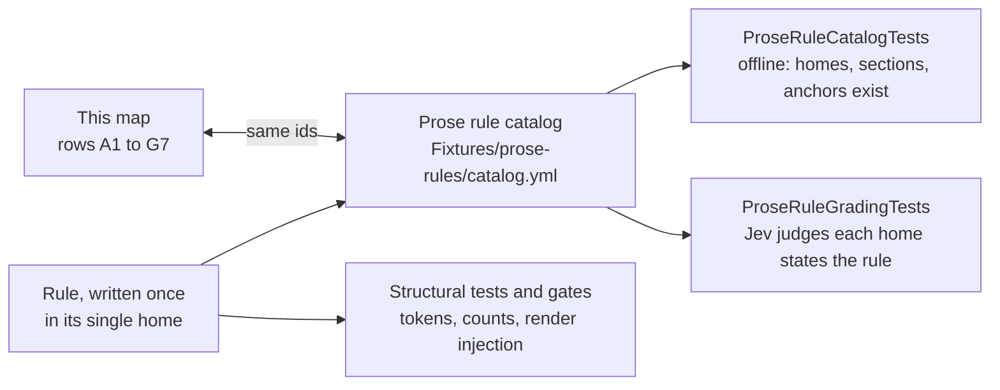

# Worker rule map — one home and one check per rule

Every sentence a worker reads is re-sent on every round trip of every worker, so the same rule
written in six agent bodies costs six times the tokens and drifts six ways. The rule map is what
makes removing that duplication safe: for each duplicated sentence it records where the sentence
lives now, the single place it lives after the trim, and the check that still enforces it once it
is there. A rule deleted without its home recorded is simply lost, and nothing would notice.

**The removals that were unblocked have landed**, and each row below records where the sentence
was removed from and what its one home now is. This page was written with every duplicated
sentence still in place, so the removal task could be checked against it row by row; the rows
marked deferred keep their text, for the reason given beside them.

Two parts of this page have different lifetimes. The page itself is a permanent reference
(decision D36 of the plan that created it): it says what enforces each rule, which stays true and
is what stops the text growing back. The per-row inventory is a snapshot taken in the tree before
the removals — the "current homes" column is expected to go stale, and each row's status is
updated as the removal lands rather than the page being archived. The plan that instructs this
work, [`2026-11-07-conductor-run-speed-shrink-reads.md`](../archive/plans/2026-11-07-conductor-run-speed-shrink-reads.md),
was archived at that slice's closeout and is provenance for these rows, not current guidance;
this page is not archived.

## How the rows were found

The rows were derived by searching this tree, not copied from the plan's estimate: decision D27
records that the count is 27 files rather than an earlier 14 and requires the map to be rebuilt by
search, and the Design's "938 bytes across agents" is an estimate in the same breath. Where the
search disagrees with the plan, both numbers are given below and the search wins.

- **The ban.** `grep -rilE "full (test )?suite" products/` matches 26 files in
  `products/kyber-squad/`. The plan says 27. The one extra file a looser search catches is
  `agents/code-reviewer.md` ("a full gate suite"), which states a different rule — one council per
  run, not the full-suite ban — so 26 is the count of files carrying *this* rule.
- **The standard templates.** The plan says "the 5 standard templates keep their line". Search
  finds 9 of the 14 templates under `products/kyber-squad/standards/` carrying a test-runner or
  ban statement: three state the ban verbatim (`go`, `rust`, `typescript`) and six state the
  filtered-run rule in their `## Completion` section (`csharp`, `data-access-layer`, `maui`,
  `pulumi`, `sql`, `test`). Every template keeps its line either way, for the reason in
  [what stays duplicated](#what-stays-duplicated-and-why).
- **The Discovery order.** 21 agent bodies and one skill carry a `## Discovery order` heading; 20
  of those agents are `invocation: subagent`, which is the only invocation the baseline injector
  reaches.
- **The completion-gate block.** Six agent bodies carry the same "Completion gate — diagnostics"
  block, bullet for bullet, with the stray database-specific and worktree bullets beside it:
  `csharp-dev`, `test-dev`, `dal-dev`, `maui-dev`, `pulumi-dev`, `react-dev`.

Read every "Enforced by" cell as the answer to one question: if this sentence were deleted and
nobody noticed, what fails? "catalog rule `X`" means entry `X` in the prose rule catalog,
[`tests/KyberWeave.Tests/Fixtures/prose-rules/catalog.yml`](../../tests/KyberWeave.Tests/Fixtures/prose-rules/catalog.yml).
Each entry states the rule once, lists the files that must state it and control files that must
not, and may carry a retired opposite that must stay absent. `ProseRuleCatalogTests` checks offline
that every listed file and section exists, and checks a home marked `anchor:` by token.
`ProseRuleGradingTests` sends each home to the Jev model, which judges whether it states the rule
by meaning; it runs only with `KW_PROSE_GRADE=1`. The map and the catalog are one rule list:
`ProseRuleCatalogTests.TheWorkerRuleMapAndTheCatalogNameTheSameRules` fails if a row names a
catalog rule the catalog lacks, or a catalog id from A1 to G7 has no row here. The exact-phrase
tests that used to fill these cells were deleted when the catalog replaced them
([ADR 0073](../adr/0073-prose-rules-are-graded-by-meaning-not-pinned-by-phrase.md)). A row with no
catalog entry names the gate or token test that enforces it; where nothing does, the row is a
finding, not a gap to paper over.

## Report formats and the completion digest

Single home after the trim: [`skills/task-gate/SKILL.md`](../../products/kyber-squad/skills/task-gate/SKILL.md),
the skill every developer worker loads when it finishes.

| ID | Rule — what a worker must do | Removed in T52 from | Single home after | Enforced by |
|---|---|---|---|---|
| A1 | End the task with the six-field digest, in this order: `STATUS`, `FILES`, `TESTS`, `COMMIT`, `REMOTE_HEAD`, `TASK_GATE`. | `agents/csharp-dev.md` → `## Completion digest`, which now points at the skill. The copy in `skills/delivery-execution/SKILL.md` and the conductor's requirement line stay, for the reason in [what stays duplicated](#what-stays-duplicated-and-why). | `skills/task-gate/SKILL.md` → `## Completion digest`, carrying the contiguous template | catalog rule `A1`; `SquadPerformanceContractTests.TheTaskGateSkillSpecifiesTheExplicitSixFieldCompletionDigestSchema` checks the field tokens in the skill, and `SharedExecutionSkill_DeclaresDeterministicTaskGate_AndConductorOffloadsIt` holds the block in `delivery-execution` |
| A2 | Record RED evidence on one machine-readable line: `RED_EVIDENCE: <runner filter> — <failing tests> — <reason>`, or `none`. | `agents/test-dev.md` → `## Completion digest`, which now points at the skill | the same `skills/task-gate/SKILL.md` section, as a seventh field | catalog rule `A2`; `ArbiterTestDevContractTests` — three cases, all reading `skills/task-gate/SKILL.md`; the ledger fact `ledger.red-evidence` and Arbiter rule `KW-ARB-MODE-001` consume the value |
| A3 | When the circuit breaker trips, return the escalation block instead: `STATUS: ESCALATION`, one closed `CIRCUIT_BREAKER_TRIGGER` token and its payload lines. | `agents/csharp-dev.md`, `agents/test-dev.md` and `agents/github-devops.md` → `## Completion digest`. The conductor's exemption line and the closed token set in `skills/task-gate/SKILL.md` → `## Escalation` stay | `skills/task-gate/references/rework.md` → `## The escalation` | catalog rule `A3`; `SquadCanonicalContentTests.TaskGateSkillDefinesTheDeterministicReviewGateContract`, which asserts the closed four-token set on the skill; `WorkerRuleSingleHomeTests.TheFailureLoopRulesAreInNoDeveloperAgentBody` |
| A4 | Developer workers apply the input-site table and whole-class rule to any change that parses a value from outside the process: a parser refuses an unrecognised input with a named error and never drops, defaults or coerces it. | Nothing removed: the rule is new, and the pointer sentences in seven developer agent bodies point here. | `skills/delivery-execution/SKILL.md` → `## Developer exit gate`, which states the input-site table and whole-class rule for developer workers | catalog rule `A4`, with `A4-whole-class`, `A4-input-site-tests` and `parsers-fail-closed` for its other halves; `SquadPerformanceContractTests.DeveloperInputRuleSentenceIsStatedInItsProductFile` holds the pointer sentence in each developer body and `...InItsDocsFile` the parser row in the test standard; `WorkerRuleSingleHomeTests.TheInputSiteTableIsInNoAgentBody` and `.TheRuleMapNamesTheDeliveryExecutionHome` |

The three agent bodies above are the only developer agents whose report *format* is the six-field
block. The other developer agents report their own agent-specific completion plus a `TASK_GATE:`
line, which the shared execution contract calls their standard completion, and that stays.

## The failure loop

Single home after the trim: `products/kyber-squad/skills/task-gate/references/rework.md`, the
reference the task gate loads after a failed fix. That file did not exist when this page was
written, which is why these rows were deferred then; T52 wrote it first, from the text in the
bodies, and removed the duplicates in the same change.

Current homes for B1 to B5 were `agents/csharp-dev.md`, `agents/test-dev.md` and
`agents/github-devops.md`, each in `## Workflow` step 6 (the four-bullet "JEV Checkpoints and
Iteration Circuit-Breaker" block) and in `## Hard rules` (the "Never enter an unconstrained
test-fix loop" bullet). The block is gone from all three, step numbering closes the gap, and the
hard-rule bullet is now a one-line pointer to the reference.

| ID | Rule — what a worker must do | Removed in T52 from | Single home after | Enforced by |
|---|---|---|---|---|
| B1 | Cap the work at 3 incremental test-fix iterations against one failing fixture or failure cluster within one dispatch, then halt and trip the breaker. | `agents/csharp-dev.md`, `agents/test-dev.md`, `agents/github-devops.md` → `## Workflow` step 6 | `skills/task-gate/references/rework.md` → `## The iteration cap` | catalog rule `B1`; `WorkerRuleSingleHomeTests.TheFailureLoopRulesAreInNoDeveloperAgentBody`: `rework.md` carries `CIRCUIT_BREAKER_TRIGGER`, and none of the three bodies may |
| B2 | Checkpoint 1, blast radius: if the fix needs files outside the authorised scope, halt and raise `BLAST_RADIUS_EXCEEDED`. | same 3 bodies | `rework.md` → `## The three JEV checkpoints` | catalog rule `B2`; the single-home test as B1 |
| B3 | Checkpoint 2, oscillation: a one-way regression costs one of the 3 iterations; only A→B→A or a repeating failure signature raises `THRASH_OSCILLATION_DETECTED`. | same 3 bodies | `rework.md` → `## The three JEV checkpoints` | catalog rule `B3`; the single-home test as B1 |
| B4 | Checkpoint 3, invariant contradiction: never bend production code to satisfy a legacy fixture that contradicts the approved design; raise `INVARIANT_CONTRADICTION`. | same 3 bodies | `rework.md` → `## The three JEV checkpoints` | catalog rule `B4`; the single-home test as B1 |
| B5 | Never enter an unconstrained test-fix loop: 3 non-converging iterations, an oscillation or a contradiction means escalate rather than keep trying. | same 3 bodies, `## Hard rules` (each now carries a pointer only) | `rework.md` → `## Never enter an unconstrained test-fix loop` | catalog rule `B5`; the single-home test as B1 |
| B6 | Conductor side: at most 2 rework dispatches per failure cluster, the tally kept on the execution artifact, and an A/B oscillation tripwire that fires immediately. | `agents/conductor.md` → `## Shared lifecycle invariants` | `skills/delivery-execution/SKILL.md` → `## Iteration circuit-breaker and loop detection` | catalog rule `B6`, whose only home is the skill and not the conductor's own body |

## The full-suite ban

Single home after the trim: [`shared/worker-baseline.md`](../../products/kyber-squad/shared/worker-baseline.md),
the always-on block `SquadWorkerBaselineInjector` applies to every subagent render. Its line
reads:

> **Never run the full test suite.** Run the test classes your task names. The review council and
> CI run the full suite on the integrated head.

| ID | Rule — what a worker must do | Removed in T52 from | Single home after | Enforced by |
|---|---|---|---|---|
| C1 | Never run the full test suite, even for a cross-cutting change — the review council and CI run it; run the tests covering the change and any test that references a changed symbol. | 11 agent bodies, one identical bullet each: `dal-dev`, `github-devops`, `go-dev`, `maui-dev`, `pulumi-dev`, `python-dev`, `react-dev`, `rust-dev`, `sql-database-architect`, `tauri-dev`, `typescript-dev` (`## Hard rules` for all but `sql-database-architect` and `tauri-dev`, whose bullet sat in `### Completion gate`) | the baseline block | catalog rule `C1`; `SquadPerformanceContractTests.TheSharedBaselineIsTheOnePlaceTheFullSuiteBanIsWritten` — the baseline matches `never run the full test suite` and **no** file under `agents/` may; `SquadWorkerBaselineInjectionTests.EachWorkerRenderCarriesTheBaselineExactlyOnce`, one case per shipped target |
| C2 | Inside the "build once, test many" bullet: the same ban, with the clause "even for a cross-cutting change". | `agents/csharp-dev.md` → `## Workflow` step 7, the ban sentence only. The rest of the bullet stays: "only the test classes … task touched", "in the first full review", "integrated head", "`TESTS: total=0` with the reason", "shared test infrastructure", "targeted set" and "cross-cutting" are all still there | the baseline block | as C1, which is where the ban now lives. The rest of the bullet is graded by the catalog entries `task-end-touched-classes-only` and `shared-infra-targeted-set`, and `SquadPerformanceContractTests.TestRunSurfacesDescribeTheCouncilFullRunAndTheZeroTestsReport` holds its `TESTS: total=0` token |
| C3 | The same ban inside the same bullet. | `agents/test-dev.md` → `## Workflow` step 5, the ban sentence only, on the same terms as C2 | the baseline block | as C2 |
| C4 | A dev agent never runs the full suite; it runs the tests covering its change. | `skills/csharp-dev/references/build-commands.md` → `## Run tests`: the ban half of the sentence. The filter command and the "the review council and CI run it" sentence stay, so a host reading the reference alone still sees which run is the gate | the baseline block | as C1 for the baseline line. **Nothing checks the reference itself**; the seeded-defect trial is the only check that the injected line replaces it |

Two rows that look like this rule but are **not** it, and stay where they are:

- `agents/conductor.md` — "No worker runs the full suite, and the conductor never dispatches a full
  run". This is the dispatcher's rule, not a worker's, and the baseline is never injected into the
  conductor (the injector's `Apply` covers `SquadInvocation.Subagent` only).
- The C# and test standards state the same expectation in their `## Completion` sections. See
  [what stays duplicated](#what-stays-duplicated-and-why).

## Discovery order, the packet rule, and batched reads

Intended single home: the baseline block, whose first and second paragraphs are the Discovery
order and the plan-read ban, whose fourth is the batched-read line, and whose last is the skills-location line.

| ID | Rule — what a worker must do | Homes, and what T52 removed | Single home after | Enforced by |
|---|---|---|---|---|
| D1 | Discover before you read: call `codegraph_explore` first, then the kw-docs tools (directly, tool search only if deferred), and read a file directly only for what an index does not cover; call a tool unavailable only with the quoted error of a call made. | `## Discovery order` in 20 subagent agent bodies (`architect`, `azure-reader`, `bug-crusher-investigator`, `code-reviewer`, `csharp-dev`, `dal-dev`, `docs-dev`, `github-devops`, `go-dev`, `maui-dev`, `pulumi-dev`, `python-dev`, `react-dev`, `review-lens`, `review-triage`, `rust-dev`, `sql-database-architect`, `tauri-dev`, `test-dev`, `typescript-dev`). **Left in place** | the baseline block | catalog rule `D1`, whose homes are the baseline and every body listed; `SquadWorkerBaselineInjectionTests.TheBaselineTextLivesInOneSharedSourceFile` (the `codegraph_explore` token) and `.EachWorkerRenderCarriesTheBaselineExactlyOnce` cover the baseline — **but the section stays**: `SquadCanonicalContentTests.LoadCodeReadingAgentsDirectIndexedDiscoveryBeforeRawReads` still requires, per body, a `## Discovery order` section naming `codegraph_explore`, the docs tools and "Read or search a file directly" in that order |
| D2 | Report what the discovery cost: `Discovery: codegraph N, docs N, direct reads N`, with a reason for each direct read of indexed code. | the same agent bodies; `skills/delivery-execution/SKILL.md` → `## Developer exit gate`; `agents/conductor.md` → `## Shared lifecycle invariants`. **Left in place** | `skills/task-gate/SKILL.md` as a report format — the baseline carries no such line today, so the baseline would have to be amended for this to move there | not in the catalog. `SquadCanonicalContentTests.LoadCodeReadingAgentsDirectIndexedDiscoveryBeforeRawReads` requires the `Discovery:` line and "reason for each direct read" in each body; `SquadPerformanceContractTests.ConductorSurfacesSpecifyTheDiscoveryHeader` requires the line in the conductor and in `delivery-execution`, and `TestDevSkillSpecifiesTheDiscoveryHeader` in the test-dev skill. Where the line goes is G4's rule |
| D3 | Plans are the conductor's: do not open a file under `<plan-index>` or `<specification-index>`, or any plan folder; return a blocker when the packet is insufficient. | `## Scope` in 13 developer agent bodies: `csharp-dev`, `dal-dev`, `github-devops`, `go-dev`, `maui-dev`, `pulumi-dev`, `python-dev`, `react-dev`, `rust-dev`, `sql-database-architect`, `tauri-dev`, `test-dev`, `typescript-dev` — the duplicate sentence removed, "Your packet is your whole scope." kept. `docs-dev` keeps only its closeout exception, which is the one part of the rule that is its own | the baseline block ("**Plans are the conductor's.**") | catalog rule `D3`, whose homes are the baseline and `delivery-execution` → `## Worker packets`; `SquadWorkerBaselineInjectionTests`, whose token list includes `<plan-index>`; Arbiter rule `KW-ARB-PLANREAD-001` on the `delegate` trigger refuses a dispatch that sends a worker into a plan |
| D4 | Batch independent reads into one round trip per question. | nowhere in the agent bodies — it is new text in the baseline | the baseline block | catalog rule `D4`, whose only home is the baseline. Listed so nothing "restores" it into agent bodies |
| D5 | In a linked worktree, pass `projectPath=<absolute worktree path>` to every kw-docs tool and to `codegraph_explore`; the answer's provenance `root=` must equal the worktree. | nowhere in the agent bodies — it is new text in the baseline | the baseline block | catalog rule `D5`, whose only home is the baseline. Listed so nothing "restores" it into agent bodies |
| D6 | Read a skill as a file only from the directory the harness installed it to, and never search the filesystem for one or read one from another repository. The path is rendered per harness and scope (`~/.copilot/skills` globally for Copilot, `.github/skills` in a project). | nowhere in the agent bodies — it is new text in the baseline | the baseline block, whose `{{skills-root}}` the render pipeline answers | catalog rule `D6`, whose only home is the baseline; `SquadSkillsRootLineTests` compares the rendered root with where the render and the global-root resolver put a skill, for every target and both scopes. A global render with no root resolver drops the paragraph rather than guess a path |

The two review seats report discovery too. `review-lens` and `review-triage` put
`Discovery: codegraph N, docs N, direct reads N` directly above their attestation line, below any
`Index fallback:` line, and the verdict engine flags a findings or `NO FINDINGS` seat that wrote
none, that read files directly with no index lookup and no fallback line, that wrote an
`Index fallback:` value outside the three modes, or that wrote two different `Index fallback:`
lines (the first is kept), as `KW-REVIEW-044`. A `SKIPPED` seat is exempt. The
correctness seat adds one closing line, `Input sites: N traced, M files with none`, directly
above its `Discovery:` line; a correctness seat that reported findings or `NO FINDINGS` without
it draws `KW-REVIEW-047`, and a `SKIPPED` correctness seat is exempt. The closing-line order and the input-site table live in `review-lens`
and the correctness lens file, not in the baseline.

## The task-end fix pass and build isolation

Single homes after the trim: `skills/resharper-clt/SKILL.md` for the mechanical fix pass,
`skills/task-gate/SKILL.md` for the exit-gate procedure and `.NET isolation`, and the host
coding standards' `## Completion` section for the commands themselves.

| ID | Rule — what a worker must do | Homes, and what T52 removed | Single home after | Enforced by |
|---|---|---|---|---|
| E1 | Fix mechanically before sweeping: `dotnet format`, then `dotnet format analyzers`, each scoped with `--include` to the changed files. `cleanupcode` is not part of the pass: it was removed because it never exits ([ADR 0074](../adr/0074-cleanupcode-is-removed-from-the-squad.md)). | removed from 5 agent bodies, `## Workflow`: `csharp-dev`, `dal-dev`, `maui-dev`, `pulumi-dev`, `test-dev` | `skills/task-gate/SKILL.md` → `## Fix pass for .NET work` | not in the catalog; an absence is a structural check. `WorkerRuleSingleHomeTests.TheCleanupCodePassIsNotRequiredInAnyAgentBody` fails if any agent body names `cleanupcode`, and `.TheCleanupCodeCommandIsAbsentFromTheSkill` fails if `skills/resharper-clt/SKILL.md` carries the command |
| E2 | The task-end pass does not run `dotnet format analyzers`; the style gate covers what it would report. | removed with E1's bullet from the same 5 bodies | the `format-style` task gate, declared once in `.kyber-weave/kyber-weave.yml` → `review.task-gates` | not in the catalog. The gate itself: `dotnet format KyberWeave.sln style --verify-no-changes --severity warn`, aliased to every .NET agent |
| E3 | Do not run ReSharper InspectCode from a task gate; inspection is a review gate, run once per review cycle. | removed from 5 agent bodies: `csharp-dev`, `dal-dev`, `maui-dev`, `pulumi-dev`, `test-dev` | `skills/resharper-clt/SKILL.md` → `## Who runs it, and when`; `skills/task-gate/SKILL.md` → `## Fix pass for .NET work` and `## Boundaries` | not in the catalog. The `inspectcode` entry under `review.gates` |
| E4 | Take a language-diagnostics baseline over the files you may change before the first edit, write it under `.agent_scratchpad`, and cite it in the message body beside the digest. | **left in place** in 6 agent bodies: `csharp-dev`, `dal-dev`, `maui-dev`, `pulumi-dev`, `react-dev`, `test-dev` | `skills/task-gate/SKILL.md` would have to state the procedure; it does not today, and the **citation** half is pinned in the two bodies | catalog rule `E4`, which covers the citation half: graded in `csharp-dev`, and checked by the `Baseline:` token in `test-dev`. The procedure half is not in the catalog |
| E5 | Sweep again after the last edit, over your own files only; never workspace-wide. | **left in place** in 6 agent bodies | `skills/task-gate/SKILL.md` does not carry it, so a removal would lose the rule. See [what T52 left](#what-t52-left-and-why) | **Nothing checks this**, and it is not in the catalog. The reason it exists — a workspace-wide sweep reads another worker's half-finished tree — is also stated in the conductor's dispatch rules, which are not this row |
| E6 | A scoped build, `tsc --noEmit`, `dotnet test` or `git diff --check` measures something else and does not clear the completion gate. | **left in place** in 6 agent bodies | `skills/task-gate/SKILL.md` does not carry it today. See [what T52 left](#what-t52-left-and-why) | **Nothing checks this**, and it is not in the catalog |
| E7 | Every diagnostic counts; fix every finding in your scope, or escalate it with file, line and reason. | **left in place** in 6 agent bodies | `skills/task-gate/SKILL.md` does not carry it today. See [what T52 left](#what-t52-left-and-why) | **Nothing checks this**, and it is not in the catalog |
| F1 | Isolate build output before running anything in a shared checkout: `--artifacts-path`, or `-p:BaseOutputPath=` / `-p:BaseIntermediateOutputPath=` where the command takes no such flag. | removed from 3 of the 5 bodies: `dal-dev`, `maui-dev`, `pulumi-dev`. `csharp-dev` and `test-dev` keep the bullet, which catalog rule `F1` lists as a home | `skills/task-gate/SKILL.md` → `## .NET isolation`; the standards' `## Completion` sections for the commands | catalog rule `F1`; `SquadPerformanceContractTests.SpecialistSurfacesNameTheArtifactsPathFlag` and `SurfacesConsistentlySpecifyArtifactIsolationFlags` hold the flag token. The task gates already pass `-p:BaseOutputPath=.agent_scratchpad/{task}/artifacts/bin/` and `--artifacts-path`, so the isolation happens whether or not a worker reads the rule |
| F2 | The three cases: a shared checkout needs the flag; your own worktree does not; an explicit `--artifacts-path` overrides the worktree path, and the assembly then sits under `<dir>/bin/<test-project>/release/`. | `agents/csharp-dev.md`, `agents/test-dev.md` | the C# and test standards' `## Completion` sections | catalog rule `F2`, on both agents — **graded there, keep** |
| F3 | Build once, test many: reuse the build with `--no-build`, or run the compiled assembly directly as `dotnet <assembly>.dll -class "<Namespace>.<Class>"`, fully qualified because a short name runs zero tests and exits 0. | `agents/csharp-dev.md`, `agents/test-dev.md`, `skills/test-dev/SKILL.md` | the host test standard's `## Completion` section, which carries the concrete path | catalog rule `F3`, with `fully-qualified-test-class` and `runner-in-test-standard`; `SquadPerformanceContractTests.WorkerSurfacesSpecifyBuildOnceTestManyWithDirectAssemblyRunner`, on all three: each must name the test standard and its `## Completion` section, so the pointer stays and only the local path moves. `TestCodingStandardDocumentsDirectAssemblyRunnerAndNoBuildFlag` holds the runner tokens in the standard |
| F4 | Zero-stash RED proofs: never `git stash`, and prove RED on a clean base checkout, a throwaway copy or an isolated worktree. | `agents/test-dev.md` → `## Workflow` step 5; `skills/delivery-execution/SKILL.md` → `## Test-first mode`; `agents/conductor.md` → `## Shared lifecycle invariants` | `skills/delivery-execution/SKILL.md` → `## Test-first mode` | catalog rule `F4`, whose homes include the conductor and `test-dev` — **graded in the conductor too, keep** |

## The conductor's copy of the execution contract

The plan removes the 2.7 KB of `conductor.md` that is word for word in the execution contract.
When T52 ran, six theories asserted the same phrases in **both** `agents/conductor.md` and
`skills/delivery-execution/SKILL.md`, so T52 removed only 572 bytes of the conductor body, not the
2.7 KB the plan estimated: G6 and G7, the two rows no theory pinned there. Those phrase theories
are deleted now, so the phrase block is lifted. What remains is smaller: catalog rules `G1` to `G5`
still list the conductor as a home, so a removal drops that home from the catalog in the same
change, and two token tests still read the conductor (G2 and G4 below).

| ID | Rule — what a worker must do | Current homes (before the trim) | Single home after | Enforced by |
|---|---|---|---|---|
| G1 | Send a self-contained packet: inlined entry-file table, acceptance criteria, dependencies, mode, pre-computed test commands, and no plan or spec in the worker's context. | `agents/conductor.md` → `## Shared lifecycle invariants`; `skills/delivery-execution/SKILL.md` → `## Ready queue`, `## Task file and dispatch` | `delivery-execution` | catalog rule `G1`, with both files as homes. **Phrase block lifted** |
| G2 | Give each parallel worker a worktree or isolated context with per-task artifact paths, and serialize integration before push. | both files | `delivery-execution` → `## Ready queue` | catalog rule `G2`, with `G2-serialized-integration`, `worktree-cleanup` and `integration-conflict-rework`; `SquadPerformanceContractTests.ConductorSurfacesSpecifyTheArtifactsPathAndTaskGateOutput` still requires the artifact-path line in both files, and `SquadWorktreeMcpContractTests` the MCP-setup sentences in the conductor. **Still blocked on those tokens**; `ConductorExecutionContractNamesTheWorktreeCleanupAndConflictAbortCommands` reads only the skill |
| G3 | Keep RED authorship and GREEN implementation adversarial, bundle same-role micro-tasks, and keep the independent verification pass at task completion. | both files | `delivery-execution` → `## Ready queue` | catalog rule `G3`, with `G3-bundle-same-role`, both files as homes. **Phrase block lifted** |
| G4 | Report discovery before the digest; the two review seats report it above their attestation line instead, and the verdict engine flags a findings or `NO FINDINGS` seat's gaps (`KW-REVIEW-044`; a `SKIPPED` seat is exempt). | both files | `delivery-execution` → `## Developer exit gate` | catalog rule `G4`, with `G4-review-seats`; `SquadPerformanceContractTests.ConductorSurfacesSpecifyTheDiscoveryHeader` still requires the `Discovery:` line in both files. **Still blocked on that token** |
| G5 | Exempt a valid `STATUS: ESCALATION` from the six-field rejection, and route a tripped breaker to architect mediation. | both files, plus `docs/kyber-squad/requirements.md` | `delivery-execution` → `## Iteration circuit-breaker and loop detection` | catalog rule `G5`, with all three files as homes. **Phrase block lifted** |
| G6 | Keep the original worker session for rework and verification; a busy session is queued, not replaced. | `agents/conductor.md` → `## Shared lifecycle invariants`: **shortened in T52** to a pointer at the skill's `## Task session continuity`; `delivery-execution` keeps the section | `delivery-execution` → `## Task session continuity` | catalog rule `G6`; `SquadCanonicalContentTests.ConductorRetainsOnlyWorkerSessionsForTaskRework` asserts the session tokens in the skill only |
| G7 | Bounded retries: the 2-rework-dispatch cap and the oscillation tripwire (row B6). | `agents/conductor.md` → `## Shared lifecycle invariants`: **removed in T52** | `delivery-execution` → `## Iteration circuit-breaker and loop detection` | catalog rule `G7`, whose only home is the skill |

Row G7 duplicates B6 from the other side: B6 records the removal of the duplication *inside* the
skill pair, G7 records the conductor-side copy that leaves.

## What stays duplicated, and why

Duplication is not automatically waste. These placements are deliberate, and T52 must leave them
alone.

| Kept | Why |
|---|---|
| The full-suite line in all 14 standard templates, and the ban sentence in `standards/go`, `standards/rust` and `standards/typescript` | A standard is host-owned project content: it ships into a host repository, is read on its own, and has no Squad render around it. Removing the line would leave that host with a rule it cannot see. |
| The ban in `skills/bug-crusher/SKILL.md` | `SquadPerformanceContractTests.BugCrusherSkillIsToldNeverToRunTheFullTestSuite` requires the phrase there, and catalog rule `C1-primary-sessions` lists the skill as a home. The skill is a primary session, which the baseline never reaches. |
| The investigator's ban, which now arrives by injection rather than in its body | `bug-crusher-investigator` is a dispatched subagent, so the baseline reaches it. `SquadPerformanceContractTests.BugCrusherInvestigatorIsToldNeverToRunTheFullTestSuiteByItsRender` asserts the ban in the investigator's **render** for every shipped harness, which is where the rule now reaches that agent; a body copy would fail `TheSharedBaselineIsTheOnePlaceTheFullSuiteBanIsWritten`. T52 removed the body copy — see [the pin conflict](#the-pin-conflict-t52-resolved). |
| The ban in `skills/kilo-review-loop/SKILL.md`, `skills/go-dev/references/gates-and-platforms.md`, `skills/rust-dev/references/gates-and-platforms.md`, `skills/typescript-dev/references/esm-and-gates.md` | Catalog rule `C1` lists the three gate references as homes and `C1-primary-sessions` the kilo skill; `KiloReviewLoopGivesNoLocalFullRunRoute` also holds the kilo skill's tokens. A gate table's reader must see the limit beside the command it limits. |
| "No worker runs the full suite, and the conductor never dispatches a full run" in `agents/conductor.md` and in `skills/delivery-execution/SKILL.md` | Catalog rule `conductor-never-dispatches-full-run` lists both as homes. This is the dispatcher's rule; the baseline reaches only `invocation: subagent` bodies. |
| The six-field block and the `TASK_GATE:` line in `skills/delivery-execution/SKILL.md` alongside its new home in `skills/task-gate/SKILL.md` | Two audiences: the conductor requires the digest, the worker emits it. Both are pinned (`ConductorSurfacesSpecifyExplicitSixFieldWorkerDigestSchema`, `SharedExecutionSkill_DeclaresDeterministicTaskGate_AndConductorOffloadsIt`, `TheTaskGateSkillSpecifiesTheExplicitSixFieldCompletionDigestSchema`). |
| The closed `CIRCUIT_BREAKER_TRIGGER` token set in `skills/task-gate/SKILL.md` alongside its procedure in `references/rework.md` | The skill raises the escalation the reference explains; `SquadCanonicalContentTests.TaskGateSkillDefinesTheDeterministicReviewGateContract` asserts the closed set on the skill file itself. |
| Each developer agent's own agent-specific completion, plus its `TASK_GATE:` line | The shared contract's phased rollout keeps those: only `csharp-dev` and `test-dev` must return the full six-field block, and the conductor rejects a missing or `FAIL` `TASK_GATE` line from every developer worker. Catalog rule `six-field-phased-rollout` grades the rollout; `SquadCanonicalContentTests.NonDeveloperAgentBodiesNeverEmitTaskGateDigest` keeps the line out of the non-developer bodies. |
| `review-lens` and `review-triage`'s `## Discovery order`, with its seat-specific `Discovery:` placement | A seat's closing lines are read by the verdict engine, so they report discovery directly above the attestation line rather than before a digest; `SquadCanonicalContentTests` asserts the `Discovery: codegraph N, docs N, direct reads N` line for them, and `KW-REVIEW-044` flags a findings or `NO FINDINGS` seat that omits it. |
| The zero-stash and worktree-isolation text in `agents/test-dev.md`, `agents/conductor.md` and the two .NET agent bodies | Each file is a home of catalog rule `F4` (zero-stash), `F2` (worktree isolation) or `E4` (artifact and baseline paths in the message body), so the grader expects the text there. |
| The test-runner statement in the 9 standard templates that carry one | Same reason as the first row, and `SquadPerformanceContractTests.TestStandardLeavesTheFullRunToTheCouncilTestGate` holds the repository test standard's version. |

## Rows still deferred, and why

**Rows B1 to B5 and A3 were deferred on a home that did not exist, and are now done.**
`products/kyber-squad/skills/task-gate/references/rework.md` was not in this tree when the page
was written. T52 wrote it from the text in the bodies — the iteration cap, the three JEV
checkpoints, the closed trigger vocabulary and the escalation payload — and then removed the
copies in the same change. `WorkerRuleSingleHomeTests` fails in both directions here: the
reference must carry `CIRCUIT_BREAKER_TRIGGER` **and** none of the three bodies may.

**Rows D1 and D2 are still deferred on a structural test, not on a missing home.** This pin
survived the move to the catalog. `SquadCanonicalContentTests.LoadCodeReadingAgentsDirectIndexedDiscoveryBeforeRawReads` requires
each of 19 agent bodies to carry a `## Discovery order` section that names `codegraph_explore`,
the two docs tools and "Read or search a file directly", in that order, and — for every agent but
the two review seats — the `Discovery: codegraph N, docs N, direct reads N` line. The injected
baseline does not satisfy it: the block has no heading, names no kw-docs tool, and carries no
counts header. T52 removed neither section. Whoever unblocks it must first move that pin to the
render (so the injected block is what is asserted) or narrow it to the fields that are genuinely
per-agent, and drop the agent bodies from catalog rule `D1`'s homes. This is the pin that blocks
its own removal: the section it protects is the duplicate of the injected block.

**Rows G1 to G5 were deferred on phrase pins; for G1, G3 and G5 that block is lifted.**
Six theories in `SquadPerformanceContractTests` asserted the same phrases in `agents/conductor.md`
and in `skills/delivery-execution/SKILL.md`, so T52 left all five rows. Those theories are deleted.
Removing the conductor copy of G1, G3 or G5 now means dropping `agents/conductor.md` from that
catalog rule's homes in the same change; no structural test reads the text. G2 and G4 are still
blocked on token tests: `ConductorSurfacesSpecifyTheArtifactsPathAndTaskGateOutput` and
`SquadWorktreeMcpContractTests` read the conductor for G2's artifact-path and MCP-setup sentences,
and `ConductorSurfacesSpecifyTheDiscoveryHeader` reads it for G4's `Discovery:` line. The removals
themselves are not done here. The G2 cleanup sentence is read only in the skill, by
`ConductorExecutionContractNamesTheWorktreeCleanupAndConflictAbortCommands`.

## The pin conflict T52 resolved

`BugCrusherSurfacesAreToldNeverToRunTheFullTestSuite`, a test since replaced, required the ban sentence in
`agents/bug-crusher-investigator.md`, and `TheSharedBaselineIsTheOnePlaceTheFullSuiteBanIsWritten`
forbids any file under `agents/` from matching `never run the full test suite`. Both cannot hold:
the investigator is `invocation: subagent`, so the baseline injector reaches it on every render.

T52 repointed the pin rather than keeping a body copy or deleting the assertion. The one theory
became two cases with the same subject — "this agent is told never to run the full suite" — and
different evidence:

- `BugCrusherSkillIsToldNeverToRunTheFullTestSuite` reads `skills/bug-crusher/SKILL.md`, unchanged.
  That skill is a primary session, which no render wraps.
- `BugCrusherInvestigatorIsToldNeverToRunTheFullTestSuiteByItsRender` renders every shipped
  harness and asserts the regex in the investigator's rendered file, which carries the injected
  baseline. That is where the rule reaches this agent now.

The test file is `tests/KyberWeave.Tests/SquadPerformanceContractTests.cs`; the pin's subject and
its regex are unchanged, only its evidence moved. No assertion was weakened.

**One conflict outside the text, still open.**
The baseline's plan-read rule ("Do not open a file under `<plan-index>` or
`<specification-index>`") is injected into `review-lens`, which is a subagent. The
`intent-alignment` lens is documented to read the plan or specification that states the change's
intent. The gap is recorded rather than fixed here: either the injector exempts the review seats
the way the report-format pins already do, or the lens's stated access changes. This is a code or
skill decision, not a documentation one.

## What T52 left, and why

Four rows name `skills/task-gate/SKILL.md` as the single home, but the skill does not carry them:
E4's baseline procedure, E5's sweep scope, E6's "this is not evidence" rule and E7's
every-diagnostic rule. Removing the agent-body copy would have deleted the rule rather than moved
it, so all four stay where they are. Unblocking them means writing the procedure into the skill
first — the same order A1, A2 and the failure loop followed here, where the home was written
before the duplicate was deleted.

## Agent bodies this map names

When T52 ran, each edited agent body also needed its migration report's recorded body digest
updated. Those reports, `products/kyber-squad/migration/`, and the tests that compared their
hashes were deleted when the catalog replaced the phrase pins
([ADR 0073](../adr/0073-prose-rules-are-graded-by-meaning-not-pinned-by-phrase.md)), so an agent
body edit no longer carries a digest update.

## What T52 did with this page

1. Read every row before editing a file, and edited only the rows this page did not defer.
2. Turned each "current homes" cell into "removed in T52 from" for the rows applied, and marked
   the rows left with the reason.
3. Recorded the byte counts against the plan's estimate, below.
4. Left every deferred row, every "what T52 left" row and every entry under
   [what stays duplicated](#what-stays-duplicated-and-why) as it is.
5. Recorded the one gate it could not read: the seeded-defect trial's per-row verdicts were not
   in this tree when the removals were applied. `.agent_scratchpad/T51/` is absent, and
   `.agent_scratchpad/` is gitignored, so no trial artifact is committed and these rows carry no
   trial result to check against. T52 applied the rows the plan authorizes by name, plus the
   unblocked rows whose named home already carries the rule, and left everything else. Recording
   the trial's verdicts per row is still owed, and it is why the cells above describe the tree
   rather than the trial.

Since T52, the "Enforced by" cells name catalog rules in place of the deleted phrase tests; the
rows, their homes and their status are otherwise as T52 left them.

## What T52 removed, in bytes

Measured against the parent commit, per file family.

| Family | Before | After | Change |
|---|---|---|---|
| `products/kyber-squad/agents/` (16 bodies) | 188,353 | 168,341 | **−20,012** |
| `skills/task-gate/SKILL.md` | 6,030 | 8,003 | +1,973 |
| `skills/task-gate/references/rework.md` (new) | 0 | 4,795 | +4,795 |
| `skills/csharp-dev/references/build-commands.md` | 866 | 847 | −19 |

The plan estimated 938 bytes across the agents, and 2.7 KB out of `conductor.md`. The agent-side
removal is 21 times the estimate because the estimate counted the ban alone; the failure-loop
blocks, the completion digest templates and the per-agent fix-pass bullets were each several
times larger. The conductor contribution is 572 bytes, not 2.7 KB, because G1 to G5 are pinned
there. The two largest single wins are `test-dev.md` (−4,434) and `csharp-dev.md` (−3,574), and
those two are the bodies re-sent most often in this programme's own runs.

What the word count does not show: the two new homes are read once per task rather than once per
worker, and a developer worker's render no longer carries a copy of a rule the baseline already
gave it.
