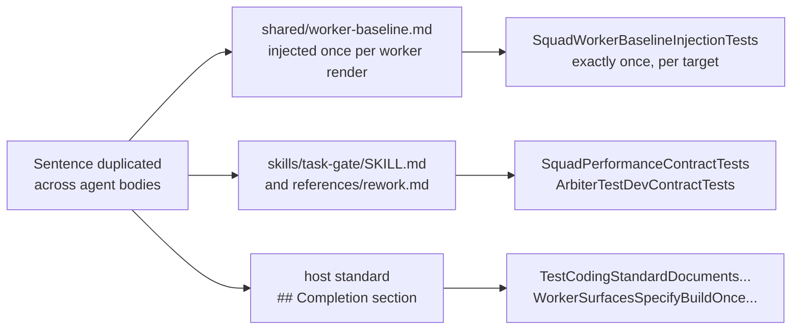

# Worker rule map — one home and one check per rule

Every sentence a worker reads is re-sent on every round trip of every worker, so the same rule
written in six agent bodies costs six times the tokens and drifts six ways. The rule map is what
makes removing that duplication safe: for each duplicated sentence it records where the sentence
lives now, the single place it lives after the trim, and the check that still enforces it once it
is there. A rule deleted without its home recorded is simply lost, and nothing would notice.

**Nothing has been deleted.** This page was written with every duplicated sentence still in
place, so the next task can be checked against it row by row.

Two parts of this page have different lifetimes. The page itself is a permanent reference
(decision D36 of the plan that created it): it says what enforces each rule, which stays true and
is what stops the text growing back. The per-row inventory is a snapshot taken in the tree before
the removals — the "current homes" column is expected to go stale, and each row's status is
updated as the removal lands rather than the page being archived. The plan that instructs this
work, [`2026-11-07-conductor-run-speed-shrink-reads.md`](../plans/2026-11-07-conductor-run-speed-shrink-reads.md),
is archived at that slice's closeout; this page is not.

## How the rows were found

The rows were derived by searching this tree, not copied from the plan's estimate: decision D27
records that the count is 27 files rather than an earlier 14 and requires the map to be rebuilt by
search, and the Design's "938 bytes across agents" is an estimate in the same breath. Where the
search disagrees with the plan, both numbers are given below and the search wins.

- **The ban.** `grep -rilE "full (test )?suite" products/` matches 26 files in
  `products/kyber-squad/`. The plan says 27. The one extra file a looser search catches is
  `agents/code-reviewer.md` ("a full gate suite"), which states a different rule — one council per
  run, not the full-suite ban — so 26 is the count of files carrying *this* rule.
- **The standard templates.** The plan says "the 5 standard templates keep their line". Search
  finds 9 of the 14 templates under `products/kyber-squad/standards/` carrying a test-runner or
  ban statement: three state the ban verbatim (`go`, `rust`, `typescript`) and six state the
  filtered-run rule in their `## Completion` section (`csharp`, `data-access-layer`, `maui`,
  `pulumi`, `sql`, `test`). Every template keeps its line either way, for the reason in
  [what stays duplicated](#what-stays-duplicated-and-why).
- **The Discovery order.** 21 agent bodies and one skill carry a `## Discovery order` heading; 20
  of those agents are `invocation: subagent`, which is the only invocation the baseline injector
  reaches.
- **The completion-gate block.** Six agent bodies carry the same "Completion gate — diagnostics"
  block, bullet for bullet, with the stray database-specific and worktree bullets beside it:
  `csharp-dev`, `test-dev`, `dal-dev`, `maui-dev`, `pulumi-dev`, `react-dev`.

Read every "Enforced by" cell as the answer to one question: if this sentence were deleted and
nobody noticed, what fails? Where the cell says "no test pins this", the row is a finding, not a
gap to paper over — the seeded-defect trial is the only thing that would catch that loss.

## Report formats and the completion digest

Single home after the trim: [`skills/task-gate/SKILL.md`](../../products/kyber-squad/skills/task-gate/SKILL.md),
the skill every developer worker loads when it finishes.

| ID | Rule — what a worker must do | Current homes (before the trim) | Single home after | Enforced by |
|---|---|---|---|---|
| A1 | End the task with the six-field digest, in this order: `STATUS`, `FILES`, `TESTS`, `COMMIT`, `REMOTE_HEAD`, `TASK_GATE`. | `agents/csharp-dev.md` → `## Completion digest`; `skills/delivery-execution/SKILL.md` → `## Developer exit gate`; `agents/conductor.md` → `## Shared lifecycle invariants` ("Require the explicit six-field…") | `skills/task-gate/SKILL.md` → a `## Completion digest` section T52 adds, carrying the contiguous template | `SquadPerformanceContractTests.TheTaskGateSkillSpecifiesTheExplicitSixFieldCompletionDigestSchema` — red today, green only when the template lands in the skill; `SquadPerformanceContractTests.SharedExecutionSkill_DeclaresDeterministicTaskGate_AndConductorOffloadsIt` holds the block in `delivery-execution` |
| A2 | Record RED evidence on one machine-readable line: `RED_EVIDENCE: <runner filter> — <failing tests> — <reason>`, or `none`. | `agents/test-dev.md` → `## Completion digest` | the same `skills/task-gate/SKILL.md` section, as a seventh field | `ArbiterTestDevContractTests` — three cases, all reading `skills/task-gate/SKILL.md`, red today; the ledger fact `ledger.red-evidence` and Arbiter rule `KW-ARB-MODE-001` consume the value |
| A3 | When the circuit breaker trips, return the escalation block instead: `STATUS: ESCALATION`, one closed `CIRCUIT_BREAKER_TRIGGER` token and its payload lines. | `agents/csharp-dev.md`, `agents/test-dev.md`, `agents/github-devops.md` → `## Completion digest`; `skills/task-gate/SKILL.md` → `## Escalation`; `agents/conductor.md` → `## Shared lifecycle invariants` | `skills/task-gate/references/rework.md` (does not exist yet — see [deferred rows](#deferred-rows-do-not-remove-these-yet)); the closed token set stays pinned in `skills/task-gate/SKILL.md` | `SquadCanonicalContentTests.TaskGateSkillDefinesTheDeterministicReviewGateContract`, which asserts the closed four-token set on the skill; `WorkerRuleSingleHomeTests.TheFailureLoopRulesAreInNoDeveloperAgentBody` |

The three agent bodies above are the only developer agents whose report *format* is the six-field
block. The other developer agents report their own agent-specific completion plus a `TASK_GATE:`
line, which the shared execution contract calls their standard completion, and that stays.

## The failure loop

Single home after the trim: `products/kyber-squad/skills/task-gate/references/rework.md`, the
reference the task gate loads after a failed fix. That file **does not exist in this tree** —
T52 creates it — so every row here is deferred, and T52 must not remove the agent-body text until
the reference is written and carries each rule.

Current homes for B1 to B5: `agents/csharp-dev.md`, `agents/test-dev.md` and
`agents/github-devops.md`, each in `## Workflow` step 6 (the four-bullet "JEV Checkpoints and
Iteration Circuit-Breaker" block) and in `## Hard rules` (the "Never enter an unconstrained
test-fix loop" bullet).

| ID | Rule — what a worker must do | Current homes (before the trim) | Single home after | Enforced by |
|---|---|---|---|---|
| B1 | Cap the work at 3 incremental test-fix iterations against one failing fixture or failure cluster within one dispatch, then halt and trip the breaker. | 3 developer agent bodies, `## Workflow` step 6 | `skills/task-gate/references/rework.md` | `WorkerRuleSingleHomeTests.TheFailureLoopRulesAreInNoDeveloperAgentBody`: `rework.md` must carry `CIRCUIT_BREAKER_TRIGGER`, and none of the three bodies may |
| B2 | Checkpoint 1, blast radius: if the fix needs files outside the authorised scope, halt and raise `BLAST_RADIUS_EXCEEDED`. | same 3 bodies | `rework.md` | as B1 |
| B3 | Checkpoint 2, oscillation: a one-way regression costs one of the 3 iterations; only A→B→A or a repeating failure signature raises `THRASH_OSCILLATION_DETECTED`. | same 3 bodies | `rework.md` | as B1 |
| B4 | Checkpoint 3, invariant contradiction: never bend production code to satisfy a legacy fixture that contradicts the approved design; raise `INVARIANT_CONTRADICTION`. | same 3 bodies | `rework.md` | as B1 |
| B5 | Never enter an unconstrained test-fix loop: 3 non-converging iterations, an oscillation or a contradiction means escalate rather than keep trying. | same 3 bodies, `## Hard rules` | `rework.md` | as B1 |
| B6 | Conductor side: at most 2 rework dispatches per failure cluster, the tally kept on the execution artifact, and an A/B oscillation tripwire that fires immediately. | `agents/conductor.md` → `## Shared lifecycle invariants`; `skills/delivery-execution/SKILL.md` → `## Iteration circuit-breaker and loop detection` | `skills/delivery-execution/SKILL.md` → that section | `SquadCanonicalContentTests.LoadConductorDefinesIterationCircuitBreakerAndOscillationDetection` asserts the skill and deliberately "not the conductor's own body", so removing the conductor copy is unblocked |

## The full-suite ban

Single home after the trim: [`shared/worker-baseline.md`](../../products/kyber-squad/shared/worker-baseline.md),
the always-on block `SquadWorkerBaselineInjector` applies to every subagent render. Its line
reads:

> **Never run the full test suite.** Run the test classes your task names. The review council and
> CI run the full suite on the integrated head.

| ID | Rule — what a worker must do | Current homes (before the trim) | Single home after | Enforced by |
|---|---|---|---|---|
| C1 | Never run the full test suite, even for a cross-cutting change — the review council and CI run it; run the tests covering the change and any test that references a changed symbol. | 11 agent bodies, one identical bullet each: `dal-dev`, `github-devops`, `go-dev`, `maui-dev`, `pulumi-dev`, `python-dev`, `react-dev`, `rust-dev`, `sql-database-architect`, `tauri-dev`, `typescript-dev`. `## Hard rules` for all but `sql-database-architect` and `tauri-dev`, whose bullet sits in `### Completion gate` | the baseline block | `SquadPerformanceContractTests.TheSharedBaselineIsTheOnePlaceTheFullSuiteBanIsWritten` — the baseline must match `never run the full test suite` and **no** file under `agents/` may; `SquadWorkerBaselineInjectionTests.EachWorkerRenderCarriesTheBaselineExactlyOnce`, one case per shipped target |
| C2 | Inside the "build once, test many" bullet: the same ban, with the clause "even for a cross-cutting change". | `agents/csharp-dev.md` → `## Workflow` step 7 | the baseline block | as C1. The rest of that bullet must stay: `TaskEndRunsTouchedTestClassesAndLeavesTheFullSuiteToTheCouncil` requires "only the test classes … task touched", "once per run", "integrated head" and "`TESTS: total=0` with the reason", and `WorkerSurfacesRunATargetedSetOnSharedTestInfrastructure` requires "shared test infrastructure", "targeted set" and "cross-cutting" |
| C3 | The same ban inside the same bullet. | `agents/test-dev.md` → `## Workflow` step 5 | the baseline block | as C2 |
| C4 | A dev agent never runs the full suite; it runs the tests covering its change. | `skills/csharp-dev/references/build-commands.md` → `## Run tests` | the baseline block | **No test pins this line.** It is also in a skill reference that a host can read without any Squad render, so the trial is the only check that the injected line replaces it |

Two rows that look like this rule but are **not** it, and stay where they are:

- `agents/conductor.md` — "No worker runs the full suite, and the conductor never dispatches a full
  run". This is the dispatcher's rule, not a worker's, and the baseline is never injected into the
  conductor (the injector's `Apply` covers `SquadInvocation.Subagent` only).
- The C# and test standards state the same expectation in their `## Completion` sections. See
  [what stays duplicated](#what-stays-duplicated-and-why).

## Discovery order, the packet rule, and batched reads

Intended single home: the baseline block, whose first and second paragraphs are the Discovery
order and the plan-read ban, and whose fourth is the batched-read line.

| ID | Rule — what a worker must do | Current homes (before the trim) | Single home after | Enforced by |
|---|---|---|---|---|
| D1 | Discover before you read: ask `codegraph_explore` first, then the kw-docs tools, and read a file directly only for what an index does not cover. | `## Discovery order` in 20 subagent agent bodies (`architect`, `azure-reader`, `bug-crusher-investigator`, `code-reviewer`, `csharp-dev`, `dal-dev`, `docs-dev`, `github-devops`, `go-dev`, `maui-dev`, `pulumi-dev`, `python-dev`, `react-dev`, `review-lens`, `review-triage`, `rust-dev`, `sql-database-architect`, `tauri-dev`, `test-dev`, `typescript-dev`) | the baseline block | `SquadWorkerBaselineInjectionTests.TheBaselineTextLivesInOneSharedSourceFile` and `.EachWorkerRenderCarriesTheBaselineExactlyOnce` cover the baseline — **but T52 must not remove the section yet**: `SquadCanonicalContentTests.LoadCodeReadingAgentsDirectIndexedDiscoveryBeforeRawReads` still requires, per body, a `## Discovery order` section naming `codegraph_explore`, both docs tools and "Read or search a file directly" in that order. Deferred |
| D2 | Report what the discovery cost: `Discovery: codegraph N, docs N, direct reads N`, with a reason for each direct read of indexed code. | the same agent bodies; `skills/delivery-execution/SKILL.md` → `## Developer exit gate`; `agents/conductor.md` → `## Shared lifecycle invariants` | `skills/task-gate/SKILL.md` as a report format — the baseline carries no such line today, so the baseline would have to be amended for this to move there | the same canonical pin as D1; `ConductorSurfacesSpecifyDiscoveryHeaderPrecedesDigest` also requires the phrase in the conductor and in `delivery-execution`. Deferred |
| D3 | Plans are the conductor's: do not open a file under `<plan-index>` or `<specification-index>`, or any plan folder; return a blocker when the packet is insufficient. | `## Scope` in 14 developer agent bodies: `csharp-dev`, `dal-dev`, `docs-dev`, `github-devops`, `go-dev`, `maui-dev`, `pulumi-dev`, `python-dev`, `react-dev`, `rust-dev`, `sql-database-architect`, `tauri-dev`, `test-dev`, `typescript-dev` | the baseline block ("**Plans are the conductor's.**") | `SquadWorkerBaselineInjectionTests`, whose required phrase list includes `<plan-index>`; Arbiter rule `KW-ARB-PLANREAD-001` on the `delegate` trigger refuses a dispatch that sends a worker into a plan. No test pins the agent-body copy, so the removal is unblocked |
| D4 | Batch independent reads into one round trip per question. | nowhere in the agent bodies — it is new text in the baseline | the baseline block | `SquadWorkerBaselineInjectionTests` ("one round trip"). Listed so nothing "restores" it into agent bodies |

The two review seats keep their own exception: `review-lens` and `review-triage` stay exempt from
*reporting* the discovery header, because their output schemas are machine-consumed and fixed.

## The task-end fix pass and build isolation

Single homes after the trim: `skills/resharper-clt/SKILL.md` for the mechanical fix pass,
`skills/task-gate/SKILL.md` for the exit-gate procedure and `.NET isolation`, and the host
coding standards' `## Completion` section for the commands themselves.

| ID | Rule — what a worker must do | Current homes (before the trim) | Single home after | Enforced by |
|---|---|---|---|---|
| E1 | Fix mechanically before sweeping: `dotnet format`, `dotnet format analyzers`, then `dotnet jb cleanupcode`, each scoped with `--include` to the changed files. | 5 agent bodies, `## Workflow`: `csharp-dev`, `dal-dev`, `maui-dev`, `pulumi-dev`, `test-dev` | `skills/resharper-clt/SKILL.md` → `## Running the fix pass before you claim work is complete` | `WorkerRuleSingleHomeTests.TheCleanupCodePassIsNotRequiredInAnyAgentBody` (red today) and `.TheCleanupCodePassKeepsItsHomeInTheSkillThatRunsIt` (green today). Decision D43 turned the pass off in agent bodies |
| E2 | The task-end pass does not run `dotnet format analyzers`; the style gate covers what it would report. | the same 5 bodies, inside the E1 bullet | the `format-style` task gate, declared once in `.kyber-weave/kyber-weave.yml` → `review.task-gates` | the gate itself: `dotnet format KyberWeave.sln style --verify-no-changes --severity warn`, aliased to every .NET agent. No test pins the verb inside an agent body |
| E3 | Do not run ReSharper InspectCode from a task gate; inspection is the once-per-run review gate. | 5 agent bodies: `csharp-dev`, `dal-dev`, `maui-dev`, `pulumi-dev`, `test-dev` | `skills/resharper-clt/SKILL.md` → `## Two cadences, and which one you are in`; `skills/task-gate/SKILL.md` → `## Boundaries` | the `inspectcode` entry under `review.gates`. No test pins the agent-body copy |
| E4 | Take a language-diagnostics baseline over the files you may change before the first edit, write it under `.agent_scratchpad`, and cite it in the message body beside the digest. | 6 agent bodies: `csharp-dev`, `dal-dev`, `maui-dev`, `pulumi-dev`, `react-dev`, `test-dev` | `skills/task-gate/SKILL.md`, for the procedure; the **citation** half stays in the two bodies that are pinned | `SpecialistPromptsClarifyArtifactAndBaselinePathsBelongInAccompanyingMessageBody` requires the baseline-plus-message-body line in `csharp-dev` and `test-dev`, so those two keep a shortened bullet and the other four move. The plan's row is "only where warnings do not fail the build", and warnings are errors here |
| E5 | Sweep again after the last edit, over your own files only; never workspace-wide. | the same 6 bodies | `skills/task-gate/SKILL.md` | **No test pins this.** The reason it exists — a workspace-wide sweep reads another worker's half-finished tree — is also stated in the conductor's dispatch rules, which are not this row |
| E6 | A scoped build, `tsc --noEmit`, `dotnet test` or `git diff --check` measures something else and does not clear the completion gate. | the same 6 bodies | `skills/task-gate/SKILL.md` | **No test pins this** |
| E7 | Every diagnostic counts; fix every finding in your scope, or escalate it with file, line and reason. | the same 6 bodies | `skills/task-gate/SKILL.md` | **No dedicated test.** The nearest pin is `SquadPerformanceContractTests` on the exit gate's report line, which does not cover this rule |
| F1 | Isolate build output before running anything in a shared checkout: `--artifacts-path`, or `-p:BaseOutputPath=` / `-p:BaseIntermediateOutputPath=` where the command takes no such flag. | 5 agent bodies: `csharp-dev`, `dal-dev`, `maui-dev`, `pulumi-dev`, `test-dev` | `skills/task-gate/SKILL.md` → `## .NET isolation`; the standards' `## Completion` sections for the commands | the task gates already pass `-p:BaseOutputPath=.agent_scratchpad/{task}/artifacts/bin/` and `--artifacts-path`, so the isolation happens whether or not a worker reads the rule. `SpecialistSurfacesPreserveAdversarialRedGreenAndForbidCollapsedRedGreen` pins `--artifacts-path` in `csharp-dev` and `test-dev`, so those two keep the bullet |
| F2 | The three cases: a shared checkout needs the flag; your own worktree does not; an explicit `--artifacts-path` overrides the worktree path, and the assembly then sits under `<dir>/bin/<test-project>/release/`. | `agents/csharp-dev.md`, `agents/test-dev.md` | the C# and test standards' `## Completion` sections | `SpecialistSurfacesClarifyWorktreeOutputIsolationBypassesArtifactsPath`, on both agents — **pinned, keep** |
| F3 | Build once, test many: reuse the build with `--no-build`, or run the compiled assembly directly as `dotnet <assembly>.dll -class "<Namespace>.<Class>"`, fully qualified because a short name runs zero tests and exits 0. | `agents/csharp-dev.md`, `agents/test-dev.md`, `skills/test-dev/SKILL.md` | the host test standard's `## Completion` section, which carries the concrete path | `WorkerSurfacesSpecifyBuildOnceTestManyWithDirectAssemblyRunner`, on all three: each must name the test standard and its `## Completion` section, so the pointer stays and only the local path moves. `TestCodingStandardDocumentsDirectAssemblyRunnerAndBuildOnceIteration` pins the standard |
| F4 | Zero-stash RED proofs: never `git stash`, and prove RED on a clean base checkout, a throwaway copy or an isolated worktree. | `agents/test-dev.md` → `## Workflow` step 5; `skills/delivery-execution/SKILL.md` → `## Test-first mode`; `agents/conductor.md` → `## Shared lifecycle invariants` | `skills/delivery-execution/SKILL.md` → `## Test-first mode` | `ConductorSurfacesSpecifyZeroStashRedProofs` (both files) and `TestDevSurfacesSpecifyZeroStashRedProofRule` — **pinned in the conductor too, keep** |

## The conductor's copy of the execution contract

The plan removes the 2.7 KB of `conductor.md` that is word for word in the execution contract.
Most of it is blocked: six theories assert the same phrases in **both** `agents/conductor.md` and
`skills/delivery-execution/SKILL.md`, so the conductor's copy cannot go until those theories drop
`ConductorAgentPath` — which is a test change, not a documentation one.

| ID | Rule — what a worker must do | Current homes (before the trim) | Single home after | Enforced by |
|---|---|---|---|---|
| G1 | Send a self-contained packet: inlined entry-file table, acceptance criteria, dependencies, mode, pre-computed test commands, and no plan or spec in the worker's context. | `agents/conductor.md` → `## Shared lifecycle invariants`; `skills/delivery-execution/SKILL.md` → `## Ready queue`, `## Task file and dispatch` | `delivery-execution` | `ConductorSurfacesSpecifyInlinedTaskPacketContents` — asserts both files. **Blocked** |
| G2 | Give each parallel worker a worktree or isolated context with per-task artifact paths, and serialize integration before push. | both files | `delivery-execution` → `## Ready queue` | `ConductorSurfacesSpecifyWorktreeAndArtifactsParallelization` — both files. **Blocked**, though `ConductorExecutionContractSpecifiesWorktreeCleanupAndConflictHandling` pins only the skill, so the MCP-setup and cleanup sentences are the removable part |
| G3 | Keep RED authorship and GREEN implementation adversarial, bundle same-role micro-tasks, and keep the independent verification pass at task completion. | both files | `delivery-execution` → `## Ready queue` | `ConductorSurfacesPreserveAdversarialRedGreenBoundaryAndBundleSameRoleTasks` — both files. **Blocked** |
| G4 | Report discovery before the digest, and exempt the two review seats from report-format rules. | both files | `delivery-execution` → `## Developer exit gate` | `ConductorSurfacesSpecifyDiscoveryHeaderPrecedesDigest` — both files. **Blocked** |
| G5 | Exempt a valid `STATUS: ESCALATION` from the six-field rejection, and route a tripped breaker to architect mediation. | both files, plus `docs/kyber-squad/requirements.md` | `delivery-execution` → `## Iteration circuit-breaker and loop detection` | `ConductorAndRequirementsExemptCircuitBreakerEscalationFromSixFieldRejection` — three files. **Blocked** |
| G6 | Keep the original worker session for rework and verification; a busy session is queued, not replaced. | `agents/conductor.md` → `## Shared lifecycle invariants` (already a pointer to the skill); `delivery-execution` → `## Task session continuity` | `delivery-execution` | `SquadCanonicalContentTests.ConductorRetainsOnlyWorkerSessionsForTaskRework` asserts the skill only. The conductor's pointer sentence can be shortened |
| G7 | Bounded retries: the 2-rework-dispatch cap and the oscillation tripwire (row B6). | `agents/conductor.md` → `## Shared lifecycle invariants` | `delivery-execution` → `## Iteration circuit-breaker and loop detection` | `SquadCanonicalContentTests.LoadConductorDefinesIterationCircuitBreakerAndOscillationDetection` asserts the skill only. Unblocked |

Row G7 duplicates B6 from the other side: B6 records the removal of the duplication *inside* the
skill pair, G7 records the conductor-side copy that leaves.

## What stays duplicated, and why

Duplication is not automatically waste. These placements are deliberate, and T52 must leave them
alone.

| Kept | Why |
|---|---|
| The full-suite line in all 14 standard templates, and the ban sentence in `standards/go`, `standards/rust` and `standards/typescript` | A standard is host-owned project content: it ships into a host repository, is read on its own, and has no Squad render around it. Removing the line would leave that host with a rule it cannot see. |
| The ban in `skills/bug-crusher/SKILL.md` and `agents/bug-crusher-investigator.md` | `SquadPerformanceContractTests.BugCrusherSurfacesAreToldNeverToRunTheFullTestSuite` requires the phrase in both. The entry point is a primary session, which the baseline never reaches. |
| The ban in `skills/kilo-review-loop/SKILL.md`, `skills/go-dev/references/gates-and-platforms.md`, `skills/rust-dev/references/gates-and-platforms.md`, `skills/typescript-dev/references/esm-and-gates.md` | `KiloReviewLoopGivesNoLocalFullRunRoute` and `LanguageGateTablesGiveATargetedTestCommand` require the ban in each. A gate table's reader must see the limit beside the command it limits. |
| "No worker runs the full suite, and the conductor never dispatches a full run" in `agents/conductor.md` and in `skills/delivery-execution/SKILL.md` | `ConductorSurfacesNeverDispatchAFullRun` requires both. This is the dispatcher's rule; the baseline reaches only `invocation: subagent` bodies. |
| The six-field block and the `TASK_GATE:` line in `skills/delivery-execution/SKILL.md` alongside its new home in `skills/task-gate/SKILL.md` | Two audiences: the conductor requires the digest, the worker emits it. Both are pinned (`ConductorSurfacesSpecifyExplicitSixFieldWorkerDigestSchema`, `SharedExecutionSkill_DeclaresDeterministicTaskGate_AndConductorOffloadsIt`, `TheTaskGateSkillSpecifiesTheExplicitSixFieldCompletionDigestSchema`). |
| The closed `CIRCUIT_BREAKER_TRIGGER` token set in `skills/task-gate/SKILL.md` alongside its procedure in `references/rework.md` | The skill raises the escalation the reference explains; `SquadCanonicalContentTests.TaskGateSkillDefinesTheDeterministicReviewGateContract` asserts the closed set on the skill file itself. |
| Each developer agent's own agent-specific completion, plus its `TASK_GATE:` line | The shared contract's phased rollout keeps those: only `csharp-dev` and `test-dev` must return the full six-field block, and the conductor rejects a missing or `FAIL` `TASK_GATE` line from every developer worker. `SquadCanonicalContentTests.NonDeveloperAgentBodiesNeverEmitTaskGateDigest` keeps it out of the non-developer bodies. |
| `review-lens` and `review-triage`'s `## Discovery order`, with its "Discovery reporting is exempt" line | Their machine-consumed output schemas are fixed; `SquadCanonicalContentTests` asserts the exemption text specifically for them. |
| The zero-stash and worktree-isolation text in `agents/test-dev.md`, `agents/conductor.md` and the two .NET agent bodies | Pinned by `TestDevSurfacesSpecifyZeroStashRedProofRule`, `ConductorSurfacesSpecifyZeroStashRedProofs`, `SpecialistSurfacesClarifyWorktreeOutputIsolationBypassesArtifactsPath` and `SpecialistPromptsClarifyArtifactAndBaselinePathsBelongInAccompanyingMessageBody`. |
| The test-runner statement in the 9 standard templates that carry one | Same reason as the first row, and `TestStandardDefinesSharedTestInfrastructureAndGivesNoFullRunRoute` pins the test standard's version. |

## Deferred rows: do not remove these yet

**Rows B1 to B5 and A3 are deferred on a home that does not exist.**
`products/kyber-squad/skills/task-gate/references/rework.md` is not in this tree. T52 creates it,
and until it carries the iteration cap, the three checkpoints, the closed trigger vocabulary and
the escalation payload, T52 must not touch the failure-loop text in `agents/csharp-dev.md`,
`agents/test-dev.md` or `agents/github-devops.md`. `WorkerRuleSingleHomeTests` fails in both
directions here: the reference must carry `CIRCUIT_BREAKER_TRIGGER` **and** none of the three
bodies may, so the file has to exist before the bodies change.

**Rows D1 and D2 are deferred on a test pin, not on a missing home.**
`SquadCanonicalContentTests.LoadCodeReadingAgentsDirectIndexedDiscoveryBeforeRawReads` requires
each of 19 agent bodies to carry a `## Discovery order` section that names `codegraph_explore`,
the two docs tools and "Read or search a file directly", in that order, and — for every agent but
the two review seats — the `Discovery: codegraph N, docs N, direct reads N` line. The injected
baseline does not satisfy it: the block has no heading, names no kw-docs tool, and carries no
counts header. T52 removes neither section. Whoever unblocks it must first move that pin to the
render (so the injected block is what is asserted) or narrow it to the fields that are genuinely
per-agent.

**Rows G1 to G5 are deferred on test pins.**
Six theories in `SquadPerformanceContractTests` assert the same phrases in `agents/conductor.md`
and in `skills/delivery-execution/SKILL.md`. Removing the conductor copy without changing those
theories turns them red. T52 removes the MCP-setup and cleanup sentences inside G2 and both G6 and
G7, which no theory pins in the conductor, and leaves the rest.

**One pin conflict, which T52 must not resolve by deleting text.**
`BugCrusherSurfacesAreToldNeverToRunTheFullTestSuite` requires the ban sentence in
`agents/bug-crusher-investigator.md`, and `TheSharedBaselineIsTheOnePlaceTheFullSuiteBanIsWritten`
forbids `agents/` from matching `never run the full test suite` at all. Both cannot pass while the
sentence stands. That is a contradiction between two pins in one class, and the fix is a pin
change: T52 must not touch the investigator's sentence, and neither pin may be weakened in the
meantime.

**One conflict outside the text.**
The baseline's plan-read rule ("Do not open a file under `<plan-index>` or
`<specification-index>`") is injected into `review-lens`, which is a subagent. The
`intent-alignment` lens is documented to read the plan or specification that states the change's
intent. Recording the gap rather than fixing it here: either the injector exempts the review seats
the way the report-format pins already do, or the lens's stated access changes. This is a code or
skill decision, not a documentation one.

## Agent bodies this map names

Decision D60 derives the migration-report set from the map, because an agent body edited without
its report updated fails the canonical suite. Of the 14 agent bodies whose text moves,
**11 have a migration report** and three do not:

| Agent body edited by T52 | Migration report |
|---|---|
| `agents/csharp-dev.md`, `agents/dal-dev.md`, `agents/docs-dev.md`, `agents/github-devops.md`, `agents/maui-dev.md`, `agents/pulumi-dev.md`, `agents/python-dev.md`, `agents/react-dev.md`, `agents/sql-database-architect.md`, `agents/tauri-dev.md`, `agents/test-dev.md` | `products/kyber-squad/migration/<agent>.md` — update the recorded body digest in the same change |
| `agents/go-dev.md`, `agents/rust-dev.md`, `agents/typescript-dev.md` | none, and none may be created: `SquadCanonicalContentTests.LoadNetNewAgentsCarryNoFabricatedMigrationRecord` names them as net-new agents, and `LoadMigrationReportsDeclareLockedSourcesAndActualCanonicalDigest` pins the report-name set to the 18 migrated agents |

The migration directory holds **18** reports, not the 19 the plan's D60 records. Deferred rows
name no additional agent today; if the investigator's row is ever unblocked it brings a twelfth
report with it.

## What T52 does with this page

1. Read every row's status cell before editing a file, and edit only the rows the seeded-defect
   trial passed.
2. Turn each "current homes" cell into "removed in T52" for the rows applied, so the page keeps
   describing the tree it sits in.
3. Report the byte counts against the plan's estimate, per file family.
4. Leave every row under [deferred](#deferred-rows-do-not-remove-these-yet) and every entry under
   [what stays duplicated](#what-stays-duplicated-and-why) exactly as it is.
