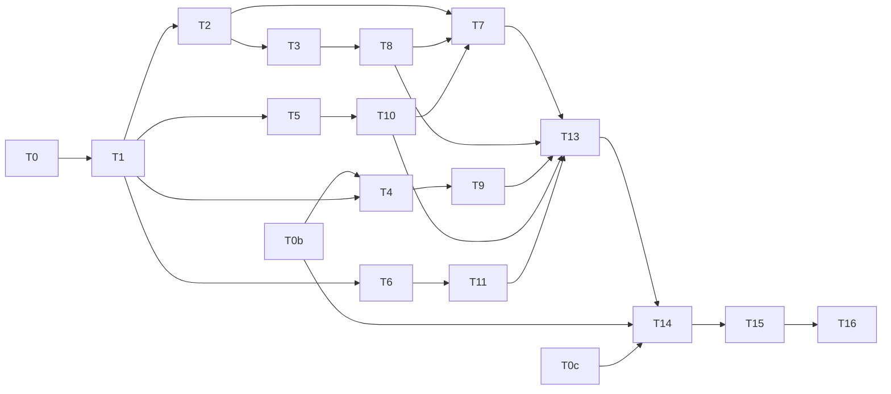

# KyberDash: Antigravity Tool and Skill Detail Views, and Copilot CLI System Prompt, Tools and Skills

**Status: Ready (revision 2).** Approved on 2026-10-21 under A2
(`AUTONOMOUS_APPROVAL: approve-and-execute`). The T0 evidence (§3.5) disproved the first pairing
rule (D4). This revision applies the T0 corrections to D1–D5, D10, D11 and D19, and adds
D20–D22. A1 approved revision 1 and lapsed when the plan returned to Draft. This plan is now
implementation authority.

The owner's approval to execute this plan stands. These corrections stay within the approved
scope.

- Development mode: `test-first`.
- Autonomy: `autonomous` (repository default, Config Reg `<autonomy>`).

---

## 1. Problem and Goal

### 1.1 Requests (owner)

1. **Antigravity (`agy`).** The skills and tools detail views show nothing, and the skills
   view is cluttered.
2. **GitHub Copilot CLI.** Sessions show no system prompt, no tools and no skills.

### 1.2 Goal

1. An Antigravity session read from a conversation store with a sibling
   `brain/<conversationId>/.system_generated/logs/transcript.jsonl` shows, per turn, the tools
   the model invoked and the skills it loaded.
   - Tool rows carry the name, the arguments, and the result where it can be paired.
   - Each turn is paired by the `last_step_index` rule in D4.
   - A session, or a call, with no transcript coverage states that invocations are not
     measurable. It never shows a measured 0.
2. The Antigravity skills view shows each listed skill with its `SKILL.md` description and a
   derived-token bar, without the turn-number list. This is already done and uncommitted
   (C1).
3. The Antigravity MCP tool catalogue (`<root>/mcp/<server>/<tool>.json`) appears as tool
   definitions offered to the model, not counted as resident context. A session with no
   catalogue states that tool definitions are not exported. It never shows an empty measured
   list.
4. A Copilot CLI session shows its root system prompt and the skills listed in its
   `<available_skills>` block, with descriptions. Both come from
   `~/.copilot/session-state/<id>/events.jsonl` and attach to the records the inspector
   actually renders: `data.db` session rows and shutdown rollups (D20). The session also
   shows the tools it invoked, with results (D10). Tool definitions stay not measurable, with
   a Copilot-CLI-specific reason.
5. All existing work for both asks lands on **one local branch**: the main checkout, two agent
   worktrees and one stopped branch. Nothing is pushed and no pull request is opened or
   updated without the owner.

No other harness changes behaviour.

---

## 2. Decisions

| ID | Question | Answer / decision | Mitigating and supporting information | Status / approval provenance |
|---|---|---|---|---|
| D1 | How is the existing work reconciled? | One local branch, `feat/kyberdash-agy-copilot-detail-views`, created in the main checkout from `main` at `6b30f533`. It carries the main checkout's uncommitted edits. Uncommitted work in each worktree is committed **in place on its own branch**, then cherry-picked onto the integration branch. Four sources, in this order: • **C1** — main checkout: the skill-description work (7 files plus `antigravity-skill-text.ts`). The plan files are committed separately. • **C2** — `worktree-agent-a70a652852dc16a9e`: the MCP catalogue reader (uncommitted). • **C3** — `feat/copilot-cli-system-prompt`: clean, two commits ahead, `06961940` and `28e45733` (the PR #406 review fixes). • **C4** — `claude/musing-swirles-a2efcb`: the transcript work (uncommitted). It adds `attachTranscriptActivity` (+17 lines) in `antigravity.ts`, `antigravity-transcript.ts` and its test, and `telemetry-inventory.md` edits. No push. PR #406 is neither updated nor closed. No worktree or branch is deleted. Cleanup, and whether this branch supersedes #406, are left to the owner. | User brief: "one branch; no push/PR without the owner". Committing in place keeps each source auditable; a patch export would silently lose untracked files. Expected textual conflicts: `telemetry-inventory.md` (C2, C3, C4) and `providers/antigravity.ts` (C4 against later tasks). T1 resolves the textual conflicts only. Behaviour is set by D4, D20 and T7–T10. | autonomous: decided from the user instruction plus T0(d); revision 2, approved 2026-10-21 (A2) |
| D2 | Redo or reuse the stopped Copilot CLI work? | Reuse C3. Its `readEventsJournal` (system prompt per agent, keyed by `messageId`) and its `pairingId: messageId` change on journal calls have **nothing to pair with**: no journal call reaches canon (T0(c)). T9 changes the reader's output to the D20 attachment and keeps the journal parsing. | User brief: "reuse, don't redo". T0(c): 0 of 5,605 journal `messageId`s exist as canon records. | autonomous: decided from the user instruction plus T0(c); revision 2, approved 2026-10-21 (A2) |
| D3 | Where do Antigravity tool and skill invocations come from? | `transcript.jsonl`, parsed by C4's `antigravity-transcript.ts`, which is reused and becomes the one transcript parser. • `PLANNER_RESPONSE.tool_calls[{name,args}]` give the calls. • `GENERIC` steps give the results where they can be paired (D4). • The provider puts invoked tool and skill **names** on the calls (`tools`, `skills`, so `kyber.skills.invoked`). • The reader puts `toolCalls` and `toolResults` on the turns (child `tool.invoke` records). The protobuf `steps.step_payload` is not used. | Plain JSON with a `step_index` per line, against a protobuf decoder. Reusing C4 avoids a second parser. C4's time-based attachment (`nearest`, `following`) is replaced by D4. | autonomous: low-confidence, no authoritative source — cheap to reverse; revision 2, approved 2026-10-21 (A2) |
| D4 | How are transcript steps paired with provider calls? | **`last_step_index` (lsi) is the last step the model saw as input.** • The model's own `PLANNER_RESPONSE` is at `lsi + 1`. • Call N owns the steps in `(lsi[N], lsi[N+1]]`. The last call's range is unbounded above. • lsi is read from the key/value attributes under `chatModel` field #20 (key `last_step_index`, a decimal-string value), through the existing `antigravitySqliteMetadataAttributes` decoder. • Top-level protobuf field #2 (packed varints) is **never** used. • The provider stamps `pairingId = agy-step:<lsi>` on each call. • The reader gets the lsi list through a helper exported from the provider module, so there is one decoder. It emits one turn per call with `nativeRecordId = agy-step:<lsi>` and declares `positionalPairingUnsafe`. • A call whose range lies before the transcript's first step gets **no parts**. A transcript can start mid-conversation. • Inside a range, a `GENERIC` step is a tool's result only when the range holds exactly one tool call. Otherwise the result is absent (status `unset`). | T0(a): 11 real sessions across `antigravity`, `antigravity-cli` and `antigravity-ide`. lsi is strictly increasing. `lsi + 1` is a `PLANNER_RESPONSE` in 100% of fully covered sessions. The step type at lsi itself varies by store version, so it is not asserted. The revision-1 rule, `(lsi[N-1], lsi[N]]`, gave each call its predecessor's tools. T2 includes a case that fails under that rule. `matchingTurns` (`dash/src/synth/provider.ts:176`) already pairs on `turnId ?? pairingId`. | autonomous: decided from T0(a) evidence; revision 2, approved 2026-10-21 (A2) |
| D5 | What counts as an Antigravity skill invocation? | A `view_file` tool call whose decoded `AbsolutePath` has the basename `SKILL.md`. • The skill name is the parent directory name, accepted only if it matches `^[\w.-]+$`. • The rule lives in `antigravity-transcript.ts` and fills `call.skills` for the owning call (D4). • A name need not appear in the `Active Skills` listing. | Read-only scan: 234 such calls across 157 of 666 transcripts. Argument values are JSON-encoded strings inside the args object, so they are decoded twice, and the fixtures reproduce this. The existing skills engine reads `kyber.skills.invoked`, so `skills.ts` needs no Antigravity predicate. | autonomous: low-confidence, no authoritative source — cheap to reverse; revision 2, approved 2026-10-21 (A2) |
| D6 | When are Antigravity skill invocations measured? | A call whose lsi range is covered by the transcript carries measured invocations. That includes a measured none (`kyber.skills.invoked: []`). A call without coverage carries nothing, and the session-level reason names the missing transcript. | Skills-view contract: "absent means not measured, `[]` is the measured none". `synthesizeCall` drops an empty `skills` array (`dash/src/synth/synth.ts:455`), so T10 keeps `[]` for Antigravity calls marked as transcript-covered, without changing other providers. | autonomous: decided from the documented skills-view contract; approved 2026-10-21 (A1), unchanged |
| D7 | How is the MCP catalogue kept from overstating residency? | Add an optional `resident?: false` to `ContentPart`. • The Antigravity reader sets it on catalogue `tool_definitions` parts. • Context composition and findings leave non-resident parts out of resident-token totals. • The catalogue is attached to the first turn only. • If T5 shows composition already ignores these parts, the RED step is recorded as "already holds". | Antigravity's prompt says MCP schemas are read on demand. Precedent: optional `role` on `ContentPart`, archived plan 2026-10-19 D21. | autonomous: decided from precedent; approved 2026-10-21 (A1), unchanged |
| D8 | How does a declared reader limit become measured when parts exist? | A content key listed in `READER_UNMEASURABLE` is lifted to measured **only on records whose paired reader turn carries parts of that key**. Other records keep a harness-specific reason. This covers Copilot CLI `system_prompt` (D20) and Antigravity `tool_definitions`. C2's removal of `tool_definitions` from Antigravity's declared limits is reverted in favour of this rule. | Fixes C2's caveat that a session without an MCP directory could read as a measured zero. Local to `measurabilityFor` and synthesis. | autonomous: low-confidence, no authoritative source — cheap to reverse; approved 2026-10-21 (A1), unchanged |
| D9 | Copilot CLI tool definitions? | Not measurable. Reason: "Copilot CLI session journals carry no tool schemas; the system prompt's `<tools>` section is usage guidance, not the offered tool set." | Brief diagnosis; comment in C3. | autonomous: decided from source evidence; approved 2026-10-21 (A1), unchanged |
| D10 | Copilot CLI tool invocations? | The reader builds `toolCalls` from `assistant.message.data.toolRequests` (`toolCallId`, `name`/`toolName`, `arguments`) and `toolResults` from `tool.execution_complete` on `data.toolCallId`. • Each call attaches to the session's canon record with the latest timestamp at or before the call's `assistant.message`. A call earlier than every record attaches to the earliest record. • Synthesis produces child `tool.invoke` records. | Read-only scan: 16,447 `tool.execution_*` events across 32 sessions, and `tool.execution_complete` carries `data.toolCallId`. T0(c): the session's records are `data.db` session rows and shutdown rollups, not one record per message, so the attachment is by time and is honest at session granularity. T0b records how many records each session has, and so how coarse the attachment is. Partly closes #211, for the CLI only. | autonomous: low-confidence, no authoritative source — cheap to reverse (reader-local); revision 2, approved 2026-10-21 (A2) |
| D11 | Sessions sourced only from Antigravity status-line events? | **Closed as a non-goal.** The status-line events and the `StatusLinePayload`/`StatusLineEvent` types carry no `transcript_path`. No session exists only through status-line events. Revision 1's T12a and T12b are removed. | T0(b): 17 sessions have file records, and every one has a `.db`. | autonomous: decided from T0(b) evidence; revision 2, approved 2026-10-21 (A2) |
| D12 | Parser-contract invalidation? | Add `ANTIGRAVITY_PARSER_CONTRACT_VERSION = '2'` (provider `antigravity`) and `COPILOT_PARSER_CONTRACT_VERSION = '3'` (provider `copilot`, moved out of `SKILLS_CONTRACT_PROVIDER_NAMES`) in `dash/src/refresh/registry.ts`, each with a comment saying why. No key-shape change, so no `CACHE_VERSION` bump. | The ADR 0016 repair contract, and the in-file precedent. | autonomous: decided from ADR 0016 and in-file precedent; approved 2026-10-21 (A1), unchanged |
| D13 | The uncommitted `SKILL.md` description lookup? | Keep it: a serve-time lookup with a cache that lives as long as the process. Add the missing unit tests against a synthetic `HOME`. Residual: an edited description shows only after a restart. | Reads only `~/.gemini/{config,antigravity*}/skills/<name>/SKILL.md`, and rejects names outside `^[\w.-]+$`. | autonomous: low-confidence, no authoritative source — cheap to reverse; approved 2026-10-21 (A1), unchanged |
| D14 | Fixture and evidence policy? | Synthetic fixtures only. No real content is committed. Real-machine evidence is counts and shapes only, recorded in §3.5. | User brief. | autonomous: decided from the user instruction; approved 2026-10-21 (A1), unchanged |
| D15 | Mode and autonomy? | `development-mode: test-first`; `autonomy: autonomous`. | Packet inputs. | autonomous: packet input; approved 2026-10-21 (A1), unchanged |
| D16 | Which specialist runs the TypeScript tasks under `dash/src`? | The tasks name the **TypeScript** skill, which the conductor maps to `react-dev`. `.tsx` work also goes to `react-dev`, tests to `test-dev`, and documentation to `docs-dev`. | The squad has no dedicated TypeScript backend agent. | autonomous: low-confidence, no authoritative source — cheap to reverse; approved 2026-10-21 (A1), unchanged |
| D17 | Linux verification? | T13 runs all four dash gates with: `docker run --rm -v <repo>:/work -v /work/dash/node_modules -v /work/dash/web/node_modules -w /work/dash node:22-bookworm bash -lc "npm ci && (cd web && npm ci) && npm run typecheck && npm run lint && npm run test && npm run check:reachable"` Exit codes are recorded. | `engines.node >= 22.13.0`. The anonymous volumes keep the host's `node_modules` untouched. | autonomous: decided from the user instruction; approved 2026-10-21 (A1), unchanged |
| D18 | ADR? | None expected. The ADR waiver is anticipated: this refines the reader, synth and measurability layering under ADR 0009 and ADR 0016, and adds one optional field (D7). T16 confirms. | Plan index closeout policy. | autonomous: decided from the plan index closeout policy; approved 2026-10-21 (A1), unchanged |
| D19 | Antigravity sessions seen only through OTLP (the `gen_ai.skills` listing source)? | **This plan does not rely on a same-session-id join.** • OTLP sessions get no transcript-derived invocations; this is recorded as a residual. • T0c explains, read-only, why 9 OTLP sessions that have a `.db` on disk under the same id have no file records in canon. Possible causes: twin dedupe, never ingested, or a window or classification filter. • The answer is recorded in the inventory. • Any fix is proposed as a todo for the owner, not done here. | T0(e): 13 OTLP sessions, with `gen_ai.skills` on 20,712 of 20,712 records, and 17 file-record sessions. No session id appears in both sets. 9 of the 13 have a `.db` under the same id. | autonomous: decided from T0(e) evidence; revision 2, approved 2026-10-21 (A2) |
| D20 | How does the Copilot CLI system prompt reach the records the inspector renders? | **Attach, don't ingest.** • The Copilot CLI reader, called with the `data.db` path that `callsAndTurns` uses (`dash/src/synth/provider.ts` lines 142–147), resolves each session's `~/.copilot/session-state/<sessionId>/events.jsonl`. • It attaches the **root** agent's latest `system.message` as one `system_prompt` part to every canon record of that session: the `data.db` session rows and the shutdown rollups. Attachment is by session id, never by position. • Subagent prompts (`agentId` set) are not attached, because no subagent record exists. This is recorded as a residual. • Journal calls are **not** ingested as new records. • T0b first establishes whether the `events.jsonl` parser calls are never produced or produced and then dropped at ingest. The result is recorded in §3.5. • A defect found by T0b is proposed as a todo, not fixed here. | T0(c): 69 `copilot-cli` records (60 `data.db` session rows, 9 shutdown rollups), all with 0 parts. 0 of 5,605 journal `messageId`s exist as canon records. The inspector renders the `data.db` rows and the rollups. Ingesting journal calls would change the session's record set and its accounting (cost and token totals against the rollups). That is expensive to reverse and outside the owner's ask. Attaching is local to the reader and re-derives on the D12 bump. | autonomous: low-confidence, no authoritative source — cheap to reverse; the costly alternative was rejected; revision 2, approved 2026-10-21 (A2) |
| D21 | Copilot CLI skills? | The listing is measured from the attached root `system_prompt` through the existing `readSystemPromptListing` (`<available_skills>`). Invocations stay as today: the provider extracts them from `toolRequests` on journal calls, which do not reach canon. They therefore stay not measurable, and the inventory says why. | Follows D20. Changing the invocation source would mean ingesting journal calls, which D20 rejected. | autonomous: decided as a consequence of D20; revision 2, approved 2026-10-21 (A2) |
| D22 | How does C4's time-based transcript attachment relate to D4? | T7 replaces `attachTranscriptActivity`'s `nearest`/`following` time attachment with the D4 lsi rule, and keeps C4's transcript parsing in `antigravity-transcript.ts`. C4's own tests that assert the time behaviour are rewritten to D4. That rewrites C4's tests, not this plan's approved Test contract. | T0(d). | autonomous: decided from T0(a) and T0(d) evidence; revision 2, approved 2026-10-21 (A2) |
| A1 | Approve and execute (revision 1)? | Approved, then lapsed: on 2026-10-21 the T0 evidence returned the plan to Draft. | `AUTONOMOUS_APPROVAL: approve-and-execute`, relayed by the conductor. The owner approved execution in chat. | autonomous: recommendation accepted (AUTONOMOUS_APPROVAL: approve-and-execute); owner approved execution in chat, relayed by the conductor 2026-10-21; lapsed on return to Draft |
| A2 | Approve and execute (revision 2)? | Approved. The plan is Ready and is implementation authority. | Revision 2 corrects the plan from the T0 evidence, within the scope the owner already approved. `docs validate .` and `docs drift .` on revision 2 returned no findings (conductor's worker). | autonomous: recommendation accepted (AUTONOMOUS_APPROVAL: approve-and-execute); owner approved execution in chat, relayed by the conductor; revision 2 is a T0-evidence correction (2026-10-21) |

There is no impactful escalation. D20 rejects the one costly option, ingesting journal calls,
and takes the reader-local alternative, which is cheap to reverse.

---

## 3. Investigation Findings

### 3.1 Antigravity (verified)

- The provider `dash/src/providers/antigravity.ts` builds calls from SQLite `gen_metadata`
  (`buildCallFromSqliteGenMetadataRow`), from `.pb` files or the live server, and from the
  status-line journal. Every one of these paths sets `tools: []`.
  `antigravitySqliteMetadataAttributes` already decodes `chatModel` field #20, where the lsi
  lives.
- `PROVIDER_READERS` (`dash/src/synth/provider.ts:101`) has no Antigravity reader on `main`.
  C2 adds one.
- Transcript shape:
  - `PLANNER_RESPONSE` steps carry `tool_calls[{name,args}]`, with JSON-encoded string
    argument values.
  - Token fields appear in 255 of the 666 transcripts.
  - `view_file` of a `SKILL.md` appears 234 times across 157 files.
- `skills.ts` reads Antigravity listings from `gen_ai.skills`, and invocations only from
  `Skill` tool records or `kyber.skills.invoked`.

### 3.2 Copilot CLI (verified)

- On `main`, `copilotCliReader` yields nothing. `callsAndTurns` falls back to
  `loadCopilotCliCalls` (`data.db` `sessions` rows, key `copilot:<sid>:<id>`) when the parser
  yields no calls.
- `READER_UNMEASURABLE` `copilot` declares every content key not measurable.
- Real `events.jsonl`:
  - 418 `system.message` events across 32 sessions.
  - `agentId` is a top-level field.
  - `tool.execution_complete` carries `data.toolCallId`.

### 3.3 Existing work to reconcile (T0(d))

| Source | Location / branch | State | Content |
|---|---|---|---|
| C1 | main checkout, `main` at `6b30f533` | uncommitted | 7 files plus `dash/src/canon/antigravity-skill-text.ts`: the `SKILL.md` descriptions, the `SkillsPanel` description and token bar, the drawer fallback, `kyberApi.ts`, and tests. The plan files sit beside them and are committed separately. |
| C2 | `.claude/worktrees/agent-a70a652852dc16a9e`, branch `worktree-agent-a70a652852dc16a9e` | uncommitted | MCP catalogue reader, registration, Antigravity measurability row, "does not export tool definitions" notice, inventory section |
| C3 | `/Users/dave/git/claude-worktree/kyber-weave/sleepy-greider-7c478b`, branch `feat/copilot-cli-system-prompt` | clean, 2 commits: `06961940`, `28e45733` (PR #406 review fixes) | `readEventsJournal`, `pairingId: messageId`, tests, inventory line |
| C4 | `/Users/dave/git/claude-worktree/kyber-weave/musing-swirles-a2efcb`, branch `claude/musing-swirles-a2efcb` | uncommitted | `antigravity.ts` (+17 lines, `attachTranscriptActivity`, time-based), `antigravity-transcript.ts` and its test, `telemetry-inventory.md` |

The other worktrees are unrelated and are not touched.

### 3.4 Discovery

- **Revision 1:** codegraph 5, docs 6, direct reads 26. Reasons: the architect references and
  `AGENTS.md`; the plan index and template; `.git` metadata read because there was no shell;
  worktree files outside the index; and narrow confirmations of the `tools: []` sites, the
  fixture `last_step_index`, the contract versions and the inventory rows.
- **Revision 2:** 1 direct read of this plan's Decisions section, for the rewrite. The T0
  evidence was gathered by the conductor's worker, read-only and as counts only.
- **Self-gathered work:** counts-only greps over `~/.gemini` and `~/.copilot`. No
  `research-agent` was used.

### 3.5 T0 evidence (counts and shapes only; conductor's worker, 2026-10-21)

- **(a) lsi.**
  - Where it is: a key/value attribute under `chatModel` field #20 (key `last_step_index`, a
    decimal-string value). The fixture `gen-metadata.json` holds `"2"`.
  - What it means: it is the last step given to the model as input. The model's
    `PLANNER_RESPONSE` is at `lsi + 1`.
  - Sample: 11 real sessions across `antigravity`, `antigravity-cli` and `antigravity-ide`.
  - In every session lsi is strictly increasing, and `lsi + 1` is a `PLANNER_RESPONSE` in 100%
    of the fully covered sessions.
  - Some transcripts start mid-conversation (for example at step 674). Calls before the first
    transcript step must get no parts.
  - The step type at lsi varies by store version.
  - Top-level protobuf field #2 (packed varints) must not be used.
  - The revision-1 rule was off by one: each call received its predecessor's tool calls.
- **(b) Status line.** No `transcript_path` on status-line events or in the
  `StatusLinePayload`/`StatusLineEvent` types. No session exists only through status-line
  events. All 17 sessions with file records have a `.db`.
- **(c) Copilot CLI.**
  - Canon holds 69 `copilot-cli` records, all with 0 parts: 60 `data.db` session rows and 9
    shutdown rollups.
  - 0 of 5,605 journal `messageId`s exist as canon records.
  - The inspector renders the `data.db` rows and the rollups.
  - Not yet traced: whether the `events.jsonl` parser calls are never produced or are dropped
    at ingest. T0b owns this.
- **(d) Git.** See §3.3.
- **(e) OTLP and file records.**
  - 13 OTLP Antigravity sessions, with `gen_ai.skills` on 20,712 of 20,712 records.
  - 17 file-record sessions.
  - 0 session ids in common.
  - 9 of the 13 OTLP sessions have a conversation `.db` on disk under the same id, but canon
    has no file records for them. The reason is unknown; T0c owns it.

---

## 4. Test Contract (test-first)

The runner root is `/Users/dave/git/personal/claude/kyber-weave/dash`. Every fixture is
synthetic (D14).

Tests assert observable output:

- reader turns;
- canonical records;
- measurability;
- the skills view;
- rendered HTML.

Weakening any assertion to reach GREEN is a scope change, and it returns this plan to Draft.

| Task | Test project or file | Runner command | Observable behavior | RED evidence required | GREEN acceptance |
|---|---|---|---|---|---|
| T0 | none (evidence task) | read-only | §3.5 (a)–(e) | n/a: no-test task, replaced by §3.5 | **Met** (§3.5) |
| T0b | none (trace task) | read-only, against a scratch copy of the store and a synthetic `HOME`; nothing is written to `~/.kyberdash` | Traces one real Copilot CLI session through discovery (`sourceType: 'jsonl'`), `createJsonlParser` and `callsAndTurns`. Records whether the journal calls are never produced, or produced and then dropped, and where. Records how many canon records each session has (input to D10). Written to §3.5 (c) | n/a: no-test task, replaced by the §3.5 note | §3.5 (c) completed. Any defect is written up as a todo proposal for the owner and not fixed |
| T0c | none (trace task) | read-only, as T0b | For the 9 OTLP sessions that have a `.db` on disk and no file records, finds the cause: twin dedupe, never discovered, a window filter, or classification. Written to §3.5 (e) | n/a: no-test task, replaced by the §3.5 note | §3.5 (e) completed. Any defect is written up as a todo proposal |
| T1 | none (integration task) | `git log --oneline main..HEAD`, then the four dash gates | One branch holds C1–C4 per D1. A baseline gate run is recorded | n/a: no-test task, replaced by the commit list and gate log | Branch exists with C1–C4. No push. PR #406 untouched. Baseline recorded |
| T2 | `src/providers/antigravity-transcript.test.ts` (from C4), `src/providers/antigravity.test.ts`, `src/synth/readers/antigravity.test.ts`, new `tests/fixtures/antigravity-transcript/` | `npx vitest run src/providers/antigravity-transcript.test.ts src/providers/antigravity.test.ts src/synth/readers/antigravity.test.ts` | See the four cases below this table | (a) and (b) fail on the reconciled branch: no `pairingId`, and the C4 time rule gives other results. (c) and (d) fail where not implemented. C4's time-rule assertions are rewritten to D4 (D22) | Pass unmodified. The existing Antigravity suites pass |
| T3 | `src/providers/antigravity-transcript.test.ts` (skill cases), `src/canon/skills.test.ts`, new `src/canon/antigravity-skill-text.test.ts` | `npx vitest run src/providers/antigravity-transcript.test.ts src/canon/skills.test.ts src/canon/antigravity-skill-text.test.ts` | (a) A `view_file` with double-encoded `AbsolutePath` `/x/skills/alpha/SKILL.md` in call N's range puts `alpha` in call N's `skills`. A `README.md` puts nothing, and neither does a parent name outside `^[\w.-]+$`. (b) Through the skills view on synthetic records: covered calls with no skill load give a measured 0. A session with no covered call is not measurable, with the transcript reason. Other harnesses are unchanged. (c) `skillDescriptionOf` handles inline, quoted, folded and absent descriptions. `antigravitySkillDescription` resolves under a synthetic `HOME` and returns undefined for a missing skill and for `../x` | (a) and (b) fail. (c) may pass at once and is then recorded as characterization of the D13 code, not as RED | Pass unmodified |
| T4 | `src/synth/readers/copilot.test.ts`, `src/synth/provider.test.ts` | `npx vitest run src/synth/readers/copilot.test.ts src/synth/provider.test.ts` | Synthetic `data.db` (two session rows, one shutdown rollup) plus `session-state/<sid>/events.jsonl` (root `system.message` with `<available_skills>`, one subagent `system.message`, `assistant.message` events with `toolRequests`, `tool.execution_complete` events). Through `ingestProviders`: (a) every canon record of the session carries exactly the root `system_prompt` part, and the subagent prompt appears on none (D20); (b) `readListingOf` gives a measured listing with names and descriptions (D21); (c) child `tool.invoke` records attach to the latest record at or before each call, or to the earliest record, with the result joined on `toolCallId` and left absent when there is no complete event (D10); (d) a session with no journal leaves its records with no parts; (e) a second session's journal never attaches to the first. C3's per-message assertions are rewritten to D20 | (a)–(e) fail: the reader yields nothing for a `data.db` path | Pass unmodified |
| T5 | `src/canon/measurability.test.ts`, `src/synth/synth.test.ts`, `src/analysis/context.test.ts`, `src/refresh/registry.test.ts` | `npx vitest run src/canon/measurability.test.ts src/synth/synth.test.ts src/analysis/context.test.ts src/refresh/registry.test.ts` | (a) D8 lift: Copilot CLI `system_prompt` is measured only on records with the part, and Antigravity `tool_definitions` only on records with catalogue parts. Other records keep the harness reasons (D9; "does not export tool definitions"). (b) D7: `resident: false` parts add no resident tokens and are reported as offered. (c) D6: covered Antigravity calls keep `kyber.skills.invoked: []`, while other providers still drop an empty `skills`. (d) D12: version `'2'` for `antigravity` and `'3'` for `copilot`; others unchanged | All fail on the reconciled branch | Pass unmodified. The full suites pass |
| T6 | `web/src/components/{AgentSessionDashboard,SessionInspectorDrawer,SkillsPanel}.test.tsx` | `npx vitest run web/src/components/AgentSessionDashboard.test.tsx web/src/components/SessionInspectorDrawer.test.tsx web/src/components/SkillsPanel.test.tsx` | Synthetic payloads: • Antigravity: invoked tools appear with counts and previews. Skills show their invocation count, or the reason it is not measurable, beside the description and token bar, with no turn-number list. MCP catalogue tools are labelled "offered (MCP catalogue)". • Copilot CLI: the system-prompt tab shows the root prompt. The tool-definitions area shows the D9 reason. The skills panel shows the listing, and the D21 reason for invocations | Fails where the UI does not render the new fields | Pass unmodified |
| T7 | T2 files | as T2 | as T2 | consumes T2 RED | T2 GREEN |
| T8 | T3 files | as T3 | as T3 | consumes T3 RED | T3 GREEN |
| T9 | T4 files | as T4 | as T4 | consumes T4 RED | T4 GREEN |
| T10 | T5 files | as T5 | as T5 | consumes T5 RED | T5 GREEN |
| T11 | T6 files | as T6 | as T6 | consumes T6 RED | T6 GREEN |
| T13 | whole `dash` suite | the four dash gates on macOS, then the D17 docker command | Green on both platforms, or each failure shown to pre-date the change (T1 baseline) | n/a: verification task | Exit 0, or a disclosed failure that pre-dates the change |
| T14 | none (documentation) | `dotnet run --project src/KyberWeave.Cli -- docs validate .`, then `-- docs drift .` | The docs describe the shipped contract | n/a: documentation task | Zero findings |
| T15 | none (review) | `code-reviewer` over `main..HEAD` | Council verdict | n/a | APPROVE, or the findings are fixed and re-audited |
| T16 | none (closeout) | `docs validate . --merge-ready`, `docs drift .` | Archived and harvested | n/a | Zero findings |

**T2 observable behavior.** The fixture is a synthetic `.db` with three `gen_metadata` rows,
lsi 2, 5 and 8, and a transcript with steps 0–10. The `PLANNER_RESPONSE` steps are at 3, 6
and 9, each with a **distinct** tool: `tool_a` (step 3), `tool_b` (step 6), `tool_c` (step
9). The `GENERIC` results are at 4, 7 and 10.

- **(a) Pairing** (`pairingId` `agy-step:2`, `agy-step:5`, `agy-step:8`):
  - call lsi 2 owns `tool_a`, with result step 4;
  - call lsi 5 owns `tool_b`;
  - call lsi 8 owns `tool_c`, so the last call's range is unbounded above.
  - The revision-1 rule would give lsi 5 `tool_a` and give lsi 2 nothing, so these
    assertions fail under it.
- **(b) Mid-conversation transcript.** A second fixture's transcript starts at step 6. The
  call with lsi 2 gets **no** parts and no invocations. The call with lsi 5 owns `tool_b`.
  No positional fallback applies.
- **(c) Results and decoding.** A range with two tool calls leaves both results absent.
  Double-encoded arguments are decoded. An unparseable line is skipped without throwing.
- **(d) End to end.** Through `ingestProviders`: the child `tool.invoke` records sit under
  the right parents. Calls carry `tools` names. The MCP catalogue is still on the first turn
  with `resident: false`. A `.db` with no transcript gives no invocation turns.

---

## 5. Tasks

Every developer task ends with the worker's own `task-gate` run. A failing gate goes back to
the same worker.

| ID | Objective | Files / symbols | Acceptance | Depends on | Required skills |
|---|---|---|---|---|---|
| T0 | Evidence | — | **Complete** (§3.5) | — | — |
| T0b | Copilot CLI ingest trace (D20) | read-only; this plan §3.5 (c) | T0b row | — | TypeScript (investigation) |
| T0c | Trace of the OTLP sessions that have a `.db` but no file records (D19) | read-only; this plan §3.5 (e) | T0c row | — | TypeScript (investigation) |
| T1 | Reconcile C1–C4 per D1. Commit in place; cherry-pick `06961940` and `28e45733`; commit C4 in place and cherry-pick it. Resolve textual conflicts only. Record a baseline gate run. No push, no deletion, PR #406 untouched | git; files per §3.3 | T1 row | T0 | git, TypeScript |
| T2 | RED: Antigravity lsi pairing, transcript reader and fixtures | `dash/src/providers/antigravity-transcript.test.ts`, `dash/src/providers/antigravity.test.ts`, `dash/src/synth/readers/antigravity.test.ts`, `dash/tests/fixtures/antigravity-transcript/**` (new, README states synthetic) | T2 RED | T1 | test-dev, Vitest |
| T3 | RED: Antigravity skill detection, measured-none in the skills view, skill-text tests | `dash/src/providers/antigravity-transcript.test.ts` (skill cases only; coordinate with T2 on this shared file, or run T2 and T3 in sequence on it), `dash/src/canon/skills.test.ts`, `dash/src/canon/antigravity-skill-text.test.ts` (new) | T3 RED | T1, T2 (shared test file) | test-dev, Vitest |
| T4 | RED: Copilot CLI attachment, listing and tool invocations (D20, D21, D10) | `dash/src/synth/readers/copilot.test.ts`, `dash/src/synth/provider.test.ts` | T4 RED | T1, T0b | test-dev, Vitest |
| T5 | RED: measurability lift, residency, measured-none, versions | `dash/src/canon/measurability.test.ts`, `dash/src/synth/synth.test.ts`, `dash/src/analysis/context.test.ts`, `dash/src/refresh/registry.test.ts` | T5 RED | T1 | test-dev, Vitest |
| T6 | RED: web rendering | `dash/web/src/components/{AgentSessionDashboard,SessionInspectorDrawer,SkillsPanel}.test.tsx` | T6 RED | T1 | test-dev, Vitest, React |
| T7 | GREEN: D4 and D22, plus the D3 provider and reader halves. Provider: read lsi through `antigravitySqliteMetadataAttributes` (field #20 only), stamp `pairingId`, export the lsi helper, replace C4's time attachment in `attachTranscriptActivity` with D4 ranges filling `tools` and `skills` (via the T8 detector), and mark calls as transcript-covered. Reader: emit lsi-keyed turns with `toolCalls` and `toolResults`; keep the first-turn catalogue with `resident: false`; declare `positionalPairingUnsafe` | `dash/src/providers/antigravity.ts`, `dash/src/providers/antigravity-transcript.ts` (range parsing), `dash/src/synth/readers/antigravity.ts`, `dash/src/synth/provider.ts` (`PROVIDER_READERS`, pairing-unsafe flag) | T2 GREEN | T2, T8, T10 | TypeScript |
| T8 | GREEN: the D5 skill-load detector in the transcript module; `antigravity-skill-text.ts` only if T3(c) finds a defect | `dash/src/providers/antigravity-transcript.ts` (skill detector, exported), `dash/src/canon/antigravity-skill-text.ts` | T3 GREEN (a, c); T3(b) after T7 and T10 | T3 | TypeScript |
| T9 | GREEN: D20, D21, D10 in the Copilot CLI reader. For a `data.db` path, resolve each session's journal, attach the root prompt to every record of the session by session id, and build tool calls and results by the D10 time rule. Keep C3's journal parsing. Remove or neutralize the unused `pairingId: messageId` only if the T4 tests require it | `dash/src/synth/readers/copilot.ts` (`copilotCliReader`, `readEventsJournal`); `dash/src/synth/provider.ts` only if session-keyed attachment needs a pairing hook, then ordered after T7 | T4 GREEN | T4 (and T7 if `provider.ts` is touched) | TypeScript |
| T10 | GREEN: D7 `ContentPart.resident`; D8 lift, with C2's Antigravity row restored and harness reasons (D9, the Antigravity reason, and D21's invocation reason); D6 measured-none for covered Antigravity calls; D12 versions | `dash/src/canon/types.ts`, `dash/src/canon/measurability.ts`, `dash/src/synth/synth.ts` (`synthesizeCall`, around `:455`), `dash/src/analysis/context.ts`, `dash/src/refresh/registry.ts` | T5 GREEN | T5 | TypeScript |
| T11 | GREEN: web rendering only, under the display-layer rule | `dash/web/src/components/AgentSessionDashboard.tsx`, `SessionInspectorDrawer.tsx`, `SkillsPanel.tsx`, `dash/web/src/lib/kyberApi.ts` | T6 GREEN; `display-layer.test.ts` passes | T6 | react-dev, React |
| T13 | Full dash gates on macOS and Linux (D17). Read-only smoke run against a **scratch** cache directory and canon db, never `~/.kyberdash/canon.db`. Confirm with counts that one real Antigravity session shows lsi-paired tools and skills, and one Copilot CLI session shows the prompt, listing and tools | none edited | T13 row | T7, T8, T9, T10, T11 | TypeScript, docker |
| T14 | Docs (§7), including the T0b and T0c findings and the D19, D20 and D21 residuals | `docs/dash/telemetry-inventory.md`, `docs/dash/architecture.md`, `docs/dash/runbook.md` | T14 row | T13, T0b, T0c | docs-dev, app-docs-standard |
| T15 | Whole-change review of `main..HEAD` | — | T15 row | T13, T14 | code-review |
| T16 | Closeout: map D1–D22 to their destinations (ADR waiver per D18, or an ADR); record the Linux evidence and residuals; list the T0b and T0c todo proposals for owner acceptance; archive the plan and move its index row; the owner gate for push, PR and #406 stays open | this plan, `docs/plans/README.md`, `docs/archive/plans/` | T16 row | T15 | docs-dev |

Revision 1's T12a and T12b are removed (D11).

### 5.1 Dependency graph

**Parallel groups.**

- **G0:** T0b and T0c run at once, and alongside T1.
- **G1:** T2, T5 and T6 run after T1. T4 runs after T1 and T0b. T3 runs after T2, because they
  share a test file.
- **G2:** T8, T9, T10 and T11 run at once (disjoint source files). T7 waits for T8, which owns
  the detector in the shared transcript module, and for T10, which owns the `resident` type.
  T9 waits for T7 only if it touches `synth/provider.ts`.

---

## 6. Risks

- **Store versions outside the 11 sampled sessions.** The lsi rule is not tested against
  them. A call whose `lsi + 1` is not a `PLANNER_RESPONSE` gets no parts; nothing is guessed.
  T13 smoke-checks one real session.
- **Copilot tool attachment is coarse.** Records are per session row and rollup, so a tool
  can only be placed on a session-level record. The count of records per session (T0b) is
  stated in the inventory.
- **Subagent prompts are not shown** for Copilot CLI (D20 residual).
- **Copilot skill invocations stay not measurable** (D21 residual).
- **9 OTLP Antigravity sessions with a `.db` have no file records.** The cause is unknown
  until T0c. No fix is made in this plan.
- **Transcripts written mid-session.** The reader takes whole lines only and never throws.
  The next pass, after the D12 re-read, heals the rest.
- **Content volume.** Covered by the existing 64 KiB bound and the 14-day purge (ADR 0018).
- **Failures that pre-date the change** (the `migration.test.ts` DROP COLUMN test, the Cursor
  date floor) are recorded in the T1 baseline and disclosed by T13.
- **Cherry-pick conflicts** across C2, C3 and C4 in `telemetry-inventory.md` and
  `providers/antigravity.ts`. T1 resolves the text; the behaviour is set by T7 and T9.
- **PR #406** exists for C3. This branch may supersede it. That is the owner's call.

## 7. Documentation updates (T14)

- `docs/dash/telemetry-inventory.md`:
  - **Verified harness outcomes.** The Copilot CLI row gets the root prompt attached to the
    session records (D20), tool invocations by time (D10) and the D9 reason. The Antigravity
    row is updated to match.
  - **Tool extraction support (#180).**
    - Copilot CLI becomes **Implemented (CLI journal, session-level attachment)**. VS Code
      stays deferred under #211.
    - Antigravity becomes **Implemented (`transcript.jsonl`, lsi-paired, `.db` sources)**.
      The status-line source is a non-goal (D11). OTLP-only sessions are a residual (D19,
      with the T0c finding). Tracked under #213.
  - **Skill availability.**
    - Copilot CLI: listing measured from the attached prompt; invocations not measurable
      (D21).
    - Antigravity: invocations measured through `view_file` of `SKILL.md` (D5, D6);
      descriptions from `SKILL.md` (D13).
  - **"Antigravity tool definitions and system prompt"** (from C2): invocations are now
    extracted; residency per D7.
  - **Parser contracts:** Antigravity `2`, Copilot `3`. Add the T0b finding.
- `docs/dash/architecture.md`:
  - the skills view contract (measured-none);
  - the canonical model (`ContentPart.resident`);
  - the measurability lift (D8);
  - the Antigravity lsi pairing rule (D4);
  - the Copilot CLI session-keyed attachment (D20).
- `docs/dash/runbook.md`: the skills view section, covering what the two harnesses now show
  and how a not-measurable state differs from an empty one.

## 8. Out of scope

- Ingesting Copilot CLI journal calls as records (D20).
- Copilot tool extraction for VS Code, JetBrains and agent.
- Antigravity built-in tool schemas and system prompt.
- Antigravity status-line transcript pairing (D11).
- OTLP-only Antigravity sessions (D19).
- The `steps.step_payload` decoder.
- Fixing the T0b or T0c causes (proposed as todos only).
- Deleting worktrees or branches.
- Pushing, opening or updating a PR, and closing PR #406. These are owner gates.

## 9. Verification gates

- Per task: `task-gate`.
- The whole change:
  - the four dash gates on macOS and on Linux in docker (D17);
  - `docs validate .` and `docs drift .`;
  - at closeout, `docs validate . --merge-ready`.
- The .NET gates do not reach `dash/`. They run only through `review gates` in T15.
