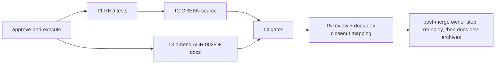

# docs-dev gets a shell (process.execute for the documentation profile)

**Status: Draft — decision-complete, awaiting approve-and-execute.** Every row in `## Decisions` is ANSWERED. The plan becomes Ready only when the owner approves at the approve-and-execute gate (scale `extends-component`, component `KyberSquad`, development mode `test-first`).

**Development mode:** `test-first` (default; no opt-out supplied). **Autonomy:** `supervised`. Branch: `fix/docs-dev-process-execute`, cut from `origin/main` (`95412c0`). Escalated by `bug-crusher` (investigator verdict `NEEDS_ARCHITECT`).

> Discovery (authoring pass 1): codegraph 3, docs 2, direct reads 24. CodeGraph returned `SquadAgent`/`BodyDigest`, `SquadSourceValidator`/`CopilotToolCatalog`, and the renderer list. Direct reads were configuration, agent source, docs and test files the indexes do not return verbatim, or single-detail confirmations: `AGENTS.md` (Config Reg and gate commands), `products/kyber-squad/profiles/capabilities.yml`, `agents/docs-dev.md`, `agents/architect.md` (frontmatter), `migration/docs-dev.md`, `migration/architect.md`, `architect/references/plan-authoring.md`, `architect/references/test-first-contract.md`, `docs/plans/README.md`, `docs/adr/README.md`, `docs/adr/0028-…md`, `docs/kyber-squad/architecture.md` (§8 Devin bullet), `docs/reference/autonomous-gates.md` (grep), `docs/kyber-squad/requirements.md` (grep), two archived plans (frontmatter shape), `src/KyberWeave.Core/Squad/Model/CopilotToolCatalog.cs` (emission order, lines 14–53), and the six test files named in §5 (exact pinned assertions).
>
> Discovery (reconciliation pass 2): codegraph 0, docs 0, direct reads 9. All were single-detail confirmations of files already named in pass 1 or not indexed as code: this plan; the architect `plan-authoring` reference; `docs/adr/0028-…md` (exact clauses to amend); `docs/adr/README.md` row 0028; `docs/kyber-squad/requirements.md` KS-008 row; `docs/kyber-squad/architecture.md` lines 676–691; `docs/reference/autonomous-gates.md` lines 122–133; `docs/plans/README.md` row; `.github/workflows/ci.yml` lines 598–632 (the `--merge-ready` CI step). A targeted grep of `docs/` (excluding `archive/` and `plans/`) for docs-dev shell/execution/narrowing claims found only ADR 0028 and the architecture §8 sentence; no other ADR states that docs-dev has no shell. The docs tools were not used in pass 2 because every target was a known file and line from pass 1.
>
> Validation note: the planner harness exposes no process tool, so `docs validate` / `docs drift` were not run on this Draft. The conductor runs both before presenting the gate (§7).

---

## 1. Problem and goal

### 1.1 Problem

`docs-dev` owns plan closeout and archival and specification-index maintenance (`products/kyber-squad/agents/docs-dev.md` Scope, Plan closeout step 6, Specification closeout steps 5–6). Archival is a `git mv` into `docs/archive/plans/` or `docs/archive/specs/`, and closeout must re-run `docs validate . --merge-ready` and `docs drift .` (spec-closeout step 6 already says so). But the `documentation` capability profile (`products/kyber-squad/profiles/capabilities.yml`, `process.execute: deny`) and docs-dev's `copilot-tools` grant no execution. On Claude the rendered subagent holds only `Read/Edit/Write/Grep/Glob` (plus MCP), so it cannot move a plan or run the checks. The owner's HARD RULE is that only `docs-dev` archives plans, so the closeout path is structurally blocked.

### 1.2 Goal

`docs-dev` holds `process.execute` on every target, scoped by its agent body to: `git mv` for plan/spec archival, `docs validate . --merge-ready`, `docs drift .`, and targeted tests that pin documentation. It never commits or pushes unless its packet says so. The existing ADR record (ADR 0028, amended in place), the ADR index, the canonical architecture doc, and every test that pins the old deny change to the new contract, without weakening any assertion. After the change no ADR or canonical doc states that docs-dev has no shell.

### 1.3 Out of scope

- Any other agent's capability profile (`architect`, `product-planning`, `task-reviewer` are unchanged).
- New `<target>-capability-profile` fields for targets other than Copilot and Devin.
- Path-scoped execution (the lattice has no command or path scoping; the boundary is instruction-only, as for `architect`).
- Changing who archives: conductor and bug-crusher keep not archiving.
- A new ADR (owner decision D1).
- Redeploying Kyber-Squad on the owner's machine (owner decision D3): listed only as a post-merge owner step in §9.

---

## Decisions

| ID | Question | Answer / decision | Mitigating and supporting information | Status / approval provenance |
|---|---|---|---|---|
| B1 | Does docs-dev get execution? | Yes — `process.execute: allow`. | `ask` would not fix the defect: `ask` narrows to withheld on Claude, Pi, ZCode and Devin subagents (capabilities.yml architect comment; ADR 0025 decision 3). | ANSWERED — owner decision relayed by bug-crusher 2026-10-26 |
| B2 | Which Copilot tools? | Add architect's seven `execute/*` entries (`getTerminalOutput`, `killTerminal`, `sendToTerminal`, `runTask`, `createAndRunTask`, `runInTerminal`, `testFailure`). Not `vscode/runCommand` (runs VS Code commands, not a shell; owner named only `execute/*`). | `SquadSourceValidator.ValidateCopilotToolCapabilities` rejects an `execute/*` tool whose capability is not allowed, so the profile edit and the tool-list edit must land in the same task. Emission order is fixed by `CopilotToolCatalog.OrderedTools` (after `search`, before `edit/createFile`). | ANSWERED — owner requirement (2); `vscode/runCommand` exclusion is a planner low-risk call |
| B3 | What does the body say docs-dev runs? | Exactly: `git mv` of a plan file or spec directory into `<docs-root>/archive/plans/` or `<docs-root>/archive/specs/`; `kyber-weave docs validate . --merge-ready`; `kyber-weave docs drift .` (or the invocation the host's `AGENTS.md` declares for the same two commands); targeted tests that pin documentation, named by the packet. Nothing else. Never commit or push unless the packet says so. docs-dev is the only role that archives a plan or spec. | Wording is host-agnostic (Squad agents deploy to other hosts), matching architect's "the repository's documentation validation and drift checks". The existing phrases pinned by `SquadDocsHarvestContractTests` stay intact. | ANSWERED — owner requirement (3); CLI-name wording is a planner low-risk call |
| B4 | Comment on the grant | The `documentation` profile carries a comment: the grant is for plan/spec archival (`git mv`) and `docs validate` / `docs drift` / targeted doc-pinning tests; the boundary is instruction-scoped in the docs-dev body; the lattice has no command scoping; the profile has exactly one consumer (`docs-dev`), pinned by a test. | Mirrors the `architect` and `reviewer` profile comments. | ANSWERED — owner requirement (1) |
| B5 | Migration report pin | `products/kyber-squad/migration/docs-dev.md` `final-body-sha256` is recomputed to the new body digest. | `SquadCanonicalContentTests.LoadMigrationReportsDeclareLockedSourcesAndActualCanonicalDigest` asserts `agent.BodyDigest == report.FinalBodySha256`. This is derived evidence of the evolved body (architect's report documents the same practice), not an assertion change. The investigator's cited line 1150 (`ExpectedSourceHashManifest`) is the historical Hotshot source hash at a fixed commit and does **not** change. | ANSWERED — planner finding; correction to investigator |
| D1 | How is the conflict with ADR 0028 recorded? ADR 0028 decision 2, its rejected alternative "Widening `docs-dev` and `task-reviewer` too", and its first Consequence say docs-dev is deliberately left without a shell. | **No new ADR.** Amend ADR 0028 in place with current information: decision 2, the third rejected alternative and the first Consequence are rewritten so they no longer say docs-dev is unwidened, and a dated amendment note goes in its Status; any other ADR that states docs-dev has no shell or no execution is amended the same way (pass-2 grep found none besides 0028). `docs/adr/README.md` row 0028 status and summary are updated to match. No superseded-by chain. | Keeps one decision record for the docs-dev grant and avoids an ADR-to-ADR contradiction. Planner's earlier recommendation (new ADR 0045 partially superseding 0028) was not accepted. ADR 0028's own trigger ("widen to a role when that role is observed failing the same way") is cited in the amendment as the reason. | ANSWERED — owner decision relayed by conductor 2026-10-26 |
| D2 | Shared `documentation` profile, or target-scoped variants? | **Change the shared `documentation` profile** to `process.execute: allow`, plus a new guard test pinning that `documentation` is consumed only by `docs-dev`. | Target scoping is expressible only for Copilot and Devin; the reported failure is on Claude. `documentation` has one consumer. The guard test makes any future second consumer a visible, reviewed change. | ANSWERED — owner decision relayed by conductor 2026-10-26 |
| D3 | The deployed docs-dev on the owner's machine is the old render (no shell). How does this plan get archived? | **Not decided by the owner.** The local Kyber-Squad redeploy is removed from execution scope and listed only as a post-merge owner step (§9). No task in this plan redeploys, and no task archives this plan. | Redeploy writes to the user's harness agent directories (outward-facing, hard to undo by hand), so it stays an owner action. See risk R1 in §8: CI runs `docs validate . --merge-ready`, which fails while this plan sits in `docs/plans/`. | ANSWERED (deferred) — owner decision relayed by conductor 2026-10-26: "NOT decided; drop redeploy from execution scope; post-merge owner step only" |

---

## 2. Investigation findings

1. **Profile and consumers.** `documentation` (capabilities.yml lines 71–79) is named only by `docs-dev` (investigator grep; confirmed: no other agent file names it, and `src/` has no `"documentation"` profile key). Profiles are not target-scoped unless they carry `target:`.
2. **Copilot tool validation.** `CopilotToolCatalog.RequiredCapabilities` maps every `execute/*` to `process.execute`; the validator rejects a tool whose capability is not allowed. With the shared profile at `allow`, docs-dev needs no `copilot-capability-profile` (architect needs one only because its shared profile is `ask`).
3. **Renderer effect per target** (computed from the profile, no renderer code change): Claude adds `Bash`, `PowerShell`; OpenCode and Kilo `bash: allow`; Pi `bash`; ZCode `Bash`; Factory `Execute`; Devin `exec`, `get_output`, `write_to_process`, `kill_shell` and drops its `safety-narrowed` record for docs-dev; CommandCode `shell_command`, `shell_output`; Cursor stays `readonly` omitted; Antigravity adds `run_command` alongside `write_to_file` and raises no `capability-not-isolable` (write is `allow`); Codex sandbox follows the profile. No rendered output is checked into the repository (only canonical source and `apm_modules/` vendored copy, which is not edited), so there is nothing to regenerate.
4. **Docs that state the old contract.**
   - ADR 0028: decision 2 lines 58–63 ("Two roles remain deliberately unchanged: `docs-dev` …"), rejected alternative lines 98–99, first Consequence lines 109–110 ("`docs-dev` and `task-reviewer` still do."). Frontmatter `last-reviewed: 2026-10-04`.
   - `docs/adr/README.md` line 49 (row 0028): "`docs-dev` and `task-reviewer` are deliberately unwidened".
   - `docs/kyber-squad/architecture.md` §8 Devin bullet lines 686–688: "`docs-dev` deliberately names no Devin profile and keeps narrowing: it has no an execution-dependent completion contract …" (also a typo, "has no an").
   - No other ADR mentions docs-dev's execution (pass-2 grep).
   - `docs/reference/autonomous-gates.md` lines 128–129 already name `docs-dev` as the owner of the `docs validate` and `docs drift` gates. Today that is unreachable for docs-dev; after the change it is true. No edit needed; T3 re-reads it to confirm.
   - `docs/kyber-squad/requirements.md` KS-008 (line 33) describes closeout outcomes (`Status: Archived`, zero findings), not grants or mechanism. No edit needed; T3 re-reads it to confirm.
5. **Tests pinning the deny** (exact, see §4): `ClaudeRendererContractTests.cs:322–324`, `OpenCodeRendererContractTests.cs:469–492`, `AntigravityRendererContractTests.cs:703–739`, `Squad/CopilotRendererTests.cs:210`, `CursorRendererContractTests.cs:319–321` (unaffected in value, gains the execute assertion), and the migration digest pin (B5). `AntigravityRendererContractTests.cs:755` is computed and unaffected. Pi/Kilo/Factory/Devin/ZCode/Codex/CommandCode tests compute from the profile; the full suite is the check.
6. **Body pins.** `SquadDocsHarvestContractTests` asserts phrases in docs-dev.md (`## Scope` with "closeout"/"Design harvest", the review contract phrases, `CLOSEOUT_COMPLETE`, `BLOCKED`, "do not archive", "Status: Archived", etc.). The body edit must keep every one.
7. **Baseline.** Renderer contract filter 120/120 green before any change (investigator).
8. **CI merge gate.** `.github/workflows/ci.yml` step "Docs validate" (lines 612–629) runs `docs validate . --merge-ready --base "$BASE"` on every pull request. `KW-DOC-LIFECYCLE-003` fails that step while this plan is still in `docs/plans/` (risk R1).

---

## 3. Design harvest

| Item | Target component | Target doc type | Destination |
|---|---|---|---|
| H1 — docs-dev holds `process.execute: allow` via the shared `documentation` profile (single consumer, test-pinned); grant is instruction-scoped to archival `git mv`, `docs validate . --merge-ready`, `docs drift .`, doc-pinning tests; never commit/push unless packeted; only docs-dev archives | KyberSquad | ADR | `docs/adr/0028-devin-target-scoped-authoring-capability-profiles.md` (amended in place), `docs/adr/README.md` row 0028 |
| H2 — per-target effect of the grant (Devin no longer narrows docs-dev; Antigravity `run_command`) | KyberSquad | Architecture | `docs/kyber-squad/architecture.md` §8 Devin bullet (replace the "deliberately names no Devin profile and keeps narrowing" sentence) |

---

## 4. Test contract (test-first)

Runner for every row: `dotnet test tests/KyberWeave.Tests/KyberWeave.Tests.csproj -c Release --filter "<filter>"`.

| Task | Test project or file | Filter | Observable behavior | RED evidence required | GREEN acceptance |
|---|---|---|---|---|---|
| T1/R1 | `tests/KyberWeave.Tests/ClaudeRendererContractTests.cs` (block at 322–324) | `FullyQualifiedName~ClaudeRendererContractTests` | `documentation` profile `process.execute == Allow`; rendered `docs-dev` tools exactly `[TodoWrite, Skill, Read, mcp__codegraph__*, mcp__kyber-weave__*, mcp__context7__*, Grep, Glob, Edit, Write, NotebookEdit, Bash, PowerShell]` | Fails on the new `Allow` assertion and on missing `Bash`/`PowerShell` | Same test passes unchanged |
| T1/R2 | `OpenCodeRendererContractTests.cs` (469–492) | `FullyQualifiedName~OpenCodeRendererContractTests` | Profile `process.execute == Allow`; docs-dev permission map `bash: allow`, every other key unchanged (`webfetch`/`websearch`/`task` stay `deny`) | Fails: `bash` is `deny` | Passes |
| T1/R3 | `AntigravityRendererContractTests.cs` (703–739) | `FullyQualifiedName~AntigravityRendererContractTests` | Every `documentation`-profile agent's `tools` contains `run_command` **and** `write_to_file`; no `capability-not-isolable` degradation for docs-dev; comment updated to "process.execute allow" | Fails: `run_command` absent | Passes |
| T1/R4 | `Squad/CopilotRendererTests.cs` line 210 | `FullyQualifiedName~CopilotRendererTests` | docs-dev tools line equals `tools: [vscode/toolSearch, vscode/askQuestions, read/problems, read/readFile, read/viewImage, read/terminalSelection, read/terminalLastCommand, read/getTaskOutput, todo, 'codegraph/*', 'kyber-weave/*', context7/resolve-library-id, context7/query-docs, search, execute/getTerminalOutput, execute/killTerminal, execute/sendToTerminal, execute/runTask, execute/createAndRunTask, execute/runInTerminal, execute/testFailure, edit/createFile, edit/editFiles, edit/rename]` | Fails: execute entries absent | Passes |
| T1/R5 | `CursorRendererContractTests.cs` (319–321) | `FullyQualifiedName~CursorRendererContractTests` | Profile `process.execute == Allow`; `readonly` still omitted | Fails on the new `Allow` assertion | Passes |
| T1/R6 | `SquadDocsHarvestContractTests.cs` (two new facts) | `FullyQualifiedName~SquadDocsHarvestContractTests` | (a) `DocsDevBodyNamesItsOnlyShellCommands`: docs-dev.md contains `git mv`, `docs validate . --merge-ready`, `docs drift .`, a targeted-tests clause, a never-commit-or-push-unless-the-packet clause, and an only-docs-dev-archives clause. (b) `DocumentationProfileIsConsumedOnlyByDocsDevAndGrantsExecute` (D2 guard): the loaded source's agents with `CapabilityProfile == "documentation"` are exactly `[docs-dev]`, and the profile's `process.execute == Allow` | (a) fails: phrases absent; (b) fails: `Deny` | Both pass |
| T2 (consequential) | `SquadCanonicalContentTests.LoadMigrationReportsDeclareLockedSourcesAndActualCanonicalDigest` | `FullyQualifiedName~SquadCanonicalContentTests` | Report digest equals the new body digest | Fails after the T2 body edit until B5 is applied (goes red mid-task, not a T1 RED) | Passes with the recomputed `final-body-sha256`; assertion untouched |
| T3 | No test (documentation) | n/a — `docs validate . --merge-ready`, `docs drift .` | ADR 0028 amended in place; README row 0028 updated; architecture §8 sentence replaced | n/a — no-test task, verified by both docs checks | `docs drift .` zero findings; `docs validate . --merge-ready` zero findings except `KW-DOC-LIFECYCLE-003` for this plan |

Any other test that fails in the full suite because it pins docs-dev's old deny is flipped to the new contract **only** by changing the expected value to what the new profile renders, recorded in the T4 digest with file and line. Deleting, skipping or loosening an assertion is a scope change that returns this plan to Draft.

---

## 5. Tasks

**T1 — RED: flip the pins (required skill: `test-dev`).**
Files: the five renderer test files above and `SquadDocsHarvestContractTests.cs`. Write R1–R6 exactly as in §4. Run each filter; record the failing assertion messages as RED evidence. No product file changes. Acceptance: every R-row fails for the intended reason; nothing else in those classes regresses. Depends on: approve-and-execute.

**T2 — GREEN: canonical source (required skills: none — canonical Squad YAML and Markdown).**
Files:
- `products/kyber-squad/profiles/capabilities.yml` — `documentation.permissions.process.execute: allow`, with the B4 comment.
- `products/kyber-squad/agents/docs-dev.md` — frontmatter `copilot-tools` gains the seven `execute/*` entries (B2); body: add a `## Commands you run` section (B3) stating the four command classes and nothing else, never commit or push unless the packet says so, and that docs-dev is the only role that archives a plan or spec; Plan closeout step 6 and Specification closeout step 5 say the move is a `git mv`; Specification closeout step 6 and a new Plan closeout step name `docs validate . --merge-ready` and `docs drift .`; add the shell boundary to `## Hard rules`. Keep every phrase pinned by `SquadDocsHarvestContractTests` and match the style of `architect.md`'s "The only processes you run…" sentence.
- `products/kyber-squad/migration/docs-dev.md` — recompute `final-body-sha256` (SHA-256 of the UTF-8, LF-normalized body after frontmatter, as `SquadSourceLoader` computes `BodyDigest`).
Acceptance: R1–R6 and `SquadCanonicalContentTests` pass with no assertion edits; `dotnet build KyberWeave.sln -c Release` clean. Ends with the worker's own `task-gate`. Depends on: T1 (RED evidence recorded).

**T3 — Docs: amend ADR 0028 and architecture in place (required skills: `architecture-decision-record`, `app-docs-standard`).**
Files:
- `docs/adr/0028-devin-target-scoped-authoring-capability-profiles.md`:
  - Status: append "Amended 2026-10-26: `docs-dev` now holds `process.execute: allow` on every target through the shared `documentation` profile, for plan/spec archival (`git mv`) and `docs validate` / `docs drift`; it was observed unable to archive, which is this ADR's own widening trigger. `task-reviewer` is unchanged." Set `last-reviewed: 2026-10-26`.
  - Decision 2: keep `architect` and `product-owner` as the only roles that name a Devin-scoped profile; replace the "Two roles remain deliberately unchanged" sentence so it says `task-reviewer` remains unchanged, and `docs-dev` needs no Devin-scoped profile because its shared `documentation` profile grants `process.execute: allow` (single consumer, test-pinned; instruction-scoped to archival `git mv`, the two docs checks and doc-pinning tests). Keep "Widen to a role when that role is observed failing the same way, not before."
  - Alternatives rejected, third bullet: narrow to "Widening `task-reviewer` too" (not observed failing; a grant with no reader); drop the docs-dev half.
  - Consequences, first bullet: replace "`docs-dev` and `task-reviewer` still do." with "`docs-dev` also receives them, through its shared profile; `task-reviewer` still records `safety-narrowed`."
  - Related: add the `documentation` profile to the `capabilities.yml` bullet and link `products/kyber-squad/agents/docs-dev.md`.
- `docs/adr/README.md` row 0028: Status becomes "Accepted (amended 2026-10-26)"; replace "`docs-dev` and `task-reviewer` are deliberately unwidened" with "`task-reviewer` is deliberately unwidened, and `docs-dev` holds `process.execute: allow` through its single-consumer `documentation` profile (amended 2026-10-26)". No new row.
- `docs/kyber-squad/architecture.md` §8 Devin bullet (lines 686–688): replace the "`docs-dev` deliberately names no Devin profile and keeps narrowing … a grant with no reader is not made." sentence (fixing "has no an") with: `docs-dev` needs no Devin profile because its shared `documentation` profile grants `process.execute: allow` on every target, for archival `git mv` and the two docs checks (ADR 0028, amended 2026-10-26); on Devin it receives `exec` and its companions and records no `safety-narrowed`.
- Any other ADR or canonical doc found at execution time stating docs-dev has no shell or no execution: amend the same way (none known; re-run the grep from pass 2 to confirm).
- Read-only confirmations, no edit expected: `docs/reference/autonomous-gates.md` lines 128–129 (become true without edit) and `docs/kyber-squad/requirements.md` KS-008 (outcome-level, states no grant). Edit either only if it states the deny; record the confirmation in the T3 digest.
Acceptance: §4 T3 row. Depends on: approve-and-execute. Runs in parallel with T1/T2 (disjoint files).

**T4 — Verification gates (required skills: none; run by the conductor's verifying worker or bug-crusher, which hold a shell).**
Run §7 in order on the combined change. Acceptance: build clean; full suite green or every failure shown pre-existing on `origin/main` with evidence; `docs drift .` zero findings; `docs validate . --merge-ready` zero findings or only `KW-DOC-LIFECYCLE-003` for this plan. Depends on: T2, T3.

**T5 — Review and docs-dev closeout (no archive).**
Whole-change `code-review`, then a `docs-dev` documentation-impact review and closeout mapping (B1–B5, D1–D3, H1–H2 to ADR 0028, ADR README and architecture §8). docs-dev does **not** archive this plan in this execution (D3); the archive is the post-merge owner step in §9. Depends on: T4.

## 6. Dependency graph



## 7. Verification gates (exact commands, repository root)

The planner has no shell. The conductor's verifying worker (or bug-crusher) runs these:

```bash
dotnet build KyberWeave.sln -c Release
dotnet test tests/KyberWeave.Tests/KyberWeave.Tests.csproj -c Release
dotnet run --project src/KyberWeave.Cli -- docs validate . --merge-ready
dotnet run --project src/KyberWeave.Cli -- docs drift .
```

- `docs validate . --merge-ready`: expect zero findings, or only `KW-DOC-LIFECYCLE-003` for this plan until it is archived.
- `docs drift .`: zero findings.
- The full suite is the authority for the targets whose tests compute from the profile.
- The same two docs commands are also run by the conductor on this Draft before it presents the approve-and-execute gate.

## 8. Risks

- **R1 — CI blocks the merge while this plan is open.** `.github/workflows/ci.yml` runs `docs validate . --merge-ready` on every PR, and `KW-DOC-LIFECYCLE-003` fails it while this plan sits in `docs/plans/`. With D3 deferred, the PR cannot go green until the plan is archived, and only docs-dev may archive. The owner has to choose before merge (for example: redeploy before merge so docs-dev archives in this PR, or another route the owner picks). Execution of T1–T5 is not affected.
- **Real widening on every target** (docs-dev can run any command). Mitigated by the instruction-scoped body, the never-commit/push rule, the R6a body pin, and the R6b single-consumer guard. Accepted by owner decisions B1 and D2.
- **Amending an accepted ADR in place** loses the "before" wording from the file itself; git history and the dated Status note keep it. Accepted by owner decision D1.
- **Antigravity shell-implies-write** (ADR 0022): not raised, because write is already `allow`.
- **Other tests pin the deny implicitly.** Caught by the full suite; handled by the flip-not-weaken rule in §4.
- **Deployed agent stays old until redeploy** (D3). Until the owner redeploys, the docs-dev on this machine still has no shell.
- **Body digest drift.** Any later body edit re-breaks the migration pin; recompute in the same task.

## 9. Review, docs-dev closeout, and post-merge owner step

Review: one whole-change `code-review` after T4. Closeout: `docs-dev` maps B1–B5, D1–D3 and H1–H2 to ADR 0028 (amended), ADR README row 0028 and architecture §8, and records the mapping. It does not archive this plan in this execution.

Post-merge owner step (D3, outside execution scope): the owner redeploys Kyber-Squad on their machine from the merged build, then `docs-dev` archives this plan with `git mv`, moves its index row to the archive table, and re-runs `docs validate . --merge-ready` and `docs drift .`. See R1: CI requires the archive before merge, so the owner may need to pull this step ahead of merge.
