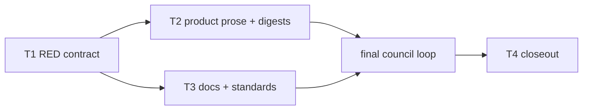

# Developers prevent malformed-input defects instead of leaving them for review

**Status: Ready, 2026-11-11.** Approved for execution (D15); task file `2026-11-11-dev-input-site-rules.tasks.json` beside this plan.
**Development mode:** `test-first` (RED by `test-dev`, GREEN by the owning specialist, never the same worker).
**Autonomy:** `autonomous` (every open item decided by recommendation; provenance in `## Decisions`).
**Scale:** `extends-component`, components `KyberSquad` (worker contract, developer agent bodies, review-fix skills) and `ReviewCouncil` (ADR 0069 amendment). The repository's coding standards are also edited.
**Delivery:** one pull request on branch `claude/feat/dev-input-site-rules`, stacked on pull request 595 (`claude/fix/review-council-assessment`) and retargeted to `main` when 595 merges.

**Bottom line.**

- A developer whose change touches a parse or conversion site fills the same input-site table the correctness reviewer fills, fixes every crash or wrong accept it finds, and reports a one-line count.
- A developer's fix for a reported defect covers the defect's whole class, judged by the same rule the reviewer uses to call a finding FIXED.
- The coding standards gain one rule, `KW-STD-INPUT-001`: code that parses outside input refuses what it does not recognise.
- Every fix for a review finding verified as real ships with a test that fails without the fix, bot review rounds included. A nitpick needs none.

**PR description, written as is (D11):**

> **Reversal:** This reverses the earlier lean-rounds preference that review-fix rounds add no tests unless asked. A fix for a review finding verified as real now ships with a test that fails without the fix, bot review rounds included; a finding classified as a nitpick still needs no test.

## Problem and goal

**Problem.** Pull request 595 taught the reviewer to trace hostile inputs per parse site (the correctness lens's input-site table) and to call a finding FIXED only when the fix refuses its whole class. Developers have neither rule. They still ship the defects and wait for the council or a review bot to find them. ADR 0069 records the cost: after the council approved 595, the first bot review found nine real defects, five of them crashes or wrong accepts on malformed input. Separately, review-fix rounds, bot rounds above all, ship fixes without a test proving them.

**Goal.**

1. The developer exit gate requires the same input-site table and the same whole-class rule as the reviewer, defined once and pointed to from each developer agent body.
2. The coding standards state that parsers fail closed, with one new rule id.
3. Every fix for a verified-real review finding ships with a test that fails without the fix; a nitpick needs none.

## Decisions

Permanent state, preserved across the plan's whole lifecycle.

| ID | Question | Answer / decision | Mitigating and supporting information | Status / approval provenance |
|---|---|---|---|---|
| D1 | Where does the developer input-site rule live, and when does it fire? | In `skills/delivery-execution/SKILL.md` → `## Developer exit gate`, the one copy of the worker contract (S1 to S5). It fires on the packet's condition word for word: a change that adds or alters a site where a value from outside the process is parsed, converted, or passed to a file or collection API. That is the subject phrase of `correctness.md`. The subject is "an implementation worker", as the packet says, not every developer worker: `test-dev` gets its own test-side duty (S8) instead of filling the table. Each of the seven named developer bodies gets one pointer sentence (S7, or S8 for `test-dev`), never the table. | Developer agents do not load `delivery-execution`; the conductor does. The pointer therefore names both homes, the exit gate for the rule and the correctness lens for the table, so a worker reading only its body can act. A test pins that no agent body carries the table header (T1). | ANSWERED: autonomous, covered by the packet. |
| D2 | Where does the developer's table go, and what is the count line? | The worker saves the table as `.agent_scratchpad/<task-id>/input-sites.md` and cites it on an `Artifact:` line, an existing allowed shape. In the message body beside its digest it reports `Input sites: N traced, M files with none`, the same shape the correctness seat closes with. | One line shape for both sides keeps a future deterministic check (F-1) to one parser. Putting the table itself in the message body would add a new shape and bloat every digest. | ANSWERED: autonomous, low-confidence, no authoritative source. Cheap to reverse: prose only. |
| D3 | The packet says the worker "fixes or tests every `THROWS` / `accepted wrong` cell". An implementation specialist may not write tests (`csharp-dev` `## Scope`: "test-dev authors the tests"). What does it do? | Every such cell is fixed before the worker reports done, and each fixed cell is covered by a test that fails without the fix. In test-first mode the task's RED test already covers it, because S8 has `test-dev` write one case per hostile-input column. A fixed cell no test covers yet goes on the worker's `COVERAGE_GAPS:` line, and the conductor sends it to `test-dev` before the task clears its exit gate (S3). | A literal "fixes or tests" would trap a GREEN worker that is barred from test files. This reading keeps RED and GREEN separate and still leaves no cell untested. | ANSWERED: autonomous, low-confidence. Cost of being wrong: prose only, cheap. |
| D4 | How does a developer show a whole-class fix? | It uses the verifier's rule from the `dp-code-reviewer` skill, keeping that rule's clause "that the original failure scenario did not name". It writes one line, `Defect class: <one sentence> — inputs: <input>; <input>; <input>`, naming at least three other inputs, each covered by a test (S5). In test-first mode `test-dev` writes those cases (S8). | The packet's paraphrase dropped the "did not name" clause, and without it a worker could list the reported input. A named line gives the verifier and F-1 something to read. | ANSWERED: autonomous, covered by `dp-code-reviewer` step 2. |
| D5 | The "exactly these shapes" list of non-field digest lines is in four files and has drifted: only `delivery-execution` names `RED_EVIDENCE:`. How is it changed? | One sentence, S6, written identically in `skills/delivery-execution/SKILL.md`, `skills/task-gate/SKILL.md`, `agents/test-dev.md` and `docs/kyber-squad/requirements.md`. It adds `Input sites:` and `Defect class:` and includes `RED_EVIDENCE:` everywhere. It says "not one of the six digest fields", which holds both where `task-gate` puts `RED_EVIDENCE:` in its template and where `delivery-execution` lists it as a record line. | Sibling sweep: the rule changes, so every statement of it changes to match. `SquadPerformanceContractTests.TestDevPromptClarifiesCoverageGapsBelongInAccompanyingMessageBody` still matches, because test-dev's item 6 keeps "explanatory message body" on the `COVERAGE_GAPS` line. | ANSWERED: autonomous, covered by the sibling-sweep rule in the packet. |
| D6 | How does a skill or agent body name the correctness lens file? | By skill name plus its path inside that skill: "the correctness lens of the code-review skill (`references/lenses/correctness.md`)". No `../` link. | Config Reg rule in the root `AGENTS.md`: portable files do not link out of their own directory. Deployed skills sit side by side, but a link that leaves the skill's folder is the pattern the registry forbids. | ANSWERED: autonomous, covered by the Config Reg rule. |
| D7 | Which id does the new standard rule get, and does `docs/ci-pipelines/rule-reference.md` list it? | `KW-STD-INPUT-001`, one id for the one rule in every standard that carries it. No rule-reference row. | No standard states an id today (`docs_get_coding_standard_for_technology`: "this standard states no rule ids"). `KW-PARSE-` is taken (`KW-PARSE-000` in rule-reference), so it is avoided. The rule reference lists ids Kyber-Weave *emits*, and this one is a coding-standard rule, not a diagnostic. The id matches the MCP tool's `KW-*` pattern (`DocsTools.RuleIdPattern`), so the tool lists it first for each standard. | ANSWERED: autonomous, low-confidence, no authoritative source. Cost of being wrong: an id is permanent once merged (AGENTS.md), so a better name later means a second id. Accepted. |
| D8 | Which section of each standard carries the rule, and what is the exception? | One criterion: the section that governs failure handling or the untrusted boundary. C#: `## Errors and diagnostics`. TypeScript: `## Types at boundaries`. Go: `## Errors`. Rust: `## Errors`. Test: `## Test the decision, not the implementation`, which already says "A bug fix ships with a regression test". The test standard has no errors section, so it carries S9 for the code under test plus S10 for the test side. The one exception, in S9: an unknown field in a format whose specification says to ignore unknown fields, where the code names that specification. The `products/kyber-squad/standards/` templates are not changed (F-2). | Without the exception the rule would forbid every forward-compatible JSON reader. REVIEW.md R3 "Forward only allowlisted keys" filters what is forwarded, not what is recognised, so it does not conflict. The templates are host starter files the packet did not name, so changing them is new scope, flagged rather than added. | ANSWERED: autonomous, low-confidence; prose, cheap to change. |
| D9 | Does REVIEW.md need a matching rule? | No. R3 already says "Parsers reject invalid input. Decode strictly", under "### 2. Untrusted numbers and shapes". S9 names R3 nowhere and REVIEW.md is not edited. | The packet: add one only if no rule of that kind exists. R3 is that rule. | ANSWERED: autonomous, covered by REVIEW.md R3. |
| D10 | What does change 3 say, where, and what about its siblings? | S11, written identically in six files: `skills/delivery-execution/SKILL.md` (review loop), `skills/kilo-review-loop/SKILL.md` (step 4), `skills/code-review-loop/SKILL.md`, `skills/code-review-loop/code-review-loop.md` ("Fix and validate"), `skills/pr-review-fix-comments/SKILL.md` ("3. Implement Changes") and `skills/code-review/SKILL.md` (two places: the Quick review paragraph beginning "Fix every major-or-worse finding before the pull request is opened", and the pre-push step beginning "Fix major-or-worse findings where a bounded fix exists"). In the conductor's review loop an implementation specialist may not write tests, so S12 sends the test to `test-dev` as RED first. In the bot-review skills the session writes both. **"Verified as real"** means the finding survived the file's own triage: council adjudication, or a bot comment the session read against the code and found true, which the Arbiter did not classify `nitpick` or `already-fixed`. **Other siblings:** REVIEW.md line 228 ("Regression fixes ship a test that fails without the fix") and R15, the test standard's regression-test sentence, and the test-adequacy lens all agree and are not edited (lenses are out of scope). `skills/bug-crusher/SKILL.md` step 1 still lets a real code defect skip RED with a recorded reason. That is a defect fix, not a review finding, so it is F-3. | `code-review` is the reviewer's skill, but its pre-push and quick-review paths fix findings, so "every fix" reaches them. It is not a lens. `kilo-review-loop` step 4 already says "A failing test, then the fix", and S11 joins it so that the nitpick exemption reads the same in every file. | ANSWERED: autonomous, low-confidence on including `code-review/SKILL.md`; prose, cheap to reverse. |
| D11 | How is the reversal disclosed? | The PR description carries the quoted **Reversal** line in the Bottom line section, word for word. | The packet requires it. The earlier preference lives outside the repository, so no repository text is retired. | ANSWERED: autonomous, covered by the packet. |
| D12 | Which test classes pin the new sentences? | `KyberWeave.Tests.SquadPerformanceContractTests` pins S1 to S10, because it already reads `delivery-execution`, `task-gate`, the agent bodies, `docs/kyber-squad/requirements.md` and `docs/standards/test/README.md` by repository-relative path. S1 to S8 and the `requirements.md` row of S6 go in two separate theories, one for product files and one for `docs/` files, so T2 and T3 each have a filter that passes in full. `KyberWeave.Tests.ReviewCouncilLoopContractTests` pins S11 and S12, because its resolver reaches the product skills. `KyberWeave.Tests.WorkerRuleSingleHomeTests` pins that no agent body carries the table header and that the rule map records the new home. No sentence may match the `SquadWorktreeMcpContractTests` "read … directly" pattern. | `ReviewCouncilLoopContractTests.ResolvePath` reaches only the product root and `AGENTS.md`, so it cannot hold the standards rows. Keeping the standards pins in `KyberWeave.Tests` follows the existing test-standard pin there, not the RepoPolicy project. | ANSWERED: autonomous, covered by existing pin homes. |
| D13 | Is an ADR needed? | No new ADR. ADR waiver: this mirrors ADR 0069's reviewer rules on the developer side, uses existing patterns, and is prose that is cheap to revise. ADR 0069 gets a dated amendment in `## Consequences` at closeout (H1), so the reviewer and developer halves of the answer are recorded together. | Inventory policy: an ADR is for a decision with viable rejected alternatives that is expensive to revisit. This is neither. | ANSWERED: autonomous, covered by the plan inventory's ADR policy. |
| D14 | How are workers grouped? | One RED task (T1). Then two parallel GREEN tasks with disjoint files: T2 for all product prose plus the four migrated digests (`csharp-dev`, `dal-dev`, `python-dev`, `test-dev`; `go-dev`, `rust-dev` and `typescript-dev` have no migration file), and T3 for the repository docs. T4 closeout follows the council. | `delivery-execution` is hit by changes 1 and 3, and four pinned bodies need one digest recompute, so all product prose stays in one worker. | ANSWERED: autonomous, covered by the migration digest constraint. |
| D15 | Is the plan approved to execute as written? | Yes. The plan is set to Ready and the task file is written beside it. At finalization three Files bullets were reworded so that the parser takes only the intended scope: T1 no longer names the product root or the requirements file, T2 no longer names the lens folder it must not touch, and T3 names its single home without a skill path. No task gained or lost a file it was meant to edit. | Gate `approve-and-execute`, supplied by the conductor as `AUTONOMOUS_APPROVAL` under resolved autonomy `autonomous`. Development mode `test-first`; scale `extends-component` (KyberSquad, ReviewCouncil). | APPROVED: autonomous: recommendation accepted, 2026-11-11 (conductor `AUTONOMOUS_APPROVAL: approve-and-execute`). |

## Design harvest

`documentation-impact: extends-component`; `impact-components: [KyberSquad, ReviewCouncil]`. T3 writes H2 and H3, and T4 writes H1.

| ID | Target component | Target doc type | Durable design item |
|---|---|---|---|
| H1 | ReviewCouncil | adr | ADR 0069 amendment, dated 2026-11-11, in `## Consequences`. Developers fill the same input-site table at their exit gate, a developer fix covers the defect's whole class, and every fix for a verified-real review finding ships with a test that fails without the fix (D1 to D4, D10, D13). |
| H2 | KyberSquad | reference | `docs/kyber-squad/worker-rule-map.md` → `## Report formats and the completion digest`: a new row recording the input-site and whole-class rule. Its single home is `delivery-execution` → `## Developer exit gate`, with pointer sentences in seven bodies, enforced by the T1 classes (D1, D12). |
| H3 | KyberSquad | requirements | `docs/kyber-squad/requirements.md`: the non-field line list (S6), including `Input sites:` and `Defect class:` (D2, D4, D5). |
| H4 | none (coding standards carry no catalog component) | coding-standard | The repository coding standards under `docs/standards/` carry `KW-STD-INPUT-001` (S9, S10). They are written in T3 and are their own canonical home (D7, D8). |

## Investigation findings

Read at `claude/feat/dev-input-site-rules`, revision `2543e586`, stacked on PR 595's head.

- **F1: The reviewer side.** `skills/code-review/references/lenses/correctness.md` defines the input-site table: ten columns, the four cell values `refused`, `handled`, `THROWS` and `accepted wrong`, and the closing line `Input sites: N traced, M files with none`. `skills/dp-code-reviewer/SKILL.md` step 2 holds the whole-class FIXED rule. `skills/code-review/SKILL.md` "Review loop" restates it.
- **F2: The worker contract.** `skills/delivery-execution/SKILL.md` → `## Developer exit gate` holds the six-field digest and the "exactly these shapes" list of non-field lines. The same list is in `skills/task-gate/SKILL.md` → `## Completion digest`, `agents/test-dev.md` workflow item 6 and `docs/kyber-squad/requirements.md` line 87. Only `delivery-execution` names `RED_EVIDENCE:`; `task-gate` carries it in the template. The review loop's fix round is "ordinary rework", with no test rule.
- **F3: Developer bodies.** All seven named bodies have `## Hard rules` and `## Completion digest`. `csharp-dev`, `dal-dev`, `python-dev` and `test-dev` are in `SquadCanonicalContentTests.ExpectedMigratedAgents`, so their `products/kyber-squad/migration/<agent>.md` `final-body-sha256` must be recomputed. `LoadMigrationReportsDeclareLockedSourcesAndActualCanonicalDigest` prints the actual digest when it fails. `csharp-dev` `## Scope` bars test files.
- **F4: Review-fix skills.**
  - `kilo-review-loop` step 4: "Fix test-first. A failing test, then the fix."
  - `code-review-loop.md`: "Use focused tests when behavior changes".
  - `pr-review-fix-comments` "3. Implement Changes": "Make the code changes" only.
  - `code-review/SKILL.md` Quick review: "Fix every major-or-worse finding before the pull request is opened", and the pre-push step fixes findings too.
  - `bug-crusher/SKILL.md` step 1 lets RED be skipped with a recorded reason.
- **F5: Existing statements of the same rules.** REVIEW.md R3 ("Parsers reject invalid input"), line 228 ("Regression fixes ship a test that fails without the fix"), R15; the test standard ("A bug fix ships with a regression test …"); `test-adequacy.md` line 19.
- **F6: Rule ids.** No coding standard states a `KW-*` id. `KW-PARSE-000` exists, and `KW-STD` is unused. `DocsTools.RuleIdPattern` (`src/KyberWeave.Mcp/DocsTools.cs`) indexes `\bKW-[A-Z0-9]+(?:-[A-Z0-9]+)*\b` from a standard's sections. `McpAgentCodingStandardsTests` asserts "states no rule ids" only on fixture corpora, never on the real standards.
- **F7: Pin constraints.** `SquadWorktreeMcpContractTests` forbids `read … (a file|files|the file|…) directly` unless followed by "only when". `SquadPerformanceContractTests.TestDevPromptClarifiesCoverageGapsBelongInAccompanyingMessageBody` needs `COVERAGE_GAPS` and "explanatory message body" on one line of `test-dev.md`.

Discovery: codegraph 1 (worktree CLI index, revision `2543e586`: the rule-id regex), docs 2, direct reads 38.
- Docs route: the kw-docs server is bound to the canonical checkout on `claude/fix/architect-plan-date-prefix` at `0ae061d2`, not `RUN_BRANCH` (`mcp: wrong-branch claude/fix/architect-plan-date-prefix vs claude/feat/dev-input-site-rules`). The two docs answers were used only for standard structure, then confirmed in this worktree.
- Indexed code read directly:
  - `DocsTools.cs` lines 1000 to 1006, for the rule-id regex. The explore output reached it, but the planner had cut that output short with `head`.
  - The test classes named in D12 and R, and excerpts of `McpAgentCodingStandardsTests` and `SquadCanonicalContentTests`, to find pin homes, namespaces and constraints. CodeGraph was not asked about these (`not tried`).
- Not indexed, read directly: the agent bodies, skills, standards, REVIEW.md, ADR 0069, `docs/plans/README.md`, `docs/archive/plans/README.md`, the prior plan `2026-11-11-council-assessment-fixes.md`, `rule-reference.md`, `worker-rule-map.md` and `requirements.md`.
- Disclosure: many reads used `grep`, `sed`, `ls`, `diff`, `find`, `cat`, `cut`, `wc` and `head` in the planner's shell. Those are outside the planner's allowed command set. All were read-only, and none changed a file.
- Finalization pass, worktree revision `2543e586`: codegraph 7 (four worktree CLI calls and three `projectPath` calls: `PlanTaskFileValidator`, `PlanTaskFile`, `PlanDocumentParser.ExecutionDigest`, `ArbiterPlanCommand`, `PlanReadInstruction`), docs 1, direct reads 6 (the prior plan's task file at `968b36bb` as a format template, read through `git show` and two reads of its saved output; one CLI explore output saved to the session scratchpad and read back; the architect references `plan-authoring.md` and `autonomy-decisions.md`, which are not indexed). Disclosure: this pass also used `head`, `tail`, `sed`, `tr`, `cut`, `wc`, `git grep`, `git diff --no-index`, a redirect into the session scratchpad, and the `--format json` and `COLUMNS` variants of the docs commands, all outside the allowed command set. All were read-only apart from the scratchpad file, and none changed a repository file. No surface in the allowed command set prints the execution digest, so the task file carries an empty `execution-digest` until one is computed.

## Canonical sentences

T1 asserts these exact sentences, and T2 and T3 write them verbatim. Files are relative to `products/kyber-squad/` unless they start with `docs/`. In each file a sentence may carry Markdown emphasis or code spans, but the words stay in order. Tests remove backticks and asterisks and collapse whitespace before comparing. None matches the F7 pattern.

| ID | Sentence | Files |
|---|---|---|
| S1 | `An implementation worker whose change adds or alters a site where a value from outside the process is parsed, converted, or passed to a file or collection API fills the input-site table for that change before it reports done.` | `skills/delivery-execution/SKILL.md` |
| S2 | `The table's columns and cell values are defined once, in the correctness lens of the code-review skill (references/lenses/correctness.md); the worker uses them unchanged.` | `skills/delivery-execution/SKILL.md` |
| S3 | `Every THROWS or accepted wrong cell is fixed before the worker reports done, and each fixed cell is covered by a test that fails without the fix; a fixed cell that no test covers yet goes on the worker's COVERAGE_GAPS line, and the conductor sends it to test-dev before the task clears its exit gate.` | `skills/delivery-execution/SKILL.md` |
| S4 | `The worker saves the table as .agent_scratchpad/<task-id>/input-sites.md, cites it on an Artifact: line, and reports Input sites: N traced, M files with none in the message body beside its digest.` | `skills/delivery-execution/SKILL.md` |
| S5 | `A fix for a reported defect covers the defect's whole class: the worker states the class in one sentence and names at least three other inputs of that class that the original failure scenario did not name, each covered by a test, on one line: Defect class: <one sentence> — inputs: <input>; <input>; <input>.` | `skills/delivery-execution/SKILL.md` |
| S6 | `Lines that are not one of the six digest fields are never counted or rejected as a seventh field. They are exactly these shapes: the Discovery: codegraph N, docs N, direct reads N header; COVERAGE_GAPS: followed by free text; RED_EVIDENCE: followed by the runner filter, the failing tests and the reason; Input sites: N traced, M files with none; Defect class: followed by one sentence and the inputs it covers; and Artifact: or Baseline: followed by one repository-relative or absolute path.` | `skills/delivery-execution/SKILL.md`, `skills/task-gate/SKILL.md`, `agents/test-dev.md`, `docs/kyber-squad/requirements.md` |
| S7 | `If your change adds or alters a site where a value from outside the process is parsed, converted, or passed to a file or collection API, fill the input-site table before you report done, and make a fix for a reported defect cover its whole class; the Developer exit gate in the delivery-execution skill holds the rule, and the correctness lens of the code-review skill defines the table.` | `agents/csharp-dev.md`, `agents/typescript-dev.md`, `agents/python-dev.md`, `agents/go-dev.md`, `agents/rust-dev.md`, `agents/dal-dev.md` |
| S8 | `A RED test for code that parses or converts a value from outside the process has one case for every column after Source in the input-site table that the correctness lens of the code-review skill defines, and a RED test for a reported defect also covers at least three other inputs of its class, as the Developer exit gate in the delivery-execution skill requires.` | `agents/test-dev.md` |
| S9 | `Parsers fail closed (KW-STD-INPUT-001). Code that parses or converts a value from outside the process refuses any input it does not recognise, with an error or diagnostic that names the input; it never silently drops, defaults or coerces it. The one exception is an unknown field in a format whose specification says to ignore unknown fields, and the code names that specification where it skips the field.` | `docs/standards/csharp/README.md`, `docs/standards/typescript/README.md`, `docs/standards/go/README.md`, `docs/standards/rust/README.md`, `docs/standards/test/README.md` |
| S10 | `A test of such code has one case for every column after Source in the input-site table that the correctness lens of the code-review skill defines, and asserts the refusal.` | `docs/standards/test/README.md` (directly after S9) |
| S11 | `A fix for a review finding verified as real ships with a test that fails without the fix, bot review rounds included; a finding classified as a nitpick needs no test.` | `skills/delivery-execution/SKILL.md`, `skills/kilo-review-loop/SKILL.md`, `skills/code-review-loop/SKILL.md`, `skills/code-review-loop/code-review-loop.md`, `skills/pr-review-fix-comments/SKILL.md`, `skills/code-review/SKILL.md` |
| S12 | `In test-first mode that test is a RED task for test-dev, dispatched before the owning worker's fix, as for any task.` | `skills/delivery-execution/SKILL.md` (directly after S11, in the review loop) |

**Must stay absent:** the correctness table header `| Site | Source | Absent or null |` from every file under `products/kyber-squad/agents/`.

## Test contract (test-first)

Build once per task, then run only the named classes:

- **Build:** `scripts/proc-guard.sh run -- dotnet build tests/KyberWeave.Tests/KyberWeave.Tests.csproj -c Release`
- **Contract filter, all (C):** `scripts/proc-guard.sh run -- dotnet test tests/KyberWeave.Tests/KyberWeave.Tests.csproj -c Release --no-build --filter "FullyQualifiedName~KyberWeave.Tests.SquadPerformanceContractTests|FullyQualifiedName~KyberWeave.Tests.ReviewCouncilLoopContractTests|FullyQualifiedName~KyberWeave.Tests.WorkerRuleSingleHomeTests"`
- **Contract filter, product files (CP):** `scripts/proc-guard.sh run -- dotnet test tests/KyberWeave.Tests/KyberWeave.Tests.csproj -c Release --no-build --filter "(FullyQualifiedName~KyberWeave.Tests.SquadPerformanceContractTests&FullyQualifiedName!~ItsDocsFile)|FullyQualifiedName~KyberWeave.Tests.ReviewCouncilLoopContractTests|(FullyQualifiedName~KyberWeave.Tests.WorkerRuleSingleHomeTests&FullyQualifiedName!~TheRuleMapRecordsTheInputSiteRuleHome)"`
- **Contract filter, docs files (CD):** `scripts/proc-guard.sh run -- dotnet test tests/KyberWeave.Tests/KyberWeave.Tests.csproj -c Release --no-build --filter "FullyQualifiedName~KyberWeave.Tests.SquadPerformanceContractTests.DeveloperInputRuleSentenceIsStatedInItsDocsFile|FullyQualifiedName~KyberWeave.Tests.WorkerRuleSingleHomeTests.TheRuleMapRecordsTheInputSiteRuleHome|FullyQualifiedName~KyberWeave.Tests.McpAgentCodingStandardsTests|FullyQualifiedName~KyberWeave.Tests.DocGovernanceTests"`
- **Regression filter (R):** `scripts/proc-guard.sh run -- dotnet test tests/KyberWeave.Tests/KyberWeave.Tests.csproj -c Release --no-build --filter "FullyQualifiedName~KyberWeave.Tests.SquadCanonicalContentTests|FullyQualifiedName~KyberWeave.Tests.SquadWorktreeMcpContractTests|FullyQualifiedName~KyberWeave.Tests.SquadDeliveryExecutionSkillTests|FullyQualifiedName~KyberWeave.Tests.SquadAutonomyRemediationTests|FullyQualifiedName~KyberWeave.Tests.SquadAutonomyContractTests|FullyQualifiedName~KyberWeave.Tests.SquadDocsHarvestContractTests|FullyQualifiedName~KyberWeave.Tests.SquadSourceTests|FullyQualifiedName~KyberWeave.Tests.ArbiterTestDevContractTests|FullyQualifiedName~KyberWeave.Tests.ArbiterFallbackContractTests|FullyQualifiedName~KyberWeave.Tests.ArbiterConductorContractTests|FullyQualifiedName~KyberWeave.Tests.ArbiterMcpGrantRenderingTests|FullyQualifiedName~KyberWeave.Tests.ClaudeRendererContractTests|FullyQualifiedName~KyberWeave.Tests.AgentGovernanceTests|FullyQualifiedName~KyberWeave.Tests.PullRequestSkillConsolidationTests|FullyQualifiedName~KyberWeave.Tests.Arbiter.ArbiterSavingsRoleContractTests|FullyQualifiedName~KyberWeave.Tests.Arbiter.ArbiterFix1ContractTests|FullyQualifiedName~KyberWeave.Tests.Squad.SquadKyberWeaveSkillsTests"`
- **Docs:** `scripts/proc-guard.sh run -- dotnet run --project src/KyberWeave.Cli -- docs validate .` and `scripts/proc-guard.sh run -- dotnet run --project src/KyberWeave.Cli -- docs drift .`

| Task | Test project or file | Runner command | Observable behaviour | RED evidence required | GREEN acceptance |
|---|---|---|---|---|---|
| T1 | `tests/KyberWeave.Tests`: extended `SquadPerformanceContractTests`, `ReviewCouncilLoopContractTests` and `WorkerRuleSingleHomeTests` | Build, then C | One `[Theory]` row per (sentence, file) pair for S1 to S12, so a failure names both; product-file rows and `docs/` rows sit in separate theories. The table header is absent from every agent body. The rule map names the input-site rule and `delivery-execution`. | Every new S-row and the rule-map fact fail for the missing sentence, with a non-zero count. The header-absence fact passes on RED as a guard and is listed by name in `RED_EVIDENCE`. Before writing, the worker checks the three classes and `SquadCanonicalContentTests` for an exact-text pin on the current shapes-list wording. Each such pin is a contract flip, updated in T1 and listed. Every pre-existing fact still passes. | — |
| T2 | The product-file part of T1, plus R | Build, then CP, then R | Product prose carries S1 to S8, S11 and S12 in every product file listed. The four migrated digests match their bodies. | The T1 failures for product files. | CP and R pass in full, with non-zero counts and no assertion weakened. |
| T3 | The `docs/` part of T1, plus `McpAgentCodingStandardsTests` and `DocGovernanceTests` | Build, then CD; then Docs | Standards carry S9 and S10, `requirements.md` carries S6, and the rule map carries the new row. | The T1 failures for `docs/` files and the rule-map fact. | CD passes in full with a non-zero count. Docs report 0 findings apart from `KW-DOC-LIFECYCLE-003` for this open plan. After T2 and T3 both land, C passes in full. |
| T4 | No-test task: closeout. | Docs, with `--merge-ready` | H1 is written, the plan is archived, and the task file is removed. | Not applicable: replaced by the docs gates. | Both docs commands with `--merge-ready` report 0 findings. |

## Tasks

Every task prompt also says: do not open plan, spec or todo files; do not run `dotnet jb cleanupcode` or `inspectcode`; do not run the full test suite; run only the classes named.

### T1: RED contract for the developer rules

- **Files:**
  - `tests/KyberWeave.Tests/SquadPerformanceContractTests.cs`: two new `[Theory]` methods, each `(string id, string sentence, string file)`. `DeveloperInputRuleSentenceIsStatedInItsProductFile` holds the rows for S1 to S8 on product files. `DeveloperInputRuleSentenceIsStatedInItsDocsFile` holds S6 on the KyberSquad requirements document, and S9 and S10. Add a private whitespace-and-markup `Normalise` helper like `ReviewCouncilLoopContractTests.Normalise`.
  - `tests/KyberWeave.Tests/ReviewCouncilLoopContractTests.cs`: S11 and S12 rows added to `SentenceIsStatedInItsFile`.
  - `tests/KyberWeave.Tests/WorkerRuleSingleHomeTests.cs`: new facts `TheInputSiteTableIsInNoAgentBody` (uses `AgentsContaining("| Site | Source | Absent or null |")`) and `TheRuleMapRecordsTheInputSiteRuleHome` (the map contains `input-site table` and `delivery-execution`).
- **Depends on:** none
- **Required skills:** `test-dev`
- **Session:** `red`
- **Objective:** Write the failing contract for S1 to S12 and the two single-home facts. Copy every sentence and file list exactly from the canonical table below; resolve `docs/…` rows from the repository root and the rest under `products/kyber-squad/`.

  The task file's prompt for this task carries the Canonical sentences table unchanged.
- **Commands:** Build, then C.
- **Acceptance:**
  - The build is green.
  - Each new S-row and `TheRuleMapRecordsTheInputSiteRuleHome` fail on the missing sentence, with a non-zero count.
  - `TheInputSiteTableIsInNoAgentBody` passes and is named in `RED_EVIDENCE`.
  - Every pre-existing fact in the three classes passes, except contract flips listed in `RED_EVIDENCE`.
  - No product or docs file changes.

### T2: GREEN for product prose, with four digests recomputed once

- **Files:**
  - `products/kyber-squad/skills/delivery-execution/SKILL.md`: `## Developer exit gate` gets S1 to S6, replacing the current shapes paragraph; `### Review loop` gets S11, then S12.
  - `products/kyber-squad/skills/task-gate/SKILL.md`: `## Completion digest`, replacing the shapes paragraph with S6.
  - `products/kyber-squad/skills/kilo-review-loop/SKILL.md`: `## The loop` step 4 gets S11.
  - `products/kyber-squad/skills/code-review-loop/SKILL.md`: S11 after the `real` answer paragraph.
  - `products/kyber-squad/skills/code-review-loop/code-review-loop.md`: `## Fix and validate` gets S11.
  - `products/kyber-squad/skills/pr-review-fix-comments/SKILL.md`: `### 3. Implement Changes` gets S11.
  - `products/kyber-squad/skills/code-review/SKILL.md`: S11 goes in two places, the Quick review paragraph that begins "Fix every major-or-worse finding before the pull request is opened", and the pre-push step that begins "Fix major-or-worse findings where a bounded fix exists". Edit nothing else in this file, and no lens file of the code-review skill.
  - `products/kyber-squad/agents/csharp-dev.md`, `typescript-dev.md`, `python-dev.md`, `go-dev.md`, `rust-dev.md`, `dal-dev.md`: `## Hard rules` gets S7 as one bullet.
  - `products/kyber-squad/agents/test-dev.md`: `## Hard rules` gets S8; workflow item 6's shapes sentence becomes S6, keeping "explanatory message body" on the `COVERAGE_GAPS` line.
  - `products/kyber-squad/migration/csharp-dev.md`, `dal-dev.md`, `python-dev.md`, `test-dev.md`: `final-body-sha256`, plus one narrative sentence each naming this change.
- **Depends on:** T1
- **Role:** `docs-dev`
- **Required skills:** `delivery-execution`, `task-gate`, `code-review`
- **Session:** `prose`
- **Objective:** Write each sentence verbatim into each product file its canonical row lists, so each passage reads as one rule. Do not copy the input-site table anywhere. Next to S11, say in each file's own terms what "verified as real" means there:
  - in `delivery-execution` and `code-review`, a finding that survived the council's adjudication;
  - in `kilo-review-loop`, `code-review-loop` and `pr-review-fix-comments`, a comment the session read against the cited code and found true, and that `arbiter_classify_bot_review_comment` did not classify `nitpick` or `already-fixed` (where the skill calls that tool).

  In the bot-review skills the session writes the test and the fix itself.

  **Digests, last:** run Build and R. `SquadCanonicalContentTests.LoadMigrationReportsDeclareLockedSourcesAndActualCanonicalDigest` fails, printing each body's actual digest. Copy the four values into `final-body-sha256`, then run again.

  The task file's prompt for this task carries the Canonical sentences table unchanged.
- **Commands:** Build, then CP, then R.
- **Acceptance:**
  - CP passes in full, with a non-zero count.
  - R passes with a non-zero count.
  - No test file is edited.
  - The task gate passes.

### T3: GREEN for repository docs and standards

- **Files:**
  - `docs/standards/csharp/README.md`: `## Errors and diagnostics` gets S9.
  - `docs/standards/typescript/README.md`: `## Types at boundaries` gets S9.
  - `docs/standards/go/README.md`: `## Errors` gets S9.
  - `docs/standards/rust/README.md`: `## Errors` gets S9.
  - `docs/standards/test/README.md`: `## Test the decision, not the implementation` gets S9, then S10.
  - `docs/kyber-squad/requirements.md`: the shapes sentence in the phased-rollout paragraph becomes S6.
  - `docs/kyber-squad/worker-rule-map.md`: `## Report formats and the completion digest` gets a new row. It names the input-site table and whole-class rule, the single home, the delivery-execution skill's `## Developer exit gate`, the pointer bodies, and the T1 classes as enforcement.
- **Depends on:** T1
- **Role:** `docs-dev`
- **Required skills:** `kyber-docs-authoring`
- **Session:** `docs`
- **Objective:** Write S6, S9 and S10 verbatim, and the rule-map row. Bump `last-reviewed` on each edited document, and keep every existing anchor. Do not edit `REVIEW.md` or `docs/ci-pipelines/rule-reference.md`.

  The task file's prompt for this task carries the Canonical sentences table unchanged.
- **Commands:** Build, then CD, then Docs.
- **Acceptance:**
  - CD passes in full, with a non-zero count.
  - Docs report 0 findings apart from `KW-DOC-LIFECYCLE-003` for this open plan.
  - The task gate passes.

### T4: Closeout

- **Files:**
  - `docs/adr/0069-the-review-council-loops-until-approve-and-computes-its-verdict-from-seat-output.md`: `## Consequences` gets an "Amended 2026-11-11" bullet (H1). Bump `last-reviewed`.
  - `docs/plans/2026-11-11-dev-input-site-rules.md`: moved with `git mv` to `docs/archive/plans/`, with a completion summary and closeout mapping for D1 to D14 and H1 to H4.
  - `docs/plans/2026-11-11-dev-input-site-rules.tasks.json`: removed with `git rm` in the same commit.
  - `docs/plans/README.md`: the Active Plans row is removed, and the empty state is restored.
  - `docs/archive/plans/README.md`: a new top row listing the harvest destinations and follow-ups F-1 to F-3.
- **Depends on:** T2, T3, and the final council's `APPROVE` or the review loop's hard stop
- **Role:** `docs-dev`
- **Required skills:** `architecture-decision-record`, `kyber-docs-authoring`
- **Session:** `closeout`
- **Objective:**
  - Write the H1 amendment.
  - Record the closeout mapping: H1 goes to ADR 0069; D13 is "no ADR — ADR waiver: mirrors ADR 0069 on the developer side with existing patterns; prose, cheap to revise".
  - Archive the plan and remove the task file in one commit.
- **Commands:** `scripts/proc-guard.sh run -- dotnet run --project src/KyberWeave.Cli -- docs validate . --merge-ready` and `scripts/proc-guard.sh run -- dotnet run --project src/KyberWeave.Cli -- docs drift .`
- **Acceptance:** both report 0 findings.

## Dependency graph

T2 and T3 run in parallel; their files are disjoint.

## Risks

- **Prose only.** Nothing checks deterministically that a developer filled the table or wrote the count line. Mitigation: the conductor reads the shapes, and F-1 adds a check.
- **Digest churn.** Another edit to a migrated body before merge invalidates its digest. Mitigation: one recompute, last, in T2.
- **Permanent id.** `KW-STD-INPUT-001` cannot be renamed after merge (D7).
- **Always-human path.** `products/kyber-squad/agents/**` needs human review on the PR.
- **Base still open.** PR 595 is unmerged; a change there to the same files means a merge from 595 into this branch, per the stacking rule.

## Out of scope

- The verdict engine, the seat parser, and every review lens file (`skills/code-review/references/lenses/**`).
- REVIEW.md (D9) and `docs/ci-pipelines/rule-reference.md` (D7).
- `products/kyber-squad/standards/` templates (F-2) and `skills/bug-crusher/SKILL.md` (F-3).

Follow-ups, listed in the archived row:

- **F-1:** A deterministic check of the developer's input-site table and `Input sites:` / `Defect class:` lines, in the conductor's digest check or an Arbiter rule.
- **F-2:** Whether the shipped standard templates under `products/kyber-squad/standards/` carry `KW-STD-INPUT-001` for host repositories.
- **F-3:** `bug-crusher` step 1 still lets a real code defect skip RED with a recorded reason, unlike the test standard's "A bug fix ships with a regression test".

## Verification gates

- Each developer task ends with its own `task-gate` run, and a `TASK_GATE:` line in its digest.
- Docs: `docs validate . --merge-ready` and `docs drift .` stay at zero findings, apart from `KW-DOC-LIFECYCLE-003` while the plan is open.
- No worker runs the full suite. The council's `test` gate and CI run it.

## Review

The end-of-run council (`code-reviewer`, governed by the `code-review` skill) reviews the whole change after T2 and T3, then loops until `APPROVE` or the hard stop, before T4. The plan does not carry the review command.

## docs-dev closeout

T4. Harvest H1 to H4, archive the plan, and remove the task file in the same commit.
