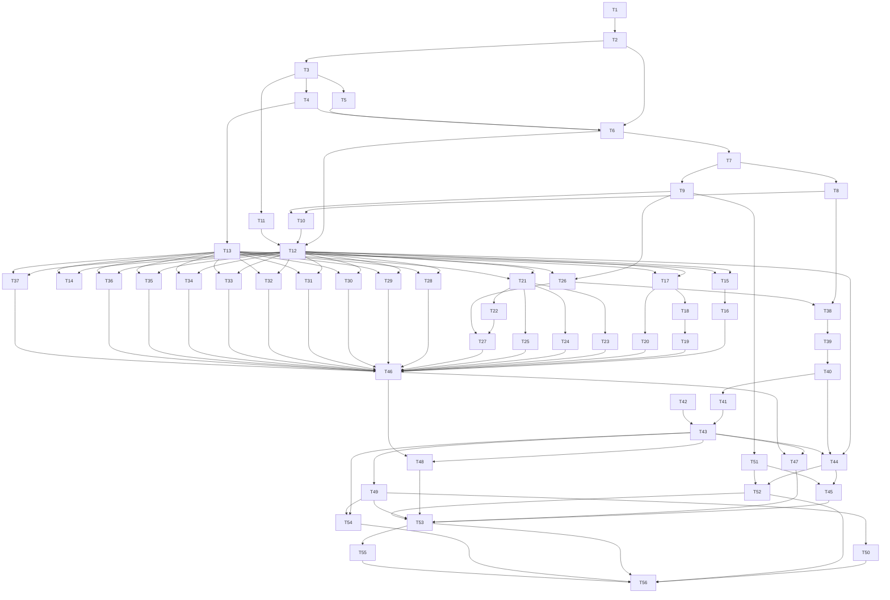

# KyberDash Relational Store Implementation

**Status: Ready, 2026-11-19.**

## Problem and goal

KyberDash currently persists telemetry in `canon.db` (schema version 24, `CanonSchema.SchemaVersion`) using JSON text columns (`tokens_json`, `content_json`, `cost_json`, `measurability_json`, `parts_json`, `raw`, `summary_json`, `turn_json`, `payload`, `parent_linkage_json`, `error_bar_json`, `evidence_links_json`, `raw_payload`, `attributes_json`, `resource_json`, `scope_json`) and a `metadata` key-value table across 22 tables. This design causes two confirmed faults:

1. **Every KyberDash MCP analytics call fails with HTTP 500 and an empty body** on real stores because `CanonStoreRepository.ParseRecordRow` deserializes `content_json` as `Dictionary<string, string>` while stored rows contain numbers and booleans, causing `EnsureProjected` to throw repeatedly with no error-envelope boundary.
2. **Copilot CLI sessions record only `llm.invoke` rows** because `TranscriptReaderRepository.DiscoverLocalSources` scans only Claude Code and Codex directories and omits Copilot CLI `events.jsonl` (model, tool, sub-agent, and shutdown usage) as well as the retired TypeScript file readers (`fc80ddf9^:dash/src/providers/*`).

The goal is to replace the v24 JSON-backed store with a third-normal-form relational SQLite schema driven by a single `RelationalSchemaCatalog`, map every evidenced harness format into static collector DTOs (`namespace KyberDash.Data.Collector` in `KyberDash.Domain` per `D11`), enforce a strict JSON-document write guard (`STORE_JSON_TEXT_REFUSED`), rebuild projections and analytics solely over typed reader/projection/operational interfaces (`IRelationalStoreWriter`, `IRelationalStoreReader`, `IProjectionStore`, `IOperationalStore`), delete older `canon.db` files unread and re-ingest from local files (OD-7, BL-1), expose a catalog-driven stored-fields view on `/api/kyber/session/{sessionKey}/stored-fields` and in the web session UI, and migrate all non-analytics callers and DI wiring off `ICanonStoreRepository` before deleting `CanonSchema` and `CanonStoreRepository`.

This plan supersedes and delivers the active specification at `docs/specs/kyberdash-relational-store/` (`README.md`, `requirements.md`, `design.md`, `tasks.md`), incorporating all resolved owner decisions (OD-1..OD-9, BL-1..BL-3), autonomous requirements/design decisions (RQ-1..RQ-12, DD-1..DD-17), and closing the four delivery gaps identified at transition from spec to plan.

## Request trace

| Request instruction | Covered by | Evidence that it is met |
|---|---|---|
| Ground plan in active spec `docs/specs/kyberdash-relational-store/` (OD-1..OD-9, RQ-1..RQ-12, BL-1..BL-3, DD-1..DD-17, tasks `1.1`–`18.1`) | `## Decisions`, `## Design harvest`, `## Tasks` (`T1`–`T56`), `## Test contract (development-mode: test-first)` | All 18 spec task groups mapped to `T1`–`T56`; all OD, RQ, DD, BL entries recorded in `## Decisions` |
| Date-prefix new plan file (`PLAN_FILE: docs/plans/kyberdash-relational-store.md`) and register in `docs/plans/README.md` | `D1` in `## Decisions`; `docs/plans/README.md` **Active Plans** row | Plan created at `docs/plans/2026-11-19-kyberdash-relational-store.md` per `plan-authoring.md` and linked from `docs/plans/README.md` |
| Gap 1: BL-2 17-harness IDs / `zcode` unevidenced & BL-1 non-recoverable / `CanonPricing.NormalizeHarnessName` folding (`claude-desktop -> claude-code`, `cursor-agent -> cursor`) / `antigravity-cli` also reading `cache/antigravity-statusline.jsonl` / prune `windsurf` & `aider` from `CleanService.KnownHarnesses` & `CanonRollupsEngine.CanonicalRegisteredHarnesses` | `D2`, `D3` in `## Decisions`; `T11`, `T29`, `T40`, `T45`, `T46` | `HarnessSourceRegistry` classifies `zcode` as unevidenced (`SOURCE_FORMAT_UNEVIDENCED`); `AntigravityTranscriptMapper` reads transcripts + `cache/antigravity-statusline.jsonl`; `windsurf` and `aider` pruned from `CleanService.KnownHarnesses` and `CanonRollupsEngine.CanonicalRegisteredHarnesses`; `AllHarnessFixtureSet` measures acceptance against evidenced recoverable subset |
| Gap 2: Migrate DI wiring & all non-analytics `ICanonStoreRepository` callers (`AddDashDataServices`, `AddDashApplication`, `SettingsRepository`, `PricingRepository`, `KyberBridgeEngine` non-analytics routes, `CanonRefreshEngine`, `TranscriptIngestionService`, `OtlpCollectorService`, `CleanService`, `CaptureService`, `JobSchedulerService`, `DoctorService`, `ReportService`, `E2eSeederService`, `CachedTokenCounter`, `IngestSpanNormalizer`, `CanonStoreRepositoryParityTests`, `FakeCanonStoreRepository` in both test projects) before removing `CanonSchema.cs` and `CanonStoreRepository*.cs` | `D4` in `## Decisions`; `T10`, `T12`, `T26`, `T38`–`T41`, `T43`–`T45`, `T51`, `T53` | Every named service, repository, DI method, and test fake/parity suite migrated onto new store interfaces before `T53` deletes `CanonSchema.cs`, `CanonStoreRepository*.cs`, and `FakeCanonStoreRepository` |
| Gap 3: Use `GET /api/kyber/session/{sessionKey}/stored-fields` (NOT `/api/sessions/...`); mount `StoredFieldsPanel` on `AgentSessionDashboard.tsx` and `RunDetail.tsx` for `/session/:sessionId`; test via `npm --prefix dash run test:related -- web/src/components/StoredFieldsPanel.test.tsx` | `D5` in `## Decisions`; `T49`, `T50` | `DashEndpointMappings.cs` maps `/stored-fields` under `/api/kyber`; `AgentSessionDashboard.tsx` and `RunDetail.tsx` render `StoredFieldsPanel`; `T50` runs `npm --prefix dash run test:related -- web/src/components/StoredFieldsPanel.test.tsx` |
| Gap 4: Spec lifecycle closeout note — `docs/specs/kyberdash-relational-store/` superseded/delivered by this plan and harvested/archived with no `tasks.yml` left so `docs validate --merge-ready` passes | `D6` in `## Decisions`; `T56`, `## docs-dev closeout` | `T56` explicitly harvests and archives both this plan and `docs/specs/kyberdash-relational-store/`, removes any `tasks.yml`, and runs `kyber-weave docs validate . --merge-ready` and `kyber-weave docs drift .` |
| Mediate `T2` & `T3` `BLOCKED` findings (`bc807771` schema/test incompatibilities, missing DTO tables, un-inlined `design.md` contracts in `T2`, `T3`, and `T4`–`T13`) | `D8`, `D9`, `D10` in `## Decisions`; `T2`–`T11` in `## Tasks`; `## Test contract (development-mode: test-first)`; `## Dependency graph` | `T2` reconciles `RelationalSchemaCatalog.cs` and updates `RelationalSchemaCatalogTests.cs`; `T3` depends on `T2`; exact `design.md` table/column/DTO/field-list contracts inlined in `T2`–`T11` |
| Mediate `T5` `BLOCKED` finding (`KyberDash.Contracts` cannot reference `KyberDash.Data` for `CollectedTypes.cs` under `ArchitectureBoundaryTests`; `LegacyTableReplacementEntry` sealed record) | `D11` in `## Decisions`; `T5`, `T55` in `## Tasks`; `## Investigation findings`; `## Test contract (development-mode: test-first)` | `T5` moves `CollectedTypes.cs` to `dash/server/KyberDash.Domain/Collector/CollectedTypes.cs` preserving `namespace KyberDash.Data.Collector;` (zero break to in-flight `T4`/`T11` or `T6`–`T37`) and unseals `LegacyTableReplacementEntry` |
| Mediate `T8` `BLOCKED` findings (`CS0111` conflict with `T7` `IProjectionStore` stubs in `SqliteRelationalStore.cs` and `ProjectionStoreReadMethods_ThrowNotImplementedExceptionInT7` in `SqliteRelationalStoreWriteTests.cs`; missing typed `DD-13` read-time aggregate DTOs, `IRelationalStoreReader` signatures, and `PricingTables` lookup; proactive `T9` stub check) | `D12`, `D13` in `## Decisions`; `T8`, `T43` in `## Tasks`; `## Investigation findings`; `## Test contract (development-mode: test-first)` | `T8` expands `Files:` to remove the 14 stubs/test, adds `IModelPricingLookup` in `CanonPricing.cs`, declares typed dictionary-free unsealed `DD-13` DTOs and aggregate methods on `IRelationalStoreReader`, updates `StoreInterfaceShapeTests.cs` & `InMemoryRelationalStore.cs`, and implements/tests parity in `SqliteRelationalStore.Reader.cs`/`SqliteRelationalStoreReadTests.cs`; `T9` confirmed clear of `IOperationalStore` stubs |
| Mediate `T51` `BLOCKED` findings (`SqliteRelationalStore.SchemaVersion = 1` vs `> 24`, `Initialize()`/`ReadStoredSchemaVersion()` in `SqliteRelationalStore.cs` causing `CS0102`/`CS0111` against `SqliteRelationalStore.Version.cs`, missing fake-FS seam, legacy v24 `metadata` vs v25+ `store_state` detection, and proactive `T52` rebuild/re-ingest check) | `D14`, `D15` in `## Decisions`; `T45`, `T51`, `T52` in `## Tasks`; `## Investigation findings`; `## Test contract (development-mode: test-first)`; `## Dependency graph` | `SqliteRelationalStore.SchemaVersion` bumped to `25`; `Initialize()`/`ReadStoredSchemaVersion()` moved to `SqliteRelationalStore.Version.cs` with read-only `sqlite_master` probe; `IRelationalStoreFileSystem` (`PhysicalRelationalStoreFileSystem`) & `onRebuiltFromOlderSchema`/`TryTakePendingRebuildReingest()` seam defined; `T51` (`medium`) & `T52` (`medium`) scoped cleanly over fake FS without real SQLite files |
| Mediate `T10` `BLAST_RADIUS_EXCEEDED` escalation (`CachedTokenCounter` callers in `CanonSessionProjectorEngine`/`CanonIngestTests`, missing `InMemoryRelationalStore` link in `KyberDash.Domain.Tests.csproj`, `ServiceCollectionExtensionsTests.cs` scope, and explicit `SettingsRepository.ReadSettings()` / `PricingRepository.GetModelCatalogSnapshot()` contracts) | `D16`–`D19` in `## Decisions`; `T10`, `T38`, `T45`, `T53` in `## Tasks`; `## Investigation findings`; `## Test contract (development-mode: test-first)` | `CachedTokenCounter` adds primary `IOperationalStore` ctor + `D4` transitional `ICanonStoreRepository` ctor (migrated off in `T38` `CanonSessionProjectorEngine` and removed in `T45` alongside `CanonIngestTests.CachedTokenCounterFlushesBufferedMissesIntoTheStore`, verified gone in `T53`); `T10` includes `KyberDash.Domain.Tests.csproj` (`InMemoryRelationalStore.cs` compile-link) & `ServiceCollectionExtensionsTests.cs`; explicit `SettingsRepository` fail-closed/range-fallback and `PricingRepository` `"empty"`->`"embedded"`/`lastRefreshAt` contracts specified |
| `development-mode: test-first`, `autonomy: autonomous`, `documentation-impact: extends-component` (`impact-components: [KyberDash]`), `Design harvest`, `Test contract`, validate with `mergeReady=false` | Frontmatter, `## Scale`, `## Design harvest`, `## Test contract (development-mode: test-first)` | Validated in worktree with zero findings |

## Scale

`documentation-impact: extends-component`
`impact-components: [KyberDash]`

## Decisions

| ID | Question | Answer / decision | Mitigating and supporting information | Status / approval provenance |
|---|---|---|---|---|
| D1 | What filename should the new plan use given `PLAN_FILE: docs/plans/kyberdash-relational-store.md` lacked a date prefix? | Create and persist at `docs/plans/2026-11-19-kyberdash-relational-store.md` and return that dated path as `PLAN_FILE`. | `plan-authoring.md` requires every new plan filename to begin with `yyyy-MM-dd-` even when a non-existent undated `PLAN_FILE` is supplied; `PlanFileResolver` resolves both slug and dated path. UTC date `2026-11-19`. | autonomous: recommendation accepted |
| OD-1..OD-9 | Owner foundational architecture decisions for the relational store redesign. | (1) Collector converts harness formats into one repository-layer DTO set (`KyberDash.Data`); (2) zero JSON columns in SQLite; (3) 3NF child tables where missing row = not reported; (4) all 22 tables unified; (5) analytics reads only the relational schema; (6) unmapped fields dropped with register reason, no catch-all; (7) delete old DB and re-ingest unread; (8) Copilot session detail page exposes every stored field; (9) unit tests over in-memory fakes only, no SQLite DB opened in tests, synthetic native fixtures covering ops `llm.invoke`/`tool.invoke`/`agent.invoke` and kinds `internal`/`client`. | Carried forward verbatim from `docs/specs/kyberdash-relational-store/requirements.md#decisions`. | Accepted — owner, 2026-11-18 |
| BL-1, BL-2, BL-3 | Owner resolutions of the three specification blockers. | **BL-1:** OTLP-only history loss upon DB deletion is accepted without recovery or legacy copy. **BL-2:** 17 store harness IDs recorded (`antigravity`, `antigravity-cli`, `claude-code`, `claude-desktop`, `claude-unclassified`, `codex-desktop`, `commandcode`, `copilot`, `copilot-agent`, `copilot-cli`, `cursor`, `cursor-agent`, `droid`, `kilo-shared-runtime`, `opencode`, `pi`, `zcode`). **BL-3:** `windsurf` and `aider` excluded (no reader, mapper, or fixture). | Carried forward verbatim from `docs/specs/kyberdash-relational-store/requirements.md#decisions`. | RESOLVED BY OWNER, 2026-11-18 |
| RQ-1..RQ-12 | Requirements-phase autonomous decisions from the specification. | Every mapped harness gets evidenced synthetic fixtures (RQ-1, RQ-12); strict JSON-document rejection keeping only closed defined-list fields + measurements (RQ-2); harness-reported cost stored, published rates computed at read time (RQ-3); measurability map dropped (RQ-4); projections stored as typed tables (RQ-5); settings reset to defaults in typed operational tables (RQ-6); SQL checked via `ExecuteSqliteCore` fake process runner without opening SQLite files (RQ-8, conflicts with ADR 0089); operational `metadata` replaced by typed tables and OTLP logs not kept raw (RQ-9); contract-v1 error envelopes prevent empty HTTP 500 (RQ-10). | RQ-3, RQ-6, RQ-8, RQ-9 marked low-confidence; RQ-2 medium; rest recommendation accepted. Recorded in `docs/specs/kyberdash-relational-store/requirements.md`. | autonomous: recommendation accepted / low-confidence carried from spec |
| DD-1..DD-17 | Design-phase autonomous decisions from the specification. | Static `RelationalSchemaCatalog` generates DDL and drives view/tests (DD-1); `NOT NULL` everywhere with optional child tables (DD-2); closed defined-field list + SHA-256 fingerprint + sizes, zero generic JSON decomposition (DD-3); disjoint `record_token_count` rows + `record_reported_total` (DD-4); `started_at` + `record_end` / `record_reported_duration` (DD-5); harness-reported currency cost only (DD-6); documented Copilot CLI `events.jsonl` shapes (DD-7); strict `subagent.started` `toolCallId` spawn and proven `agentId` join (DD-8); delete `canon.db`/`-wal`/`-shm` unread (DD-9); OTLP log tables removed and `codex.tool_result` mapped on receipt (DD-10, DD-17b); `ExecuteSqliteCore` test subclass seam (DD-11); DTOs in `KyberDash.Data`, interfaces in `KyberDash.Contracts` (DD-12; assembly placement superseded by `D11`); non-derivable projection outputs + exclusive `_unmeasurable` reason rows (DD-13, DD-14); `tool_definition` keeps `(name, server, schema_tokens)` (DD-15); port every evidenced pre-`fc80ddf9` TS reader, unevidenced emits `SOURCE_FORMAT_UNEVIDENCED` (DD-16); Codex `local_shell_call` + OTLP `codex.tool_result` (DD-17). | Carried forward from `docs/specs/kyberdash-relational-store/design.md#design-decisions`. DD-17b requires confirming `codex.tool_result` attribute names against OpenAI Codex telemetry docs in `T27`. | autonomous: carried from spec design |
| D2 | How are BL-2's `zcode`, folded aliases (`claude-desktop`, `cursor-agent`), and `antigravity-cli` handled under BL-1 and DD-16? | Classify `zcode` (and OTLP-only `opencode`, `copilot-agent`, `copilot`) as BL-1 non-recoverable / unevidenced (`zcode` emits `SOURCE_FORMAT_UNEVIDENCED` if local source files appear); preserve `CanonPricing.NormalizeHarnessName` folding (`claude-desktop -> claude-code`, `cursor-agent -> cursor`); extend `antigravity-cli` discovery/mapping to also read `cache/antigravity-statusline.jsonl` (`SettingsRepository.AntigravityStatusLineRelativePath`); measure re-ingest acceptance against the evidenced recoverable subset. | Avoids inventing unverified `zcode` file formats (DD-16) while matching `NormalizeHarnessName` (`CanonPricing.cs:726,736`) and existing `SettingsRepository.AntigravityStatusLineRelativePath` (`SettingsRepository.cs:34`). | autonomous: recommendation accepted |
| D3 | Where must BL-3 exclusions (`windsurf`, `aider`) be cleaned up beyond reader omission? | Remove `"aider"` and `"windsurf"` from `CleanService.KnownHarnesses` (`CleanService.cs`) and `CanonRollupsEngine.CanonicalRegisteredHarnesses` (`CanonRollupsEngine.cs`), while leaving `CanonPricing.NormalizeHarnessName` alias folding intact so legacy strings normalize safely. | Matches BL-3 ("Both are excluded... Their names may still normalize, but discovery reports nothing for them") and ensures rollups/clean do not advertise excluded harnesses. | autonomous: recommendation accepted |
| D4 | How is `ICanonStoreRepository` replaced across non-analytics services, DI, and tests without breaking intermediate compilation? | Migrate Data repositories (`SettingsRepository`, `PricingRepository`, `CachedTokenCounter`) onto `IOperationalStore` first while keeping `SqliteRelationalStore` registered alongside `ICanonStoreRepository` during transition; migrate Application engines/services (`TranscriptIngestionService`, `OtlpCollectorService`, `CanonSessionProjectorEngine`, `CanonRollupsEngine`, `KyberBridgeEngine` analytics + all 13 non-analytics query methods, `CanonRefreshEngine`, `CleanService`, `CaptureService`, `JobSchedulerService`, `DoctorService`, `ReportService`, `E2eSeederService`) and `AddDashDataServices`/`AddDashApplication` and tests (`CanonStoreRepositoryParityTests`, `FakeCanonStoreRepository` in both test projects) before deleting `CanonSchema.cs` and `CanonStoreRepository*.cs`. | Keeps `dotnet build dash/server/KyberDash.sln -c Release` green at every task boundary and prevents orphaned callers of `ICanonStoreRepository`. | autonomous: recommendation accepted |
| D5 | Which API path and React views host the Stored fields inspection feature, and how are Vitest tests run? | Serve `GET /api/kyber/session/{sessionKey}/stored-fields` inside `/api/kyber` in `DashEndpointMappings.cs` (per `dash/AGENTS.md` display-layer rule, overriding `/api/sessions/...` in the draft spec); mount `StoredFieldsPanel` on both `AgentSessionDashboard.tsx` (`AgentSessionContent`) and `RunDetail.tsx` (for `/session/:sessionId` execution view); run `npm --prefix dash run test:related -- web/src/components/StoredFieldsPanel.test.tsx` (never full-suite `npm --prefix dash test`). | Honors `dash/AGENTS.md` `/api/kyber/*` API rule and non-full-suite dev test rule while covering both session inspection entry points. | autonomous: recommendation accepted |
| D6 | What happens to the superseded specification at `docs/specs/kyberdash-relational-store/` at closeout? | `T56` (`docs-dev` closeout) harvests and archives both this plan (`docs/plans/2026-11-19-kyberdash-relational-store.md` -> `docs/archive/plans/`) and the superseded active specification (`docs/specs/kyberdash-relational-store/` -> `docs/archive/specs/kyberdash-relational-store/`), updating `docs/specs/README.md` to `Archived` and deleting any `.tasks.yml`, so `kyber-weave docs validate . --merge-ready` passes with zero `KW-DOC-LIFECYCLE-003`/`-005` findings. | Required by `docs/plans/README.md` and `docs/specs/README.md` lifecycle gates on merge-ready branches. | autonomous: recommendation accepted |
| D7 | Should file-changing tasks under `dash/server/` run `dash/server/KyberDash.sln` commands in `**Commands:**`? | Yes: `dash/server/KyberDash.sln` is a separate .NET solution from `KyberWeave.sln`, so C# tasks under `dash/server/` run `dotnet build dash/server/KyberDash.sln -c Release`, targeted `dotnet test dash/server.tests/...`, and `dotnet format dash/server/KyberDash.sln` alongside `kyber-weave` standards. | Verified in `dash/AGENTS.md` and `.kyber-weave/kyber-weave.yml` (`dash-server-*` gates). | autonomous: recommendation accepted |
| D8 | How should `T2` and `T3` resolve `T2`/`T3` `BLOCKED` findings (`RelationalSchemaCatalogTests` root-table and composite-key assertions, `bc807771` schema gaps/divergences vs `design.md`, and un-inlined spec tables)? | Update `T2` (`Difficulty: hard`, adding `RelationalSchemaCatalogTests.cs` to `T2` `Files:` and `Commands:`) to reconcile `RelationalSchemaCatalog.cs` with `design.md` (completing all projection/operational/catalog tables plus the missing/misshaped record/session/content_part/tool_definition/tool_call/agent_invocation tables and removing `T1` measurability/unused-session/JSON-violating shapes), add explicit root-table and non-repeated composite-key allowlists to `RelationalSchemaCatalogTests.cs`, and change `T3` `Depends on:` from `T1` to `T2` with full table/column and DTO mappings inlined into both tasks. | Prevents concurrent edits to `RelationalSchemaCatalog.cs`, aligns `bc807771` with `OD-2`/`OD-3`/`DD-1`–`DD-15`/`RQ-3`/`RQ-4` so `T3`–`T53` never collide with `T1` columns, and keeps `docs packet` 100% self-contained without workers reading `docs/specs/`. | autonomous: recommendation accepted |
| D9 | Should `T2`'s reconciled `RelationalSchemaCatalog.cs` retain `T1`'s primary key column names (`span_id`, `session_id`, `record_session_link`) or rename them to `design.md` prose names (`record_id`, `session_key`, `record_session`)? | Retain `T1`'s `span_id` (on `record` and record children), `session_id` (on `session` and session/projection children), and `record_session_link(span_id, session_key)` while using `session_workspace.working_directory` (`T3` finding) and reconciling all table shapes/columns to `design.md` (`OD-3`/`DD-3`/`DD-4`/`DD-5`/`DD-13`/`DD-14`/`DD-15`). | Preserves `T1` identifier conventions (`span_id`, `session_id`, `record_session_link`) already aligned with `CanonSchema` while satisfying every 3NF/no-JSON/no-measurability invariant and unblocking `T3` 1:1 DTO mapping. | autonomous: recommendation accepted |
| D10 | Should `T4`–`T13` also inline referenced `design.md` tables and rules that workers cannot read directly from `docs/specs/`? | Yes: inline the closed 15-entry `DefinedFieldList` and `JsonDocumentText`/`ToolContentMeasurer` rules in `T4`, store interface contracts (`StoredFieldsView`) in `T5`, the 3 exclusive pairs and guard error codes in `T6`, DD-13 read-time aggregates in `T8`, default operator settings in `T9`, and local source roots plus BL-2/BL-3 IDs in `T11`. | Ensures `kyber-weave docs packet` gives every `T4`–`T13` worker exact contracts without referencing unreadable `docs/specs/` sections. | autonomous: recommendation accepted |
| D11 | Where should `CollectedTypes.cs` live so `IRelationalStoreWriter` in `KyberDash.Contracts` can reference `CollectedBatch` without circular references or `ArchitectureBoundaryTests` violations? | Move `CollectedTypes.cs` from `dash/server/KyberDash.Data/Collector/CollectedTypes.cs` to `dash/server/KyberDash.Domain/Collector/CollectedTypes.cs` (assembly `KyberDash.Domain`) while keeping `namespace KyberDash.Data.Collector;`, and unseal `LegacyTableReplacementEntry` in `dash/server/KyberDash.Domain/Schema/LegacyTableReplacementMap.cs` (`T5`). | Verified in `ArchitectureBoundaryTests.cs` (`ContractsAndCoreDoNotReferencePresentation` line 132, `DomainNeverReferencesOuterLayers` line 116, `NoKyberDashClassOrRecordIsSealed` line 137) and `.csproj` references (`KyberDash.Contracts` -> `KyberDash.Domain`, `KyberDash.Core`; `KyberDash.Data` -> `KyberDash.Contracts`, `KyberDash.Domain`, `KyberDash.Core`): `ArchitectureBoundaryTests` restricts assembly references only (`KyberDash.Contracts.Repositories.*` namespace check applies solely to Presentation types) and `.editorconfig`/`Directory.Build.props` do not enforce `IDE0130`. Putting `CollectedTypes.cs` in `KyberDash.Domain` (alongside `CanonModels.cs`, `StoreAndServiceDtos.cs`, and `RelationalSchemaCatalog.cs`) lets `KyberDash.Contracts` reference `CollectedBatch` cleanly, preserves `OD-1`'s `KyberDash.Data.Collector` namespace without breaking in-flight `T4`/`T11` worktrees or `T6`–`T37`, and isolates `CollectedTypesTests` (`typeof(CollectedBatch).Assembly` = `KyberDash.Domain`) from `T4`/`T11` classes added in `KyberDash.Data`. Supersedes DD-12's assembly placement; `T55` records this in ADR 0090. | autonomous: recommendation accepted |
| D12 | How should `T8` resolve `CS0111` with `T7`'s 14 `IProjectionStore` stubs in `SqliteRelationalStore.cs` and `ProjectionStoreReadMethods_ThrowNotImplementedExceptionInT7` in `SqliteRelationalStoreWriteTests.cs`, and does `T9` face any `IOperationalStore` stub conflict? | Expand `T8`'s `Files:` and `Commands:` to include `dash/server/KyberDash.Data/Repositories/SqliteRelationalStore.cs` and `dash/server.tests/KyberDash.Data.Tests/Repositories/SqliteRelationalStoreWriteTests.cs` so `T8` deletes the 14 `NotImplementedException` stubs (moving their implementations into `SqliteRelationalStore.Reader.cs` alongside `public partial class SqliteRelationalStore : IRelationalStoreReader`), deletes `ProjectionStoreReadMethods_ThrowNotImplementedExceptionInT7` (covered by `SqliteRelationalStoreReadTests`), and asserts `typeof(IRelationalStoreReader).IsAssignableFrom(typeof(SqliteRelationalStore))`. Leave `T9` unchanged: `SqliteRelationalStore.cs` and `SqliteRelationalStoreWriteTests.cs` contain zero `IOperationalStore` stubs or `NotImplementedException` assertions, and `SqliteRelationalStore.Operational.cs` implements `IOperationalStore` via `partial class`. | Verified directly in `SqliteRelationalStore.cs` (lines 198–485) and `SqliteRelationalStoreWriteTests.cs` (lines 555–576) at commit `7c37b5ce`; `rg` over `dash/server` and `dash/server.tests` confirmed no other `NotImplementedException` stubs exist. Keeping `SqliteRelationalStoreWriteTests.SqliteRelationalStore_ContainsNoSystemTextJsonSerializationOrDeserialization` active enforces zero `System.Text.Json` usage in `SqliteRelationalStore.Reader.cs` too. | autonomous: recommendation accepted |
| D13 | What typed `DD-13` read-time aggregate contracts and `IRelationalStoreReader` signatures should `T8` declare, and how does `PricingTables` reach `IRelationalStoreReader` without violating `StoreInterfaceShapeTests`? | Add `public interface IModelPricingLookup` (`ModelCosts? GetModelCosts(string model)`) in `dash/server/KyberDash.Domain/CanonPricing.cs`, implement it explicitly on `PricingTables : IModelPricingLookup`, and add `IModelPricingLookup? pricing = null` overloads to `CanonPricing` (`GetModelCosts`, `CalculateCost`, `PricePublishedTurn`, `PriceTurn`). Add unsealed, dictionary-free DTOs (`ReadTimeModelCost`, `ReadTimeCostSummary`, `ReadTimeBasisTotal`, `ReadTimeCostBasisMismatch`, `ReadTimeSessionToolSummary`, `ReadTimeSessionServerSummary`, `ReadTimeSessionRequestSummary`, `ReadTimeSessionCoverage`, `ReadTimeTurnReconciliation`, `ReadTimeContextBucketTokens`, `ReadTimeContextBucketSummary`, `ReadTimeAuxiliarySummary`, `ReadTimeTurnSummary`, `SessionAggregateView`) and `GetSessionAggregate(string sessionKey, IModelPricingLookup? pricing = null)`, `ListSessionAggregates(string? harnessId = null, IModelPricingLookup? pricing = null)`, and `SessionTurnSummaries(string sessionKey, IModelPricingLookup? pricing = null)` to `IRelationalStoreReader.cs`, expanding `T8`'s `Files:` to include `CanonPricing.cs`, `IRelationalStoreReader.cs`, and `StoreInterfaceShapeTests.cs`. | `StoreInterfaceShapeTests.StoreInterfaces_AndReachableModels_ContainNoJsonElementJsonNodeObjectOrDictionarySignatures` rejects `PricingTables` (`PricingCache`/`LowercaseIndex`), `CostBlock` (`ByModel`), and `CostBasisMismatch` (`TotalsByBasis`) because all three expose `IReadOnlyDictionary<,>`. Exposing `IModelPricingLookup` (which `PricingTables` implements with no dictionary properties) and list-based `ReadTimeCostSummary`/`ReadTimeCostBasisMismatch` alongside existing unsealed domain types `Problem`, `SubagentSession`, and `UnusedSchemaRange` satisfies both `StoreInterfaceShapeTests` and `ArchitectureBoundaryTests.NoKyberDashClassOrRecordIsSealed`, keeps `ReportedCost` (`CostBasis.Harness`) separate from `PublishedCost` (`CostBasis.Published`, `RQ-3`), preserves `OD-3` absent=`null` semantics, and lets `T43` (`KyberBridgeEngine`/`AnalyticsService`) pass `pricing.LoadPricingTables()` directly. | autonomous: recommendation accepted |
| D14 | What schema version must `SqliteRelationalStore` stamp, how does it distinguish legacy v24 `canon.db` (`metadata`) from relational v25+ (`store_state`) without opening SQLite files in tests, and how are `SqliteRelationalStore.cs` and `SqliteRelationalStore.Version.cs` split for `T51`? | Bump `SqliteRelationalStore.SchemaVersion` from `1` to `25` (`> 24`, per `CanonSchema.SchemaVersion == 24` and Requirement 7), add `DetectorVersion = 5` and `WalSizeLimitBytes = 32 * 1024 * 1024` on `SqliteRelationalStore` (removing `CanonSchema` dependency from `SqliteRelationalStore`), move `Initialize()` and `ReadStoredSchemaVersion()` from `SqliteRelationalStore.cs` into `SqliteRelationalStore.Version.cs` with `FormatSchemaVersionRefusal(...)` preserving Requirement 7.3's existing refusal message, expand `T51`'s `Files:` to include `SqliteRelationalStore.cs`, and set `T51` `Difficulty: medium`. When `fileSystem.FileExists(DatabasePath)` is `true`, `SqliteRelationalStore.Version.cs` runs one read-only `ExecuteSqlite` probe against `sqlite_master` (`store_state.schema_version` vs legacy `metadata.schema_version`) before any PRAGMA/DDL mutation or deletion, refusing `> 25`, invalid (`<= 0` or non-numeric), and (in `T51`) `1 <= version < 25` without modifying/deleting files; when `FileExists(DatabasePath)` is `false` (fresh DB or `RecordingSqliteRelationalStore`), it keeps the 3-step `store_state` DDL/check sequence. | Verified at commit `f4d304ad`: `SqliteRelationalStoreWriteTests.cs` (lines 86, 97, 124–161) and `OperationalStoreTests.cs` (lines 53–54, 145) reference `SqliteRelationalStore.SchemaVersion` dynamically with zero hardcoded `'1'` expectations, and `EnsureInitialized_RefusesInvalidOlderOrNewerSchemaVersion` passes `"0\t5"` (`<= 0`, violating `RelationalSchemaCatalog`'s `PosInt("schema_version")`) and `"99\t5"` (`> 25`). Separating invalid `<= 0` (always throws `InvalidOperationException`) from valid older `1 <= version < 25` (throws in `T51`; deleted/rebuilt in `T52`) keeps `SqliteRelationalStoreWriteTests` and `OperationalStoreTests` green unchanged across both `T51` and `T52`. | autonomous: recommendation accepted |
| D15 | What file-system and re-ingest trigger seam should `SqliteRelationalStore` expose in `T51` so both `T51` and `T52` run cleanly over fakes without real disk IO or DI cycles? | Add `public interface IRelationalStoreFileSystem` (`FileExists`, `CreateDirectory`, `DeleteFile` — omitting read/copy/move methods to enforce Requirement 7.1/7.2) and unsealed `public class PhysicalRelationalStoreFileSystem : IRelationalStoreFileSystem` in `dash/server/KyberDash.Data/Repositories/IRelationalStoreFileSystem.cs`. Replace direct `Directory.CreateDirectory` in `SqliteRelationalStore.ExecuteSqliteCore` with `protected void EnsureDatabaseDirectory()` delegating to `fileSystem.CreateDirectory`, and add constructor overloads on `SqliteRelationalStore` accepting `IRelationalStoreFileSystem? fileSystem`, `Action? onRebuiltFromOlderSchema = null`, and `Action<string>? log = null` (keeping existing 2-arg public and 3-arg protected constructors intact), plus unsealed `StoreRebuildInfo`, `RebuiltFromOlderSchema`, `RebuiltFromSchemaVersion`, `LastRebuildInfo`, `HasPendingRebuildReingest`, and `TryTakePendingRebuildReingest()` (invoking `onRebuiltFromOlderSchema` outside `writeGate` after `initialized = true`). Wire `IRelationalStoreFileSystem` and `TryTakePendingRebuildReingest()` in `T45` (`AddDashDataServices` and `JobSchedulerService.Start()`). | Existing `IHarnessFileSystem` (`IHarnessSourceReader.cs:9`) is read-only for source discovery, so adding write/delete methods there would break `HarnessSourceRegistryTests.FakeHarnessFileSystem`. `KyberDash.Data.csproj` references `KyberDash.Contracts` and `KyberDash.Domain` (not `Microsoft.Extensions.Logging.Abstractions` or `KyberDash.Application`, which `ArchitectureBoundaryTests.DataNeverReferencesOuterLayers` forbids), so `Action<string>` (defaulting to `Console.Error.WriteLine`), `Action? onRebuiltFromOlderSchema`, and `TryTakePendingRebuildReingest()` let `T52` (`StoreRebuildTests` in `KyberDash.Data.Tests`) verify unread deletion of `canon.db`/`-wal`/`-shm`, logging, schema rebuild, and re-ingest trigger over `FakeRelationalStoreFileSystem` + `InMemoryRelationalStore` without opening real SQLite files, and let `T45` wire startup re-ingest without circular DI or file overlap with `T52`. | autonomous: recommendation accepted |
| D16 | How does `T10` migrate `CachedTokenCounter` onto `IOperationalStore` without breaking `CanonSessionProjectorEngine` (`T38`) or `CanonIngestTests` (`T45`/`T53`)? | Match `D4`'s transitional dual-registration pattern: in `T10`, add the primary `CachedTokenCounter(IOperationalStore store, ...)` constructor backed by `GetCachedTokenCount` and `PutCachedTokenCounts(IEnumerable<StoredTokenCacheEntry>)` (passing `model` as `ModelId`), and retain a transitional `CachedTokenCounter(ICanonStoreRepository store, ...)` constructor delegating to `ICanonStoreRepository` ONLY until `T38` switches `CanonSessionProjectorEngine` (`lines 207, 726`) to `IOperationalStore` and `T45` deletes the transitional constructor (migrating `CanonIngestTests.CachedTokenCounterFlushesBufferedMissesIntoTheStore`), with `T53` verifying zero `ICanonStoreRepository` references remain anywhere. | Verified across the full solution at `f4d304ad`: the only `CachedTokenCounter` callers outside `CanonAnalysisTests.TokenCache_MemoizesAndPersistsAboveMinLengthThreshold` are `CanonSessionProjectorEngine.cs` (`lines 207, 726`, migrated in `T38`) and `CanonIngestTests.cs` (`line 436`). Keeping the transitional overload through `T38` and removing it in `T45` satisfies `T45`'s "Zero production classes or DI containers reference `ICanonStoreRepository`" acceptance while keeping `KyberDash.sln` compiling at every task boundary. | autonomous: recommendation accepted |
| D17 | How should `T10` test `CachedTokenCounter` in `KyberDash.Domain.Tests` and Data DI wiring in `KyberDash.Data.Tests`? | Add `dash/server.tests/KyberDash.Domain.Tests/KyberDash.Domain.Tests.csproj` (compile-linking `InMemoryRelationalStore.cs` matching `KyberDash.Data.Tests.csproj:31`) and `dash/server.tests/KyberDash.Data.Tests/ServiceCollectionExtensionsTests.cs` to `T10`'s `Files:` list, migrating `CanonAnalysisTests.TokenCache_MemoizesAndPersistsAboveMinLengthThreshold` to `InMemoryRelationalStore` while keeping transitional `ICanonStoreRepository` checks in `ServiceCollectionExtensionsTests` until `T45`. | `KyberDash.Data.Tests.csproj` (line 31) already compile-links `InMemoryRelationalStore.cs`, and `KyberDash.Domain.Tests.csproj` references `KyberDash.Application.csproj`, which transitively supplies `KyberDash.Data` (needed for `JsonDocumentText.IsDocument` at `InMemoryRelationalStore.cs:3680`) and shares `<NoWarn>` (`CA1707;CA1034;CA1725;CA1002;xUnit1051`). Including `ServiceCollectionExtensionsTests.cs` lets `T10` verify `SqliteRelationalStore` and all four store interfaces (`IRelationalStoreWriter`, `IRelationalStoreReader`, `IProjectionStore`, `IOperationalStore`) immediately. | autonomous: recommendation accepted |
| D18 | How should `SettingsRepository.ReadSettings()` handle corrupt SQLite cells vs out-of-range `SettingsView` values after migrating to `IOperationalStore`? | Let `SqliteRelationalStore.ReadSettings()` fail closed (`InvalidOperationException` / `SqliteExecutionException` / `CircuitBreakerOpenException`) on corrupt non-bool or non-integer cells (`"yes please"`, `"1e3"`, `"ON"`) per `KW-STD-INPUT-001`, while `SettingsRepository.ReadSettings()` normalizes any out-of-range `SettingsView` integer (`RefreshCadenceMinutes` outside `1..1440` -> `5`; `DashboardPort` outside `1..65535` -> `4747`) returned by a scripted `SqliteRelationalStore` (`ExecuteSqliteCore` seam) or custom `IOperationalStore` stub; `WriteBooleanSetting` and `WriteIntSetting` validate key and range before reading `ReadSettings()` and saving the updated `SettingsView` via `SaveSettings`. | `RelationalSchemaCatalog` enforces `CHECK (x IN (0, 1))`, `1..1440`, and `1..65535` on `operator_setting_*`, and both `SqliteRelationalStore` (`ParseBoolFlag`, `ParseInt32Required`) and `InMemoryRelationalStore` enforce them at persistence boundaries. Propagating SQLite parse/execution errors instead of swallowing them prevents silent corruption (`KW-STD-INPUT-001`), while range clamping in `SettingsRepository.ReadSettings()` keeps the `1..1440`/`1..65535` invariant intact across seams. | autonomous: recommendation accepted |
| D19 | How should `PricingRepository.GetModelCatalogSnapshot()` map `StoredModelCatalogSnapshot` (`"empty"` status and `lastRefreshAt`) and handle store errors? | Map `null`, whitespace, or `"empty"` `StoredModelCatalogSnapshot.Status` to `"embedded"` (preserving any other status such as `"refreshed"`), derive `lastRefreshAt` as the latest non-whitespace `LastRefreshAtUtc` across `Vendors` (compared as UTC `DateTimeOffset` with `StringComparer.Ordinal` tiebreak/fallback, or `null` when absent), and catch `InvalidOperationException`, `IOException`, `SqliteExecutionException`, and `CircuitBreakerOpenException` to return advisory `status = "unknown"` (`lastRefreshAt = null`). | `SqliteRelationalStore.GetModelContextWindowCatalog()` and `InMemoryRelationalStore.GetModelContextWindowCatalog()` both return `Status = "empty"` when `context_window_catalog_state` is absent, whereas `PricingRepositoryTests` expects `"embedded"` on an unrefreshed store and `"refreshed"` once populated. Including `SqliteExecutionException` and `CircuitBreakerOpenException` keeps catalog metadata reads advisory even when the SQLite circuit breaker trips. | autonomous: recommendation accepted |
| AP1 | Approve and execute | Approved for execution as planned. | Recorded by the finalize step, which changed no task, file scope, test row or command. | ANSWERED: autonomous: recommendation accepted, AUTONOMOUS_APPROVAL: approve-and-execute, 2026-11-19 |

## Design harvest

| Target component | Target doc type | Section | Content to harvest |
|---|---|---|---|
| KyberDash | architecture | Relational store schema, catalog, and table replacement map | `RelationalSchemaCatalog`, 3NF record/projection/operational tables, `NOT NULL` + child-table absence rule, and 22-table replacement map |
| KyberDash | reference | Per-harness field register | `docs/dash/field-register.md` mapping every native harness field to `table.column` or dropped reason across all evidenced harnesses and `zcode` unevidenced status |
| KyberDash | architecture | Collector boundary and mapping pipeline | Collector DTOs (`KyberDash.Domain/Collector`, `namespace KyberDash.Data.Collector` per `D11`), `IHarnessSourceReader`/`IHarnessMapper`, OTLP `OtlpSpanNative` + log mapper, Copilot CLI `events.jsonl` mapping, `antigravity-cli` statusline cache |
| KyberDash | architecture | Analytics read path, error envelope, and `/api/kyber/session/{sessionKey}/stored-fields` | Read-only `IRelationalStoreReader`/`IProjectionStore` boundary, per-session `PROJECTION_FAILED` isolation, non-empty contract-v1 error envelope, read-time pricing/aggregates, and stored-fields endpoint + panel |
| KyberDash | adr | KyberDash relational store architectural decisions | New ADR (`docs/adr/0090-kyberdash-relational-store.md`) capturing OD-1..OD-9, RQ-1..RQ-12, DD-1..DD-17, BL-1..BL-3, and `zcode`/BL-3 resolutions |

## Investigation findings

- `dash/server/KyberDash.sln` is separate from root `KyberWeave.sln`; test projects are `KyberDash.Domain.Tests`, `KyberDash.Data.Tests`, `KyberDash.Application.Tests`, and `KyberDash.Presentation.Tests` under `dash/server.tests/`.
- `rg` over `dash/server` and `dash/server.tests` confirmed `ICanonStoreRepository`, `CanonStoreRepository`, `CanonSchema`, or `FakeCanonStoreRepository` are referenced across `AddDashDataServices`, `AddDashApplication`, `SettingsRepository`, `PricingRepository`, `KyberBridgeEngine` (both `ExecuteAnalytics` and all 13 non-analytics read routes: `GetSessions`, `GetSessionDetail`, `GetRuns`, `GetHarnesses`, `GetFindings`, `GetCompare`, `GetTimeline`, `GetQuarantinePage`, `GetProblemsPage`, `GetCoverage`, `GetMeta`, `GetPredictions`, `GetCalibration`, plus detail routes), `CanonSessionProjectorEngine`, `CanonRollupsEngine`, `CanonRefreshEngine`, `CanonProjectionService`, `TranscriptIngestionService`, `OtlpCollectorService`, `BoundedIngestWriter`, `IngestSpanNormalizer`, `CachedTokenCounter`, `CleanService`, `CaptureService`, `JobSchedulerService`, `DoctorService`, `ReportService`, `E2eSeederService`, `CanonStoreRepositoryParityTests`, `CircuitBreakerTests`, `ServiceCollectionExtensionsTests`, `SettingsRepositoryTests`, `PricingRepositoryTests`, `ApplicationParityTests`, `OtlpCollectorServiceTests`, `SettingsCleanDoctorReportTests`, `CanonAnalysisTests`, `CanonIngestTests`, `CanonSynthTests`, and `Fakes.cs` in both `KyberDash.Application.Tests` and `KyberDash.Domain.Tests`.
- `CanonPricing.NormalizeHarnessName` (`dash/server/KyberDash.Domain/CanonPricing.cs:720-765`) already folds `claude-desktop -> claude-code` and `cursor-agent -> cursor`, and returns unrecognized lowercase strings (such as `zcode`) unchanged. `CleanService.KnownHarnesses` (`dash/server/KyberDash.Application/Services/CleanService.cs:47,53`) and `CanonRollupsEngine.CanonicalRegisteredHarnesses` (`dash/server/KyberDash.Application/CanonRollupsEngine.cs:64,75`) both still list `"aider"` and `"windsurf"`.
- `SettingsRepository.AntigravityStatusLineRelativePath` (`dash/server/KyberDash.Data/Repositories/SettingsRepository.cs:34`) is `"cache/antigravity-statusline.jsonl"`, appended by `kyberdash kyber antigravity-statusline` (`Program.cs`) via `CaptureService.RecordAntigravityStatusLineAsync`.
- `dash/web/src/App.tsx` renders `RunDetail` for `/session/:sessionId` (`location.level === 'execution'`) and `ContextExplorer`/`Sessions`/`ContextDoctor` render `AgentSessionDashboard`; `dash/package.json` exposes `test:related` (`vitest related --run`), `typecheck`, `lint`, and `check:reachable`.
- Inspection of commit `bc807771` (`RelationalSchemaCatalog.cs`, `RelationalSchemaCatalogTests.cs`, `SchemaDdlGenerator.cs`) during `T2`/`T3` mediation confirmed two test blockers (`Catalog_AllForeignKeysUseOnDeleteCascadeAndTopologicalOrder` rejecting any non-`harness` table with `ForeignKeys: []`, and `Catalog_EveryRepeatedItemTableCarriesNonNullPosition` rejecting any multi-column PK lacking `position`/`turn_position`) plus `T1` schema divergences from `design.md`: `content_part.part_text` NOT NULL (lacking `content_part_text`/`content_part_withheld`/`content_part_truncation`), wide `record_tokens` + `record.duration_ms` (vs DD-4 `record_token_count`/`record_reported_total` and DD-5 `record_end`/`record_reported_duration`), `record_cost*` with `basis`/`status` (vs DD-6/RQ-3 `record_reported_cost`), `tool_definition.definition_text` (violating DD-15), `tool_call_arguments`/`tool_call_result` NOT NULL text columns lacking `characters`/`original_utf8_bytes`/`tool_call_mcp`/`tool_call_outcome`/`tool_call_error*`/`tool_call_exit_code`, missing `record_error`/`record_edit_failure`/`record_agent_instance`/`agent_invocation_outcome`/`agent_invocation_error`/`session_workspace`/`session_title`/`session_model_usage`, and legacy/measurability/derived columns on `session` (`session_context_summary` with `is_measurable`/`context_limit > 0`, `session_measurability`, `record_measurability`, `session_sync_state`, `session_settled`, `session_transcript`, `session_total_*`, `session_cost*`) that violate DD-13, DD-14, and RQ-4.
- Inspection at commit `2669bc5c` during `T5` mediation confirmed `KyberDash.Contracts.csproj` references only `KyberDash.Core.csproj` and `KyberDash.Domain.csproj`, while `KyberDash.Data.csproj` references `KyberDash.Contracts.csproj` and `ArchitectureBoundaryTests.ContractsAndCoreDoNotReferencePresentation` (`ArchitectureBoundaryTests.cs:132`) forbids `KyberDash.Contracts` from referencing `KyberDash.Data`. `ArchitectureBoundaryTests` restricts assembly references only (`KyberDash.Contracts.Repositories.*` namespace check applies solely to Presentation types and `KyberDash.*` on `NoKyberDashClassOrRecordIsSealed`), and `LegacyTableReplacementEntry` (`dash/server/KyberDash.Domain/Schema/LegacyTableReplacementMap.cs:26`) is the sole `public sealed` type under `dash/server/`. Moving `CollectedTypes.cs` to `dash/server/KyberDash.Domain/Collector/CollectedTypes.cs` while keeping `namespace KyberDash.Data.Collector;` satisfies `ArchitectureBoundaryTests`, avoids breaking concurrent `T4`/`T11` worktrees, and isolates `CollectedTypesTests` (`typeof(CollectedBatch).Assembly`) from non-DTO collector types added in `KyberDash.Data`.
- Inspection at commit `7c37b5ce` during `T8` mediation (and proactive `T9` check) confirmed:
  - `SqliteRelationalStore.cs` (lines 198–485, committed in `T7`) defines 14 `IProjectionStore` read methods throwing `NotImplementedException`, and `SqliteRelationalStoreWriteTests.cs` (`ProjectionStoreReadMethods_ThrowNotImplementedExceptionInT7`, lines 555–576) asserts they throw, while `SqliteRelationalStore_ContainsNoSystemTextJsonSerializationOrDeserialization` (lines 41–68) forbids any `System.Text.Json` field, property, parameter, or IL local variable across `SqliteRelationalStore`. Neither `SqliteRelationalStore.cs` nor `SqliteRelationalStoreWriteTests.cs` contains any `IOperationalStore` stubs or `NotImplementedException` assertions (`T9` clear of `CS0111`).
  - `StoreInterfaceShapeTests.StoreInterfaces_AndReachableModels_ContainNoJsonElementJsonNodeObjectOrDictionarySignatures` rejects `PricingTables`, `CostBlock`, and `CostBasisMismatch` directly on `IRelationalStoreReader` because of their `IReadOnlyDictionary<,>` properties, whereas `IModelPricingLookup` (implemented explicitly by `PricingTables` in `CanonPricing.cs`), list-based `ReadTimeCostSummary`/`ReadTimeCostBasisMismatch`, `Problem`, `SubagentSession`, and `UnusedSchemaRange` are all unsealed and dictionary/JSON/object-free.
- Inspection at commit `f4d304ad` during `T51` mediation (and proactive `T52` check) confirmed:
  - `SqliteRelationalStore.cs` declares `public const int SchemaVersion = 1;` (line 27), calls `Directory.CreateDirectory` directly in `ExecuteSqliteCore` (line 453), and defines `Initialize()`/`ReadStoredSchemaVersion()` (lines 471–532) creating `store_state` and checking `store_state.schema_version` while referencing `CanonSchema.WalSizeLimitBytes`/`CanonSchema.DetectorVersion` (`CanonSchema` is deleted in `T53`).
  - `SqliteRelationalStoreWriteTests.cs` (`Constructor_InitializesPragmasAppliesGeneratedDdlAndStampsStoreStateWithoutTouchingDisk`, `EnsureInitialized_RefusesInvalidOlderOrNewerSchemaVersion` with `"0\t5"` and `"99\t5"`, `EnsureInitialized_UpdatesDetectorVersionWhenSchemaVersionMatches`) and `OperationalStoreTests.cs` (line 54) reference `SqliteRelationalStore.SchemaVersion` dynamically with zero hardcoded `'1'` expectations, and `RecordingSqliteRelationalStore` tests expect the exact 3-step initialization SQL sequence when the database file does not exist.
  - `IHarnessFileSystem` (`IHarnessSourceReader.cs:9`) is read-only for transcript discovery; `KyberDash.Data.csproj` references `KyberDash.Contracts`, `KyberDash.Core`, and `KyberDash.Domain` (no `Microsoft.Extensions.Logging.Abstractions` or `KyberDash.Application` per `ArchitectureBoundaryTests.DataNeverReferencesOuterLayers`), while `KyberDash.Application` references `KyberDash.Data` and `JobSchedulerService.Start()` owns `jobs.lock`.
- Inspection at commit `f4d304ad` during `T10` mediation confirmed:
  - `CachedTokenCounter` (`dash/server/KyberDash.Application/CachedTokenCounter.cs`) is constructed in production by `CanonSessionProjectorEngine.cs` (`lines 207, 726`, migrated in `T38`) and in tests by `CanonIngestTests.CachedTokenCounterFlushesBufferedMissesIntoTheStore` (`line 436`, using `FakeCanonStoreRepository`) and `CanonAnalysisTests.TokenCache_MemoizesAndPersistsAboveMinLengthThreshold` (`lines 144, 170`). `CanonAnalysisTests.cs` also constructs `CanonSessionProjectorEngine`/`CanonRollupsEngine` with `FakeCanonStoreRepository` (`lines 559, 677`, migrated in `T53`).
  - `KyberDash.Domain.Tests.csproj` references `KyberDash.Application.csproj` (which transitively references `KyberDash.Data.csproj` supplying `JsonDocumentText.IsDocument` used at `InMemoryRelationalStore.cs:3680`) and shares `<NoWarn>` with `KyberDash.Application.Tests.csproj`, so compile-linking `InMemoryRelationalStore.cs` in `KyberDash.Domain.Tests.csproj` (matching `KyberDash.Data.Tests.csproj:31`) compiles cleanly.
  - `SqliteRelationalStore.ReadSettings()` (`SqliteRelationalStore.Operational.cs:28-46`) parses `operator_setting_*` cells via `ParseBoolFlag` and `ParseInt32Required` (throwing `InvalidOperationException` on `"yes please"`, `"1e3"`, `"ON"`), while `SaveSettings` (`InMemoryRelationalStore.cs:1394`, `SqliteRelationalStore.Operational.cs:49`) enforces `RelationalSchemaCatalog` `CHECK` constraints (`minutes` `1..1440`, `port` `1..65535`).
  - `SqliteRelationalStore.GetModelContextWindowCatalog()` (`SqliteRelationalStore.Operational.cs:651-728`) and `InMemoryRelationalStore.GetModelContextWindowCatalog()` (`InMemoryRelationalStore.cs:2110-2151`) default `Status` to `"empty"` when `context_window_catalog_state` is absent, and carry vendor timestamps in `StoredModelCatalogSnapshot.Vendors[*].LastRefreshAtUtc`.
- Discovery (worktree rev `f4d304ad`, cumulative): codegraph 45 (36 prior + 9 `T10` `codegraph_explore` calls), docs 19 (17 prior + 2 `T10` `kw-docs` standard calls), direct reads 117 (96 prior + 21 `T10` direct reads past CodeGraph trim/gap limits or unindexed `.csproj` files: `KyberDash.Domain.Tests.csproj`, `KyberDash.Data.Tests.csproj`, `CanonIngestTests.cs`, `CanonAnalysisTests.cs`, `SettingsRepositoryTests.cs`, `PricingRepositoryTests.cs`, `ServiceCollectionExtensionsTests.cs`, `InMemoryRelationalStore.cs`, `KyberDash.Application/ServiceCollectionExtensions.cs`, `RelationalSchemaCatalog.cs`, `OperationalStoreTests.cs`, `DashEndpointMappings.cs`, `CanonSchema.cs`, `PricingFixture.cs`, `CircuitBreakerTests.cs`, `KyberDash.Data.csproj`, `ArchitectureBoundaryTests.cs`, `KyberDash.Application.csproj`, `KyberDash.Application.Tests.csproj`, `JsonDocumentText.cs`, `SettingsService.cs`).

## Test contract (development-mode: test-first)

| Task | Test project or file | Runner command | Observable behavior | RED evidence required | GREEN acceptance |
|---|---|---|---|---|---|
| T1 | `dash/server.tests/KyberDash.Domain.Tests/Schema/RelationalSchemaCatalogTests.cs` (`KyberDash.Domain.Tests.Schema.RelationalSchemaCatalogTests`) | `dotnet test dash/server.tests/KyberDash.Domain.Tests/KyberDash.Domain.Tests.csproj -c Release --filter "FullyQualifiedName~KyberDash.Domain.Tests.Schema.RelationalSchemaCatalogTests"` | Catalog declares every record, session, turn table; DDL emits `NOT NULL` + `INTEGER`/`REAL`/`TEXT` only; rejects `BLOB`/`*_json`/`payload`/`raw`/EAV; all FKs have `ON DELETE CASCADE`; repeated items carry `position` | Missing `RelationalSchemaCatalog`/`SchemaDdlGenerator` or failing DDL invariant assertions | All catalog and DDL assertions pass with non-zero test count |
| T2 | `dash/server.tests/KyberDash.Domain.Tests/Schema/LegacyTableReplacementMapTests.cs` + `dash/server.tests/KyberDash.Domain.Tests/Schema/RelationalSchemaCatalogTests.cs` (`KyberDash.Domain.Tests.Schema.LegacyTableReplacementMapTests` & `RelationalSchemaCatalogTests`) | `dotnet test dash/server.tests/KyberDash.Domain.Tests/KyberDash.Domain.Tests.csproj -c Release --filter "FullyQualifiedName~KyberDash.Domain.Tests.Schema.LegacyTableReplacementMapTests\|FullyQualifiedName~KyberDash.Domain.Tests.Schema.RelationalSchemaCatalogTests"` | All 22 v24 tables map to typed replacement tables or explicit removal with reason; reconciled record/session/projection/operational/catalog tables satisfy DD-1..DD-15 (3NF, exclusive `_unmeasurable` & `content_part_text`/`_withheld`, root-table allowlist, non-repeated composite-key allowlist) | Missing `LegacyTableReplacementMap`, unmapped v24 table, missing `T3`-required record/session tables, or failing root/composite-key invariant | All 22 tables verified mapped and full `RelationalSchemaCatalogTests` + `LegacyTableReplacementMapTests` pass |
| T3 | `dash/server.tests/KyberDash.Data.Tests/Collector/CollectedTypesTests.cs` (`KyberDash.Data.Tests.Collector.CollectedTypesTests`) | `dotnet test dash/server.tests/KyberDash.Data.Tests/KyberDash.Data.Tests.csproj -c Release --filter "FullyQualifiedName~KyberDash.Data.Tests.Collector.CollectedTypesTests"` | Reflection test fails if any DTO property is `JsonElement`, `JsonNode`, `object`, or a dictionary; every DTO property maps to a catalog column; mutual-exclusion guard on `PlainText` vs `Withheld` | Missing DTO types or constructor guard failing | Reflection, mapping, and guard tests pass |
| T4 | `dash/server.tests/KyberDash.Data.Tests/Collector/ToolContentMeasurerTests.cs` (`KyberDash.Data.Tests.Collector.ToolContentMeasurerTests`) | `dotnet test dash/server.tests/KyberDash.Data.Tests/KyberDash.Data.Tests.csproj -c Release --filter "FullyQualifiedName~KyberDash.Data.Tests.Collector.ToolContentMeasurerTests"` | Classifies object, array, nested JSON string, JSON scalar, prose quoting JSON, empty/blank input, oversized plain text; enforces closed `DefinedFieldList` mapped to catalog columns | Missing `JsonDocumentText`/`ToolContentMeasurer`/`DefinedFieldList` or failing classification assertions | All classification, SHA-256 fingerprint, truncation, and catalog-column assertions pass |
| T5 | `dash/server.tests/KyberDash.Domain.Tests/Contracts/StoreInterfaceShapeTests.cs` (`KyberDash.Domain.Tests.Contracts.StoreInterfaceShapeTests`) | `dotnet test dash/server.tests/KyberDash.Domain.Tests/KyberDash.Domain.Tests.csproj -c Release --filter "FullyQualifiedName~KyberDash.Domain.Tests.Contracts.StoreInterfaceShapeTests"` | Moves `CollectedTypes.cs` to `KyberDash.Domain/Collector/` preserving `namespace KyberDash.Data.Collector;` (`D11`), unseals `LegacyTableReplacementEntry`, and checks `IRelationalStoreWriter`, `IRelationalStoreReader`, `IProjectionStore`, `IOperationalStore` expose only unsealed collector DTOs and typed models with zero JSON/dictionary types or forbidden assembly references | Missing interfaces or reflection failure | `StoreInterfaceShapeTests`, `LegacyTableReplacementMapTests`, `CollectedTypesTests`, and `ArchitectureBoundaryTests` pass |
| T6 | `dash/server.tests/KyberDash.Application.Tests/Fakes/InMemoryRelationalStoreTests.cs` (`KyberDash.Application.Tests.Fakes.InMemoryRelationalStoreTests`) | `dotnet test dash/server.tests/KyberDash.Application.Tests/KyberDash.Application.Tests.csproj -c Release --filter "FullyQualifiedName~KyberDash.Application.Tests.Fakes.InMemoryRelationalStoreTests"` | Enforces PK, FK, cascade delete, `NOT NULL`, exclusive pairs (`content_part_text` vs `_withheld`; projection vs `_unmeasurable`), JSON refusal (`STORE_JSON_TEXT_REFUSED`), and missing child row rule | Missing `InMemoryRelationalStore` or constraint test failures | All constraint, cascade, and JSON guard tests pass |
| T7 | `dash/server.tests/KyberDash.Data.Tests/Repositories/SqliteRelationalStoreWriteTests.cs` (`KyberDash.Data.Tests.Repositories.SqliteRelationalStoreWriteTests`) | `dotnet test dash/server.tests/KyberDash.Data.Tests/KyberDash.Data.Tests.csproj -c Release --filter "FullyQualifiedName~KyberDash.Data.Tests.Repositories.SqliteRelationalStoreWriteTests"` | `ExecuteSqliteCore` test subclass records generated DDL + transactional batch inserts; refuses JSON text with `STORE_JSON_TEXT_REFUSED`; opens zero SQLite files | Missing `SqliteRelationalStore` or failing SQL/guard assertions | All SQL write, transaction, and JSON refusal tests pass |
| T8 | `dash/server.tests/KyberDash.Data.Tests/Repositories/SqliteRelationalStoreReadTests.cs` + `dash/server.tests/KyberDash.Data.Tests/Repositories/SqliteRelationalStoreWriteTests.cs` + `dash/server.tests/KyberDash.Domain.Tests/Contracts/StoreInterfaceShapeTests.cs` | `dotnet test dash/server.tests/KyberDash.Data.Tests/KyberDash.Data.Tests.csproj -c Release --filter "FullyQualifiedName~KyberDash.Data.Tests.Repositories.SqliteRelationalStoreReadTests\|FullyQualifiedName~KyberDash.Data.Tests.Repositories.SqliteRelationalStoreWriteTests"` and `dotnet test dash/server.tests/KyberDash.Domain.Tests/KyberDash.Domain.Tests.csproj -c Release --filter "FullyQualifiedName~KyberDash.Domain.Tests.Contracts.StoreInterfaceShapeTests"` | All 14 `IProjectionStore` reads, 18 `IRelationalStoreReader` queries/`StoredFields(sessionKey)`, and `GetSessionAggregate`/`ListSessionAggregates`/`SessionTurnSummaries` (`DD-13` aggregates, `IModelPricingLookup` via `PricingTables`, separate `ReportedCost` vs `PublishedCost`, `CostBasisMismatch`, `UnusedRange`, `Reconciliation`, first/last context buckets, `OD-3` absent=`null`) match between `SqliteRelationalStore` (`ExecuteSqliteCore` seam) and `InMemoryRelationalStore` across filtered (`harnessId`/session/run/finding set), unfiltered (`null`), and empty stores; `StoreInterfaceShapeTests` checks unsealed DTOs and zero JSON/object/dictionary signatures | Missing `IModelPricingLookup`, aggregate DTOs/methods, `StoreInterfaceShapeTests` failure, or failing `SqliteRelationalStoreReadTests` | Parity across filtered/unfiltered/empty queries, `SqliteRelationalStoreReadTests`, updated `SqliteRelationalStoreWriteTests`, and `StoreInterfaceShapeTests` pass with zero `System.Text.Json` in `SqliteRelationalStore` |
| T9 | `dash/server.tests/KyberDash.Data.Tests/Repositories/OperationalStoreTests.cs` (`KyberDash.Data.Tests.Repositories.OperationalStoreTests`) | `dotnet test dash/server.tests/KyberDash.Data.Tests/KyberDash.Data.Tests.csproj -c Release --filter "FullyQualifiedName~KyberDash.Data.Tests.Repositories.OperationalStoreTests"` | Typed settings (defaults when row absent), `store_state`, `store_write_marker`, `store_clean_stamp`, `projection_state`, `projection_dirty_*`, `session_key_alias`, `refresh_run`, `source_checkpoint`, `ingest_problem`, `quarantined_span` (no raw payload), `token_cache`, `metric_point` | Missing operational store methods or failing state assertions | Operational store CRUD, defaults, and absence semantics pass |
| T10 | `dash/server.tests/KyberDash.Data.Tests/SettingsRepositoryTests.cs`, `PricingRepositoryTests.cs`, `ServiceCollectionExtensionsTests.cs`, `dash/server.tests/KyberDash.Domain.Tests/CanonAnalysisTests.cs` | `dotnet test dash/server.tests/KyberDash.Data.Tests/KyberDash.Data.Tests.csproj -c Release --filter "FullyQualifiedName~SettingsRepositoryTests\|FullyQualifiedName~PricingRepositoryTests\|FullyQualifiedName~ServiceCollectionExtensionsTests"` and `dotnet test dash/server.tests/KyberDash.Domain.Tests/KyberDash.Domain.Tests.csproj -c Release --filter "FullyQualifiedName~KyberDash.Domain.Tests.CanonAnalysisTests"` | `SettingsRepository` & `PricingRepository` depend solely on `IOperationalStore` (`SettingsRepository.ReadSettings()` lets `SqliteRelationalStore` corrupt-cell faults fail closed, clamps out-of-range `SettingsView` ints to `5`/`4747`, and validates before write; `PricingRepository` maps `"empty"`/`null` -> `"embedded"`, derives `lastRefreshAt` from latest vendor timestamp, and returns advisory `"unknown"` on store failure); `CachedTokenCounter` exposes primary `IOperationalStore` ctor + transitional `ICanonStoreRepository` ctor until `T38`/`T45`; `AddDashDataServices` registers `SqliteRelationalStore` + all 4 interfaces while keeping transitional `ICanonStoreRepository`; `KyberDash.Domain.Tests.csproj` links `InMemoryRelationalStore.cs` | Compile/test failure migrating off `ICanonStoreRepository`, missing DI interface resolution, or wrong corrupt-cell / out-of-range / `"empty"` catalog handling | `SettingsRepositoryTests`, `PricingRepositoryTests`, `ServiceCollectionExtensionsTests`, and `CanonAnalysisTests` pass over `InMemoryRelationalStore` / `ScriptedSqliteRelationalStore` seam |
| T11 | `dash/server.tests/KyberDash.Data.Tests/Collector/HarnessSourceRegistryTests.cs` (`KyberDash.Data.Tests.Collector.HarnessSourceRegistryTests`) | `dotnet test dash/server.tests/KyberDash.Data.Tests/KyberDash.Data.Tests.csproj -c Release --filter "FullyQualifiedName~KyberDash.Data.Tests.Collector.HarnessSourceRegistryTests"` | Discovers Claude, Codex, Copilot CLI, Antigravity (including `cache/antigravity-statusline.jsonl`), and all evidenced TS-port roots via fake FS; `zcode`/unknown emits `SOURCE_FORMAT_UNEVIDENCED`; `windsurf`/`aider` excluded; `NormalizeHarnessName` folds `claude-desktop->claude-code`, `cursor-agent->cursor`; optional `sinceUtc` set & unset | Missing registry/problem code or excluded harness appearing | Discovery, `sinceUtc` filter, `zcode` problem, and BL-3 exclusion tests pass |
| T12 | `dash/server.tests/KyberDash.Application.Tests/Ingest/RelationalIngestTests.cs` (`KyberDash.Application.Tests.Ingest.RelationalIngestTests`) | `dotnet test dash/server.tests/KyberDash.Application.Tests/KyberDash.Application.Tests.csproj -c Release --filter "FullyQualifiedName~KyberDash.Application.Tests.Ingest.RelationalIngestTests"` | `TranscriptIngestionService` writes only via `IRelationalStoreWriter`; malformed unit writes `SOURCE_UNREADABLE` and continues; unknown event types counted with zero payload kept; `IngestSpanNormalizer` drops `PipelineSink : ICanonStoreRepository` | Compile/test failure on `IRelationalStoreWriter` ingest path | Ingest batching, unreadable unit, and unknown-event tests pass |
| T13 | `dash/server.tests/KyberDash.Data.Tests/Collector/FieldRegisterTests.cs` (`KyberDash.Data.Tests.Collector.FieldRegisterTests`) | `dotnet test dash/server.tests/KyberDash.Data.Tests/KyberDash.Data.Tests.csproj -c Release --filter "FullyQualifiedName~KyberDash.Data.Tests.Collector.FieldRegisterTests"` | Reflects every native reader type's properties against `docs/dash/field-register.md` tables and fails on any undocumented property or missing dropped reason | Missing `docs/dash/field-register.md` or test failure on unmapped native properties | Register structure and reflection completeness test passes |
| T14 | `dash/server.tests/KyberDash.Data.Tests/Harnesses/ClaudeTranscriptMapperTests.cs` (`KyberDash.Data.Tests.Harnesses.ClaudeTranscriptMapperTests`) | `dotnet test dash/server.tests/KyberDash.Data.Tests/KyberDash.Data.Tests.csproj -c Release --filter "FullyQualifiedName~KyberDash.Data.Tests.Harnesses.ClaudeTranscriptMapperTests"` | Synthetic JSONL fixtures with all token classes, none, `tool_use`/`tool_result` pairs, JSON-doc tool result, nested JSON string, prose with JSON fragment, numbers/booleans in text slots; asserts every DTO property & absent child row | Missing `ClaudeTranscriptMapper` or failed DTO assertions | All Claude mapper and register checks pass |
| T15 | `dash/server.tests/KyberDash.Data.Tests/Harnesses/CodexRolloutMapperTests.cs` (`KyberDash.Data.Tests.Harnesses.CodexRolloutMapperTests`) | `dotnet test dash/server.tests/KyberDash.Data.Tests/KyberDash.Data.Tests.csproj -c Release --filter "FullyQualifiedName~KyberDash.Data.Tests.Harnesses.CodexRolloutMapperTests"` | `function_call` & `custom_tool_call` paired with outputs by `call_id` (and `id` fallback, `arguments` vs `input`) produce `tool.invoke` children; JSON arguments store measurements only | Missing `CodexRolloutMapper` or failed pairing assertions | Codex rollout mapper tests pass |
| T16 | `dash/server.tests/KyberDash.Data.Tests/Harnesses/CodexLocalShellTests.cs` (`KyberDash.Data.Tests.Harnesses.CodexLocalShellTests`) | `dotnet test dash/server.tests/KyberDash.Data.Tests/KyberDash.Data.Tests.csproj -c Release --filter "FullyQualifiedName~KyberDash.Data.Tests.Harnesses.CodexLocalShellTests"` | `local_shell_call` / `local_shell_call_output`: `completed`->success, `incomplete`->failure, `in_progress`->no outcome row; `action` kept as size+fingerprint; plain `output` kept as text | Missing `local_shell_call` handling or wrong outcome rows | All `local_shell_call` status and content tests pass |
| T17 | `dash/server.tests/KyberDash.Data.Tests/Harnesses/CopilotCliMapperTests.cs` (`KyberDash.Data.Tests.Harnesses.CopilotCliMapperTests`) | `dotnet test dash/server.tests/KyberDash.Data.Tests/KyberDash.Data.Tests.csproj -c Release --filter "FullyQualifiedName~KyberDash.Data.Tests.Harnesses.CopilotCliMapperTests"` | Reads `events.jsonl`; every `assistant.message` -> `llm.invoke` even without `outputTokens`; `outputTokens` absent leaves no token row; skips `pending-session:*`; handles reasoning, user/system msgs, model/context change | Missing `CopilotCliJournalReader`/`CopilotCliMapper` or skipped message | All Copilot CLI message/skipping tests pass |
| T18 | `dash/server.tests/KyberDash.Data.Tests/Harnesses/CopilotCliToolTests.cs` (`KyberDash.Data.Tests.Harnesses.CopilotCliToolTests`) | `dotnet test dash/server.tests/KyberDash.Data.Tests/KyberDash.Data.Tests.csproj -c Release --filter "FullyQualifiedName~KyberDash.Data.Tests.Harnesses.CopilotCliToolTests"` | `toolRequests[]` + `tool.execution_start` + `tool.execution_complete` -> `tool.invoke` parented to message; JSON result keeps size only; incomplete tool leaves no end/outcome row; MCP tool & `skill.invoked` mapped | Missing tool correlation or JSON result withholding failure | All Copilot CLI tool tests pass |
| T19 | `dash/server.tests/KyberDash.Data.Tests/Harnesses/CopilotCliSubagentTests.cs` (`KyberDash.Data.Tests.Harnesses.CopilotCliSubagentTests`) | `dotnet test dash/server.tests/KyberDash.Data.Tests/KyberDash.Data.Tests.csproj -c Release --filter "FullyQualifiedName~KyberDash.Data.Tests.Harnesses.CopilotCliSubagentTests"` | `subagent.started`/`completed`/`failed` -> `agent.invoke` spawned by `toolCallId`; `record_agent_instance` links only when fixture proves `agentId` join (DD-8) | Missing subagent mapping or unverified inferred link | All Copilot CLI subagent tests pass |
| T20 | `dash/server.tests/KyberDash.Data.Tests/Harnesses/CopilotCliSessionUsageTests.cs` (`KyberDash.Data.Tests.Harnesses.CopilotCliSessionUsageTests`) | `dotnet test dash/server.tests/KyberDash.Data.Tests/KyberDash.Data.Tests.csproj -c Release --filter "FullyQualifiedName~KyberDash.Data.Tests.Harnesses.CopilotCliSessionUsageTests"` | Multiple `session.shutdown` snapshots produce disjoint-class `session_model_usage` rows; missing shutdown yields none; `session.context_changed` populates workspace/repo/branch | Missing shutdown usage or workspace mapping | All Copilot CLI session usage tests pass |
| T21 | `dash/server.tests/KyberDash.Data.Tests/Harnesses/ClaudeSpanMapperTests.cs` (`KyberDash.Data.Tests.Harnesses.ClaudeSpanMapperTests`) | `dotnet test dash/server.tests/KyberDash.Data.Tests/KyberDash.Data.Tests.csproj -c Release --filter "FullyQualifiedName~KyberDash.Data.Tests.Harnesses.ClaudeSpanMapperTests"` | `OtlpSpanNative` + `ClaudeSpanMapper` map model, tool, and `invoke_agent` spans with `client`/`internal` kinds and assert every DTO property | Missing `OtlpSpanNative`/`ClaudeSpanMapper` | All Claude OTLP span tests pass |
| T22 | `dash/server.tests/KyberDash.Data.Tests/Harnesses/CodexSpanMapperTests.cs` (`KyberDash.Data.Tests.Harnesses.CodexSpanMapperTests`) | `dotnet test dash/server.tests/KyberDash.Data.Tests/KyberDash.Data.Tests.csproj -c Release --filter "FullyQualifiedName~KyberDash.Data.Tests.Harnesses.CodexSpanMapperTests"` | Maps only Codex allowlisted keys; unallowlisted attributes are dropped | Missing `CodexSpanMapper` or leaked unallowlisted attribute | Codex OTLP span tests pass |
| T23 | `dash/server.tests/KyberDash.Data.Tests/Harnesses/CopilotSpanMapperTests.cs` (`KyberDash.Data.Tests.Harnesses.CopilotSpanMapperTests`) | `dotnet test dash/server.tests/KyberDash.Data.Tests/KyberDash.Data.Tests.csproj -c Release --filter "FullyQualifiedName~KyberDash.Data.Tests.Harnesses.CopilotSpanMapperTests"` | Maps `copilot` adapter keys including `gen_ai.tool.name` and `invoke_agent` where present without inventing unverified Copilot Chat shapes | Missing `CopilotSpanMapper` | Copilot OTLP span tests pass |
| T24 | `dash/server.tests/KyberDash.Data.Tests/Harnesses/AntigravityOpenCodeSpanMapperTests.cs` (`KyberDash.Data.Tests.Harnesses.AntigravityOpenCodeSpanMapperTests`) | `dotnet test dash/server.tests/KyberDash.Data.Tests/KyberDash.Data.Tests.csproj -c Release --filter "FullyQualifiedName~KyberDash.Data.Tests.Harnesses.AntigravityOpenCodeSpanMapperTests"` | Maps Antigravity OTLP keys; OpenCode `step`/`tool`/`request` spans yield `llm.invoke`/`tool.invoke`/`agent.invoke` | Missing Antigravity/OpenCode span mappers | Antigravity & OpenCode span tests pass |
| T25 | `dash/server.tests/KyberDash.Data.Tests/Harnesses/DroidPiSpanMapperTests.cs` (`KyberDash.Data.Tests.Harnesses.DroidPiSpanMapperTests`) | `dotnet test dash/server.tests/KyberDash.Data.Tests/KyberDash.Data.Tests.csproj -c Release --filter "FullyQualifiedName~KyberDash.Data.Tests.Harnesses.DroidPiSpanMapperTests"` | Maps Droid `factory.turn`/`factory.tool`/`factory.session` and Pi keys; `gemini`-attributed spans yield zero stored records | Missing Droid/Pi span mappers or Gemini not excluded | Droid/Pi/Gemini exclusion span tests pass |
| T26 | `dash/server.tests/KyberDash.Application.Tests/Otlp/OtlpLogMapperTests.cs` + `OtlpCollectorServiceTests.cs` (`KyberDash.Application.Tests.Otlp.OtlpLogMapperTests`) | `dotnet test dash/server.tests/KyberDash.Application.Tests/KyberDash.Application.Tests.csproj -c Release --filter "FullyQualifiedName~OtlpLogMapper\|FullyQualifiedName~OtlpCollectorServiceTests"` | `OtlpCollectorService`/`BoundedIngestWriter` migrate off `ICanonStoreRepository`; zero rows written to removed log tables; unmapped log increments `ingest_problem` with no raw payload | Missing `OtlpLogMapper` or `StorePendingLogs` dependency failure | OTLP log mapping and collector service tests pass |
| T27 | `dash/server.tests/KyberDash.Data.Tests/Harnesses/CodexToolResultMapperTests.cs` (`KyberDash.Data.Tests.Harnesses.CodexToolResultMapperTests`) | `dotnet test dash/server.tests/KyberDash.Data.Tests/KyberDash.Data.Tests.csproj -c Release --filter "FullyQualifiedName~KyberDash.Data.Tests.Harnesses.CodexToolResultMapperTests"` | `codex.tool_result` maps documented tool name, call id, success, duration to `tool.invoke`; drops arguments/excerpt with register citation to `openai/codex` telemetry docs | Missing `CodexToolResultMapper` or unverified attribute error | Codex OTLP tool-result tests pass |
| T28 | `dash/server.tests/KyberDash.Data.Tests/Harnesses/CopilotVscodeMapperTests.cs` (`KyberDash.Data.Tests.Harnesses.CopilotVscodeMapperTests`) | `dotnet test dash/server.tests/KyberDash.Data.Tests/KyberDash.Data.Tests.csproj -c Release --filter "FullyQualifiedName~KyberDash.Data.Tests.Harnesses.CopilotVscodeMapperTests"` | Synthetic fixtures matching `fc80ddf9^:dash/src/providers/copilot-vscode.ts` map cleanly and match register | Missing `CopilotVscodeMapper` | Copilot VS Code mapper tests pass |
| T29 | `dash/server.tests/KyberDash.Data.Tests/Harnesses/AntigravityTranscriptMapperTests.cs` (`KyberDash.Data.Tests.Harnesses.AntigravityTranscriptMapperTests`) | `dotnet test dash/server.tests/KyberDash.Data.Tests/KyberDash.Data.Tests.csproj -c Release --filter "FullyQualifiedName~KyberDash.Data.Tests.Harnesses.AntigravityTranscriptMapperTests"` | Transcript fixtures yield `llm.invoke` + `PLANNER_RESPONSE.tool_calls` -> `tool.invoke`; `antigravity-cli` also reads `cache/antigravity-statusline.jsonl` | Missing `AntigravityTranscriptMapper` or statusline JSONL coverage | Antigravity transcript + statusline mapper tests pass |
| T30 | `dash/server.tests/KyberDash.Data.Tests/Harnesses/DroidSessionMapperTests.cs` (`KyberDash.Data.Tests.Harnesses.DroidSessionMapperTests`) | `dotnet test dash/server.tests/KyberDash.Data.Tests/KyberDash.Data.Tests.csproj -c Release --filter "FullyQualifiedName~KyberDash.Data.Tests.Harnesses.DroidSessionMapperTests"` | Synthetic `~/.factory/sessions` fixtures produce evidenced Droid records and absent child rows | Missing `DroidSessionMapper` | Droid session mapper tests pass |
| T31 | `dash/server.tests/KyberDash.Data.Tests/Harnesses/PiMapperTests.cs` (`KyberDash.Data.Tests.Harnesses.PiMapperTests`) | `dotnet test dash/server.tests/KyberDash.Data.Tests/KyberDash.Data.Tests.csproj -c Release --filter "FullyQualifiedName~KyberDash.Data.Tests.Harnesses.PiMapperTests"` | Synthetic fixtures matching `pi.ts` map cleanly to typed DTOs | Missing `PiMapper` | Pi mapper tests pass |
| T32 | `dash/server.tests/KyberDash.Data.Tests/Harnesses/CursorMapperTests.cs` (`KyberDash.Data.Tests.Harnesses.CursorMapperTests`) | `dotnet test dash/server.tests/KyberDash.Data.Tests/KyberDash.Data.Tests.csproj -c Release --filter "FullyQualifiedName~KyberDash.Data.Tests.Harnesses.CursorMapperTests"` | Cursor fixtures (including `cursor-agent` alias normalization to `cursor`) yield usage-bearing `llm.invoke` records | Missing `CursorMapper` | Cursor mapper tests pass |
| T33 | `dash/server.tests/KyberDash.Data.Tests/Harnesses/KiloMapperTests.cs` (`KyberDash.Data.Tests.Harnesses.KiloMapperTests`) | `dotnet test dash/server.tests/KyberDash.Data.Tests/KyberDash.Data.Tests.csproj -c Release --filter "FullyQualifiedName~KyberDash.Data.Tests.Harnesses.KiloMapperTests"` | `kilo-shared-runtime` and `kilo-vscode-legacy` fixtures produce typed DTOs under respective IDs | Missing `KiloMapper` | Kilo mapper tests pass |
| T34 | `dash/server.tests/KyberDash.Data.Tests/Harnesses/CommandCodeMapperTests.cs` (`KyberDash.Data.Tests.Harnesses.CommandCodeMapperTests`) | `dotnet test dash/server.tests/KyberDash.Data.Tests/KyberDash.Data.Tests.csproj -c Release --filter "FullyQualifiedName~CommandCodeMapperTests"` | Fixtures produce `llm.invoke` and `tool_use` -> `tool.invoke` DTOs | Missing `CommandCodeMapper` | CommandCode mapper tests pass |
| T35 | `dash/server.tests/KyberDash.Data.Tests/Harnesses/DevinWarpMapperTests.cs` (`KyberDash.Data.Tests.Harnesses.DevinWarpMapperTests`) | `dotnet test dash/server.tests/KyberDash.Data.Tests/KyberDash.Data.Tests.csproj -c Release --filter "FullyQualifiedName~DevinWarpMapperTests"` | Devin and Warp fixtures produce typed DTOs matching deleted providers | Missing `DevinMapper`/`WarpMapper` | Devin & Warp mapper tests pass |
| T36 | `dash/server.tests/KyberDash.Data.Tests/Harnesses/KimiRooMapperTests.cs` (`KyberDash.Data.Tests.Harnesses.KimiRooMapperTests`) | `dotnet test dash/server.tests/KyberDash.Data.Tests/KyberDash.Data.Tests.csproj -c Release --filter "FullyQualifiedName~KimiRooMapperTests"` | Kimi Code and Roo Code fixtures produce typed DTOs matching deleted providers | Missing `KimiCodeMapper`/`RooCodeMapper` | Kimi Code & Roo Code mapper tests pass |
| T37 | `dash/server.tests/KyberDash.Data.Tests/Harnesses/ClineMapperTests.cs` (`KyberDash.Data.Tests.Harnesses.ClineMapperTests`) | `dotnet test dash/server.tests/KyberDash.Data.Tests/KyberDash.Data.Tests.csproj -c Release --filter "FullyQualifiedName~ClineMapperTests"` | `cline` and `cline-cli` fixtures produce typed DTOs under respective IDs | Missing `ClineMapper` | Cline mapper tests pass |
| T38 | `dash/server.tests/KyberDash.Application.Tests/Projection/SessionProjectionTests.cs` (`KyberDash.Application.Tests.Projection.SessionProjectionTests`) | `dotnet test dash/server.tests/KyberDash.Application.Tests/KyberDash.Application.Tests.csproj -c Release --filter "FullyQualifiedName~SessionProjectionTests"` | `CanonSessionProjectorEngine` reads `IRelationalStoreReader` only, constructs `CachedTokenCounter` via `IOperationalStore` (never `ICanonStoreRepository`), writes typed `IProjectionStore` rows (`session_context`/`_unmeasurable`, `session_schema`/`_unmeasurable`, `tool_definition.schema_tokens`, timeline marks), zero JSON | Compile/test failure against `IRelationalStoreReader`/`IProjectionStore`/`IOperationalStore` | Session projection tests pass |
| T39 | `dash/server.tests/KyberDash.Application.Tests/Projection/RunExecutionProjectionTests.cs` (`KyberDash.Application.Tests.Projection.RunExecutionProjectionTests`) | `dotnet test dash/server.tests/KyberDash.Application.Tests/KyberDash.Application.Tests.csproj -c Release --filter "FullyQualifiedName~RunExecutionProjectionTests"` | Run grouping and execution parent linkage stored as typed rows (`run*`, `execution*`), zero `parent_linkage_json` | Missing typed run/execution projection rows | Run & execution projection tests pass |
| T40 | `dash/server.tests/KyberDash.Application.Tests/Projection/RollupProjectionTests.cs` (`KyberDash.Application.Tests.Projection.RollupProjectionTests`) | `dotnet test dash/server.tests/KyberDash.Application.Tests/KyberDash.Application.Tests.csproj -c Release --filter "FullyQualifiedName~RollupProjectionTests"` | Rollups written as typed `harness_rollup_metric` rows; empty harness leaves no metric row rather than zero; `aider` & `windsurf` pruned from `CanonicalRegisteredHarnesses` | `aider`/`windsurf` still present or zero metric rows written | Rollup & BL-3 exclusion tests pass |
| T41 | `dash/server.tests/KyberDash.Application.Tests/Projection/FindingPredictionProjectionTests.cs` (`KyberDash.Application.Tests.Projection.FindingPredictionProjectionTests`) | `dotnet test dash/server.tests/KyberDash.Application.Tests/KyberDash.Application.Tests.csproj -c Release --filter "FullyQualifiedName~FindingPredictionProjectionTests"` | Findings emit typed evidence links and `finding_compaction_hazard`; predictions store comparison/observed-delta/calibration child rows only when present | Missing typed finding/prediction child tables | Finding & prediction projection tests pass |
| T42 | `dash/server.tests/KyberDash.Application.Tests/Analytics/AnalyticsErrorEnvelopeTests.cs` (`KyberDash.Application.Tests.Analytics.AnalyticsErrorEnvelopeTests`) | `dotnet test dash/server.tests/KyberDash.Application.Tests/KyberDash.Application.Tests.csproj -c Release --filter "FullyQualifiedName~AnalyticsErrorEnvelopeTests"` | Throwing fake proves `ExecuteAnalytics` maps store fault->`ANALYTICS_STORE_UNAVAILABLE`, bad arg->`ANALYTICS_INVALID_ARGUMENT`, other->`ANALYTICS_INTERNAL` in non-empty contract-v1 JSON, never empty HTTP 500 | Empty 500 or unhandled exception in `ExecuteAnalytics` | Error envelope tests pass |
| T43 | `dash/server.tests/KyberDash.Application.Tests/Analytics/AnalyticsReadPathTests.cs` + `ApplicationParityTests.cs` (`KyberDash.Application.Tests.Analytics.AnalyticsReadPathTests`) | `dotnet test dash/server.tests/KyberDash.Application.Tests/KyberDash.Application.Tests.csproj -c Release --filter "FullyQualifiedName~AnalyticsReadPathTests\|FullyQualifiedName~ApplicationParityTests"` | `AnalyticsService`, `CanonProjectionService`, and `KyberBridgeEngine` (analytics + all 13+ non-analytics query methods: `GetSessions`, `GetSessionDetail`, `GetRuns`, `GetHarnesses`, `GetFindings`, `GetCompare`, `GetTimeline`, `GetQuarantinePage`, `GetProblemsPage`, `GetCoverage`, `GetMeta`, `GetPredictions`, `GetCalibration`) use new store interfaces; failing session logs `PROJECTION_FAILED` while remaining sessions answer; reported vs priced cost never blended | Compile/test failure on `ICanonStoreRepository` removal from `KyberBridgeEngine`/`AnalyticsService` | Analytics read-path and dashboard query parity tests pass |
| T44 | `dash/server.tests/KyberDash.Application.Tests/Ingest/FullReingestTests.cs` (`KyberDash.Application.Tests.Ingest.FullReingestTests`) | `dotnet test dash/server.tests/KyberDash.Application.Tests/KyberDash.Application.Tests.csproj -c Release --filter "FullyQualifiedName~FullReingestTests"` | `CanonRefreshEngine` runs over `IRelationalStoreWriter`/`IRelationalStoreReader`/`IOperationalStore`; full re-ingest over refresh window returns per-harness session & record counts | Compile/test failure on `CanonRefreshEngine` migration | Full re-ingest tests pass over fake FS + fake store |
| T45 | `dash/server.tests/KyberDash.Application.Tests/SettingsCleanDoctorReportTests.cs` + `dash/server.tests/KyberDash.Data.Tests/ServiceCollectionExtensionsTests.cs` + `CircuitBreakerTests.cs` + `SqliteRelationalStoreParityTests.cs` + `dash/server.tests/KyberDash.Domain.Tests/CanonIngestTests.cs` | `dotnet test dash/server.tests/KyberDash.Application.Tests/KyberDash.Application.Tests.csproj -c Release --filter "FullyQualifiedName~SettingsCleanDoctorReportTests"` and `dotnet test dash/server.tests/KyberDash.Data.Tests/KyberDash.Data.Tests.csproj -c Release --filter "FullyQualifiedName~ServiceCollectionExtensionsTests\|FullyQualifiedName~CircuitBreakerTests\|FullyQualifiedName~SqliteRelationalStoreParityTests"` and `dotnet test dash/server.tests/KyberDash.Domain.Tests/KyberDash.Domain.Tests.csproj -c Release --filter "FullyQualifiedName~CanonIngestTests"` | All remaining Application services (`CleanService` with `windsurf`/`aider` pruned from `KnownHarnesses`, `CaptureService`, `JobSchedulerService` consuming `TryTakePendingRebuildReingest()` in `Start()`, `DoctorService`, `ReportService`, `E2eSeederService`) & DI (`AddDashDataServices` registering `IRelationalStoreFileSystem`, `AddDashApplication`) resolve without `ICanonStoreRepository`; `CachedTokenCounter` removes its transitional `ICanonStoreRepository` constructor (`CanonIngestTests.CachedTokenCounterFlushesBufferedMissesIntoTheStore` migrated to `InMemoryRelationalStore`); `CleanService` rejects `windsurf`/`aider`; parity/breaker tests run over `SqliteRelationalStore` seam | Compile/test failure on remaining services, `CachedTokenCounter` `ICanonStoreRepository` removal, DI, or `windsurf`/`aider` clean scope | Application service, DI, `CachedTokenCounter`, circuit-breaker, and parity tests pass |
| T46 | `dash/server.tests/KyberDash.Application.Tests/Analytics/AllHarnessFixtureSetTests.cs` (`KyberDash.Application.Tests.Analytics.AllHarnessFixtureSetTests`) | `dotnet test dash/server.tests/KyberDash.Application.Tests/KyberDash.Application.Tests.csproj -c Release --filter "FullyQualifiedName~AllHarnessFixtureSetTests"` | Loads every evidenced mapper's fixtures into `InMemoryRelationalStore`; verifies ops `llm.invoke`/`tool.invoke`/`agent.invoke`, kinds `internal`/`client`, evidenced recoverable BL-2 subset (with `claude-desktop->claude-code`, `cursor-agent->cursor`, `antigravity-cli` statusline), `zcode`->`SOURCE_FORMAT_UNEVIDENCED`, and legacy-breaking numeric/boolean content shapes | Missing harness or op/kind coverage | All-harness fixture set tests pass |
| T47 | `dash/server.tests/KyberDash.Application.Tests/Analytics/AnalyticsOperationsReadTests.cs` (`KyberDash.Application.Tests.Analytics.AnalyticsOperationsReadTests`) | `dotnet test dash/server.tests/KyberDash.Application.Tests/KyberDash.Application.Tests.csproj -c Release --filter "FullyQualifiedName~AnalyticsOperationsReadTests"` | Real `KyberBridgeEngine` + `AnalyticsService` over `AllHarnessFixtureSet` return HTTP 200 contract-v1 envelopes for `status`, `catalog`, `query`, `search-sessions` (filtered/unfiltered/empty); unproduced `tool.invoke` renders "not reported" | Failing HTTP 200 or wrong values over fixture set | Read-op analytics tests pass |
| T48 | `dash/server.tests/KyberDash.Application.Tests/Analytics/AnalyticsOperationsDetailTests.cs` (`KyberDash.Application.Tests.Analytics.AnalyticsOperationsDetailTests`) | `dotnet test dash/server.tests/KyberDash.Application.Tests/KyberDash.Application.Tests.csproj -c Release --filter "FullyQualifiedName~AnalyticsOperationsDetailTests"` | Real engine + service return HTTP 200 contract-v1 envelopes for `inspect`, `findings`, `compare`, `outcomes`; injected store fault returns error envelope; single-session `PROJECTION_FAILED` isolates cleanly | Failing HTTP 200 or non-isolated projection failure | Detail-op analytics tests pass |
| T49 | `dash/server.tests/KyberDash.Presentation.Tests/StoredFieldsEndpointTests.cs` (`KyberDash.Presentation.Tests.StoredFieldsEndpointTests`) | `dotnet test dash/server.tests/KyberDash.Presentation.Tests/KyberDash.Presentation.Tests.csproj -c Release --filter "FullyQualifiedName~StoredFieldsEndpointTests"` | `GET /api/kyber/session/{sessionKey}/stored-fields` returns HTTP 200 with every reachable catalog column for Copilot session labeled `table.column`, absent optional rows marked not reported, and HTTP 404 when session missing; never `/api/sessions/...` | Missing route or missing catalog column assertion fails | Endpoint tests pass |
| T50 | `dash/web/src/components/StoredFieldsPanel.test.tsx` (+ existing `AgentSessionDashboard.test.tsx` & `RunDetail.test.tsx` untouched in assertions) | `npm --prefix dash run test:related -- web/src/components/StoredFieldsPanel.test.tsx` | `StoredFieldsPanel` fetches `/api/kyber/session/{sessionKey}/stored-fields`, renders `table.column` labels for every reachable catalog column, renders `"not reported"` (never `0` or `""`) for absent optional rows, mounted in `AgentSessionDashboard.tsx` & `RunDetail.tsx` | Missing `StoredFieldsPanel` or failing catalog-column / not-reported assertions | `test:related`, `typecheck`, `lint`, and `check:reachable` pass with non-zero tests |
| T51 | `dash/server.tests/KyberDash.Data.Tests/Repositories/SchemaVersionTests.cs` + `SqliteRelationalStoreWriteTests.cs` + `OperationalStoreTests.cs` (`KyberDash.Data.Tests.Repositories.SchemaVersionTests`) | `dotnet test dash/server.tests/KyberDash.Data.Tests/KyberDash.Data.Tests.csproj -c Release --filter "FullyQualifiedName~SchemaVersionTests\|FullyQualifiedName~SqliteRelationalStoreWriteTests\|FullyQualifiedName~OperationalStoreTests"` | Stamps `SchemaVersion == 25` (`> 24`); opens existing v25 store without deletion; refuses newer relational (`store_state > 25`) or legacy (`metadata > 25`) stores with `FormatSchemaVersionRefusal` (`InvalidOperationException`), zero mutations, and zero deletions of `canon.db`/`-wal`/`-shm` on `FakeRelationalStoreFileSystem`; refuses invalid (`<= 0`, non-numeric) or older (`1..24`, pending `T52`) versions without deletion; `PhysicalRelationalStoreFileSystem` and `StoreRebuildInfo` unsealed | Missing `IRelationalStoreFileSystem`/`SqliteRelationalStore.Version.cs`, `SchemaVersion == 1`, or refusal mutating/deleting fake FS files or missing refusal message | `SchemaVersionTests`, `SqliteRelationalStoreWriteTests`, and `OperationalStoreTests` pass with zero real-disk writes in `SchemaVersionTests` |
| T52 | `dash/server.tests/KyberDash.Data.Tests/Repositories/StoreRebuildTests.cs` + `SchemaVersionTests.cs` + `SqliteRelationalStoreWriteTests.cs` (`KyberDash.Data.Tests.Repositories.StoreRebuildTests`) | `dotnet test dash/server.tests/KyberDash.Data.Tests/KyberDash.Data.Tests.csproj -c Release --filter "FullyQualifiedName~StoreRebuildTests\|FullyQualifiedName~SchemaVersionTests\|FullyQualifiedName~SqliteRelationalStoreWriteTests"` | Over `FakeRelationalStoreFileSystem` + `ExecuteSqliteCore` seam + `InMemoryRelationalStore`, opening older schema (`metadata.schema_version = 24` or `store_state.schema_version` in `1..24`) reads zero data rows, deletes `canon.db`, `-wal`, and `-shm` unread without copy (tolerating absent `-wal`/`-shm`), creates fresh schema & stamps v25, logs path, old/new versions, settings reset to defaults, and non-recoverable OTLP/unevidenced (`zcode`) classes, and triggers `onRebuiltFromOlderSchema` (or arms `HasPendingRebuildReingest`/`TryTakePendingRebuildReingest()`); v25 & v26+ trigger zero deletions/re-ingest; invalid `<= 0` still throws | Missing delete/rebuild behavior, data rows read before deletion, missing `-wal`/`-shm` deletion, missing log fields, or re-ingest trigger not invoked | `StoreRebuildTests`, `SchemaVersionTests`, and `SqliteRelationalStoreWriteTests` pass over fakes with zero real SQLite files opened |
| T53 | `dash/server.tests/KyberDash.Domain.Tests/Schema/LegacyColumnAbsenceTests.cs` (`KyberDash.Domain.Tests.Schema.LegacyColumnAbsenceTests`) | `dotnet test dash/server.tests/KyberDash.Domain.Tests/KyberDash.Domain.Tests.csproj -c Release --filter "FullyQualifiedName~LegacyColumnAbsenceTests"` | Source-scan test fails if any non-test `.cs` file mentions legacy JSON columns (`tokens_json`, `content_json`, `cost_json`, etc.) or `CanonSchema`/`CanonStoreRepository`/`ICanonStoreRepository` (including any transitional `ICanonStoreRepository` constructor on `CachedTokenCounter`); `FakeCanonStoreRepository` deleted from both test projects; remaining `CanonAnalysisTests`/`CanonIngestTests`/`CanonSynthTests` migrated; full `KyberDash.sln` test suites green | `CanonSchema`/`CanonStoreRepository`/`ICanonStoreRepository` or legacy JSON column references remain | Legacy absence scan and updated `KyberDash.sln` tests pass |
| T54 | No-unit-test documentation task | `kyber-weave docs validate . && kyber-weave docs drift .` | Manual/gate check: `docs/dash/architecture.md` reflects relational schema, collector boundary, analytics read path, and `/api/kyber/session/{sessionKey}/stored-fields` | N/A — documentation-only task | `docs validate` & `docs drift` report zero errors/drift findings |
| T55 | No-unit-test documentation task | `kyber-weave docs validate . && kyber-weave docs drift .` | Manual/gate check: `docs/adr/0090-kyberdash-relational-store.md` & `docs/adr/README.md` record OD-1..OD-9, RQ-1..RQ-12, DD-1..DD-17, BL-1..BL-3, `zcode`/BL-3 decisions | N/A — documentation-only task | `docs validate` & `docs drift` report zero errors/drift findings |
| T56 | No-unit-test closeout task | `kyber-weave docs validate . --merge-ready && kyber-weave docs drift .` | Manual/gate check: all `Design harvest` items landed; this plan archived to `docs/archive/plans/`; `docs/specs/kyberdash-relational-store/` archived to `docs/archive/specs/kyberdash-relational-store/`; no `.tasks.yml` remains | N/A — closeout-only task | `docs validate --merge-ready` & `docs drift` pass cleanly on branch |

## Tasks

### T1: Define record tables in RelationalSchemaCatalog and generate DDL

- **Objective:** Create `RelationalSchemaCatalog` and `SchemaDdlGenerator` for all record, session, and turn tables so one static catalog drives DDL and schema invariants.
- **Capabilities:** C# domain modelling, SQLite DDL generation, and xUnit invariant testing
- **Difficulty:** hard
- **Technology:** csharp
- **Session:** `schema-catalog`
- **Depends on:** none
- **Files:**
  - `dash/server/KyberDash.Domain/Schema/RelationalSchemaCatalog.cs`: `RelationalSchemaCatalog`, `TableDefinition`, `ColumnDefinition`, `ForeignKeyDefinition`, record/session/turn table definitions
  - `dash/server/KyberDash.Domain/Schema/SchemaDdlGenerator.cs`: `SchemaDdlGenerator`, deterministic `CREATE TABLE` DDL emission with `NOT NULL`, `CHECK` constraints, `ON DELETE CASCADE`, and indexes
  - `dash/server.tests/KyberDash.Domain.Tests/Schema/RelationalSchemaCatalogTests.cs`: `RelationalSchemaCatalogTests`, catalog & DDL invariant checks
- **Commands:**
  - `dotnet build dash/server/KyberDash.sln -c Release`
  - `dotnet test dash/server.tests/KyberDash.Domain.Tests/KyberDash.Domain.Tests.csproj -c Release --no-build --filter "FullyQualifiedName~KyberDash.Domain.Tests.Schema.RelationalSchemaCatalogTests"`
  - `dotnet format dash/server/KyberDash.sln whitespace --verify-no-changes --include dash/server/KyberDash.Domain/Schema/RelationalSchemaCatalog.cs dash/server/KyberDash.Domain/Schema/SchemaDdlGenerator.cs dash/server.tests/KyberDash.Domain.Tests/Schema/RelationalSchemaCatalogTests.cs`
  - `dotnet format dash/server/KyberDash.sln style --verify-no-changes --severity warn --include dash/server/KyberDash.Domain/Schema/RelationalSchemaCatalog.cs dash/server/KyberDash.Domain/Schema/SchemaDdlGenerator.cs dash/server.tests/KyberDash.Domain.Tests/Schema/RelationalSchemaCatalogTests.cs`
- **Acceptance:**
  - Catalog defines all record, session, and turn tables (`harness`, `source`, `session*`, `record*`, `content_part*`, `tool_definition*`, `tool_call*`, `agent_invocation*`) with `NOT NULL` columns typed `INTEGER`, `REAL`, or `TEXT` only.
  - Tests fail on any `BLOB`, `*_json`, `payload`, `raw`, EAV shape, missing `ON DELETE CASCADE`, or repeated-item table lacking `position`.

### T2: Complete and reconcile RelationalSchemaCatalog, RelationalSchemaCatalogTests, and LegacyTableReplacementMap

- **Objective:** Reconcile `RelationalSchemaCatalog` to `design.md` (fixing `T1` record/content-part/tool-definition/tool-call/agent/session gaps and adding all projection, operational, and store-state tables), update `RelationalSchemaCatalogTests` for root tables and non-repeated composite keys, and record the 22-table replacement map in `LegacyTableReplacementMap`.
- **Capabilities:** C# domain modelling, relational normalization, and xUnit tests
- **Difficulty:** hard
- **Technology:** csharp
- **Session:** `schema-catalog`
- **Depends on:** T1
- **Files:**
  - `dash/server/KyberDash.Domain/Schema/RelationalSchemaCatalog.cs`: complete and reconcile record, content-part, tool-definition, tool-call, agent-invocation, session, session-projection, turn, run, execution, rollup, finding, prediction, store-state, operator-setting, checkpoint, problem, quarantine, token-cache, provenance, refresh-run, context-window, and metric tables
  - `dash/server/KyberDash.Domain/Schema/LegacyTableReplacementMap.cs`: `LegacyTableReplacementMap`, mapping all 22 v24 `CanonSchema` tables to typed replacement tables or documented removals
  - `dash/server.tests/KyberDash.Domain.Tests/Schema/LegacyTableReplacementMapTests.cs`: `LegacyTableReplacementMapTests` verifying every v24 table is mapped and every target table exists in `RelationalSchemaCatalog` (or is an explicit removal with reason)
  - `dash/server.tests/KyberDash.Domain.Tests/Schema/RelationalSchemaCatalogTests.cs`: update `ExpectedCoreTables`, replace non-`harness` FK check in `Catalog_AllForeignKeysUseOnDeleteCascadeAndTopologicalOrder` with `DeclaredRootTables` allowlist, replace multi-PK `position` check in `Catalog_EveryRepeatedItemTableCarriesNonNullPosition` with `NonRepeatedCompositeKeyTables` allowlist, and update `Catalog_RepeatedRecordEntitiesAndDdlExcludeForbiddenTokens` to check `content_part` and `tool_definition`
- **Commands:**
  - `dotnet build dash/server/KyberDash.sln -c Release`
  - `dotnet test dash/server.tests/KyberDash.Domain.Tests/KyberDash.Domain.Tests.csproj -c Release --no-build --filter "FullyQualifiedName~KyberDash.Domain.Tests.Schema.LegacyTableReplacementMapTests|FullyQualifiedName~KyberDash.Domain.Tests.Schema.RelationalSchemaCatalogTests"`
  - `dotnet format dash/server/KyberDash.sln whitespace --verify-no-changes --include dash/server/KyberDash.Domain/Schema/RelationalSchemaCatalog.cs dash/server/KyberDash.Domain/Schema/LegacyTableReplacementMap.cs dash/server.tests/KyberDash.Domain.Tests/Schema/LegacyTableReplacementMapTests.cs dash/server.tests/KyberDash.Domain.Tests/Schema/RelationalSchemaCatalogTests.cs`
  - `dotnet format dash/server/KyberDash.sln style --verify-no-changes --severity warn --include dash/server/KyberDash.Domain/Schema/RelationalSchemaCatalog.cs dash/server/KyberDash.Domain/Schema/LegacyTableReplacementMap.cs dash/server.tests/KyberDash.Domain.Tests/Schema/LegacyTableReplacementMapTests.cs dash/server.tests/KyberDash.Domain.Tests/Schema/RelationalSchemaCatalogTests.cs`
- **Acceptance:**
  - Governing design rules (`DD-1`, `DD-2`, `DD-13`, `DD-14`, `D8`, `D9`):
    - `DD-1`: `RelationalSchemaCatalog` is the single static source of every table, column, key, FK, check, and index; `SchemaDdlGenerator`, the stored-fields view, and catalog tests read it directly.
    - `DD-2` / `OD-3`: Every column is `NOT NULL` and typed solely as `INTEGER`, `REAL`, or `TEXT` (booleans `INTEGER CHECK (x IN (0, 1))`, timestamps ISO-8601 UTC `TEXT`, enums `TEXT CHECK (...)`); optional values live in 0..1 child tables keyed to the parent whose absence means "not reported" (never `""`, `0`, `NULL`, or status flag). No `BLOB`, `*_json`, `payload`, `raw`, or EAV tables. Every FK is `ON DELETE CASCADE`.
    - `DD-13`: Projection tables store only analysis outputs not computable by a plain aggregate over `record` rows; `turn_count`, `request_count`, `total_input`, `total_output`, `total_cache_read`, `total_cache_creation`, `duration_ms`, `models`, `cost` (RQ-3), `cache_hit_ratio`, `cache_creation_coverage`, `tool_calls`, `tools_invoked`, `tools_offered`, `tools`, `servers`, `requests`, `coverage`, `problems`, `costBasisMismatch`, `reconciliation`, `subagents`/`auxiliary` payload members, first/last context buckets, and priced `UnusedRange.Floor`/`Ceiling` are computed at read time and MUST NOT be stored. `measurability` maps are dropped (`RQ-4`).
    - `DD-14`: Projector "not measurable" verdicts live in an exclusive `_unmeasurable` table (`session_context` vs `session_context_unmeasurable`; `session_schema` vs `session_schema_unmeasurable`); `content_part_text` vs `content_part_withheld` is likewise mutually exclusive.
    - `D9`: Retain `T1` PK names `span_id` (on `record` and record children), `session_id` (on `session` and session/projection children), and `record_session_link(span_id, session_key)`. Remove `T1`-invented columns/tables that violate `DD-3`/`DD-4`/`DD-5`/`DD-13`/`DD-14`/`DD-15`/`RQ-3`/`RQ-4` (`record.duration_ms`, `record_tokens`, `record_reasoning_tokens`, `record_cost*`, `record_measurability*`, `record_content_bucket`, `record_skill_listing*`, `record_bash_command`, `record_tool_sequence_entry`, `record_offered_tool`, `record_exit_code`, `record_provider`, `record_context_window`, `record_deduplication`, `record_turn_identity`, `record_native_identity`, `record_initiator`, `record_session_label`, `record_termination`, `record_active_duration`, `record_web_search_requests`, `record_repo`, `record_branch`, `record_agent_attribute`, `content_part.part_text`, `content_part_truncated`, `tool_definition.definition_text`, `tool_definition.is_resident`, `tool_call_arguments`, `tool_call_result`, `tool_call_timing`, `tool_call_completed_at`, `session.span_count/turn_count/request_count/duration_ms/problems_count/sync_status`, `session_sync_state`, `session_settled`, `session_transcript`, `session_total_*`, `session_cache_*`, `session_tool_*`, `session_cost*`, `session_model`, `session_context_summary*`, `session_schema_analysis*`, `session_reconciliation`, `session_measurability*`, `session_turn.input_tokens/output_tokens/...`, `session_turn_model`, `session_turn_reasoning`).
  - Complete catalog table & column contract (`PK` = primary key; `FK` = `ON DELETE CASCADE`; `Idx` = index; `Unique` = unique index):
    - **Root & source/record tables:**
      - `harness`: `harness_id` (`TEXT PK`), `ForeignKeys: []`.
      - `source`: `source_id` (`TEXT PK`), `harness_id` (`TEXT FK -> harness(harness_id)`), `source_kind` (`TEXT CHECK (source_kind IN ('file', 'otlp'))`), `locator` (`TEXT`); `Unique(harness_id, source_kind, locator)`, `Idx(harness_id)`.
      - `record`: `span_id` (`TEXT PK`), `source_id` (`TEXT FK -> source(source_id)`), `harness_id` (`TEXT FK -> harness(harness_id)`), `op` (`TEXT CHECK (op IN ('llm.invoke', 'tool.invoke', 'agent.invoke', 'unspecified'))`), `kind` (`TEXT CHECK (kind IN ('unspecified', 'internal', 'server', 'client', 'producer', 'consumer'))`), `name` (`TEXT`), `started_at_utc` (`TEXT`), `status` (`TEXT CHECK (status IN ('unset', 'ok', 'error', 'unspecified'))`); `Idx(harness_id, started_at_utc)`, `Idx(source_id)`, `Idx(started_at_utc)`, `Idx(op)`.
      - `record_session_link`: `span_id` (`TEXT PK FK -> record`), `session_key` (`TEXT`, indexed scalar, no FK so out-of-order OTLP spans insert cleanly); `Idx(session_key)`.
      - `record_parent`: `span_id` (`TEXT PK FK -> record`), `parent_span_id` (`TEXT`, indexed scalar, no self-FK); `Idx(parent_span_id)`.
      - `record_trace`: `span_id` (`TEXT PK FK -> record`), `trace_id` (`TEXT`); `Idx(trace_id)`.
      - `record_model`: `span_id` (`TEXT PK FK -> record`), `model_id` (`TEXT`); `Idx(model_id)`.
      - `record_end`: `span_id` (`TEXT PK FK -> record`), `ended_at_utc` (`TEXT`).
      - `record_reported_duration`: `span_id` (`TEXT PK FK -> record`), `duration_ms` (`INTEGER CHECK (duration_ms >= 0)`).
      - `record_token_count`: `span_id` (`TEXT FK -> record`), `token_class` (`TEXT CHECK (token_class IN ('input', 'cache_read', 'cache_write', 'output', 'reasoning'))`), `token_count` (`INTEGER CHECK (token_count >= 0)`); `PK(span_id, token_class)` (non-repeated composite PK).
      - `record_reported_total`: `span_id` (`TEXT FK -> record`), `direction` (`TEXT CHECK (direction IN ('input', 'output'))`), `token_count` (`INTEGER CHECK (token_count >= 0)`); `PK(span_id, direction)` (non-repeated composite PK).
      - `record_reported_cost`: `span_id` (`TEXT PK FK -> record`), `amount` (`REAL CHECK (amount >= 0.0)`), `currency` (`TEXT`).
      - `record_skill_invocation`: `span_id` (`TEXT FK -> record`), `skill_name` (`TEXT`); `PK(span_id, skill_name)` (non-repeated composite PK).
      - `record_agent_instance`: `span_id` (`TEXT PK FK -> record`), `agent_instance_id` (`TEXT`); `Idx(agent_instance_id)`.
      - `record_error`: `span_id` (`TEXT PK FK -> record`), `message` (`TEXT`).
      - `record_edit_failure`: `span_id` (`TEXT PK FK -> record`), `failure_count` (`INTEGER CHECK (failure_count >= 0)`).
      - `record_correction`: `span_id` (`TEXT PK FK -> record`).
      - `record_correction_rule`: `span_id` (`TEXT PK FK -> record_correction`), `correction_rule` (`TEXT`).
      - `record_declared_context_window`: `span_id` (`TEXT PK FK -> record`), `declared_context_window` (`INTEGER CHECK (declared_context_window > 0)`).
    - **Content-part tables (including `T3` withheld/text split):**
      - `content_part`: `span_id` (`TEXT FK -> record`), `position` (`INTEGER CHECK (position >= 0)`), `bucket` (`TEXT CHECK (bucket IN ('system_prompt', 'tool_definitions', 'tool_definition', 'instruction_context', 'conversation_history', 'tool_result_content', 'user_prompt', 'user_message', 'reasoning'))`); `PK(span_id, position)`, `IsRepeatedItem: true`, `Idx(span_id, bucket)`.
      - `content_part_text`: `span_id` (`TEXT`), `position` (`INTEGER CHECK (position >= 0)`), `part_text` (`TEXT`); `PK(span_id, position)`, `CompositeFK -> content_part(span_id, position)` (mutually exclusive with `content_part_withheld`).
      - `content_part_withheld`: `span_id` (`TEXT`), `position` (`INTEGER CHECK (position >= 0)`), `utf8_bytes` (`INTEGER >= 0`), `characters` (`INTEGER >= 0`), `measured_tokens` (`INTEGER >= 0`); `PK(span_id, position)`, `CompositeFK -> content_part(span_id, position)` (mutually exclusive with `content_part_text`).
      - `content_part_reported_tokens`: `span_id`, `position`, `token_count` (`INTEGER >= 0`); `PK(span_id, position)`, `CompositeFK -> content_part`.
      - `content_part_server`: `span_id`, `position`, `server_name` (`TEXT`); `PK(span_id, position)`, `CompositeFK -> content_part`.
      - `content_part_role`: `span_id`, `position`, `role_name` (`TEXT`); `PK(span_id, position)`, `CompositeFK -> content_part`.
      - `content_part_residency`: `span_id`, `position`, `is_resident` (`INTEGER IN (0, 1)`); `PK(span_id, position)`, `CompositeFK -> content_part`.
      - `content_part_truncation`: `span_id`, `position`, `original_utf8_bytes` (`INTEGER >= 0`); `PK(span_id, position)`, `CompositeFK -> content_part`.
    - **Tool-definition tables (`DD-15`):**
      - `tool_definition`: `span_id` (`TEXT FK -> record`), `position` (`INTEGER >= 0`), `tool_name` (`TEXT`), `schema_tokens` (`INTEGER >= 0`); `PK(span_id, position)`, `IsRepeatedItem: true`, `Idx(tool_name)`.
      - `tool_definition_server`: `span_id`, `position`, `server_name` (`TEXT`); `PK(span_id, position)`, `CompositeFK -> tool_definition`.
    - **Tool-call tables (including `T3` input/result/error/exit-code tables):**
      - `tool_call`: `span_id` (`TEXT PK FK -> record`), `call_id` (`TEXT`, empty allowed only when native format lacks call id), `tool_name` (`TEXT`); `Idx(call_id)`, `Idx(tool_name)`.
      - `tool_call_mcp`: `span_id` (`TEXT PK FK -> tool_call`), `server_name` (`TEXT`), `server_tool_name` (`TEXT`).
      - `tool_call_input_size`: `span_id` (`TEXT PK FK -> tool_call`), `utf8_bytes` (`INTEGER >= 0`), `characters` (`INTEGER >= 0`).
      - `tool_call_input_fingerprint`: `span_id` (`TEXT PK FK -> tool_call`), `sha256` (`TEXT CHECK (length(sha256) = 64)`); `Idx(sha256)`.
      - `tool_call_input_text`: `span_id` (`TEXT PK FK -> tool_call`), `text` (`TEXT`).
      - `tool_call_input_truncation`: `span_id` (`TEXT PK FK -> tool_call`), `original_utf8_bytes` (`INTEGER >= 0`).
      - `tool_call_result_size`: `span_id` (`TEXT PK FK -> tool_call`), `utf8_bytes` (`INTEGER >= 0`), `characters` (`INTEGER >= 0`).
      - `tool_call_result_text`: `span_id` (`TEXT PK FK -> tool_call`), `text` (`TEXT`).
      - `tool_call_result_truncation`: `span_id` (`TEXT PK FK -> tool_call`), `original_utf8_bytes` (`INTEGER >= 0`).
      - `tool_call_outcome`: `span_id` (`TEXT PK FK -> tool_call`), `succeeded` (`INTEGER IN (0, 1)`).
      - `tool_call_error`: `span_id` (`TEXT PK FK -> tool_call`), `message` (`TEXT`).
      - `tool_call_error_code`: `span_id` (`TEXT PK FK -> tool_call_error`), `code` (`TEXT`).
      - `tool_call_exit_code`: `span_id` (`TEXT PK FK -> tool_call`), `exit_code` (`INTEGER`).
    - **Agent-invocation tables:**
      - `agent_invocation`: `span_id` (`TEXT PK FK -> record`), `agent_name` (`TEXT`); `Idx(agent_name)`.
      - `agent_invocation_spawn`: `span_id` (`TEXT PK FK -> agent_invocation`), `spawning_record_id` (`TEXT`, indexed scalar, no FK); `Idx(spawning_record_id)`.
      - `agent_invocation_outcome`: `span_id` (`TEXT PK FK -> agent_invocation`), `succeeded` (`INTEGER IN (0, 1)`).
      - `agent_invocation_error`: `span_id` (`TEXT PK FK -> agent_invocation`), `message` (`TEXT`).
    - **Session record tables (including `T3` workspace/title/model-usage):**
      - `session`: `session_id` (`TEXT PK`), `harness_id` (`TEXT FK -> harness`), `native_session_id` (`TEXT`); `Idx(harness_id)`, `Idx(harness_id, native_session_id)`.
      - `session_workspace`: `session_id` (`TEXT PK FK -> session`), `working_directory` (`TEXT`).
      - `session_repository`: `session_id` (`TEXT PK FK -> session`), `repo_name` (`TEXT`).
      - `session_branch`: `session_id` (`TEXT PK FK -> session`), `branch_name` (`TEXT`).
      - `session_title`: `session_id` (`TEXT PK FK -> session`), `title` (`TEXT`).
      - `session_model_usage`: `session_id` (`TEXT FK -> session`), `snapshot_position` (`INTEGER >= 0`), `model_id` (`TEXT`), `token_class` (`TEXT CHECK (token_class IN ('input', 'cache_read', 'cache_write', 'output', 'reasoning'))`), `token_count` (`INTEGER >= 0`); `PK(session_id, snapshot_position, model_id, token_class)` (non-repeated composite PK).
    - **Session projection & turn tables (`DD-13`, `DD-14`):**
      - `session_projection`: `session_id` (`TEXT PK FK -> session`), `label` (`TEXT`), `is_subagent` (`INTEGER IN (0, 1)`), `span_count` (`INTEGER >= 0`), `started_at_utc` (`TEXT`), `ended_at_utc` (`TEXT`); `Idx(started_at_utc DESC)`.
      - `session_projection_parent`: `session_id` (`TEXT PK FK -> session_projection`), `parent_session_id` (`TEXT`, indexed scalar); `Idx(parent_session_id)`.
      - `session_projection_agent`: `session_id` (`TEXT PK FK -> session_projection`), `agent_name` (`TEXT`).
      - `session_projection_included_in_parent`: `session_id` (`TEXT PK FK -> session_projection`).
      - `session_request`: `session_id` (`TEXT FK -> session_projection`), `position` (`INTEGER >= 0`), `request_span_id` (`TEXT`); `PK(session_id, position)`, `IsRepeatedItem: true`.
      - `session_turn`: `session_id` (`TEXT FK -> session_projection`), `position` (`INTEGER >= 0`), `span_id` (`TEXT`); `PK(session_id, position)`, `IsRepeatedItem: true`, `Idx(span_id)`.
      - `session_context` (exclusive with `session_context_unmeasurable`): `session_id` (`TEXT PK FK -> session_projection`), `context_limit` (`INTEGER > 0`), `context_limit_source` (`TEXT`), `residual_total` (`INTEGER`), `fresh_jump_factor` (`REAL`), `accumulation_rate` (`REAL`).
      - `session_context_unmeasurable` (exclusive with `session_context`): `session_id` (`TEXT PK FK -> session_projection`), `reason` (`TEXT`).
      - `session_context_observed_part`: `session_id` (`TEXT FK -> session_context`), `bucket` (`TEXT`); `PK(session_id, bucket)` (non-repeated composite PK).
      - `session_context_derived_count`: `session_id` (`TEXT FK -> session_context`), `counter` (`TEXT`), `count` (`INTEGER >= 0`); `PK(session_id, counter)` (non-repeated composite PK).
      - `session_context_flagged_turn`: `session_id` (`TEXT FK -> session_context`), `turn_index` (`INTEGER >= 0`); `PK(session_id, turn_index)` (non-repeated composite PK).
      - `session_context_turn`: `session_id` (`TEXT FK -> session_context`), `position` (`INTEGER >= 0`), `input_tokens` (`INTEGER >= 0`), `bucketed_tokens` (`INTEGER >= 0`), `residual_tokens` (`INTEGER`), `residual_attribution` (`TEXT`), `builtin_tool_definition_tokens` (`INTEGER >= 0`), `fresh_input` (`INTEGER >= 0`); `PK(session_id, position)`, `IsRepeatedItem: true`.
      - `session_context_turn_headroom`: `session_id`, `position`, `headroom` (`INTEGER`), `pressure` (`REAL`); `PK(session_id, position)`, `CompositeFK -> session_context_turn`.
      - `session_context_turn_accumulation`: `session_id`, `position`, `rate` (`REAL`); `PK(session_id, position)`, `CompositeFK -> session_context_turn`.
      - `session_context_turn_bucket`: `session_id`, `position`, `bucket` (`TEXT`), `tokens` (`INTEGER >= 0`); `PK(session_id, position, bucket)`, `CompositeFK -> session_context_turn` (non-repeated composite PK).
      - `session_context_turn_server_definitions`: `session_id`, `position`, `server` (`TEXT`), `tokens` (`INTEGER >= 0`); `PK(session_id, position, server)`, `CompositeFK -> session_context_turn` (non-repeated composite PK).
      - `session_context_turn_stripped_instructions`: `session_id`, `position`, `block_count` (`INTEGER >= 0`), `tokens` (`INTEGER >= 0`); `PK(session_id, position)`, `CompositeFK -> session_context_turn`.
      - `session_context_turn_fresh_jump`: `session_id`, `position`, `previous_fresh_input` (`INTEGER >= 0`), `factor` (`REAL`); `PK(session_id, position)`, `CompositeFK -> session_context_turn`.
      - `session_context_turn_non_resident`: `session_id`, `position`, `tokens` (`INTEGER >= 0`); `PK(session_id, position)`, `CompositeFK -> session_context_turn`.
      - `session_schema` (exclusive with `session_schema_unmeasurable`): `session_id` (`TEXT PK FK -> session_projection`), `invocation_count` (`INTEGER >= 0`), `turn_count` (`INTEGER >= 0`).
      - `session_schema_unmeasurable` (exclusive with `session_schema`): `session_id` (`TEXT PK FK -> session_projection`), `reason` (`TEXT`).
      - `session_schema_ranked_tool`: `session_id` (`TEXT FK -> session_schema`), `position` (`INTEGER >= 0`), `tool_name` (`TEXT`), `cost_tokens` (`INTEGER >= 0`), `invoked` (`INTEGER IN (0, 1)`); `PK(session_id, position)`, `IsRepeatedItem: true`.
      - `session_schema_ranked_tool_server`: `session_id`, `position`, `server_name` (`TEXT`); `PK(session_id, position)`, `CompositeFK -> session_schema_ranked_tool`.
      - `session_schema_server`: `session_id` (`TEXT FK -> session_schema`), `server_name` (`TEXT`), `tokens` (`INTEGER >= 0`); `PK(session_id, server_name)` (non-repeated composite PK).
      - `session_schema_unused`: `session_id` (`TEXT PK FK -> session_schema`), `token_residencies` (`INTEGER >= 0`).
      - `session_timeline_subagent`: `session_id` (`TEXT FK -> session_projection`), `span_id` (`TEXT`); `PK(session_id, span_id)` (non-repeated composite PK).
      - `session_timeline_auxiliary`: `session_id` (`TEXT FK -> session_projection`), `span_id` (`TEXT`); `PK(session_id, span_id)` (non-repeated composite PK).
    - **Run, execution, rollup, finding, and prediction tables:**
      - `run`: `run_id` (`TEXT PK`), `harness_id` (`TEXT FK -> harness`), `grouping_basis` (`TEXT IN ('explicit', 'derived')`), `grouping_rule` (`TEXT IN ('explicit_run_id', 'session_fallback')`), `execution_count` (`INTEGER >= 0`); `Idx(harness_id)`.
      - `run_label`: `run_id` (`TEXT PK FK -> run`), `label` (`TEXT`).
      - `run_working_directory`: `run_id` (`TEXT PK FK -> run`), `working_directory` (`TEXT`).
      - `run_bounds`: `run_id` (`TEXT PK FK -> run`), `started_at_utc` (`TEXT`), `ended_at_utc` (`TEXT`).
      - `execution`: `execution_id` (`TEXT PK`), `run_id` (`TEXT FK -> run`), `harness_id` (`TEXT FK -> harness`), `is_root` (`INTEGER IN (0, 1)`); `Idx(run_id)`.
      - `execution_session`: `execution_id` (`TEXT PK FK -> execution`), `session_id` (`TEXT FK -> session`); `Idx(session_id)`.
      - `execution_parent`: `execution_id` (`TEXT PK FK -> execution`), `parent_execution_id` (`TEXT FK -> execution`); `Idx(parent_execution_id)`.
      - `execution_agent`: `execution_id` (`TEXT PK FK -> execution`), `agent_name` (`TEXT`).
      - `execution_bounds`: `execution_id` (`TEXT PK FK -> execution`), `started_at_utc` (`TEXT`), `ended_at_utc` (`TEXT`).
      - `harness_rollup`: `harness_id` (`TEXT PK FK -> harness`), `session_count` (`INTEGER >= 0`), `run_count` (`INTEGER >= 0`), `execution_count` (`INTEGER >= 0`), `unknown_window_sessions` (`INTEGER >= 0`), `window_sessions_total` (`INTEGER >= 0`).
      - `harness_rollup_metric`: `harness_id` (`TEXT FK -> harness_rollup`), `metric` (`TEXT IN ('context_pressure_median', 'context_pressure_p95', 'cache_hit_rate', 'tool_yield', 'delegation_overhead')`), `value` (`REAL`), `basis` (`TEXT IN ('measured', 'derived')`); `PK(harness_id, metric)` (non-repeated composite PK).
      - `finding` (Root, `ForeignKeys: []`): `finding_id` (`TEXT PK`), `detector_id` (`TEXT`), `title` (`TEXT`), `mechanism` (`TEXT`), `confidence` (`TEXT`), `recommendation` (`TEXT`), `outcome_risk_caveat` (`TEXT`), `rank_score` (`REAL`); `Idx(detector_id)`, `Idx(rank_score DESC)`.
      - `finding_estimated_waste`: `finding_id` (`TEXT PK FK -> finding`), `tokens` (`INTEGER >= 0`).
      - `finding_error_bar`: `finding_id` (`TEXT PK FK -> finding`), `lower` (`REAL`), `upper` (`REAL`).
      - `finding_evidence_link`: `finding_id` (`TEXT FK -> finding`), `position` (`INTEGER >= 0`), `span_id` (`TEXT`, no FK), `turn_index` (`INTEGER`), `description` (`TEXT`); `PK(finding_id, position)`, `IsRepeatedItem: true`.
      - `finding_run`: `finding_id` (`TEXT PK FK -> finding`), `run_id` (`TEXT`); `Idx(run_id)`.
      - `finding_session`: `finding_id` (`TEXT PK FK -> finding`), `session_id` (`TEXT`); `Idx(session_id)`.
      - `finding_measurement_class`: `finding_id` (`TEXT PK FK -> finding`), `measurement_class` (`TEXT`).
      - `finding_confidence_basis`: `finding_id` (`TEXT PK FK -> finding`), `confidence_basis` (`TEXT`).
      - `finding_what_would_raise_it`: `finding_id` (`TEXT PK FK -> finding`), `text` (`TEXT`).
      - `finding_compaction_hazard`: `finding_id` (`TEXT PK FK -> finding`), `context_limit` (`INTEGER > 0`), `context_limit_source` (`TEXT`).
      - `prediction` (Root, `ForeignKeys: []`, `finding_id` unlinked so predictions survive finding rebuilds): `prediction_id` (`TEXT PK`), `finding_id` (`TEXT`), `run_id` (`TEXT`), `predicted_waste_tokens` (`INTEGER >= 0`), `confidence` (`REAL`), `confidence_tier` (`TEXT`), `created_at_utc` (`TEXT`); `Idx(finding_id)`, `Idx(run_id)`, `Idx(created_at_utc)`.
      - `prediction_comparison`: `prediction_id` (`TEXT PK FK -> prediction`), `comparison_run_id` (`TEXT`).
      - `prediction_observed_delta`: `prediction_id` (`TEXT PK FK -> prediction`), `tokens` (`INTEGER`).
      - `prediction_calibration`: `prediction_id` (`TEXT PK FK -> prediction`), `score` (`REAL`).
    - **Store-state, settings, operational, and catalog tables:**
      - Single-row root tables (`singleton_id` `INTEGER PK CHECK (singleton_id = 1)`, `ForeignKeys: []`): `store_state(singleton_id, schema_version > 0, detector_version > 0)`, `store_write_marker(singleton_id, records_write_seq >= 0)`, `store_clean_stamp(singleton_id, last_clean_at_utc)`, `projection_state(singleton_id, projection_schema_version, records_marker >= 0)`, `projection_dirty_range(singleton_id, from_seq >= 0, to_seq >= 0)`, `content_retention(singleton_id, retention_days > 0)`, `content_purge_mark(singleton_id, purged_through_utc)`, `context_window_catalog_state(singleton_id, status)`, `operator_setting_folder_import(singleton_id, scheduled IN (0, 1))`, `operator_setting_jobs(singleton_id, paused IN (0, 1))`, `operator_setting_refresh_cadence(singleton_id, minutes CHECK (minutes >= 1 AND minutes <= 1440))`, `operator_setting_receiver(singleton_id, hosted IN (0, 1))`, `operator_setting_dashboard(singleton_id, port CHECK (port >= 1 AND port <= 65535))`.
      - `projection_dirty_session` (Root): `session_id` (`TEXT PK`).
      - `session_key_alias` (Root): `alias_key` (`TEXT PK`), `session_id` (`TEXT`); `Idx(session_id)`.
      - `quarantined_span` (Root): `span_id` (`TEXT PK`), `reason` (`TEXT`); plus FK children `quarantined_span_namespace(span_id, namespace_name)` (`PK(span_id, namespace_name)`, non-repeated composite PK), `quarantined_span_source(span_id PK, source)`, `quarantined_span_name(span_id PK, name)`, `quarantined_span_timestamp(span_id PK, timestamp_utc)`, `quarantined_span_harness(span_id PK, harness_id)` (`Idx(harness_id)`).
      - `ingest_problem` (Root): `problem_id` (`INTEGER PK`), `problem_key` (`TEXT`, `Unique(problem_key)`), `severity` (`TEXT`), `code` (`TEXT`), `message` (`TEXT`); plus FK children `ingest_problem_span(problem_id PK, span_id)` (`Idx(span_id)`), `ingest_problem_location(problem_id PK, location)`, `ingest_problem_session(problem_id PK, session_id)`, `ingest_problem_harness(problem_id PK, harness_id)` (`Idx(harness_id)`), `ingest_problem_timestamp(problem_id PK, timestamp_utc)`, `ingest_problem_stack(problem_id PK, stack)`.
      - `ingest_log` (Root): `ingest_id` (`INTEGER PK`), `source` (`TEXT`), `record_count` (`INTEGER >= 0`), `timestamp_utc` (`TEXT`); `Idx(source)`, `Idx(timestamp_utc)`.
      - `token_cache` (Root): `hash` (`TEXT PK`), `token_count` (`INTEGER >= 0`); plus `token_cache_model(hash PK FK -> token_cache, model_id)`.
      - `model_context_window_catalog` (Root): `lookup_id` (`TEXT PK`), `canonical_model_id` (`TEXT`), `context_window` (`INTEGER > 0`), `vendor` (`TEXT`), `documentation_url` (`TEXT`), `retrieved_at_utc` (`TEXT`), `Idx(vendor)`; plus `model_context_window_source_revision(lookup_id PK FK -> model_context_window_catalog, source_revision)`.
      - `model_context_window_catalog_vendor` (Root): `vendor` (`TEXT PK`), `status` (`TEXT`); plus `model_context_window_catalog_vendor_refresh(vendor PK FK, last_refresh_at_utc)` and `model_context_window_catalog_vendor_error(vendor PK FK, last_error)`.
      - `metric_point` (Root): `point_id` (`INTEGER PK`), `point_key` (`TEXT`, `Unique(point_key)`), `name` (`TEXT`, `Idx(name)`), `kind` (`TEXT`); plus FK children `metric_point_unit(point_id PK, unit)`, `metric_point_temporality(point_id PK, aggregation_temporality INTEGER)`, `metric_point_time(point_id PK, time_unix_nano)`, `metric_point_start_time(point_id PK, start_time_unix_nano)`, `metric_point_timestamp(point_id PK, timestamp_utc)`, `metric_point_value(point_id PK, value REAL)`, `metric_point_count(point_id PK, point_count INTEGER)`, `metric_point_sum(point_id PK, point_sum REAL)`, `metric_point_source(point_id PK, source)`.
      - `source_checkpoint` (Root, non-repeated composite PK): `harness_id`, `source_key`, `provider_id`, `parser_id`, `parser_contract_version`, `format`, `source_root_label`, `revision_token`, `covered_from_utc`, `covered_through_utc`, `last_attempt_utc`, `last_status`, `unit_count` (`INTEGER >= 0`), `record_count` (`INTEGER >= 0`); `PK(harness_id, source_key)`, `Idx(harness_id)`; plus composite-FK children `source_checkpoint_success(harness_id, source_key, last_success_utc)` and `source_checkpoint_error(harness_id, source_key, last_error_code)` (`PK(harness_id, source_key)`, `CompositeFK -> source_checkpoint`).
      - `record_provenance`: `span_id` (`TEXT PK FK -> record`), `harness_id` (`TEXT`), `source_key` (`TEXT`), `source_revision` (`TEXT`), `parser_version` (`TEXT`), `imported_at_utc` (`TEXT`), `location_token` (`TEXT`); `Idx(harness_id, source_key)`; plus FK children `record_provenance_native_session(span_id PK FK -> record_provenance, native_session_id)` (`Idx(native_session_id)`) and `record_provenance_native_record(span_id PK FK -> record_provenance, native_record_id)` (`Idx(native_record_id)`).
      - `refresh_run` (Root): `refresh_run_id` (`TEXT PK`), `started_at_utc` (`TEXT`), `status` (`TEXT`), `pid` (`INTEGER`), `trigger` (`TEXT`); `Idx(started_at_utc DESC)`, `Idx(status, started_at_utc DESC)`; plus FK children `refresh_run_completion(refresh_run_id PK FK, completed_at_utc)`, `refresh_run_summary(refresh_run_id PK FK, summary)`, `refresh_run_history_window(refresh_run_id PK FK, history_weeks > 0)`.
  - `RelationalSchemaCatalogTests` updates:
    - Declare `DeclaredRootTables` allowlist containing solely the 27 root tables above (`harness`, `finding`, `prediction`, the 13 `singleton_id` root tables, `projection_dirty_session`, `session_key_alias`, `quarantined_span`, `ingest_problem`, `ingest_log`, `token_cache`, `model_context_window_catalog`, `model_context_window_catalog_vendor`, `metric_point`, `source_checkpoint`, `refresh_run`) and assert every table outside `DeclaredRootTables` declares `ForeignKeys.Count > 0`.
    - Check `position` (`INTEGER NOT NULL`, `position >= 0`, in `PrimaryKeyColumns` when composite) for all `IsRepeatedItem == true` tables, declare `NonRepeatedCompositeKeyTables` allowlist (`record_token_count`, `record_reported_total`, `record_skill_invocation`, `session_model_usage`, `session_context_observed_part`, `session_context_derived_count`, `session_context_flagged_turn`, `session_context_turn_bucket`, `session_context_turn_server_definitions`, `session_schema_server`, `session_timeline_subagent`, `session_timeline_auxiliary`, `harness_rollup_metric`, `quarantined_span_namespace`, `source_checkpoint`, `source_checkpoint_success`, `source_checkpoint_error`), and fail if any multi-column PK table outside `NonRepeatedCompositeKeyTables` lacks `IsRepeatedItem: true` and `position`.
    - Update `ExpectedCoreTables` to assert the complete reconciled catalog and update `Catalog_RepeatedRecordEntitiesAndDdlExcludeForbiddenTokens` to verify `content_part` and `tool_definition` (`IsRepeatedItem == true`, `position` present).
  - Complete 22-table `LegacyTableReplacementMap` (all 22 v24 `CanonSchema` tables):
    - `records` -> `record`, `record_session_link`, `record_parent`, `record_trace`, `record_model`, `record_end`, `record_reported_duration`, `record_token_count`, `record_reported_total`, `record_reported_cost`, `record_skill_invocation`, `record_agent_instance`, `record_error`, `record_edit_failure`, `record_correction`, `record_correction_rule`, `record_declared_context_window`, `content_part*`, `tool_definition*`, `tool_call*`, `agent_invocation*` (removed: `measurability_json` dropped per `RQ-4`; `raw` dropped per `OD-6`; priced cost read-time per `RQ-3`).
    - `session` -> `session`, `session_workspace`, `session_repository`, `session_branch`, `session_title`, `session_model_usage`, `session_projection`, `session_projection_parent`, `session_projection_agent`, `session_projection_included_in_parent`, `session_request`, `session_context*`, `session_schema*`, `session_timeline_*` (removed: `synced_at`, `sync_status`, `settled_at`, `transcript_path`, `transcript_offset` unused; `problems_count` and payload aggregates read-time per `DD-13`).
    - `session_turn` -> `session_turn` (removed: `turn_json` read-time from `record`).
    - `run` -> `run`, `run_label`, `run_working_directory`, `run_bounds` (removed: `payload` always null).
    - `execution` -> `execution`, `execution_session`, `execution_parent`, `execution_agent`, `execution_bounds` (removed: `payload` always null; `parent_linkage_json` read-time).
    - `harness_rollup` -> `harness_rollup`, `harness_rollup_metric` (removed: `measurability_json`, `payload`, `sample_count`, `field_coverage` read-time).
    - `finding` -> `finding`, `finding_estimated_waste`, `finding_error_bar`, `finding_evidence_link`, `finding_run`, `finding_session`, `finding_measurement_class`, `finding_confidence_basis`, `finding_what_would_raise_it`, `finding_compaction_hazard`.
    - `prediction` -> `prediction`, `prediction_comparison`, `prediction_observed_delta`, `prediction_calibration` (removed: `error_bar_json`, `payload` never set).
    - `metadata` -> `store_state`, `store_write_marker`, `store_clean_stamp`, `projection_state`, `projection_dirty_range`, `projection_dirty_session`, `session_key_alias`, `content_retention`, `content_purge_mark`, `context_window_catalog_state`, `operator_setting_folder_import`, `operator_setting_jobs`, `operator_setting_refresh_cadence`, `operator_setting_receiver`, `operator_setting_dashboard`.
    - `quarantine` -> `quarantined_span`, `quarantined_span_namespace`, `quarantined_span_source`, `quarantined_span_name`, `quarantined_span_timestamp`, `quarantined_span_harness` (removed: `raw_payload` dropped per `OD-6`).
    - `pending_logs`, `quarantined_logs`, `enriched_logs` -> Removed (`DD-10`: OTLP logs are mapped on receipt to collector DTOs or counted in `ingest_problem` with no raw payload kept).
    - `problems` -> `ingest_problem`, `ingest_problem_span`, `ingest_problem_location`, `ingest_problem_session`, `ingest_problem_harness`, `ingest_problem_timestamp`, `ingest_problem_stack`.
    - `ingest_log` -> `ingest_log`.
    - `token_cache` -> `token_cache`, `token_cache_model`.
    - `model_context_window_catalog` -> `model_context_window_catalog`, `model_context_window_source_revision`.
    - `model_context_window_catalog_vendor` -> `model_context_window_catalog_vendor`, `model_context_window_catalog_vendor_refresh`, `model_context_window_catalog_vendor_error`.
    - `metric_point` -> `metric_point`, `metric_point_unit`, `metric_point_temporality`, `metric_point_time`, `metric_point_start_time`, `metric_point_timestamp`, `metric_point_value`, `metric_point_count`, `metric_point_sum`, `metric_point_source` (removed: `attributes_json`, `resource_json`, `scope_json` written and never read).
    - `source_checkpoint` -> `source_checkpoint`, `source_checkpoint_success`, `source_checkpoint_error`.
    - `record_provenance` -> `record_provenance`, `record_provenance_native_session`, `record_provenance_native_record`.
    - `refresh_run` -> `refresh_run`, `refresh_run_completion`, `refresh_run_summary`, `refresh_run_history_window`.

### T3: Define static collector DTOs in KyberDash.Data

- **Objective:** Define all static collector DTO types in `KyberDash.Data/Collector` mapping 1:1 to `T2`'s complete `RelationalSchemaCatalog`, with reflection and mutual-exclusion invariant tests.
- **Capabilities:** C# record design and reflection-based xUnit invariant testing
- **Difficulty:** medium
- **Technology:** csharp
- **Session:** `collector-core`
- **Depends on:** T2
- **Files:**
  - `dash/server/KyberDash.Data/Collector/CollectedTypes.cs`: `RecordOp`, `RecordKind`, `RecordStatus`, `TokenClass`, `SourceKind`, `ContentBucket`, `CollectedSource`, `CollectedBatch`, `CollectedProblem`, `CollectedSession`, `CollectedRecord`, `CollectedToolCall`, `CollectedToolContent`, `CollectedAgentInvocation`, `CollectedContentPart`, `CollectedWithheldText`, `CollectedToolDefinition`, `CollectedRecordSignals`, `CollectedModelUsage`, `CollectedWorkspace`, `CollectedCost`, `CollectedError`, `CollectedTokenCount`
  - `dash/server.tests/KyberDash.Data.Tests/Collector/CollectedTypesTests.cs`: `CollectedTypesTests`
- **Commands:**
  - `dotnet build dash/server/KyberDash.sln -c Release`
  - `dotnet test dash/server.tests/KyberDash.Data.Tests/KyberDash.Data.Tests.csproj -c Release --no-build --filter "FullyQualifiedName~KyberDash.Data.Tests.Collector.CollectedTypesTests"`
  - `dotnet format dash/server/KyberDash.sln whitespace --verify-no-changes --include dash/server/KyberDash.Data/Collector/CollectedTypes.cs dash/server.tests/KyberDash.Data.Tests/Collector/CollectedTypesTests.cs`
  - `dotnet format dash/server/KyberDash.sln style --verify-no-changes --severity warn --include dash/server/KyberDash.Data/Collector/CollectedTypes.cs dash/server.tests/KyberDash.Data.Tests/Collector/CollectedTypesTests.cs`
- **Acceptance:**
  - Exact DTO signatures and 1:1 `RelationalSchemaCatalog` column mapping:
    - Enums: `RecordOp` (`LlmInvoke`, `ToolInvoke`, `AgentInvoke`, `Unspecified`), `RecordKind` (`Unspecified`, `Internal`, `Server`, `Client`, `Producer`, `Consumer`), `RecordStatus` (`Unset`, `Ok`, `Error`, `Unspecified`), `TokenClass` (`Input`, `CacheRead`, `CacheWrite`, `Output`, `Reasoning`), `SourceKind` (`File`, `Otlp`), `ContentBucket` (`SystemPrompt`, `ToolDefinitions`, `ToolDefinition`, `InstructionContext`, `ConversationHistory`, `ToolResultContent`, `UserPrompt`, `UserMessage`, `Reasoning`).
    - `CollectedSource(string HarnessId, SourceKind Kind, string Locator)` -> `source(harness_id, source_kind, locator)`.
    - `CollectedBatch(CollectedSource Source, IReadOnlyList<CollectedSession> Sessions, IReadOnlyList<CollectedRecord> Records, IReadOnlyList<CollectedProblem> Problems)`.
    - `CollectedProblem(string ProblemKey, string Severity, string Code, string Message, string? SpanId = null, string? Location = null, string? SessionKey = null, string? HarnessId = null, string? TimestampUtc = null, string? Stack = null)` -> `ingest_problem(problem_key, severity, code, message)` + optional `ingest_problem_span.span_id`, `ingest_problem_location.location`, `ingest_problem_session.session_id`, `ingest_problem_harness.harness_id`, `ingest_problem_timestamp.timestamp_utc`, `ingest_problem_stack.stack`.
    - `CollectedSession(string SessionKey, string HarnessId, string NativeSessionId, CollectedWorkspace? Workspace, string? Title, IReadOnlyList<CollectedModelUsage> ReportedUsage)` -> `session(session_id, harness_id, native_session_id)`, `session_title.title`.
    - `CollectedWorkspace(string? WorkingDirectory, string? Repository, string? Branch)` -> `session_workspace.working_directory`, `session_repository.repo_name`, `session_branch.branch_name`.
    - `CollectedModelUsage(int SnapshotPosition, string Model, TokenClass TokenClass, long Count)` -> `session_model_usage(snapshot_position, model_id, token_class, token_count)`.
    - `CollectedTokenCount(TokenClass TokenClass, long Count)` -> `record_token_count(token_class, token_count)`.
    - `CollectedCost(double Amount, string Currency)` -> `record_reported_cost(amount, currency)`.
    - `CollectedError(string Message, string? Code)` -> `tool_call_error.message`, `tool_call_error_code.code`.
    - `CollectedWithheldText(long Utf8Bytes, long Characters, long MeasuredTokens)` -> `content_part_withheld(utf8_bytes, characters, measured_tokens)`.
    - `CollectedContentPart(int Position, ContentBucket Bucket, string? PlainText, CollectedWithheldText? Withheld, long? ReportedTokens, string? Server, string? Role, bool? Resident, long? OriginalUtf8BytesWhenTruncated)` -> `content_part(position, bucket)`, `content_part_text.part_text` (XOR with `content_part_withheld`), `content_part_reported_tokens.token_count`, `content_part_server.server_name`, `content_part_role.role_name`, `content_part_residency.is_resident`, `content_part_truncation.original_utf8_bytes`. Constructor guard throws `ArgumentException` unless `(PlainText is not null) ^ (Withheld is not null)`.
    - `CollectedToolDefinition(int Position, string ToolName, string? Server, long SchemaTokens)` -> `tool_definition(position, tool_name, schema_tokens)`, `tool_definition_server.server_name`.
    - `CollectedToolContent(string? PlainText, long Utf8Bytes, long Characters, string? Sha256Fingerprint, long? OriginalUtf8BytesWhenTruncated)` -> for `Input`: `tool_call_input_size(utf8_bytes, characters)`, `tool_call_input_fingerprint.sha256`, `tool_call_input_text.text`, `tool_call_input_truncation.original_utf8_bytes`; for `Result`: `tool_call_result_size(utf8_bytes, characters)`, `tool_call_result_text.text`, `tool_call_result_truncation.original_utf8_bytes`.
    - `CollectedToolCall(string CallId, string ToolName, string? McpServerName, string? McpToolName, CollectedToolContent? Input, CollectedToolContent? Result, bool? Succeeded, CollectedError? Error, long? ExitCode)` -> `tool_call(call_id, tool_name)`, `tool_call_mcp(server_name, server_tool_name)`, `tool_call_outcome.succeeded`, `tool_call_error`/`tool_call_error_code`, `tool_call_exit_code.exit_code`.
    - `CollectedAgentInvocation(string AgentName, string? SpawningCallId, bool? Succeeded, string? Error)` -> `agent_invocation.agent_name`, `agent_invocation_spawn.spawning_record_id`, `agent_invocation_outcome.succeeded`, `agent_invocation_error.message`.
    - `CollectedRecordSignals(string? ErrorMessage, long? EditFailures, string? CorrectionRule, long? DeclaredContextWindow)` -> `record_error.message`, `record_edit_failure.failure_count`, `record_correction` + `record_correction_rule.correction_rule`, `record_declared_context_window.declared_context_window`.
    - `CollectedRecord(string RecordId, string HarnessId, RecordOp Op, RecordKind Kind, string Name, DateTimeOffset StartedAt, RecordStatus Status, string? SessionKey, string? ParentRecordId, string? TraceId, string? Model, DateTimeOffset? EndedAt, long? ReportedDurationMs, IReadOnlyList<CollectedTokenCount> Tokens, CollectedCost? ReportedCost, IReadOnlyList<CollectedContentPart> Parts, CollectedToolCall? Tool, CollectedAgentInvocation? Agent, IReadOnlyList<string> SkillsInvoked, string? AgentInstanceId, IReadOnlyList<CollectedToolDefinition> ToolDefinitions, CollectedRecordSignals Signals, long? ReportedInputTokens = null, long? ReportedOutputTokens = null)` -> `record(span_id, harness_id, op, kind, name, started_at_utc, status)`, `record_session_link.session_key`, `record_parent.parent_span_id`, `record_trace.trace_id`, `record_model.model_id`, `record_end.ended_at_utc`, `record_reported_duration.duration_ms`, `record_token_count`, `record_reported_total`, `record_reported_cost`, `content_part*`, `tool_call*`, `agent_invocation*`, `record_skill_invocation.skill_name`, `record_agent_instance.agent_instance_id`, `tool_definition*`, `Signals` tables.
  - Reflection test fails on any `JsonElement`, `JsonNode`, `object`, or dictionary property across all DTO types in `KyberDash.Data/Collector`, verifies every DTO property maps to its `RelationalSchemaCatalog` column, and tests the `PlainText` vs `Withheld` mutual-exclusion constructor guard.

### T4: Implement JsonDocumentText guard, ToolContentMeasurer, and DefinedFieldList

- **Objective:** Add `JsonDocumentText`, `ToolContentMeasurer`, and the closed `DefinedFieldList` so JSON documents are withheld while preserving plain text and detector measurements.
- **Capabilities:** C# text parsing, SHA-256 canonical fingerprinting, token measurement, and xUnit tests
- **Difficulty:** medium
- **Technology:** csharp
- **Session:** `collector-core`
- **Depends on:** T3
- **Files:**
  - `dash/server/KyberDash.Data/Collector/JsonDocumentText.cs`: `JsonDocumentText.IsDocument`
  - `dash/server/KyberDash.Data/Collector/ToolContentMeasurer.cs`: `ToolContentMeasurer.Measure`
  - `dash/server/KyberDash.Data/Collector/DefinedFieldList.cs`: `DefinedFieldList`
  - `dash/server.tests/KyberDash.Data.Tests/Collector/ToolContentMeasurerTests.cs`: `ToolContentMeasurerTests`
- **Commands:**
  - `dotnet build dash/server/KyberDash.sln -c Release`
  - `dotnet test dash/server.tests/KyberDash.Data.Tests/KyberDash.Data.Tests.csproj -c Release --no-build --filter "FullyQualifiedName~KyberDash.Data.Tests.Collector.ToolContentMeasurerTests"`
  - `dotnet format dash/server/KyberDash.sln whitespace --verify-no-changes --include dash/server/KyberDash.Data/Collector/JsonDocumentText.cs dash/server/KyberDash.Data/Collector/ToolContentMeasurer.cs dash/server/KyberDash.Data/Collector/DefinedFieldList.cs dash/server.tests/KyberDash.Data.Tests/Collector/ToolContentMeasurerTests.cs`
  - `dotnet format dash/server/KyberDash.sln style --verify-no-changes --severity warn --include dash/server/KyberDash.Data/Collector/JsonDocumentText.cs dash/server/KyberDash.Data/Collector/ToolContentMeasurer.cs dash/server/KyberDash.Data/Collector/DefinedFieldList.cs dash/server.tests/KyberDash.Data.Tests/Collector/ToolContentMeasurerTests.cs`
- **Acceptance:**
  - `JsonDocumentText.IsDocument(string)` returns `true` iff trimmed whole text starts with `{` or `[` and parses cleanly as a JSON object or array (`JsonDocument.Parse` with trailing-token check); JSON scalars (`42`, `true`, `"x"`), empty/blank strings, and plain prose containing a JSON fragment return `false`.
  - `ToolContentMeasurer.Measure` preserves plain text (truncating tool results > `CanonSynth.MaxToolResultBytes` via `CanonValidation.TruncateContentPartUtf8` with `OriginalUtf8BytesWhenTruncated`), computes UTF-8 byte count, character count, `CanonTokenCache.ApproximateO200kBase` tokens, and SHA-256 over canonical (sorted-key, minified) JSON or plain text, and sets `PlainText = null` when `IsDocument` (including nested JSON strings that parse as JSON objects/arrays).
  - Closed `DefinedFieldList` enforces these exact 15 entries mapped to `RelationalSchemaCatalog` tables/columns: (1) Skill name -> `record_skill_invocation.skill_name`; (2) Tool input size -> `tool_call_input_size(utf8_bytes, characters)`; (3) Tool input fingerprint -> `tool_call_input_fingerprint.sha256`; (4) Tool input text -> `tool_call_input_text.text`; (5) Tool result size -> `tool_call_result_size(utf8_bytes, characters)`; (6) Tool result text -> `tool_call_result_text.text` + `tool_call_result_truncation.original_utf8_bytes`; (7) Tool exit code -> `tool_call_exit_code.exit_code`; (8) Tool definitions -> `tool_definition(position, tool_name, schema_tokens)` + `tool_definition_server.server_name`; (9) Content part JSON withheld -> `content_part_withheld(utf8_bytes, characters, measured_tokens)`; (10) Content part reported tokens/server/role/residency/truncation -> `content_part_reported_tokens.token_count`, `content_part_server.server_name`, `content_part_role.role_name`, `content_part_residency.is_resident`, `content_part_truncation.original_utf8_bytes`; (11) Record error -> `record_error.message`; (12) Edit failures -> `record_edit_failure.failure_count`; (13) Correction -> `record_correction` + `record_correction_rule.correction_rule`; (14) User message -> `content_part` (`user_message`); (15) Declared context window -> `record_declared_context_window.declared_context_window`; plus Reported totals -> `record_reported_total(direction, token_count)`. Every `DefinedFieldList` entry is verified against `RelationalSchemaCatalog`.

### T5: Relocate CollectedTypes to KyberDash.Domain, unseal LegacyTableReplacementEntry, and declare relational store interfaces in KyberDash.Contracts

- **Objective:** Move `CollectedTypes.cs` from `KyberDash.Data/Collector` to `KyberDash.Domain/Collector` preserving `namespace KyberDash.Data.Collector;` (`D11`), unseal `LegacyTableReplacementEntry`, and declare `IRelationalStoreWriter`, `IRelationalStoreReader`, `IProjectionStore`, `IOperationalStore`, and typed read models in `KyberDash.Contracts`.
- **Capabilities:** C# interface design, Clean Architecture assembly layering, and xUnit reflection contract testing
- **Difficulty:** medium
- **Technology:** csharp
- **Session:** `collector-core`
- **Depends on:** T3
- **Files:**
  - `dash/server/KyberDash.Data/Collector/CollectedTypes.cs`: delete from `KyberDash.Data` (relocated to `KyberDash.Domain/Collector/CollectedTypes.cs` per `D11`)
  - `dash/server/KyberDash.Domain/Collector/CollectedTypes.cs`: relocated static collector DTOs preserving `namespace KyberDash.Data.Collector;` with `<remarks>` explaining `D11` placement
  - `dash/server/KyberDash.Domain/Schema/LegacyTableReplacementMap.cs`: unseal `LegacyTableReplacementEntry` (`public record`) per `ArchitectureBoundaryTests.NoKyberDashClassOrRecordIsSealed`
  - `dash/server/KyberDash.Contracts/Repositories/IRelationalStoreWriter.cs`: `IRelationalStoreWriter`
  - `dash/server/KyberDash.Contracts/Repositories/IRelationalStoreReader.cs`: `IRelationalStoreReader`, `StoredFieldsView`, typed read-model records
  - `dash/server/KyberDash.Contracts/Repositories/IProjectionStore.cs`: `IProjectionStore`
  - `dash/server/KyberDash.Contracts/Repositories/IOperationalStore.cs`: `IOperationalStore`
  - `dash/server.tests/KyberDash.Domain.Tests/Contracts/StoreInterfaceShapeTests.cs`: `StoreInterfaceShapeTests`
- **Commands:**
  - `dotnet build dash/server/KyberDash.sln -c Release`
  - `dotnet test dash/server.tests/KyberDash.Domain.Tests/KyberDash.Domain.Tests.csproj -c Release --no-build --filter "FullyQualifiedName~KyberDash.Domain.Tests.Contracts.StoreInterfaceShapeTests|FullyQualifiedName~KyberDash.Domain.Tests.Schema.LegacyTableReplacementMapTests"`
  - `dotnet test dash/server.tests/KyberDash.Data.Tests/KyberDash.Data.Tests.csproj -c Release --no-build --filter "FullyQualifiedName~KyberDash.Data.Tests.Collector.CollectedTypesTests"`
  - `dotnet test dash/server.tests/KyberDash.Presentation.Tests/KyberDash.Presentation.Tests.csproj -c Release --no-build --filter "FullyQualifiedName~KyberDash.Presentation.Tests.ArchitectureBoundaryTests"`
  - `dotnet format dash/server/KyberDash.sln whitespace --verify-no-changes --include dash/server/KyberDash.Domain/Collector/CollectedTypes.cs dash/server/KyberDash.Domain/Schema/LegacyTableReplacementMap.cs dash/server/KyberDash.Contracts/Repositories/IRelationalStoreWriter.cs dash/server/KyberDash.Contracts/Repositories/IRelationalStoreReader.cs dash/server/KyberDash.Contracts/Repositories/IProjectionStore.cs dash/server/KyberDash.Contracts/Repositories/IOperationalStore.cs dash/server.tests/KyberDash.Domain.Tests/Contracts/StoreInterfaceShapeTests.cs`
  - `dotnet format dash/server/KyberDash.sln style --verify-no-changes --severity warn --include dash/server/KyberDash.Domain/Collector/CollectedTypes.cs dash/server/KyberDash.Domain/Schema/LegacyTableReplacementMap.cs dash/server/KyberDash.Contracts/Repositories/IRelationalStoreWriter.cs dash/server/KyberDash.Contracts/Repositories/IRelationalStoreReader.cs dash/server/KyberDash.Contracts/Repositories/IProjectionStore.cs dash/server/KyberDash.Contracts/Repositories/IOperationalStore.cs dash/server.tests/KyberDash.Domain.Tests/Contracts/StoreInterfaceShapeTests.cs`
- **Acceptance:**
  - `CollectedTypes.cs` moves from `dash/server/KyberDash.Data/Collector/CollectedTypes.cs` to `dash/server/KyberDash.Domain/Collector/CollectedTypes.cs` unchanged in public DTO/enum definitions and **preserving `namespace KyberDash.Data.Collector;`** (`D11`), with a `<remarks>` doc note on `CollectedBatch` stating it lives in `KyberDash.Domain` so `KyberDash.Contracts` references it without depending on `KyberDash.Data`. Do NOT add a `KyberDash.Data.csproj` reference to `KyberDash.Contracts.csproj`.
  - `LegacyTableReplacementEntry` in `dash/server/KyberDash.Domain/Schema/LegacyTableReplacementMap.cs` is unsealed (`public record LegacyTableReplacementEntry`) and every new public class or record in `KyberDash.Contracts/Repositories/` is unsealed per `ArchitectureBoundaryTests.NoKyberDashClassOrRecordIsSealed`.
  - `IRelationalStoreWriter` exposes `WriteBatch(CollectedBatch batch)`, `DeleteSource(string sourceId)`, and `WriteProblem(CollectedProblem problem)`; `IRelationalStoreReader` exposes typed queries (`Records`, `TokenCounts`, `ReportedTotals`, `ReportedCosts`, `SkillsInvoked`, `ToolCalls`, `ContentParts`, `ToolDefinitions`, `AgentInvocations`, `RecordSignals`, `Sessions`, etc.) and `StoredFieldsView StoredFields(string sessionKey)` (returning catalog-driven table entries with column names, rows for the session, and missing parent keys for absent optional child tables); `IProjectionStore` exposes typed read/replace for `session_projection*`, `session_turn`, `run*`, `execution*`, `harness_rollup*`, `finding*`, `prediction*`; `IOperationalStore` exposes typed settings (`SettingsView`), `store_state`, `store_write_marker`, `store_clean_stamp`, `projection_*`, `session_key_alias`, `refresh_run*`, `source_checkpoint*`, `ingest_problem*`, `quarantined_span*`, `token_cache*`, `model_context_window_catalog*`, `metric_point*`.
  - All four interfaces accept/return static collector DTOs (`KyberDash.Data.Collector`) and typed read models only; `StoreInterfaceShapeTests` fails on any `JsonElement`, `JsonDocument`, `JsonNode`, `object`, or dictionary signature or any sealed public type; `LegacyTableReplacementMapTests`, `CollectedTypesTests`, and `ArchitectureBoundaryTests` all pass.

### T6: Build InMemoryRelationalStore enforcing catalog constraints

- **Objective:** Implement `InMemoryRelationalStore` implementing all four store interfaces and enforcing PK, FK cascade, `NOT NULL`, exclusive-pair, and `STORE_JSON_TEXT_REFUSED` rules, linked into `KyberDash.Data.Tests`.
- **Capabilities:** C# in-memory constraint-enforcing fake and xUnit testing
- **Difficulty:** hard
- **Technology:** csharp
- **Session:** `store-sqlite`
- **Depends on:** T2, T4, T5
- **Files:**
  - `dash/server.tests/KyberDash.Application.Tests/Fakes/InMemoryRelationalStore.cs`: `InMemoryRelationalStore`
  - `dash/server.tests/KyberDash.Application.Tests/Fakes/InMemoryRelationalStoreTests.cs`: `InMemoryRelationalStoreTests`
  - `dash/server.tests/KyberDash.Data.Tests/KyberDash.Data.Tests.csproj`: compile-link `InMemoryRelationalStore.cs`
- **Commands:**
  - `dotnet build dash/server/KyberDash.sln -c Release`
  - `dotnet test dash/server.tests/KyberDash.Application.Tests/KyberDash.Application.Tests.csproj -c Release --no-build --filter "FullyQualifiedName~KyberDash.Application.Tests.Fakes.InMemoryRelationalStoreTests"`
  - `dotnet format dash/server/KyberDash.sln whitespace --verify-no-changes --include dash/server.tests/KyberDash.Application.Tests/Fakes/InMemoryRelationalStore.cs dash/server.tests/KyberDash.Application.Tests/Fakes/InMemoryRelationalStoreTests.cs`
  - `dotnet format dash/server/KyberDash.sln style --verify-no-changes --severity warn --include dash/server.tests/KyberDash.Application.Tests/Fakes/InMemoryRelationalStore.cs dash/server.tests/KyberDash.Application.Tests/Fakes/InMemoryRelationalStoreTests.cs`
- **Acceptance:**
  - Rejects duplicate PK, orphan FK, and missing `NOT NULL` (`STORE_CONSTRAINT_VIOLATED`), enforces the three exclusive pairs (`content_part_text` vs `content_part_withheld`; `session_context` vs `session_context_unmeasurable`; `session_schema` vs `session_schema_unmeasurable`), rejects any `TEXT` value where `JsonDocumentText.IsDocument` is true with `STORE_JSON_TEXT_REFUSED`, cascades deletes, and leaves no child row when an optional value is unreported.

### T7: Write SqliteRelationalStore DDL and write paths over ExecuteSqliteCore seam

- **Objective:** Implement `SqliteRelationalStore` DDL initialization, `IRelationalStoreWriter`, and `IProjectionStore` writes over `BaseSqliteRepository.ExecuteSqliteCore` with hex-encoded SQL parameters and write guard.
- **Capabilities:** C# SQLite adapter over `sqlite3` process seam and seam-based xUnit tests
- **Difficulty:** hard
- **Technology:** csharp
- **Session:** `store-sqlite`
- **Depends on:** T6
- **Files:**
  - `dash/server/KyberDash.Data/Repositories/SqliteRelationalStore.cs`: `SqliteRelationalStore` schema initialization, `WriteBatch`, `DeleteSource`, `WriteProblem`, projection writes, JSON guard
  - `dash/server.tests/KyberDash.Data.Tests/Repositories/SqliteRelationalStoreWriteTests.cs`: `SqliteRelationalStoreWriteTests`
- **Commands:**
  - `dotnet build dash/server/KyberDash.sln -c Release`
  - `dotnet test dash/server.tests/KyberDash.Data.Tests/KyberDash.Data.Tests.csproj -c Release --no-build --filter "FullyQualifiedName~KyberDash.Data.Tests.Repositories.SqliteRelationalStoreWriteTests"`
  - `dotnet format dash/server/KyberDash.sln whitespace --verify-no-changes --include dash/server/KyberDash.Data/Repositories/SqliteRelationalStore.cs dash/server.tests/KyberDash.Data.Tests/Repositories/SqliteRelationalStoreWriteTests.cs`
  - `dotnet format dash/server/KyberDash.sln style --verify-no-changes --severity warn --include dash/server/KyberDash.Data/Repositories/SqliteRelationalStore.cs dash/server.tests/KyberDash.Data.Tests/Repositories/SqliteRelationalStoreWriteTests.cs`
- **Acceptance:**
  - Subclass overriding `ExecuteSqliteCore` verifies transactional batch writes, generated DDL application, `STORE_JSON_TEXT_REFUSED` rejection, and zero JSON serialization/deserialization without opening a database file.

### T8: Implement SqliteRelationalStore.Reader queries, DD-13 read-time aggregates, and StoredFields projection

- **Objective:** Add `IModelPricingLookup` to `CanonPricing.cs`, define typed `DD-13` read-time aggregate DTOs and methods on `IRelationalStoreReader.cs`, remove the 14 `IProjectionStore` `NotImplementedException` stubs from `SqliteRelationalStore.cs` and `ProjectionStoreReadMethods_ThrowNotImplementedExceptionInT7` from `SqliteRelationalStoreWriteTests.cs`, implement all `IRelationalStoreReader` and `IProjectionStore` reads in `SqliteRelationalStore.Reader.cs` and matching aggregates in `InMemoryRelationalStore.cs`, and verify parity and contract shape in `SqliteRelationalStoreReadTests.cs` and `StoreInterfaceShapeTests.cs`.
- **Capabilities:** C# SQL aggregate queries, typed row parsing, contract design, and parity xUnit tests
- **Difficulty:** hard
- **Technology:** csharp
- **Session:** `store-sqlite`
- **Depends on:** T7
- **Files:**
  - `dash/server/KyberDash.Domain/CanonPricing.cs`: `IModelPricingLookup`, explicit `PricingTables : IModelPricingLookup`, and `IModelPricingLookup? pricing` overloads on `GetModelCosts`, `CalculateCost`, `PricePublishedTurn`, and `PriceTurn`
  - `dash/server/KyberDash.Contracts/Repositories/IRelationalStoreReader.cs`: unsealed dictionary-free `DD-13` DTOs (`ReadTimeModelCost`, `ReadTimeCostSummary`, `ReadTimeBasisTotal`, `ReadTimeCostBasisMismatch`, `ReadTimeSessionToolSummary`, `ReadTimeSessionServerSummary`, `ReadTimeSessionRequestSummary`, `ReadTimeSessionCoverage`, `ReadTimeTurnReconciliation`, `ReadTimeContextBucketTokens`, `ReadTimeContextBucketSummary`, `ReadTimeAuxiliarySummary`, `ReadTimeTurnSummary`, `SessionAggregateView`) and `GetSessionAggregate`, `ListSessionAggregates`, `SessionTurnSummaries` on `IRelationalStoreReader`
  - `dash/server/KyberDash.Data/Repositories/SqliteRelationalStore.cs`: remove the 14 `IProjectionStore` read `NotImplementedException` stubs so `SqliteRelationalStore.Reader.cs` implements them without `CS0111`
  - `dash/server/KyberDash.Data/Repositories/SqliteRelationalStore.Reader.cs`: `public partial class SqliteRelationalStore : IRelationalStoreReader`, all 14 `IProjectionStore` read methods, all 18 `IRelationalStoreReader` row queries + `StoredFields` catalog FK walk, and `GetSessionAggregate` / `ListSessionAggregates` / `SessionTurnSummaries` using `.mode tabs` + `hex(...)` + `DecodeHexText` with zero `System.Text.Json`
  - `dash/server.tests/KyberDash.Application.Tests/Fakes/InMemoryRelationalStore.cs`: matching `GetSessionAggregate`, `ListSessionAggregates`, and `SessionTurnSummaries` implementations over in-memory tables
  - `dash/server.tests/KyberDash.Data.Tests/Repositories/SqliteRelationalStoreWriteTests.cs`: remove `ProjectionStoreReadMethods_ThrowNotImplementedExceptionInT7` and assert `typeof(IRelationalStoreReader).IsAssignableFrom(typeof(SqliteRelationalStore))` in `SqliteRelationalStore_IsPublicUnsealedAndImplementsContracts`
  - `dash/server.tests/KyberDash.Domain.Tests/Contracts/StoreInterfaceShapeTests.cs`: assert `GetSessionAggregate`, `ListSessionAggregates`, and `SessionTurnSummaries` on `IRelationalStoreReader` in `RelationalStoreInterfaces_ExposeRequiredTypedOperations`
  - `dash/server.tests/KyberDash.Data.Tests/Repositories/SqliteRelationalStoreReadTests.cs`: `SqliteRelationalStoreReadTests` verifying parity between `SqliteRelationalStore` (`ExecuteSqliteCore` seam) and `InMemoryRelationalStore` across filtered, unfiltered, and empty stores
- **Commands:**
  - `dotnet build dash/server/KyberDash.sln -c Release`
  - `dotnet test dash/server.tests/KyberDash.Data.Tests/KyberDash.Data.Tests.csproj -c Release --no-build --filter "FullyQualifiedName~KyberDash.Data.Tests.Repositories.SqliteRelationalStoreReadTests|FullyQualifiedName~KyberDash.Data.Tests.Repositories.SqliteRelationalStoreWriteTests"`
  - `dotnet test dash/server.tests/KyberDash.Domain.Tests/KyberDash.Domain.Tests.csproj -c Release --no-build --filter "FullyQualifiedName~KyberDash.Domain.Tests.Contracts.StoreInterfaceShapeTests"`
  - `dotnet format dash/server/KyberDash.sln whitespace --verify-no-changes --include dash/server/KyberDash.Domain/CanonPricing.cs dash/server/KyberDash.Contracts/Repositories/IRelationalStoreReader.cs dash/server/KyberDash.Data/Repositories/SqliteRelationalStore.cs dash/server/KyberDash.Data/Repositories/SqliteRelationalStore.Reader.cs dash/server.tests/KyberDash.Application.Tests/Fakes/InMemoryRelationalStore.cs dash/server.tests/KyberDash.Data.Tests/Repositories/SqliteRelationalStoreWriteTests.cs dash/server.tests/KyberDash.Domain.Tests/Contracts/StoreInterfaceShapeTests.cs dash/server.tests/KyberDash.Data.Tests/Repositories/SqliteRelationalStoreReadTests.cs`
  - `dotnet format dash/server/KyberDash.sln style --verify-no-changes --severity warn --include dash/server/KyberDash.Domain/CanonPricing.cs dash/server/KyberDash.Contracts/Repositories/IRelationalStoreReader.cs dash/server/KyberDash.Data/Repositories/SqliteRelationalStore.cs dash/server/KyberDash.Data/Repositories/SqliteRelationalStore.Reader.cs dash/server.tests/KyberDash.Application.Tests/Fakes/InMemoryRelationalStore.cs dash/server.tests/KyberDash.Data.Tests/Repositories/SqliteRelationalStoreWriteTests.cs dash/server.tests/KyberDash.Domain.Tests/Contracts/StoreInterfaceShapeTests.cs dash/server.tests/KyberDash.Data.Tests/Repositories/SqliteRelationalStoreReadTests.cs`
- **Acceptance:**
  - **Pricing lookup (`dash/server/KyberDash.Domain/CanonPricing.cs`):**
    - Add `public interface IModelPricingLookup { ModelCosts? GetModelCosts(string model); }` (unsealed interface, zero dictionaries on its signature).
    - Implement `IModelPricingLookup` explicitly on `PricingTables` (`ModelCosts? IModelPricingLookup.GetModelCosts(string model) => CanonPricing.GetModelCosts(model, this);`), keeping `PricingTables` unsealed (`public record`) and keeping existing properties unchanged.
    - Add overloads on `CanonPricing` sharing the existing lookup/tiering logic: `GetModelCosts(string model, PricingTables tables)`, `GetModelCosts(string model, IModelPricingLookup? pricing)` (dispatches `PricingTables` directly, other non-null `IModelPricingLookup` via `pricing.GetModelCosts(model)`, or `GetTables()` when `null`), `CalculateCost(string model, double inputTokens, double outputTokens, double cacheCreationTokens, double cacheReadTokens, double webSearchRequests, bool fast, double oneHourCacheCreationTokens, IModelPricingLookup? pricing)`, `PricePublishedTurn(TokenUsage tokens, string? model, string? harness, IModelPricingLookup? pricing, CostBlock? existing = null)`, and `PriceTurn(TokenUsage tokens, string? model, string? harness, IModelPricingLookup? pricing, CostBlock? existing = null)`.
  - **`IRelationalStoreReader` typed `DD-13` contracts (`dash/server/KyberDash.Contracts/Repositories/IRelationalStoreReader.cs`, all public records unsealed per `ArchitectureBoundaryTests.NoKyberDashClassOrRecordIsSealed`, zero `JsonElement`/`JsonDocument`/`JsonNode`/`object`/dictionary properties per `StoreInterfaceShapeTests`):**
    - `public record ReadTimeModelCost(string Model, double Value);`
    - `public record ReadTimeCostSummary(CostBasis Basis, CostStatus Status, double? Value, string? Currency, IReadOnlyList<ReadTimeModelCost> ByModel);`
    - `public record ReadTimeBasisTotal(string Basis, double? Total);`
    - `public record ReadTimeCostBasisMismatch(string Code, string Message, IReadOnlyList<string> Bases, IReadOnlyList<ReadTimeBasisTotal> TotalsByBasis);`
    - `public record ReadTimeSessionToolSummary(string Name, string? Server, long SchemaTokens, int Invocations, int TurnsResident, int Errors, long TotalSchemaCost, bool Invoked);`
    - `public record ReadTimeSessionServerSummary(string Server, bool IsMcp, int Tools, long SchemaTokens, int Invocations, int UnusedTools, long UnusedCost);`
    - `public record ReadTimeSessionRequestSummary(string RequestSpanId, string TimestampUtc, int Turns, string? Model, string? PromptPreview);`
    - `public record ReadTimeSessionCoverage(bool SchemaMeasurable, bool ContextMeasurable);`
    - `public record ReadTimeTurnReconciliation(string RequestSpanId, long? RootInput, long? SumChatInput, bool? InputMatch, long? RootOutput, long? SumChatOutput, bool? OutputMatch);`
    - `public record ReadTimeContextBucketTokens(string Bucket, long Tokens);`
    - `public record ReadTimeContextBucketSummary(IReadOnlyList<ReadTimeContextBucketTokens> Buckets, long? ReportedInput);`
    - `public record ReadTimeAuxiliarySummary(IReadOnlyList<string> SpanIds, ReadTimeCostSummary? ReportedCost, ReadTimeCostSummary PublishedCost);`
    - `public record ReadTimeTurnSummary(int Position, string SpanId, string TimestampUtc, string? Model, long? InputTokens, long? OutputTokens, long? FreshInputTokens, long? CacheReadTokens, long? CacheCreationTokens, long? ReasoningTokens, long? DurationMs, ReadTimeCostSummary? ReportedCost, ReadTimeCostSummary PublishedCost);`
    - `public record SessionAggregateView(string SessionKey, string HarnessId, int TurnCount, int RequestCount, long? TotalInput, long? TotalOutput, long? TotalCacheRead, long? TotalCacheCreation, long? DurationMs, IReadOnlyList<string> Models, ReadTimeCostSummary? ReportedCost, ReadTimeCostSummary PublishedCost, ReadTimeCostBasisMismatch? CostBasisMismatch, double? CacheHitRatio, int? CacheCreationCoverage, int? ToolCalls, IReadOnlyList<string> ToolsInvoked, bool HasToolDefinitions, IReadOnlyList<string> ToolsOffered, IReadOnlyList<ReadTimeSessionToolSummary> Tools, IReadOnlyList<ReadTimeSessionServerSummary> Servers, IReadOnlyList<ReadTimeSessionRequestSummary> Requests, ReadTimeSessionCoverage Coverage, IReadOnlyList<Problem> Problems, IReadOnlyList<ReadTimeTurnReconciliation> Reconciliation, IReadOnlyList<SubagentSession> Subagents, ReadTimeAuxiliarySummary Auxiliary, ReadTimeContextBucketSummary? FirstContextBucket, ReadTimeContextBucketSummary? LastContextBucket, UnusedSchemaRange? UnusedRange);`
    - Methods added to `IRelationalStoreReader`:
      - `SessionAggregateView? GetSessionAggregate(string sessionKey, IModelPricingLookup? pricing = null);`
      - `IReadOnlyList<SessionAggregateView> ListSessionAggregates(string? harnessId = null, IModelPricingLookup? pricing = null);`
      - `IReadOnlyList<ReadTimeTurnSummary> SessionTurnSummaries(string sessionKey, IModelPricingLookup? pricing = null);`
  - **Read-time aggregate semantics (`DD-13`, `DD-4`, `DD-5`, `DD-6`, `OD-3`, `RQ-3`, never stored in projection tables):**
    - Turn set uses `session_turn` ordered by `position` when projected, else session `record` rows with `op = 'llm.invoke'` ordered by `(started_at_utc, span_id)`. `TurnCount` counts turn records; `RequestCount` counts `session_request` rows when projected else session records with no in-session parent.
    - `TotalInput` sums `input + cache_read + cache_write` across `record_token_count` for the turn set (`null` when no turn has those classes); `TotalOutput`, `TotalCacheRead`, and `TotalCacheCreation` sum `output`, `cache_read`, and `cache_write` across turns (`null` when no turn reports that class).
    - `DurationMs` sums over root request records when nesting exists else all session records (`ended_at_utc - started_at_utc` when `record_end` exists, else `record_reported_duration.duration_ms`; `null` when no record has end or reported duration).
    - `Models` returns distinct `record_model.model_id` values in turn order.
    - `ReportedCost` aggregates `record_reported_cost` rows (`CostBasis.Harness`; `null` when none exist) and `PublishedCost` prices each turn's `record_token_count` + `record_model` + `harness_id` via `CanonPricing.PriceTurn(..., pricing)` and sums via `CanonPricing.SumCosts`; the two bases are never blended, and `CostBasisMismatch` populates `ReadTimeCostBasisMismatch` when both valued `Harness` and valued `Published` turn cost blocks exist in the session.
    - `CacheHitRatio` is `TotalInput > 0 && TotalCacheRead.HasValue ? (double)TotalCacheRead.Value / TotalInput.Value : null`; `CacheCreationCoverage` counts turns with `cache_write > 0` when `TotalInput > 0 && TotalCacheCreation.HasValue && TurnCount > 0`, else `null`.
    - `ToolCalls` counts `tool_call` rows (`null` when `0`, per `OD-3`); `ToolsInvoked` lists distinct `tool_call.tool_name`; `HasToolDefinitions` indicates `tool_definition` rows exist (`> 0`) and `ToolsOffered` lists distinct `tool_definition.tool_name`; `Tools` and `Servers` aggregate `session_schema_ranked_tool` / `tool_definition` residency with `tool_call` invocation and error counts; `Requests` builds request summaries (`PromptPreview` = first 200 chars of plain-text `content_part_text` for `user_prompt`/`user_message`/`conversation_history`, `null` when withheld/absent); `Coverage` reports `session_schema` and `session_context` presence; `Problems` returns session-scoped `ingest_problem*` rows plus any cost basis/currency mismatch problem; `Reconciliation` compares `record_reported_total` against `record_token_count` per turn (`null` when unreported); `Subagents` & `Auxiliary` read `session_timeline_subagent` / `session_timeline_auxiliary` (or `agent.invoke` records when unprojected); `FirstContextBucket` / `LastContextBucket` read first/last `session_context_turn` buckets + `record_reported_total` input (`null` when absent); `UnusedRange` prices `session_schema_unused.token_residencies` via `CanonPricing.CopilotCreditsTable` / `CanonPricing.GetModelCosts(primaryModel, pricing)` into `Floor`/`Ceiling`/`Currency = "USD"` (falling back to `Floor = 0, Ceiling = token_residencies, Currency = null` when unpriced, or `null` when `session_schema_unused` is absent).
  - **`SqliteRelationalStore` and parity requirements:**
    - `SqliteRelationalStore.cs` removes the 14 `NotImplementedException` stubs (lines 198–485) and `SqliteRelationalStoreWriteTests.cs` removes `ProjectionStoreReadMethods_ThrowNotImplementedExceptionInT7` while asserting `IRelationalStoreReader` implementation; `SqliteRelationalStore.Reader.cs` declares `public partial class SqliteRelationalStore : IRelationalStoreReader` and implements all 14 `IProjectionStore` reads, all 18 `IRelationalStoreReader` queries + `StoredFields` catalog FK walk, and the 3 aggregate methods using `.mode tabs` + `hex(...)` + `DecodeHexText` via `BaseSqliteRepository` with zero `System.Text.Json`.
    - Filtered, unfiltered, and empty-store queries match identically across `SqliteRelationalStore` (`ExecuteSqliteCore` seam) and `InMemoryRelationalStore`; `StoreInterfaceShapeTests`, `SqliteRelationalStoreWriteTests`, and `SqliteRelationalStoreReadTests` all pass.

### T9: Implement IOperationalStore in SqliteRelationalStore and InMemoryRelationalStore

- **Objective:** Implement all typed operational tables (`operator_setting_*`, `store_state`, `store_write_marker`, `store_clean_stamp`, `projection_*`, `session_key_alias`, `refresh_run*`, `source_checkpoint*`, `ingest_problem*`, `quarantined_span*`, `token_cache*`, `model_context_window_catalog*`, `metric_point*`) in `SqliteRelationalStore.Operational.cs` and `InMemoryRelationalStore`.
- **Capabilities:** C# typed operational state persistence over seam and xUnit tests
- **Difficulty:** medium
- **Technology:** csharp
- **Session:** `operational-data`
- **Depends on:** T7
- **Files:**
  - `dash/server/KyberDash.Data/Repositories/SqliteRelationalStore.Operational.cs`: `SqliteRelationalStore` `IOperationalStore` implementation
  - `dash/server.tests/KyberDash.Application.Tests/Fakes/InMemoryRelationalStore.cs`: `IOperationalStore` implementation
  - `dash/server.tests/KyberDash.Data.Tests/Repositories/OperationalStoreTests.cs`: `OperationalStoreTests`
- **Commands:**
  - `dotnet build dash/server/KyberDash.sln -c Release`
  - `dotnet test dash/server.tests/KyberDash.Data.Tests/KyberDash.Data.Tests.csproj -c Release --no-build --filter "FullyQualifiedName~KyberDash.Data.Tests.Repositories.OperationalStoreTests"`
  - `dotnet format dash/server/KyberDash.sln whitespace --verify-no-changes --include dash/server/KyberDash.Data/Repositories/SqliteRelationalStore.Operational.cs dash/server.tests/KyberDash.Application.Tests/Fakes/InMemoryRelationalStore.cs dash/server.tests/KyberDash.Data.Tests/Repositories/OperationalStoreTests.cs`
  - `dotnet format dash/server/KyberDash.sln style --verify-no-changes --severity warn --include dash/server/KyberDash.Data/Repositories/SqliteRelationalStore.Operational.cs dash/server.tests/KyberDash.Application.Tests/Fakes/InMemoryRelationalStore.cs dash/server.tests/KyberDash.Data.Tests/Repositories/OperationalStoreTests.cs`
- **Acceptance:**
  - Replaces every `metadata` key (`store_state`, `store_write_marker`, `store_clean_stamp`, `projection_state`, `projection_dirty_range`, `projection_dirty_session`, `session_key_alias`, `content_retention`, `content_purge_mark`, `context_window_catalog_state`, and single-row `operator_setting_*` tables returning defaults when absent: `folder_import.scheduled = false`, `jobs.paused = false`, `refresh_cadence_minutes = 5`, `receiver.hosted = false`, `dashboard.port = 4747`), `quarantined_span*` (without raw payload), `ingest_problem*`, `source_checkpoint*`, `refresh_run*`, `token_cache*`, `model_context_window_catalog*`, and `metric_point*` with typed `NOT NULL` rows and absent-row semantics.

### T10: Migrate SettingsRepository, PricingRepository, CachedTokenCounter, and Data DI onto new store interfaces

- **Objective:** Migrate `SettingsRepository`, `PricingRepository`, `CachedTokenCounter` (primary `IOperationalStore` ctor plus transitional `ICanonStoreRepository` ctor until `T38`/`T45`), and `AddDashDataServices` (`KyberDash.Data/ServiceCollectionExtensions.cs`) onto `IOperationalStore` / relational store interfaces while keeping transitional `ICanonStoreRepository` DI registration until `T45`.
- **Capabilities:** C# repository migration, DI registration, and xUnit tests over in-memory fake and `ExecuteSqliteCore` seam
- **Difficulty:** medium
- **Technology:** csharp
- **Session:** `operational-data`
- **Depends on:** T8, T9
- **Files:**
  - `dash/server/KyberDash.Data/Repositories/SettingsRepository.cs`: replace `ICanonStoreRepository` with `IOperationalStore`; clamp out-of-range `SettingsView` ints to defaults (`5`, `4747`) while letting `SqliteRelationalStore` faults fail closed; validate before `ReadSettings()` + `SaveSettings()`
  - `dash/server/KyberDash.Data/Repositories/PricingRepository.cs`: replace `ICanonStoreRepository` with `IOperationalStore`; map `Status == "empty"`/blank to `"embedded"`, derive `lastRefreshAt` from `Vendors`, keep store errors advisory (`"unknown"`)
  - `dash/server/KyberDash.Application/CachedTokenCounter.cs`: add primary `IOperationalStore` ctor (`GetCachedTokenCount`, `PutCachedTokenCounts(IEnumerable<StoredTokenCacheEntry>)` with `ModelId: model`) while keeping transitional `ICanonStoreRepository` ctor until `T38`/`T45`
  - `dash/server/KyberDash.Data/ServiceCollectionExtensions.cs`: register `SqliteRelationalStore` singleton and forward `IRelationalStoreWriter`, `IRelationalStoreReader`, `IProjectionStore`, `IOperationalStore` in `AddDashDataServices`; wire `SettingsRepository`/`PricingRepository` onto `IOperationalStore`; keep transitional `ICanonStoreRepository` until `T45`
  - `dash/server.tests/KyberDash.Domain.Tests/KyberDash.Domain.Tests.csproj`: compile-link the shared in-memory relational store fake (matching the data test project compile link)
  - `dash/server.tests/KyberDash.Domain.Tests/CanonAnalysisTests.cs`: update `TokenCache_MemoizesAndPersistsAboveMinLengthThreshold` to use `InMemoryRelationalStore` (`IOperationalStore`)
  - `dash/server.tests/KyberDash.Data.Tests/SettingsRepositoryTests.cs`: migrate to `InMemoryRelationalStore` + `ScriptedSqliteRelationalStore` (`ExecuteSqliteCore` seam) / custom `IOperationalStore` stub
  - `dash/server.tests/KyberDash.Data.Tests/PricingRepositoryTests.cs`: migrate to `InMemoryRelationalStore` + `ThrowingOperationalStore : IOperationalStore`
  - `dash/server.tests/KyberDash.Data.Tests/ServiceCollectionExtensionsTests.cs`: assert singleton resolution of `SqliteRelationalStore`, `IRelationalStoreWriter`, `IRelationalStoreReader`, `IProjectionStore`, `IOperationalStore`, and pre-registered `IOperationalStore` override (keeping transitional `ICanonStoreRepository` checks until `T45`)
- **Commands:**
  - `dotnet build dash/server/KyberDash.sln -c Release`
  - `dotnet test dash/server.tests/KyberDash.Data.Tests/KyberDash.Data.Tests.csproj -c Release --no-build --filter "FullyQualifiedName~SettingsRepositoryTests|FullyQualifiedName~PricingRepositoryTests|FullyQualifiedName~ServiceCollectionExtensionsTests"`
  - `dotnet test dash/server.tests/KyberDash.Domain.Tests/KyberDash.Domain.Tests.csproj -c Release --no-build --filter "FullyQualifiedName~KyberDash.Domain.Tests.CanonAnalysisTests"`
  - `dotnet format dash/server/KyberDash.sln whitespace --verify-no-changes --include dash/server/KyberDash.Data/Repositories/SettingsRepository.cs dash/server/KyberDash.Data/Repositories/PricingRepository.cs dash/server/KyberDash.Application/CachedTokenCounter.cs dash/server/KyberDash.Data/ServiceCollectionExtensions.cs dash/server.tests/KyberDash.Domain.Tests/CanonAnalysisTests.cs dash/server.tests/KyberDash.Data.Tests/SettingsRepositoryTests.cs dash/server.tests/KyberDash.Data.Tests/PricingRepositoryTests.cs dash/server.tests/KyberDash.Data.Tests/ServiceCollectionExtensionsTests.cs`
  - `dotnet format dash/server/KyberDash.sln style --verify-no-changes --severity warn --include dash/server/KyberDash.Data/Repositories/SettingsRepository.cs dash/server/KyberDash.Data/Repositories/PricingRepository.cs dash/server/KyberDash.Application/CachedTokenCounter.cs dash/server/KyberDash.Data/ServiceCollectionExtensions.cs dash/server.tests/KyberDash.Domain.Tests/CanonAnalysisTests.cs dash/server.tests/KyberDash.Data.Tests/SettingsRepositoryTests.cs dash/server.tests/KyberDash.Data.Tests/PricingRepositoryTests.cs dash/server.tests/KyberDash.Data.Tests/ServiceCollectionExtensionsTests.cs`
- **Acceptance:**
  - **`SettingsRepository`:** Depends solely on `IOperationalStore`. `WriteBooleanSetting` and `WriteIntSetting` validate key and integer bounds (`RefreshCadenceMinutes` `1..1440`; `DashboardPort` `1..65535`) BEFORE reading `ReadSettings()` and persisting updated `SettingsView` via `SaveSettings(...)` (preserving unmodified fields, writing zero rows on invalid input). `ReadSettings()` reads `store.ReadSettings()`, falls back to `DefaultRefreshCadenceMinutes` (`5`) / `DefaultDashboardPort` (`4747`) for out-of-range `SettingsView` ints (via scripted `SqliteRelationalStore` or custom `IOperationalStore` stub), and lets `InvalidOperationException`, `SqliteExecutionException`, and `CircuitBreakerOpenException` from `SqliteRelationalStore.ReadSettings()` propagate (failing closed on corrupt non-bool/non-int cells like `"yes please"`, `"1e3"`, `"ON"` per `KW-STD-INPUT-001`). `SettingsRepositoryTests` tests absent defaults, corrupt-cell failure via `ScriptedSqliteRelationalStore`, out-of-range `SettingsView` fallback, valid/invalid writes over `InMemoryRelationalStore`, and Factory/Antigravity files.
  - **`PricingRepository`:** Depends solely on optional `IOperationalStore? store = null` (configuring `CanonPricing` when non-null). `GetModelCatalogSnapshot()` reads `store.GetModelContextWindowCatalog()`, maps `null`/whitespace/`"empty"` `Status` to `"embedded"` (preserving other values like `"refreshed"`), sets `lastRefreshAt` to the latest non-whitespace `LastRefreshAtUtc` across `Vendors` (UTC `DateTimeOffset` max with `StringComparer.Ordinal` tiebreak/fallback, or `null` if none), and catches `InvalidOperationException`, `IOException`, `SqliteExecutionException`, and `CircuitBreakerOpenException` to return advisory `status = "unknown"` and `lastRefreshAt = null`. `PricingRepositoryTests` covers empty/populated `InMemoryRelationalStore` and `ThrowingOperationalStore`.
  - **`CachedTokenCounter`:** Primary `CachedTokenCounter(IOperationalStore store, string model, Func<string, long>? countTokens = null, int minLength = CanonTokenCache.MinCachedTextLength, int maxMemoEntries = CanonTokenCache.MaxMemoEntries)` ctor uses `GetCachedTokenCount` and `PutCachedTokenCounts(IEnumerable<StoredTokenCacheEntry>)` with `ModelId: model`; transitional `CachedTokenCounter(ICanonStoreRepository store, ...)` ctor stays ONLY until `T38` migrates `CanonSessionProjectorEngine` (`lines 207, 726`) and `T45` removes it (with `CanonIngestTests.CachedTokenCounterFlushesBufferedMissesIntoTheStore`). `KyberDash.Domain.Tests.csproj` links `InMemoryRelationalStore.cs`; `CanonAnalysisTests.TokenCache_MemoizesAndPersistsAboveMinLengthThreshold` passes over `InMemoryRelationalStore`.
  - **`AddDashDataServices`:** Registers `SqliteRelationalStore` singleton, forwards `IRelationalStoreWriter`, `IRelationalStoreReader`, `IProjectionStore`, `IOperationalStore`, wires `SettingsRepository`/`PricingRepository` to `IOperationalStore`, and keeps transitional `ICanonStoreRepository` until `T45`; `ServiceCollectionExtensionsTests` verifies all 4 interfaces, singleton identity, and pre-registered `IOperationalStore` override.

### T11: Replace DiscoverLocalSources with HarnessSourceRegistry enforcing BL-2, zcode, and BL-3 rules

- **Objective:** Introduce `IHarnessSourceReader`, `IHarnessMapper`, and `HarnessSourceRegistry` in `KyberDash.Data/Collector`, wire `TranscriptReaderRepository.DiscoverLocalSources` through it, handle `zcode`/unevidenced sources with `SOURCE_FORMAT_UNEVIDENCED`, keep `NormalizeHarnessName` alias folding, and exclude `windsurf`/`aider`.
- **Capabilities:** C# source discovery registry over fake filesystem seam and xUnit tests
- **Difficulty:** medium
- **Technology:** csharp
- **Session:** `ingest-pipeline`
- **Depends on:** T3
- **Files:**
  - `dash/server/KyberDash.Data/Collector/IHarnessSourceReader.cs`: `IHarnessSourceReader`, `SourceUnit`, `NativeSourceUnit`
  - `dash/server/KyberDash.Data/Collector/IHarnessMapper.cs`: `IHarnessMapper`
  - `dash/server/KyberDash.Data/Collector/HarnessSourceRegistry.cs`: `HarnessSourceRegistry` covering Claude, Codex, Copilot CLI, Antigravity (transcripts + `cache/antigravity-statusline.jsonl`), evidenced TS ports, and `SOURCE_FORMAT_UNEVIDENCED` emission for `zcode`/unknown ids while excluding `windsurf`/`aider`
  - `dash/server/KyberDash.Data/Repositories/TranscriptReaderRepository.cs`: delegate `DiscoverLocalSources` to `HarnessSourceRegistry`
  - `dash/server.tests/KyberDash.Data.Tests/Collector/HarnessSourceRegistryTests.cs`: `HarnessSourceRegistryTests`
- **Commands:**
  - `dotnet build dash/server/KyberDash.sln -c Release`
  - `dotnet test dash/server.tests/KyberDash.Data.Tests/KyberDash.Data.Tests.csproj -c Release --no-build --filter "FullyQualifiedName~KyberDash.Data.Tests.Collector.HarnessSourceRegistryTests"`
  - `dotnet format dash/server/KyberDash.sln whitespace --verify-no-changes --include dash/server/KyberDash.Data/Collector/IHarnessSourceReader.cs dash/server/KyberDash.Data/Collector/IHarnessMapper.cs dash/server/KyberDash.Data/Collector/HarnessSourceRegistry.cs dash/server/KyberDash.Data/Repositories/TranscriptReaderRepository.cs dash/server.tests/KyberDash.Data.Tests/Collector/HarnessSourceRegistryTests.cs`
  - `dotnet format dash/server/KyberDash.sln style --verify-no-changes --severity warn --include dash/server/KyberDash.Data/Collector/IHarnessSourceReader.cs dash/server/KyberDash.Data/Collector/IHarnessMapper.cs dash/server/KyberDash.Data/Collector/HarnessSourceRegistry.cs dash/server/KyberDash.Data/Repositories/TranscriptReaderRepository.cs dash/server.tests/KyberDash.Data.Tests/Collector/HarnessSourceRegistryTests.cs`
- **Acceptance:**
  - Registry covers BL-2's 17 IDs (`antigravity`, `antigravity-cli`, `claude-code`, `claude-desktop`, `claude-unclassified`, `codex-desktop`, `commandcode`, `copilot`, `copilot-agent`, `copilot-cli`, `cursor`, `cursor-agent`, `droid`, `kilo-shared-runtime`, `opencode`, `pi`, `zcode`) plus evidenced legacy IDs (`kilo-vscode-legacy`, `copilot-vscode`, `devin`, `warp`, `kimi-code`, `roo-code`, `cline`, `cline-cli`) via fake FS seam with optional `sinceUtc` filter (tested both set and unset).
  - Discovers local roots: Claude (`~/.claude/projects`), Codex (`~/.codex/sessions`), Copilot CLI (`~/.copilot/session-state/<id>/events.jsonl`), Antigravity (`cache/antigravity-statusline.jsonl` via `SettingsRepository.AntigravityStatusLineRelativePath` + transcripts), CommandCode (`~/.commandcode/projects/<cwd>/<id>.jsonl`), Kilo (`~/.local/share/kilo/kilo.db` + legacy VS Code global storage), Devin (`~/.local/share/devin/cli/transcripts/` + `sessions.db`), Warp (Group Containers SQLite), Droid (`~/.factory/sessions` + `<id>.settings.json`), Cursor (SQLite storage), Cline & Roo Code (`tasks/<id>/ui_messages.json`), Copilot VS Code journal, Pi, and Kimi Code.
  - Preserves `CanonPricing.NormalizeHarnessName` folds (`claude-desktop -> claude-code`, `cursor-agent -> cursor`); OTLP-only IDs (`opencode`, `copilot`, `copilot-agent`) report no local files; unevidenced `zcode`/unknown source emits `ingest_problem` with code `SOURCE_FORMAT_UNEVIDENCED` (never silent zero); BL-3 excluded IDs `windsurf` and `aider` yield zero discoveries/readers.

### T12: Route TranscriptIngestionService and CanonIngestPipeline through IRelationalStoreWriter

- **Objective:** Update `TranscriptIngestionService`, `CanonIngestPipeline`, `IngestSpanNormalizer`, and `KyberDash.Application/ServiceCollectionExtensions.cs` so mapped batches persist exclusively through `IRelationalStoreWriter` and `IOperationalStore`.
- **Capabilities:** C# ingestion pipeline refactoring over store interfaces and xUnit tests
- **Difficulty:** medium
- **Technology:** csharp
- **Session:** `ingest-pipeline`
- **Depends on:** T6, T10, T11
- **Files:**
  - `dash/server/KyberDash.Application/Services/TranscriptIngestionService.cs`: replace `ICanonStoreRepository` with `IRelationalStoreWriter`, `IOperationalStore`, `HarnessSourceRegistry`
  - `dash/server/KyberDash.Application/CanonIngestPipeline.cs`: accept `IRelationalStoreWriter` / `IOperationalStore`
  - `dash/server/KyberDash.Application/IngestSpanNormalizer.cs`: replace `PipelineSink : ICanonStoreRepository` with relational DTO batch output
  - `dash/server/KyberDash.Application/ServiceCollectionExtensions.cs`: update `TranscriptIngestionService` DI registration
  - `dash/server.tests/KyberDash.Application.Tests/Ingest/RelationalIngestTests.cs`: `RelationalIngestTests`
- **Commands:**
  - `dotnet build dash/server/KyberDash.sln -c Release`
  - `dotnet test dash/server.tests/KyberDash.Application.Tests/KyberDash.Application.Tests.csproj -c Release --no-build --filter "FullyQualifiedName~KyberDash.Application.Tests.Ingest.RelationalIngestTests"`
  - `dotnet format dash/server/KyberDash.sln whitespace --verify-no-changes --include dash/server/KyberDash.Application/Services/TranscriptIngestionService.cs dash/server/KyberDash.Application/CanonIngestPipeline.cs dash/server/KyberDash.Application/IngestSpanNormalizer.cs dash/server/KyberDash.Application/ServiceCollectionExtensions.cs dash/server.tests/KyberDash.Application.Tests/Ingest/RelationalIngestTests.cs`
  - `dotnet format dash/server/KyberDash.sln style --verify-no-changes --severity warn --include dash/server/KyberDash.Application/Services/TranscriptIngestionService.cs dash/server/KyberDash.Application/CanonIngestPipeline.cs dash/server/KyberDash.Application/IngestSpanNormalizer.cs dash/server/KyberDash.Application/ServiceCollectionExtensions.cs dash/server.tests/KyberDash.Application.Tests/Ingest/RelationalIngestTests.cs`
- **Acceptance:**
  - Mapped batches write only via `IRelationalStoreWriter`; unreadable units emit `SOURCE_UNREADABLE` without halting remaining units; unknown event types are counted with zero payload persisted.

### T13: Create docs/dash/field-register.md and reflection verification test

- **Objective:** Create `docs/dash/field-register.md` and `FieldRegisterTests` verifying every native reader type property has a mapped or dropped-with-reason register entry.
- **Capabilities:** C# reflection over native types against Markdown tables and governed technical documentation
- **Difficulty:** medium
- **Technology:** csharp
- **Session:** `field-register`
- **Depends on:** T4
- **Files:**
  - `docs/dash/field-register.md`: governed reference document with sections per harness and `zcode` unevidenced note
  - `dash/server.tests/KyberDash.Data.Tests/Collector/FieldRegisterTests.cs`: `FieldRegisterTests`
- **Commands:**
  - `dotnet build dash/server/KyberDash.sln -c Release`
  - `dotnet test dash/server.tests/KyberDash.Data.Tests/KyberDash.Data.Tests.csproj -c Release --no-build --filter "FullyQualifiedName~KyberDash.Data.Tests.Collector.FieldRegisterTests"`
  - `kyber-weave docs validate . && kyber-weave docs drift .`
- **Acceptance:**
  - `FieldRegisterTests` parses `docs/dash/field-register.md` and fails if any native type property lacks a documented row for its harness; `docs validate` and `docs drift` pass.

### T14: Implement Claude Code file mapper

- **Objective:** Implement `ClaudeTranscriptMapper` porting `CanonSynth` file logic into pure native->DTO mapping and document its fields in `docs/dash/field-register.md`.
- **Capabilities:** C# JSONL parsing into static DTOs and xUnit tests over synthetic fixtures
- **Difficulty:** medium
- **Technology:** csharp
- **Session:** `file-mappers`
- **Depends on:** T12, T13
- **Files:**
  - `dash/server/KyberDash.Data/Harnesses/Claude/ClaudeTranscriptMapper.cs`: `ClaudeTranscriptMapper` + native types
  - `dash/server.tests/KyberDash.Data.Tests/Harnesses/ClaudeTranscriptMapperTests.cs`: `ClaudeTranscriptMapperTests`
  - `docs/dash/field-register.md`: Claude Code file field register section
- **Commands:**
  - `dotnet build dash/server/KyberDash.sln -c Release`
  - `dotnet test dash/server.tests/KyberDash.Data.Tests/KyberDash.Data.Tests.csproj -c Release --no-build --filter "FullyQualifiedName~KyberDash.Data.Tests.Harnesses.ClaudeTranscriptMapperTests"`
  - `dotnet format dash/server/KyberDash.sln whitespace --verify-no-changes --include dash/server/KyberDash.Data/Harnesses/Claude/ClaudeTranscriptMapper.cs dash/server.tests/KyberDash.Data.Tests/Harnesses/ClaudeTranscriptMapperTests.cs`
  - `dotnet format dash/server/KyberDash.sln style --verify-no-changes --severity warn --include dash/server/KyberDash.Data/Harnesses/Claude/ClaudeTranscriptMapper.cs dash/server.tests/KyberDash.Data.Tests/Harnesses/ClaudeTranscriptMapperTests.cs`
- **Acceptance:**
  - Asserts every DTO property and absent optional row across all token classes, missing tokens, `tool_use`/`tool_result` pairs, JSON-doc results, nested JSON strings, prose with JSON, and numeric/boolean content fields.

### T15: Implement Codex rollout mapper with tool call pairing

- **Objective:** Implement `CodexRolloutMapper` pairing `function_call` and `custom_tool_call` with their outputs by `call_id` (and `id` fallback) into `tool.invoke` DTOs.
- **Capabilities:** C# JSONL parsing into static DTOs and xUnit tests over synthetic fixtures
- **Difficulty:** medium
- **Technology:** csharp
- **Session:** `file-mappers`
- **Depends on:** T12, T13
- **Files:**
  - `dash/server/KyberDash.Data/Harnesses/Codex/CodexRolloutMapper.cs`: `CodexRolloutMapper` + native types
  - `dash/server.tests/KyberDash.Data.Tests/Harnesses/CodexRolloutMapperTests.cs`: `CodexRolloutMapperTests`
  - `docs/dash/field-register.md`: Codex rollout field register section
- **Commands:**
  - `dotnet build dash/server/KyberDash.sln -c Release`
  - `dotnet test dash/server.tests/KyberDash.Data.Tests/KyberDash.Data.Tests.csproj -c Release --no-build --filter "FullyQualifiedName~KyberDash.Data.Tests.Harnesses.CodexRolloutMapperTests"`
  - `dotnet format dash/server/KyberDash.sln whitespace --verify-no-changes --include dash/server/KyberDash.Data/Harnesses/Codex/CodexRolloutMapper.cs dash/server.tests/KyberDash.Data.Tests/Harnesses/CodexRolloutMapperTests.cs`
  - `dotnet format dash/server/KyberDash.sln style --verify-no-changes --severity warn --include dash/server/KyberDash.Data/Harnesses/Codex/CodexRolloutMapper.cs dash/server.tests/KyberDash.Data.Tests/Harnesses/CodexRolloutMapperTests.cs`
- **Acceptance:**
  - `function_call` and `custom_tool_call` paired with outputs become child `tool.invoke` records; JSON arguments retain only measurements; plain-text `custom_tool_call.input` preserved.

### T16: Add Codex local_shell_call and local_shell_call_output mapping

- **Objective:** Extend `CodexRolloutMapper` for `local_shell_call` and `local_shell_call_output` per OpenAI's Local shell reference (DD-17a).
- **Capabilities:** C# JSONL parsing against API specification and xUnit tests
- **Difficulty:** medium
- **Technology:** csharp
- **Session:** `file-mappers`
- **Depends on:** T15
- **Files:**
  - `dash/server/KyberDash.Data/Harnesses/Codex/CodexRolloutMapper.cs`: `local_shell_call` / `local_shell_call_output` mapping
  - `dash/server.tests/KyberDash.Data.Tests/Harnesses/CodexLocalShellTests.cs`: `CodexLocalShellTests`
  - `docs/dash/field-register.md`: Codex `local_shell_call` entries citing OpenAI Local shell reference
- **Commands:**
  - `dotnet build dash/server/KyberDash.sln -c Release`
  - `dotnet test dash/server.tests/KyberDash.Data.Tests/KyberDash.Data.Tests.csproj -c Release --no-build --filter "FullyQualifiedName~KyberDash.Data.Tests.Harnesses.CodexLocalShellTests"`
  - `dotnet format dash/server/KyberDash.sln whitespace --verify-no-changes --include dash/server/KyberDash.Data/Harnesses/Codex/CodexRolloutMapper.cs dash/server.tests/KyberDash.Data.Tests/Harnesses/CodexLocalShellTests.cs`
  - `dotnet format dash/server/KyberDash.sln style --verify-no-changes --severity warn --include dash/server/KyberDash.Data/Harnesses/Codex/CodexRolloutMapper.cs dash/server.tests/KyberDash.Data.Tests/Harnesses/CodexLocalShellTests.cs`
- **Acceptance:**
  - `completed` -> success outcome, `incomplete` -> failure, `in_progress` -> absent outcome row; `action` mapped to size + fingerprint only; plain `output` kept as `tool_call_result_text`.

### T17: Implement Copilot CLI journal reader and model call mapping

- **Objective:** Implement `CopilotCliJournalReader` (`~/.copilot/session-state/<id>/events.jsonl`) and `CopilotCliMapper` for `assistant.message`, skipping `pending-session:*` and keeping messages lacking `outputTokens`.
- **Capabilities:** C# JSONL journal parsing into static DTOs and xUnit tests
- **Difficulty:** medium
- **Technology:** csharp
- **Session:** `copilot-cli`
- **Depends on:** T12, T13
- **Files:**
  - `dash/server/KyberDash.Data/Harnesses/CopilotCli/CopilotCliJournalReader.cs`: `CopilotCliJournalReader`
  - `dash/server/KyberDash.Data/Harnesses/CopilotCli/CopilotCliMapper.cs`: `CopilotCliMapper` + native event types
  - `dash/server.tests/KyberDash.Data.Tests/Harnesses/CopilotCliMapperTests.cs`: `CopilotCliMapperTests`
  - `docs/dash/field-register.md`: Copilot CLI model/message fields
- **Commands:**
  - `dotnet build dash/server/KyberDash.sln -c Release`
  - `dotnet test dash/server.tests/KyberDash.Data.Tests/KyberDash.Data.Tests.csproj -c Release --no-build --filter "FullyQualifiedName~KyberDash.Data.Tests.Harnesses.CopilotCliMapperTests"`
  - `dotnet format dash/server/KyberDash.sln whitespace --verify-no-changes --include dash/server/KyberDash.Data/Harnesses/CopilotCli/CopilotCliJournalReader.cs dash/server/KyberDash.Data/Harnesses/CopilotCli/CopilotCliMapper.cs dash/server.tests/KyberDash.Data.Tests/Harnesses/CopilotCliMapperTests.cs`
  - `dotnet format dash/server/KyberDash.sln style --verify-no-changes --severity warn --include dash/server/KyberDash.Data/Harnesses/CopilotCli/CopilotCliJournalReader.cs dash/server/KyberDash.Data/Harnesses/CopilotCli/CopilotCliMapper.cs dash/server.tests/KyberDash.Data.Tests/Harnesses/CopilotCliMapperTests.cs`
- **Acceptance:**
  - Every `assistant.message` produces an `llm.invoke` record regardless of `outputTokens` presence; missing `outputTokens` yields no token row; `pending-session:*` skipped; reasoning, user, system, and model-change events mapped.

### T18: Map Copilot CLI tool requests and execution events

- **Objective:** Extend `CopilotCliMapper` to correlate `toolRequests[]`, `tool.execution_start`, and `tool.execution_complete` into `tool.invoke` DTOs.
- **Capabilities:** C# event correlation into static DTOs and xUnit tests
- **Difficulty:** medium
- **Technology:** csharp
- **Session:** `copilot-cli`
- **Depends on:** T17
- **Files:**
  - `dash/server/KyberDash.Data/Harnesses/CopilotCli/CopilotCliMapper.cs`: tool call correlation
  - `dash/server.tests/KyberDash.Data.Tests/Harnesses/CopilotCliToolTests.cs`: `CopilotCliToolTests`
  - `docs/dash/field-register.md`: Copilot CLI tool fields
- **Commands:**
  - `dotnet build dash/server/KyberDash.sln -c Release`
  - `dotnet test dash/server.tests/KyberDash.Data.Tests/KyberDash.Data.Tests.csproj -c Release --no-build --filter "FullyQualifiedName~KyberDash.Data.Tests.Harnesses.CopilotCliToolTests"`
  - `dotnet format dash/server/KyberDash.sln whitespace --verify-no-changes --include dash/server/KyberDash.Data/Harnesses/CopilotCli/CopilotCliMapper.cs dash/server.tests/KyberDash.Data.Tests/Harnesses/CopilotCliToolTests.cs`
  - `dotnet format dash/server/KyberDash.sln style --verify-no-changes --severity warn --include dash/server/KyberDash.Data/Harnesses/CopilotCli/CopilotCliMapper.cs dash/server.tests/KyberDash.Data.Tests/Harnesses/CopilotCliToolTests.cs`
- **Acceptance:**
  - Tool calls link to requesting `llm.invoke`; JSON-document results keep size only; incomplete tools omit `record_end` and `tool_call_outcome`; MCP server/tool and `skill.invoked` mapped.

### T19: Map Copilot CLI sub-agent invocations

- **Objective:** Extend `CopilotCliMapper` to map `subagent.started`, `subagent.completed`, and `subagent.failed` into `agent.invoke` DTOs per DD-8.
- **Capabilities:** C# event correlation into static DTOs and xUnit tests
- **Difficulty:** medium
- **Technology:** csharp
- **Session:** `copilot-cli`
- **Depends on:** T18
- **Files:**
  - `dash/server/KyberDash.Data/Harnesses/CopilotCli/CopilotCliMapper.cs`: sub-agent correlation
  - `dash/server.tests/KyberDash.Data.Tests/Harnesses/CopilotCliSubagentTests.cs`: `CopilotCliSubagentTests`
  - `docs/dash/field-register.md`: Copilot CLI sub-agent fields
- **Commands:**
  - `dotnet build dash/server/KyberDash.sln -c Release`
  - `dotnet test dash/server.tests/KyberDash.Data.Tests/KyberDash.Data.Tests.csproj -c Release --no-build --filter "FullyQualifiedName~KyberDash.Data.Tests.Harnesses.CopilotCliSubagentTests"`
  - `dotnet format dash/server/KyberDash.sln whitespace --verify-no-changes --include dash/server/KyberDash.Data/Harnesses/CopilotCli/CopilotCliMapper.cs dash/server.tests/KyberDash.Data.Tests/Harnesses/CopilotCliSubagentTests.cs`
  - `dotnet format dash/server/KyberDash.sln style --verify-no-changes --severity warn --include dash/server/KyberDash.Data/Harnesses/CopilotCli/CopilotCliMapper.cs dash/server.tests/KyberDash.Data.Tests/Harnesses/CopilotCliSubagentTests.cs`
- **Acceptance:**
  - `agent.invoke` spawns from `subagent.started.toolCallId`; `record_agent_instance` links only when proven by documented `agentId` join (DD-8) and never infers links by time window.

### T20: Map Copilot CLI shutdown usage snapshots and workspace metadata

- **Objective:** Extend `CopilotCliMapper` to map `session.shutdown.modelMetrics` into disjoint `session_model_usage` snapshots and `session.context_changed` into workspace/repo/branch DTOs.
- **Capabilities:** C# nested object mapping to typed DTOs and xUnit tests
- **Difficulty:** easy
- **Technology:** csharp
- **Session:** `copilot-cli`
- **Depends on:** T17
- **Files:**
  - `dash/server/KyberDash.Data/Harnesses/CopilotCli/CopilotCliMapper.cs`: `session.shutdown` & `session.context_changed` mapping
  - `dash/server.tests/KyberDash.Data.Tests/Harnesses/CopilotCliSessionUsageTests.cs`: `CopilotCliSessionUsageTests`
  - `docs/dash/field-register.md`: Copilot CLI session usage & context fields
- **Commands:**
  - `dotnet build dash/server/KyberDash.sln -c Release`
  - `dotnet test dash/server.tests/KyberDash.Data.Tests/KyberDash.Data.Tests.csproj -c Release --no-build --filter "FullyQualifiedName~KyberDash.Data.Tests.Harnesses.CopilotCliSessionUsageTests"`
  - `dotnet format dash/server/KyberDash.sln whitespace --verify-no-changes --include dash/server/KyberDash.Data/Harnesses/CopilotCli/CopilotCliMapper.cs dash/server.tests/KyberDash.Data.Tests/Harnesses/CopilotCliSessionUsageTests.cs`
  - `dotnet format dash/server/KyberDash.sln style --verify-no-changes --severity warn --include dash/server/KyberDash.Data/Harnesses/CopilotCli/CopilotCliMapper.cs dash/server.tests/KyberDash.Data.Tests/Harnesses/CopilotCliSessionUsageTests.cs`
- **Acceptance:**
  - Multiple shutdown snapshots store ordered `session_model_usage` rows in disjoint classes; sessions without shutdown store zero rows; context changes populate workspace, repository, and branch.

### T21: Add OtlpSpanNative and map Claude OTLP spans

- **Objective:** Create `OtlpSpanNative` from `CanonAdapters.cs` key lists and implement `ClaudeSpanMapper` for OTLP spans.
- **Capabilities:** C# OTLP attribute mapping into static DTOs and xUnit tests
- **Difficulty:** medium
- **Technology:** csharp
- **Session:** `otlp-mappers`
- **Depends on:** T12, T13
- **Files:**
  - `dash/server/KyberDash.Data/Harnesses/Otlp/OtlpSpanNative.cs`: `OtlpSpanNative`
  - `dash/server/KyberDash.Data/Harnesses/Otlp/ClaudeSpanMapper.cs`: `ClaudeSpanMapper`
  - `dash/server.tests/KyberDash.Data.Tests/Harnesses/ClaudeSpanMapperTests.cs`: `ClaudeSpanMapperTests`
  - `docs/dash/field-register.md`: Claude OTLP fields
- **Commands:**
  - `dotnet build dash/server/KyberDash.sln -c Release`
  - `dotnet test dash/server.tests/KyberDash.Data.Tests/KyberDash.Data.Tests.csproj -c Release --no-build --filter "FullyQualifiedName~KyberDash.Data.Tests.Harnesses.ClaudeSpanMapperTests"`
  - `dotnet format dash/server/KyberDash.sln whitespace --verify-no-changes --include dash/server/KyberDash.Data/Harnesses/Otlp/OtlpSpanNative.cs dash/server/KyberDash.Data/Harnesses/Otlp/ClaudeSpanMapper.cs dash/server.tests/KyberDash.Data.Tests/Harnesses/ClaudeSpanMapperTests.cs`
  - `dotnet format dash/server/KyberDash.sln style --verify-no-changes --severity warn --include dash/server/KyberDash.Data/Harnesses/Otlp/OtlpSpanNative.cs dash/server/KyberDash.Data/Harnesses/Otlp/ClaudeSpanMapper.cs dash/server.tests/KyberDash.Data.Tests/Harnesses/ClaudeSpanMapperTests.cs`
- **Acceptance:**
  - Model, tool, and `invoke_agent` spans with `client`/`internal` kinds map into `CollectedRecord` DTOs with every property asserted.

### T22: Map Codex OTLP spans

- **Objective:** Implement `CodexSpanMapper` keeping only Codex allowlisted keys from `CanonAdapters.cs`.
- **Capabilities:** C# OTLP span mapping and xUnit tests
- **Difficulty:** easy
- **Technology:** csharp
- **Session:** `otlp-mappers`
- **Depends on:** T21
- **Files:**
  - `dash/server/KyberDash.Data/Harnesses/Otlp/CodexSpanMapper.cs`: `CodexSpanMapper`
  - `dash/server.tests/KyberDash.Data.Tests/Harnesses/CodexSpanMapperTests.cs`: `CodexSpanMapperTests`
  - `docs/dash/field-register.md`: Codex OTLP span fields
- **Commands:**
  - `dotnet build dash/server/KyberDash.sln -c Release`
  - `dotnet test dash/server.tests/KyberDash.Data.Tests/KyberDash.Data.Tests.csproj -c Release --no-build --filter "FullyQualifiedName~KyberDash.Data.Tests.Harnesses.CodexSpanMapperTests"`
  - `dotnet format dash/server/KyberDash.sln whitespace --verify-no-changes --include dash/server/KyberDash.Data/Harnesses/Otlp/CodexSpanMapper.cs dash/server.tests/KyberDash.Data.Tests/Harnesses/CodexSpanMapperTests.cs`
  - `dotnet format dash/server/KyberDash.sln style --verify-no-changes --severity warn --include dash/server/KyberDash.Data/Harnesses/Otlp/CodexSpanMapper.cs dash/server.tests/KyberDash.Data.Tests/Harnesses/CodexSpanMapperTests.cs`
- **Acceptance:**
  - Only allowlisted Codex attributes reach DTOs; unallowlisted attributes are dropped and registered.

### T23: Map Copilot OTLP spans

- **Objective:** Implement `CopilotSpanMapper` for evidenced `copilot` OTLP adapter keys.
- **Capabilities:** C# OTLP span mapping and xUnit tests
- **Difficulty:** easy
- **Technology:** csharp
- **Session:** `otlp-mappers`
- **Depends on:** T21
- **Files:**
  - `dash/server/KyberDash.Data/Harnesses/Otlp/CopilotSpanMapper.cs`: `CopilotSpanMapper`
  - `dash/server.tests/KyberDash.Data.Tests/Harnesses/CopilotSpanMapperTests.cs`: `CopilotSpanMapperTests`
  - `docs/dash/field-register.md`: Copilot OTLP span fields
- **Commands:**
  - `dotnet build dash/server/KyberDash.sln -c Release`
  - `dotnet test dash/server.tests/KyberDash.Data.Tests/KyberDash.Data.Tests.csproj -c Release --no-build --filter "FullyQualifiedName~KyberDash.Data.Tests.Harnesses.CopilotSpanMapperTests"`
  - `dotnet format dash/server/KyberDash.sln whitespace --verify-no-changes --include dash/server/KyberDash.Data/Harnesses/Otlp/CopilotSpanMapper.cs dash/server.tests/KyberDash.Data.Tests/Harnesses/CopilotSpanMapperTests.cs`
  - `dotnet format dash/server/KyberDash.sln style --verify-no-changes --severity warn --include dash/server/KyberDash.Data/Harnesses/Otlp/CopilotSpanMapper.cs dash/server.tests/KyberDash.Data.Tests/Harnesses/CopilotSpanMapperTests.cs`
- **Acceptance:**
  - Adapter keys map `llm.invoke`, `tool.invoke`, and `agent.invoke` only as evidenced by `CanonAdapters.cs`.

### T24: Map Antigravity and OpenCode OTLP spans

- **Objective:** Implement `AntigravitySpanMapper` and `OpenCodeSpanMapper` for OTLP spans.
- **Capabilities:** C# OTLP span mapping and xUnit tests
- **Difficulty:** medium
- **Technology:** csharp
- **Session:** `otlp-mappers`
- **Depends on:** T21
- **Files:**
  - `dash/server/KyberDash.Data/Harnesses/Otlp/AntigravitySpanMapper.cs`: `AntigravitySpanMapper`
  - `dash/server/KyberDash.Data/Harnesses/Otlp/OpenCodeSpanMapper.cs`: `OpenCodeSpanMapper`
  - `dash/server.tests/KyberDash.Data.Tests/Harnesses/AntigravityOpenCodeSpanMapperTests.cs`: `AntigravityOpenCodeSpanMapperTests`
  - `docs/dash/field-register.md`: Antigravity OTLP and OpenCode OTLP fields
- **Commands:**
  - `dotnet build dash/server/KyberDash.sln -c Release`
  - `dotnet test dash/server.tests/KyberDash.Data.Tests/KyberDash.Data.Tests.csproj -c Release --no-build --filter "FullyQualifiedName~KyberDash.Data.Tests.Harnesses.AntigravityOpenCodeSpanMapperTests"`
  - `dotnet format dash/server/KyberDash.sln whitespace --verify-no-changes --include dash/server/KyberDash.Data/Harnesses/Otlp/AntigravitySpanMapper.cs dash/server/KyberDash.Data/Harnesses/Otlp/OpenCodeSpanMapper.cs dash/server.tests/KyberDash.Data.Tests/Harnesses/AntigravityOpenCodeSpanMapperTests.cs`
  - `dotnet format dash/server/KyberDash.sln style --verify-no-changes --severity warn --include dash/server/KyberDash.Data/Harnesses/Otlp/AntigravitySpanMapper.cs dash/server/KyberDash.Data/Harnesses/Otlp/OpenCodeSpanMapper.cs dash/server.tests/KyberDash.Data.Tests/Harnesses/AntigravityOpenCodeSpanMapperTests.cs`
- **Acceptance:**
  - Antigravity keys map accurately; OpenCode `step`/`tool`/`request` contract-3 spans produce `llm.invoke`, `tool.invoke`, and `agent.invoke`.

### T25: Map Droid and Pi OTLP spans while excluding Gemini

- **Objective:** Implement `DroidSpanMapper` and `PiSpanMapper` and preserve `gemini` exclusion.
- **Capabilities:** C# OTLP span mapping and xUnit tests
- **Difficulty:** medium
- **Technology:** csharp
- **Session:** `otlp-mappers`
- **Depends on:** T21
- **Files:**
  - `dash/server/KyberDash.Data/Harnesses/Otlp/DroidSpanMapper.cs`: `DroidSpanMapper`
  - `dash/server/KyberDash.Data/Harnesses/Otlp/PiSpanMapper.cs`: `PiSpanMapper`
  - `dash/server.tests/KyberDash.Data.Tests/Harnesses/DroidPiSpanMapperTests.cs`: `DroidPiSpanMapperTests`
  - `docs/dash/field-register.md`: Droid OTLP and Pi OTLP fields
- **Commands:**
  - `dotnet build dash/server/KyberDash.sln -c Release`
  - `dotnet test dash/server.tests/KyberDash.Data.Tests/KyberDash.Data.Tests.csproj -c Release --no-build --filter "FullyQualifiedName~KyberDash.Data.Tests.Harnesses.DroidPiSpanMapperTests"`
  - `dotnet format dash/server/KyberDash.sln whitespace --verify-no-changes --include dash/server/KyberDash.Data/Harnesses/Otlp/DroidSpanMapper.cs dash/server/KyberDash.Data/Harnesses/Otlp/PiSpanMapper.cs dash/server.tests/KyberDash.Data.Tests/Harnesses/DroidPiSpanMapperTests.cs`
  - `dotnet format dash/server/KyberDash.sln style --verify-no-changes --severity warn --include dash/server/KyberDash.Data/Harnesses/Otlp/DroidSpanMapper.cs dash/server/KyberDash.Data/Harnesses/Otlp/PiSpanMapper.cs dash/server.tests/KyberDash.Data.Tests/Harnesses/DroidPiSpanMapperTests.cs`
- **Acceptance:**
  - Droid `factory.turn`/`factory.tool`/`factory.session` and Pi keys map to DTOs; `gemini`-attributed spans yield zero stored records.

### T26: Map OTLP logs on receipt, remove pending log tables, and migrate OtlpCollectorService

- **Objective:** Add `OtlpLogMapper`, migrate `OtlpCollectorService`, `BoundedIngestWriter`, and DI (`ServiceCollectionExtensions.cs`) off `ICanonStoreRepository` onto `IRelationalStoreWriter` and `IOperationalStore`, and remove `StorePendingLogs` usage.
- **Capabilities:** C# OTLP log ingestion refactoring over store interfaces and xUnit tests
- **Difficulty:** medium
- **Technology:** csharp
- **Session:** `ingest-pipeline`
- **Depends on:** T9, T12
- **Files:**
  - `dash/server/KyberDash.Data/Harnesses/Otlp/OtlpLogMapper.cs`: `OtlpLogMapper`
  - `dash/server/KyberDash.Application/Services/OtlpCollectorService.cs`: replace `ICanonStoreRepository` with `IRelationalStoreWriter` / `IOperationalStore`
  - `dash/server/KyberDash.Application/BoundedIngestWriter.cs`: remove `StorePendingLogs` and route drained logs through `OtlpLogMapper` / `IRelationalStoreWriter`
  - `dash/server/KyberDash.Application/ServiceCollectionExtensions.cs`: update `OtlpCollectorService` DI registration
  - `dash/server.tests/KyberDash.Application.Tests/Otlp/OtlpLogMapperTests.cs`: `OtlpLogMapperTests`
  - `dash/server.tests/KyberDash.Application.Tests/OtlpCollectorServiceTests.cs`: update collector tests onto `InMemoryRelationalStore`
- **Commands:**
  - `dotnet build dash/server/KyberDash.sln -c Release`
  - `dotnet test dash/server.tests/KyberDash.Application.Tests/KyberDash.Application.Tests.csproj -c Release --no-build --filter "FullyQualifiedName~OtlpLogMapperTests|FullyQualifiedName~OtlpCollectorServiceTests"`
  - `dotnet format dash/server/KyberDash.sln whitespace --verify-no-changes --include dash/server/KyberDash.Data/Harnesses/Otlp/OtlpLogMapper.cs dash/server/KyberDash.Application/Services/OtlpCollectorService.cs dash/server/KyberDash.Application/BoundedIngestWriter.cs dash/server/KyberDash.Application/ServiceCollectionExtensions.cs dash/server.tests/KyberDash.Application.Tests/Otlp/OtlpLogMapperTests.cs dash/server.tests/KyberDash.Application.Tests/OtlpCollectorServiceTests.cs`
  - `dotnet format dash/server/KyberDash.sln style --verify-no-changes --severity warn --include dash/server/KyberDash.Data/Harnesses/Otlp/OtlpLogMapper.cs dash/server/KyberDash.Application/Services/OtlpCollectorService.cs dash/server/KyberDash.Application/BoundedIngestWriter.cs dash/server/KyberDash.Application/ServiceCollectionExtensions.cs dash/server.tests/KyberDash.Application.Tests/Otlp/OtlpLogMapperTests.cs dash/server.tests/KyberDash.Application.Tests/OtlpCollectorServiceTests.cs`
- **Acceptance:**
  - No `pending_logs`, `quarantined_logs`, or `enriched_logs` writes occur; unmappable logs record `ingest_problem` with zero payload kept.

### T27: Map Codex codex.tool_result OTLP log events

- **Objective:** Verify `codex.tool_result` attribute names against OpenAI Codex telemetry docs and implement `CodexToolResultMapper` (DD-17b).
- **Capabilities:** C# OTLP log-event mapping from vendor telemetry docs and xUnit tests
- **Difficulty:** medium
- **Technology:** csharp
- **Session:** `otlp-mappers`
- **Depends on:** T22, T26
- **Files:**
  - `dash/server/KyberDash.Data/Harnesses/Otlp/CodexToolResultMapper.cs`: `CodexToolResultMapper`
  - `dash/server.tests/KyberDash.Data.Tests/Harnesses/CodexToolResultMapperTests.cs`: `CodexToolResultMapperTests`
  - `docs/dash/field-register.md`: Codex `codex.tool_result` entries citing OpenAI Codex telemetry doc
- **Commands:**
  - `dotnet build dash/server/KyberDash.sln -c Release`
  - `dotnet test dash/server.tests/KyberDash.Data.Tests/KyberDash.Data.Tests.csproj -c Release --no-build --filter "FullyQualifiedName~CodexToolResultMapperTests"`
  - `dotnet format dash/server/KyberDash.sln whitespace --verify-no-changes --include dash/server/KyberDash.Data/Harnesses/Otlp/CodexToolResultMapper.cs dash/server.tests/KyberDash.Data.Tests/Harnesses/CodexToolResultMapperTests.cs`
  - `dotnet format dash/server/KyberDash.sln style --verify-no-changes --severity warn --include dash/server/KyberDash.Data/Harnesses/Otlp/CodexToolResultMapper.cs dash/server.tests/KyberDash.Data.Tests/Harnesses/CodexToolResultMapperTests.cs`
- **Acceptance:**
  - Tool name, call id, success, and duration map to `tool.invoke`; arguments and output excerpt are dropped with cited reason; halts with `BLOCKED` if `openai/codex` telemetry docs lack the event.

### T28: Port Copilot VS Code journal reader

- **Objective:** Port `fc80ddf9^:dash/src/providers/copilot-vscode.ts` into `CopilotVscodeMapper` with synthetic fixtures and field register entries.
- **Capabilities:** C# port of TypeScript journal reader into static DTOs and xUnit tests
- **Difficulty:** medium
- **Technology:** csharp
- **Session:** `ts-port-batch-a`
- **Depends on:** T12, T13
- **Files:**
  - `dash/server/KyberDash.Data/Harnesses/CopilotVscode/CopilotVscodeMapper.cs`: `CopilotVscodeMapper` + native types
  - `dash/server.tests/KyberDash.Data.Tests/Harnesses/CopilotVscodeMapperTests.cs`: `CopilotVscodeMapperTests`
  - `docs/dash/field-register.md`: Copilot VS Code fields
- **Commands:**
  - `dotnet build dash/server/KyberDash.sln -c Release`
  - `dotnet test dash/server.tests/KyberDash.Data.Tests/KyberDash.Data.Tests.csproj -c Release --no-build --filter "FullyQualifiedName~CopilotVscodeMapperTests"`
  - `dotnet format dash/server/KyberDash.sln whitespace --verify-no-changes --include dash/server/KyberDash.Data/Harnesses/CopilotVscode/CopilotVscodeMapper.cs dash/server.tests/KyberDash.Data.Tests/Harnesses/CopilotVscodeMapperTests.cs`
  - `dotnet format dash/server/KyberDash.sln style --verify-no-changes --severity warn --include dash/server/KyberDash.Data/Harnesses/CopilotVscode/CopilotVscodeMapper.cs dash/server.tests/KyberDash.Data.Tests/Harnesses/CopilotVscodeMapperTests.cs`
- **Acceptance:**
  - Fixtures matching `copilot-vscode.ts` produce expected DTOs and register entries.

### T29: Port Antigravity transcript and statusline reader

- **Objective:** Port `fc80ddf9^:dash/src/providers/antigravity-transcript.ts` into `AntigravityTranscriptMapper` and include `antigravity-cli` `cache/antigravity-statusline.jsonl` reading/mapping.
- **Capabilities:** C# port of TypeScript transcript reader and JSONL statusline reader into static DTOs with xUnit tests
- **Difficulty:** medium
- **Technology:** csharp
- **Session:** `ts-port-batch-a`
- **Depends on:** T12, T13
- **Files:**
  - `dash/server/KyberDash.Data/Harnesses/Antigravity/AntigravityTranscriptMapper.cs`: `AntigravityTranscriptMapper` handling transcripts (`PLANNER_RESPONSE.tool_calls` -> `tool.invoke`) and `cache/antigravity-statusline.jsonl` for `antigravity-cli`
  - `dash/server.tests/KyberDash.Data.Tests/Harnesses/AntigravityTranscriptMapperTests.cs`: `AntigravityTranscriptMapperTests`
  - `docs/dash/field-register.md`: Antigravity transcript & `antigravity-cli` statusline fields
- **Commands:**
  - `dotnet build dash/server/KyberDash.sln -c Release`
  - `dotnet test dash/server.tests/KyberDash.Data.Tests/KyberDash.Data.Tests.csproj -c Release --no-build --filter "FullyQualifiedName~AntigravityTranscriptMapperTests"`
  - `dotnet format dash/server/KyberDash.sln whitespace --verify-no-changes --include dash/server/KyberDash.Data/Harnesses/Antigravity/AntigravityTranscriptMapper.cs dash/server.tests/KyberDash.Data.Tests/Harnesses/AntigravityTranscriptMapperTests.cs`
  - `dotnet format dash/server/KyberDash.sln style --verify-no-changes --severity warn --include dash/server/KyberDash.Data/Harnesses/Antigravity/AntigravityTranscriptMapper.cs dash/server.tests/KyberDash.Data.Tests/Harnesses/AntigravityTranscriptMapperTests.cs`
- **Acceptance:**
  - Transcript fixtures produce `llm.invoke` + `tool.invoke`; `cache/antigravity-statusline.jsonl` lines map cleanly for `antigravity-cli` with JSON objects withheld and unmapped fields registered.

### T30: Port Droid session reader

- **Objective:** Port `fc80ddf9^:dash/src/providers/droid.ts` (`~/.factory/sessions` + `.settings.json`) into `DroidSessionMapper`.
- **Capabilities:** C# port of TypeScript session reader into static DTOs and xUnit tests
- **Difficulty:** medium
- **Technology:** csharp
- **Session:** `ts-port-batch-a`
- **Depends on:** T12, T13
- **Files:**
  - `dash/server/KyberDash.Data/Harnesses/Droid/DroidSessionMapper.cs`: `DroidSessionMapper`
  - `dash/server.tests/KyberDash.Data.Tests/Harnesses/DroidSessionMapperTests.cs`: `DroidSessionMapperTests`
  - `docs/dash/field-register.md`: Droid file fields
- **Commands:**
  - `dotnet build dash/server/KyberDash.sln -c Release`
  - `dotnet test dash/server.tests/KyberDash.Data.Tests/KyberDash.Data.Tests.csproj -c Release --no-build --filter "FullyQualifiedName~DroidSessionMapperTests"`
  - `dotnet format dash/server/KyberDash.sln whitespace --verify-no-changes --include dash/server/KyberDash.Data/Harnesses/Droid/DroidSessionMapper.cs dash/server.tests/KyberDash.Data.Tests/Harnesses/DroidSessionMapperTests.cs`
  - `dotnet format dash/server/KyberDash.sln style --verify-no-changes --severity warn --include dash/server/KyberDash.Data/Harnesses/Droid/DroidSessionMapper.cs dash/server.tests/KyberDash.Data.Tests/Harnesses/DroidSessionMapperTests.cs`
- **Acceptance:**
  - Synthetic `~/.factory/sessions` fixtures produce evidenced Droid DTOs matching deleted provider.

### T31: Port Pi reader

- **Objective:** Port `fc80ddf9^:dash/src/providers/pi.ts` into `PiMapper`.
- **Capabilities:** C# port of TypeScript file reader into static DTOs and xUnit tests
- **Difficulty:** easy
- **Technology:** csharp
- **Session:** `ts-port-batch-a`
- **Depends on:** T12, T13
- **Files:**
  - `dash/server/KyberDash.Data/Harnesses/Pi/PiMapper.cs`: `PiMapper`
  - `dash/server.tests/KyberDash.Data.Tests/Harnesses/PiMapperTests.cs`: `PiMapperTests`
  - `docs/dash/field-register.md`: Pi file fields
- **Commands:**
  - `dotnet build dash/server/KyberDash.sln -c Release`
  - `dotnet test dash/server.tests/KyberDash.Data.Tests/KyberDash.Data.Tests.csproj -c Release --no-build --filter "FullyQualifiedName~PiMapperTests"`
  - `dotnet format dash/server/KyberDash.sln whitespace --verify-no-changes --include dash/server/KyberDash.Data/Harnesses/Pi/PiMapper.cs dash/server.tests/KyberDash.Data.Tests/Harnesses/PiMapperTests.cs`
  - `dotnet format dash/server/KyberDash.sln style --verify-no-changes --severity warn --include dash/server/KyberDash.Data/Harnesses/Pi/PiMapper.cs dash/server.tests/KyberDash.Data.Tests/Harnesses/PiMapperTests.cs`
- **Acceptance:**
  - Fixtures mirroring `pi.ts` map cleanly to typed DTOs with register entries.

### T32: Port Cursor reader

- **Objective:** Port `fc80ddf9^:dash/src/providers/cursor.ts` into `CursorMapper` supporting `cursor` (with `cursor-agent -> cursor` normalization).
- **Capabilities:** C# port of TypeScript SQLite/JSON reader into static DTOs and xUnit tests
- **Difficulty:** medium
- **Technology:** csharp
- **Session:** `ts-port-batch-b`
- **Depends on:** T12, T13
- **Files:**
  - `dash/server/KyberDash.Data/Harnesses/Cursor/CursorMapper.cs`: `CursorMapper`
  - `dash/server.tests/KyberDash.Data.Tests/Harnesses/CursorMapperTests.cs`: `CursorMapperTests`
  - `docs/dash/field-register.md`: Cursor fields
- **Commands:**
  - `dotnet build dash/server/KyberDash.sln -c Release`
  - `dotnet test dash/server.tests/KyberDash.Data.Tests/KyberDash.Data.Tests.csproj -c Release --no-build --filter "FullyQualifiedName~CursorMapperTests"`
  - `dotnet format dash/server/KyberDash.sln whitespace --verify-no-changes --include dash/server/KyberDash.Data/Harnesses/Cursor/CursorMapper.cs dash/server.tests/KyberDash.Data.Tests/Harnesses/CursorMapperTests.cs`
  - `dotnet format dash/server/KyberDash.sln style --verify-no-changes --severity warn --include dash/server/KyberDash.Data/Harnesses/Cursor/CursorMapper.cs dash/server.tests/KyberDash.Data.Tests/Harnesses/CursorMapperTests.cs`
- **Acceptance:**
  - Fixtures produce usage-bearing `llm.invoke` DTOs and fold `cursor-agent -> cursor`.

### T33: Port Kilo readers

- **Objective:** Port `kilo-shared-runtime` and `kilo-vscode-legacy` TypeScript readers into `KiloMapper`.
- **Capabilities:** C# port of TypeScript readers into static DTOs and xUnit tests
- **Difficulty:** medium
- **Technology:** csharp
- **Session:** `ts-port-batch-b`
- **Depends on:** T12, T13
- **Files:**
  - `dash/server/KyberDash.Data/Harnesses/Kilo/KiloMapper.cs`: `KiloMapper`
  - `dash/server.tests/KyberDash.Data.Tests/Harnesses/KiloMapperTests.cs`: `KiloMapperTests`
  - `docs/dash/field-register.md`: Kilo fields
- **Commands:**
  - `dotnet build dash/server/KyberDash.sln -c Release`
  - `dotnet test dash/server.tests/KyberDash.Data.Tests/KyberDash.Data.Tests.csproj -c Release --no-build --filter "FullyQualifiedName~KiloMapperTests"`
  - `dotnet format dash/server/KyberDash.sln whitespace --verify-no-changes --include dash/server/KyberDash.Data/Harnesses/Kilo/KiloMapper.cs dash/server.tests/KyberDash.Data.Tests/Harnesses/KiloMapperTests.cs`
  - `dotnet format dash/server/KyberDash.sln style --verify-no-changes --severity warn --include dash/server/KyberDash.Data/Harnesses/Kilo/KiloMapper.cs dash/server.tests/KyberDash.Data.Tests/Harnesses/KiloMapperTests.cs`
- **Acceptance:**
  - Both `kilo-shared-runtime` and `kilo-vscode-legacy` fixtures produce DTOs under their respective harness IDs.

### T34: Port CommandCode reader

- **Objective:** Port `fc80ddf9^:dash/src/providers/commandcode.ts` into `CommandCodeMapper`.
- **Capabilities:** C# port of TypeScript file reader into static DTOs and xUnit tests
- **Difficulty:** easy
- **Technology:** csharp
- **Session:** `ts-port-batch-b`
- **Depends on:** T12, T13
- **Files:**
  - `dash/server/KyberDash.Data/Harnesses/CommandCode/CommandCodeMapper.cs`: `CommandCodeMapper`
  - `dash/server.tests/KyberDash.Data.Tests/Harnesses/CommandCodeMapperTests.cs`: `CommandCodeMapperTests`
  - `docs/dash/field-register.md`: CommandCode fields
- **Commands:**
  - `dotnet build dash/server/KyberDash.sln -c Release`
  - `dotnet test dash/server.tests/KyberDash.Data.Tests/KyberDash.Data.Tests.csproj -c Release --no-build --filter "FullyQualifiedName~CommandCodeMapperTests"`
  - `dotnet format dash/server/KyberDash.sln whitespace --verify-no-changes --include dash/server/KyberDash.Data/Harnesses/CommandCode/CommandCodeMapper.cs dash/server.tests/KyberDash.Data.Tests/Harnesses/CommandCodeMapperTests.cs`
  - `dotnet format dash/server/KyberDash.sln style --verify-no-changes --severity warn --include dash/server/KyberDash.Data/Harnesses/CommandCode/CommandCodeMapper.cs dash/server.tests/KyberDash.Data.Tests/Harnesses/CommandCodeMapperTests.cs`
- **Acceptance:**
  - Fixtures yield `llm.invoke` and `tool_use` -> `tool.invoke` records matching `commandcode.ts`.

### T35: Port Devin and Warp readers

- **Objective:** Port `devin.ts` and `warp.ts` into `DevinMapper` and `WarpMapper`.
- **Capabilities:** C# port of TypeScript readers into static DTOs and xUnit tests
- **Difficulty:** medium
- **Technology:** csharp
- **Session:** `ts-port-batch-b`
- **Depends on:** T12, T13
- **Files:**
  - `dash/server/KyberDash.Data/Harnesses/Devin/DevinMapper.cs`: `DevinMapper`
  - `dash/server/KyberDash.Data/Harnesses/Warp/WarpMapper.cs`: `WarpMapper`
  - `dash/server.tests/KyberDash.Data.Tests/Harnesses/DevinWarpMapperTests.cs`: `DevinWarpMapperTests`
  - `docs/dash/field-register.md`: Devin and Warp fields
- **Commands:**
  - `dotnet build dash/server/KyberDash.sln -c Release`
  - `dotnet test dash/server.tests/KyberDash.Data.Tests/KyberDash.Data.Tests.csproj -c Release --no-build --filter "FullyQualifiedName~DevinWarpMapperTests"`
  - `dotnet format dash/server/KyberDash.sln whitespace --verify-no-changes --include dash/server/KyberDash.Data/Harnesses/Devin/DevinMapper.cs dash/server/KyberDash.Data/Harnesses/Warp/WarpMapper.cs dash/server.tests/KyberDash.Data.Tests/Harnesses/DevinWarpMapperTests.cs`
  - `dotnet format dash/server/KyberDash.sln style --verify-no-changes --severity warn --include dash/server/KyberDash.Data/Harnesses/Devin/DevinMapper.cs dash/server/KyberDash.Data/Harnesses/Warp/WarpMapper.cs dash/server.tests/KyberDash.Data.Tests/Harnesses/DevinWarpMapperTests.cs`
- **Acceptance:**
  - Devin and Warp synthetic fixtures produce DTOs matching deleted providers.

### T36: Port Kimi Code and Roo Code readers

- **Objective:** Port `kimicode.ts` and `roo-code.ts` into `KimiCodeMapper` and `RooCodeMapper`.
- **Capabilities:** C# port of TypeScript readers into static DTOs and xUnit tests
- **Difficulty:** medium
- **Technology:** csharp
- **Session:** `ts-port-batch-c`
- **Depends on:** T12, T13
- **Files:**
  - `dash/server/KyberDash.Data/Harnesses/KimiCode/KimiCodeMapper.cs`: `KimiCodeMapper`
  - `dash/server/KyberDash.Data/Harnesses/RooCode/RooCodeMapper.cs`: `RooCodeMapper`
  - `dash/server.tests/KyberDash.Data.Tests/Harnesses/KimiRooMapperTests.cs`: `KimiRooMapperTests`
  - `docs/dash/field-register.md`: Kimi Code and Roo Code fields
- **Commands:**
  - `dotnet build dash/server/KyberDash.sln -c Release`
  - `dotnet test dash/server.tests/KyberDash.Data.Tests/KyberDash.Data.Tests.csproj -c Release --no-build --filter "FullyQualifiedName~KimiRooMapperTests"`
  - `dotnet format dash/server/KyberDash.sln whitespace --verify-no-changes --include dash/server/KyberDash.Data/Harnesses/KimiCode/KimiCodeMapper.cs dash/server/KyberDash.Data/Harnesses/RooCode/RooCodeMapper.cs dash/server.tests/KyberDash.Data.Tests/Harnesses/KimiRooMapperTests.cs`
  - `dotnet format dash/server/KyberDash.sln style --verify-no-changes --severity warn --include dash/server/KyberDash.Data/Harnesses/KimiCode/KimiCodeMapper.cs dash/server/KyberDash.Data/Harnesses/RooCode/RooCodeMapper.cs dash/server.tests/KyberDash.Data.Tests/Harnesses/KimiRooMapperTests.cs`
- **Acceptance:**
  - Kimi Code and Roo Code fixtures produce DTOs matching deleted providers.

### T37: Port Cline readers

- **Objective:** Port `cline.ts` (`cline` and `cline-cli`) into `ClineMapper`.
- **Capabilities:** C# port of TypeScript file readers into static DTOs and xUnit tests
- **Difficulty:** medium
- **Technology:** csharp
- **Session:** `ts-port-batch-c`
- **Depends on:** T12, T13
- **Files:**
  - `dash/server/KyberDash.Data/Harnesses/Cline/ClineMapper.cs`: `ClineMapper`
  - `dash/server.tests/KyberDash.Data.Tests/Harnesses/ClineMapperTests.cs`: `ClineMapperTests`
  - `docs/dash/field-register.md`: Cline fields
- **Commands:**
  - `dotnet build dash/server/KyberDash.sln -c Release`
  - `dotnet test dash/server.tests/KyberDash.Data.Tests/KyberDash.Data.Tests.csproj -c Release --no-build --filter "FullyQualifiedName~ClineMapperTests"`
  - `dotnet format dash/server/KyberDash.sln whitespace --verify-no-changes --include dash/server/KyberDash.Data/Harnesses/Cline/ClineMapper.cs dash/server.tests/KyberDash.Data.Tests/Harnesses/ClineMapperTests.cs`
  - `dotnet format dash/server/KyberDash.sln style --verify-no-changes --severity warn --include dash/server/KyberDash.Data/Harnesses/Cline/ClineMapper.cs dash/server.tests/KyberDash.Data.Tests/Harnesses/ClineMapperTests.cs`
- **Acceptance:**
  - `cline` and `cline-cli` fixtures produce DTOs under their respective IDs.

### T38: Rewrite CanonSessionProjectorEngine over IRelationalStoreReader and IProjectionStore

- **Objective:** Rewrite `CanonSessionProjectorEngine` session projection (context pressure, schema ranking, timeline subagent/auxiliary marks, exclusive `_unmeasurable` rows) to read only `IRelationalStoreReader`, construct `CachedTokenCounter` via `IOperationalStore` (`D16`), and write typed rows via `IProjectionStore`, updating `CanonProjectionService` and `KyberDash.Application/ServiceCollectionExtensions.cs`.
- **Capabilities:** C# analysis engine refactoring over store interfaces and xUnit tests
- **Difficulty:** hard
- **Technology:** csharp
- **Session:** `projections`
- **Depends on:** T8, T26
- **Files:**
  - `dash/server/KyberDash.Application/CanonSessionProjectorEngine.cs`: migrate from `ICanonStoreRepository` to `IRelationalStoreReader`, `IProjectionStore`, `IOperationalStore`, switching `new CachedTokenCounter(...)` calls (`lines 207, 726`) onto `IOperationalStore`
  - `dash/server/KyberDash.Application/Services/CanonProjectionService.cs`: replace `ICanonStoreRepository` with `IRelationalStoreReader`, `IProjectionStore`, `IOperationalStore`
  - `dash/server/KyberDash.Application/ServiceCollectionExtensions.cs`: update `CanonSessionProjectorEngine` and `CanonProjectionService` registrations
  - `dash/server.tests/KyberDash.Application.Tests/Projection/SessionProjectionTests.cs`: `SessionProjectionTests`
- **Commands:**
  - `dotnet build dash/server/KyberDash.sln -c Release`
  - `dotnet test dash/server.tests/KyberDash.Application.Tests/KyberDash.Application.Tests.csproj -c Release --no-build --filter "FullyQualifiedName~SessionProjectionTests"`
  - `dotnet format dash/server/KyberDash.sln whitespace --verify-no-changes --include dash/server/KyberDash.Application/CanonSessionProjectorEngine.cs dash/server/KyberDash.Application/Services/CanonProjectionService.cs dash/server/KyberDash.Application/ServiceCollectionExtensions.cs dash/server.tests/KyberDash.Application.Tests/Projection/SessionProjectionTests.cs`
  - `dotnet format dash/server/KyberDash.sln style --verify-no-changes --severity warn --include dash/server/KyberDash.Application/CanonSessionProjectorEngine.cs dash/server/KyberDash.Application/Services/CanonProjectionService.cs dash/server/KyberDash.Application/ServiceCollectionExtensions.cs dash/server.tests/KyberDash.Application.Tests/Projection/SessionProjectionTests.cs`
- **Acceptance:**
  - Reads solely through `IRelationalStoreReader`, passes `IOperationalStore` (never `ICanonStoreRepository`) to `CachedTokenCounter`, writes typed `IProjectionStore` rows (`session_context`/`_unmeasurable`, `session_schema`/`_unmeasurable`, `tool_definition.schema_tokens`, timeline marks), zero JSON columns.

### T39: Project typed runs and executions

- **Objective:** Update run grouping and execution linkage projection in `CanonSessionProjectorEngine` / `CanonRollupsEngine` to store typed `run*` and `execution*` rows with no `parent_linkage_json`.
- **Capabilities:** C# run/execution projection logic and xUnit tests
- **Difficulty:** medium
- **Technology:** csharp
- **Session:** `projections`
- **Depends on:** T38
- **Files:**
  - `dash/server/KyberDash.Application/CanonSessionProjectorEngine.cs`: typed run/execution projection helpers
  - `dash/server.tests/KyberDash.Application.Tests/Projection/RunExecutionProjectionTests.cs`: `RunExecutionProjectionTests`
- **Commands:**
  - `dotnet build dash/server/KyberDash.sln -c Release`
  - `dotnet test dash/server.tests/KyberDash.Application.Tests/KyberDash.Application.Tests.csproj -c Release --no-build --filter "FullyQualifiedName~RunExecutionProjectionTests"`
  - `dotnet format dash/server/KyberDash.sln whitespace --verify-no-changes --include dash/server/KyberDash.Application/CanonSessionProjectorEngine.cs dash/server.tests/KyberDash.Application.Tests/Projection/RunExecutionProjectionTests.cs`
  - `dotnet format dash/server/KyberDash.sln style --verify-no-changes --severity warn --include dash/server/KyberDash.Application/CanonSessionProjectorEngine.cs dash/server.tests/KyberDash.Application.Tests/Projection/RunExecutionProjectionTests.cs`
- **Acceptance:**
  - `run*` and `execution*` rows store typed grouping and parent linkage without `parent_linkage_json` or `payload`.

### T40: Rewrite CanonRollupsEngine over new interfaces and prune BL-3 windsurf/aider

- **Objective:** Migrate `CanonRollupsEngine` from `ICanonStoreRepository` to `IRelationalStoreReader`/`IProjectionStore`, emit typed `harness_rollup_metric` rows (leaving absent harnesses without metric rows), and remove `"aider"` and `"windsurf"` from `CanonicalRegisteredHarnesses` (BL-3).
- **Capabilities:** C# aggregation engine refactoring and xUnit tests
- **Difficulty:** medium
- **Technology:** csharp
- **Session:** `projections`
- **Depends on:** T39
- **Files:**
  - `dash/server/KyberDash.Application/CanonRollupsEngine.cs`: replace `ICanonStoreRepository` with `IRelationalStoreReader` & `IProjectionStore`; remove `"aider"` and `"windsurf"` from `CanonicalRegisteredHarnesses`
  - `dash/server/KyberDash.Application/ServiceCollectionExtensions.cs`: update `CanonRollupsEngine` registration
  - `dash/server.tests/KyberDash.Application.Tests/Projection/RollupProjectionTests.cs`: `RollupProjectionTests`
- **Commands:**
  - `dotnet build dash/server/KyberDash.sln -c Release`
  - `dotnet test dash/server.tests/KyberDash.Application.Tests/KyberDash.Application.Tests.csproj -c Release --no-build --filter "FullyQualifiedName~RollupProjectionTests"`
  - `dotnet format dash/server/KyberDash.sln whitespace --verify-no-changes --include dash/server/KyberDash.Application/CanonRollupsEngine.cs dash/server/KyberDash.Application/ServiceCollectionExtensions.cs dash/server.tests/KyberDash.Application.Tests/Projection/RollupProjectionTests.cs`
  - `dotnet format dash/server/KyberDash.sln style --verify-no-changes --severity warn --include dash/server/KyberDash.Application/CanonRollupsEngine.cs dash/server/KyberDash.Application/ServiceCollectionExtensions.cs dash/server.tests/KyberDash.Application.Tests/Projection/RollupProjectionTests.cs`
- **Acceptance:**
  - Unobserved harnesses get no `harness_rollup_metric` rows; `CanonicalRegisteredHarnesses` excludes `aider` and `windsurf`.

### T41: Project findings and predictions into typed child tables

- **Objective:** Store detector outputs (`finding_compaction_hazard`, `finding_evidence_link`, measurement/confidence children) and optional prediction children (`prediction_comparison`, `prediction_observed_delta`, `prediction_calibration`) as typed rows.
- **Capabilities:** C# detector & prediction persistence refactoring and xUnit tests
- **Difficulty:** medium
- **Technology:** csharp
- **Session:** `projections`
- **Depends on:** T40
- **Files:**
  - `dash/server/KyberDash.Application/CanonSessionProjectorEngine.cs`: typed finding projection writes
  - `dash/server/KyberDash.Application/KyberBridgeEngine.cs`: typed prediction persistence via `IProjectionStore`
  - `dash/server.tests/KyberDash.Application.Tests/Projection/FindingPredictionProjectionTests.cs`: `FindingPredictionProjectionTests`
- **Commands:**
  - `dotnet build dash/server/KyberDash.sln -c Release`
  - `dotnet test dash/server.tests/KyberDash.Application.Tests/KyberDash.Application.Tests.csproj -c Release --no-build --filter "FullyQualifiedName~FindingPredictionProjectionTests"`
  - `dotnet format dash/server/KyberDash.sln whitespace --verify-no-changes --include dash/server/KyberDash.Application/CanonSessionProjectorEngine.cs dash/server/KyberDash.Application/KyberBridgeEngine.cs dash/server.tests/KyberDash.Application.Tests/Projection/FindingPredictionProjectionTests.cs`
  - `dotnet format dash/server/KyberDash.sln style --verify-no-changes --severity warn --include dash/server/KyberDash.Application/CanonSessionProjectorEngine.cs dash/server/KyberDash.Application/KyberBridgeEngine.cs dash/server.tests/KyberDash.Application.Tests/Projection/FindingPredictionProjectionTests.cs`
- **Acceptance:**
  - Findings and predictions persist via typed child tables with optional rows omitted when absent.

### T42: Wrap KyberBridgeEngine.ExecuteAnalytics in contract-v1 error boundary

- **Objective:** Add one catch boundary around `KyberBridgeEngine.ExecuteAnalytics` mapping store failures (`ANALYTICS_STORE_UNAVAILABLE`), invalid arguments (`ANALYTICS_INVALID_ARGUMENT`), and unexpected errors (`ANALYTICS_INTERNAL`) to non-empty contract-v1 error envelopes.
- **Capabilities:** C# error boundary handling and xUnit tests using throwing store fake
- **Difficulty:** easy
- **Technology:** csharp
- **Session:** `analytics-engine`
- **Depends on:** none
- **Files:**
  - `dash/server/KyberDash.Application/KyberBridgeEngine.cs`: `ExecuteAnalytics` catch boundary
  - `dash/server.tests/KyberDash.Application.Tests/Analytics/AnalyticsErrorEnvelopeTests.cs`: `AnalyticsErrorEnvelopeTests`
- **Commands:**
  - `dotnet build dash/server/KyberDash.sln -c Release`
  - `dotnet test dash/server.tests/KyberDash.Application.Tests/KyberDash.Application.Tests.csproj -c Release --no-build --filter "FullyQualifiedName~AnalyticsErrorEnvelopeTests"`
  - `dotnet format dash/server/KyberDash.sln whitespace --verify-no-changes --include dash/server/KyberDash.Application/KyberBridgeEngine.cs dash/server.tests/KyberDash.Application.Tests/Analytics/AnalyticsErrorEnvelopeTests.cs`
  - `dotnet format dash/server/KyberDash.sln style --verify-no-changes --severity warn --include dash/server/KyberDash.Application/KyberBridgeEngine.cs dash/server.tests/KyberDash.Application.Tests/Analytics/AnalyticsErrorEnvelopeTests.cs`
- **Acceptance:**
  - Real `KyberBridgeEngine` returns non-empty contract-v1 error envelopes with stable error codes on store failure, invalid argument, and internal fault, never an empty HTTP 500.

### T43: Migrate AnalyticsService and all KyberBridgeEngine non-analytics query routes onto relational store

- **Objective:** Migrate `AnalyticsService` and `KyberBridgeEngine` (both `ExecuteAnalytics`/`EnsureProjected` and every non-analytics route: `GetSessions`, `GetSessionDetail`, `GetSessionSummary`, `GetTurnFigures`, `GetTurnContent`, `GetSessionContent`, `GetSpanAttributes`, `GetFindings`, `GetFindingById`, `GetHarnesses`, `GetHarnessById`, `GetRuns`, `GetRunById`, `GetCompare`, `GetCompareRuns`, `GetTimeline`, `GetQuarantinePage`, `GetQuarantineDetail`, `GetProblemsPage`, `GetProblemDetail`, `GetCoverage`, `GetReport`, `GetMeta`, `GetPredictions`, `TryRecordPrediction`, `GetCalibration`, `GetModelCatalog`) from `ICanonStoreRepository` onto `IRelationalStoreReader`, `IProjectionStore`, and `IOperationalStore`, updating DI and `ApplicationParityTests`.
- **Capabilities:** C# analytics and dashboard query refactoring over store interfaces and xUnit parity tests
- **Difficulty:** hard
- **Technology:** csharp
- **Session:** `analytics-engine`
- **Depends on:** T41, T42
- **Files:**
  - `dash/server/KyberDash.Application/Services/AnalyticsService.cs`: depend only on `IRelationalStoreReader`, `IProjectionStore`, `IOperationalStore`, `KyberBridgeEngine`
  - `dash/server/KyberDash.Application/KyberBridgeEngine.cs`: replace `ICanonStoreRepository` across analytics, per-session `EnsureProjected` (`PROJECTION_FAILED` isolation), read-time pricing, and all non-analytics read routes
  - `dash/server/KyberDash.Application/ServiceCollectionExtensions.cs`: update `KyberBridgeEngine` registration
  - `dash/server.tests/KyberDash.Application.Tests/Analytics/AnalyticsReadPathTests.cs`: `AnalyticsReadPathTests`
  - `dash/server.tests/KyberDash.Application.Tests/ApplicationParityTests.cs`: update `KyberBridgeEngine` callers onto `InMemoryRelationalStore`
- **Commands:**
  - `dotnet build dash/server/KyberDash.sln -c Release`
  - `dotnet test dash/server.tests/KyberDash.Application.Tests/KyberDash.Application.Tests.csproj -c Release --no-build --filter "FullyQualifiedName~AnalyticsReadPathTests|FullyQualifiedName~ApplicationParityTests"`
  - `dotnet format dash/server/KyberDash.sln whitespace --verify-no-changes --include dash/server/KyberDash.Application/Services/AnalyticsService.cs dash/server/KyberDash.Application/KyberBridgeEngine.cs dash/server/KyberDash.Application/ServiceCollectionExtensions.cs dash/server.tests/KyberDash.Application.Tests/Analytics/AnalyticsReadPathTests.cs dash/server.tests/KyberDash.Application.Tests/ApplicationParityTests.cs`
  - `dotnet format dash/server/KyberDash.sln style --verify-no-changes --severity warn --include dash/server/KyberDash.Application/Services/AnalyticsService.cs dash/server/KyberDash.Application/KyberBridgeEngine.cs dash/server/KyberDash.Application/ServiceCollectionExtensions.cs dash/server.tests/KyberDash.Application.Tests/Analytics/AnalyticsReadPathTests.cs dash/server.tests/KyberDash.Application.Tests/ApplicationParityTests.cs`
- **Acceptance:**
  - `KyberBridgeEngine` and `AnalyticsService` take zero `ICanonStoreRepository` dependencies and parse zero store JSON (consuming `IRelationalStoreReader.GetSessionAggregate`, `ListSessionAggregates`, and `SessionTurnSummaries` with `pricing.LoadPricingTables()` as `IModelPricingLookup`, alongside `IProjectionStore` and `IOperationalStore`); per-session `PROJECTION_FAILED` isolates broken sessions; cost reports harness-reported (`ReportedCost`) vs read-time priced (`PublishedCost`) separately without blending; all non-analytics endpoints answer identically in `ApplicationParityTests`.

### T44: Migrate CanonRefreshEngine and implement full re-ingest per-harness counts

- **Objective:** Migrate `CanonRefreshEngine` off `ICanonStoreRepository` onto `IRelationalStoreWriter`, `IRelationalStoreReader`, and `IOperationalStore`, and add full re-ingest reporting per-harness session and record counts.
- **Capabilities:** C# refresh/re-ingest orchestration over store interfaces and fake FS with xUnit tests
- **Difficulty:** medium
- **Technology:** csharp
- **Session:** `analytics-engine`
- **Depends on:** T12, T40, T43
- **Files:**
  - `dash/server/KyberDash.Application/CanonRefreshEngine.cs`: migrate to `IRelationalStoreWriter`, `IRelationalStoreReader`, `IOperationalStore`; full re-ingest with per-harness counts
  - `dash/server/KyberDash.Application/ServiceCollectionExtensions.cs`: update `CanonRefreshEngine` registration
  - `dash/server.tests/KyberDash.Application.Tests/Ingest/FullReingestTests.cs`: `FullReingestTests`
- **Commands:**
  - `dotnet build dash/server/KyberDash.sln -c Release`
  - `dotnet test dash/server.tests/KyberDash.Application.Tests/KyberDash.Application.Tests.csproj -c Release --no-build --filter "FullyQualifiedName~FullReingestTests"`
  - `dotnet format dash/server/KyberDash.sln whitespace --verify-no-changes --include dash/server/KyberDash.Application/CanonRefreshEngine.cs dash/server/KyberDash.Application/ServiceCollectionExtensions.cs dash/server.tests/KyberDash.Application.Tests/Ingest/FullReingestTests.cs`
  - `dotnet format dash/server/KyberDash.sln style --verify-no-changes --severity warn --include dash/server/KyberDash.Application/CanonRefreshEngine.cs dash/server/KyberDash.Application/ServiceCollectionExtensions.cs dash/server.tests/KyberDash.Application.Tests/Ingest/FullReingestTests.cs`
- **Acceptance:**
  - Full re-ingest over refresh history window returns per-harness session and record counts using fake FS and `InMemoryRelationalStore`.

### T45: Migrate remaining Application services, final DI wiring, BL-3 CleanService prune, and parity/service tests

- **Objective:** Migrate `CleanService` (removing `"aider"` and `"windsurf"` from `KnownHarnesses`), `CaptureService`, `JobSchedulerService`, `DoctorService`, `ReportService`, and `E2eSeederService` off `ICanonStoreRepository`, remove `ICanonStoreRepository` from `AddDashDataServices`/`AddDashApplication` and the transitional `ICanonStoreRepository` constructor from `CachedTokenCounter` (`D16`, migrating `CanonIngestTests.CachedTokenCounterFlushesBufferedMissesIntoTheStore`), wire `IRelationalStoreFileSystem` and startup rebuild re-ingest check (`TryTakePendingRebuildReingest()`), and migrate `SettingsCleanDoctorReportTests`, `ServiceCollectionExtensionsTests`, `CircuitBreakerTests`, and `CanonStoreRepositoryParityTests` onto `SqliteRelationalStore`/`InMemoryRelationalStore`.
- **Capabilities:** C# service/DI migration and xUnit test suite conversion
- **Difficulty:** hard
- **Technology:** csharp
- **Session:** `analytics-engine`
- **Depends on:** T44, T51
- **Files:**
  - `dash/server/KyberDash.Application/CachedTokenCounter.cs`: remove transitional `ICanonStoreRepository` constructor so `CachedTokenCounter` depends solely on `IOperationalStore` (`D16`)
  - `dash/server/KyberDash.Application/Services/CleanService.cs`: migrate to new store interfaces; prune `"aider"` and `"windsurf"` from `KnownHarnesses`
  - `dash/server/KyberDash.Application/Services/CaptureService.cs`: migrate to `IOperationalStore`
  - `dash/server/KyberDash.Application/Services/JobSchedulerService.cs`: migrate to `IRelationalStoreReader` & `IOperationalStore`, and in `Start()` when `lease is not null` and `(store as SqliteRelationalStore)?.TryTakePendingRebuildReingest() == true`, trigger `RunJob(work: ImportHistory)`
  - `dash/server/KyberDash.Application/Services/DoctorService.cs`: migrate to `IRelationalStoreReader` & `IOperationalStore`
  - `dash/server/KyberDash.Application/Services/ReportService.cs`: migrate to `IProjectionStore` & `IRelationalStoreReader`
  - `dash/server/KyberDash.Application/Services/E2eSeederService.cs`: migrate to `IRelationalStoreWriter`, `IProjectionStore`, `IOperationalStore`
  - `dash/server/KyberDash.Application/ServiceCollectionExtensions.cs`: remove `ICanonStoreRepository` from `AddDashApplication`
  - `dash/server/KyberDash.Data/ServiceCollectionExtensions.cs`: remove `ICanonStoreRepository` / `CanonStoreRepository` registration from `AddDashDataServices` and register `IRelationalStoreFileSystem` (via `PhysicalRelationalStoreFileSystem` singleton) passed to `SqliteRelationalStore`
  - `dash/server.tests/KyberDash.Domain.Tests/CanonIngestTests.cs`: migrate `CachedTokenCounterFlushesBufferedMissesIntoTheStore` from `FakeCanonStoreRepository` to `InMemoryRelationalStore` (`IOperationalStore`)
  - `dash/server.tests/KyberDash.Application.Tests/SettingsCleanDoctorReportTests.cs`: migrate to `InMemoryRelationalStore` and assert `aider`/`windsurf` exclusion in clean validation
  - `dash/server.tests/KyberDash.Data.Tests/ServiceCollectionExtensionsTests.cs`: remove transitional `ICanonStoreRepository` checks and assert resolution of `IRelationalStoreWriter`/`Reader`, `IProjectionStore`, `IOperationalStore`, and `IRelationalStoreFileSystem`
  - `dash/server.tests/KyberDash.Data.Tests/CircuitBreakerTests.cs`: exercise circuit breaker through `SqliteRelationalStore` seam
  - `dash/server.tests/KyberDash.Data.Tests/CanonStoreRepositoryParityTests.cs`: convert/replace parity assertions against `SqliteRelationalStore` via `ExecuteSqliteCore` seam (updating newer-version test to `26` vs `25` and using `SqliteRelationalStore.FormatSchemaVersionRefusal`)
- **Commands:**
  - `dotnet build dash/server/KyberDash.sln -c Release`
  - `dotnet test dash/server.tests/KyberDash.Application.Tests/KyberDash.Application.Tests.csproj -c Release --no-build --filter "FullyQualifiedName~SettingsCleanDoctorReportTests"`
  - `dotnet test dash/server.tests/KyberDash.Data.Tests/KyberDash.Data.Tests.csproj -c Release --no-build --filter "FullyQualifiedName~ServiceCollectionExtensionsTests|FullyQualifiedName~CircuitBreakerTests|FullyQualifiedName~CanonStoreRepositoryParityTests"`
  - `dotnet test dash/server.tests/KyberDash.Domain.Tests/KyberDash.Domain.Tests.csproj -c Release --no-build --filter "FullyQualifiedName~CanonIngestTests"`
  - `dotnet format dash/server/KyberDash.sln whitespace --verify-no-changes --include dash/server/KyberDash.Application/CachedTokenCounter.cs dash/server/KyberDash.Application/Services/CleanService.cs dash/server/KyberDash.Application/Services/CaptureService.cs dash/server/KyberDash.Application/Services/JobSchedulerService.cs dash/server/KyberDash.Application/Services/DoctorService.cs dash/server/KyberDash.Application/Services/ReportService.cs dash/server/KyberDash.Application/Services/E2eSeederService.cs dash/server/KyberDash.Application/ServiceCollectionExtensions.cs dash/server/KyberDash.Data/ServiceCollectionExtensions.cs dash/server.tests/KyberDash.Domain.Tests/CanonIngestTests.cs`
  - `dotnet format dash/server/KyberDash.sln style --verify-no-changes --severity warn --include dash/server/KyberDash.Application/CachedTokenCounter.cs dash/server/KyberDash.Application/Services/CleanService.cs dash/server/KyberDash.Application/Services/CaptureService.cs dash/server/KyberDash.Application/Services/JobSchedulerService.cs dash/server/KyberDash.Application/Services/DoctorService.cs dash/server/KyberDash.Application/Services/ReportService.cs dash/server/KyberDash.Application/Services/E2eSeederService.cs dash/server/KyberDash.Application/ServiceCollectionExtensions.cs dash/server/KyberDash.Data/ServiceCollectionExtensions.cs dash/server.tests/KyberDash.Domain.Tests/CanonIngestTests.cs`
- **Acceptance:**
  - Zero production classes (including `CachedTokenCounter`) or DI containers reference `ICanonStoreRepository`; `CleanService.KnownHarnesses` omits `aider` and `windsurf`; `AddDashDataServices` wires `IRelationalStoreFileSystem` and `JobSchedulerService.Start()` consumes `TryTakePendingRebuildReingest()`; all migrated Data, Domain (`CanonIngestTests`), and Application unit tests pass.

### T46: Assemble AllHarnessFixtureSet covering evidenced recoverable BL-2 IDs, ops, and kinds

- **Objective:** Build `AllHarnessFixtureSet` loading synthetic fixtures from every evidenced mapper into `InMemoryRelationalStore`, covering all ops, kinds, `claude-desktop->claude-code`/`cursor-agent->cursor` folds, `antigravity-cli` statusline, and `zcode` unevidenced problem emission.
- **Capabilities:** C# multi-harness test fixture composition and xUnit assertions
- **Difficulty:** medium
- **Technology:** csharp
- **Session:** `analytics-engine`
- **Depends on:** T16, T19, T20, T23, T24, T25, T27, T28, T29, T30, T31, T32, T33, T34, T35, T36, T37
- **Files:**
  - `dash/server.tests/KyberDash.Application.Tests/Analytics/AllHarnessFixtureSet.cs`: `AllHarnessFixtureSet`
  - `dash/server.tests/KyberDash.Application.Tests/Analytics/AllHarnessFixtureSetTests.cs`: `AllHarnessFixtureSetTests`
- **Commands:**
  - `dotnet build dash/server/KyberDash.sln -c Release`
  - `dotnet test dash/server.tests/KyberDash.Application.Tests/KyberDash.Application.Tests.csproj -c Release --no-build --filter "FullyQualifiedName~AllHarnessFixtureSetTests"`
  - `dotnet format dash/server/KyberDash.sln whitespace --verify-no-changes --include dash/server.tests/KyberDash.Application.Tests/Analytics/AllHarnessFixtureSet.cs dash/server.tests/KyberDash.Application.Tests/Analytics/AllHarnessFixtureSetTests.cs`
  - `dotnet format dash/server/KyberDash.sln style --verify-no-changes --severity warn --include dash/server.tests/KyberDash.Application.Tests/Analytics/AllHarnessFixtureSet.cs dash/server.tests/KyberDash.Application.Tests/Analytics/AllHarnessFixtureSetTests.cs`
- **Acceptance:**
  - Produces `llm.invoke`, `tool.invoke`, `agent.invoke`, kinds `internal` and `client`, every evidenced recoverable BL-2 harness ID, and `zcode` `SOURCE_FORMAT_UNEVIDENCED` check, plus numeric/boolean legacy-breaking value shapes.

### T47: Test analytics status, catalog, query, and search-sessions over AllHarnessFixtureSet

- **Objective:** Prove `KyberBridgeEngine` + `AnalyticsService` answer HTTP 200 contract-v1 envelopes for `status`, `catalog`, `query`, and `search-sessions` over `AllHarnessFixtureSet`.
- **Capabilities:** C# engine-level analytics tests over in-memory fakes
- **Difficulty:** medium
- **Technology:** csharp
- **Session:** `analytics-engine`
- **Depends on:** T43, T46
- **Files:**
  - `dash/server.tests/KyberDash.Application.Tests/Analytics/AnalyticsOperationsReadTests.cs`: `AnalyticsOperationsReadTests`
- **Commands:**
  - `dotnet build dash/server/KyberDash.sln -c Release`
  - `dotnet test dash/server.tests/KyberDash.Application.Tests/KyberDash.Application.Tests.csproj -c Release --no-build --filter "FullyQualifiedName~AnalyticsOperationsReadTests"`
  - `dotnet format dash/server/KyberDash.sln whitespace --verify-no-changes --include dash/server.tests/KyberDash.Application.Tests/Analytics/AnalyticsOperationsReadTests.cs`
  - `dotnet format dash/server/KyberDash.sln style --verify-no-changes --severity warn --include dash/server.tests/KyberDash.Application.Tests/Analytics/AnalyticsOperationsReadTests.cs`
- **Acceptance:**
  - All four operations return HTTP 200 contract-v1 envelopes with expected filtered/unfiltered/empty values; harnesses without `tool.invoke` report "not reported" rather than zero.

### T48: Test analytics inspect, findings, compare, and outcomes over AllHarnessFixtureSet

- **Objective:** Prove `KyberBridgeEngine` + `AnalyticsService` answer HTTP 200 contract-v1 envelopes for `inspect`, `findings`, `compare`, and `outcomes`, plus error envelopes and per-session `PROJECTION_FAILED` isolation.
- **Capabilities:** C# engine-level analytics tests over in-memory fakes
- **Difficulty:** medium
- **Technology:** csharp
- **Session:** `analytics-engine`
- **Depends on:** T43, T46
- **Files:**
  - `dash/server.tests/KyberDash.Application.Tests/Analytics/AnalyticsOperationsDetailTests.cs`: `AnalyticsOperationsDetailTests`
- **Commands:**
  - `dotnet build dash/server/KyberDash.sln -c Release`
  - `dotnet test dash/server.tests/KyberDash.Application.Tests/KyberDash.Application.Tests.csproj -c Release --no-build --filter "FullyQualifiedName~AnalyticsOperationsDetailTests"`
  - `dotnet format dash/server/KyberDash.sln whitespace --verify-no-changes --include dash/server.tests/KyberDash.Application.Tests/Analytics/AnalyticsOperationsDetailTests.cs`
  - `dotnet format dash/server/KyberDash.sln style --verify-no-changes --severity warn --include dash/server.tests/KyberDash.Application.Tests/Analytics/AnalyticsOperationsDetailTests.cs`
- **Acceptance:**
  - All four operations return HTTP 200 contract-v1 envelopes; injected store fault returns structured error envelope; single-session projection failure isolates to `PROJECTION_FAILED`.

### T49: Serve GET /api/kyber/session/{sessionKey}/stored-fields

- **Objective:** Expose `GET /api/kyber/session/{sessionKey}/stored-fields` on the `/api/kyber` group in `DashEndpointMappings` via `IDashboardQueryService` and `KyberBridgeEngine`.
- **Capabilities:** C# ASP.NET minimal API endpoint over store interfaces and xUnit endpoint tests
- **Difficulty:** medium
- **Technology:** csharp
- **Session:** `stored-fields`
- **Depends on:** T43
- **Files:**
  - `dash/server/KyberDash.Contracts/Services/IDashServices.cs`: add `GetStoredFields(string sessionKey)` to `IDashboardQueryService`
  - `dash/server/KyberDash.Application/Services/DashboardQueryService.cs`: implement `GetStoredFields`
  - `dash/server/KyberDash.Application/KyberBridgeEngine.cs`: implement `GetStoredFields` calling `IRelationalStoreReader.StoredFields`
  - `dash/server/KyberDash.Api/Endpoints/DashEndpointMappings.cs`: map `kyber.MapGet("/session/{sessionKey}/stored-fields", ...)`
  - `dash/server.tests/KyberDash.Presentation.Tests/StoredFieldsEndpointTests.cs`: `StoredFieldsEndpointTests`
- **Commands:**
  - `dotnet build dash/server/KyberDash.sln -c Release`
  - `dotnet test dash/server.tests/KyberDash.Presentation.Tests/KyberDash.Presentation.Tests.csproj -c Release --no-build --filter "FullyQualifiedName~StoredFieldsEndpointTests"`
  - `dotnet format dash/server/KyberDash.sln whitespace --verify-no-changes --include dash/server/KyberDash.Contracts/Services/IDashServices.cs dash/server/KyberDash.Application/Services/DashboardQueryService.cs dash/server/KyberDash.Application/KyberBridgeEngine.cs dash/server/KyberDash.Api/Endpoints/DashEndpointMappings.cs dash/server.tests/KyberDash.Presentation.Tests/StoredFieldsEndpointTests.cs`
  - `dotnet format dash/server/KyberDash.sln style --verify-no-changes --severity warn --include dash/server/KyberDash.Contracts/Services/IDashServices.cs dash/server/KyberDash.Application/Services/DashboardQueryService.cs dash/server/KyberDash.Application/KyberBridgeEngine.cs dash/server/KyberDash.Api/Endpoints/DashEndpointMappings.cs dash/server.tests/KyberDash.Presentation.Tests/StoredFieldsEndpointTests.cs`
- **Acceptance:**
  - Route lives under `/api/kyber/session/{sessionKey}/stored-fields` (never `/api/sessions/...`); returns HTTP 200 with every reachable catalog column for a Copilot session labeled `table.column` and missing child rows marked not reported, and HTTP 404 for unknown `sessionKey`.

### T50: Build StoredFieldsPanel and mount on AgentSessionDashboard and RunDetail

- **Objective:** Create `StoredFieldsPanel` + `fetchStoredFields` in `kyberApi.ts` calling `/api/kyber/session/{sessionKey}/stored-fields`, mount it in `AgentSessionDashboard.tsx` and `RunDetail.tsx`, and test with Vitest `test:related`.
- **Capabilities:** React TypeScript component with typed API client and Vitest tests
- **Difficulty:** medium
- **Technology:** typescript
- **Session:** `stored-fields`
- **Depends on:** T49
- **Files:**
  - `dash/web/src/lib/kyberApi.ts`: `StoredFieldsResponse` types and `fetchStoredFields` calling the Kyber stored-fields endpoint for `sessionKey`
  - `dash/web/src/components/StoredFieldsPanel.tsx`: `StoredFieldsPanel` rendering `table.column` labels and `"not reported"` for absent rows
  - `dash/web/src/components/AgentSessionDashboard.tsx`: mount `StoredFieldsPanel` inside `AgentSessionContent`
  - `dash/web/src/pages/RunDetail.tsx`: mount `StoredFieldsPanel` for the session execution inspection route
  - `dash/web/src/components/StoredFieldsPanel.test.tsx`: `StoredFieldsPanel` Vitest suite
- **Commands:**
  - `npm --prefix dash run typecheck`
  - `npm --prefix dash run lint`
  - `npm --prefix dash run test:related -- web/src/components/StoredFieldsPanel.test.tsx`
  - `npm --prefix dash run check:reachable`
- **Acceptance:**
  - Every catalog column reachable from a Copilot session renders with `table.column` label; absent child rows show `"not reported"` (never `0` or `""`); targeted `test:related`, `typecheck`, `lint`, and `check:reachable` pass.

### T51: Stamp relational schema version (> 24), introduce FS/rebuild seam, and refuse newer stores

- **Objective:** Bump `SqliteRelationalStore.SchemaVersion` to `25` (`> 24`), introduce `IRelationalStoreFileSystem` and rebuild/log constructor seams, move `Initialize()`/`ReadStoredSchemaVersion()` into `SqliteRelationalStore.Version.cs` with a read-only `sqlite_master` probe distinguishing legacy `metadata` v24 vs `store_state` v25+, and refuse newer or invalid stores without mutating or deleting any file.
- **Capabilities:** C# schema version gating over fake file system seam and xUnit tests
- **Difficulty:** medium
- **Technology:** csharp
- **Session:** `lifecycle-cleanup`
- **Depends on:** T9
- **Files:**
  - `dash/server/KyberDash.Data/Repositories/IRelationalStoreFileSystem.cs`: `public interface IRelationalStoreFileSystem` (`FileExists`, `CreateDirectory`, `DeleteFile` — omitting read/copy/move to enforce Requirement 7.1/7.2) and unsealed `public class PhysicalRelationalStoreFileSystem : IRelationalStoreFileSystem` (`Instance`)
  - `dash/server/KyberDash.Data/Repositories/SqliteRelationalStore.cs`: bump `public const int SchemaVersion = 25;` (`> 24`), declare `public const int DetectorVersion = 5;` and `public const int WalSizeLimitBytes = 32 * 1024 * 1024;` (removing `CanonSchema` dependency from `SqliteRelationalStore`), replace direct `Directory.CreateDirectory` in `ExecuteSqliteCore` with `protected void EnsureDatabaseDirectory()` using `fileSystem.CreateDirectory`, move `Initialize()` and `ReadStoredSchemaVersion()` to `SqliteRelationalStore.Version.cs`, add constructor overloads accepting `IRelationalStoreFileSystem? fileSystem`, `Action? onRebuiltFromOlderSchema = null`, and `Action<string>? log = null` (preserving existing 2-arg public and 3-arg protected constructors), and update `EnsureInitialized()` / `ExecuteTransaction()` to invoke any returned rebuild callback outside `lock (writeGate)` after `initialized = true`
  - `dash/server/KyberDash.Data/Repositories/SqliteRelationalStore.Version.cs`: unsealed `public record StoreRebuildInfo(string DatabasePath, int OldSchemaVersion, int NewSchemaVersion, bool SettingsResetToDefaults, IReadOnlyList<string> UnrecoverableHistoryClasses, bool ReingestTriggered)`, `RebuiltFromOlderSchema`, `RebuiltFromSchemaVersion`, `LastRebuildInfo`, `HasPendingRebuildReingest`, `TryTakePendingRebuildReingest()`, `FormatSchemaVersionRefusal(string path, int fromVersion, int toVersion = SchemaVersion)` (`$"canon store at {path} was built with schema version {fromVersion}, but this build understands version {toVersion}; upgrade KyberDash"`), `Initialize()`, and `ReadStoredSchemaVersion()`. When `fileSystem.FileExists(DatabasePath)` is `true`, execute one read-only `.headers off` `.mode tabs` query against `sqlite_master` (`store_state.schema_version` vs legacy `metadata.schema_version`) before any PRAGMA/DDL/directory creation; refuse `version > SchemaVersion` via `FormatSchemaVersionRefusal`, refuse invalid (`<= 0` or non-numeric) versions, and refuse `1 <= version < SchemaVersion` (until `T52`) with `InvalidOperationException` and zero file deletion/mutation. When `fileSystem.FileExists(DatabasePath)` is `false`, preserve the existing 3-step PRAGMA+`store_state` initialization sequence so `SqliteRelationalStoreWriteTests` continues passing unchanged
  - `dash/server.tests/KyberDash.Data.Tests/Repositories/SchemaVersionTests.cs`: `SchemaVersionTests` using a `FakeRelationalStoreFileSystem` + `RecordingSqliteRelationalStore`/`ScriptedSqliteRelationalStore` subclass (`ExecuteSqliteCore` seam)
- **Commands:**
  - `dotnet build dash/server/KyberDash.sln -c Release`
  - `dotnet test dash/server.tests/KyberDash.Data.Tests/KyberDash.Data.Tests.csproj -c Release --no-build --filter "FullyQualifiedName~SchemaVersionTests|FullyQualifiedName~SqliteRelationalStoreWriteTests|FullyQualifiedName~OperationalStoreTests"`
  - `dotnet format dash/server/KyberDash.sln whitespace --verify-no-changes --include dash/server/KyberDash.Data/Repositories/IRelationalStoreFileSystem.cs dash/server/KyberDash.Data/Repositories/SqliteRelationalStore.cs dash/server/KyberDash.Data/Repositories/SqliteRelationalStore.Version.cs dash/server.tests/KyberDash.Data.Tests/Repositories/SchemaVersionTests.cs`
  - `dotnet format dash/server/KyberDash.sln style --verify-no-changes --severity warn --include dash/server/KyberDash.Data/Repositories/IRelationalStoreFileSystem.cs dash/server/KyberDash.Data/Repositories/SqliteRelationalStore.cs dash/server/KyberDash.Data/Repositories/SqliteRelationalStore.Version.cs dash/server.tests/KyberDash.Data.Tests/Repositories/SchemaVersionTests.cs`
- **Acceptance:**
  - `SqliteRelationalStore.SchemaVersion == 25` (`> 24`); `PhysicalRelationalStoreFileSystem` and `StoreRebuildInfo` are unsealed (`ArchitectureBoundaryTests`); `SqliteRelationalStore` has zero `System.Text.Json`, zero `CanonSchema` references, and zero direct `Directory.CreateDirectory` / `File.*` calls.
  - Opening a newer schema version (`store_state > 25` or `metadata > 25`) throws `InvalidOperationException` matching `FormatSchemaVersionRefusal` without mutating, creating directories, or deleting `canon.db`, `-wal`, or `-shm` on `FakeRelationalStoreFileSystem`; invalid (`<= 0`, non-numeric) and older (`1..24`, pending `T52`) versions refuse without deleting files; `SchemaVersionTests`, `SqliteRelationalStoreWriteTests`, and `OperationalStoreTests` all pass.

### T52: Delete older stores unread and trigger full re-ingest

- **Objective:** Replace the older-version (`1 <= version < SchemaVersion`) refusal in `SqliteRelationalStore.Version.cs` to delete `canon.db`, `-wal`, and `-shm` unread without legacy backup, log all required rebuild facts, create the relational schema, and trigger full re-ingest.
- **Capabilities:** C# database file lifecycle management over fake FS seam and xUnit tests
- **Difficulty:** medium
- **Technology:** csharp
- **Session:** `lifecycle-cleanup`
- **Depends on:** T44, T51
- **Files:**
  - `dash/server/KyberDash.Data/Repositories/SqliteRelationalStore.Version.cs`: replace `1 <= version < SchemaVersion` refusal in `Initialize()` (keeping `version <= 0` throwing `InvalidOperationException` so `SqliteRelationalStoreWriteTests` stays green) with: (1) zero reads of any data rows (`records`, `session`, `settings`); (2) `fileSystem.DeleteFile` on `DatabasePath`, `${DatabasePath}-wal`, and `${DatabasePath}-shm` with no copy/backup; (3) `log(...)` recording store deletion, `DatabasePath`, old and new schema versions (`25`), that operator settings (`operator_setting_*`) were reset to defaults, and unrecoverable history classes (`OTLP-only` and `unevidenced (zcode)`); (4) `EnsureDatabaseDirectory()`, WAL pragmas, `SchemaDdlGenerator.GenerateSchemaDdl()`, and `store_state` v25 stamp; (5) recording `RebuiltFromOlderSchema = true`, `RebuiltFromSchemaVersion = version`, `LastRebuildInfo`, and returning `onRebuiltFromOlderSchema` (or setting `hasPendingRebuildReingest = true` when callback is null)
  - `dash/server.tests/KyberDash.Data.Tests/Repositories/StoreRebuildTests.cs`: `StoreRebuildTests` exercising `FakeRelationalStoreFileSystem` + `ExecuteSqliteCore` test subclass + `InMemoryRelationalStore`
- **Commands:**
  - `dotnet build dash/server/KyberDash.sln -c Release`
  - `dotnet test dash/server.tests/KyberDash.Data.Tests/KyberDash.Data.Tests.csproj -c Release --no-build --filter "FullyQualifiedName~StoreRebuildTests|FullyQualifiedName~SchemaVersionTests|FullyQualifiedName~SqliteRelationalStoreWriteTests"`
  - `dotnet format dash/server/KyberDash.sln whitespace --verify-no-changes --include dash/server/KyberDash.Data/Repositories/SqliteRelationalStore.Version.cs dash/server.tests/KyberDash.Data.Tests/Repositories/StoreRebuildTests.cs`
  - `dotnet format dash/server/KyberDash.sln style --verify-no-changes --severity warn --include dash/server/KyberDash.Data/Repositories/SqliteRelationalStore.Version.cs dash/server.tests/KyberDash.Data.Tests/Repositories/StoreRebuildTests.cs`
- **Acceptance:**
  - Over `FakeRelationalStoreFileSystem` + `ExecuteSqliteCore` seam + `InMemoryRelationalStore`, opening legacy v24 (`metadata\t24`) or older relational (`store_state\t24`) deletes `canon.db`, `-wal`, and `-shm` unread with zero copy (tolerating absent `-wal`/`-shm`), creates schema v25, logs path, old/new versions, settings reset to defaults, and non-recoverable OTLP/unevidenced (`zcode`) history classes, triggers `onRebuiltFromOlderSchema` outside `writeGate` after `initialized = true` (and tests `TryTakePendingRebuildReingest()` when callback omitted), leaves v25/v26+ untouched without re-ingest, and opens zero real SQLite files; `StoreRebuildTests`, `SchemaVersionTests`, and `SqliteRelationalStoreWriteTests` pass.

### T53: Delete legacy store code, FakeCanonStoreRepository, and add LegacyColumnAbsenceTests

- **Objective:** Remove `CanonSchema.cs`, `CanonStoreRepository.cs`, `CanonStoreRepository.Queries.cs`, `ICanonStoreRepository` in `IDashRepositories.cs`, and `FakeCanonStoreRepository` in both test projects, verify `CachedTokenCounter` carries no transitional `ICanonStoreRepository` constructor, migrate remaining test references (`CanonAnalysisTests`, `CanonIngestTests`, `CanonSynthTests`) onto `RelationalSchemaCatalog`/`InMemoryRelationalStore`, and guard with `LegacyColumnAbsenceTests`.
- **Capabilities:** C# legacy code removal, test-fake cleanup, and source-scanning xUnit tests
- **Difficulty:** medium
- **Technology:** csharp
- **Session:** `lifecycle-cleanup`
- **Depends on:** T45, T47, T48, T49, T52
- **Files:**
  - `dash/server/KyberDash.Domain/CanonSchema.cs`: delete legacy v24 schema class
  - `dash/server/KyberDash.Data/Repositories/CanonStoreRepository.cs`: delete legacy store repository
  - `dash/server/KyberDash.Data/Repositories/CanonStoreRepository.Queries.cs`: delete legacy store queries
  - `dash/server/KyberDash.Contracts/Repositories/IDashRepositories.cs`: remove `ICanonStoreRepository` and `CanonSchema` XML doc references
  - `dash/server.tests/KyberDash.Application.Tests/Fakes.cs`: remove `FakeCanonStoreRepository`
  - `dash/server.tests/KyberDash.Domain.Tests/Fakes.cs`: remove `FakeCanonStoreRepository`
  - `dash/server.tests/KyberDash.Domain.Tests/CanonAnalysisTests.cs`: migrate remaining `FakeCanonStoreRepository`/`CanonSchema` usages (`SessionProjection_*`, `RunAndHarnessRollups_*`) to `InMemoryRelationalStore`/`RelationalSchemaCatalog`
  - `dash/server.tests/KyberDash.Domain.Tests/CanonIngestTests.cs`: migrate remaining `FakeCanonStoreRepository` usages to `InMemoryRelationalStore`
  - `dash/server.tests/KyberDash.Domain.Tests/CanonSynthTests.cs`: remove `CanonSchema` dependency
  - `dash/server.tests/KyberDash.Domain.Tests/Schema/LegacyColumnAbsenceTests.cs`: `LegacyColumnAbsenceTests` scanning `dash/server` for removed JSON column names and legacy store symbols
- **Commands:**
  - `dotnet build dash/server/KyberDash.sln -c Release`
  - `dotnet test dash/server.tests/KyberDash.Domain.Tests/KyberDash.Domain.Tests.csproj -c Release --no-build --filter "FullyQualifiedName~LegacyColumnAbsenceTests|FullyQualifiedName~CanonAnalysisTests|FullyQualifiedName~CanonIngestTests|FullyQualifiedName~CanonSynthTests"`
  - `dotnet format dash/server/KyberDash.sln whitespace --verify-no-changes --include dash/server/KyberDash.Contracts/Repositories/IDashRepositories.cs dash/server.tests/KyberDash.Application.Tests/Fakes.cs dash/server.tests/KyberDash.Domain.Tests/Fakes.cs dash/server.tests/KyberDash.Domain.Tests/Schema/LegacyColumnAbsenceTests.cs`
  - `dotnet format dash/server/KyberDash.sln style --verify-no-changes --severity warn --include dash/server/KyberDash.Contracts/Repositories/IDashRepositories.cs dash/server.tests/KyberDash.Application.Tests/Fakes.cs dash/server.tests/KyberDash.Domain.Tests/Fakes.cs dash/server.tests/KyberDash.Domain.Tests/Schema/LegacyColumnAbsenceTests.cs`
- **Acceptance:**
  - Zero occurrences of `CanonSchema`, `CanonStoreRepository`, `ICanonStoreRepository`, `FakeCanonStoreRepository`, any transitional `ICanonStoreRepository` constructor on `CachedTokenCounter`, or legacy `*_json` / `payload` / `raw` column identifiers remain in `dash/server` or `dash/server.tests`; all `KyberDash.sln` unit suites build and pass.

### T54: Update KyberDash architecture documentation

- **Objective:** Update `docs/dash/architecture.md` with the relational schema catalog, collector boundary, analytics read path, error envelope, and `/api/kyber/session/{sessionKey}/stored-fields` surface.
- **Capabilities:** technical architecture writing in Markdown and Mermaid
- **Difficulty:** easy
- **Session:** `docs-closeout`
- **Depends on:** T43, T49
- **Files:**
  - `docs/dash/architecture.md`: relational schema, collector boundary, analytics read path, stored-fields API
- **Commands:**
  - `kyber-weave docs validate .`
  - `kyber-weave docs drift .`
- **Acceptance:**
  - `docs/dash/architecture.md` accurately documents delivered architecture, types, and `/api/kyber/session/{sessionKey}/stored-fields` with zero `docs validate` or `docs drift` errors.

### T55: Record architectural decision record (ADR)

- **Objective:** Create `docs/adr/0090-kyberdash-relational-store.md` and register it in `docs/adr/README.md`, capturing OD-1..OD-9, RQ-1..RQ-12, DD-1..DD-17, BL-1..BL-3, `zcode`/BL-3 decisions, `D11` (`CollectedTypes.cs` in `KyberDash.Domain` preserving `namespace KyberDash.Data.Collector`), and ADR 0089 testing-seam exception.
- **Capabilities:** architecture decision record authoring in Markdown
- **Difficulty:** easy
- **Session:** `docs-closeout`
- **Depends on:** T53
- **Files:**
  - `docs/adr/0090-kyberdash-relational-store.md`: new ADR
  - `docs/adr/README.md`: register ADR 0090
- **Commands:**
  - `kyber-weave docs validate .`
  - `kyber-weave docs drift .`
- **Acceptance:**
  - ADR 0090 captures every permanent architectural decision and passes `docs validate` and `docs drift`.

### T56: Docs-dev closeout and archive of plan and superseded specification

- **Objective:** Complete `Design harvest`, archive this plan (`docs/plans/2026-11-19-kyberdash-relational-store.md` -> `docs/archive/plans/`) removing its `.tasks.yml`, and harvest/archive the superseded active specification (`docs/specs/kyberdash-relational-store/` -> `docs/archive/specs/kyberdash-relational-store/`, updating `docs/specs/README.md` to `Archived` with zero `tasks.yml`) so merge-ready validation passes.
- **Capabilities:** documentation harvest, canonical doc verification, and plan/specification archiving
- **Difficulty:** easy
- **Session:** `docs-closeout`
- **Depends on:** T50, T52, T53, T54, T55
- **Files:**
  - `docs/plans/2026-11-19-kyberdash-relational-store.md`: completion summary, closeout mapping, and archive move to `docs/archive/plans/`
  - `docs/plans/README.md`: remove active plan row
  - `docs/archive/plans/README.md`: add archived plan row
  - `docs/specs/kyberdash-relational-store/README.md`: mark harvested (`H1`..`H7`) and archive folder to `docs/archive/specs/kyberdash-relational-store/`
  - `docs/specs/README.md`: update `KyberDash relational store` specification row to `Archived`
- **Commands:**
  - `kyber-weave docs validate . --merge-ready`
  - `kyber-weave docs drift .`
- **Acceptance:**
  - Both `docs/plans/2026-11-19-kyberdash-relational-store.md` and `docs/specs/kyberdash-relational-store/` are archived with closeout mappings complete, no `.tasks.yml`/`tasks.yml` remains, and `kyber-weave docs validate . --merge-ready` plus `kyber-weave docs drift .` pass with zero findings.

## Dependency graph

## Risks

- **Transitional dual-interface window during `ICanonStoreRepository` removal:** Leaving `ICanonStoreRepository` alive through `T45` risks stale callers compiling; `T53`'s `LegacyColumnAbsenceTests` source-scan gate prevents any survivor before merge.
- **Unverified `codex.tool_result` OTLP attributes (DD-17b):** Secondary telemetry docs are not authoritative; `T27` explicitly halts and reports `BLOCKED` if `openai/codex` official telemetry docs do not confirm the attributes.
- **No real-SQLite integration test in this run (RQ-8 / DD-11 conflict with ADR 0089):** Checked via `ExecuteSqliteCore` seam and `InMemoryRelationalStore` per OD-9; verified manually by owner after re-ingest via Copilot CLI session inspection (`OD-8`).
- **`T56` branch merge-ready blocker:** Leaving `docs/specs/kyberdash-relational-store/` in `docs/specs/` would fail `KW-DOC-LIFECYCLE-003`; `T56` archives both the plan and superseded spec together.

## Out-of-scope boundaries

- Migrating any existing `canon.db` v24 row or retaining any legacy database copy (OD-7, BL-1).
- Recovering OTLP-only history (`opencode`, `copilot-agent`, `copilot` OTLP-only sessions) or inventing formats for `zcode` (`SOURCE_FORMAT_UNEVIDENCED`).
- Adding readers, mappers, or fixtures for `windsurf` or `aider` (BL-3).
- Writing real-disk SQLite integration tests (`tests/KyberWeave.Integration.Tests` or opening `canon.db` in tests, OD-9).
- Changing `dash/tray/` (tray crate remains an unchanged display layer over `/api/kyber/*`).

## Verification gates

- **C# (`dash/server/**`, `dash/server.tests/**`):**
  - `dotnet format dash/server/KyberDash.sln whitespace --verify-no-changes -v minimal`
  - `dotnet format dash/server/KyberDash.sln style --verify-no-changes --severity warn -v minimal`
  - `dotnet build dash/server/KyberDash.sln -c Release --no-incremental -nr:false -p:UseSharedCompilation=false`
  - Targeted `dotnet test dash/server.tests/<Project>/<Project>.csproj -c Release --no-build --filter "..."` per task; full `dash-server-test` runs only in the review council / CI.
- **TypeScript (`dash/web/**`):**
  - `npm --prefix dash run typecheck`
  - `npm --prefix dash run lint`
  - `npm --prefix dash run test:related -- <files relative to dash/>` (never full-suite `npm --prefix dash run test` in dev tasks)
  - `npm --prefix dash run check:reachable`
- **Documentation (`docs/**`):**
  - `kyber-weave docs validate .` during active planning/execution; `kyber-weave docs validate . --merge-ready` and `kyber-weave docs drift .` at closeout (`T56`).

## Review

- Reviewed at completion of implementation and documentation harvest by the `code-reviewer` council governed by the `code-review` skill over the accumulated branch diff against `main` (`--base main --council`), checking correctness, test adequacy, display-layer compliance (`/api/kyber/*`), zero JSON columns/guards, and full-suite gates (`dash-server-test`, `ts-test`, `docs-validate`, `docs-drift`).

## docs-dev closeout

- `docs-dev` runs `T56` last: verifies `Design harvest` items (H1–H5 and spec H1–H7) are landed in `docs/dash/architecture.md`, `docs/dash/field-register.md`, and `docs/adr/0090-kyberdash-relational-store.md`; records the closeout mapping in this plan's completion summary; archives this plan (`docs/plans/2026-11-19-kyberdash-relational-store.md` -> `docs/archive/plans/`) removing its `.tasks.yml`; archives the superseded active specification (`docs/specs/kyberdash-relational-store/` -> `docs/archive/specs/kyberdash-relational-store/`, updating `docs/specs/README.md` inventory status to `Archived` and removing any `tasks.yml`); and verifies `kyber-weave docs validate . --merge-ready` and `kyber-weave docs drift .` pass with zero findings.
