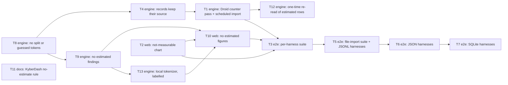

# Droid token counters, honest per-turn chart, and a per-harness dashboard e2e

**Status: Ready, 2026-11-25.**

Autonomy: autonomous. Development mode: test-first. Base: `main` at `2f661f462`, branch
`claude/fix/droid-chart-and-per-harness-e2e`.

## Request

The user's request, verbatim (sent with a screenshot of the KyberDash Sessions page, Harness: Droid,
a session whose token tiles all read "—", TURNS 1, and whose "Token Spend per Turn" chart shows
Cache Hit 0.0% / Fresh 0 / Output 0 on an empty plot):

> Also, I noticed that Droid is not properly displaying the bar graph. This tells me two things. The Droid part is broken, but also our comprehensive playwright tests aren't checking each harness. So we need to create a test which loads a sample database at least 10 turns per harness per session in multiple sessions, and then is able to load and check each harness to make sure we have full fidelity and functionality across the board. If there are gaps, we need to know about them and fill them and test them.

## Problem and goal

**Problem.** Three defects combine on the Droid session page:

1. **No Droid session ever gets token counters.** Droid's counters live only in its session files
   (`~/.factory/sessions/<workspace>/<id>.settings.json`, `tokenUsage`). The C# engine rewrite
   (`fc80ddf9d`, #612) deleted the job pass that read those files for plugin-captured sessions
   (`dash/src/sync/factory-live-counters.ts`) and never ported it. `JobSchedulerService` now only
   purges and projects, so on the owner's machine 293 Droid records carry no token, no model and no
   counter row.
2. **The scheduled folder import setting is dead.** `settings.folder_import.scheduled` is stored and
   shown, but `JobSchedulerService` never reads it (`ImportHistory` reads settings and discards
   them), so no file-sourced harness is refreshed unattended even when the owner turns it on.
3. **Projection cannot tell a plugin row from a file row.** `CanonRecordHydration.Hydrate` stamps
   every record read from the relational store with the source `relational`, because
   `CollectedRecord` carries no source. `CanonSessionProjectorEngine.SplitDroidSessionRecords`,
   `IsFileSource` and the twin-turn rules key on the source (`kyberdash-factory-plugin`,
   `codeburn/…`), so on the relational path they never fire: restored Droid counter rows would land
   as extra turns instead of pairing with the plugin's turns.
4. **The spend chart draws unmeasured turns as zero.** `TurnSpendChart` turns `null` token fields
   into `0`, so a session with no per-turn counters shows "Cache Hit 0.0% / Fresh 0 / Output 0" and
   empty bars instead of saying the figure is not measured.

The Playwright suite passed throughout, because its only Droid check asserts the empty state, it
seeds one session per harness, it never asserts models, and it checks the chart only for harnesses
that measure tokens.

**Goal.** Droid sessions get their counters and model from their session files through the shared
engine on every refresh and maintenance tick; the scheduled folder import setting works; the chart
shows a named not-measurable state instead of zeros; and isolated Playwright suites load two
sessions of at least 10 turns for every harness KyberDash can load (OTLP-captured and file-imported)
and check every dashboard section of every session, so a harness that loses fidelity fails the suite.

## Request trace

| Request instruction | Covered by | Evidence that it is met |
|---|---|---|
| "Droid is not properly displaying the bar graph … The Droid part is broken" | T4 (records keep their source, so Droid pairing fires), T1 (counters and model from session files), T2 (not-measurable chart state), D1, D2, D11 | T4 projection test: plugin turns plus file counter rows give the companion totals, the plugin turn count and the file model; T1 unit tests: a plugin-captured Droid session gains file counter rows on refresh and on a maintenance tick; T2 tests: an all-null session renders `turn-spend-not-measurable` and no zero chips; T3: the paired Droid session shows measured Total Input and its model |
| "our comprehensive playwright tests aren't checking each harness" | T3, T5, T6, T7, D5 | `otel-web-dashboard.spec.ts` runs one test per session of the seven OTLP harnesses; `file-harness-dashboard.spec.ts` runs one per session of every local-file registration; both use the shared `assertHarnessSessionDashboard` |
| "create a test which loads a sample database" | T3, T5, D4, D13 | Each spec boots an isolated `canon.db` and loads it through the production OTLP ingest, the Droid counter pass and the folder import, never touching `~/.kyberdash/canon.db` |
| "at least 10 turns per harness per session" | T3, T5–T7 | Every fixture session has 10 or 12 turns; the contract's `turns` is asserted on the row, the Turns tile and the chart |
| "in multiple sessions" | T3, T5–T7 | Two sessions per harness; Harness Detail asserts session count 2 |
| "load and check each harness to make sure we have full fidelity and functionality across the board" | T3, T5–T7, D5 | Per session: harness badge, turns, tokens, cache creation, tool calls, cost basis, chart, context, schema, skills, timeline, stored fields, models through `api/kyber/sessions` |
| "If there are gaps, we need to know about them" | Contract matrices in T3 and T5–T7, D6, `PR note:` lines | Each harness's `*Measurable: false` dimensions are asserted as an explicit not-measurable state and listed in the pull request notes as found gaps |
| Owner's D1 answer: "We never, under any circumstances, are to estimate" — remove every estimate | T8, T9, T10, D15, D16 | Unit tests at every site D15 lists assert the value is the reported figure or not measured, never a derived guess |
| Owner's D1 answer: "Bury that rule deep" | T11 | The rule appears in `docs/rules/honest-unobservability.md`, `dash/AGENTS.md`, `docs/dash/architecture.md` principles and `REVIEW.md`, and `kyber-weave docs validate` and `docs drift` pass |
| "fill them and test them" | T4, T1, T2, T3, T5–T7, D6 | The Droid counter gap and the zero-chart gap are fixed and tested; a further gap the new suite exposes is kept failing and fixed in this run (D6) |

## Scale

`documentation-impact: extends-component` on **KyberDash**. No new component, endpoint, table or
dependency. The engine gains one optional record member (`CollectedRecord.SourceName`), one read pass and one reader query; the web chart gains one state; the
e2e suite gains sessions and assertions.

## Decisions

| ID | Question | Answer / decision | Mitigating and supporting information | Status / approval provenance |
|---|---|---|---|---|
| D1 | Should a paired Droid session draw per-turn token bars? (the request asks for the bar graph; a documented rule calls Droid counters a session fact) | No bars. Turns with no measured per-turn tokens show the `turn-spend-not-measurable` state, and the overview tiles show the real session totals. No estimated bars. | Owner's answer, verbatim: "We don't estimate shit here in Kyberdash. The point of Kyberdash is to show absolute reality. We never, under any circumstances, are to estimate." Real per-turn Droid capture (hooks or plugins for per-turn tokens, tool descriptions, skills and system prompt) is researched separately and becomes its own issue and run (PR note). | ANSWERED — owner decision 2026-11-24, relayed by the conductor |
| D15 | What counts as an estimate, which KyberDash must never produce? | Scope: the data KyberDash collects and displays (`dash/**` code, `docs/dash/**`) only; the rule is never applied to other projects or other parts of this repository (owner clarification 2026-11-24). Any figure the harness did not report and that is not exact arithmetic on reported values. That covers an even or weighted split of a session total across calls or turns, a token count derived from text length, a heuristic floor or ratio, and an invented uncertainty band. These are removed, and the value shows as not measured. A sum or difference of reported counters, and reported tokens multiplied by a published rate, are calculations; they stay, labelled with their basis, never as "estimated". Published-rate cost is a calculation: its display text and `CanonSynth.CostIsEstimated` wording become "calculated from published rates" (T9, T10). | Owner's standing rule (D1). Sites found with codegraph and search: `DroidSessionMapper.AddDistributedTokens` and `BuildRecordTokens` (even split), `CursorMapper.EstimateTokens` (characters / 4), `WarpMapper.EstimateWeight` and `AllocateTokens` (weighted split), the `CanonFindings` error bars (×0.75–1.3) and the subagent-waste heuristic (`Math.Max(100, …×0.50)`), and the text-derived token counter: `CanonTokenCache.ApproximateO200kBase` (characters / 4, tokenizer label "approximate/chars-per-4"), which feeds `ToolContentMeasurer` (`MeasuredTokens`, the tool schema, tool result and skill token fields most mappers set), `CanonContextAnalysis` (context buckets), `CanonSessionProjectorEngine` through `CachedTokenCounter` (`CreateTokenCounter` and the context-turn derivation), and `KyberBridgeEngine` (`derivedCounts`, `derived_tokens`). Schema residency `schemaTokens` and skill `tokensPerTurn` come from that measurer, so the residency findings built on them inherit its treatment, D17 (real local tokenizer, labelled). The web shows them through `ContextReviewPanel.estimateTokens`, `ContextInspector`, `SkillsPanel`, `SessionSpendCharts`, `SessionInspectorDrawer`, `Scorecard`, `FindingList`, `RecommendationPanel`, `FindingDetail` and `kyberApi.ts`. | ANSWERED — owner decision 2026-11-24; the line between estimate and calculation is autonomous: low-confidence, no authoritative source (reversible at review) |
| D17 | How are text-derived token counts produced (`CanonTokenCache.ApproximateO200kBase` and everything it feeds)? | Real local tokenization replaces characters / 4 everywhere (T13). It uses `Microsoft.ML.Tokenizers` in C#, and the vocabulary comes from the NuGet data packages shipped with KyberDash, so there is no network or API call at run time, ever. The tokenizer is chosen by model: the model's own published tokenizer where one exists (`TiktokenTokenizer.CreateForModel`: `o200k_base` for current OpenAI models, `cl100k_base` for older ones). Claude and every other model with no published tokenizer use one named standard stand-in, `o200k_base` (D19). Every text-derived figure carries the tokenizer name and whether it is the model's own or the stand-in, and the UI shows that label (for example "o200k_base, standard tokenizer — not Claude's own"). Residency findings built on these counts stay and carry the same label. Token cache keys include the tokenizer name. | Owner's answer, verbatim: "I don't want to call an API endpoint. I want it to stay local." and "Let's use the closest tokenizer for Claude. I know that, strictly speaking, that invalidates the no estimates, but for the tokenization, I'm okay with us getting close by using a standard tokenizer." This is the owner's one approved exception to D15, limited to counting tokens in text. | ANSWERED — owner decision 2026-11-24, relayed by the conductor |
| D18 | Which packages, and which versions? | `Microsoft.ML.Tokenizers` 3.0.0, `Microsoft.ML.Tokenizers.Data.O200kBase` 3.0.0 and `Microsoft.ML.Tokenizers.Data.Cl100kBase` (the 3.0.0 release of the same family), all latest stable, referenced by `dash/server/KyberDash.Data/KyberDash.Data.csproj` only. The repository has no `Directory.Packages.props`, so versions are pinned in that project file. | nuget.org, checked 2026-11-24: `Microsoft.ML.Tokenizers` 3.0.0 stable (updated 2026-11-11; targets net8.0, compatible with net10.0) and `Microsoft.ML.Tokenizers.Data.O200kBase` 3.0.0 stable (2026-11-11). The worker confirms the `Cl100kBase` data package's 3.0.0 on nuget.org before pinning it. The tokenizer is an outside resource (shipped vocabulary), so it sits behind a seam: interface `ITextTokenizer` in `KyberDash.Contracts`, adapter in `KyberDash.Data`, and a fake in the test support. | ANSWERED — owner decision D17 approves the dependency; versions verified on nuget.org |
| D19 | Which standard tokenizer stands in for Claude and other models with no published tokenizer? | `o200k_base`. | Anthropic publishes no offline Claude tokenizer. `o200k_base` is the current widely used BPE vocabulary, and its data package is already needed for OpenAI models, so the stand-in adds no new package. Every figure it produces is labelled "standard tokenizer — not <model>'s own". Open-weight models (Llama, Qwen and others) publish their own tokenizers, but each needs its own vocabulary file shipped; this run uses the stand-in for them (PR note). | ANSWERED — autonomous: low-confidence, no authoritative source for "closest"; one constant to change (`StandardTokenizerName`) |
| D20 | What happens to stored text-derived counts made with characters / 4? | A stored figure whose tokenizer label is `approximate/chars-per-4`, or has no label, reads as not measured. It is never relabelled or shown as a count. Each new count stores its tokenizer label, and cache keys of the form `<tokenizer>:<model>:<sha256>` make every old cache entry miss. | Content older than 14 days is purged, so old figures cannot all be recounted; showing them as not measured follows D15. Where the stored record has no tokenizer column, T13 adds a nullable one through the schema catalogue's existing change path (`RelationalSchemaCatalog`). | ANSWERED — autonomous: low-confidence, no authoritative source; changes stored meaning, so rated `hard` (T13) |
| D16 | Where do Droid, Warp and Cursor session totals go once no estimate splits them? | Session-level counters a harness reports as session totals are stored once, in `session_model_usage` (`CollectedSession.ReportedUsage`, which `DroidSessionMapper.BuildReportedUsage` already fills). Records carry no split token counts. Session totals read `session_model_usage` when no record of the session carries a counter; per-call and per-turn figures stay null. Each registration gets its own parser contract version (`SourceRootSpec`, default "1"; `droid`, `cursor` and `warp` "2"), threaded into every `SourceUnit` the registry builds, so `CanonRefreshEngine.CheckpointIsReusable` (an ordinal `!=` on the version) refuses their old checkpoints. A one-time correction pass in the first maintenance tick after deploy re-reads the already-imported sources of those three harnesses, so stored estimated rows are replaced without a manual import; otherwise they are replaced on the next refresh or import. | This keeps the real totals in the tiles without inventing per-call figures. Today every registration shares `HarnessSourceRegistry.DefaultParserContractVersion` "1", so a version bump needs this per-registration field to exist. Scheduled import defaults off, so without the correction pass the owner's estimated rows would survive indefinitely. | ANSWERED — autonomous: low-confidence, no authoritative source; changes stored meaning, so rated `hard` (T8) |
| D2 | Where does the Droid counter pass run? | In one shared step that `JobSchedulerService.RunJob` (the `POST /api/kyber/refresh` path and the import paths) and `RunMaintenancePass` (the timer) both call, before projection. | The timer cadence is minutes, so the e2e can reach the pass only through `POST /api/kyber/refresh`; proving it through `/import-history` would hide the bug because that path reads every folder anyway. | ANSWERED — autonomous: decided from code evidence |
| D3 | Which Droid sessions does the pass read, how, and what does it record? | Sessions the store holds with a record from the OTLP source `kyberdash-factory-plugin`, newest first, at most 80 per pass. Files come only from the `droid` registration's reader (`sourceRegistry.GetReader("droid")`), never `DiscoverAll`, and never a path built from a session id; discovery uses the standard `CanonRefreshEngine.DefaultHistoryWeeks` window. Each file goes through the existing checkpoint check and `ProcessRelationalSourceUnit`, so it writes per-file source checkpoints only; it writes no `refresh_run` row and claims no history coverage. No age window on the plugin records. | Mirrors the deleted pass's scope ("never reads a session the plugin did not capture") so the opt-in folder import stays opt-in, and keeps the cost to one Factory folder scan per tick. Per-file checkpoints are exactly what a later full import reads, so it skips only unchanged files. The old 6-hour window is replaced by checkpoints, because a fixed window made a session finished overnight never gain counters. | ANSWERED — autonomous: low-confidence, no authoritative source (cheap to reverse: one constant and one filter) |
| D4 | How does the e2e "load a sample database"? | Boot `kyberdash web` on an isolated temp `canon.db` and load it through the production OTLP receiver (`/v1/traces`, `/v1/logs`) plus Droid session files written under the server's isolated `HOME`, then `POST /api/kyber/refresh`. No new seeder world. | Reuses `startIsolatedServer` and the existing payload builders, and proves the real ingest, file read and projection path; a hand-written database would prove only the fixture writer (the E2E seeder's own rationale). | ANSWERED — autonomous: decided from existing pattern |
| D5 | Which harnesses does "each harness" mean? | Every harness KyberDash can load. T3 covers the seven captured over OTLP (`claude-code`, `opencode`, `droid`, `codex`, `copilot`, `pi`, `antigravity`) plus the excluded `gemini` check. T5–T7 cover every local-file registration in `HarnessSourceRegistry`: the `claude-code` and `codex` transcripts, `copilot-cli`, `antigravity` and `antigravity-cli` (their `.jsonl` roots), `commandcode`, `pi`, `kimi-code`, file-only `droid`, `cline`, `cline-cli`, `roo-code`, `kilo-vscode-legacy`, `copilot-vscode`, `devin` (transcript and SQLite), `kilo-shared-runtime`, `warp` and `cursor`. Every harness gets two sessions of 10+ turns. | The owner asked for "each harness" and "full fidelity and functionality across the board", and plan review rejected the narrower set. Where a harness cannot reach a section, the suite asserts its explicit not-measurable state and the contract lists the gap. | ANSWERED — plan review finding 1 |
| D13 | How do the file-import harnesses reach the isolated database? | Each harness's native files are written under the isolated server's `HOME`, at the path its registry reader scans: JSONL, JSON, or SQLite built with Node's built-in `node:sqlite` (`dash/package.json` requires Node 22.13 or later). The spec then posts `api/kyber/import-history`. File shapes are copied from each mapper's test in `dash/server.tests/KyberDash.Data.Tests/Harnesses/`, and timestamps are relative to the run's clock (D10). | This proves the real readers, mappers and projection, the same reasoning as D4. `AllHarnessFixtureSet.cs` builds in-memory `CollectedBatch` objects inside the test project. Seeding from it would bypass every reader and mapper, and would move test code into the production seeder. | ANSWERED — autonomous: decided from D4's reasoning |
| D14 | Should the Droid sessions reuse `dash/e2e/factory-replay-world.ts`? | No. It stays as the plugin replay and consent coverage in `harness-collection.spec.ts`. | It seeds plugin hook fixtures through the CLI seeder before the server starts and writes no session files, so it cannot exercise the counter pass that runs on refresh. | ANSWERED — autonomous: decided from code evidence |
| D6 | What happens when the new suite exposes a gap not known today? | The worker keeps the failing assertion, reports `Open item:` with harness, section and observed value, and the conductor dispatches the fix in this run. No assertion is weakened or skipped; a dimension the harness genuinely does not export is asserted as its explicit not-measurable state. | The request says gaps are to be known, filled and tested. "Fix as discovered" during the run. | ANSWERED — autonomous: decided from request |
| D7 | Extend the existing per-harness spec or add a parallel spec? | Extend `dash/e2e/otel-web-dashboard.spec.ts` and `dash/e2e/otel-harness-payloads.ts` in place. | The existing spec already is the per-harness dashboard suite; a second spec would duplicate every section assertion. The request's "create a test" is met by the new per-session tests. | ANSWERED — autonomous: decided from repository duplication rule |
| D8 | The test standard says Playwright never runs in a developer's task gate, but the request needs proof that the suite passes. | The e2e tasks' gates run `typecheck` and `lint` only. Each e2e task's worker first checks that the isolated config can launch its browser (`npx --prefix dash playwright install --list` lists Chromium), rebuilds the CLI and the web bundle, then runs its own spec once as a bounded evidence step and reports the result. RED is the new assertions failing at runtime; GREEN is the same assertions passing. When no browser is available, the digest and the pull request notes say `NOT VERIFIED: <reason>`, never a pass, and the conductor runs the evidence step where a browser exists. | This keeps the test standard intact and still gives the request its proof. CI does not yet run the isolated specs (issue #681). | ANSWERED — plan review finding 4 |
| D9 | Wire the dead `folderImportScheduled` setting here, or leave a PR note? | Wire it in T1: when the setting is on, the maintenance tick runs the full harness-source refresh before purge and projection; remove the discarded `settings.ReadSettings()` call in `ImportHistory`. | It sits in the method T1 changes, and `docs/dash/architecture.md` describes it as working. Own what you touch. | ANSWERED — autonomous: decided from change-scope rule |
| D11 | Restore record source identity on the relational read path, or special-case Droid? | Restore it for every record: `CollectedRecord` gains an optional `SourceName`, every reader method that returns records for projection fills it from the record's `source` row (OTLP: the locator, the service name; file: `codeburn/<harness_id>`), and `CanonRecordHydration.Hydrate` uses it instead of `relational`. | The source rules (`SplitDroidSessionRecords`, `IsFileSource`, twin-turn collapse) are documented for every harness and silently inert since the C# cutover; a Droid-only patch would leave the same defect for every other harness. This changes projections for any session holding both OTLP and file rows, which is the documented behaviour; rated `hard` (T4) for that reason. Rules that switch on, by harness: - `CollapseIdJoins`: OTLP `llm.invoke` rows carrying `gen_ai.response.id` or a request join id, plus file rows (`claude-code`, `codex`). - `DedupeTwinTurns` counter clusters (`CollapseCluster`): any harness whose OTLP and file rows report equal counters, and the file-only `claude-desktop` cluster. - `CollapseOverlapFileJoins`: `cursor` (`HasEvidencedCursorTwinShare`). - `SplitDroidSessionRecords`: `droid`. T4 bumps `SqliteRelationalStore.DetectorVersion` from 5 to 6, so `IsProjectionCurrent` turns false and every stored projection is rebuilt on the first start or tick after deploy; no stale projection survives. | ANSWERED — autonomous: low-confidence, no authoritative source for the C#-specific fix; cost of wrong is a projection regression caught by T4's regression cases and review |
| D12 | Does a paused install read files on the timer? | No. When `JobsPaused` is true, `RunMaintenancePass` runs neither the Droid counter pass nor the scheduled import; purge and projection continue as today. | Pause is the owner's "stop background work" switch; reading their files while paused would break it. | ANSWERED — autonomous: decided from the setting's meaning |
| D10 | The fixtures use a fixed 2026-11-20 base time. | T3 derives the base time from the run's clock (one hour before the run, floored to the minute), so the 14-day retention and the 2-week history window never age the fixtures out. | The fixed date stops the suite passing after 2026-12-04; this is a defect in a file T3 rewrites. | ANSWERED — autonomous: decided from code evidence |
| AP1 | Approve and execute | Approved for execution as planned. | Recorded by the finalize step, which changed no task, file scope, test row or command. | ANSWERED: autonomous: recommendation accepted, AUTONOMOUS_APPROVAL: approve-and-execute (plan review cycles 1-2 findings fixed; owner decisions D1 no estimated bars, D17 local tokenizers with labelled stand-in recorded), 2026-11-25 |

## Design harvest

| Target component | Target doc type | Section | Content to harvest |
|---|---|---|---|
| KyberDash | architecture | `docs/dash/architecture.md` § Where the Factory file rows come from | The C# counter pass: plugin-captured Droid sessions, file found by reader discovery, same reader/mapper/source id as the folder import, checkpoint skip, run on refresh and every maintenance tick; replace the stale "live counter" bullet at line 807 |
| KyberDash | architecture | `docs/dash/architecture.md` § Jobs / scheduled maintenance | `settings.folder_import.scheduled` on: the maintenance tick runs the full harness-source refresh; off: only the Droid counter pass reads files |
| KyberDash | architecture | `docs/dash/architecture.md` § The Factory source-precedence rule | Records read from the relational store keep their source (`CollectedRecord.SourceName`: OTLP service name or `codeburn/<harness>`), which is what the split and the file-source rules key on |
| KyberDash | architecture | `docs/dash/architecture.md` § The Factory source-precedence rule | Per-turn tokens for a paired Droid session are not measurable; the chart shows `turn-spend-not-measurable`, the tiles show the file totals |
| KyberDash | reference | `docs/dash/telemetry-inventory.md` (Factory file source) | The spend chart's not-measurable state for turns with no counter, for every harness |
| KyberDash | runbook | `docs/dash/runbook.md` (e2e) | The isolated per-harness dashboard suites: two sessions of 10+ turns per OTLP and per file-import harness, native files under the isolated `HOME`, the build prerequisites and the commands; the per-harness gap matrix |
| KyberDash | architecture | `docs/dash/architecture.md` § Engine and projection | `SqliteRelationalStore.DetectorVersion` is 6; the bump re-projects every stored session after the source-identity change |

## Investigation findings

- Discovery: codegraph 9 (worktree `projectPath`, provenance `branch=claude/fix/droid-chart-and-per-harness-e2e rev=2f661f462`), docs 6 (`kw-docs` in the worktree, same provenance), direct reads 11: this plan (re-read before revision), `TranscriptIngestionService.cs` 122-330 (codegraph trimmed the refresh body), `AGENTS.md` (Config Reg, not indexed as code), `docs/plans/README.md` and `docs/dash/architecture.md` (exact lines for the plan), `JobSchedulerService.cs` 170-503 and `SessionSpendCharts.tsx` 440-740 (codegraph trimmed both bodies), `HarnessSourceRegistry.cs` 90-210 (trimmed), `otel-web-dashboard.spec.ts`, `otel-harness-payloads.ts` 1-600, `harness-collection-world.ts` 140-560 (e2e TypeScript bodies the explore result did not include), `DashEndpointMappings.cs` 880-920 (route bodies trimmed). The deleted TypeScript pass was read with `git show fc80ddf9d^:…`.
- `JobSchedulerService.RunJob` and `RunMaintenancePass` each run `PurgeExpiredContent` then `ProjectAll`; neither reads a file. `ImportHistory` discards `settings.ReadSettings()`.
- `HarnessSourceRegistry` already registers `droid` (`factory`, `droid-reader`, `droid-jsonl`, `.factory/sessions`, `*.jsonl`, companion `.settings.json`), and `DroidSessionMapper` already maps the companion `tokenUsage` (tested by `DroidSessionMapperTests.Map_DistributesCompanionTokenUsageAcrossAssistantCallsAndPopulatesSessionModelUsage`). The port needs selection and wiring, not a new reader.
- `TranscriptIngestionService.RefreshRelationalSources` discovers through `sourceRegistry.DiscoverAll`, checks checkpoints, and writes each unit through `ProcessRelationalSourceUnit`; reusing that path keeps the source id, so a later folder import replaces rather than doubles the rows.
- `CanonSessionProjectorEngine.SplitDroidSessionRecords` pairs plugin turn rows with file counter rows on exact session id; chart turns come from plugin rows, so per-turn token fields stay null after the fix (D1).
- `CollectedSession` and `CollectedRecord` carry no source, and no `IRelationalStoreReader` query returns session ids by record source; T4 adds the record member, T1 the query.
- `CanonRecordHydration.Hydrate` sets `Source = "relational"` on every hydrated record, so `SplitDroidSessionRecords` (plugin source / `codeburn/` prefix), `IsFileSource`, `CollapseIdJoins`, `CollapseCluster` and `CollapseOverlapFileJoins` see no plugin or file rows on the relational path. OTLP batches are written with `CollectedSource(harness, SourceKind.Otlp, <service name>)` (`CanonIngestPipeline`); file batches with the mapper's file source. `CanonSynth.FileSourcePrefix` is `codeburn/`.
- `TranscriptIngestionService.RefreshRelationalSources` writes a `refresh_run` row, discovers through `DiscoverAll` with a `SinceUtc` window, and per unit `ProcessRelationalSourceUnit` checks the checkpoint, deletes the old source on a re-read, writes the batch and upserts the checkpoint.
- Recorded Factory hook fixtures (`dash/e2e/fixtures/factory/*.json`) carry a `model` field once each; live data shows no model on plugin rows. With counters paired, the model comes from the file counter rows (architecture § model follows the same split), which closes the visible model gap; the hook-model question is a `PR note:`.
- `startIsolatedServer` sets `HOME` to `<rootDir>/home`, so the e2e can place Droid session files where the server's reader looks. `resolveKyberdashCommand` prefers an existing `bin/Release` binary and the web bundle is rebuilt only when `dist/dash/index.html` is missing, so stale builds must be rebuilt before the spec runs.
- `otel-tray-dashboard.spec.ts` iterates `STORED_OTLP_HARNESS_CONTRACTS`, so contract changes reach it.
- `IRelationalStoreReader` returns `CollectedRecord` from exactly five members: `RecordContentFree`, `SessionRecordsForRebuild`, `AllSessionRecordsForMaintenance`, `SessionRecordsContentFree`, `SessionTimelineRecords`. In `SqliteRelationalStore.Reader.cs` they build records in `QueryRecords` (the first two), `QueryContentFreeRecordsBySession` (`SessionRecordsContentFree` and `RecordContentFree`) and the `TREC` query in `SessionTimelineRecords`. In `InMemoryRelationalStore` they build them in `MaterializeRecord` (through `CollectReaderRecords`) and `MaterializeRecordContentFree` (through `CollectSessionRecordsContentFree` and `CollectSessionTimelineRecords`). `CanonRecordHydration.Hydrate` is called by `CanonSessionProjectorEngine.ProjectIncrementalRelational` and by `KyberBridgeEngine` (`GetSessionContent`, `GetTimeline`, `TrySessionTimelineTree`, `TodayTimelineNodes`, `GetSpanAttributes`).
- Rules keyed on source: `CollapseIdJoins` (`gen_ai.response.id` and the request join id against file native ids), `CollapseCluster` through `DedupeTwinTurns` counter keys (special file-only case `codeburn/claude-desktop`), `CollapseOverlapFileJoins` gated by `HasEvidencedCursorTwinShare`, and `SplitDroidSessionRecords`. `SqliteRelationalStore.DetectorVersion` is 5, and `IsProjectionCurrent` re-projects any store stamped differently.
- The local-file readers and their formats (`HarnessSourceRegistry`): JSONL for `claude-code` (`.claude/projects`), `codex` (`.codex/sessions`), `copilot-cli` (`.copilot/session-state/*/events.jsonl`), `commandcode`, `droid`, `pi`, `kimi-code` (`wire.jsonl`), and the `antigravity` and `antigravity-cli` brain roots. JSON for `cline`, `roo-code`, `kilo-vscode-legacy` (`ui_messages.json`), `cline-cli` (`*.messages.json`), `devin` transcripts and `copilot-vscode` workspace storage. SQLite for `kilo-shared-runtime` (`kilo.db`), `devin` (`sessions.db`), `warp` (`warp.sqlite`) and `cursor` (`state.vscdb`). Protocol-buffer `.pb` conversation files for `antigravity` and `antigravity-cli`. Each mapper has a test under `dash/server.tests/KyberDash.Data.Tests/Harnesses/` to copy shapes from.
- `harness-collection.spec.ts` covers the seeded measured, honest-empty and zero-record worlds and the Factory hook replay (`factory-replay-world.ts`); none of it loads native files through the folder import into a booted server.
- Standards fetched through `docs_get_coding_standard_for_technology`: `csharp` (interface first, seams, in-memory unit tests), `react` (distinct states, never `0` for unmeasured, Vitest tests per state), `typescript` (display layer, unmeasured stays null, no floating promise; its Testing section is empty), `test` (unit by default; Playwright outside task gates, see D8).

## Data model

No table, column or index changes; both additions read the existing `record.source_id` to
`source` link.

| Member | Type and nullability | Meaning | Filled by |
|---|---|---|---|
| `CollectedRecord.SourceName` (T4, new last positional parameter, default `null`) | `string?` | The record's source as projection rules read it: the OTLP source's locator (service name, e.g. `kyberdash-factory-plugin`) for `SourceKind.Otlp`; `codeburn/<harness_id>` for file sources; `null` only for a record built in memory by a mapper before it is stored | Every `SqliteRelationalStore` and `InMemoryRelationalStore` method that returns `CollectedRecord` for hydration; mappers leave it `null` |

| Query | Input | Output | Order and bound | Index |
|---|---|---|---|---|
| `IRelationalStoreReader.SessionKeysWithRecordSource(string harnessId, string sourceName, int limit)` (T1) | harness id (`droid`), OTLP source locator (`kyberdash-factory-plugin`), positive limit | distinct session keys, `IReadOnlyList<string>` | newest record timestamp first, then session key; at most `limit` rows | Existing indexes only; the query runs once per pass under `LIMIT`. A limit below 1 is refused with `ArgumentOutOfRangeException` |

## Test contract (development-mode: test-first)

| Task | Test project or file | Runner command | Observable behavior | RED evidence required | GREEN acceptance |
|---|---|---|---|---|---|
| T4 | `dash/server.tests/KyberDash.Application.Tests/Projection/RelationalSourceIdentityTests.cs` (`KyberDash.Application.Tests.Projection.RelationalSourceIdentityTests`), `dash/server.tests/KyberDash.Data.Tests/Repositories/RecordSourceNameTests.cs` (`KyberDash.Data.Tests.Repositories.RecordSourceNameTests`) | `dotnet test dash/server.tests/KyberDash.Application.Tests/KyberDash.Application.Tests.csproj --filter "FullyQualifiedName~KyberDash.Application.Tests.Projection.RelationalSourceIdentityTests" && dotnet test dash/server.tests/KyberDash.Data.Tests/KyberDash.Data.Tests.csproj --filter "FullyQualifiedName~KyberDash.Data.Tests.Repositories.RecordSourceNameTests"` | Reader (real SQLite): a record from an OTLP batch reads back with `SourceName` equal to the batch locator; a record from a file batch reads back with `codeburn/<harness>`; a record whose source was deleted is gone (cascade unchanged). Hydration: `Hydrate` copies `SourceName` into `CanonicalRecord.Source`; a `null` `SourceName` keeps `relational`. Projection (in-memory store): a Droid session with 10 plugin turn records and the file rows and session usage `DroidSessionMapper` writes (after T8) for a companion (`inputTokens` 25829, `outputTokens` 6811, `cacheReadTokens` 283904, `cacheCreationTokens` 1200, model `gpt-5-codex`) projects 10 turns, session totals equal to the companion, model `gpt-5-codex`, cost basis `published_priced`, and per-turn token fields `null`; the same plugin records alone project 10 turns with totals `not_measurable`; a Claude session of OTLP records only projects exactly as before the change (turns, totals, cost). Mixed OTLP plus file sessions, each pinned to the documented outcome: - `claude-code`: 4 OTLP `llm.invoke` rows carrying `gen_ai.response.id` and 4 transcript rows with matching message ids project 4 turns. Token totals equal the OTLP rows, never the sum of both, and the transcript's content parts land on the OTLP turns (`CollapseIdJoins`). - `codex`: OTLP rows and rollout rows joined on the request id project one turn per request (`CollapseIdJoins`). - Counter twins: an OTLP row and a file row with equal counters within `TwinTurnMaxSkewMs` collapse to one turn (`DedupeTwinTurns` and `CollapseCluster`). - `cursor`: overlapping file rows that `HasEvidencedCursorTwinShare` accepts collapse as documented (`CollapseOverlapFileJoins`). - Mixed rows with no join key keep both turns. `SqliteRelationalStore.DetectorVersion` is 6. | Tests fail to compile on the missing `CollectedRecord.SourceName`; then the pairing case fails because counter rows count as turns | All cases pass with a non-zero count; existing projection test classes the worker runs (`KyberDash.Application.Tests.Projection`) keep their assertions |
| T1 | `dash/server.tests/KyberDash.Application.Tests/Ingest/PluginSessionFileSchedulerTests.cs` (`KyberDash.Application.Tests.Ingest.PluginSessionFileSchedulerTests`), `dash/server.tests/KyberDash.Application.Tests/Ingest/PluginSessionFileRefreshTests.cs` (`KyberDash.Application.Tests.Ingest.PluginSessionFileRefreshTests`), `dash/server.tests/KyberDash.Data.Tests/Repositories/SessionKeysWithRecordSourceTests.cs` (`KyberDash.Data.Tests.Repositories.SessionKeysWithRecordSourceTests`) | `dotnet test dash/server.tests/KyberDash.Application.Tests/KyberDash.Application.Tests.csproj --filter "FullyQualifiedName~KyberDash.Application.Tests.Ingest.PluginSessionFile" && dotnet test dash/server.tests/KyberDash.Data.Tests/KyberDash.Data.Tests.csproj --filter "FullyQualifiedName~KyberDash.Data.Tests.Repositories.SessionKeysWithRecordSourceTests"` | Ingest (in-memory `IHarnessFileSystem` and store): a plugin-captured Droid session whose transcript and companion exist gains the file rows, the companion's `tokenUsage` as session usage, and its model; a session id with no file is skipped and reported nowhere as a failure; a Droid file whose session the plugin did not capture is not read; an empty candidate set reads nothing; a second call with an unchanged file writes nothing (checkpoint); a later `RefreshHarnessSources` over the same file leaves one copy of the counters (same source id); a candidate id containing `/` or `..` never reads outside the sessions root. Scheduler (fakes): `TriggerRefreshAsync` and `RunMaintenancePass` each call the counter pass once before `ProjectAll`; `RunMaintenancePass` calls `RefreshHarnessSources(DefaultHistoryWeeks)` when `FolderImportScheduled` is true and not when false; with `JobsPaused` true, `RunMaintenancePass` calls neither file read but still purges and projects, and a refresh declined while paused calls neither. Reader (real SQLite in the Data test project): returns only sessions of the named harness with a record from the named source, newest first, capped at `limit`; empty store returns empty; `limit` 0 throws `ArgumentOutOfRangeException` | The new test classes fail to compile on the missing `SessionKeysWithRecordSource`, `ITranscriptIngestionService.RefreshPluginSessionFiles` symbols; once stubbed, the scheduler assertions fail because no pass runs | All three classes pass with a non-zero test count; no existing assertion changed |
| T2 | `dash/web/src/components/SessionSpendCharts.test.tsx` (extend the `TurnSpendChart` describe block), `dash/web/src/components/session/SessionChartsSection.test.tsx`, `dash/web/src/components/SessionInspectorDrawer.test.tsx`, `dash/web/src/components/AgentSessionDashboard.test.tsx` (one case each) | `npm --prefix dash run test -- web/src/components/SessionSpendCharts.test.tsx web/src/components/session/SessionChartsSection.test.tsx web/src/components/SessionInspectorDrawer.test.tsx web/src/components/AgentSessionDashboard.test.tsx` | Each embedding component (`SessionChartsSection`, `SessionInspectorDrawer`, `AgentSessionDashboard`), given a `/charts` response whose turns carry no token field, renders `turn-spend-not-measurable` and no `turn-bar-*`. In the chart itself: all turns with every token field null: renders `turn-spend-not-measurable` with the turn count and the reason text, no `turn-bar-*`, no Cache Hit/Fresh/Output chips, no `0` figure. Mixed turns: every turn renders `turn-bar-<i>`; measured turns carry `data-measured="true"`, unmeasured ones `data-measured="false"` with no segments and aria-label "Turn <i>, tokens not measured"; chips sum measured turns only. A measured zero (`output: 0`) stays measured. Empty `turns` still renders `turn-spend-empty`. Fully measured turns render exactly as today. No code path draws a bar or chip for a turn without a measured figure (D1) | New cases fail: the all-null case renders `turn-spend-chart` with "Fresh: 0" | New and existing cases pass; existing assertions unchanged |
| T3 | `dash/e2e/otel-web-dashboard.spec.ts`, `dash/e2e/session-dashboard-assertions.ts` | Gate (D8): `npm --prefix dash run typecheck && npm --prefix dash run lint`. Evidence step: `npx --prefix dash playwright test --config dash/playwright.isolated.config.ts dash/e2e/otel-web-dashboard.spec.ts` | For each of the 14 sessions (two per harness in D5, each 10 or 12 turns): Harness Detail shows session count 2 and the run count `/api/kyber/harness/<id>` reports; the session row shows its turns; badge, notes gaps, Turns tile; tokens measured or "—" per contract; tool calls; cost basis; chart: `perTurnTokensMeasurable` gives one `turn-bar-*` per turn all `data-measured="true"`, otherwise `turn-spend-not-measurable` and zero bars; context, schema, skills, timeline, stored fields; `/api/kyber/sessions?harness=<id>` lists the contract's models for the session. Droid A (paired with session files, after `POST /api/kyber/refresh`): Total Input and Total Output measured, model `gpt-5-codex`, chart not-measurable. Droid B (plugin only): totals "—", chart not-measurable. Gemini stays excluded | Gate RED: typecheck fails on the contract fields and helpers the spec names (`perTurnTokensMeasurable`, `buildDroidSessionFiles`, `homeDir`, `postRefresh`, `assertHarnessSessionDashboard` from its new module). Evidence RED: with the new assertions written and before the fixtures emit second sessions and Droid files, the spec run fails at runtime on the missing session rows, the Droid A totals and the models; the worker records the failing test names | Gate passes; the evidence run passes against a freshly built CLI and web bundle with every session test green; no assertion weakened |
| T8 | `dash/server.tests/KyberDash.Data.Tests/Harnesses/DroidSessionMapperTests.cs`, `CursorMapperTests.cs`, `DevinWarpMapperTests.cs` (classes `KyberDash.Data.Tests.Harnesses.DroidSessionMapperTests`, `.CursorMapperTests`, `.DevinWarpMapperTests`); `dash/server.tests/KyberDash.Application.Tests/Projection/SessionUsageTotalsTests.cs` (`KyberDash.Application.Tests.Projection.SessionUsageTotalsTests`) | `dotnet test dash/server.tests/KyberDash.Data.Tests/KyberDash.Data.Tests.csproj --filter "FullyQualifiedName~KyberDash.Data.Tests.Harnesses" && dotnet test dash/server.tests/KyberDash.Data.Tests/KyberDash.Data.Tests.csproj --filter "FullyQualifiedName~KyberDash.Data.Tests.Collector.ParserContractVersionTests" && dotnet test dash/server.tests/KyberDash.Application.Tests/KyberDash.Application.Tests.csproj --filter "FullyQualifiedName~KyberDash.Application.Tests.Projection.SessionUsageTotalsTests"` | Contract versions: `droid`, `cursor`, `warp` units carry "2", others "1"; a "1" checkpoint is not reusable for the three and stays reusable for `claude-code`. Droid: a companion with `tokenUsage` yields session usage equal to it and assistant-call records with no token count; a companion without `tokenUsage` yields no usage and no counts. Cursor: a bubble or transcript turn with zero native counts yields a record with no token count (text length never becomes tokens); native counts still map. Warp: conversation totals land as session usage; exchanges carry no allocated counts. Each reader's parser contract version is higher than before. Projection: a session with no record counters and session usage shows totals equal to the usage; a session with record counters ignores usage (no double count); per-turn figures stay null | The changed mapper assertions fail: records still carry split or text-derived counts | All pass with a non-zero count; the existing mapper tests that asserted split or text-derived figures are rewritten to assert not-measured (this is the owner's rule changing the contract, D15) |
| T13 | `dash/server.tests/KyberDash.Data.Tests/Collector/LocalTextTokenizerTests.cs` (`KyberDash.Data.Tests.Collector.LocalTextTokenizerTests`), `dash/server.tests/KyberDash.Data.Tests/Collector/ToolContentMeasurerTests.cs` (extend), `dash/server.tests/KyberDash.Application.Tests/Projection/TokenizerLabelTests.cs` (`KyberDash.Application.Tests.Projection.TokenizerLabelTests`) | `dotnet test dash/server.tests/KyberDash.Data.Tests/KyberDash.Data.Tests.csproj --filter "FullyQualifiedName~KyberDash.Data.Tests.Collector" && dotnet test dash/server.tests/KyberDash.Application.Tests/KyberDash.Application.Tests.csproj --filter "FullyQualifiedName~KyberDash.Application.Tests.Projection.TokenizerLabelTests"` | Adapter (real data packages, no network): "hello world" counts exactly as `o200k_base` and `cl100k_base` define it (the test pins the counts the vocabularies give); `gpt-4o` and `gpt-5-codex` select `o200k_base` as the model's own; `gpt-4` selects `cl100k_base` as its own; `claude-sonnet-4-20250514`, an unknown model and a blank model select the `o200k_base` stand-in with `IsModelOwn` false; an empty string counts 0. Measurer: tool schema, tool result and skill figures carry the tokenizer name and own/stand-in flag; no figure equals characters / 4 unless the tokenizer gives it. Cache: keys are `<tokenizer>:<model>:<sha256>`, so the same text under another tokenizer misses. Projection and bridge: context buckets, `derived_tokens` and residency findings carry the label; a stored figure labelled `approximate/chars-per-4`, or with no label, reads as not measured (D20) | Fails to compile on the missing `ITextTokenizer` and label fields; then the counts equal characters / 4 | All pass with a non-zero count; existing measurer and projection tests that pinned characters / 4 counts are rewritten to the tokenizer's counts (D17) |
| T12 | `dash/server.tests/KyberDash.Application.Tests/Ingest/NoEstimateRereadTests.cs` (`KyberDash.Application.Tests.Ingest.NoEstimateRereadTests`) | `dotnet test dash/server.tests/KyberDash.Application.Tests/KyberDash.Application.Tests.csproj --filter "FullyQualifiedName~KyberDash.Application.Tests.Ingest.NoEstimateRereadTests"` | With the metadata key absent and checkpointed `droid`, `cursor` and `warp` units, the first unpaused maintenance pass re-reads exactly those units and sets the key; a second pass re-reads none; with the key absent and jobs paused, nothing is read; a failing re-read leaves the key absent so the next tick retries; units of other harnesses are never re-read | Fails to compile on the missing re-read member; then no unit is re-read | All pass with a non-zero count |
| T9 | `dash/server.tests/KyberDash.Domain.Tests` and `dash/server.tests/KyberDash.Application.Tests` classes that cover `CanonFindings` and context derivation; new `dash/server.tests/KyberDash.Application.Tests/Projection/NoEstimateFindingsTests.cs` (`KyberDash.Application.Tests.Projection.NoEstimateFindingsTests`) | `dotnet test dash/server.tests/KyberDash.Application.Tests/KyberDash.Application.Tests.csproj --filter "FullyQualifiedName~KyberDash.Application.Tests.Projection.NoEstimateFindingsTests"` | Every finding `CanonFindings` emits carries no `ErrorBar`. The subagent-waste finding emits no waste figure (null, rank by confidence only) instead of `Math.Max(100, …×0.50)`. Schema residency waste, when present, is exact `schemaTokens × turnsResident` and carries the tokenizer label of `schemaTokens`. The bridge's cost note and `CanonSynth` cost basis text say "calculated from published rates", never "estimates" | New assertions fail on today's error bars and heuristic figure | All pass; existing finding tests that asserted error bars or heuristic figures are rewritten to the not-measured outcome (D15) |
| T10 | `dash/web/src/components/analysis/ContextReviewPanel.test.tsx`, `FindingList.test.tsx`, `Scorecard.test.tsx`, `RecommendationPanel.test.tsx`, `dash/web/src/pages/FindingDetail.test.tsx`, `dash/web/src/components/ContextInspector.test.tsx`, `dash/web/src/components/SkillsPanel.test.tsx` (existing files extended; created where missing) | `npm --prefix dash run test -- web/src/components/analysis web/src/pages/FindingDetail.test.tsx web/src/components/ContextInspector.test.tsx web/src/components/SkillsPanel.test.tsx` | No component computes a token count from text (`ContextReviewPanel.estimateTokens` removed); a text-derived figure with `tokenizerIsModelOwn` false renders "o200k_base, standard tokenizer — not Claude's own" for a Claude model, and with true renders the tokenizer as the model's own; a response missing the fields fails validation as an error state; a finding with no waste figure or error bar renders "not measured", never a range or `0`; no visible text says "estimated" or "≈" for a figure; cost labels read "calculated from published rates" where that is the basis | New assertions fail on today's estimate text and ranges | All pass; existing assertions on estimate text are rewritten to the not-measured outcome (D15) |
| T11 | Documentation only | `kyber-weave docs validate . && kyber-weave docs drift .` | The rule text "KyberDash never estimates the data it collects and displays: a value the harness did not report is shown as not measured; the fix is capturing the real value. This rule applies to KyberDash (`dash/**` and `docs/dash/**`) only. One exception: token counts of text may use the model's own published tokenizer or, when the model publishes none, the closest standard local tokenizer, always labelled with the tokenizer used and whether it is the model's own; tokenization never calls an API. Every other estimate stays banned." appears as a hard rule in each target, scoped to KyberDash and never worded as a repository-wide or general ban; every documented estimate (even or weighted token splits, characters / 4 counts, invented error bars, heuristic waste figures) is removed or restated as not measured | Not applicable: no code behaviour; verification is the two docs checks and the reviewer reading each target | Both checks report no findings |
| T5 | `dash/e2e/file-harness-dashboard.spec.ts`, `dash/e2e/file-harness-world.ts`, `dash/e2e/file-harness-contracts.ts`, `dash/e2e/file-harness-jsonl.ts` | Gate: `npm --prefix dash run typecheck && npm --prefix dash run lint`. Evidence step: `npx --prefix dash playwright test --config dash/playwright.isolated.config.ts dash/e2e/file-harness-dashboard.spec.ts` | Loads two sessions of 10+ turns each for the JSONL harnesses (`claude-code`, `codex`, `copilot-cli`, `commandcode`, `pi`, `kimi-code`, file-only `droid`, and the `.jsonl` roots of `antigravity` and `antigravity-cli`) by writing native files under the isolated `HOME` and posting `api/kyber/import-history`. For every session it runs the same `assertHarnessSessionDashboard` checks as T3, against a contract that states each section as measured or as an explicit not-measurable state, and it checks the models through `api/kyber/sessions`. Import returns 200, and each harness tab and session row is present | Gate RED: typecheck fails on the missing world, contract and builder modules. Evidence RED: with contracts and assertions written, the run fails at runtime until each builder emits files the reader accepts | Gate passes; the evidence run passes for every JSONL harness; a genuine engine gap is reported per D6 and fixed in-run |
| T6 | `dash/e2e/file-harness-json.ts` | Same gate and evidence command as T5 | The same checks for the JSON harnesses: `cline`, `cline-cli`, `roo-code`, `kilo-vscode-legacy`, `copilot-vscode`, and `devin` transcripts | Evidence RED: the new contracts' sessions are missing at runtime until the builders emit files the readers accept | Evidence run passes for every JSON harness, plus T5's harnesses unchanged |
| T7 | `dash/e2e/file-harness-sqlite.ts` | Same gate and evidence command as T5 | The same checks for the SQLite harnesses, built with `node:sqlite` at the platform path the reader checks: `kilo-shared-runtime`, `devin` (`sessions.db`), `warp`, and `cursor` (`state.vscdb`) | Evidence RED: the new contracts' sessions are missing at runtime until the databases match the readers' schemas | Evidence run passes for every SQLite harness, plus earlier harnesses unchanged |

## Tasks

### T4: Records read from the store keep their source

- **Objective:** Give every relational record its source name and hydrate it, so the Droid split and the file-source rules see plugin and file rows again.
- **Capabilities:** C# domain records, SQLite reader queries and projection with xUnit in-memory and SQLite unit tests
- **Difficulty:** hard
- **Technology:** csharp
- **Session:** `engine`
- **Depends on:** T8 (Droid session usage instead of split counts, which the pairing case pins)
- **Files:**
  - `dash/server/KyberDash.Domain/Collector/CollectedTypes.cs`: `CollectedRecord`, add last positional parameter `string? SourceName = null` with XML docs per the Data model table.
  - `dash/server/KyberDash.Data/Repositories/SqliteRelationalStore.Reader.cs`: the five `CollectedRecord` members and nothing else: `RecordContentFree`, `SessionRecordsForRebuild`, `AllSessionRecordsForMaintenance`, `SessionRecordsContentFree`, `SessionTimelineRecords`. Change their three builders: `QueryRecords`, `QueryContentFreeRecordsBySession` and the `TREC` select in `SessionTimelineRecords`. Each joins `source` on `record.source_id` and fills `SourceName`: the OTLP locator, or `codeburn/<harness_id>` (`CanonSynth.FileSourcePrefix`) for file kinds.
  - `dash/server/KyberDash.Data/Repositories/SqliteRelationalStore.cs`: `DetectorVersion`, 5 to 6, so every stored projection is rebuilt after deploy (D11).
  - `dash/server.tests/KyberDash.Application.Tests/Fakes/InMemoryRelationalStore.cs`: `MaterializeRecord` and `MaterializeRecordContentFree` fill `SourceName` the same way from the stored source row.
  - `dash/server/KyberDash.Application/CanonRecordHydration.cs`: `Hydrate`, `Source = record.SourceName ?? RelationalSourceName`.
  - `dash/server.tests/KyberDash.Application.Tests/Projection/RelationalSourceIdentityTests.cs`: new class; copy the store and projector setup in `dash/server.tests/KyberDash.Application.Tests/Projection/SessionProjectionTests.cs`, and the companion shape in `DroidSessionMapperTests`.
  - `dash/server.tests/KyberDash.Data.Tests/Repositories/RecordSourceNameTests.cs`: new class; copy `SqliteRelationalStoreWriteTests` setup.
- **Design (failure mode and mitigation):** Failure mode: restoring the source switches on the file-source rules for every harness, so a wrong mapping silently drops or double-counts turns and tokens in sessions holding both OTLP and file rows. Mitigation:
  - Map from the stored `source` row only (kind plus locator); never infer a source from record attributes.
  - The file prefix is `CanonSynth.FileSourcePrefix`, the same constant the projector reads, never a second literal.
  - Pin an OTLP-only session's projection before and after (the Claude regression case) and run the existing `KyberDash.Application.Tests.Projection` classes; an existing assertion that changes is escalated, not edited.
  - Leave `SplitDroidSessionRecords` and the collapse rules unchanged: they are the documented behaviour this task re-enables. Pin each rule's mixed-session outcome (claude-code, codex, counter twin, cursor, no-join) before changing hydration, so a wrong mapping fails a named case.
  - Bump `DetectorVersion` so no projection computed under the old hydration survives the deploy.- **Commands:**
  - `kyber-weave review gates . --agent <your agent name> --task T4 --red`
  - `kyber-weave review gates . --agent <your agent name> --task T4`
- **Acceptance:**
  - The T4 Test-contract cases pass with a non-zero count in both projects; the existing projection classes pass unchanged.
  - The pinned Droid figures (10 turns, companion totals, `gpt-5-codex`, `published_priced`, per-turn tokens null) are what T3's Droid A contract cites.

### T1: Read Droid counters for plugin-captured sessions and honour scheduled folder import

- **Objective:** Port the deleted Droid counter pass into the C# engine and make the scheduler read `FolderImportScheduled`, so Droid sessions get file counters and models on refresh and every tick.
- **Capabilities:** C# application services and SQLite reader queries with xUnit in-memory unit tests
- **Difficulty:** medium
- **Technology:** csharp
- **Session:** `engine`
- **Depends on:** T4 (`CollectedRecord.SourceName` and the shared reader and fake files)
- **Files:**
  - `dash/server/KyberDash.Contracts/Repositories/IRelationalStoreReader.cs`: `IRelationalStoreReader`, add `IReadOnlyList<string> SessionKeysWithRecordSource(string harnessId, string sourceName, int limit)` per the Data model table, with XML docs.
  - `dash/server/KyberDash.Data/Repositories/SqliteRelationalStore.Reader.cs`: `SqliteRelationalStore.SessionKeysWithRecordSource`, parameterised query, newest record first, `LIMIT`.
  - `dash/server.tests/KyberDash.Application.Tests/Fakes/InMemoryRelationalStore.cs`: `InMemoryRelationalStore.SessionKeysWithRecordSource`, same semantics.
  - `dash/server/KyberDash.Contracts/Services/IDashServices.cs`: `ITranscriptIngestionService`, add `RefreshReport RefreshPluginSessionFiles(string harnessId, IReadOnlyCollection<string> sessionKeys)`.
  - `dash/server/KyberDash.Application/Services/TranscriptIngestionService.cs`: `RefreshPluginSessionFiles`, discover through the `harnessId` registration's reader only (`sourceRegistry.GetReader(harnessId)`, never `DiscoverAll`; no path built from an id) with the `CanonRefreshEngine.DefaultHistoryWeeks` window, keep only units whose transcript file stem is in `sessionKeys`, and run each through the existing checkpoint check and `ProcessRelationalSourceUnit`; write no `refresh_run` row and claim no history coverage.
  - `dash/server/KyberDash.Application/Services/JobSchedulerService.cs`: `RunJob`, `RunMaintenancePass`, `ImportHistory`; one private step `RefreshPluginCapturedCounters()` (reader query with harness `droid`, source `kyberdash-factory-plugin`, limit 80, then `ingestion.RefreshPluginSessionFiles`) called by both before `ProjectAll`; `RunMaintenancePass` first calls `ingestion.RefreshHarnessSources(CanonRefreshEngine.DefaultHistoryWeeks)` when `settings.ReadSettings().FolderImportScheduled` is true; when `JobsPaused` is true it skips both file reads but still purges and projects; delete the discarded `settings.ReadSettings()` line in `ImportHistory`.  - `dash/server.tests/KyberDash.Application.Tests/Ingest/PluginSessionFileSchedulerTests.cs`: new top-level class; copy the construction in `SettingsCleanDoctorReportTests.JobSchedulerServiceTests`.
  - `dash/server.tests/KyberDash.Application.Tests/Ingest/PluginSessionFileRefreshTests.cs`: new class; copy `RelationalIngestTests` setup and the transcript and companion shape from `DroidSessionMapperTests`.
  - `dash/server.tests/KyberDash.Data.Tests/Repositories/SessionKeysWithRecordSourceTests.cs`: new class; copy `SqliteRelationalStoreWriteTests` store setup.
- **Design (failure modes the worker must hold):**
  - A session id comes from a span, so it is data: files are matched by enumerating discovery results and comparing stems, never by joining the id into a path.
  - Rows must carry the folder import's identity: same reader, same `DroidSessionMapper`, same `ComputeSourceId`, same checkpoint, so a later import replaces them.
  - The pass runs inside the scheduler's existing `runningJob` guard under the jobs lease, so it never overlaps a refresh; a failure in it fails the job with the existing `IsJobFailure` handling.
  - Any other `IRelationalStoreReader` or `ITranscriptIngestionService` implementer the build names gets the member with the same semantics.
- **Commands:**
  - `kyber-weave review gates . --agent <your agent name> --task T1 --red`
  - `kyber-weave review gates . --agent <your agent name> --task T1`
- **Acceptance:**
  - The T1 Test-contract cases pass with a non-zero count in both projects.
  - `POST /api/kyber/refresh` on a store holding a plugin-captured Droid session with a session file under `HOME/.factory/sessions` yields measured session totals (exercised end to end by T3).
  - No new analyzer warning; public members carry XML docs.

### T2: Show a not-measurable state in the per-turn spend chart

- **Objective:** Stop `TurnSpendChart` from drawing unmeasured turns as zero and render a named not-measurable state.
- **Capabilities:** React and TypeScript UI with Vitest component tests
- **Difficulty:** easy
- **Technology:** react
- **Session:** `web`
- **Depends on:** none
- **Files:**
  - `dash/web/src/components/SessionSpendCharts.tsx`: `TurnSpendChart`; a turn is measured when any of `input`, `fresh_input`, `fresh`, `cache_read`, `cache_creation`, `output`, `visible_output`, `reasoning` is a finite number; no measured turn renders `data-testid="turn-spend-not-measurable"` (heading "Token Spend per Turn", the turn count, text "This harness does not report token counts per turn. Session totals, where reported, are in the overview."); otherwise every turn keeps `turn-bar-<i>` with `data-measured`, unmeasured bars draw no segments, and the chips and cumulative line use measured turns only. Theme tokens only, no new dependency.
  - `dash/web/src/components/SessionSpendCharts.test.tsx`: extend with the T2 cases.
  - `dash/web/src/components/session/SessionChartsSection.test.tsx`, `dash/web/src/components/SessionInspectorDrawer.test.tsx`, `dash/web/src/components/AgentSessionDashboard.test.tsx`: one case each, the embedding component renders `turn-spend-not-measurable` for a token-less charts-section response.- **Commands:**
  - `kyber-weave review gates . --agent <your agent name> --task T2 --red`
  - `kyber-weave review gates . --agent <your agent name> --task T2`
- **Acceptance:**
  - T2 Test-contract cases pass; `npm --prefix dash run typecheck` and `npm --prefix dash run lint` are clean for the touched files.
  - No `0`, `0.0%` or empty bar is shown for a turn with no counter.

### T3: Two sessions of 10+ turns per captured harness, checked section by section

- **Objective:** Extend the isolated OTLP dashboard suite to two sessions of at least 10 turns for every harness in D5, with Droid session files and a refresh, and assert every section, the chart state and the models.
- **Capabilities:** TypeScript Playwright end-to-end tests against an isolated KyberDash server
- **Difficulty:** medium
- **Technology:** typescript
- **Session:** `e2e`
- **Depends on:** T1 (Droid counters on refresh, which carries T4's pairing), T2 (`turn-spend-not-measurable` test id and `data-measured`), T10 (the final no-estimate UI the assertions read)
- **Files:**
  - `dash/e2e/otel-harness-payloads.ts`: `HarnessExpectationContract` gains `perTurnTokensMeasurable: boolean` and `pairedWithSessionFiles: boolean`; `STORED_OTLP_HARNESS_CONTRACTS` holds two contracts per harness (ids such as `otel-e2e-<harness>-a-12t` and `-b-10t`; Droid ids UUID-shaped, as Factory writes them); each `build*Fixture` takes the session contract and its own trace and span id ranges; Droid A has 10 turns and `pairedWithSessionFiles: true`, `tokensMeasurable: true`, `cacheCreationMeasurable: true`, `perTurnTokensMeasurable: false`, `expectedCostStatus: 'published_priced'`, `expectedModels: ['gpt-5-codex']`, its companion uses T4's pinned counters (`inputTokens` 25829, `outputTokens` 6811, `cacheReadTokens` 283904, `cacheCreationTokens` 1200), and its tool calls, context and gap substrings follow the source-precedence rule in `docs/dash/architecture.md` (file tool records when the transcript has them, context falling back to the counter records); a value the engine shows otherwise is a D6 gap, never a value copied from the screen; Droid B has 12 turns, plugin only, `tokensMeasurable: false`; every other harness has `perTurnTokensMeasurable` equal to its `tokensMeasurable`; `BASE_TIME_NS` derived per D10; new `buildDroidSessionFiles(contract)` returns the transcript (`<id>.jsonl`, session start carrying the id, one assistant message per turn) and companion (`<id>.settings.json`, `tokenUsage` and model `gpt-5-codex`) as relative paths under `.factory/sessions/<workspace>/`, shaped as in `DroidSessionMapperTests`.
  - `dash/e2e/harness-collection-world.ts`: `IsolatedServerHandle` gains `homeDir`; new `postRefresh(baseUrl)` that posts the engine's refresh route (`api/kyber/refresh` under `baseUrl`) and fails on a non-200 answer.
  - `dash/e2e/otel-web-dashboard.spec.ts`: `beforeAll` writes the Droid session files under `server.homeDir`, posts every fixture, waits for ingest, then calls `postRefresh`; the per-harness test iterates the harness's two sessions; Harness Detail asserts session count 2 and the run count the API reports.
  - `dash/e2e/session-dashboard-assertions.ts`: new module; move `assertHarnessSessionDashboard`, `overviewCardValue` and `navigateToHarnessDetail` here unchanged, then add the chart check per `perTurnTokensMeasurable` and the models check through `api/kyber/sessions?harness=<id>`; T5–T7 import it.
  - `dash/e2e/otel-tray-dashboard.spec.ts`: keep its assertions; narrow only a locator or loop the new contract list makes ambiguous, and name each such edit.
- **Rules for the worker:**
  - A harness that fails a new assertion for a reason other than the fixture is a gap (D6): keep the assertion, report `Open item: <harness> — <section> — <observed>`, and finish; never weaken, skip or delete an assertion.
  - Do not assert session-row text beyond what the spec asserts today (`agent-session-row-<id>` visible, `<n> turns`): a parallel run edits those rows.
- **Commands:**
  - `kyber-weave review gates . --agent <your agent name> --task T3 --red`
  - `dotnet build dash/server/KyberDash.Cli -c Release`
  - `npm --prefix dash run build:web`
  - `npx --prefix dash playwright install --list` (browser precondition: the isolated config's Chromium must be listed; otherwise stop the evidence steps and report `NOT VERIFIED: <reason>`)
  - `npx --prefix dash playwright test --config dash/playwright.isolated.config.ts dash/e2e/otel-web-dashboard.spec.ts` (evidence RED, before the fixtures emit the new sessions; record the failing test names)
  - `kyber-weave review gates . --agent <your agent name> --task T3`
  - `dotnet build dash/server/KyberDash.Cli -c Release`
  - `npm --prefix dash run build:web`
  - `npx --prefix dash playwright test --config dash/playwright.isolated.config.ts dash/e2e/otel-web-dashboard.spec.ts` (evidence GREEN)
  - `npx --prefix dash playwright test --config dash/playwright.isolated.config.ts dash/e2e/otel-tray-dashboard.spec.ts`
- **Acceptance:**
  - The gate passes, and the evidence GREEN run passes against the two fresh builds above with every session test green; the report quotes the passing count.
  - The report states the tray spec as `VERIFIED` (passed) or `NOT VERIFIED: <reason>` when it cannot boot here; `NOT VERIFIED` is carried to the pull request notes and never reported as a pass.

### T8: Mappers stop splitting or guessing tokens; session totals come from reported session usage

- **Objective:** Remove the even split (Droid), the weighted split (Warp) and the text-length token guess (Cursor), keep reported session totals as session usage, and make projection totals read them.
- **Capabilities:** C# harness mappers and projection with xUnit in-memory unit tests
- **Difficulty:** hard
- **Technology:** csharp
- **Session:** `engine`
- **Depends on:** none
- **Files:**
  - `dash/server/KyberDash.Data/Harnesses/Droid/DroidSessionMapper.cs`: delete `AddDistributedTokens` and make `BuildRecordTokens` emit no counts, so every assistant-call record's tokens are not measured; `BuildReportedUsage` stays the single home of the companion totals; bump the parser contract version the droid `SourceRootSpec` reports.
  - `dash/server/KyberDash.Data/Harnesses/Cursor/CursorMapper.cs`: delete `EstimateTokens` and `CharsPerToken`; `MapBubbles` and `MapTranscript` emit native counts only, or none; a transcript turn is kept as a turn with no counts instead of being skipped for zero estimate; bump the parser contract version.
  - `dash/server/KyberDash.Data/Harnesses/Warp/WarpMapper.cs`: delete `EstimateWeight`, `AllocateTokens` and `CharsPerToken`; conversation totals become `CollectedSession.ReportedUsage`; exchanges carry no allocated counts; bump the parser contract version.
  - `dash/server/KyberDash.Data/Collector/HarnessSourceRegistry.cs`: `SourceRootSpec` gains `string ParserContractVersion = DefaultParserContractVersion`; `TryBuildFileUnit` and the SQLite and explicit-file unit builders (`CursorHarnessSourceReader`, `CopilotVsCodeHarnessSourceReader`, `AntigravityHarnessSourceReader`, the `ExplicitFiles` path) take the spec's version instead of the constant; the `droid`, `cursor` and `warp` registrations declare "2".
  - `dash/server.tests/KyberDash.Data.Tests/Collector/ParserContractVersionTests.cs` (`KyberDash.Data.Tests.Collector.ParserContractVersionTests`): new; units built for `droid`, `cursor` and `warp` carry "2", every other registration "1"; a checkpoint stamped "1" is not reusable for a `droid`, `cursor` or `warp` unit (`CanonRefreshEngine.CheckpointIsReusable` false) and stays reusable for a `claude-code` unit.
  - `dash/server/KyberDash.Application/CanonSessionProjectorEngine.cs`: session totals read `IRelationalStoreReader.SessionModelUsages(sessionKey)` only when no record of the session carries a counter; per-turn figures unchanged (null).
  - `dash/server.tests/KyberDash.Data.Tests/Harnesses/DroidSessionMapperTests.cs`, `CursorMapperTests.cs`, `DevinWarpMapperTests.cs`: rewrite the split or text-derived assertions to the not-measured outcome and add the T8 cases.
  - `dash/server.tests/KyberDash.Application.Tests/Projection/SessionUsageTotalsTests.cs`: new; copy `SessionProjectionTests` setup.
- **Design (failure mode and mitigation):** Failure mode: removing record counts can drop real totals from the tiles, or count them twice once session usage is also read, silently in stored data. Mitigation:
  - Session usage is read only when no record of that session carries a counter; a test pins both branches.
  - Per-registration parser contract versions ("2" for the three changed readers) make `CanonRefreshEngine.CheckpointIsReusable` refuse old checkpoints, so `ProcessRelationalSourceUnit` replaces the stored estimated rows on the next read; T12's one-time re-read makes that read happen after deploy.
  - The `DetectorVersion` bump in T4 re-projects every stored session after both changes.
  - Copilot CLI and other mappers that already fill `ReportedUsage` alongside record counters keep record totals (pinned by the no-double-count case).
- **Commands:**
  - `kyber-weave review gates . --agent <your agent name> --task T8 --red`
  - `kyber-weave review gates . --agent <your agent name> --task T8`
- **Acceptance:**
  - T8 Test-contract cases pass; no `Estimate*`, `CharsPerToken` or allocation helper remains in the three mappers.

### T12: One-time re-read replaces stored estimated rows

- **Objective:** After deploy, re-read the already-imported `droid`, `cursor` and `warp` sources once, so rows stored with estimated tokens are replaced without a manual import.
- **Capabilities:** C# application services with xUnit in-memory unit tests
- **Difficulty:** easy
- **Technology:** csharp
- **Session:** `engine`
- **Depends on:** T1 (the scheduler and per-harness refresh it extends), T8 (the "2" parser contract versions)
- **Files:**
  - `dash/server/KyberDash.Contracts/Services/IDashServices.cs`: `ITranscriptIngestionService`, add `RefreshReport RereadCheckpointedSources(IReadOnlyCollection<string> harnessIds)`.
  - `dash/server/KyberDash.Application/Services/TranscriptIngestionService.cs`: `RereadCheckpointedSources`, discover through each named harness's reader only, keep units that already have a source checkpoint, and process them through the existing `ProcessRelationalSourceUnit` (the "2" contract version makes the checkpoint non-reusable).
  - `dash/server/KyberDash.Application/Services/JobSchedulerService.cs`: `RunMaintenancePass`, when jobs are not paused and the operational store metadata key `kyberdash.no_estimate_reread` is absent, call `RereadCheckpointedSources(["droid", "cursor", "warp"])` before projection and set the key only on success. Use the operational store's existing metadata get/set, the one `CanonRefreshEngine.ContentPurgedThroughKey` uses.
  - `dash/server.tests/KyberDash.Application.Tests/Ingest/NoEstimateRereadTests.cs`: new; copy `PluginSessionFileSchedulerTests` setup.
- **Commands:**
  - `kyber-weave review gates . --agent <your agent name> --task T12 --red`
  - `kyber-weave review gates . --agent <your agent name> --task T12`
- **Acceptance:**
  - T12 cases pass with a non-zero count.

### T13: Local tokenizer replaces characters / 4, labelled by tokenizer

- **Objective:** Count text tokens with a real local tokenizer chosen by model, label every text-derived figure with the tokenizer and whether it is the model's own, and treat old characters / 4 figures as not measured.
- **Capabilities:** C# seams, NuGet dependency, analysis and projection with xUnit unit tests
- **Difficulty:** hard
- **Technology:** csharp
- **Session:** `engine-analysis`
- **Depends on:** T9 (shared `KyberBridgeEngine.cs` and `CanonFindings` residency figures; T9 follows T8)
- **Files:**
  - `dash/server/KyberDash.Contracts/Repositories/ITextTokenizer.cs`: new. `ITextTokenizer` exposes `TokenCount Count(string text, string? model)`. `TokenCount` (in `dash/server/KyberDash.Domain/CanonTokenCache.cs`) becomes `TokenCount(long Count, string Tokenizer, bool IsModelOwn)`.
  - `dash/server/KyberDash.Data/Tokenization/LocalTextTokenizer.cs`: new adapter over `Microsoft.ML.Tokenizers`:
    - `TiktokenTokenizer.CreateForModel(model)` when it recognises the model (the model's own: `o200k_base` or `cl100k_base`); otherwise the stand-in `StandardTokenizerName = "o200k_base"` (D19), with `IsModelOwn` false.
    - Tokenizers are created once and cached per encoding.
    - The vocabulary comes from the data packages only; no network call.
  - `dash/server/KyberDash.Data/KyberDash.Data.csproj`: package references from D18, pinned.
  - `dash/server/KyberDash.Domain/CanonTokenCache.cs`: delete `ApproximateO200kBase`; keep `ApproximateTokenizerName` only as the legacy label D20 treats as not measured. `CacheKey(text, model)` becomes `CacheKey(text, model, tokenizer)`, returning `<tokenizer>:<model>:<sha256>`.
  - `dash/server/KyberDash.Application/CachedTokenCounter.cs`: take an `ITextTokenizer` (no characters / 4 default), key by tokenizer, store the tokenizer in `StoredTokenCacheEntry`, and return `TokenCount`.
  - `dash/server/KyberDash.Data/Collector/ToolContentMeasurer.cs`: `MeasuredTokens` comes from `LocalTextTokenizer` and carries the tokenizer label. Mappers keep calling the measurer unchanged.
  - `dash/server/KyberDash.Domain/CanonContextAnalysis.cs` (`ReduceContextParts`, `AnalyzeContext`): take the counting function or `TokenCount` values as a parameter (Domain stays data plus pure logic, with no package reference), and carry the label on each bucket.
  - `dash/server/KyberDash.Application/CanonSessionProjectorEngine.cs` (`CreateTokenCounter`, `ProjectIncrementalRelational`) and `dash/server/KyberDash.Application/KyberBridgeEngine.cs` (`derivedCounts`, `derived_tokens`, residency figures): pass the label through to the API fields as `tokenizer` (string) and `tokenizerIsModelOwn` (boolean) beside each text-derived figure.
  - Storage of the label (D20): where a text-derived token figure is stored without a tokenizer, add a nullable `tokenizer` column through `dash/server/KyberDash.Domain/Schema/RelationalSchemaCatalog.cs` and the store's existing schema-change path; null or `approximate/chars-per-4` reads as not measured.
  - `dash/server/KyberDash.Application/ServiceCollectionExtensions.cs`: register `LocalTextTokenizer` as `ITextTokenizer`.
  - Test support fake `FakeTextTokenizer` beside `dash/server.tests/KyberDash.Application.Tests/Fakes/InMemoryRelationalStore.cs`, plus the T13 test files.
- **Design (failure mode and mitigation):** Failure mode: mixing old characters / 4 counts with new tokenizer counts silently in caches and stored rows, or a hidden network fetch of a vocabulary. Mitigation:
  - Cache keys include the tokenizer name, so no old entry is ever read as a new count.
  - Stored figures without a real tokenizer label read as not measured; none is relabelled.
  - Only data-package vocabularies are used; the adapter test runs with no network.
  - The stand-in is labelled at the source (`IsModelOwn` false) and never inferred later.
- **Commands:**
  - `kyber-weave review gates . --agent <your agent name> --task T13 --red`
  - `kyber-weave review gates . --agent <your agent name> --task T13`
- **Acceptance:**
  - T13 cases pass; no characters / 4 counter remains under `dash/server`; the packages are pinned to D18's versions.

### T9: Findings and context derivation produce no estimated figure

- **Objective:** Remove invented error bars and heuristic waste figures from the engine's findings, and word published-rate cost as a calculation.
- **Capabilities:** C# domain analysis and projection with xUnit unit tests
- **Difficulty:** medium
- **Technology:** csharp
- **Session:** `engine-analysis`
- **Depends on:** T8 (shared `CanonSessionProjectorEngine.cs`)
- **Files:**
  - `dash/server/KyberDash.Domain/CanonFindings.cs`: every `new FindingErrorBar(...)` removed (`ErrorBar: null`); the subagent-waste finding emits `EstimatedWasteTokens: null` instead of `Math.Max(100L, …)`; residency findings (schema and skill) stay, carrying the tokenizer label T13 provides; any other heuristic ratio or floor the worker finds in the same class follows D15 and is named in the report.
  - `dash/server/KyberDash.Application/KyberBridgeEngine.cs`: the cost note text "published pricing estimates" becomes "calculated from published rates".
  - `dash/server/KyberDash.Domain/CanonSynth.cs`: `CostIsEstimated` and its summary text describe a calculation from published rates ("calculated from published rates"); rename the member and its serialized `costIsEstimated` key only if codegraph shows no reader outside the engine, otherwise keep the name and add a PR note.
  - `dash/server.tests/KyberDash.Application.Tests/Projection/NoEstimateFindingsTests.cs`: new; existing finding and context tests that asserted the removed figures are rewritten to the not-measured outcome.
- **Commands:**
  - `kyber-weave review gates . --agent <your agent name> --task T9 --red`
  - `kyber-weave review gates . --agent <your agent name> --task T9`
- **Acceptance:**
  - T9 cases pass; the field names `EstimatedWasteTokens` and `FindingErrorBar` stay (renaming is a contract change across store, API and web; PR note).

### T10: The web shows no estimated figure

- **Objective:** Remove client-side token guesses and every estimated range or label from the dashboard.
- **Capabilities:** React and TypeScript UI with Vitest component tests
- **Difficulty:** easy
- **Technology:** react
- **Session:** `web`
- **Depends on:** T2 (shared `SessionSpendCharts.tsx` and `SessionInspectorDrawer.tsx`), T9 (null error bars and waste figures from the API), T13 (the `tokenizer` and `tokenizerIsModelOwn` API fields)
- **Files:**
  - `dash/web/src/components/analysis/ContextReviewPanel.tsx`: delete `estimateTokens` and what it feeds; show the engine's figure or "not measured".
  - Every view that shows a text-derived token figure (context buckets, tool schema, tool result, skill tokens, residency findings) shows its tokenizer label from the API: "<tokenizer>, the model's own tokenizer" or "<tokenizer>, standard tokenizer — not <model>'s own"; `dash/web/src/lib/kyberApi.ts` validates the two new fields.
  - `dash/web/src/components/analysis/FindingList.tsx`, `Scorecard.tsx`, `RecommendationPanel.tsx`, `dash/web/src/pages/FindingDetail.tsx`: no error-bar range; a null waste figure reads "not measured".
  - `dash/web/src/components/ContextInspector.tsx`, `SkillsPanel.tsx`, `SessionSpendCharts.tsx`, `SessionInspectorDrawer.tsx`, `dash/web/src/lib/kyberApi.ts`: remove "estimated" wording or derived figures; cost basis text reads "calculated from published rates".
  - The test files named in the T10 Test-contract row.
- **Commands:**
  - `kyber-weave review gates . --agent <your agent name> --task T10 --red`
  - `kyber-weave review gates . --agent <your agent name> --task T10`
- **Acceptance:**
  - T10 cases pass; `npm --prefix dash run typecheck` and `npm --prefix dash run lint` clean.

### T11: Write the KyberDash no-estimate rule where every agent and reviewer reads it

- **Objective:** Make "KyberDash never estimates" a hard rule, scoped to KyberDash only, in every rule source agents and the review council read, and remove the documented estimates.
- **Capabilities:** documentation in Markdown under the governed-docs rules
- **Difficulty:** easy
- **Session:** `docs`
- **Depends on:** none
- **Files:**
  - `docs/rules/honest-unobservability.md`: add the rule as its first, hard clause: an estimate is any figure the harness did not report that is not exact arithmetic on reported values (splits, text-length counts, heuristic floors, invented bands); a published-rate cost is a calculation; scope `dash/**` and `docs/dash/**`.
  - `dash/AGENTS.md`: the rule, scoped to KyberDash, linking the rule document.
  - `docs/dash/architecture.md`: the rule in the principles section; replace "split evenly across assistant calls" and the counter-attribution text in § The Factory source-precedence rule with "session totals are stored once as session usage; per-call and per-turn tokens are not measured"; the findings error-bar text in § ranking; the `derived_tokens` text.
  - `docs/adr/0055-factory-capture-is-a-hooks-plugin-pipeline.md`: amend (dated amendment section, as the 2026-11-09 amendment does) to drop the accepted "known lossy approximation" of splitting session `tokenUsage` across calls: Droid per-call tokens are not measured, session totals are a session fact, and Factory documents no per-request token source for built-in models.
  - `docs/dash/telemetry-inventory.md`: the "Counter attribution" row and the Cursor and Warp counter rows.
  - `docs/dash/field-register.md`: the Cursor `TextLength` row and the Droid counter rows.
  - `REVIEW.md`: a new recurring-defect rule, scoped to changes under `dash/`, stating that the council rejects any estimated figure in KyberDash data; worded so it does not read as a repository-wide ban.
  - Every other hit under `docs/dash/**` of `rg -n -i -e estimat -e 'chars-per-4' -e approximate -e derived_tokens docs/dash` (including any token-cache text describing `CanonTokenCache` or `CachedTokenCounter`, and § "Context & token estimation helpers"): restated as the rule and its tokenizer exception say (local tokenizer, labelled, model's own or the `o200k_base` stand-in), or removed; published-rate cost described as "calculated from published rates". The report lists each hit and its outcome.
  - `.kyber-weave/kyber-weave.yml`: only if `dash/AGENTS.md` or `REVIEW.md` content is generated from it (today it generates only the root Config Reg block, so expected unchanged).
- **Commands:**
  - `kyber-weave docs validate .`
  - `kyber-weave docs drift .`
- **Acceptance:**
  - Both checks report no findings; each target carries the rule text from the T11 Test-contract row; no target words it as applying outside KyberDash.

### T5: File-import harness suite and its JSONL harnesses

- **Objective:** Add an isolated spec that loads two sessions of 10+ turns per file-import harness through the real folder import, starting with the JSONL harnesses, and checks every dashboard section per session.
- **Capabilities:** TypeScript Playwright end-to-end tests against an isolated KyberDash server, writing native harness transcript files
- **Difficulty:** medium
- **Technology:** typescript
- **Session:** `e2e-files`
- **Depends on:** T3 (`session-dashboard-assertions.ts`, `homeDir` on the server handle)
- **Files:**
  - `dash/e2e/file-harness-world.ts`: new; `writeHarnessFiles(homeDir, files)` that writes each relative path under `homeDir` only (refusing absolute paths and `..`), and `postImportHistory(baseUrl)` that posts `api/kyber/import-history` and fails on a non-200 answer.
  - `dash/e2e/file-harness-contracts.ts`: new; `FileHarnessFixture` (`contract: HarnessExpectationContract`, `files(baseTimeMs): { relativePath: string; content: string | Uint8Array }[]`, or a `build(homeDir, baseTimeMs)` hook for SQLite) and `FILE_HARNESS_FIXTURES`, which concatenates the lists exported by `file-harness-jsonl.ts`, `file-harness-json.ts` and `file-harness-sqlite.ts`; it creates the latter two as empty exported lists for T6 and T7.
  - `dash/e2e/file-harness-jsonl.ts`: new; two sessions per JSONL harness of D5 (`claude-code`, `codex`, `copilot-cli`, `commandcode`, `pi`, `kimi-code`, file-only `droid`, `antigravity` and `antigravity-cli` brain roots), each 10 or 12 turns, shapes copied from the matching `dash/server.tests/KyberDash.Data.Tests/Harnesses/*MapperTests.cs`, timestamps from the run clock (D10); each contract states every section as measured or not measurable, from the mapper's tests and `docs/dash/telemetry-inventory.md`.
  - `dash/e2e/file-harness-dashboard.spec.ts`: new; `beforeAll` starts `startIsolatedServer`, writes every fixture, posts import history and waits until `api/kyber/sessions` lists every contract session; one test per harness iterating its two sessions with `assertHarnessSessionDashboard` and Harness Detail session count 2.
- **Rules for the worker:** as T3 (D6 gap handling, no new row-text assertions). A contract value comes from the mapper test or the documentation, never from the screen.
- **Commands:**
  - `kyber-weave review gates . --agent <your agent name> --task T5 --red`
  - `dotnet build dash/server/KyberDash.Cli -c Release`
  - `npm --prefix dash run build:web`
  - `npx --prefix dash playwright install --list` (browser precondition: the isolated config's Chromium must be listed; otherwise stop the evidence steps and report `NOT VERIFIED: <reason>`)
  - `npx --prefix dash playwright test --config dash/playwright.isolated.config.ts dash/e2e/file-harness-dashboard.spec.ts` (evidence RED)
  - `kyber-weave review gates . --agent <your agent name> --task T5`
  - `npx --prefix dash playwright test --config dash/playwright.isolated.config.ts dash/e2e/file-harness-dashboard.spec.ts` (evidence GREEN, after rebuilding both artefacts again if engine or web code changed since)
- **Acceptance:**
  - The gate passes and the evidence GREEN run passes for every JSONL harness, with its passing count quoted.
  - Every `*Measurable: false` dimension is listed in the report as a found gap for the pull request notes.

### T6: JSON-format file harnesses in the file-import suite

- **Objective:** Add two 10+ turn sessions for each JSON-format harness to the file-import suite.
- **Capabilities:** TypeScript Playwright end-to-end fixtures writing native harness JSON files
- **Difficulty:** easy
- **Technology:** typescript
- **Session:** `e2e-files`
- **Depends on:** T5 (`FileHarnessFixture`, the spec and the empty `file-harness-json.ts`)
- **Files:**
  - `dash/e2e/file-harness-json.ts`: two sessions per harness for `cline`, `cline-cli`, `roo-code`, `kilo-vscode-legacy` (`ui_messages.json` / `*.messages.json`), `copilot-vscode` (workspace storage path for `process.platform`) and `devin` transcripts, shapes from `ClineMapperTests`, `KimiRooMapperTests`, `KiloMapperTests`, `CopilotVscodeMapperTests` and `DevinWarpMapperTests`.
- **Commands:**
  - `kyber-weave review gates . --agent <your agent name> --task T6 --red`
  - `dotnet build dash/server/KyberDash.Cli -c Release`
  - `npm --prefix dash run build:web`
  - `npx --prefix dash playwright install --list` (browser precondition: the isolated config's Chromium must be listed; otherwise stop the evidence steps and report `NOT VERIFIED: <reason>`)
  - `npx --prefix dash playwright test --config dash/playwright.isolated.config.ts dash/e2e/file-harness-dashboard.spec.ts` (evidence RED)
  - `kyber-weave review gates . --agent <your agent name> --task T6`
  - `npx --prefix dash playwright test --config dash/playwright.isolated.config.ts dash/e2e/file-harness-dashboard.spec.ts` (evidence GREEN)
- **Acceptance:**
  - The evidence GREEN run passes for every JSON and JSONL harness; gaps reported per D6.

### T7: SQLite-format file harnesses in the file-import suite

- **Objective:** Add two 10+ turn sessions for each SQLite-format harness to the file-import suite.
- **Capabilities:** TypeScript Playwright end-to-end fixtures building SQLite databases with `node:sqlite`
- **Difficulty:** medium
- **Technology:** typescript
- **Session:** `e2e-files`
- **Depends on:** T6 (the suite's JSON harnesses green, so a failure here is this task's)
- **Files:**
  - `dash/e2e/file-harness-sqlite.ts`: two sessions per harness for `kilo-shared-runtime` (`kilo.db`), `devin` (`sessions.db`), `warp` (`warp.sqlite`) and `cursor` (`state.vscdb`), each built with `DatabaseSync` from `node:sqlite` at the path the reader checks for `process.platform`, with the tables and rows the readers query, copied from `KiloMapperTests`, `DevinWarpMapperTests` and `CursorMapperTests`.
- **Commands:**
  - `kyber-weave review gates . --agent <your agent name> --task T7 --red`
  - `dotnet build dash/server/KyberDash.Cli -c Release`
  - `npm --prefix dash run build:web`
  - `npx --prefix dash playwright install --list` (browser precondition: the isolated config's Chromium must be listed; otherwise stop the evidence steps and report `NOT VERIFIED: <reason>`)
  - `npx --prefix dash playwright test --config dash/playwright.isolated.config.ts dash/e2e/file-harness-dashboard.spec.ts` (evidence RED)
  - `kyber-weave review gates . --agent <your agent name> --task T7`
  - `npx --prefix dash playwright test --config dash/playwright.isolated.config.ts dash/e2e/file-harness-dashboard.spec.ts` (evidence GREEN)
- **Acceptance:**
  - The evidence GREEN run passes for every file-import harness in D5; gaps reported per D6.

## Dependency graph

T8, T4, T1 and T12 run in order in one `engine` session; T9 then T13 run after T8 in one `engine-analysis` session, in parallel with T4; T2 runs at once, T10 after T2 and T13; T11 runs at any time; T3 starts when T1, T2 and T10 are integrated; T5, T6 and T7 run in order in one `e2e-files` session, because each adds to the same spec run.

## Risks

- A Droid transcript shape in the e2e fixture that the mapper rejects yields no counters: T3 copies the shape from `DroidSessionMapperTests`, and T1's ingest test uses the same shape.
- Cost basis for the paired Droid session may not be `published_priced`: the contract states the expected basis and a mismatch is a D6 gap, not a value to copy from the screen.
- The sessions-list column-header run edits `ContextExplorer.tsx` rows that T3 locates by test id and `<n> turns`: a merge conflict there is resolved by keeping both runs' test ids.
- Fourteen sessions lengthen the serial suite: each test keeps its 180-second limit, and fixture posting happens once in `beforeAll`.
- A further gap surfaced by T3, T5, T6 or T7 adds a fix task mid-run (D6); the conductor dispatches it to the owning technology's worker.
- Restoring record source re-activates the collapse rules for every mixed-source session (D11): T4 pins each rule's outcome per harness, and the `DetectorVersion` bump re-projects stored sessions once after deploy, which costs one full projection pass on first start.
- A SQLite reader that queries tables the mapper test does not show yields no sessions: T7 copies the schema from the reader and its test, and a missing table is a T7 fixture defect, not a gap.
- Estimated Cursor, Warp and file-only Droid rows already stored stay wrong until re-read: T12's one-time re-read covers those three harnesses' checkpointed sources on the first unpaused maintenance tick after deploy (pinned by T12's cases); a paused install is corrected on its first tick after resuming.
- Platform-specific reader paths (`cursor`, `copilot-vscode`, `kilo`, `warp`) differ between macOS and Linux: fixtures choose the path by `process.platform` from the registry's own list.

## Out-of-scope boundaries

- CI wiring of the isolated specs and the tray app is issues #681 and #682.
- Version plumbing files (`scripts/release-local.sh`, `.github/workflows/release.yml`, tray version metadata, `/api/kyber/version`) and `dash/web/src/components/ContextExplorer.tsx` belong to parallel runs; this plan does not edit them.
- PR note: `HarnessSourceRegistry` `antigravity` and `antigravity-cli` `.pb` conversation roots — the suite covers both harnesses through their `.jsonl` brain roots but not the protocol-buffer files — a valid `.pb` fixture needs the conversation schema, which the repository does not carry; listed as a found gap.
- PR note: `dash/server/KyberDash.Domain/FactoryHookMapper.cs` — live Droid plugin rows on the owner's machine carry no model although the mapper maps payload `model` — whether Factory's hooks send a model on turn events is unverified; the session model now comes from the paired file rows.
- PR note: `dash/web/src/components/SessionSpendCharts.tsx` — Droid draws no per-turn token bars (owner decision D1) — Droid reports tokens only as session totals, so the chart says "not measured per turn" and the overview tiles carry the real totals.
- PR note: Droid per-turn capture (hooks or plugins for per-turn tokens, tool descriptions, skills and system prompt) — researched separately and filed as its own issue and run — Factory documents no per-request token source for built-in models, so per-turn Droid tokens stay not measured in this run.
- PR note: `dash/server/KyberDash.Data/Harnesses/Droid/DroidSessionMapper.cs` — the even split of session `tokenUsage` is removed for every Droid source, paired and file-only alike (T8) — per-call Droid tokens read not measured, and the session totals show from session usage; nothing here is left to a human.
- PR note: further KyberDash estimate sites found by the collection-gap audit — invented cache pricing rates (`dash/server/KyberDash.Domain/CanonPricing.cs` and its `PricingRepository` copies), prefix-match pricing (`CanonPricing.cs`), default model ids shown as data, and absent counters stored as zero — tracked as separate GitHub issues the conductor files, outside this plan.
- PR note: `CanonFindings` `EstimatedWasteTokens` and `FindingErrorBar` names — kept after T9 removes the estimated values — renaming them is a store, API and web contract change, left to a human to schedule.
- PR note: per-harness `*Measurable: false` dimensions asserted by the suite (for example `claude-code` context and schema, `codex` tool calls and skills, `copilot` cost rate, `droid` per-turn tokens) are telemetry the harness does not export, listed for the owner.

## Verification gates

- Each task's own gate (`kyber-weave review gates . --agent <agent> --task <id>`, with `--red` first).
- `kyber-weave docs validate .` and `kyber-weave docs drift .` after the docs-dev closeout edits.
- The evidence runs of T3 (`otel-web-dashboard.spec.ts`) and T7 (`file-harness-dashboard.spec.ts`, all file harnesses) against fresh builds are the proof that every harness renders from a loaded database (D8); the tray spec result is reported as `VERIFIED` or `NOT VERIFIED: <reason>`.

## Review

The end-of-run review council reviews the whole branch under the `code-review` skill; it derives its own gate command.

## docs-dev closeout

docs-dev harvests every Design harvest row into `docs/dash/architecture.md`, `docs/dash/telemetry-inventory.md` and `docs/dash/runbook.md`, replaces the stale live-counter bullet in `docs/dash/architecture.md`, fills the Closeout mapping, runs `kyber-weave docs standards migrate` for any standards warning, and archives the plan. No ADR: the change restores documented behaviour and follows the existing source-precedence rule (ADR waiver).
