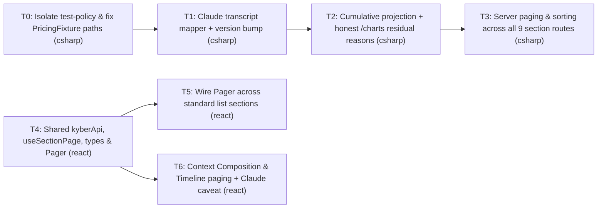

# KyberDash Session Detail Paging, Sorting, Context Composition Paging, and Honest Claude Code Context Attribution

**Status: Ready.**

## Request

````markdown
# KyberDash session detail: paging and sort on every list, Context Composition paging, honest Claude Code composition

## Why
On the session detail page (web dashboard, `dash/web`), the list sections behave inconsistently. Some have paging, some don't, and none can be sorted. The Context Composition card renders every turn at once, so long sessions are one huge scroll. Separately, for Claude Code sessions the composition chart attributes about 100% of every turn to "Residual (drift / framing)". Only 5 tokens show as conversation history, so the chart says nothing about what fills the context.

## Scope

### Part 1: paging and sorting on every list in the session detail page
Every section on the session detail page that lists anything gets:
- **Page size selector: 25 / 50 / 100** (default 25). The choice persists per section for the browser session.
- **Paging** with the shared `Pager` (`dash/web/src/components/ui/Pager.tsx`). Show the controls whenever the list has items, so the page-size selector stays reachable even when the list fits on one page.
- **Sort order toggle: newest first / oldest first** (default newest first). Changing the sort or the page size returns to page 1.
- **Paging and sorting on the server**, not in the browser. Extend the section routes so they take `page`, `limit` (25/50/100 only) and `order` (`asc|desc`) and return `total`. Read them through the existing `useSectionPage` hook (`dash/web/src/components/session/useSectionPage.ts`) so the query key carries page, limit and order.

Sections to cover. Audit each; add whatever is missing:
- `components/session/`: `SessionSummarySection`, `SessionCostSection`, `SessionChartsSection`, `SessionToolsSection`, `SessionSkillsSection`, `SessionKwSkillsSection`, `SessionServersSection`, `SessionRequestsSection`, `SessionProblemsSection`, `SessionReconciliationSection`, `SessionTimelineSection` (timeline and call tree).
- `SkillsPanel.tsx` and `SchemaCostRanking.tsx` where they render inside the session page.
- **Context Composition** (`dash/web/src/components/SessionSpendCharts.tsx`): page the turn list in both views, Stacked Bars and Heatmap Matrix. It has never been paged.

Ordering meaning: "oldest first" = chronological by the item's timestamp, or turn index for turns. Where a list has no time, say in the PR what order it uses.

### Part 2: Claude Code context composition shows 100% residual
For Claude Code sessions, every turn in Context Composition is about 100% "Residual (drift / framing)" (127K–140K tokens), with only "Conversation history: 5" attributed. Find why the C# Claude Code import (`dash/server/`: the Claude Code transcript parser, the part-to-bucket mapping, and the tokenizer seam that sizes buckets) leaves the buckets empty. Fix it so that:
- User messages, assistant messages, tool calls and tool results land in their buckets.
- Residual is the true gap. Claude Code transcripts (`~/.claude/projects/<project>/<session>.jsonl`, plus `subagents/agent-*.jsonl`) do not contain the system prompt or the tool schemas. Those stay residual, and the card states that reason instead of implying everything is unknown.

## Constraints
- Branch from a fresh `origin/main`. Follow `AGENTS.md`: its gates must pass, and use CodeGraph and kw-docs before grep.
- Unit tests run in memory through interfaces. Slow disk or process tests go in the `*.Integration.Tests` projects.
- Keep paging and sorting in one shared place (the hook plus the server window), not one implementation per section.
- Other open work, read before editing nearby code:
  - PR #721: Claude Code `record.span_id` UNIQUE import failures (record insert path).
  - PR #722: Claude Code skill collection (Claude Code parser).
  - The update and version-restart fix (`SelfUpdater.cs`, `MenubarService.cs`, `DashCommandLine.cs`, tray supervisor). Don't touch these files.

## Done when
- Every list section on the session detail page, Context Composition included, offers 25/50/100 page sizes, paging and a newest/oldest toggle. Each is served by the server, with component tests covering page change, page-size change and order change.
- A real Claude Code session shows its message, tool-call and tool-result buckets after a refresh. Residual is no longer about 100%, and the card explains what stays residual.
- Gates pass, and the PR title carries the harness name (e.g. `[cursor]` or `[agy]`). PR goes draft → ready, then the Kilo review loop. Do not merge.
````

## Problem and goal

On the KyberDash session detail page (`dash/web/src/components/AgentSessionDashboard.tsx`), list sections have inconsistent pagination, no page-size persistence, no sort order toggle, and no server-side paging on Context Composition (`SessionChartsSection` / `SessionSpendCharts`) or unified pagination on `SessionTimelineSection` (Call Tree and Duration Timeline). Furthermore, `SchemaCostRanking.tsx` client-sorts `tools` when schema metrics are absent, existing backend section routes clamp `limit` to `25` and hardcode ascending SQL/LINQ order, and `Pager.tsx` hides completely when a list fits on one page.

Separately, Claude Code sessions display ~100% "Residual (drift / framing)" and tiny "Conversation history" counts in Context Composition because: (1) `ClaudeTranscriptMapper` emits only single-group delta parts while `CanonSessionProjectorEngine` carries forward only `system_prompt` (`lastSystem`) across cumulative Anthropic prompt turns, dropping prior user, assistant, `tool_use`, and `tool_result` history; (2) `IsMatchingClaudeUsage` splits streamed assistant lines with identical `message.id` as usage counters grow, causing `BuildRecords` to discard subsequent chunks on `seenRecordIds.Add`; (3) `tool_use` blocks emit zero `CollectedContentPart` items; (4) >64 KiB plain-text truncation drops full `MeasuredTokens` when `Withheld` is left null; (5) `compact_boundary` / `isCompactSummary` and `isSidechain` / `agentId` (`subagents/agent-*.jsonl`) separation are missing; (6) stale `canon.db` checkpoints remain pinned at `ParserContractVersion = "1"`; and (7) `/charts` `context` and `ContextCaveat` omit transcript-unmeasurable explanations (`system_prompt` and tool schemas) and misclassify high residual as proxy drift.

The goal is:
1. Deliver consistent server-side `page`, strict `limit` (`25`/`50`/`100`, default `25`), and `order` (`desc` newest first default / `asc` oldest first) across every session detail list section and `/charts` Context Composition (Stacked Bars and Heatmap Matrix), driven by one shared backend paging window and one shared `useSectionPage` hook + `<Pager>` control bar visible whenever `total > 0`, with page resets on limit/order changes and per-section `sessionStorage` page-size persistence.
2. Reconstruct accurate, cumulative per-turn Claude Code context composition on refresh without double-counting, while isolating subagents, preserving >64 KiB token counts, bumping Claude's parser contract version, and surfacing honest explanations for omitted system prompt and tool schema buckets.

## Request trace

| Request instruction | Covered by | Evidence that it is met |
|---|---|---|
| Page size selector `25 / 50 / 100` (default `25`), persisted per section for the browser session | D1, D2, T3, T4, T5, T6 | `useSectionPage` stores per-section `limit` in `sessionStorage`, validates `{25,50,100}`, defaults to `25`; `T4`–`T6` UI tests verify persistence and selector behavior |
| Shared `Pager` (`dash/web/src/components/ui/Pager.tsx`) shown whenever list has items so selector stays reachable on 1-page lists | D2, D3, D9, T4, T5, T6 | `Pager` renders `list-pager` when `total > 0` whenever `onLimitChange`/`onOrderChange` are supplied; verified in `Pager.test.tsx` and section component tests |
| Sort order toggle: newest first / oldest first (default newest first); changing sort or page size resets to page 1 | D4, D7, D8, D9, T3, T4, T5, T6 | `useSectionPage` defaults `order` to `'desc'`, resets `page` to `1` on `setLimit` and `setOrder`, resets timeline `levelPages` and `expandedIds` on change; verified in unit and UI tests |
| Server-side paging and sorting (`page`, `limit` `25/50/100` only, `order` `asc\|desc`, return `total`) via `useSectionPage` query key with `page`, `limit`, `order` | D4, D5, D6, T3, T4 | `DashEndpointMappings.ReadSectionPageWindow` rejects invalid `limit`/`order` with HTTP 400 (`DashHttp.Error` `{"error": "..."}`); `SqliteRelationalStore`, `InMemoryRelationalStore`, and `KyberBridgeEngine` sort/slice server-side; `SchemaCostRanking` drops client `.sort`; `kyberSessionSectionQueryKey` includes `[sessionId, section, page, limit, order]` |
| Audit `SessionSummarySection`, `SessionCostSection`, `SessionChartsSection`, `SessionToolsSection`, `SessionSkillsSection`, `SessionKwSkillsSection`, `SessionServersSection`, `SessionRequestsSection`, `SessionProblemsSection`, `SessionReconciliationSection`, `SessionTimelineSection` (timeline and call tree), `SkillsPanel.tsx`, `SchemaCostRanking.tsx` | D6, D10, Investigation findings, T3, T4, T5, T6 | `SessionSummarySection` and `SessionCostSection` confirmed non-list in Investigation findings (`PR note:`); remaining 9 section components plus `SkillsPanel`, `SchemaCostRanking`, and `SessionSpendCharts` receive server paging + `Pager` |
| Page Context Composition (`SessionSpendCharts.tsx`) in both Stacked Bars and Heatmap Matrix views | D5, T3, T6 | `/charts` pages & sorts `context.turns` while preserving whole-session `turns` and `context` summary aggregates; `ContextCompositionChart` renders `<Pager>` across both view modes using whole-session `observedBuckets`/`observedServers` for legends |
| Ordering meaning (`oldest first` = timestamp / turn index; non-timestamped lists stated in PR) | D7, Out-of-scope boundaries, T3 | Timestamped/turn-indexed routes sort chronologically (`desc`/`asc`, non-null timestamps first for problems); ranked routes (`tools`, `servers`, `skills`) sort by primary schema-token/unused/invocation rank with deterministic tiebreaker and `PR note:` disclosure |
| Fix C# Claude Code import (`ClaudeTranscriptMapper`, part-to-bucket mapping, projector/context seam) so user, assistant, `tool_use`, and `tool_result` land in their buckets | D11, D12, D13, T1, T2, T3 | Streaming `message.id` chunks merge across growing usage; `tool_use` emits measured `conversation_history` parts; >64 KiB plain text splits cleanly on `<system-reminder>` boundaries into `Withheld` continuation chunks measuring only the remainder tail; compaction folds `AgentInstanceId = "claude:compact_boundary"` through `CanonRecordHydration.Hydrate`; subagents isolate to `${parentSessionId}#agent-{bareId}` with parent linkage preserved; `ParserContractVersion` bumps to `"2"`; cumulative history projects in linear O(T) pass |
| Keep omitted system prompt & tool schemas residual and state that reason on Context Composition card | D12, T2, T6 | `KyberBridgeEngine.BuildContextPayload` emits `missingBuckets` + `residualReasons` from `CanonSynth.MeasurabilityFor(harness)`; `ContextCaveat` and `ContextCompositionChart` display omission reasons instead of `heavyDrift` proxy-drift blame |
| In-memory unit tests, shared hook/window design, `AGENTS.md` gates pass, awareness of PR #721/#722, untouched updater/tray files, PR workflow (`[harness]` title, real refresh proof, no merge) | D11, D14, Risks, Out-of-scope boundaries, T0–T6 | `T0` isolates `test-policy` from `dash/**` and fixes `PricingFixture` path probing under `--artifacts-path` so `AGENTS.md` task gates pass cleanly; unit tests mock I/O interfaces in memory; `ReadSectionPageWindow` composes existing `ReadPageWindow`/`OffsetStartsThePage` helpers and sections share `useSectionPage`; `SelfUpdater.cs`, `MenubarService.cs`, `DashCommandLine.cs`, and `dash/tray/**` remain untouched; `PR note:` captures live refresh check and PR lifecycle |

## Scale

- `documentation-impact`: `extends-component`
- `impact-components`: `KyberDash`

This change alters KyberDash's `/api/kyber/session/{id}/*` section paging/sort contract (including newly paging `/charts` `context.turns`), web dashboard section data-loading behavior (`useSectionPage` + `Pager` + `sessionStorage`), and Claude Code ingestion/context projection behavior (`ParserContractVersion = "2"`, streaming chunk merge, `tool_use` capture, compaction reset, subagent isolation, and honest omission explanations). Architecture, runbook, and field register documentation under `docs/dash/` require updates at `docs-dev` closeout.

## Decisions

| ID | Question | Answer / decision | Mitigating and supporting information | Status / approval provenance |
|---|---|---|---|---|
| D1 | How is per-section page size persisted in the browser session without duplicating component state? | Persist inside `useSectionPage` via `sessionStorage` key `kyberdash:session-section:limit:${section}`, defaulting to `25` and validating `{25, 50, 100}` inside guarded `try/catch`. | Avoids per-component state loss on tab switch and avoids cross-session `localStorage` leaks. | Accepted (`autonomous`: covered by request & `dash/AGENTS.md`) |
| D2 | Should `Pager.tsx` gain optional page-size and sort-order props or be wrapped externally? | Extend `PagerProps` with optional `limitOptions`, `onLimitChange`, `order`, `onOrderChange`, and `orderLabels`. | Single shared control avoids 11 wrappers while preserving backward compatibility for bare `<Pager>` callers. | Accepted (`autonomous`: covered by shared-hook constraint) |
| D3 | When does `Pager.tsx` render vs return `null`? | Render when `total > 0` whenever `onLimitChange` or `onOrderChange` is passed; hide when `total <= 0`, `limit <= 0`, or legacy single-page with neither callback. | Keeps 25/50/100 and sort reachable on 1-page session lists without breaking bare legacy callers. | Accepted (`autonomous`: covered by request & D2) |
| D4 | How should backend section routes validate `limit` and `order`, and do `/sessions` or `/subagents` change? | Add `ReadSectionPageWindow` (composing existing `ReadPageWindow` / `OffsetStartsThePage` / `sessionId` checks in `DashEndpointMappings`) requiring `limit` in `{25, 50, 100}` (default `25`) and trimmed case-insensitive `order` in `{"desc", "asc"}` (default `"desc"`), returning HTTP `400` (`DashHttp.Error` `{"error": "..."}`) otherwise; apply only to session section routes while leaving `/sessions` & `/subagents` unchanged. | Rejects invalid inputs cleanly per `KW-STD-INPUT-001` instead of silently clamping to `25`, without duplicating validation helpers. | Accepted (`autonomous`: covered by `KW-STD-INPUT-001` & request) |
| D5 | How should `/api/kyber/session/{id}/charts` page Context Composition without distorting whole-session chart math or contradicting ADR 0092? | Amend `docs/adr/0092-dashboard-views-load-by-section-and-page.md` per owner request to page and sort `context.turns` on the server (`total`, `page`, `limit`, `offset`, `order` present in both measurable and unmeasurable responses); compute whole-session `first`, `last`, `flaggedTurns`, `residualTotal`, `measuredInputTotal`, `maxBucketTokens`, `observedBuckets`, `observedServers`, `missingBuckets`, `residualReasons`, and tokenizer labels from unpaged `ctx.Turns` before slicing; preserve 1-based `index = turn.Position + 1` on paged `context.turns`; keep whole-session `turns` for `TurnSpendChart`. | Prevents browser-side slicing, keeps `first`/`last`/inspector turn indices and `Residual %` / Heatmap intensity exact across pages, and keeps ADR 0092 consistent (`dash/AGENTS.md`). | Accepted (`autonomous`: covered by `dash/AGENTS.md` & request) |
| D6 | How is `SchemaCostRanking.tsx` client-side sorting handled? | Remove `.sort(...)` (`sortedTools`) in `SchemaCostRanking.tsx` and render server-returned order directly. | Eliminates client override of server ordering when schema metrics are absent. | Accepted (`autonomous`: covered by `dash/AGENTS.md` & server-sort constraint) |
| D7 | What sort order does `Newest first` (`desc`, default) vs `Oldest first` (`asc`) use per section, including non-timestamped lists and null problem timestamps? | Chronological routes sort `DESC`/`ASC`: `requests` (`position`), `reconciliation` (`position`), `charts` (`context.turns` by `Position`), `timeline` (root & child levels by `StartMs DESC/ASC, SpanId ASC`), `kw-skills` (`started_at_utc, tc.rowid`), and `problems` (`LEFT JOIN ingest_problem_timestamp` sorting non-null timestamps first ordered `DESC`/`ASC`, then null timestamps, tiebreak `problem_id DESC/ASC` identically in SQLite and `InMemoryRelationalStore`). Ranked non-timestamped routes sort: `skills` by `invocations` (`DESC`/`ASC`, tiebreak `name ASC`); `tools` by `TotalSchemaCost` (`total_schema_cost`, schema token residency per `docs/rules/secondary-cost-display.md`, not dollar cost) then `Invocations` (`DESC`/`ASC`, tiebreak `name ASC`); `servers` by `UnusedCost` then `totalSchemaCost` then `Invocations` (`DESC`/`ASC`, tiebreak `server ASC`). PR notes clarify ranked semantics. | Summary DTOs carry per-session aggregates without timestamps and `OtlpLogMapper` can emit null-timestamp problems; explicit secondary keys and null-timestamp rules keep SQLite and in-memory stores deterministic. | Accepted (`autonomous`: low reversal cost, covered by request & `docs/rules/secondary-cost-display.md`) |
| D8 | How do `SessionTimelineSection` Call Tree and Duration Timeline coordinate `limit`, `order`, and expanded child levels? | Drive root timeline via `useSectionPage('timeline', ...)`, share one `<Pager>` across both views, pass `limit`/`order` into child `useQueries`, and reset both `levelPages` and `expandedIds` whenever `limit`, `order`, or root `page` changes. | Keeps both timeline views consistent and prevents stale child caches or mismatched expanded branches. | Accepted (`autonomous`: low reversal cost, covered by shared-hook constraint) |
| D9 | Which existing test expectations intentionally shift under the new defaults and contract? | Authorize updating expectations for `desc` default (`SessionSectionEndpointsTests`, `SessionKwSkillLoadsTests`, `SqliteRelationalStoreReadTests`), HTTP `400` `{"error": "..."}` / `limit=25&order=desc` route mock signatures (`MinimalApiEndpointTests`, `AnalyticsReadPathTests`, `AnalyticsOperationsDetailTests`, `ApplicationParityTests`), `&limit=25&order=desc` URLs (`kyberApi.sections.test.ts`, `AgentSessionDashboard.test.tsx`), single-page `<Pager>` visibility (`Session*Section.test.tsx`, `SchemaCostRanking.test.tsx`, `SkillsPanel.test.tsx`), root `timeline-level-more` load-more -> `<Pager>` transition (`SessionTimelineSection.test.tsx`), and `tool_use` `Parts.Count` (`ClaudeTranscriptMapperTests`). | Explicitly records contract shifts under `plan-authoring.md` rather than relaxing invariants silently. | Accepted (`autonomous`: covered by request contract changes) |
| D10 | Which sibling panels and routes are outside this plan's scope? | `SessionSummarySection` and `SessionCostSection` have zero lists (unchanged); `/sessions`, `ContextExplorer` `/subagents`, and `StoredFieldsPanel` keep existing paging (`PR note:`). | Confirmed by inspecting `AgentSessionDashboard.tsx` and panel components. | Accepted (`autonomous`: covered by audit & `change-scope`) |
| D11 | How does `ClaudeTranscriptMapper` fix streaming loss, missing `tool_use` parts, >64 KiB truncation, compaction, subagents, and stale checkpoints alongside PR #721/#722? | Coalesce streamed assistant entries sharing non-empty `message.id` across advancing usage (retain earliest `RecordId` for PR #721 `span_id` safety, preserve PR #722 skill extraction); emit `tool_use` `ConversationHistory` parts measured via `ToolContentMeasurer`; for >64 KiB non-document text split on intact `<system-reminder>...</system-reminder>` boundaries (cutting before an unclosed tag or extracting complete blocks) plus ONE `Withheld` continuation part measuring **only the unretained remainder tail** via `ToolContentMeasurer.Measure`; fold `compact_boundary`/`isCompactSummary` onto the next kept `llm.invoke` turn via `CollectedRecord.AgentInstanceId = "claude:compact_boundary"` (already persisted/round-tripped in `record_agent_instance` with no schema change); resolve `parentSessionId` from `line.SessionId` or directory above `subagents/` and isolate sidechain/subagent records to `${parentSessionId}#agent-{bareId}`; bump Claude `ParserContractVersion` to `"2"`. | Satisfies `CollectedContentPart` XOR rule, prevents double-counting the first 64 KiB in `AnalyzeContext`, preserves SQLite compaction hydration with zero schema change, links subagents to parent sessions, and triggers automatic re-ingest on refresh. | Accepted (`autonomous`: medium reversal cost, isolated to parser seam; respects PR #721/#722) |
| D12 | How is cumulative multi-turn Claude context reconstructed and explained without estimating? | In `CanonRecordHydration.Hydrate`, surface `AgentInstanceId == "claude:compact_boundary"` onto `CanonicalRecord.Raw["claude.compact_boundary"]` without emitting synthetic `ContentPart` text; in `CanonSessionProjectorEngine.BuildStoredSessionProjection`, recognize `#agent-` subagent keys (`IsSubagent = true`, `ParentSessionId`), exclude subagent turns from parent context, and accumulate prior turns `< k` (`system_prompt`, `instruction_context`, `conversation_history`, `tool_result_content`) since `"claude.compact_boundary"` in a linear `O(T)` pass using pre-reduced/pre-counted summary `ContextPart`s (`Derived = true`, `Text = string.Empty`) rather than quadratic re-tokenization; derive `/charts` `missingBuckets` and `residualReasons` from existing `CanonSynth.MeasurabilityFor(harness)`, render omission reasons in `ContextCaveat`/footer, suppress `heavyDrift` ("proxy is a poor fit") when omission telemetry explains residual share, and build chart legend/server flags from whole-session `observedBuckets`/`observedServers`. | Exact linear reconstruction with zero heuristic multipliers (`docs/rules/honest-unobservability.md`) and accurate legends/explanations across paged charts views. | Accepted (`autonomous`: covered by `docs/rules/honest-unobservability.md` & request) |
| D13 | Does this plan add a SQLite schema migration? | No (`SchemaVersion` remains unchanged). | Existing `record_agent_instance` and sort tables already hold all required columns; `ParserContractVersion = "2"` handles stale data refresh. | Accepted (`autonomous`: covered by repository code inspection) |
| D14 | How should the task-gate `test-policy` selection and `PricingFixture` path resolution failures under `--artifacts-path` be resolved before `T1`–`T3` execute? | Add prerequisite task `T0` (`csharp`, `easy`, `depends-on: []`) before `T1`: define `&net-policy-paths` in `.kyber-weave/kyber-weave.yml` so `dash/**` does not trigger `test-policy` and remove `--no-build` from `&test-policy`; strengthen `TaskGatesRepositoryConfigTests` to assert `dash/server/**` and `dash/server.tests/**` do not select `test-policy`; update `PricingFixture.PricingDirectory()` in both `KyberDash.Application.Tests` and `KyberDash.Domain.Tests` to probe both `server/KyberDash.Data/Pricing` and `dash/server/KyberDash.Data/Pricing`. | Keeps council `review.gates` `*net-test-paths` intact for `ReviewTaskGatesRepositoryConfigTests.TestPolicyGateIsSelectedExactlyWhereTheBuildGateIs`, avoids unbuilt `RepoPolicy.Tests` failures when policy-only files skip `dotnet-build`, and unblocks `[ModuleInitializer]` `PricingFixture` loading under `--artifacts-path .agent_scratchpad/{task}/artifacts`. | Accepted (`MEDITATION_DECISION: Accept Option A`; `autonomous`: covered by `.kyber-weave/kyber-weave.yml` & `TaskGatesRepositoryConfigTests`) |
| AP1 | Approve and execute | Approved for execution as planned. | Recorded at finalization from conductor `AUTONOMOUS_APPROVAL` under resolved `autonomy: autonomous`, including `D14` and `T0`, without altering other tasks, file scopes, test rows, or commands. | ANSWERED: autonomous: recommendation accepted, 2026-11-25 |

## Design harvest

| Target component | Target doc type | Section | Content to harvest |
|---|---|---|---|
| KyberDash | `adr` | `docs/adr/0092-dashboard-views-load-by-section-and-page.md` | Amend ADR 0092 (`Decision` and `Read Model Register` references) to allow server-side paging and sorting of `/api/kyber/session/{id}/charts` `context.turns` (`page`, `limit`, `offset`, `order`, `total`) while keeping whole-session `turns` and context summary aggregates unpaged (`D5`). |
| KyberDash | `architecture` | `Backend REST API contract (dash/server/KyberDash.Api/Endpoints/DashEndpointMappings.cs)`, `Read Model Register`, and `Web dashboard data loading by section and page` | Section endpoints enforce `limit` in `{25, 50, 100}` (default `25`) and `order` in `{desc, asc}` (default `desc`, returning HTTP `400` `{"error": "..."}` otherwise); `/charts` pages & sorts `context.turns` while preserving whole-session `turns` and context aggregates (`first`, `last`, `measuredInputTotal`, `maxBucketTokens`, `observedBuckets`, `observedServers`, `missingBuckets`, `residualReasons`); `useSectionPage` persists per-section `limit` in `sessionStorage` and renders `<Pager>` whenever `total > 0` (`D1`–`D7`, `D10`). |
| KyberDash | `architecture` | `Collector attribution and read-side API projection` | Document Claude Code transcript streaming `message.id` merge, `tool_use` content part attribution, >64 KiB `<system-reminder>`-safe `Withheld` tail chunking, `AgentInstanceId = "claude:compact_boundary"` compaction hydration/reset, subagent isolation to `${parentSessionId}#agent-{bareId}`, `ParserContractVersion = "2"`, linear cumulative multi-turn Claude prompt projection, and `CanonSynth.MeasurabilityFor`-backed `missingBuckets`/`residualReasons` omission explanations (`D11`, `D12`, `D13`). |
| KyberDash | `runbook` | `11. Slow dashboard responses on a large store` | Update section paging size defaults (`25/50/100`), default newest-first sort order, and paged `/charts` `context.turns` notes while noting whole-session spend curve preservation. |
| KyberDash | `reference` | `docs/dash/field-register.md` (`## claude-code`) | Update `ClaudeTranscriptLine` / `ClaudeTranscriptMapper` field register prose and tables for `ParserContractVersion = "2"`, `tool_use` `conversation_history` parts, >64 KiB `Withheld` continuation parts, `AgentInstanceId = "claude:compact_boundary"`, `${parentSessionId}#agent-{bareId}` subagent keys, cumulative prompt reconstruction, and `system_prompt` / tool schema residual attribution (`D11`, `D12`). |

Documentation waiver (local execution, task-gate config, & test-shift provenance): `D8`, `D9`, `D13`, and `D14` capture implementation synchronization, authorized existing-test expectation updates, absence of SQLite schema migration, and local task-gate/test-fixture configuration fixes with no additional long-lived architectural invariant beyond the harvested entries above.

## Investigation findings

- `SessionSummarySection.tsx` (status/source/tokenizer badges, telemetry banner, 12 scalar KPI tiles) and `SessionCostSection.tsx` / `SessionCostPanel.tsx` (cost-basis banner + per-model breakdown tiles) contain no pageable list and remain unchanged.
- Divergent patterns found in existing code (to fix directly inside the planned tasks, not copy):
  - `dash/web/src/components/SchemaCostRanking.tsx:185`: client-side `sortedTools` re-sorts `tools` when `schema` metrics are absent; removed in `T5`.
  - `dash/server/KyberDash.Api/Endpoints/DashEndpointMappings.cs`: `ReadPageWindow(..., maxLimit: defaultLimit)` silently clamped requested limits > `25`; section routes move to strict `ReadSectionPageWindow` returning `400 Bad Request` (`DashHttp.Error` `{"error": "..."}`) on invalid `limit`/`order` (`T3`), composing existing validation helpers rather than copying them.
  - `dash/web/src/components/session/SessionChartsSection.tsx` & `SessionTimelineSection.tsx`: bypassed `useSectionPage`; migrated in `T6`.
- Host test configuration in `.kyber-weave/kyber-weave.yml`: `technology-gates` for `csharp` runs `dash-format-whitespace`, `dash-format-style`, `dash-build`, `dash-unit-application`, and `dash-unit-domain` (omitting `KyberDash.Data.Tests` and `KyberDash.Presentation.Tests`); `technology-gates` for `react` runs `dash-typecheck`, `dash-lint`, and `tray-ui-typecheck` (omitting Vitest and `check:reachable`). Full Vitest (`ts-test`) and tray (`cargo-test`) carry `full-suite: true` for review council / CI (`AGENTS.md`), and `dash-server-test` runs whole-solution `KyberDash.sln` (prohibited for dev agents under `AGENTS.md`). Therefore `T1`, `T3`, and `T4`–`T6` declare targeted per-project `dotnet test` (`.agent_scratchpad/<task>/artifacts`) and `npm --prefix dash run test:related` + `check:reachable` commands directly inside `Commands:` alongside `task-gate` runs.
- Task-gate `test-policy` and `PricingFixture` findings (`T0`):
  - In `.kyber-weave/kyber-weave.yml`, `&test-policy` under `review.technology-gates.csharp` (aliased into `dev-easy`, `dev-medium`, `dev-hard`, `test-dev`) used `*net-test-paths` (which includes `**/*.cs`, `**/*.csproj`, `**/*.props`, `**/*.targets`, `**/*.sln*`, `**/NuGet.config`, `**/.editorconfig`) with `--no-build`, while `dotnet-build` used `*net-build-paths` (`src/**`, `tests/**`). Changes under `dash/server/**` or `dash/server.tests/**` therefore triggered `test-policy` without triggering `dotnet-build`, failing against unbuilt `.agent_scratchpad/{task}/artifacts`, and `TaskGatesRepositoryConfigTests.CsharpRunsTheKyberDashGatesForAKyberDashChange` only asserted exclusion of `KyberWeave.sln` arguments rather than `test-policy`. Defining `&net-policy-paths` (scoped off `dash/**` while preserving `review.gates` `*net-test-paths` for `ReviewTaskGatesRepositoryConfigTests.TestPolicyGateIsSelectedExactlyWhereTheBuildGateIs`) and dropping `--no-build` from `&test-policy` resolves both.
  - `PricingFixture.PricingDirectory()` in both `dash/server.tests/KyberDash.Application.Tests/PricingFixture.cs` and `dash/server.tests/KyberDash.Domain.Tests/PricingFixture.cs` walked up from `AppContext.BaseDirectory` checking only `server/KyberDash.Data/Pricing/litellm-snapshot.json`; under `--artifacts-path .agent_scratchpad/{task}/artifacts`, `AppContext.BaseDirectory` parents reach repo root without crossing `dash/`, failing `[ModuleInitializer]` `PricingFixture.Initialize()`. Sibling `E2eSeederWorldTests` and `LegacyColumnAbsenceTests` already probe from repo root (`dash/...`); probing both `server/...` and `dash/server/...` aligns `PricingFixture`.
- Worktree note: the conductor prompt listed `...-paging-sort-claude-composition`, whereas the actual git worktree directory on disk is `...-paging-claude-composition` (`antigravity/feat/session-detail-paging-claude-composition`, rev `f4f6b2f7`).
- `Discovery: codegraph 41, docs 21, direct reads 82 (28 initial planning + 33 prior remediation reads + 21 T0 revision reads: 10 config/plan/csproj/AGENTS/standards-continuation reads + 11 C# reads where CodeGraph omitted or truncated symbols or to verify sibling path-probing and repository-policy test assertions)`.

## Test contract (development-mode: test-first)

| Task | Test project or file | Runner command | Observable behavior | RED evidence required | GREEN acceptance |
|---|---|---|---|---|---|
| T0 | `tests/KyberWeave.RepoPolicy.Tests/TaskGatesRepositoryConfigTests.cs` (`KyberWeave.Tests.TaskGatesRepositoryConfigTests`), `dash/server.tests/KyberDash.Application.Tests/PricingFixture.cs` (`KyberDash.Application.Tests.ApplicationParityTests`), `dash/server.tests/KyberDash.Domain.Tests/PricingFixture.cs` (`KyberDash.Domain.Tests.CanonAnalysisTests`) | `dotnet test tests/KyberWeave.RepoPolicy.Tests/KyberWeave.RepoPolicy.Tests.csproj -c Release --artifacts-path .agent_scratchpad/T0/artifacts --filter "FullyQualifiedName~KyberWeave.Tests.TaskGatesRepositoryConfigTests" && dotnet test dash/server.tests/KyberDash.Application.Tests/KyberDash.Application.Tests.csproj -c Release --artifacts-path .agent_scratchpad/T0/artifacts --filter "FullyQualifiedName~KyberDash.Application.Tests.ApplicationParityTests" && dotnet test dash/server.tests/KyberDash.Domain.Tests/KyberDash.Domain.Tests.csproj -c Release --artifacts-path .agent_scratchpad/T0/artifacts --filter "FullyQualifiedName~KyberDash.Domain.Tests.CanonAnalysisTests"` | Normal: `TaskGatesRepositoryConfigTests` verifies `dash/server/**` (`dash/server/KyberDash.Core/X.cs`) and `dash/server.tests/**` (`dash/server.tests/KyberDash.Domain.Tests/XTests.cs`) select `dash-build`, `dash-unit-application`, and `dash-unit-domain`, select zero `KyberWeave.sln` gates, and do NOT select `test-policy` across `csharp` and developer tiers (`dev-easy`, `dev-medium`, `dev-hard`); policy files (`tests/KyberWeave.RepoPolicy.Tests/X.cs`, `.kyber-weave/kyber-weave.yml`, `scripts/fast-loop.sh`) continue selecting `test-policy` without `--no-build`; `PricingFixture.PricingDirectory()` probes both `server/KyberDash.Data/Pricing` and `dash/server/KyberDash.Data/Pricing` so `PricingFixture.Initialize()` and `EnsureInstalled()` succeed under both standard `bin/` output and `--artifacts-path .agent_scratchpad/T0/artifacts`. Missing pricing directory still throws `DirectoryNotFoundException`; auth/endpoint access N/A (repo-policy & test-fixture checks). | Strengthened `TaskGatesRepositoryConfigTests` fails asserting `test-policy` is excluded for `dash/server/KyberDash.Core/X.cs` and `dash/server.tests/KyberDash.Domain.Tests/XTests.cs` before `.kyber-weave/kyber-weave.yml` defines `&net-policy-paths`; running `ApplicationParityTests` and `CanonAnalysisTests` with `--artifacts-path .agent_scratchpad/T0/artifacts` fails in `PricingFixture.Initialize()` with `DirectoryNotFoundException` before `PricingFixture.cs` probes `dash/server/...`. | `KyberWeave.Tests.TaskGatesRepositoryConfigTests`, `KyberDash.Application.Tests.ApplicationParityTests`, `KyberDash.Domain.Tests.CanonAnalysisTests`, and `kyber-weave review gates . --agent <you> --task T0` (`review-config`, `dotnet-build`, `test-policy`, `dash-build`, `dash-unit-application`, `dash-unit-domain`) pass with non-zero test counts and zero failures. |
| T1 | `dash/server.tests/KyberDash.Data.Tests/Harnesses/ClaudeTranscriptMapperTests.cs` (`KyberDash.Data.Tests.Harnesses.ClaudeTranscriptMapperTests`), `dash/server.tests/KyberDash.Data.Tests/Collector/HarnessSourceRegistryTests.cs` (`KyberDash.Data.Tests.Collector.HarnessSourceRegistryTests`), `dash/server.tests/KyberDash.Data.Tests/Collector/SkillExtractionTests.cs` (`KyberDash.Data.Tests.Collector.SkillExtractionTests`) | `dotnet test dash/server.tests/KyberDash.Data.Tests/KyberDash.Data.Tests.csproj -c Release --artifacts-path .agent_scratchpad/T1/artifacts --filter "FullyQualifiedName~KyberDash.Data.Tests.Harnesses.ClaudeTranscriptMapperTests\|FullyQualifiedName~KyberDash.Data.Tests.Collector.HarnessSourceRegistryTests\|FullyQualifiedName~KyberDash.Data.Tests.Collector.SkillExtractionTests"` | Normal: `tool_use` emits measured `ConversationHistory` `CollectedContentPart`, and user/assistant/`tool_result`/skill parts remain preserved (`SkillExtractionTests` verified); streamed chunks sharing non-empty `message.id` with advancing usage coalesce keeping earliest `RecordId` and latest usage; >64 KiB non-document text splits cleanly on intact `<system-reminder>...</system-reminder>` boundaries (extracting intact blocks or backing up cut before an unclosed tag) plus ONE `Withheld` continuation chunk measured via `ToolContentMeasurer.Measure` over only the unretained remainder tail (never double-counting the first 64 KiB); `compact_boundary` / `isCompactSummary` folds onto the next kept `llm.invoke` turn via `CollectedRecord.AgentInstanceId = "claude:compact_boundary"`; `isSidechain` / `agentId` / `.../subagents/agent-*.jsonl` files resolve `parentSessionId` from `line.SessionId` or the directory immediately above `subagents/` and isolate to `${parentSessionId}#agent-{bareId}`; non-sidechain defaults cleanly; `HarnessSourceRegistry` stamps Claude `ParserContractVersion == "2"`. Empty transcript yields zero records. Auth/endpoint access N/A (pure in-memory parser & registry unit tests). | Fail assertions expecting merged `message.id` usage snapshot, `tool_use` `ConversationHistory` part, intact `<system-reminder>` tail-measured >64 KiB `Withheld` part, `AgentInstanceId = "claude:compact_boundary"` carrier, `${parentSessionId}#agent-{bareId}` subagent isolation, or `ParserContractVersion == "2"`. | All tests in `ClaudeTranscriptMapperTests`, `HarnessSourceRegistryTests`, and `SkillExtractionTests` pass (zero failures, non-zero test count) without weakening assertions beyond D9's authorized `Parts.Count` adjustments. |
| T2 | `dash/server.tests/KyberDash.Application.Tests/Projection/ClaudeContextCompositionTests.cs` (`KyberDash.Application.Tests.Projection.ClaudeContextCompositionTests`, copy setup pattern from `SessionProjectionTests`) and `dash/server.tests/KyberDash.Application.Tests/Projection/SessionProjectionTests.cs` (`KyberDash.Application.Tests.Projection.SessionProjectionTests`) | `dotnet test dash/server.tests/KyberDash.Application.Tests/KyberDash.Application.Tests.csproj -c Release --artifacts-path .agent_scratchpad/T2/artifacts --filter "FullyQualifiedName~KyberDash.Application.Tests.Projection.ClaudeContextCompositionTests\|FullyQualifiedName~KyberDash.Application.Tests.Projection.SessionProjectionTests"` | Normal: multi-turn Claude session Turn `k` accumulates prior turns `< k` (`conversation_history`, `tool_result_content`, `instruction_context`, `system_prompt`) in a linear O(T) pre-reduced pass without counting Turn `k`'s own output inside Turn `k`'s input buckets; `CanonRecordHydration.Hydrate` surfaces `AgentInstanceId == "claude:compact_boundary"` onto `CanonicalRecord.Raw["claude.compact_boundary"]` without emitting synthetic `ContentPart` text, verified across both `InMemoryRelationalStore` and temp-file `SqliteRelationalStore` round-trip hydration -> projection reset to post-compaction turns; `${parentSessionId}#agent-{bareId}` subagents persist `IsSubagent = true` & `ParentSessionId = parentSessionId` while staying excluded from parent context turns; >64 KiB plain + withheld token-conservation assertion matches full-text tokenization without double-counting the first 64 KiB; `GetSessionCharts` derives `missingBuckets` (`system_prompt`, tool definitions) and plain-text `residualReasons` from `CanonSynth.MeasurabilityFor(harness)` for `claude` and omits them for non-omitted harnesses; end-to-end in-memory refresh -> projection -> `GetSessionCharts` yields realistic non-residual turn shares. Empty session returns empty turns safely. Endpoint auth/bad-input normalization covered in `T3`. | Fail assertions checking multi-turn cumulative `ConversationHistory` > delta-only Turn `k` count, >64 KiB plain + withheld token conservation, SQLite & in-memory `AgentInstanceId` compaction hydration/reset, `#agent-` subagent parent linkage & exclusion, or `CanonSynth.MeasurabilityFor`-backed `missingBuckets`/`residualReasons` on `/charts`. | `ClaudeContextCompositionTests` and `SessionProjectionTests` pass (zero failures, non-zero test count). |
| T3 | `dash/server.tests/KyberDash.Presentation.Tests/MinimalApiEndpointTests.cs`, `dash/server.tests/KyberDash.Application.Tests/Sessions/SessionSectionEndpointsTests.cs`, `dash/server.tests/KyberDash.Application.Tests/Sessions/SessionKwSkillLoadsTests.cs`, `dash/server.tests/KyberDash.Application.Tests/Analytics/AnalyticsReadPathTests.cs`, `dash/server.tests/KyberDash.Application.Tests/Analytics/AnalyticsOperationsDetailTests.cs`, `dash/server.tests/KyberDash.Application.Tests/ApplicationParityTests.cs`, `dash/server.tests/KyberDash.Data.Tests/Repositories/SqliteRelationalStoreReadTests.cs` | `dotnet test dash/server.tests/KyberDash.Presentation.Tests/KyberDash.Presentation.Tests.csproj -c Release --artifacts-path .agent_scratchpad/T3/artifacts --filter "FullyQualifiedName~KyberDash.Presentation.Tests.MinimalApiEndpointTests" && dotnet test dash/server.tests/KyberDash.Application.Tests/KyberDash.Application.Tests.csproj -c Release --artifacts-path .agent_scratchpad/T3/artifacts --filter "FullyQualifiedName~KyberDash.Application.Tests.Sessions.SessionSectionEndpointsTests\|FullyQualifiedName~KyberDash.Application.Tests.Sessions.SessionKwSkillLoadsTests\|FullyQualifiedName~KyberDash.Application.Tests.Analytics.AnalyticsReadPathTests\|FullyQualifiedName~KyberDash.Application.Tests.Analytics.AnalyticsOperationsDetailTests\|FullyQualifiedName~KyberDash.Application.Tests.ApplicationParityTests" && dotnet test dash/server.tests/KyberDash.Data.Tests/KyberDash.Data.Tests.csproj -c Release --artifacts-path .agent_scratchpad/T3/artifacts --filter "FullyQualifiedName~KyberDash.Data.Tests.Repositories.SqliteRelationalStoreReadTests"` | Normal: all 9 session section routes (`requests`, `reconciliation`, `problems`, `tools`, `servers`, `skills`, `kw-skills`, `timeline`, `charts`) return top-level `total`, `page`, `limit`, `offset`, `order` (including `/charts` when `context.measurable` is `false` with `total = 0`); options set (`limit=25,50,100`, `order=asc\|desc`, `page>=1`, `parentSpanId`/`level`) vs unset default (`page=1, limit=25, order=desc`); whitespace/mixed-case `order` normalized (`" ASC "` -> `"asc"`) while blank/unknown `order` (`"sideways"`) and non-`{25,50,100}` `limit` (`10`, `500`) reject with HTTP `400` `DashHttp.Error` `{"error": "..."}`; unknown session returns `404`; empty section list returns `items: []`, `total: 0`; `/charts` computes `first`, `last`, `flaggedTurns`, `residualTotal`, `measuredInputTotal`, `maxBucketTokens`, `observedBuckets`, `observedServers`, `missingBuckets`, `residualReasons`, and tokenizer labels from unpaged `ctx.Turns` before slicing `context.turns`, preserving 1-based `index = turn.Position + 1` in both `desc` and `asc`; `problems` joins `ingest_problem_timestamp` sorting non-null timestamps first (`DESC`/`ASC`) then null timestamps (`problem_id` tiebreak) identically in SQLite & in-memory; ranked routes sort `skills` by `invocations`, `tools` by `TotalSchemaCost` then `Invocations`, and `servers` by `UnusedCost` then `totalSchemaCost` then `Invocations` (`DESC`/`ASC`, tiebreak name ASC); SQLite persists & round-trips `AgentInstanceId = "claude:compact_boundary"`; all existing `MinimalApiEndpointTests` route mocks updated for `order = "desc"`. Loopback local API uses no bearer auth policy. | Fail on missing `order` parameter/property, `limit=50` clamping or `limit=500` not returning `400` `{"error": "..."}`, `/charts` missing unmeasurable top-level window / unpaged `first` & `last` / 1-based `index`, null-timestamp `problems` SQLite vs in-memory divergence, or `asc` default order on section stores. | All 7 test classes across Presentation, Application, and Data projects pass (zero failures, non-zero test count). |
| T4 | `dash/web/src/lib/kyberApi.sections.test.ts`, `dash/web/src/components/session/useSectionPage.test.tsx`, `dash/web/src/components/ui/Pager.test.tsx`, `dash/web/src/components/AgentSessionDashboard.test.tsx` | `npm --prefix dash run test:related -- web/src/lib/kyberApi.sections.test.ts web/src/components/session/useSectionPage.test.tsx web/src/components/ui/Pager.test.tsx web/src/components/AgentSessionDashboard.test.tsx && npm --prefix dash run check:reachable` | Normal: `KyberSectionPageLimit`, `KyberSectionPageOrder`, and `KyberSessionChartsSection` (extending `KyberSectionWindow`) live in `kyberApi.ts` and are re-exported by `session/types.ts`; `kyberSessionSectionQueryKey` includes `[sessionId, section, page, limit, order]`; `sectionPath` and `fetchKyberSession*` (including `fetchKyberSessionCharts` and `fetchKyberSessionTimeline`) send `page`, `limit`, `order`; `useSectionPage` persists `limit` in `sessionStorage` per section, defaults `limit=25` / `order='desc'`, resets invalid stored sizes (`"30"`, non-numeric, throws on `sessionStorage`) to `25`, resets `page` to `1` on `setLimit`/`setOrder`; `Pager` shows page-size selector + sort toggle when `total > 0` with callbacks even if `total <= limit`, still hides when `total === 0` or bare single-page legacy usage without limit/order handlers. | Fail assertions checking `&limit=50&order=asc`, query key containing `limit`/`order`, `sessionStorage` per-section persistence, page reset to `1`, or visible single-page controls when callbacks supplied. | All tests across all 4 Vitest files and `check:reachable` pass (non-zero count, zero failures). |
| T5 | `dash/web/src/components/SchemaCostRanking.test.tsx`, `dash/web/src/components/SkillsPanel.test.tsx`, `dash/web/src/components/session/SessionToolsSection.test.tsx`, `dash/web/src/components/session/SessionServersSection.test.tsx`, `dash/web/src/components/session/SessionSkillsSection.test.tsx`, `dash/web/src/components/session/SessionKwSkillsSection.test.tsx`, `dash/web/src/components/session/SessionRequestsSection.test.tsx`, `dash/web/src/components/session/SessionReconciliationSection.test.tsx`, `dash/web/src/components/session/SessionProblemsSection.test.tsx` | `npm --prefix dash run test:related -- web/src/components/SchemaCostRanking.test.tsx web/src/components/SkillsPanel.test.tsx web/src/components/session/SessionToolsSection.test.tsx web/src/components/session/SessionServersSection.test.tsx web/src/components/session/SessionSkillsSection.test.tsx web/src/components/session/SessionKwSkillsSection.test.tsx web/src/components/session/SessionRequestsSection.test.tsx web/src/components/session/SessionReconciliationSection.test.tsx web/src/components/session/SessionProblemsSection.test.tsx && npm --prefix dash run check:reachable` | Each of the 9 list/table sections + reusable panels handles page change (`page=2`), page-size change (`25 -> 50 -> 100`, resetting to `page=1` and persisting per section), sort toggle (`Newest first` <-> `Oldest first`, resetting to `page=1`), renders controls even on 1-page non-empty results (`total > 0`), hides cleanly on empty results (`total === 0`), and `SchemaCostRanking` preserves server-provided `tools` order without client re-sorting. | Fail assertions testing page-size change, order toggle, page-1 reset, single-page control visibility on `total > 0`, and server-order preservation in `SchemaCostRanking`. | All tests across all 9 Vitest files and `check:reachable` pass (non-zero count, zero failures). |
| T6 | `dash/web/src/components/session/SessionChartsSection.test.tsx`, `dash/web/src/components/SessionSpendCharts.test.tsx`, `dash/web/src/components/session/SessionTimelineSection.test.tsx` | `npm --prefix dash run test:related -- web/src/components/session/SessionChartsSection.test.tsx web/src/components/SessionSpendCharts.test.tsx web/src/components/session/SessionTimelineSection.test.tsx && npm --prefix dash run check:reachable` | `SessionChartsSection` uses `useSectionPage('charts', ...)` and drives `<Pager>` across BOTH Context Composition Stacked Bars and Heatmap Matrix (page change, `25`/`50`/`100` page-size change, newest/oldest order change resetting to page `1`, single-page `total > 0` reachable, empty `total === 0` hidden); `Residual %`, `legendSegments`, `hasServerAttribution`, and heatmap scale use whole-session `measuredInputTotal`, `maxBucketTokens`, `observedBuckets`, and `observedServers` consistently across pages; `ContextCaveat` and card footer display `residualReasons`/`missingBuckets` explaining omitted Claude system prompt & tool schemas plainly and suppress `heavyDrift` ("proxy is a poor fit") copy when harness omission telemetry explains the residual share; `SessionTimelineSection` shares `useSectionPage('timeline', ...)` + `<Pager>` across Call Tree & Duration Timeline, propagates `limit` & `order` to expanded children, resets `levelPages` and `expandedIds` on `limit`/`order`/`page` changes, and updates root `timeline-level-more` tests to `<Pager>` controls. | Fail assertions on Context Composition paging in Stacked Bars & Heatmap Matrix, whole-session `observedBuckets`/`observedServers` legend stability, `heavyDrift` suppression with `residualReasons`, whole-session residual % invariance, or Timeline Call Tree / Duration Timeline `limit`/`order` + `expandedIds` reset. | All tests across all 3 Vitest files and `check:reachable` pass (non-zero count, zero failures). |

## Tasks

### T0: Isolate `test-policy` from `dash/**` and fix `PricingFixture` path resolution under `--artifacts-path`

- **Objective:** Prevent `dash/**` changes from triggering `test-policy` without `dotnet-build` and allow `PricingFixture` in `KyberDash.Application.Tests` and `KyberDash.Domain.Tests` to locate `dash/server/KyberDash.Data/Pricing` when tests run under `--artifacts-path`.
- **Capabilities:** Repository gate YAML configuration, repository-policy xUnit assertions, and C# test-fixture path probing.
- **Difficulty:** easy
- **Technology:** csharp
- **Session:** task-gate-setup
- **Depends on:** none
- **Files:**
  - `.kyber-weave/kyber-weave.yml`: `review.technology-gates.csharp` (`&test-policy`, `&net-policy-paths`) — define `&net-policy-paths` (covering KyberWeave C# sources, tests, project files, props and targets, `KyberWeave.sln*`, root/KyberWeave `NuGet.config` and `.editorconfig`, `global.json`, review config, `apm.yml`, `.apm`, `products`, `REVIEW.md`, and `scripts` while excluding KyberDash paths per `D14`) on `&test-policy` instead of `*net-test-paths`, and remove `--no-build` from `&test-policy` `run` argv so policy-only edits build `KyberWeave.RepoPolicy.Tests` under `.agent_scratchpad` per-task artifacts without changing council `review.gates` `*net-test-paths` (`D14`).
  - `tests/KyberWeave.RepoPolicy.Tests/TaskGatesRepositoryConfigTests.cs`: `TaskGatesRepositoryConfigTests.CsharpRunsTheKyberDashGatesForAKyberDashChange`, `TaskGatesRepositoryConfigTests.CsharpRunsThePolicyTestsForAPolicyTestChange` — strengthen assertions so KyberDash server and server-test C# changes do not select `test-policy`, while policy test, review config, and shell script changes still select `test-policy` and `&test-policy` omits `--no-build` (`D14`).
  - `dash/server.tests/KyberDash.Application.Tests/PricingFixture.cs`: `PricingFixture.PricingDirectory` — probe both the relative `server` and repo-root `dash` `server` `KyberDash.Data` `Pricing` directories for `litellm-snapshot.json` while walking parent directories from `AppContext.BaseDirectory`, so `--artifacts-path` resolves cleanly alongside standard output layouts (`D14`).
  - `dash/server.tests/KyberDash.Domain.Tests/PricingFixture.cs`: `PricingFixture.PricingDirectory` — probe both the relative `server` and repo-root `dash` `server` `KyberDash.Data` `Pricing` directories for `litellm-snapshot.json` while walking parent directories from `AppContext.BaseDirectory`, matching `KyberDash.Application.Tests` (`D14`).
- **Commands:**
  - `kyber-weave review gates . --agent <you> --task T0 --red`
  - `dotnet test tests/KyberWeave.RepoPolicy.Tests/KyberWeave.RepoPolicy.Tests.csproj -c Release --artifacts-path .agent_scratchpad/T0/artifacts --filter "FullyQualifiedName~KyberWeave.Tests.TaskGatesRepositoryConfigTests"`
  - `dotnet test dash/server.tests/KyberDash.Application.Tests/KyberDash.Application.Tests.csproj -c Release --artifacts-path .agent_scratchpad/T0/artifacts --filter "FullyQualifiedName~KyberDash.Application.Tests.ApplicationParityTests"`
  - `dotnet test dash/server.tests/KyberDash.Domain.Tests/KyberDash.Domain.Tests.csproj -c Release --artifacts-path .agent_scratchpad/T0/artifacts --filter "FullyQualifiedName~KyberDash.Domain.Tests.CanonAnalysisTests"`
  - `kyber-weave review gates . --agent <you> --task T0`
- **Acceptance:**
  - `TaskGatesRepositoryConfigTests`, `ApplicationParityTests`, `CanonAnalysisTests`, and `kyber-weave review gates . --agent <you> --task T0` pass with non-zero test counts; `dash/server/**` and `dash/server.tests/**` changes no longer select `test-policy`, `&test-policy` omits `--no-build`, and both `PricingFixture.PricingDirectory()` implementations resolve `dash/server/KyberDash.Data/Pricing` under `--artifacts-path`.

### T1: Fix Claude Code transcript parsing, streaming merge, `tool_use` parts, >64 KiB overflow, compaction markers, subagent isolation, and parser contract version

- **Objective:** Fix `ClaudeTranscriptMapper` and bump Claude's `ParserContractVersion` so real Claude Code transcripts preserve streamed blocks, `tool_use` content, >64 KiB tokens, compaction boundaries, and isolated subagent sessions safely.
- **Capabilities:** C# harness transcript parsing, streaming JSONL coalescence, token-measurement boundary handling, and unit testing with in-memory fakes.
- **Difficulty:** medium
- **Technology:** csharp
- **Session:** claude-parser
- **Depends on:** T0 (consumes T0's `test-policy` isolation so `dash/server/**` edits do not trigger unbuilt `KyberWeave.RepoPolicy.Tests`, and T0's `PricingFixture` path probing so `dash-unit-application` / `dash-unit-domain` pass under `--artifacts-path`)
- **Files:**
  - `dash/server/KyberDash.Data/Harnesses/Claude/ClaudeTranscriptMapper.cs`: `ClaudeTranscriptMapper`, `TryParseLine`, `ExtractFileStem`, `ParseTurnGroup`, `BuildContentParts`, `IsMatchingClaudeUsage`, `BuildRecords` — merge streamed assistant entries sharing the same non-empty `message.id` even when usage token counters grow (retaining earliest deterministic `RecordId` so PR #721 `record.span_id` uniqueness holds, preserving PR #722 skill extraction, accumulating content blocks in order, keeping non-empty model and latest usage snapshot); emit `ContentBuckets.ConversationHistory` `CollectedContentPart` items for `tool_use` blocks (`toolName` + serialized JSON input measured with `ToolContentMeasurer`); split plain text exceeding `MaxToolResultBytes` (64 KiB) cleanly on intact `<system-reminder>...</system-reminder>` boundaries (extracting intact complete reminder blocks or backing up the 64 KiB `PlainText` cut before any unclosed `<system-reminder>` tag) plus ONE `Withheld` (`CollectedWithheldText`) continuation chunk measured via `ToolContentMeasurer.Measure` over **only the unretained remainder tail** (preventing double-counting the first 64 KiB in `AnalyzeContext`, while satisfying `PlainText` XOR `Withheld`); fold `compact_boundary` (`type == "system" && subtype == "compact_boundary"`) and `isCompactSummary == true` transitions onto the next kept `llm.invoke` turn via `CollectedRecord.AgentInstanceId = "claude:compact_boundary"` (persisted and round-tripped in `record_agent_instance` with zero schema change); resolve `parentSessionId` from `line.SessionId` or the directory immediately above the `subagents` directory, resolve `bareId` from `agentId` or `agent-*` filename stem / fallback, and isolate `isSidechain == true`, non-empty `agentId`, or nested subagent transcript files under `$"{parentSessionId}#agent-{bareId}"` (`D11`).
  - `dash/server/KyberDash.Data/Collector/HarnessSourceRegistry.cs`: `HarnessSourceRegistry` — bump `claude` harness `ParserContractVersion` from `"1"` to `"2"` so stale `canon.db` checkpoints re-ingest automatically on refresh.
  - `dash/server.tests/KyberDash.Data.Tests/Harnesses/ClaudeTranscriptMapperTests.cs`: `ClaudeTranscriptMapperTests` — update authorized `Parts.Count` expectations (`D9`) for emitted `tool_use` parts and add RED->GREEN unit tests for streamed same-`message.id` growing usage merge, `<system-reminder>`-safe >64 KiB `PlainText` + tail-only `Withheld` overflow preservation, `AgentInstanceId = "claude:compact_boundary"` folding, and `${parentSessionId}#agent-{bareId}` subagent isolation (both `line.SessionId` and `subagents` directory fallback).
  - `dash/server.tests/KyberDash.Data.Tests/Collector/HarnessSourceRegistryTests.cs`: `HarnessSourceRegistryTests` — assert Claude source units receive `ParserContractVersion == "2"`.
  - `dash/server.tests/KyberDash.Data.Tests/Collector/SkillExtractionTests.cs`: `SkillExtractionTests` — verify PR #722 skill extraction expectations stay intact alongside coalesced streamed Claude turns (`D9`).
- **Commands:**
  - `kyber-weave review gates . --agent <you> --task T1 --red`
  - `dotnet test dash/server.tests/KyberDash.Data.Tests/KyberDash.Data.Tests.csproj -c Release --artifacts-path .agent_scratchpad/T1/artifacts --filter "FullyQualifiedName~KyberDash.Data.Tests.Harnesses.ClaudeTranscriptMapperTests|FullyQualifiedName~KyberDash.Data.Tests.Collector.HarnessSourceRegistryTests|FullyQualifiedName~KyberDash.Data.Tests.Collector.SkillExtractionTests"`
  - `kyber-weave review gates . --agent <you> --task T1`
- **Acceptance:**
  - Every `ClaudeTranscriptMapperTests`, `HarnessSourceRegistryTests`, and `SkillExtractionTests` case passes against the Test contract command, streamed `message.id` chunks merge with latest usage, `tool_use` blocks and tail-measured >64 KiB overflow avoid double-counting, compaction markers fold via `AgentInstanceId`, subagents link via `${parentSessionId}#agent-{bareId}`, and `ParserContractVersion == "2"`.

### T2: Reconstruct cumulative Claude Code multi-turn context composition and surface honest residual reasons in `/charts`

- **Objective:** Hydrate compaction boundaries cleanly, reconstruct cumulative Claude Code prompt buckets in linear time inside `CanonSessionProjectorEngine`, link `#agent-` subagents while excluding them from parent context, and expose `missingBuckets` and `residualReasons` from `KyberBridgeEngine.GetSessionCharts`.
- **Capabilities:** C# record hydration, linear context projection, in-memory & SQLite store round-trip testing, and analytics payload construction.
- **Difficulty:** medium
- **Technology:** csharp
- **Session:** claude-projection
- **Depends on:** T1 (consumes T1's merged streamed assistant turns, `tool_use` parts, tail-measured >64 KiB parts, `AgentInstanceId = "claude:compact_boundary"` markers, and `${parentSessionId}#agent-{bareId}` subagent records)
- **Files:**
  - `dash/server/KyberDash.Application/CanonRecordHydration.cs`: `CanonRecordHydration.Hydrate` — surface `record.AgentInstanceId == "claude:compact_boundary"` onto `CanonicalRecord.Raw["claude.compact_boundary"]` (`true`) without emitting synthetic `ContentPart` text (`D11`, `D12`).
  - `dash/server/KyberDash.Application/CanonSessionProjectorEngine.cs`: `CanonSessionProjectorEngine.BuildStoredSessionProjection` — recognize `#agent-` subagent session keys (extracting `ParentSessionId` from prefix before `#agent-` and setting `IsSubagent = true`) while keeping subagent turns excluded from parent context turns; reset cumulative prefix when hydrated `Raw["claude.compact_boundary"]` is present; accumulate Claude prompt-eligible context parts (`system_prompt`, `instruction_context`, `conversation_history`, `tool_result_content`) across turns `< k` in a linear `O(T)` pass by reducing and tokenizing each turn's own parts once and carrying per-bucket pre-counted summary `ContextPart` entries (`Text = string.Empty`, `Derived = true`, `Tokens`, `InstructionTokens`, `StrippedCount`, `Tokenizer`, `TokenizerIsModelOwn`) forward rather than quadratically re-tokenizing prior raw text; exclude Turn `k`'s own assistant output and thinking from Turn `k`'s input buckets (`D12`).
  - `dash/server/KyberDash.Application/KyberBridgeEngine.cs`: `KyberBridgeEngine.BuildContextPayload` — emit `missingBuckets` and plain-language `residualReasons` derived from existing `CanonSynth.MeasurabilityFor(harness)` on the charts `context` payload when transcript unmeasurable buckets apply (`claude` omitting `system_prompt` and tool definitions), leaving non-omitted harnesses unaffected (`D12`).
  - `dash/server.tests/KyberDash.Application.Tests/Projection/ClaudeContextCompositionTests.cs`: `ClaudeContextCompositionTests` — new test class following `SessionProjectionTests` + `InMemoryRelationalStore` AND temp-file `SqliteRelationalStore` round-trip hydration testing (`AgentInstanceId = "claude:compact_boundary"` persisted in SQLite -> `SessionRecordsForRebuild` -> `CanonRecordHydration.Hydrate` -> `CanonSessionProjectorEngine.BuildStoredSessionProjection`), plus multi-turn linear cumulative Claude buckets, Turn `k` own-output exclusion, `#agent-` subagent parent linkage & parent exclusion, >64 KiB `PlainText` + tail-only `Withheld` token-conservation assertion matching full-text tokenization without double-counting the first 64 KiB, `CanonSynth.MeasurabilityFor`-backed `missingBuckets`/`residualReasons` on charts, and full in-memory refresh -> project -> `GetSessionCharts` verification.
- **Commands:**
  - `kyber-weave review gates . --agent <you> --task T2 --red`
  - `dotnet test dash/server.tests/KyberDash.Application.Tests/KyberDash.Application.Tests.csproj -c Release --artifacts-path .agent_scratchpad/T2/artifacts --filter "FullyQualifiedName~KyberDash.Application.Tests.Projection.ClaudeContextCompositionTests|FullyQualifiedName~KyberDash.Application.Tests.Projection.SessionProjectionTests"`
  - `kyber-weave review gates . --agent <you> --task T2`
- **Acceptance:**
  - `ClaudeContextCompositionTests` and `SessionProjectionTests` pass; SQLite & in-memory compaction hydration resets cleanly, >64 KiB token conservation holds without doubling, `#agent-` subagents link to parents and stay excluded from parent context, cumulative Claude multi-turn sessions show populated message/tool-call/tool-result buckets rather than ~100% residual, and `missingBuckets`/`residualReasons` reflect `CanonSynth.MeasurabilityFor`.

### T3: Implement strict server-side paging (`25`, `50`, `100`) and sorting (`desc`, `asc`) across every session detail route including `/charts`

- **Objective:** Extend shared API validation, query service, `KyberBridgeEngine`, `IRelationalStoreReader`, and `SqliteRelationalStore` so all nine session detail section endpoints sort and slice server-side with `limit` in `{25, 50, 100}` and `order` in `{desc, asc}` (default `25`, `desc`).
- **Capabilities:** ASP.NET Core minimal API validation, C# application services, SQLite queries, in-memory store fakes, and multi-project `.NET` testing.
- **Difficulty:** easy
- **Technology:** csharp
- **Session:** server-paging
- **Depends on:** T2 (shares `dash/server/KyberDash.Application/KyberBridgeEngine.cs`)
- **Files:**
  - `dash/server/KyberDash.Api/Endpoints/DashHttp.cs`: `DashHttp.Pagination` — add strict section-limit (`25`, `50`, `100` only) and trimmed case-insensitive `order` (`"desc"` default, `"asc"`) validation helpers returning `DashHttp.Error(StatusCodes.Status400BadRequest, ...)` (`{"error": "..."}`) on invalid values.
  - `dash/server/KyberDash.Api/Endpoints/DashEndpointMappings.cs`: `DashEndpointMappings` — add `ReadSectionPageWindow` composing/parameterizing shared `ReadPageWindow`, `OffsetStartsThePage`, and `sessionId` validation helpers to enforce `limit in {25, 50, 100}` and `order in {"desc", "asc"}` (defaults `25`, `"desc"`) across all nine session detail routes (`requests`, `reconciliation`, `problems`, `tools`, `servers`, `skills`, `kw-skills`, `timeline`, `charts`) while keeping sessions and subagents `ReadPageWindow` unchanged.
  - `dash/server/KyberDash.Contracts/Services/IDashServices.cs`: `IDashboardQueryService` — add `string order = "desc"` to the 8 existing paged section methods and `(int page = 1, int limit = 25, string order = "desc")` to `GetSessionCharts`.
  - `dash/server/KyberDash.Contracts/Repositories/IRelationalStoreReader.cs`: `IRelationalStoreReader` — add `string order = "desc"` to `SessionRequestFigures`, `SessionReconciliationFigures`, `SessionProblems`, and `SessionKwSkillLoads`.
  - `dash/server/KyberDash.Data/Repositories/SqliteRelationalStore.Reader.cs`: `SqliteRelationalStore` — support validated `desc` (newest/latest first) and `asc` (oldest/earliest first) SQL ordering in `SessionRequestFigures` (`p.position`), `SessionReconciliationFigures` (`position`), `SessionProblems` (`LEFT JOIN ingest_problem_timestamp ipt ON ipt.problem_id = ip.problem_id` sorting non-null timestamps first via `CASE WHEN ipt.timestamp_utc IS NULL THEN 1 ELSE 0 END ASC`, ordered `DESC` or `ASC`, then null timestamps, tiebreak `ip.problem_id DESC` or `ASC`), and `SessionKwSkillLoads` (`r.started_at_utc, tc.rowid`).
  - `dash/server/KyberDash.Application/Services/DashboardQueryService.cs`: `DashboardQueryService` — forward `page`, `limit`, `order` across all 9 session section query methods.
  - `dash/server/KyberDash.Application/KyberBridgeEngine.cs`: `KyberBridgeEngine` — implement `order` sorting (`desc` default, `asc` reverse) + paging envelope (`total`, `page`, `limit`, `offset`, `order`) across all 9 section methods: chronological `requests`, `reconciliation`, `problems`, `kw-skills`, `timeline` (sorting root spans & child levels by `StartMs DESC/ASC, SpanId ASC`); ranked `skills` sorted by `invocations` (`DESC` or `ASC`, tiebreak `name ASC`), `tools` sorted by `TotalSchemaCost` (`total_schema_cost`, schema token residency per the secondary-cost-display rule, never dollar cost) then `Invocations` (`DESC` or `ASC`, tiebreak `name ASC`), and `servers` sorted by `UnusedCost` then `totalSchemaCost` then `Invocations` (`DESC` or `ASC`, tiebreak `server ASC`); plus `GetSessionCharts` / `BuildContextPayload` emitting top-level `total`, `page`, `limit`, `offset`, `order` on both measurable and unmeasurable (`projection.Context == null`, `total = 0`) responses, computing `first`, `last`, `flaggedTurns`, `residualTotal`, `measuredInputTotal`, `maxBucketTokens`, `observedBuckets`, `observedServers`, `missingBuckets`, `residualReasons`, and tokenizer labels from unpaged `ctx.Turns` before slicing `context.turns`, preserving 1-based `index = turn.Position + 1` in both orders, and keeping whole-session `turns` intact.
  - `dash/server.tests/KyberDash.Application.Tests/Fakes/InMemoryRelationalStore.cs`: `InMemoryRelationalStore` — match SQLite `desc` and `asc` ordering on all updated `IRelationalStoreReader` methods (including `SessionProblems` non-null timestamps first, null timestamps after, `problem_id` tiebreak).
  - `dash/server.tests/KyberDash.Application.Tests/Fakes/DelegatingRelationalStoreReader.cs`: `DelegatingRelationalStoreReader` — forward `order` argument.
  - `dash/server.tests/KyberDash.Application.Tests/Analytics/AnalyticsReadPathTests.cs`: `FaultingSessionReader` — update interface signatures for `order`.
  - `dash/server.tests/KyberDash.Application.Tests/Analytics/AnalyticsOperationsDetailTests.cs`: `FaultingSessionReader` — update interface signatures for `order`.
  - `dash/server.tests/KyberDash.Application.Tests/ApplicationParityTests.cs`: `ApplicationParityTests` — align session query call signatures for `order`.
  - `dash/server.tests/KyberDash.Application.Tests/Sessions/SessionSectionEndpointsTests.cs`: `SessionSectionEndpointsTests` — test `desc` default, `asc` reversal, limits 25, 50, 100, measurable and unmeasurable `/charts` envelopes (`total`, `first`, `last`, 1-based `index`, whole-session summary aggregates), null-timestamp `problems` sort parity, timeline root/child ordering, ranked `tools`/`servers`/`skills` primary+secondary keys, and invalid `order` handling (`D9`).
  - `dash/server.tests/KyberDash.Application.Tests/Sessions/SessionKwSkillLoadsTests.cs`: `SessionKwSkillLoadsTests` — update default expectation to `desc` (`D9`) and test `asc` vs `desc`.
  - `dash/server.tests/KyberDash.Data.Tests/Repositories/SqliteRelationalStoreReadTests.cs`: `SqliteRelationalStoreReadTests` — verify SQLite `desc` and `asc` ordering (including `ingest_problem_timestamp` nulls-last ordering), invalid `order` rejection (`D9`), and `AgentInstanceId = "claude:compact_boundary"` persistence/read-back parity.
  - `dash/server.tests/KyberDash.Presentation.Tests/PresentationBuilder.cs`: `PresentationBuilder` — align test helper signatures with `IDashboardQueryService`.
  - `dash/server.tests/KyberDash.Presentation.Tests/MinimalApiEndpointTests.cs`: `MinimalApiEndpointTests` — update all existing section route `Setup`/`Verify` mocks across all 9 routes for `limit = 25, order = "desc"` (`D9`), and assert limits 25, 50, 100 acceptance, HTTP `400` `{"error": "..."}` (`DashHttp.Error`, not ProblemDetails) on invalid `limit`/`order` (`limit=10`, `limit=500`, `order=bad`), and serialized measurable & unmeasurable charts paging envelopes (`D9`).
- **Commands:**
  - `kyber-weave review gates . --agent <you> --task T3 --red`
  - `dotnet test dash/server.tests/KyberDash.Presentation.Tests/KyberDash.Presentation.Tests.csproj -c Release --artifacts-path .agent_scratchpad/T3/artifacts --filter "FullyQualifiedName~KyberDash.Presentation.Tests.MinimalApiEndpointTests"`
  - `dotnet test dash/server.tests/KyberDash.Application.Tests/KyberDash.Application.Tests.csproj -c Release --artifacts-path .agent_scratchpad/T3/artifacts --filter "FullyQualifiedName~KyberDash.Application.Tests.Sessions.SessionSectionEndpointsTests|FullyQualifiedName~KyberDash.Application.Tests.Sessions.SessionKwSkillLoadsTests|FullyQualifiedName~KyberDash.Application.Tests.Analytics.AnalyticsReadPathTests|FullyQualifiedName~KyberDash.Application.Tests.Analytics.AnalyticsOperationsDetailTests|FullyQualifiedName~KyberDash.Application.Tests.ApplicationParityTests"`
  - `dotnet test dash/server.tests/KyberDash.Data.Tests/KyberDash.Data.Tests.csproj -c Release --artifacts-path .agent_scratchpad/T3/artifacts --filter "FullyQualifiedName~KyberDash.Data.Tests.Repositories.SqliteRelationalStoreReadTests"`
  - `kyber-weave review gates . --agent <you> --task T3`
- **Acceptance:**
  - `MinimalApiEndpointTests`, `SessionSectionEndpointsTests`, `SessionKwSkillLoadsTests`, `AnalyticsReadPathTests`, `AnalyticsOperationsDetailTests`, `ApplicationParityTests`, and `SqliteRelationalStoreReadTests` pass; all 9 section endpoints validate `{25,50,100}` / `{desc,asc}` strictly (`DashHttp.Error` 400), default to `25` + `desc`, sort server-side deterministically across SQLite & in-memory stores, and preserve unmeasurable windows + whole-session context aggregates and 1-based indices on `/charts`.

### T4: Extend `kyberApi`, `useSectionPage`, `types`, and shared `Pager` for `25`, `50`, `100`, per-section `sessionStorage`, and sort toggle

- **Objective:** Update the shared session API client, query key builder, `useSectionPage` hook, and `Pager` UI control so every list section shares one implementation of page size persistence (`25`, `50`, `100`), sort order toggle (`desc`, `asc`), page-1 reset, and reachable controls whenever `total > 0`.
- **Capabilities:** React hooks, TypeScript API client typing, accessible UI controls, browser `sessionStorage` handling, and Vitest / Testing Library tests.
- **Difficulty:** easy
- **Technology:** react
- **Session:** frontend-shared-paging
- **Depends on:** none
- **Files:**
  - `dash/web/src/lib/kyberApi.ts`: `KYBER_SECTION_PAGE_LIMIT`, `KyberSectionPageLimit`, `KyberSectionPageOrder`, `KyberSectionWindow`, `KyberSessionChartsSection`, `kyberSessionSectionQueryKey`, `sectionPath`, `fetchKyberSession*` — define `KyberSectionPageLimit` (`25 | 50 | 100`) and `KyberSectionPageOrder` (`'desc' | 'asc'`) beside `KyberSectionWindow`, carry `order` on `KyberSectionWindow`, extend `KyberSessionChartsSection` from `KyberSectionWindow` with whole-session `context` fields (`measuredInputTotal`, `maxBucketTokens`, `observedBuckets`, `observedServers`, `missingBuckets`, `residualReasons`) without renaming `KyberSessionChartsSection`, and thread `page`, `limit` (default `25`), and `order` (default `'desc'`) across query keys and URL parameters for all section fetchers including `fetchKyberSessionCharts` and `fetchKyberSessionTimeline`.
  - `dash/web/src/components/session/types.ts`: `PagedWindow`, `KyberSectionPageLimit`, `KyberSectionPageOrder` — import and re-export `KyberSectionPageLimit` / `KyberSectionPageOrder` (plus compatibility aliases `SectionPageLimit`, `SectionPageOrder` if used) from `kyberApi.ts` and extend `PagedWindow` with optional `limitOptions`, `onLimitChange`, `order`, `onOrderChange`, `orderLabels`, `loading`, and `ariaLabel`.
  - `dash/web/src/components/session/useSectionPage.ts`: `useSectionPage` — read/write per-section `limit` in `sessionStorage` (`kyberdash:session-section:limit:${section}`, guarded try-catch validating `{25,50,100}` and defaulting to `25`), default `order` to `'desc'`, reset `page` to `1` on `setLimit` or `setOrder`, include `[sessionId, section, page, limit, order]` in query key, and expose ready-to-spread `pagerProps` with `limitOptions: [25, 50, 100]`, `onLimitChange`, `order`, `onOrderChange`.
  - `dash/web/src/components/ui/Pager.tsx`: `Pager` — add accessible `<select>` (`data-testid="pager-limit"`) for `limitOptions` and toggle `<button>` (`data-testid="pager-order"`, `"Newest first"` vs `"Oldest first"` or `orderLabels`) rendered inside `list-pager` whenever `total > 0` and `onLimitChange`/`onOrderChange` are supplied, while preserving `total <= limit` hide when neither callback is present.
  - `dash/web/src/lib/kyberApi.sections.test.ts`: test query keys, URL params (`limit`, `order`), and `fetchKyberSessionCharts` paging/sort requests (`D9`).
  - `dash/web/src/components/session/useSectionPage.test.tsx`: test default `25` & `'desc'`, per-section `sessionStorage` persistence/isolation, invalid stored value fallback to `25`, `page = 1` reset on limit/order change, and query key `[sessionId, section, page, limit, order]`.
  - `dash/web/src/components/ui/Pager.test.tsx`: test reachable limit/order controls on `total > 0 && total <= limit`, callback invocations, zero-total hide, and backward-compatible single-page hide when callbacks are omitted.
  - `dash/web/src/components/AgentSessionDashboard.test.tsx`: update section fetch URL assertions for `&limit=25&order=desc` (`D9`).
- **Commands:**
  - `kyber-weave review gates . --agent <you> --task T4 --red`
  - `npm --prefix dash run test:related -- web/src/lib/kyberApi.sections.test.ts web/src/components/session/useSectionPage.test.tsx web/src/components/ui/Pager.test.tsx web/src/components/AgentSessionDashboard.test.tsx`
  - `npm --prefix dash run check:reachable`
  - `kyber-weave review gates . --agent <you> --task T4`
- **Acceptance:**
  - All 4 shared frontend Vitest files and `check:reachable` pass; `KyberSectionPageLimit` / `KyberSectionPageOrder` / `KyberSessionChartsSection` live in `kyberApi.ts` and re-export in `types.ts`; `useSectionPage` persists per-section `25, 50, 100` sizes in `sessionStorage`, resets to page `1` on limit/order change, encodes `page`, `limit`, and `order` in query keys and URLs, and `<Pager>` exposes controls whenever `total > 0`.

### T5: Wire shared `Pager` (page size + sort order) across standard session detail list sections and panels

- **Objective:** Connect `useSectionPage` `pagerProps` to all standard list sections (`SessionToolsSection`, `SchemaCostRanking`, `SessionServersSection`, `SessionSkillsSection`, `SkillsPanel`, `SessionKwSkillsSection`, `SessionRequestsSection`, `SessionReconciliationSection`, `SessionProblemsSection`), remove client-side sorting in `SchemaCostRanking`, and test page, page-size, and order transitions in each component.
- **Capabilities:** React component integration, Testing Library interaction tests, and removal of client-side sorting in favor of server ordering.
- **Difficulty:** easy
- **Technology:** react
- **Session:** frontend-list-sections
- **Depends on:** T4 (consumes updated `useSectionPage`, `PagedWindow`, and `Pager`)
- **Files:**
  - `dash/web/src/components/SchemaCostRanking.tsx`: `SchemaCostRanking` — remove client-side `.sort(...)` (`sortedTools`) so server order governs `tools`, and forward extended `pager` props into `<Pager>` (`D6`).
  - `dash/web/src/components/SkillsPanel.tsx`: `SkillsPanel` — forward extended `pager` props into `<Pager>`.
  - `dash/web/src/components/session/SessionToolsSection.tsx`: `SessionToolsSection` — wire `useSectionPage('tools', ...)` `pagerProps` cleanly into `SchemaCostRanking`.
  - `dash/web/src/components/session/SessionServersSection.tsx`: `SessionServersSection` — pass full `pagerProps` (including limit/order controls) into `<Pager>`.
  - `dash/web/src/components/session/SessionSkillsSection.tsx`: `SessionSkillsSection` — pass full `pagerProps` into `SkillsPanel`.
  - `dash/web/src/components/session/SessionKwSkillsSection.tsx`: `SessionKwSkillsSection` — pass full `pagerProps` into `<Pager>`.
  - `dash/web/src/components/session/SessionRequestsSection.tsx`: `SessionRequestsSection` — pass full `pagerProps` into `<Pager>`.
  - `dash/web/src/components/session/SessionReconciliationSection.tsx`: `SessionReconciliationSection` — pass full `pagerProps` into `<Pager>`.
  - `dash/web/src/components/session/SessionProblemsSection.tsx`: `SessionProblemsSection` — pass full `pagerProps` into `<Pager>`.
  - `dash/web/src/components/SchemaCostRanking.test.tsx`, `dash/web/src/components/SkillsPanel.test.tsx`, `dash/web/src/components/session/SessionToolsSection.test.tsx`, `dash/web/src/components/session/SessionServersSection.test.tsx`, `dash/web/src/components/session/SessionSkillsSection.test.tsx`, `dash/web/src/components/session/SessionKwSkillsSection.test.tsx`, `dash/web/src/components/session/SessionRequestsSection.test.tsx`, `dash/web/src/components/session/SessionReconciliationSection.test.tsx`, `dash/web/src/components/session/SessionProblemsSection.test.tsx`: update single-page assertions where controls stay reachable on `total > 0` (`D9`) and test page change, page-size change (25, 50, 100), sort order toggle (Newest first vs Oldest first), page-1 reset, and `SchemaCostRanking` server-order preservation.
- **Commands:**
  - `kyber-weave review gates . --agent <you> --task T5 --red`
  - `npm --prefix dash run test:related -- web/src/components/SchemaCostRanking.test.tsx web/src/components/SkillsPanel.test.tsx web/src/components/session/SessionToolsSection.test.tsx web/src/components/session/SessionServersSection.test.tsx web/src/components/session/SessionSkillsSection.test.tsx web/src/components/session/SessionKwSkillsSection.test.tsx web/src/components/session/SessionRequestsSection.test.tsx web/src/components/session/SessionReconciliationSection.test.tsx web/src/components/session/SessionProblemsSection.test.tsx`
  - `npm --prefix dash run check:reachable`
  - `kyber-weave review gates . --agent <you> --task T5`
- **Acceptance:**
  - All 9 component Vitest files and `check:reachable` pass; every standard session list section + reusable panel displays working 25, 50, 100, paging, and sort order controls backed by `useSectionPage` whenever `total > 0`.

### T6: Add server-backed paging and sorting to Context Composition and Timeline, plus honest Claude residual copy

- **Objective:** Page and sort Context Composition (both Stacked Bars and Heatmap Matrix views) and Timeline (both Call Tree and Duration Timeline views) through `useSectionPage` + `<Pager>`, preserve whole-session chart scaling and legend attribution, and surface honest transcript-omission reasons on the Context Composition card.
- **Capabilities:** React Query / `useQueries` coordination, SVG/chart component state without client-side domain calculations, and Vitest interaction testing.
- **Difficulty:** medium
- **Technology:** react
- **Session:** frontend-complex-sections
- **Depends on:** T4 (consumes updated `useSectionPage`, `fetchKyberSessionCharts`, `fetchKyberSessionTimeline`, and `Pager`)
- **Files:**
  - `dash/web/src/components/session/SessionChartsSection.tsx`: `SessionChartsSection` — switch from raw `useQuery` to `useSectionPage('charts', ...)` calling `fetchKyberSessionCharts` and passing paged/sorted data + `pagerProps` to `SessionSpendCharts`.
  - `dash/web/src/components/SessionSpendCharts.tsx`: `SessionSpendCharts`, `ContextCompositionChart`, `ContextCaveat` — accept `contextPager` prop and render shared `<Pager>` across BOTH `'bars'` (Stacked Bars) and `'heatmap'` (Heatmap Matrix) views; build `legendSegments` and `hasServerAttribution` from whole-session `context.observedBuckets` and `context.observedServers` when present (falling back to current page `rows` if absent); size `Residual %` and Heatmap intensity from whole-session `measuredInputTotal` and `maxBucketTokens` when present; update `ContextCaveat` and card footer to render server `missingBuckets`/`residualReasons` explaining omitted Claude system prompt & tool schemas plainly and suppress `heavyDrift` ("proxy is a poor fit") warning copy when `residualReasons`/`missingBuckets` explains the omitted harness telemetry (`D12`).
  - `dash/web/src/components/session/SessionTimelineSection.tsx`: `SessionTimelineSection` — connect top-level timeline query to `useSectionPage('timeline', ...)`, share `<Pager>` across Call Tree and Duration Timeline views, forward active `limit` & `order` to child level `useQueries`, and clear/reset BOTH `levelPages` AND `expandedIds` whenever `limit`, `order`, or root `page` changes (`D8`).
  - `dash/web/src/components/session/SessionChartsSection.test.tsx`, `dash/web/src/components/SessionSpendCharts.test.tsx`, `dash/web/src/components/session/SessionTimelineSection.test.tsx`: update root `timeline-level-more` load-more tests to shared `<Pager>` controls while preserving child `timeline-level-more` tests (`D9`), test `expandedIds` reset on limit, order, or root page changes, and test page change, page-size change (25, 50, 100 -> page `1`), and order toggle (`desc` vs `asc` -> page `1`) in Stacked Bars, Heatmap Matrix, Call Tree, and Duration Timeline, plus whole-session `observedBuckets`/`observedServers` legend stability, `Residual %` invariance, and `heavyDrift` suppression when `residualReasons` explains omitted telemetry.
- **Commands:**
  - `kyber-weave review gates . --agent <you> --task T6 --red`
  - `npm --prefix dash run test:related -- web/src/components/session/SessionChartsSection.test.tsx web/src/components/SessionSpendCharts.test.tsx web/src/components/session/SessionTimelineSection.test.tsx`
  - `npm --prefix dash run check:reachable`
  - `kyber-weave review gates . --agent <you> --task T6`
- **Acceptance:**
  - All 3 complex-section Vitest files and `check:reachable` pass; Context Composition pages and sorts in both Stacked Bars and Heatmap Matrix views with whole-session scaling, stable legend attribution, and honest Claude residual explanations, and Timeline pages and sorts across Call Tree and Duration Timeline including child-level & expansion reset on limit/order/page changes.

## Dependency graph



- `T0` and `T4` start immediately in parallel (zero overlapping files).
- `T1` runs after `T0` (depends on `T0`'s task-gate `test-policy` isolation and `PricingFixture` `--artifacts-path` fix); `T2` runs after `T1`; `T3` runs after `T2` (sequential within `KyberBridgeEngine.cs`).
- `T5` and `T6` run in parallel once `T4` completes (zero overlapping files).

## Risks

- **PR #721 / PR #722 merge-conflict or behavior regression risk**: `ClaudeTranscriptMapper.cs` sits adjacent to active work on `record.span_id` uniqueness (#721) and skill collection (#722). *Mitigation:* `T1` merges streaming chunks onto the earliest deterministic `RecordId` without generating duplicate span IDs or altering skill extraction rules, and runs `ClaudeTranscriptMapperTests` + `SkillExtractionTests` directly in `T1`.
- **Large session `canon.db` refresh duration after `ParserContractVersion` bump**: bumping Claude's parser contract version triggers re-ingest of existing Claude session files on next refresh. *Mitigation:* only Claude's `ParserContractVersion` bumps (`"2"`), leaving other 12 harnesses at `"1"`, and re-ingest runs through the existing single-flight `CanonRefreshEngine` checkpoint seam.
- **Host `technology-gates` omit `KyberDash.Data.Tests`, `KyberDash.Presentation.Tests`, Vitest, and `check:reachable`**: `.kyber-weave/kyber-weave.yml` `technology-gates` runs only `dash-unit-application`, `dash-unit-domain`, `dash-typecheck`, `dash-lint`, and `tray-ui-typecheck`. *Mitigation:* each task's `Commands:` and `Test contract` include the exact scoped `dotnet test ... --artifacts-path .agent_scratchpad/<task>/artifacts --filter "..."` (`T0`–`T3`) and `npm --prefix dash run test:related -- ...` + `check:reachable` (`T4`–`T6`) commands as RED/GREEN proof, while whole-solution `dash-server-test` and `full-suite: true` `ts-test` remain reserved for review council and CI (`AGENTS.md`).
- **Forbidden update/tray files**: `SelfUpdater.cs`, `MenubarService.cs`, `DashCommandLine.cs`, and `dash/tray/**` must stay clean. *Mitigation:* zero tasks touch them; verify `git diff --name-only` excludes them before council review.

## Out-of-scope boundaries

- Touching update/restart files (`SelfUpdater.cs`, `MenubarService.cs`, `DashCommandLine.cs`, `dash/tray/**`) is forbidden by request constraint.
- Adding a SQLite schema/index migration (`SchemaVersion` remains unchanged).
- Rewriting non-session-section pagers (`StoredFieldsPanel`, `ContextExplorer` `SubagentChildren`, `/sessions`, `/subagents`), or touching `SessionSummarySection` / `SessionCostSection` (audited: no pageable list).
- Inventing tokenizer multipliers or estimating missing Claude system prompt / tool definitions (`docs/rules/honest-unobservability.md`).
- Whole-solution `.NET` (`dash-server-test`), `full-suite: true` Vitest (`ts-test`), and isolated Playwright e2e suites (`Dash harness-collection e2e`): run by review council / CI rather than individual developer tasks (`AGENTS.md`).
- PR note: Section sort order semantics — chronological routes order newest-first (`desc`, default) to oldest-first (`asc`), with `problems` joining `ingest_problem_timestamp` so non-null timestamps sort first (`DESC`/`ASC`) followed by null timestamps (`problem_id` tiebreak); non-timestamped summary routes sort `skills` by `invocations` (`DESC`/`ASC`, tiebreak `name ASC`), `tools` by resident schema tokens `TotalSchemaCost` (`total_schema_cost`, per `docs/rules/secondary-cost-display.md`, not dollar cost) then `Invocations` (`DESC`/`ASC`, tiebreak `name ASC`), and `servers` by `UnusedCost` then `totalSchemaCost` then `Invocations` (`DESC`/`ASC`, tiebreak `server ASC`).
- PR note: `SessionSummarySection` and `SessionCostSection`/`SessionCostPanel` were audited and carry no pageable item list (badges, KPI tiles, scalar cost cards, and model breakdown grid only).
- PR note: Sibling paginated views outside the named session detail list sections (`/sessions`, `ContextExplorer` `/subagents`, and `StoredFieldsPanel` `/stored-fields`) retain existing paging behavior as separate follow-up candidates.
- PR note: Live verification on a real local `~/.claude/projects/.../*.jsonl` session via KyberDash refresh (confirming Context Composition message/tool-call/tool-result buckets populate and residual explanation card appears) plus PR lifecycle (`[harness]` prefix in title, draft -> ready -> Kilo review loop, leave unmerged) are executed outside autonomous task gates at conductor/human verification.

## Verification gates

- Per-task `.NET` (`T0`–`T3`): `kyber-weave review gates . --agent <you> --task <id> --red`, the task's scoped `dotnet test <csproj> -c Release --artifacts-path .agent_scratchpad/<id>/artifacts --filter "..."` commands (`RepoPolicy.Tests`, `Application.Tests`, `Domain.Tests`, `Data.Tests`, `Presentation.Tests`), and `kyber-weave review gates . --agent <you> --task <id>`.
- Per-task React (`T4`–`T6`): `kyber-weave review gates . --agent <you> --task <id> --red`, the task's `npm --prefix dash run test:related -- ...` command, `npm --prefix dash run check:reachable`, and `kyber-weave review gates . --agent <you> --task <id>` (`dash-typecheck`, `dash-lint`).
- Final plan-wide docs check after closeout edits: `kyber-weave docs validate . --merge-ready` and `kyber-weave docs drift .`.

## Review

- Reviewed at completion by `code-reviewer` running the full review council and full-suite blocking gates under the `code-review` skill against `origin/main` before transitioning any pull request from draft to ready and starting the Kilo review loop.

## docs-dev closeout

- `docs-dev` harvests the approved `## Design harvest` rows into `docs/adr/0092-dashboard-views-load-by-section-and-page.md` (amending the "charts not paged" decision per `D5`), `docs/dash/architecture.md` (including `Read Model Register`), `docs/dash/runbook.md`, and `docs/dash/field-register.md` (`## claude-code`), runs `kyber-weave docs standards migrate` if needed to clear warning-period diagnostics, and archives this plan into `docs/archive/plans/` under `docs/archive/plans/README.md` (`kyber-weave docs validate . --merge-ready` and `kyber-weave docs drift .` clean).

## Closeout mapping

Links are written relative to this plan's current folder (`docs/plans/`); the archive move rebases them. Documentation impact for every harvested destination is `extends-component` on `KyberDash`, `last-reviewed: 2026-11-25` (status `current`; this plan becomes `archived` on archive).

| ID | Destination |
|---|---|
| D1, D2, D3, D4, D6, D7 | [Web dashboard data loading by section and page](../dash/architecture.md#web-dashboard-data-loading-by-section-and-page), [The read-model register](../dash/architecture.md#the-read-model-register), [Backend REST API Contract](../dash/architecture.md#backend-rest-api-contract-dashserverkyberdashapiendpointsdashendpointmappingscs), and [Slow dashboard responses on a large store](../dash/runbook.md#11-slow-dashboard-responses-on-a-large-store) |
| D5 | [ADR 0092: Dashboard views load by section and by page](../adr/0092-dashboard-views-load-by-section-and-page.md#decision), [The read-model register](../dash/architecture.md#the-read-model-register), [Web dashboard data loading by section and page](../dash/architecture.md#web-dashboard-data-loading-by-section-and-page), and [Slow dashboard responses on a large store](../dash/runbook.md#11-slow-dashboard-responses-on-a-large-store) |
| D10 | [Web dashboard data loading by section and page](../dash/architecture.md#web-dashboard-data-loading-by-section-and-page) (`SessionSummarySection`, `SessionCostSection`, `/sessions`, `/subagents`, and `StoredFieldsPanel` scope boundaries) and [Navigating the web dashboard](../dash/runbook.md#navigating-the-web-dashboard) |
| D11, D12 | [Collector attribution and read-side API projection](../dash/architecture.md#collector-attribution-and-read-side-api-projection) and [Field register — claude-code](../dash/field-register.md#claude-code) |
| D8, D9, D13, D14 | Documentation waiver — `D8` captures `SessionTimelineSection` child-level/expansion reset synchronization, `D9` records authorized test-expectation shifts for the new defaults and contract, `D13` confirms no SQLite schema migration was added, and `D14` captures local task-gate (`test-policy`) and `PricingFixture` path-probing configuration fixes with no new architectural invariant beyond the harvested entries. |
| AP1 | Documentation waiver — the autonomous approve-and-execute gate is process provenance with no surviving architectural, operational, or behavioral invariant. |
| KyberDash | Design harvest rows harvested into [ADR 0092](../adr/0092-dashboard-views-load-by-section-and-page.md), [KyberDash architecture](../dash/architecture.md), [KyberDash runbook](../dash/runbook.md), and [Field register](../dash/field-register.md). |

ADR waiver: `D5` is recorded in [ADR 0092](../adr/0092-dashboard-views-load-by-section-and-page.md). No ADR — ADR waiver for `D1`–`D4`, `D6`–`D14`, and `AP1`: `D1`–`D4`, `D6`–`D7`, and `D11`–`D12` apply established section-paging and collector-attribution patterns without introducing new architectural constraints beyond ADR 0092, while `D8`–`D10`, `D13`–`D14`, and `AP1` capture implementation synchronization, test-expectation updates, local gate/fixture configuration, or process provenance.

## Completion summary

- **Implementation commits on `antigravity/feat/session-detail-paging-claude-composition`:**
  - `T0` (`8fa82d1b`): isolated `&net-policy-paths` in `.kyber-weave/kyber-weave.yml`, dropped `--no-build` on `&test-policy`, strengthened `TaskGatesRepositoryConfigTests`, and updated `PricingFixture` path probing in `KyberDash.Application.Tests` and `KyberDash.Domain.Tests`.
  - `T1` (`57e1f284`): updated `ClaudeTranscriptMapper` (streaming `message.id` coalescence, `tool_use` `ConversationHistory` parts, `<system-reminder>`-safe >64 KiB `Withheld` tail measurement, `AgentInstanceId = "claude:compact_boundary"` folding, `${parentSessionId}#agent-{bareId}` subagent isolation) and bumped `HarnessSourceRegistry.ClaudeTranscriptV2ParserContractVersion` to `"2"`.
  - `T2` (`e029ad81`): surfaced `claude.compact_boundary` in `CanonRecordHydration.Hydrate`, implemented linear `O(T)` cumulative Claude context reconstruction and `#agent-` subagent exclusion/linkage in `CanonSessionProjectorEngine.BuildStoredSessionProjection`, and added `CanonSynth.MeasurabilityFor`-backed `missingBuckets`/`residualReasons` to `KyberBridgeEngine.BuildContextPayload`.
  - `T3` (`2dd8d6d7`): implemented strict `ReadSectionPageWindow` (`limit` in `{25, 50, 100}`, `order` in `{"desc", "asc"}`, HTTP `400` `{"error": "..."}`) in `DashHttp` / `DashEndpointMappings`, server-side sorting and paging across all 9 session detail routes (including `/charts` `context.turns`) in `KyberBridgeEngine`, `DashboardQueryService`, `SqliteRelationalStore.Reader`, and `InMemoryRelationalStore`.
  - `T4` (`a50893a7`): extended `kyberApi.ts`, `session/types.ts`, `useSectionPage.ts` (`sessionStorage` per-section limit persistence, `'desc'` default, page-1 reset), and `Pager.tsx` (25/50/100 selector and Newest/Oldest toggle shown whenever `total > 0`).
  - `T5` (`2f257e3f`): wired `useSectionPage` / `Pager` across `SchemaCostRanking` (removing client `.sort`), `SkillsPanel`, `SessionToolsSection`, `SessionServersSection`, `SessionSkillsSection`, `SessionKwSkillsSection`, `SessionRequestsSection`, `SessionReconciliationSection`, and `SessionProblemsSection`.
  - `T6` (`f4f6b2f7`): wired `useSectionPage('charts', ...)` and `<Pager>` into `SessionChartsSection` / `SessionSpendCharts` (`ContextCompositionChart` Stacked Bars and Heatmap Matrix using whole-session `observedBuckets`/`observedServers`/`measuredInputTotal`/`maxBucketTokens` plus `ContextCaveat` omission explanations and `heavyDrift` suppression), and wired `useSectionPage('timeline', ...)` + child `limit`/`order` + `expandedIds`/`levelPages` reset into `SessionTimelineSection`.
- **Verification notes:**
  - `NOT VERIFIED: live Claude Code session refresh against ~/.claude/projects/*.jsonl and PR lifecycle (draft -> ready -> Kilo review loop)` — requires a live local Claude transcript store and GitHub PR workflow outside autonomous `docs-dev` closeout.
  - Documentation closeout verification (`FieldRegisterTests`, `kyber-weave docs closeout`, `kyber-weave docs validate .`, and `kyber-weave docs drift .`) recorded at closeout execution.
