# Autonomous gates inventory

Full inventory of every gate reachable in autonomous mode on `main` `2089297`,
prepared as item A of the
[reduce autonomous gates plan](../plans/2026-10-24-issue-386-reduce-autonomous-gates.md).
It classifies each gate as **keep**, **reduce**, or **collapse**, records the
autonomous behavior for each, and gives the irreversible-action justification
for every keep. Removals already made by PR #424 are recorded as
removed — not reinstated.

Baseline: `main` at `2089297`. Sources read on that baseline:
`products/kyber-squad/agents/conductor/references/autonomy.md`,
`execution-and-review.md`, `plan-path.md`, `spec-path.md`, `intake-path.md`,
`products/kyber-squad/agents/conductor.md`,
`products/kyber-squad/agents/code-reviewer.md`,
`products/kyber-squad/agents/architect/references/autonomy-decisions.md`,
`plan-authoring.md`,
`products/kyber-squad/skills/product-owner/SKILL.md`,
`products/kyber-squad/skills/code-review/SKILL.md`,
`review:` in `.kyber-weave/kyber-weave.yml`, and
`src/KyberWeave.Core/Review/VerdictEngine.cs` with `review verdict`
rules 1–6. See [review council architecture](../code-review/architecture.md),
[Kyber-Squad architecture](../kyber-squad/architecture.md), and the
[rule reference](../ci-pipelines/rule-reference.md).

Supervised mode is unchanged: every gate below is relayed to the user exactly
as its contract states. This page describes autonomous mode only.

## How to read this inventory

Each row names:

- **Gate id / trigger** — the status marker, contract section, or verdict rule
  that raises the gate.
- **Owning specialist** — the agent or skill that records the decision.
- **Autonomous behavior** — one of three:
  - `auto-approve with provenance` — conductor re-invokes the owner with
    `AUTONOMOUS_APPROVAL: <gate id>`; the owner records the approval in
    `## Decisions` with `autonomous: recommendation accepted`. The conductor
    never writes the row itself.
  - `park` — work stops for that change or task, is recorded in the parked
    list, and the run continues with unaffected work before delivery.
  - `hard-stop` — the run relays to the user and stops; nothing proceeds
    past the gate without a human answer.
- **Disposition** — `keep` (stays human), `reduce` (stays but fires less
  often or on fewer severities), or `collapse` (two presentations merged into
  one without removing either approval).
- **Irreversible-action justification** — required on every `keep`: why the
  gate guards a destructive or otherwise irreversible action.

```mermaid
flowchart LR
    Intake["intake choice"] --> PlanSpec["plan / spec READY_FOR_REVIEW"]
    PlanSpec --> Tasks["tasks approval"]
    Tasks --> Exec["approve and execute"]
    Exec --> Mode["mode-change re-approval"]
    Mode --> TG["developer task-gate"]
    TG --> Council["whole-change council"]
    Council --> PrePush["pre-push self-review"]
    PrePush --> Val["docs validate / docs drift"]
    Val --> Verdict["verdict rules 1-6"]
    Verdict --> Delivery["delivery: draft PR only"]
```

## 1. Intake and promotion

| Gate id / trigger | Owning specialist | Autonomous behavior | Disposition | Notes / irreversible-action justification |
|---|---|---|---|---|
| `intake choice` — `STATUS: INTAKE_RECOMMENDATION` (`PLAN` vs `SPEC`) in the intake-path assessment | `architect` (assessment), `conductor` (routing) | `auto-approve with provenance` — the architect's `RECOMMENDED` choice is recorded as the choice; `AUTONOMOUS_APPROVAL` provenance per the autonomy contract | keep | Choosing the wrong artifact type wastes the run and orphans downstream approvals. The choice is cheap to record but expensive to redo, so the recommendation is accepted with provenance rather than silently routed. Supervised mode asks the user. |
| Defect diagnosis — `TRIAL \| NEEDS_ARCHITECT` before promotion | `bug-crusher-investigator`, `architect` | `auto-approve with provenance` for `TRIVIAL`; `NEEDS_ARCHITECT` routes per contract | keep | Diagnosis gates implementation authority. Skipping it would authorize work from symptoms. Irreversible in the sense of wasted execution and scope creep — keep the ordering. |
| Promotion — pre-create empty plan/spec file on harnesses that withhold file creation | `conductor` | `auto-approve with provenance` — mechanical step, no decision | keep | File-system write that enables the author. No human judgement involved; keep as automatic. |

## 2. Plan-path gates

| Gate id / trigger | Owning specialist | Autonomous behavior | Disposition | Notes / irreversible-action justification |
|---|---|---|---|---|
| Plan Draft `STATUS: NEEDS_DECISION` (non-hard-block) | `architect` | `auto-approve with provenance` — accept `RECOMMENDED`, record `autonomous: recommendation accepted` | keep | Plan decisions constrain all downstream execution. Auto-approval preserves the decision record while keeping the run moving; the draft pull request review is the human safety net. |
| Plan Draft hard-block `ESCALATION: hard_block` with `RECOMMENDED: none` | `architect` | `hard-stop` — relay with `SOURCES_SEARCHED` + `COST_OF_WRONG` + `RECOMMENDED: none` and stop | keep | **Irreversible-action justification:** high risk of being wrong AND no safe recommendation. Proceeding would commit execution to an ungrounded choice. Must stay human. |
| `STATUS: PLAN_READY` verification (`## Decisions` complete, mode + contract present, `docs validate` + `docs drift` pass) | `architect` | `auto-approve with provenance` — mechanical verification, recorded | keep | Guards executing an incomplete contract. Keep the check; autonomous mode does not weaken it. |
| Final **approve and execute** → `STATUS: PLAN_FINALIZED` | `architect` (records), `conductor` (re-invokes with `AUTONOMOUS_APPROVAL`) | `auto-approve with provenance` | keep | **Irreversible-action justification:** authorizes execution and spend of the whole run. The approval is recorded twice (presentation + ledger row) so a silent execution cannot happen. |
| Mode-change re-approval — `development-mode` change reopens Test/verification contract approval | `architect` | `hard-stop` in effect: return to Draft and require re-approval; in autonomous mode the re-approval itself is `auto-approve with provenance` once re-presented | keep | Changing the contract after approval invalidates prior evidence. Keep the reopen; autonomous mode still records it. A change of `autonomy` alone is not a mode change and reopens nothing. |

## 3. Spec-path gates (per-phase READY_FOR_REVIEW)

| Gate id / trigger | Owning specialist | Autonomous behavior | Disposition | Notes / irreversible-action justification |
|---|---|---|---|---|
| Requirements `READY_FOR_REVIEW` | `product-owner` | `auto-approve with provenance` via `AUTONOMOUS_APPROVAL: <gate id>` | keep | Requirements bind design and tasks. Keep the per-phase approval; autonomous mode only changes who answers it. |
| Design `READY_FOR_REVIEW` | `product-owner` | `auto-approve with provenance` | keep | Same as requirements: approving a design authorizes downstream task derivation. |
| `tasks approval` — tasks-phase `READY_FOR_REVIEW` (`GAPS`, `OPEN_QUESTIONS`, Test/verification contract) | `product-owner` | `auto-approve with provenance` today; **collapse** proposed (see §8) | collapse | Happy path (no gaps, no open questions) merges this presentation with approve-and-execute into one consolidated review carrying two `AUTONOMOUS_APPROVAL` rows. Any gap or question disables the collapse. Supervised mode keeps separate gates. |
| Final **approve and execute** → `STATUS: SPEC_FINALIZED` (with validation evidence) | `product-owner` | `auto-approve with provenance` | keep | **Irreversible-action justification:** authorizes execution of the task graph. Never execute a Draft artifact; this gate is the Ready transition. |
| Mode-change re-approval — post-approval `development-mode` change reopens tasks + contract | `product-owner` | `auto-approve with provenance` once re-presented; revision reopens downstream phases | keep | Same rationale as the plan path: the contract changed, so the approval must be re-earned. |
| `STATUS: REQUIREMENTS_GAP` / `DESIGN_GAP`, `SPEC_WRITE_ERROR`, `BLOCKED` | `product-owner` | `park` for gaps with recommendations accepted; `hard-stop` for write errors, missing credentials, or unresolvable `BLOCKED` | keep | Missing facts no one can supply and write errors are unresolvable by the run. **Irreversible-action justification:** proceeding without the artifact would execute against a stale or absent contract. |

## 4. Execution gates

| Gate id / trigger | Owning specialist | Autonomous behavior | Disposition | Notes / irreversible-action justification |
|---|---|---|---|---|
| Developer `task-gate` — `TASK_GATE: PASS \| FAIL \| NONE_DECLARED \| NONE_APPLICABLE \| UNAVAILABLE` per `review.task-gates` | Owning developer (`csharp-dev`, `test-dev`, `react-dev`, `tauri-dev`, `github-devops`, and others) | `auto-approve with provenance` on `PASS` / `NONE_DECLARED` / `NONE_APPLICABLE`; `park`-and-rework on `FAIL` or missing line (rework to the same worker session, circuit-breaker after 2 reworks per key) | keep | **Irreversible-action justification:** the deterministic exit gate is the only evidence a task is done. No agent audits a single task; removing this gate would let unbuilt or unformatted code reach the council. `code-reviewer` remains the single whole-change council, never a per-task reviewer. |
| Iteration circuit-breaker (`ITERATION_CAP_EXCEEDED`, `THRASH_OSCILLATION_DETECTED`, `INVARIANT_CONTRADICTION`, `BLAST_RADIUS_EXCEEDED`), `STATUS: ESCALATION` | `conductor`, `architect` (mediation) | `park` — halt rework for that cluster, record `ESCALATION: circuit-breaker`, continue unaffected work | keep | Prevents thrash loops from consuming the run. Keep: unbounded retry would spend execution without converging. |
| `NEEDS_HUMAN` from `code-reviewer` and unresolved circuit-breakers | `conductor` | `park` — park that change or task, finish every unaffected task and closeout, list the parked item in the draft pull request and final report | keep | Non-fatal by design. Parking preserves the run while keeping the human decision where it belongs. |

## 5. Whole-change council gate

| Gate id / trigger | Owning specialist | Autonomous behavior | Disposition | Notes / irreversible-action justification |
|---|---|---|---|---|
| Whole-change `council` — `code-reviewer` once over the accumulated diff (procedure steps 1–5, adversarial confirm, adjudication, `review verdict`) | `code-reviewer` (orchestrator and adjudicator), `review-lens` / `review-triage` seats | `auto-approve with provenance` on `APPROVE`; `park` on `NEEDS_HUMAN` or exhausted `REQUEST_CHANGES`; never deliver on open `REQUEST_CHANGES` | keep | **Irreversible-action justification:** the last gate before the change leaves the machine. Nothing is committed, pushed, or opened as a pull request until this returns `APPROVE` (or the parked delivery path below). `REQUEST_CHANGES` follows the bounded remediation loop; the second verdict governs. |
| Per-task council invocation (without a human asking) | — | Refused: the reviewer says the routing is wrong rather than proceeding | keep (as a ban) | Per-task LLM review was removed by #424 and is not reinstated; the `task-gate` owns per-task evidence. Running fifteen lenses per task is cost without coverage gain. |

## 6. Pre-push self-review gate

| Gate id / trigger | Owning specialist | Autonomous behavior | Disposition | Notes / irreversible-action justification |
|---|---|---|---|---|
| Pre-push `self-review` — sync + whole-change council re-run over the final diff + defect-class checklist + evidence | `code-reviewer` skill procedure run by the delivery agent | `hard-stop` on failure: if the re-run returns `REQUEST_CHANGES` or `NEEDS_HUMAN`, do not push; fix again or report | keep | **Irreversible-action justification:** pushing publishes the change to CI and reviewers and spends minutes. The gate requires fixing every major-or-worse finding, re-running steps 1–5, and using the second verdict. A verdict computed before a fix is void. |

## 7. Docs gates

| Gate id / trigger | Owning specialist | Autonomous behavior | Disposition | Notes / irreversible-action justification |
|---|---|---|---|---|
| `docs validate` (blocking gate, `KW-DOC-*`, `KW-CONFIG-REG-*`, `KW-DOC-LIFECYCLE-*`) | `docs-dev`, enforced by `GateRunner` | `hard-stop` — a failing blocking gate forces `REQUEST_CHANGES` per verdict rule 3; fix and re-gate | keep | Governance corpus must stay at zero findings. Removing it would let drift ship as truth. |
| `docs drift` (`KW-DOC-DRIFT-*`: `code-refs` and `api-endpoints` resolution against the code graph) | `docs-dev` | `hard-stop` on the same blocking-gate path | keep | Drift means the documentation claims coverage it no longer has. Keep; editing anything under `docs/` re-runs both checks in the same change. |

## 8. Verdict rules

The `verdict rules` are evaluated in fixed order by `VerdictEngine.Evaluate`.
The first rule that fires decides. Findings below `min-confidence` are dropped
before rules 4–5; coverage is reported, never decisive.

| # | Rule | Verdict | Autonomous behavior | Disposition |
|---|---|---|---|---|
| 1 | A changed path matches `review.policy.always-human` → `KW-REVIEW-008` | `NEEDS_HUMAN` | `park` (reserved-path escalation, before any finding is weighed) | keep — see §10 |
| 2 | Diff exceeds `max-reviewable-lines` (`20000`) → `KW-REVIEW-009` | `NEEDS_HUMAN` | `park` (size escalation; never subdivide to slip under) | keep — reduce scope via exclusion only for lockfiles/scratch (plan item C), never by splitting |
| 3 | A blocking gate failed → `KW-REVIEW-005` (includes `docs validate`, `docs drift`, build, test, analyzers, and every other `blocking: true` gate) | `REQUEST_CHANGES` | `hard-stop` — cannot be approved past; fix, re-run, second verdict governs | keep — **irreversible-action justification:** a failing blocking gate is failed evidence; approving past it would ship unverified claims |
| 4 | Any surviving `critical` finding → `KW-REVIEW-006` | `REQUEST_CHANGES` | Bounded remediation before park (plan item B); Minor/Info never block here | reduce — gate only on Critical and Major per owner decision Q3; Minor/Info are reported, never blocking |
| 5 | Surviving `major` findings reach `major-count-blocks` (`3`) → `KW-REVIEW-007` | `REQUEST_CHANGES` | Same remediation loop as rule 4 | reduce — same Q3 scope as rule 4 |
| 6 | Otherwise | `APPROVE` | `auto-approve with provenance` — deliver per §11 | keep |

`KW-REVIEW-001` (dropped, missing evidence), `KW-REVIEW-002` (below
confidence floor), `KW-REVIEW-003` (suppressed), `KW-REVIEW-004`
(suppression expired), `KW-REVIEW-010` (coverage below floor), and
`KW-REVIEW-012` (no coverage report) shape the accepted-finding set but never
decide the verdict. Blocking gates that fail shut the run regardless of how
clean the council was; `KW-REVIEW-008` and `KW-REVIEW-009` escalate regardless
of how clean or filthy the findings were.

## 9. Hard stops

These stay human in autonomous mode. No task in the reduction plan weakens
them. If implementation finds one of them in the way, the worker stops and the
conductor returns `STATUS: NEEDS_DECISION`.

- **merge, publish, delete, spend** — committing to a feature branch, pushing
  it, and opening a **draft** pull request are allowed; merging is not.
  CI minutes triggered by the push are expected cost, not the spend hard stop.
- **Unresolvable `STATUS: BLOCKED` or write errors** (`PLAN_WRITE_ERROR`,
  `SPEC_WRITE_ERROR`), such as missing credentials or access — relay the
  evidence and stop.
- **`RECOMMENDED: none` hard blocks** — the only item relayed mid-run, batched
  with `SOURCES_SEARCHED` + `COST_OF_WRONG`. A hard block carrying a real
  `RECOMMENDED` option is decided as
  `autonomous: low-confidence, no authoritative source`, not relayed.
- **Blocking-gate failure → `REQUEST_CHANGES`** (verdict rule 3) — a failing
  blocking gate cannot be approved past.
- **Always-human paths** (§10) and **`KW-REVIEW-008`** — reserved-path
  escalation is by design before any finding is weighed.
- **Always-human procedure** — the `code-reviewer` per-task ban, the
  whole-change council, and the pre-push self-review sync/council/checklist/
  evidence steps stay as written; only finding-severity gating changes per Q3.

## 10. Always-human paths

Touching one forces `KW-REVIEW-008` → `NEEDS_HUMAN` by verdict rule 1, before
any finding is weighed. No task narrows or removes this list.

- `products/kyber-squad/profiles/capabilities.yml`
- `products/kyber-squad/agents/**`
- `.kyber-weave/kyber-weave.yml`
- `**/*secret*`
- `**/*credential*`

Rationale: the artifacts that decide what agents may do, and any secret or
credential material, are not approvable by an agent. A change widening a
capability profile or editing an instruction surface escalates on path alone.
`KW-REVIEW-008` itself always stays human.

`KW-REVIEW-009` (size ceiling `max-reviewable-lines: 20000`) is the companion
escalation: an unreviewable diff is not the engine's to settle. Lockfile and
scratch-output scoping (plan item C) excludes machine-generated churn from the
numerator only; source-only overflow still escalates and never suppresses a
remediation pass already in flight.

## 11. Push rule (Q5)

Autonomous delivery follows the current `autonomy.md` contract verbatim. The
2026-10-22 "always push regardless of risk" direction is **not** adopted.

- Push a **draft** pull request on `APPROVE`, or on parked
  (`NEEDS_HUMAN` or an exhausted `REQUEST_CHANGES` loop whose change was
  parked).
- **Never** push with open `REQUEST_CHANGES` — leave the change unpushed and
  report it.
- **Never** mark the pull request ready for review.
- **Never** merge. Assign the draft to the invoking user, include every
  `autonomous: low-confidence` decision, the auto-approved gate count, and the
  parked list in the description.

Pre-push order: sync the remote head and base branch (merge, never rebase,
never force-push), run the full self-review council over the whole
accumulated diff, fix every major-or-worse finding, re-run, and use the
second verdict. A pre-fix verdict is void.

## 12. Removed by #424 — not reinstated

These gates were removed by PR #424. They are listed here so a future
reduction does not re-litigate them, and they are **not** reinstated by this
inventory.

- Per-task LLM audits — replaced by the deterministic `task-gate` exit gate
  per ADR 0005 and the 2026-10-20 task-gate plan. Removed by #424 — not
  reinstated.
- Per-task `inspectcode` runs — the analyzer now runs once in the whole-change
  gate suite, not per task. Removed by #424 — not reinstated.
- Duplicate per-phase re-approvals collapsed by #424 — the remaining phase
  gates above are the post-#424 baseline. Removed by #424 — not reinstated.

## 13. Disposition summary

- **keep** — intake choice, defect-diagnosis ordering, promotion mechanics,
  plan Draft decisions, plan `PLAN_READY` verification, plan and spec
  **approve and execute**, mode-change re-approval, per-phase
  `READY_FOR_REVIEW`, `task-gate`, circuit-breaker and `NEEDS_HUMAN` parking,
  whole-change council, per-task council ban, pre-push self-review, `docs
  validate`, `docs drift`, verdict rules 1–3 and 6, hard stops, always-human
  paths, `KW-REVIEW-008`, `KW-REVIEW-009`, blocking gates, and the Q5 push
  rule. Every keep above carries its irreversible-action justification:
  without the gate, the run would execute, publish, or approve past missing
  evidence, reserved paths, unreviewable size, or failed blocking gates.
- **reduce** — verdict rules 4–5: gate only on Critical and Major findings;
  Minor/Info are reported but never block, never force remediation loops, and
  never force `NEEDS_HUMAN`. Blocking gates, `KW-REVIEW-008`, and
  `KW-REVIEW-009` still decide per the verdict table.
- **collapse** — `tasks approval` + **approve and execute** merge into one
  consolidated presentation (max 2 gates total in the happy spec path) when
  there are no gaps and no open questions; any gap or question reopens
  separate gates. Supervised mode keeps every gate separately. The plan path
  (single approve-and-execute already) does not collapse further.

## Related

- [Reduce autonomous gates plan](../plans/2026-10-24-issue-386-reduce-autonomous-gates.md) — items A–E, decisions Q1–Q5 and D1–D5
- [Review council architecture](../code-review/architecture.md) — three layers, task gates, verdict rules 1–6
- [Rule reference](../ci-pipelines/rule-reference.md) — every `KW-REVIEW-*` id
- [Kyber-Squad architecture](../kyber-squad/architecture.md) — conductor delivery and rendering
- [Configuration](../configuration.md) — `review:` and `task-gates:` host configuration
