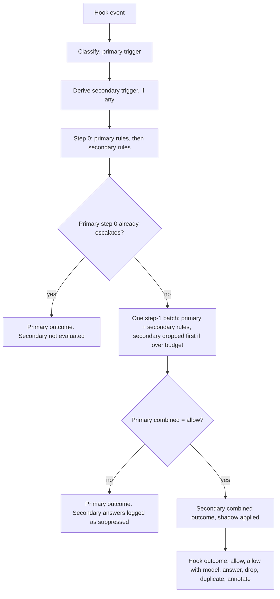

# Arbiter decision-model savings design

**Phase status:** Approved

Approved 2026-11-10 by the conductor's `AUTONOMOUS_APPROVAL: design-approval` (D42).

Authored 2026-11-10 under autonomy `autonomous` and development mode `test-first`, against the
approved [requirements](requirements.md) (Requirements 1–22, decisions D1–D13). This document
cites them as `Req n.m` and `Dn` and does not restate them. Its own decisions are D14–D41 in
[Decisions](#decisions).

- **Code facts** were read in the worktree at branch `claude/feat/arbiter-decision-model-savings`
  (base `e418fe93`), through the worktree's CodeGraph index.
- **Harness facts** come from vendor documentation, read 2026-11-10 through `research-agent`, and
  are listed in [§17](#17-harness-sources). Under Req 7.3 an unverified capability is unsupported.
- **Section numbers** are used for cross-references (`§n`).

## Overview

The design adds one mechanism and reuses the rest.

The mechanism is the **secondary trigger**. Today one hook event classifies to one trigger
(`delegate`, `investigate`, `lens.spawn` …) whose family fixes what `undecidable` means. For the
conductor and investigate families `undecidable` means `escalate`, so a new cost-saving question
asked on `delegate` would block a dispatch every time the model is unsure, the opposite of the
fail-safe contract (Req 5.1). Each new judgement therefore gets its own trigger, in its own family,
whose `undecidable` maps to "do what happens today". The evaluator derives the secondary trigger
from the primary one in the same event and evaluates it **only when the primary outcome is
`allow`**, so escalation still wins (Req 1.3) and the conductor family's combination does not grow
(D15).

Everything else reuses what ships: closed predicates, first-match `decide` clauses, the single
step-1 batch per event, the decision log entry shape, shipped-rule overrides, the MCP fallback,
and the adapters' existing allow-with-rewrite path.

Model profiles are resolved **at render time**, where Squad already holds the bundled matrix and
the selected preset, and written to a small table the hook host reads (D16). No Core project takes
a Squad reference.

## 1. Architecture

### 1.1 Components

| Component | Location | Change | Req |
|---|---|---|---|
| Families and effects | `src/KyberWeave.Core/Arbiter/ArbiterTriggerFamily.cs`, `Rules/ArbiterRule.cs` (`RuleEffects`) | Four new families, eight new effects, new `Combine` arms (§2) | 1 |
| Trigger catalogue | `src/KyberWeave.Core/Arbiter/ArbiterTriggerCatalog.cs` | Seven new triggers and their facts (§2, §3) | 1, 2 |
| Evaluator | `src/KyberWeave.Core/Arbiter/ArbiterEvaluator.cs` | Secondary-trigger evaluation in the same event, shadow mapping, `for-each` expansion, budget split (§2.4, §4.2, §5) | 1, 5 |
| Git and hunk facts | `src/KyberWeave.Core/Arbiter/Facts/GitFacts.cs`, new `Facts/CommentSyntax.cs`, `src/KyberWeave.Arbiter/Hooks/HookGitFacts.cs` | Fill `review.changed-hunks`; derive comment-only, rename-only and no-code-change paths (§3) | 2, 3 |
| Model targets | new `src/KyberWeave.Core/Arbiter/ModelTargets/` (`ArbiterModelTargets`, `ArbiterSemanticProfiles`, `ModelTargetResolver`) | Read the render-time table; pick a profile; resolve the token (§6) | 6, 8–12 |
| Model-targets writer | `src/KyberWeave.Core.Squad/Rendering/ArbiterHookWiring.cs`, new `Rendering/ArbiterModelTargetsFile.cs`; `src/KyberWeave.Cli/Commands/Squad/Infrastructure/SquadPresetFileRewriter.cs` | Emit the table beside the hooks, through `SquadModelResolution.ResolveToken` (§6.1) | 6 |
| Adapter capability | `src/KyberWeave.Arbiter/Hooks/IHarnessHookAdapter.cs`, `Hooks/Adapters/ClaudeHookAdapter.cs` | `ModelOverride` declaration; model write in the existing single rewrite (§6.3, §6.6) | 7, 9 |
| Hook engine | `src/KyberWeave.Arbiter/Hooks/ArbiterHookDecisionEngine.cs`, `IContextualHookDecisionEngine.cs` | Map the new effects to hook outcomes (§7) | 9, 13–19 |
| Run stores | new `src/KyberWeave.Core/Arbiter/Stores/ArbiterRunStore.cs` | Earlier findings and earlier failures, text kept only under the Arbiter directory (§8) | 5.8, 14, 19 |
| Section index | new `src/KyberWeave.Core/Arbiter/Sections/` (`DocumentSectionIndex`, `SectionSelector`) | Heading-level index of governed Markdown and the trim judgement (§7.3) | 15 |
| Advice services | new `src/KyberWeave.Core/Arbiter/Advice/CommentTriageService.cs` | Bot comment triage (§7.8) | 20 |
| Tool surfaces | `src/KyberWeave.Arbiter/Mcp/ArbiterTools.cs`, `Hooks/ConductorGuard.cs`; new CLI commands under `src/KyberWeave.Cli/Commands/Arbiter/` | Two new `kw-arbiter` tools and their CLI twins; `arbiter tune` (§12) | 4, 15.4, 20 |
| Squad roles | `products/kyber-squad/agents/*.md` and `skills/*` | Accept the new outcomes (§7, §15) | 22.5 |

### 1.2 Flow of one hook event



The evaluator keeps its invariant of at most one step-1 call per event (archived design §1.1).

## 2. Triggers, families and effects

### 2.1 New triggers

Each maps to exactly one family (Req 1.2). A secondary trigger is never classified directly from
a payload; it is derived from the primary trigger of the same event.

| Trigger | Family | Derived from | When |
|---|---|---|---|
| `delegate.model` | ModelTarget | `delegate` (pre) | Always for `delegate`, which only fires for the conductor dispatching an implementation-class target (§6.5) |
| `intake.shortcut` | Shortcut | `delegate.planner` (pre) | The prompt's planner marker is `INTAKE` |
| `triage.shortcut` | Shortcut | `investigate` (pre) | Caller `bug-crusher`, target `bug-crusher-investigator` |
| `docs-impact.shortcut` | Shortcut | `delegate` or `investigate` (pre) | Target `docs-dev` and the prompt body carries the line `DOCS-IMPACT: true` (§7.6) |
| `delegate.failure` | FailureCluster | `delegate.returned` (post) | The return's `RESULT:` is not `PASS` and the store holds an earlier non-PASS attempt of the same task (§7.7) |
| `sections.select` | Advice | none: tool surface only (§12) | A caller asks which sections a worker needs |
| `comment.triage` | Advice | none: tool surface only (§12) | A review loop asks how to treat a bot comment |
| `lens.spawn`, `lens.returned`, `refute.spawn` | unchanged | — | Existing triggers; two gain effects (§2.2) |

`docs-impact.shortcut` and `delegate.model` can both derive from one `delegate` event only if the
conductor delegates the docs-impact review to `docs-dev` through `delegate`; the evaluator then
derives both, and `docs-impact.shortcut` is evaluated first: an `answer` outcome removes the
dispatch, so no model is chosen for it.

### 2.2 Effects and families

| Family | Effects its rules may use | `undecidable` maps to | Combine |
|---|---|---|---|
| ModelTarget (new) | `keep`, `retarget` | `keep` | `retarget` when any rule answers `retarget`. The profile comes from the highest-precedence retargeting rule: `KW-ARB-LADDER-001`, then `KW-ARB-DIFFICULTY-001` (Req 10.4). Otherwise `keep` |
| Shortcut (new) | `spawn`, `answer` | `spawn` | `answer` only when **every** evaluated rule on the firing answers `answer`; any `spawn` or `undecidable` gives `spawn` |
| FailureCluster (new) | `allow`, `same-failure` | `allow` | `same-failure` when any rule answers it |
| Advice (new) | `keep`, `advise` | `keep` | `advise` only when every evaluated rule answers `advise` |
| LensReturned (extended) | `allow`, `annotate`, `drop` (new) | `allow` | `annotate` when any rule answers it (a `drop` on the same finding is then suppressed and logged); else `drop` when any rule answers it; else `allow` |
| RefuteSpawn (extended) | `allow`, `verify`, `drop` (new), `duplicate` (new) | `allow` | `verify` > `drop` > `duplicate` > `allow`. All three deny the refuter; they differ in the finding's status (§7.1, §7.2) |
| Conductor, Investigate, LensSpawn, Gate | unchanged | unchanged | unchanged |

What each new effect does when delivered:

- `retarget` — the dispatch runs on the chosen profile's model (§6.6).
- `answer` — the dispatch is not spawned; the caller receives a substitute digest in the deny
  reason (§7.4–§7.6).
- `same-failure` — the return is annotated with an `ARBITER_SAME_FAILURE:` line (§7.7).
- `advise` — the tool response carries the rule's advice (§12).
- `drop` — the finding is dropped: no refuter, no fix (§7.1).
- `duplicate` — the refuter is not spawned; the finding takes the earlier finding's outcome (§7.2).

`IsStrongestEffect` (the step-1 short-circuit signal) is unchanged: it stays `escalate`, `skip`,
`verify`. The new effects never short-circuit step 1, because each one removes or changes work and
must be confirmed by the rule that produced it, not inferred from a sibling.

### 2.3 Why new families instead of new conductor-family effects

See D15. In short: a conductor-family rule's `undecidable` is `escalate`, and a host cannot remap
it (`ArbiterTriggerFamily` remarks). Putting difficulty, intake, triage or docs-impact questions on
`delegate`, `delegate.planner` or `investigate` would make every unsure answer block the dispatch.
A separate family with its own `undecidable` mapping keeps both contracts: the primary trigger keeps
escalate-wins, the secondary trigger fails safe.

### 2.4 Secondary-trigger evaluation

In `ArbiterEvaluator.EvaluateDispatchAsync`, after classification:

1. `SecondaryTriggers.For(classification, prompt, ev)` returns zero or more secondary triggers
   (§2.1). It reads only the classification, the headers and the planner marker.
2. Facts are built once for the primary trigger and enriched with the secondary trigger's extra
   facts (§3); one `ArbiterFactSet` serves both.
3. Step 0 runs for the primary rules, then for each secondary trigger's rules.
4. If the primary step 0 short-circuits (its combined effect is the family's strongest), no step-1
   call is made and the secondary triggers are not evaluated.
5. Otherwise one step-1 batch holds the selected primary rules and the selected secondary rules.
   The state budget is checked with both; if it is exceeded, the secondary rules are removed and
   answer `undecidable` with provider status `over-budget`, and the primary rules are sent alone.
   If the primary rules alone exceed it, today's behaviour applies to them. A new rule can therefore
   never push a primary rule over budget.
6. The primary outcome is combined as today. When it is not `allow`, every secondary rule is
   recorded with `effect` set to the family's neutral effect and `would-effect` set to what it
   answered, evidence `suppressed: primary <outcome>` (Req 1.3).
7. When it is `allow`, each secondary trigger is combined, shadow is applied (§5), and one decision
   record is written per secondary trigger, sharing the event's `ledger-id`.

The event outcome stays the primary outcome; secondary outcomes travel beside it in
`ArbiterDispatchEvaluation` as a new optional `Secondary` list (trigger, outcome, payload).

## 3. Facts

| Fact | Triggers | Label | Filler | Absent when |
|---|---|---|---|---|
| `review.changed-hunks` | `lens.spawn`, `lens.returned`, `refute.spawn` | derived | `HookGitFacts`, from new `GitFacts.GetChangedHunks`: `git diff --unified=0 --find-renames <merge-base>` against the working tree (committed plus tracked dirty), plus each untracked file as one whole-file hunk. Value: ordered list of `{path, old-start, old-count, start, count}` | Base unreadable, or nothing changed (Req 2.2); always in `arbiter eval` (Req 2.4) |
| `review.comment-only-paths` | `lens.spawn` | derived | `CommentSyntax` over the hunk lines (§7.9) | `review.changed-hunks` absent |
| `review.rename-only-paths` | `lens.spawn` | derived | Rename entries with similarity 100 (`R100`) in the same diff | As above |
| `review.no-code-change-paths` | `lens.spawn` | derived | Union of comment-only, rename-only and changed `*.md` paths | As above |
| `finding.changed-lines` | `lens.returned` | derived | New-side line numbers of `finding.file` inside `review.changed-hunks` | Hunks absent, or no finding file |
| `finding.severity` | `lens.returned` | asserted | The finding's severity from the lens output (`Critical`, `Major`, `Minor`, `Info`) | Not stated |
| `finding.gate-corroborated` | `lens.returned` | derived | Same evidence `KW-ARB-GATE-CORROBORATED-001` reads on `refute.spawn`, moved to a shared reader | No gate report |
| `finding.dropped` | `refute.spawn` | derived | Run store: the finding id was dropped earlier in this review (§8) | No `REVIEW_RUN` header, or not dropped |
| `review.prior-findings` | `refute.spawn` | derived | Run store: earlier findings of this review in the same file within ±20 lines, at most 3, oldest first | No `REVIEW_RUN` header, or none |
| `plan.task.file-kinds` | `delegate.model` | derived | Distinct extensions of `plan.task.files`, each tagged `test` or `source` by the owner map's test patterns | No task files |
| `ledger.task.prior-attempt` | `delegate.model`, `delegate.failure` | derived | `LedgerFacts`: the latest earlier pre/post pair for the same plan file, plan digest and task: `{result: pass\|fail\|none, profile, token}` | No earlier attempt |
| `model-targeting.ladder.next` | `delegate.model` | derived | The configured ladder entry after `ledger.task.prior-attempt.profile` | Prior profile unrecorded, or already the top |
| `delegation.model` | `delegate.model` | asserted | The dispatch input's own model field, read by the adapter | Field absent |
| `harness.model-override` | `delegate.model` | derived | The adapter's declaration (§6.3), copied by the host like `harness.observes-returns` | Never absent |
| `failure.previous-text`, `failure.current-text` | `delegate.failure` | derived / asserted | Run store; the return's non-PASS output | Store has none; text over the store limit |
| `intake.request` | `intake.shortcut` | asserted | The prompt body after the `INTAKE:` marker | Empty |
| `defect.report` | `triage.shortcut` | asserted | The investigator prompt body | Empty |
| `review.diff-summary`, `review.changed-paths` | `docs-impact.shortcut` | derived | Existing readers, now also on this trigger | As today |
| `docs.governed-paths-changed` | `docs-impact.shortcut` | derived | Changed paths that are governed documents (frontmatter `id:`) under the Config Reg docs root | None changed |
| `section.candidate.*`, `task.text` | `sections.select` | asserted | Tool input (§7.3) | — |
| `comment.*`, `file.text-at-line`, `comment.fixing-commits` | `comment.triage` | asserted / derived | Tool input; working tree at `HEAD`; `git log -L` from the comment's commit (§7.8) | Line beyond file end; no later commit touches the line |

`review.changed-hunks` is never shortened (Req 2.3). It is only sent to step 1 by a rule whose
`state` names it, and no shipped rule does.

`KW-ARB-PREEX-001` currently reads `finding.line in review.changed-hunks`, a comparison the new
value shape cannot satisfy (an integer against a list of ranges). Its `decide` clauses change to
read `finding.changed-lines` instead (D20). Because `review.changed-hunks` has never been filled,
the rule has never answered; after this change it starts answering, which is the behaviour it was
written for.

## 4. Rules

### 4.1 New rules

Every id is new and permanent (Req 1.5). Thresholds are unmeasured, so every step-1 rule ships
in shadow (D7); `KW-ARB-LENS-002` is step 0 and enforces (D8).

| Id | Trigger | Step | Question | Answers → effects | Facts read | Default |
|---|---|---|---|---|---|---|
| `KW-ARB-LENS-002` | `lens.spawn` | 0 | Is every changed path comment-only, rename-only or Markdown? | `no-code-change` → `skip`; else `undecidable` → `allow` | `lens.name`, `review.changed-paths`, `review.no-code-change-paths` | enforced |
| `KW-ARB-DIFFICULTY-001` | `delegate.model` | 1 (`choice`, floor 0.8) | How hard is this task? | `easy`, `standard`, `hard` → `retarget` | `plan.task.text`, `plan.task.files`, `plan.task.file-kinds` | model-targeting switch (§5.2) |
| `KW-ARB-LADDER-001` | `delegate.model` | 0 | Should this retry run one profile up? | `step-up` → `retarget`; `top-of-ladder`, `profile-unrecorded`, `first-attempt`, `returns-unobservable` → `keep` | `harness.observes-returns`, `ledger.task.prior-attempt`, `model-targeting.ladder.next` | model-targeting switch |
| `KW-ARB-NITPICK-001` | `lens.returned` | 0 then 1 (`choice`, floor 0.85) | Is this finding a nitpick? | step 0: `severity Critical` or gate-corroborated → `substantive`; step 1: `nitpick` → `drop`, `substantive` → `allow` | `finding.severity`, `finding.gate-corroborated`, `finding.claim`, `finding.excerpt`, `lens.name` | shadow |
| `KW-ARB-NITPICK-002` | `refute.spawn` | 0 | Was this finding dropped earlier in this review? | `dropped` → `drop` | `finding.dropped` | follows `KW-ARB-NITPICK-001` (D22) |
| `KW-ARB-DUP-001` | `refute.spawn` | 1 (`choice`, floor 0.9, `for-each: review.prior-findings`) | Is this finding the same defect as the earlier one? | `same-defect` → `duplicate`, `different` → `allow` | `finding.claim`, `finding.excerpt`, `finding.file`, `finding.line`, `review.prior-findings` | shadow |
| `KW-ARB-TRIM-001` | `sections.select` | 1 (`choice`, floor 0.9, `for-each: section.candidates`) | Does the task need this section? | `needed` → `keep`, `not-needed` → `advise` | `task.text`, `section.candidate.*` | shadow |
| `KW-ARB-TRIAGE-001` | `triage.shortcut` | 1 (`choice`, floor 0.9) | Is this defect trivial? | `trivial` → `answer`, `needs-architect` → `spawn` | `defect.report` | shadow |
| `KW-ARB-INTAKE-001` | `intake.shortcut` | 1 (`choice`, floor 0.9) | Is this request plan-sized or spec-sized? | `plan`, `spec` → `answer`; `unclear` → `spawn` | `intake.request` | shadow |
| `KW-ARB-DOCIMPACT-001` | `docs-impact.shortcut` | 0 then 1 (`choice`, floor 0.9) | Does this change touch documented behaviour? | step 0: governed document changed → `touches`; step 1: `no-doc-impact` → `answer`, `touches` → `spawn` | `docs.governed-paths-changed`, `review.changed-paths`, `review.diff-summary` | shadow |
| `KW-ARB-FAILURE-001` | `delegate.failure` | 1 (`choice`, floor 0.85) | Is this the same failure as the previous attempt? | `same` → `same-failure`, `different` → `allow` | `failure.previous-text`, `failure.current-text` | shadow |
| `KW-ARB-COMMENT-001` | `comment.triage` | 1 (`choice`, floor 0.85) | Is this bot comment real, a nitpick, or already fixed? | `nitpick`, `already-fixed` → `advise`; `real` → `keep` | `comment.body`, `comment.path`, `comment.line`, `file.text-at-line`, `comment.fixing-commits` | shadow |

`KW-ARB-LENS-002` names the lenses that cannot find anything in such a change: `correctness`,
`test-adequacy`, `performance`, `di-composition`, `duplicate-implementation`, `model-placement`.
It never names `security` (a secret can be added in a comment), `documentation-accuracy` (comments
are documentation) or `blast-radius-revertibility` (a rename moves callers). See D21.

A `choice` answer that is not the rule's spawn-side answer clears its floor or the rule answers
`undecidable`, exactly as `KW-ARB-SCOPE-002` does today.

### 4.2 `for-each` expansion

`KW-ARB-DUP-001` and `KW-ARB-TRIM-001` compare one item against several. The single-dispatch fact
model cannot express a pair, so `RuleAsk` gains an optional `ForEach` naming a list fact. The
evaluator expands the rule into one question per list item in the same step-1 batch, binding the
item to `candidate.*` in the state. Each expansion is recorded as its own rule entry with a new
`candidate` field (§10). Only shipped rules may set `for-each`; a host rule that sets it fails
`KW-ARB-CONFIG-015`.

Combination for an expanded rule:

- `KW-ARB-DUP-001`: the first item, in store order, answered `same-defect` with confidence at or
  above the floor decides `duplicate`; its id becomes the outcome's `duplicate-of`. Any other
  result is `allow` (Req 14.5).
- `KW-ARB-TRIM-001`: each section answered `not-needed` at or above the floor is advised for
  removal. A section with any other answer is kept (Req 15.6).

## 5. Shadow mode and the shared safety contract

### 5.1 Per-rule shadow

`ArbiterRule` gains `Shadow` (bool). `default-rules.yml` sets `shadow: true` on every new step-1
rule. A host turns one on with a shipped-rule override:

```yaml
arbiter:
  rules:
    - id: KW-ARB-NITPICK-001
      shadow: false
```

`FindOverrideViolation` accepts `shadow` beside `enabled`, the threshold and `effects`. A rule in
shadow is evaluated and logged in full; the effect it contributes to `Combine` is the family's
neutral effect (`keep`, `spawn`, `allow`), and its entry records `shadow: true` and `would-effect`
(Req 5.4–5.6). Shadow is decided once, in the evaluator, so no adapter or role sees a shadowed
effect.

### 5.2 The model-targeting switch

Model targeting has one switch (Req 12.1):

```yaml
arbiter:
  model-targeting:
    mode: shadow        # off | shadow | enforce; default shadow
```

It governs `KW-ARB-DIFFICULTY-001` and `KW-ARB-LADDER-001` together, including the step-0 ladder
(D5). `off` disables both rules (`enabled: false`); `shadow` evaluates and logs them; `enforce`
lets `retarget` through. A `shadow` override on either rule fails `KW-ARB-CONFIG-014`, so there is
only one switch to read.

### 5.3 Fail-safe points

| Situation | Result | Recorded as |
|---|---|---|
| Provider `none`, error, over budget, below floor, undecidable | Family neutral effect: today's behaviour | Existing provider status and `undecidable` |
| Primary outcome not `allow` | Secondary not delivered | `would-effect`, evidence `suppressed: primary <outcome>` |
| No hook and no `serve` call | Nothing runs, nothing logged | — (Req 5.2) |
| `serve` call | Outcome labelled advisory; `retarget` reports what it would have done | `source: serve` (Req 5.3) |
| Invalid new configuration | Rule not evaluated; `validate` and `doctor` report `KW-ARB-CONFIG-012`–`015` | Hook logs the diagnostic to stderr (Req 5.9) |
| Model-targets table missing or unreadable | `keep` | `model.reason: model-targets-unreadable` (Req 6.4) |
| Store unwritable | The rule that needs it answers `undecidable` | Provider status unchanged; evidence `store-unavailable` |

## 6. Model targeting

### 6.1 Profile resolution: render-time table (Req 6)

The hook host cannot run `SquadModelResolution.ResolveToken` itself, for two reasons found in the
code:

- **Layering.** `KyberWeave.Core` may reference no repository project, and each feature assembly
  references only Core (`CoreAssemblySplitTests`, ADR 0057). `ResolveToken`, `SquadModelProfiles`,
  the preset store and the preset parser all live in `KyberWeave.Core.Squad`. The hook host
  (`KyberWeave.Arbiter`) references only Core.
- **Data.** The bundled matrix (`profiles/models.yml`) is read from the release archive Squad
  extracts to a temporary directory during `install`/`update` (`SquadLifecycleService`). In a host
  repository nothing on disk holds it at hook time.

So resolution runs where both inputs already exist: at render time, inside Core.Squad, through
`ResolveToken` and nothing else. `ArbiterHookWiring`, when it produces hooks for a target, also
emits a receipt-owned file per hooked target:

- Project scope: `artifacts/arbiter/model-targets.<harness>.json` (the project Arbiter directory,
  already git-ignored and checked by `KW-ARB-LOG-001`).
- Global scope: `~/.kyber-weave/arbiter/model-targets.<harness>.json`.
- Instance scope: not emitted; targeting keeps every model (fail safe).

```json
{
  "schema": "kyber-arbiter.model-targets/v1",
  "harness": "claude",
  "preset": { "name": "work", "digest": "…" },
  "bundle-digest": "…",
  "profiles": { "fast": "claude-haiku-5-5", "general": "claude-sonnet-5-5", "architect": "opus", "orchestration": "sonnet" },
  "agents": { "csharp-dev": { "profile": "general", "token": "claude-sonnet-5-5" } }
}
```

`profiles` holds `ResolveToken(merged, profile, harness)` for every bundled profile, `null` where
it resolves to `inherit` or is undefined (Req 6.2). `agents` holds each rendered agent's profile and
the token it was rendered with, so the hook can detect a no-op (Req 9.5) and the ledger can record
what a dispatch ran on (Req 10.5). `squad preset use` and `squad preset clear` rewrite agent files
through `SquadPresetFileRewriter`, which already calls `ResolveToken`; they rewrite the table in the
same transaction, so the table cannot lag the agents.

Core gains a reader, `ArbiterModelTargets.TryRead(arbiterDirectory, harness)`, that parses this
JSON with `System.Text.Json` and no Squad types. Unreadable, wrong schema, or wrong harness answers
`null` (Req 6.4). This is D16; the rejected alternatives (move the resolver into Core; reference
Core.Squad from the hook host) are in its row.

### 6.2 Semantic profiles in configuration (Req 8.3–8.4, 10.2)

```yaml
arbiter:
  model-targeting:
    mode: shadow
    difficulty-profiles:
      easy: fast
      standard: general
      hard: deep-planning
    ladder: [fast, general, deep-planning]
```

`ArbiterSemanticProfiles.All` in Core lists the six semantic profiles. A repository-policy test
asserts it equals the profile keys of `products/kyber-squad/profiles/models.yml`, so the list
cannot drift. Any value outside it (a concrete model id, a typo) fails `KW-ARB-CONFIG-012`; an
empty, duplicated or non-profile ladder fails `KW-ARB-CONFIG-013`. Shipped defaults are the values
above; a host may override each key.

### 6.3 Per-harness model-override capability (Req 7)

`IHarnessHookAdapter` gains, beside `ObservesReturns`:

```csharp
/// <summary>Whether one dispatch can name its own model, the field that carries it, and the accepted value form.</summary>
ModelOverrideCapability ModelOverride => ModelOverrideCapability.Unsupported;

public sealed record ModelOverrideCapability(
    bool Supported, string? Field, IReadOnlySet<string>? AcceptedAliases, string Source);
```

The host copies it into `HookContext` and the `harness.model-override` fact. Declarations, from
§17:

| Harness | Verdict | Field | Basis |
|---|---|---|---|
| Claude | **Supported** | `model` on the `Agent` input; aliases only: `sonnet`, `opus`, `haiku`, `fable` | Vendor docs state the per-call parameter and its alias-only values; `PreToolUse` `updatedInput` replaces the input [CC-SUB], [CC-HOOK] |
| Codex | Unsupported (unverified) | — | Hooks can rewrite input, but no `spawn_agent` model parameter is documented [CX-HOOK], [CX-SUB] |
| Copilot CLI, Copilot in VS Code | Unsupported (unverified) | — | `modifiedArgs` exists; the custom-agent `model` is agent-level only [GH-HOOK], [GH-AGENT] |
| Cursor | Unsupported (unverified) | — | The parent can name a model natively; whether `updated_input` applies to `Task` is undocumented [CU-SUB], [CU-HOOK] |
| OpenCode | Unsupported | — | The task tool documents no per-call model; model is agent config [OC-AGENT] |
| Pi | Unsupported (unverified) | — | `tool_call` input is mutable, but no core subagent tool or model field is documented [PI-EXT] |
| Kilo | Unsupported (unverified) | — | Subagent model is config-level; the task tool documents no model [KI-SUB] |
| Antigravity | Unsupported | — | `invoke_subagent` has no model field; tier is per custom subagent [AG-SUB], [AG-HOOK] |
| Factory | Unsupported | — | Docs: "the caller cannot choose a model for a single call". `complexity` routes through settings and is not documented as a model selector [FA-DROID], [FA-HOOK] |
| Devin | Unsupported (unverified) | — | `run_subagent` schema documents no model; model is `agent.subagent_model` config [DV-HOOK], [DV-LOG] |

Only `ClaudeHookAdapter` overrides the default. The architecture document's harness-facts table
gains a "Per-dispatch model" column citing these sources (Req 7.2).

Claude accepts aliases, not full ids, and the bundled Claude tokens mix both (`opus`, `sonnet`,
`claude-haiku-5-5`, `claude-sonnet-5-5`). The adapter accepts an alias as is; for a full id
matching `^claude-(haiku|sonnet|opus|fable)-` it writes the family alias and records
`model.reason: alias-derived` with both values; any other token is not written and records
`token-not-accepted` (D18).

### 6.4 Choosing the profile

`ModelTargetResolver` runs after the `delegate.model` outcome is combined:

1. Outcome `keep` → no change.
2. `retarget` from `KW-ARB-LADDER-001` → profile `model-targeting.ladder.next`; else from
   `KW-ARB-DIFFICULTY-001` → `difficulty-profiles[answer]`.
3. `delegation.model` present → no change, `caller-named-model` (D9, Req 9.4).
4. Read the table; `null` → `model-targets-unreadable`. Profile token `null` → `no-token` (Req 6.2).
5. Token equals the target agent's rendered token → `same-as-rendered` (Req 9.5).
6. Harness unsupported → `unsupported-harness`; the profile and token are still recorded (Req 7.4).
7. Mode `shadow` → `shadow`. Otherwise the hook outcome carries the token (§6.6), `delivered: true`.

### 6.5 Who is eligible (Req 11)

The eligible set is defined once: the catalogue's `implementation` target class
(`ArbiterSquadCatalog`, from the `worker` and `publishing-worker` capability profiles, the same set
`ArbiterHookWiring.GuardedCapabilityProfiles` and `ReadGuard` use). `delegate.model` derives only
from `delegate`, and `TriggerClassifier` classifies `delegate` only for the conductor dispatching an
implementation-class target. Planners go to `delegate.planner`, reviewers and every other caller to
`investigate`, and an unidentified target is class `not-squad`, so none can reach `delegate.model`
(Req 11.1, 11.3). No rule carries its own eligibility list (Req 11.2).

A consequence: bug-crusher's own dispatches to specialists classify as `investigate` and are not
retargeted in this version.

### 6.6 Delivery (Req 9)

- `HookOutcome` gains `ModelToken` (string?). `MapResult` sets it on `Allow` when §6.4 step 7
  delivers.
- `IContextualHookDecisionEngine.DecidePreDispatch` gains an optional `dispatchModel` parameter,
  which adapters fill from their model field so `delegation.model` is a real fact.
- `ClaudeHookAdapter` already renders one `updatedInput` that copies every input field and strips
  the routing headers from `prompt` (`RenderPreAllowStrip`). The model write is a second mutation
  inside the same `RenderPreAllow` call, so header strip and model change are one rewrite and every
  other field is copied (Req 9.3). The adapter writes the field even when it strips nothing.
- `delivered: true` means the field was written. Claude documents settings that override it (an
  installed mod's `agent.spawn` hook, `CLAUDE_CODE_SUBAGENT_MODEL_FORCE`), so the record cannot
  prove the model ran; the runbook says so.

### 6.7 Retry ladder (Req 10)

The ledger's pre events gain `model-profile`, `model-token` and `model-source` (`rendered`,
`retarget`, `caller`, `unknown`). `rendered` comes from the table's `agents` entry; `retarget` when
the hook delivered one; `caller` when the input named a model. `ledger.task.prior-attempt` reads the
latest earlier pair for the same plan file, plan digest and task; `KW-ARB-LADDER-001` decides, in
order:

1. `harness.observes-returns` is false → `returns-unobservable` (Req 10.6)
2. no prior attempt, or its result is `pass` → `first-attempt`
3. prior profile not recorded → `profile-unrecorded` (Req 10.3)
4. `model-targeting.ladder.next` absent → `top-of-ladder` (Req 10.3)
5. otherwise → `step-up`

No model call is made (Req 10.1).

### 6.8 Shadow and outcome join (Req 12)

Each `delegate.model` decision carries the record-level `model` block (§10) in both modes. The
tuning report (§12.1) joins a decision to its dispatch's return by `ledger-id`, and shows the chosen
profile beside the return's `RESULT:` and `TASK_GATE` lines (Req 12.3).

### 6.9 Departures from the owner's model-targeting design

The requirements carry the owner's design (Req 6–12). This design departs from it in two places:

- **Resolution is a lookup, not a call (Req 6.1).** The hook reads tokens `ResolveToken` produced at
  render time, rather than calling it. The requirement's purpose — one resolution path, the user's
  preset respected — is kept; the literal call is impossible without breaking the assembly split
  and without data the hook does not have (§6.1).
- **Claude alias derivation (Req 9.2).** Claude cannot take the full ids the matrix holds for
  `fast` and `general`. Writing the family alias is the nearest the harness allows; it is recorded
  every time, and a host that wants exact versions sets preset tokens to aliases.

## 7. Spawn-removing judgements

### 7.1 Nitpick filter (Req 13)

- **Home:** `lens.returned`, per finding, before code-reviewer dispatches any refuter.
- **Guards (Req 13.4):** `KW-ARB-NITPICK-001`'s step-0 clauses answer `substantive` for severity
  `Critical` (the highest the lens contract defines) or a gate-corroborated finding, so step 1 is
  not asked.
- **Delivery:** `drop` renders as a post-dispatch annotation on the lens return, one line per
  dropped finding: `ARBITER_DROPPED: <finding id> rule=KW-ARB-NITPICK-001 decision=<id>`.
  Code-reviewer lists dropped findings in a "Dropped by the Arbiter" section of its review output
  and dispatches no refuter and no fix for them (Req 13.2, 13.3).
- **Back-stop:** `KW-ARB-NITPICK-002` denies any refuter later dispatched for a dropped finding.
- **Store:** each finding the lens returned is appended to the review's finding store with its drop
  status (§8).

### 7.2 Duplicate findings (Req 14)

- **Home:** `refute.spawn`, with `KW-ARB-DUP-001` expanded over `review.prior-findings` (§4.2).
- **Review identity (Req 14.4):** code-reviewer writes `REVIEW_RUN: <id>` on every lens and refute
  dispatch of one review; a missing header leaves the store unread and the rule `undecidable`.
- **Delivery:** `duplicate` denies the refuter with reason
  `ARBITER_DUPLICATE: <finding id> of <earlier id> decision=<id>`. Code-reviewer marks the finding
  duplicate and gives it the earlier finding's refutation outcome; if that refutation is still in
  flight, it applies the outcome when the earlier refuter returns (Req 14.3).
- **Store:** each refuter's return records its outcome against its finding id.

### 7.3 Trim what workers read (Req 15)

- **Index:** `DocumentSectionIndex` reads governed Markdown (frontmatter `id:`) inside the
  repository with Markdig, one section per H2 or H3 heading: path, GitHub-style anchor, heading
  text, level, line range and content digest. It is cached at
  `<arbiter-dir>/index/sections.json`, keyed by each file's blob id, and rebuilt per file when the
  blob changes (Req 15.1).
- **Home: tool surface only (D27).** `sections.select` is reached through the `kw-arbiter` tool
  `arbiter_select_relevant_document_sections` and the CLI twin `kyber-weave arbiter sections`
  (Req 15.4). The hook never rewrites a prompt for trimming.
- **Rewrite rule (Req 15.5):** the tool takes only the task text and a list of document references
  (`path` or `path#anchor`) and returns only references. It never receives or returns packet text,
  so the task text, acceptance criteria, file list, test command and routing headers cannot be
  trimmed by construction. The packet author substitutes each whole-document reference with the
  returned `path#anchor` list. A document whose every section is judged `not-needed` is returned
  whole and flagged (D28). No size cap is applied anywhere.
- **Unsure (Req 15.6):** provider `none`, error or over budget returns every reference unchanged
  with `trimmed: none` and the reason.
- **Who calls it:** the conductor, before a delegate, where `kw-arbiter` is wired; elsewhere the
  packet is unchanged.

### 7.4 Bug triage shortcut (Req 16)

- **Home:** `triage.shortcut`.
- **Substitute digest**, delivered as the deny reason:

```text
REPRODUCED:        no — not run; the Arbiter judged the report trivial
ROOT CAUSE:        UNKNOWN
EVIDENCE:          none
BLAST RADIUS:      files=unknown  layers=unknown
EXISTING COVERAGE: NONE
TRIPWIRES:         NONE
VERDICT:           TRIVIAL
PROPOSED FIX:      none — bug-crusher reproduces and locates the fix itself
ARBITER_DECISION:  <decision id> (KW-ARB-TRIAGE-001, p=<p>)
Discovery: codegraph 0, docs 0, direct reads 0
DIRECT_READ_REASONS: none
```

- Bug-crusher treats `ARBITER_DECISION` as permission to skip the investigator only. It still
  reproduces the defect, runs its tripwires, and escalates to `architect` when one fires (Req 16.3).

### 7.5 Plan-or-spec intake shortcut (Req 17)

- **Home:** `intake.shortcut`, derived only from the `INTAKE` marker, never from a planning
  dispatch (Req 17.5).
- **Substitute digest** in the shape the conductor already accepts (Req 17.2):

```text
STATUS: INTAKE_RECOMMENDATION
INPUT: <the INTAKE: line value>
RECOMMENDATION: PLAN | SPEC
RATIONALE: The Arbiter (KW-ARB-INTAKE-001, p=<p>) judged the request <plan|spec>-sized; no architect intake ran.
GAPS: none
OPEN_QUESTIONS: none
ARBITER_DECISION: <decision id>
Discovery: codegraph 0, docs 0, direct reads 0
DIRECT_READ_REASONS: none
```

- The conductor's handling is unchanged (Req 17.3); `ARBITER_DECISION` is the one new line it
  carries into its record.

### 7.6 Documentation-impact shortcut (Req 18)

- **Identification:** the conductor and bug-crusher write `DOCS-IMPACT: true` as the first body
  line of a documentation-impact review dispatch to `docs-dev`. A closeout dispatch never carries it
  (Req 18.3); an unmarked dispatch is never shortcut (D26).
- **Guard (Req 18.4):** `KW-ARB-DOCIMPACT-001` step 0 answers `touches` when any governed document
  changed.
- **Substitute digest** in docs-dev's review shape:

```text
DOCS_REVIEW: no doc change with justification — the Arbiter (KW-ARB-DOCIMPACT-001, p=<p>) judged that the change touches no documented behaviour
RECOMMENDATIONS: none
ARBITER_DECISION: <decision id>
```

### 7.7 Same-failure detection (Req 19)

- **Home:** `delegate.failure`, post-dispatch.
- **Store:** every non-PASS `delegate.returned` appends its output to the run's failure store (§8).
- **Delivery:** `same-failure` appends to the post-dispatch annotation:
  `ARBITER_SAME_FAILURE: yes prior=<prior ledger id> decision=<id>`.
- The delivery-execution contract takes it as the same-failure input to failure-cluster keying, so
  the attempt joins the prior cluster and its dispatch tally. Limits, tally persistence and
  oscillation detection are unchanged (Req 19.3). With no line, keying follows today's rules.

### 7.8 Bot comment triage (Req 20)

- **Home: tool surface, not a hook (D29).** The decision point is "before the loop acts on a
  comment", not a dispatch, so there is no hook event to attach to. The loops already run `gh` in a
  shell, and `kw-arbiter` is not wired on every hooked harness. The surfaces are the CLI command
  `kyber-weave arbiter comment` and the `kw-arbiter` tool `arbiter_classify_bot_review_comment`,
  both over `CommentTriageService`.
- **Inputs:** comment body, path, line, the comment's commit, and the author login. The service
  refuses any author not ending `[bot]` or on the configured bot list, answering `keep` with reason
  `human-comment` (Req 20.7, D11).
- **Facts:** `file.text-at-line` from the working tree at `HEAD`; `comment.fixing-commits` from
  `git log -L<line>,<line>:<path> <comment commit>..HEAD`.
- **Already-fixed needs a commit (Req 20.5):** an `already-fixed` answer with no fixing commit is
  reported as `real`.
- **Output:** `classification`, `commit` (for already-fixed), `decision`, `advisory` flag. The loop
  posts the reply and resolves; the Arbiter never posts (D12).

### 7.9 Hunk-level lens skipping (Req 3)

`CommentSyntax` maps file extensions to comment tokens:

| Languages | Line tokens | Block |
|---|---|---|
| C#, Java, Kotlin, Swift, Go, Rust, TypeScript, JavaScript, C, C++ | `//` | `/* … */` |
| Python, shell, YAML, TOML, Ruby, PowerShell | `#` | — (PowerShell `<# … #>`) |
| SQL, Lua | `--` | — |
| HTML, XML, XAML | — | `<!-- … -->` |

A file is comment-only when every added and removed line of every hunk is blank or starts (after
indentation) with a line token, or lies in a block that opens and closes inside the same hunk. A
`*` continuation line counts only inside such a block, because `*p = x` is code in C, Go and Rust.
Unknown extension, absent hunks, or any other line → not comment-only (Req 3.4). No model is called
(Req 3.5).

## 8. Run stores (Req 5.8, 14.2, 19)

`ArbiterRunStore` keeps text that later judgements read, under the Arbiter directory only:

```text
<arbiter-dir>/stores/review-<sha256(REVIEW_RUN)>/findings.jsonl
<arbiter-dir>/stores/run-<sha256(plan-file + plan-digest | session)>/failures.jsonl
```

- Appends use the existing locked one-line append (`ArbiterLogFiles.AppendLineAsync`).
- A stored item larger than `arbiter.stores.max-item-bytes` (default 16384) is not stored, and the
  rule that would read it answers `undecidable`. Text is never shortened.
- `decisions.jsonl` and `ledger.jsonl` keep digests only (Req 5.7); the store holds the text, keyed
  by the same finding id or ledger id.
- `kyber-weave arbiter doctor` reports the store size; stores older than
  `arbiter.stores.retain-days` (default 14) are deleted on the next append to the same directory.

The in-flight ledger was rejected as the home: it is digest-only by contract, and holding text there
would break Req 5.7 (D24).

## 9. Configuration

New keys in the `arbiter:` section. Everything not listed keeps today's merge rules.

| Key | Type | Default | Validation |
|---|---|---|---|
| `model-targeting.mode` | `off` \| `shadow` \| `enforce` | `shadow` | `KW-ARB-CONFIG-012` on any other value |
| `model-targeting.difficulty-profiles.easy` / `.standard` / `.hard` | semantic profile | `fast` / `general` / `deep-planning` | `KW-ARB-CONFIG-012` when not a semantic profile |
| `model-targeting.ladder` | list of semantic profiles | `[fast, general, deep-planning]` | `KW-ARB-CONFIG-013` when empty, duplicated or not profiles |
| `stores.max-item-bytes` | integer | `16384` | `KW-ARB-CONFIG-015` when ≤ 0 or > 1048576 |
| `stores.retain-days` | integer | `14` | `KW-ARB-CONFIG-015` when < 1 |
| `comment-triage.bot-logins` | list of strings | `[]` (logins ending `[bot]` always count) | `KW-ARB-CONFIG-015` on blank entries |
| `rules[].shadow` | bool, shipped-rule override | per rule | `KW-ARB-CONFIG-014` on the two targeting rules |

This repository's `.kyber-weave/kyber-weave.yml` gets none of these keys, and its
`arbiter.provider.kind: none` is unchanged (Req 5.11).

## 10. Decision log and ledger additions

All additions are optional and omitted when null, so existing readers and existing lines stay valid
and the schema id stays `kyber-arbiter.decision/v1` (D31).

`ArbiterDecisionRule` (one per rule, existing shape kept, Req 5.6):

| Field | Type | When written |
|---|---|---|
| `shadow` | bool | Every rule that supports shadow (all new step-1 rules and the two targeting rules) |
| `would-effect` | string | The effect suppressed by shadow, by a non-`allow` primary, or by an unsupported harness |
| `candidate` | string | One `for-each` expansion: the earlier finding id or the section reference |

`ArbiterDecisionRecord` (one per trigger):

| Field | Type | When written |
|---|---|---|
| `primary-ledger-id` | string | Secondary-trigger records, pointing at the event's primary record |
| `model` | `{profile, token, rendered-token, source: difficulty\|ladder, delivered, reason}` | `delegate.model` records (Req 12.2, 12.4) |
| `substitute` | `{kind: intake\|triage\|docs-impact, digest: sha256}` | `answer` outcomes (the digest, not the text) |
| `duplicate-of` | string | `duplicate` outcomes |

`ArbiterLedgerEvent` pre events: `model-profile`, `model-token`, `model-source` (§6.7). A pre event
whose dispatch was denied by an `answer`, `drop` or `duplicate` outcome counts as not dispatched
(`InFlightPaths`' `notDispatched` set, and `arbiter audit`).

## 11. Diagnostics

| Id | Where | Meaning | Hint |
|---|---|---|---|
| `KW-ARB-CONFIG-012` | `validate`, `doctor`, hook | `model-targeting` names an unknown mode or a value that is not a semantic profile | List of the six profiles |
| `KW-ARB-CONFIG-013` | same | `model-targeting.ladder` empty, duplicated or not profiles | Example ladder |
| `KW-ARB-CONFIG-014` | same | `shadow` set on a model-targeting rule | Use `model-targeting.mode` |
| `KW-ARB-CONFIG-015` | same | Invalid `stores:` or `comment-triage:` value, or a host rule using `for-each` or a new effect reserved to shipped rules | Valid ranges |
| `KW-ARB-MODEL-001` | `doctor` (warning) | Model targeting is not `off`, a hooked target is installed, and its model-targets table is missing, unreadable or older than the Squad lock | Run `kyber-weave squad update` |

All ids are new (Req 1.6). On the hook path an invalid new key makes the affected rule "not
evaluated" and is logged to stderr; the rest of the configuration still loads.

## 12. Commands and tools

### 12.1 `kyber-weave arbiter tune` (Req 4)

Read-only. Reads `decisions.jsonl` and `ledger.jsonl` from the resolved Arbiter directory.

```text
kyber-weave arbiter tune [--rule <id>] [--thresholds 0.5,0.6,0.7,0.8,0.9] [--json]
```

Per step-1 rule: count of scored answers, a score histogram in tenths, and for each candidate
threshold how many answers would change side. Where a decision's `ledger-id` pairs to a return,
the `RESULT:` and `TASK_GATE` outcome and, for `delegate.model`, the chosen profile are shown beside
the score (Req 4.2, 12.3). Shadow and enforced answers are reported separately. A missing log or no
scored answers prints one line saying so and exits 0 (Req 4.4). It never writes configuration
(Req 4.3).

### 12.2 New tools and CLI twins

| `kw-arbiter` tool | CLI twin | Trigger |
|---|---|---|
| `arbiter_select_relevant_document_sections` | `kyber-weave arbiter sections --task-file <f> --ref <path[#anchor]>…` | `sections.select` |
| `arbiter_classify_bot_review_comment` | `kyber-weave arbiter comment --path <p> --line <n> --commit <sha> --author <login> --body-file <f>` | `comment.triage` |

Both tools are added to the Copilot conductor guard's allow list (`ConductorGuard`) and to the
rendered `kw-arbiter` grants. Tool names are client-visible contract and are fixed here.

`arbiter rules` lists every new rule with trigger, step, answers, effects, facts read, shadow
default and `for-each` (Req 1.7).

## 13. Error handling

- Every new fact reader returns absent on failure and never throws (the existing `GitFacts`
  contract).
- A store or index I/O failure makes its rule `undecidable`; it never blocks a dispatch.
- An adapter failure while writing the model field falls back to today's allow (header strip
  only) and logs `model-write-failed`; the decision records `delivered: false`.
- A secondary-trigger exception is caught inside the evaluator, logged, and treated as
  `undecidable` for that trigger. It never reaches `KW-ARB-HOOK-001`, because the primary decision
  has already been made.
- Tool-surface failures return a structured error with the provenance line, as the existing
  `ArbiterTools` responses do.

## 14. Testing strategy

Test-first per Req 22.2: each behaviour change starts with a failing test. Targeted runs only on
developer tasks (Req 22.3, ADR 0059).

- **Fake provider.** Every step-1 rule is tested through the existing injected `IArbiterProvider`
  seam (`ArbiterHookDecisionEngine(providerFactory: …)` and the evaluator constructor), with a
  scripted fake that answers per rule id and per `candidate`, and can raise transport errors and
  over-budget. No test needs a network, a key or a paid call (Req 5.10).
- **Engine units** (`tests/KyberWeave.Tests/Arbiter/`): `Combine` for every new and extended
  family, including escalate-suppresses-secondary and the Shortcut "all must agree" rule; shadow
  mapping; `for-each` expansion and first-duplicate-wins; budget split (secondary dropped, primary
  kept).
- **Facts:** `GitFacts.GetChangedHunks` and rename detection against temporary git repositories
  (the `HookGitFactsSnapshotTests` pattern); `CommentSyntax` table tests per language, including the
  `*p = x` negative cases; `review.changed-hunks` absent offline (Req 2.4).
- **Model targeting:** `ModelTargetResolver` for every reason code in §6.4; the table reader for
  bad JSON, wrong schema and wrong harness; ladder decisions for each clause; Squad render tests
  asserting the emitted table equals `ResolveToken` for every profile with and without a preset;
  a preset-use test asserting agents and table change in one transaction.
- **Adapter golden tests:** Claude `updatedInput` carries every original field, the stripped
  prompt and `model` in one document; alias derivation; caller-named model left alone; every other
  adapter declares `Unsupported` (one theory over `CommandHookAdapters.All` and the plugin
  adapters).
- **Hook end to end:** `ArbiterHookDecisionEngine` over a temp repo for each new outcome: the deny
  reasons carry the exact substitute digests of §7.4–§7.6; `drop`, `duplicate` and `same-failure`
  render where each harness shows text.
- **Config:** each of `KW-ARB-CONFIG-012`–`015`; shipped-rule `shadow` override accepted;
  repository-policy test that `ArbiterSemanticProfiles.All` equals `models.yml` keys; a test that
  this repository's `.kyber-weave/kyber-weave.yml` still has `provider.kind: none`.
- **Tune report:** fixture `decisions.jsonl` and `ledger.jsonl` with a known histogram and join.
- **Roles:** existing Squad corpus tests (render, KS checks) cover the role edits; a text test per
  edited role asserts it names the new line it accepts.

## 15. Delivery phases and file-level change lists

Three draft pull requests, in order, each shippable alone (Req 21). Paths are repository-relative.

### 15.1 Phase 1 — Foundation (Req 1–7)

- `src/KyberWeave.Core/Arbiter/ArbiterTriggerFamily.cs` — families ModelTarget, Shortcut,
  FailureCluster, Advice; extended LensReturned and RefuteSpawn; `Combine` arms.
- `src/KyberWeave.Core/Arbiter/Rules/ArbiterRule.cs` — `RuleEffects` (`keep`, `retarget`, `spawn`,
  `answer`, `same-failure`, `advise`, `drop`, `duplicate`); `ArbiterRule.Shadow`; `RuleAsk.ForEach`.
- `src/KyberWeave.Core/Arbiter/ArbiterTriggerCatalog.cs` — the seven triggers and §3 facts.
- `src/KyberWeave.Core/Arbiter/ArbiterEvaluator.cs`, `ArbiterEvaluationResult.cs` — secondary
  triggers, shadow, `for-each`, budget split.
- `src/KyberWeave.Core/Arbiter/Providers/SystemOneContracts.cs`, `StateBudget` — expansion and
  split budget.
- `src/KyberWeave.Core/Arbiter/ArbiterConfigLoader.cs`, `ArbiterConfig.cs`,
  `src/KyberWeave.Core/Configuration/ArbiterYamlSection.cs`, `Rules/RuleValidator.cs` — §9 keys,
  `shadow` override, `KW-ARB-CONFIG-012`–`015`.
- `src/KyberWeave.Core/Arbiter/Facts/ArbiterDecisionRecord.cs`, `ArbiterLedgerEvent.cs` — §10.
- `src/KyberWeave.Core/Arbiter/Facts/GitFacts.cs`, new `Facts/CommentSyntax.cs`;
  `src/KyberWeave.Arbiter/Hooks/HookGitFacts.cs` — §3 hunk facts.
- `src/KyberWeave.Core/Arbiter/Rules/default-rules.yml` — `KW-ARB-LENS-002`; `KW-ARB-PREEX-001`
  reads `finding.changed-lines`.
- New `src/KyberWeave.Core/Arbiter/ModelTargets/ArbiterModelTargets.cs`,
  `ArbiterSemanticProfiles.cs`.
- `src/KyberWeave.Core.Squad/Rendering/ArbiterHookWiring.cs`, new
  `Rendering/ArbiterModelTargetsFile.cs`; `src/KyberWeave.Cli/Commands/Squad/Infrastructure/SquadPresetFileRewriter.cs`,
  `SquadPresetClearCommand.cs` — table emission (§6.1).
- `src/KyberWeave.Arbiter/Hooks/IHarnessHookAdapter.cs` — `ModelOverrideCapability`,
  `HookContext.ModelOverride`, `HookOutcome.ModelToken`; `Hooks/Adapters/ClaudeHookAdapter.cs` —
  declaration only; `Hooks/HookCommand.cs` — copy into context.
- New `src/KyberWeave.Cli/Commands/Arbiter/ArbiterTuneCommand.cs` and its registration;
  `ArbiterRulesCommand.cs`; `ArbiterDoctorCommand.cs` (`KW-ARB-MODEL-001`).
- Tests per §14; `tests/KyberWeave.RepoPolicy.Tests/` semantic-profile parity test.
- Docs: ADR 0053 amendment (§16), Arbiter architecture, runbook, configuration reference, rule
  reference.

### 15.2 Phase 2 — Model targeting (Req 8–12), shadow by default

- `default-rules.yml` — `KW-ARB-DIFFICULTY-001`, `KW-ARB-LADDER-001`.
- New `src/KyberWeave.Core/Arbiter/ModelTargets/ModelTargetResolver.cs`; new
  `src/KyberWeave.Core/Arbiter/SecondaryTriggers.cs` (the `delegate.model` arm).
- `src/KyberWeave.Core/Arbiter/Facts/LedgerFacts.cs` (prior attempt, model fields),
  `TriggerFactBuilder.cs` and the plan reader (`plan.task.file-kinds`).
- `src/KyberWeave.Arbiter/Hooks/ArbiterHookDecisionEngine.cs` (`MapResult`, model block),
  `IContextualHookDecisionEngine.cs` (`dispatchModel`), `Hooks/Adapters/ClaudeHookAdapter.cs`
  (read `tool_input.model`, write the model in the single rewrite, alias derivation).
- `src/KyberWeave.Arbiter/Mcp/ArbiterTools.cs` — advisory `retarget` in the evaluate response.
- `ArbiterTuneCommand.cs` — the profile column.
- Docs: architecture (model targeting, harness column), runbook (enabling enforce, reading the
  report), configuration reference.

### 15.3 Phase 3 — Spawn-removing judgements (Req 13–20)

- `default-rules.yml` — `KW-ARB-NITPICK-001`/`002`, `KW-ARB-DUP-001`, `KW-ARB-TRIM-001`,
  `KW-ARB-TRIAGE-001`, `KW-ARB-INTAKE-001`, `KW-ARB-DOCIMPACT-001`, `KW-ARB-FAILURE-001`,
  `KW-ARB-COMMENT-001`.
- `SecondaryTriggers.cs` — shortcut and failure arms; `src/KyberWeave.Core/Arbiter/Facts/TriggerClassifier.cs`
  — `DOCS-IMPACT` marker and `REVIEW_RUN` header read.
- New `src/KyberWeave.Core/Arbiter/Stores/ArbiterRunStore.cs`; new
  `src/KyberWeave.Core/Arbiter/Sections/DocumentSectionIndex.cs`, `SectionSelector.cs`; new
  `src/KyberWeave.Core/Arbiter/Advice/CommentTriageService.cs`, `SubstituteDigests.cs`.
- `src/KyberWeave.Core/Arbiter/Facts/GateReportFacts.cs` — shared corroboration reader.
- `ArbiterHookDecisionEngine.cs` — `answer`, `drop`, `duplicate`, `same-failure` mapping.
- `ArbiterTools.cs`, `Hooks/ConductorGuard.cs` — the two tools; new
  `src/KyberWeave.Cli/Commands/Arbiter/ArbiterSectionsCommand.cs`, `ArbiterCommentCommand.cs`.
- `src/KyberWeave.Cli/Commands/Arbiter/ArbiterAuditCommand.cs` — not-dispatched outcomes.
- Squad corpus: `products/kyber-squad/agents/conductor.md` and
  `agents/conductor/references/intake-path.md`, `agents/bug-crusher.md` and the bug-crusher skill,
  `skills/code-review/SKILL.md`, `agents/docs-dev.md`, `skills/delivery-execution/`,
  `skills/kilo-review-loop/`, `skills/code-review-loop/` — accept `ARBITER_DECISION`,
  `ARBITER_DROPPED`, `ARBITER_DUPLICATE`, `ARBITER_SAME_FAILURE`, write `DOCS-IMPACT: true` and
  `REVIEW_RUN`, call the new tools; re-render portable copies as the build requires (Req 22.5).
- Docs: architecture, runbook, rule reference, configuration reference, review-council
  architecture (dropped and duplicate findings, hunk skip), Squad architecture.

### 15.4 Merging while the specification is open

Per D10, the complete specification is archived once all three phases are specified, so trunk
carries it and each phase PR updates canonical documentation; the tasks phase confirms the
mechanics.

## 16. ADR 0053 amendment outline

Amended in place (D2, Req 1.4); the status block gains an amended date.

- **Decision:** add the secondary-trigger rule (derived in the same event, evaluated only after a
  primary `allow`, sharing the one step-1 call, dropped first when over budget).
- **Decision:** the family table gains ModelTarget, Shortcut, FailureCluster and Advice, and the
  extended LensReturned and RefuteSpawn effects, with their `undecidable` mappings and combination.
- **Decision:** per-rule shadow mode and the single model-targeting switch; new step-1 rules ship in
  shadow.
- **Decision:** model profiles resolve at render time into the model-targets table; the hook host
  never references Squad.
- **Decision:** per-dispatch model capability is declared per adapter from vendor documentation and
  is unsupported when unverified. This is stricter than the general rule that an undocumented hook
  capability is assumed supported until a defect says otherwise, and the ADR states why: a wrong
  model claim is silent, a wrong hook claim is not.
- **Decision:** text from earlier events lives only in run stores under the Arbiter directory.
- **Alternatives considered:** effects on the conductor family; resolving tokens in the hook host;
  the ledger as the text store.
- **Consequences:** a second decision record per event for secondary triggers; additive decision
  fields; tool-surface rules outside the hook.
- **Permanent identifiers:** the twelve new rule ids and five new diagnostic ids.

## 17. Harness sources

Read 2026-11-10 through `research-agent`. Third-party issue trackers were not treated as
authoritative.

- [CC-SUB] Claude Code subagents — https://code.claude.com/docs/en/sub-agents ("On an Agent tool
  call, that parameter takes a model alias: `sonnet`, `opus`, `haiku`, or `fable`.")
- [CC-HOOK] Claude Code hooks — https://code.claude.com/docs/en/hooks (`updatedInput` "Replaces the
  entire input object, so include unchanged fields alongside modified ones.")
- [CX-HOOK] Codex hooks — https://learn.chatgpt.com/docs/hooks
- [CX-SUB] Codex subagents — https://learn.chatgpt.com/docs/agent-configuration/subagents
- [GH-HOOK] Copilot CLI hooks reference — https://docs.github.com/en/copilot/reference/copilot-cli-reference/cli-hooks-reference
- [GH-AGENT] Copilot custom agents configuration — https://docs.github.com/en/copilot/reference/custom-agents-configuration
- [CU-SUB] Cursor subagents — https://cursor.com/docs/context/subagents
- [CU-HOOK] Cursor hooks — https://cursor.com/docs/hooks
- [OC-AGENT] OpenCode agents — https://opencode.ai/docs/agents/
- [PI-EXT] Pi extensions — https://pi.dev/docs/latest/extensions
- [KI-SUB] Kilo custom subagents — https://kilo.ai/docs/customize/custom-subagents
- [AG-HOOK] Antigravity hooks — https://antigravity.google/docs/hooks
- [AG-SUB] Antigravity subagents — https://antigravity.google/docs/subagents
- [FA-DROID] Factory custom droids — https://docs.factory.com/cli/configuration/custom-droids
- [FA-HOOK] Factory hooks reference — https://docs.factory.com/reference/hooks-reference
- [DV-HOOK] Devin lifecycle hooks — https://docs.devin.ai/cli/extensibility/hooks/lifecycle-hooks
- [DV-LOG] Devin CLI changelog — https://docs.devin.ai/cli/changelog

## Decisions

Requirements-phase decisions D1–D13 are in [requirements](requirements.md#decisions).

| ID | Question | Answer / decision | Mitigating and supporting information | Status / approval provenance |
|---|---|---|---|---|
| D14 | How does a new judgement get its own fail-safe `undecidable`? | A secondary trigger per decision point, in its own family, derived from the primary trigger of the same event (§2.4) | `ArbiterTriggerFamily`: undecidable is fixed per family and a host cannot remap it; conductor and investigate map it to `escalate` | autonomous: low-confidence, no authoritative source — expensive to reverse (rule model shape); recommended because it keeps both contracts |
| D15 | Does the conductor family's combination grow beyond escalate-wins for `retarget` and the skip outcomes? | No. Conductor and Investigate are unchanged; `retarget` lives in ModelTarget and the skips in Shortcut, evaluated only after a primary `allow` | Satisfies Req 1.3 structurally rather than by a precedence rule | autonomous: low-confidence, no authoritative source |
| D16 | Core.Squad → Arbiter layering for profile → token resolution: move or reference? | Neither. Resolve at render time with `ResolveToken` and persist a model-targets table the hook reads (§6.1) | `CoreAssemblySplitTests` forbids Core → Squad; the bundled matrix exists only in the extracted release during install, so a hook-time call has no data. Rejected: moving the resolver, profile and preset types into Core (drags preset parsing out of Squad against ADR 0057, still no matrix); `KyberWeave.Arbiter` → Core.Squad reference (not forbidden by the test, but loads the Squad engine in every hook process and still no matrix) | autonomous: low-confidence, no authoritative source — expensive to reverse (persisted file contract); departure from the literal Req 6.1 recorded in §6.9 |
| D17 | Where does the table live? | `artifacts/arbiter/model-targets.<harness>.json` at project scope, `~/.kyber-weave/arbiter/` at global scope, not at instance scope | Presets are per user, so the table must not be committed; the project Arbiter directory is already ignored and is where the hook host looks | autonomous: low-confidence, no authoritative source |
| D18 | Claude takes aliases only; bundled tokens include full ids | Write the family alias for `claude-(haiku\|sonnet\|opus\|fable)-…`, record `alias-derived`; refuse any other token | [CC-SUB]. The alias may resolve to a different version of the same family; recorded every time | autonomous: low-confidence, no authoritative source |
| D19 | Which harnesses support a per-dispatch model? | Claude only. Every other adapter declares unsupported (§6.3) | Research 2026-11-10, §17; Req 7.3 makes unverified unsupported | autonomous: recommendation accepted |
| D20 | `review.changed-hunks` value shape vs `KW-ARB-PREEX-001`'s `in` comparison | Structured ranges per path; PREEX-001 reads a new per-finding `finding.changed-lines` | The rule has never answered because the fact was never filled; it starts answering as designed | autonomous: low-confidence, no authoritative source |
| D21 | Which lenses does `KW-ARB-LENS-002` skip? | correctness, test-adequacy, performance, di-composition, duplicate-implementation, model-placement; never security, documentation-accuracy, blast-radius-revertibility | Comments can hold secrets and are documentation; renames move callers | autonomous: low-confidence, no authoritative source — cheap to change (rule text) |
| D22 | Is `KW-ARB-NITPICK-002` shadowed separately? | No: it follows `KW-ARB-NITPICK-001`'s shadow state, since it only enforces that rule's earlier drop | One switch per feature | autonomous: low-confidence, no authoritative source |
| D23 | Model-targeting defaults | `easy→fast`, `standard→general`, `hard→deep-planning`; ladder `fast → general → deep-planning` | Requirements say easy goes cheaper and hard stronger; `deep-planning` is the strongest profile not reserved to planners | autonomous: low-confidence, no authoritative source — one configuration line each |
| D24 | Home of earlier findings and failures (Req 5.8, 14.2) | Per-review and per-run JSONL stores under the Arbiter directory (§8), not the in-flight ledger | The ledger is digest-only by contract (Req 5.7) | autonomous: low-confidence, no authoritative source |
| D25 | Pairwise fact for duplicates | `for-each` expansion over `review.prior-findings`, candidates pre-filtered in step 0 (same file, ±20 lines, at most 3) | Keeps one step-1 call per event; bounds the batch | autonomous: low-confidence, no authoritative source |
| D26 | How is a documentation-impact review dispatch recognised? | A `DOCS-IMPACT: true` body marker written by the conductor and bug-crusher; unmarked dispatches are never shortcut | Today the dispatch carries no marker; a missing marker fails safe | autonomous: low-confidence, no authoritative source |
| D27 | Home of the trim judgement and its rewrite rule (Req 15) | Tool surface only (`kw-arbiter` tool and CLI twin); the tool sees only task text and references, never the packet, so protected packet parts cannot be trimmed | Most harnesses cannot rewrite input (§6.3); Req 15.4 | autonomous: low-confidence, no authoritative source |
| D28 | A document whose every section is judged not needed | Returned whole and flagged | Dropping a document the author chose is a larger call than trimming it | autonomous: low-confidence, no authoritative source |
| D29 | Home of bot comment triage (Req 20.2) | Tool surface (CLI `kyber-weave arbiter comment` and `kw-arbiter` tool), not a hook trigger | No dispatch boundary exists at the decision point; the loops already use a shell; `kw-arbiter` is not wired on every hooked harness | autonomous: low-confidence, no authoritative source |
| D30 | Intake shortcut digest shape (Req 17.2) | The existing `STATUS: INTAKE_RECOMMENDATION` shape plus one `ARBITER_DECISION:` line (§7.5) | `conductor/references/intake-path.md`, `architect/references/intake-assessment.md` | autonomous: recommendation accepted |
| D31 | Additive decision fields or a schema bump? | Additive, null-omitted, schema id unchanged | Existing lines stay valid; readers ignore unknown fields | autonomous: low-confidence, no authoritative source |
| D32 | Triage shortcut digest | The investigator's block with `VERDICT: TRIVIAL`, `PROPOSED FIX: none` and `ARBITER_DECISION` (§7.4); bug-crusher reproduces and locates itself | A model cannot reproduce or name the fixing line, which the investigator's `TRIVIAL` normally requires | autonomous: low-confidence, no authoritative source |
| D33 | Shortcut combination | `answer` only when every rule on the firing agrees | Removing a spawn needs agreement, not a majority | autonomous: low-confidence, no authoritative source |
| D34 | `drop` vs `annotate` on one finding | `annotate` wins; the drop is logged as suppressed | A finding whose excerpt is wrong needs a person's eye more, not less | autonomous: low-confidence, no authoritative source |
| D35 | Is a second step-1 call allowed for secondary triggers? | No: one batch per event; secondary rules removed first when over budget | Archived design §1.1 invariant; a new rule never pushes a primary rule over budget | autonomous: recommendation accepted |
| D36 | Retargeting bug-crusher's dispatches | Out of scope in this version: they classify as `investigate` | Req 11.2 defines eligibility once; widening it is a later change | autonomous: low-confidence, no authoritative source |
| D37 | Review identity for the finding store | `REVIEW_RUN: <id>` header on lens and refute dispatches, written by code-reviewer | Missing header fails safe (no store, rule undecidable) | autonomous: low-confidence, no authoritative source |
| D38 | Store retention | 14 days by default, pruned on the next append to the same store directory | Ignored directory; bounded growth without a scheduler | autonomous: low-confidence, no authoritative source |
| D39 | Conflict between ADR 0053's "undocumented hook capability assumed supported" and Req 7.3 | Req 7.3 governs model override only; the ADR is amended to say so | Approved requirement is more specific; no conflict with existing hook behaviour | autonomous: recommendation accepted |
| D40 | Is `delivered: true` proof the model ran? | No; it means the field was written | [CC-SUB] documents overrides (`agent.spawn`, `CLAUDE_CODE_SUBAGENT_MODEL_FORCE`) | autonomous: recommendation accepted |
| D41 | `KW-ARB-NITPICK-001` floor and others | Floors in §4.1 (0.8–0.9), unmeasured, shadow by default; measured later from shadow runs through `arbiter tune` | Q2: no paid calls in this work | autonomous: low-confidence, no authoritative source |
| D42 | Is the design approved? | Yes: §1–§17 and D14–D41 approved as written, 2026-11-10. Tasks-phase decisions continue at D43 in [tasks](tasks.md#decisions) | Conductor input `AUTONOMOUS_APPROVAL: design-approval` under autonomy `autonomous` | autonomous: recommendation accepted |

## Design harvest

Scale: `documentation-impact: extends-component`, `impact-components: [KyberArbiter, KyberSquad, ReviewCouncil]`.

| ID | Design item (section) | Target component | Target doc type |
|---|---|---|---|
| H1 | Secondary triggers, families, effects, combination (§2) | KyberArbiter | adr (amend 0053), architecture |
| H2 | New facts and fillers (§3) | KyberArbiter | architecture |
| H3 | New rules, `for-each` expansion (§4) | KyberArbiter | architecture, reference (rule reference) |
| H4 | Shadow mode, model-targeting switch, fail-safe table (§5) | KyberArbiter | architecture, runbook |
| H5 | Model-targets table and render-time resolution (§6.1) | KyberArbiter, KyberSquad | architecture, adr (amend 0053) |
| H6 | Per-harness model-override capability and sources (§6.3, §17) | KyberArbiter | architecture (harness facts) |
| H7 | Profile choice, eligibility, delivery, ladder (§6.4–§6.8) | KyberArbiter | architecture, runbook |
| H8 | Nitpick, duplicate, hunk skip in the review council (§7.1, §7.2, §7.9) | ReviewCouncil | architecture |
| H9 | Shortcut digests and role changes (§7.4–§7.7) | KyberSquad | architecture |
| H10 | Section index and trim tool (§7.3) | KyberArbiter | architecture, reference (CLI) |
| H11 | Bot comment triage tool (§7.8) | KyberArbiter, KyberSquad | architecture, runbook |
| H12 | Run stores (§8) | KyberArbiter | architecture |
| H13 | Configuration keys (§9) | KyberArbiter | reference (configuration) |
| H14 | Decision log and ledger fields (§10) | KyberArbiter | architecture |
| H15 | Diagnostics (§11) | KyberArbiter | reference (rule reference) |
| H16 | `arbiter tune` and the new tools (§12) | KyberArbiter | runbook, reference (CLI command surface) |
| H17 | Requirements 1–7 (foundation) | KyberArbiter | architecture |
| H18 | Requirements 8–12 (model targeting) | KyberArbiter | architecture, runbook |
| H19 | Requirements 13–20 (spawn-removing judgements) | KyberArbiter, ReviewCouncil, KyberSquad | architecture |
| H20 | Requirements 21–22 (delivery and verification) | KyberArbiter | none (process; closes with the spec) |

## Requirement traceability

| Req | Sections |
|---|---|
| 1 | §2, §4, §11, §12.2, §16 |
| 2 | §3 |
| 3 | §4.1 (`KW-ARB-LENS-002`), §7.9 |
| 4 | §12.1 |
| 5 | §5, §8, §9, §10, §11, §14 |
| 6 | §6.1, §6.9 |
| 7 | §6.3, §17 |
| 8 | §4.1, §6.2, §6.4 |
| 9 | §6.4, §6.6 |
| 10 | §6.7 |
| 11 | §6.5 |
| 12 | §5.2, §6.8, §12.1 |
| 13 | §7.1 |
| 14 | §4.2, §7.2, §8 |
| 15 | §7.3 |
| 16 | §7.4 |
| 17 | §7.5 |
| 18 | §7.6 |
| 19 | §7.7, §8 |
| 20 | §7.8 |
| 21 | §15 |
| 22 | §14, §15 |
