# Implementation Tasks

**Phase status:** Approved

Approved 2026-11-10 by the conductor's `AUTONOMOUS_APPROVAL: tasks-approval` (D53); execution
authorized by `AUTONOMOUS_APPROVAL: approve-and-execute` (D54). The specification is Ready.

**Development mode:** test-first

**Autonomy:** autonomous

Authored 2026-11-10 against the approved [requirements](requirements.md) (Req 1–22, D1–D13) and
the approved [design](design.md) (§1–§17, D14–D42). Task-phase decisions are D43–D54 below.

These tasks deliver the three phases as three sequential draft pull requests (Req 21):

| Phase | Covers | Tasks | Ends with |
|---|---|---|---|
| 1. Foundation | Req 1–7 | 1.1–1.18 | 1.19 docs, 1.20 verification, 1.21 review |
| 2. Model targeting | Req 8–12, shadow by default | 2.1–2.10 | 2.11 docs, 2.12 verification, 2.13 review |
| 3. Spawn-removing judgements | Req 13–20 | 3.1–3.16 | 3.17 docs, 3.18 verification, 3.19 review |
| Closeout | Req 21.5, 22 | 4.1 | after 3.19 |

## How these tasks are dispatched

- **One task, one cold invocation.** The conductor dispatches each task's prompt from
  `tasks.json` unchanged, filling only `{worktree}` and `{prior_results}`. Each prompt carries
  its files with symbols, its acceptance criteria, its full test class names and its exact
  commands, so an implementation worker never opens this specification. Only the `docs-dev`
  documentation and closeout tasks are given specification sections, and they are exempt from
  `KW-ARB-PLANREAD-001` as a documentation-profile target.
- **Test-first.** Every implementation task has a preceding RED task owned by `test-dev`. RED
  and GREEN are never one task and never share a worker session. RED records a failing run of
  the row's filter (`RED_EVIDENCE:`); GREEN makes the same filter pass without weakening an
  assertion, and neighbouring classes in the filter stay green. A compile failure naming a
  missing type is valid RED only for a type that does not exist yet.
- **Build once, test many, never the full suite** (ADR 0059, test standard `## Completion`).
  Every code task runs, from the repository root:
  - build: `scripts/proc-guard.sh run -- dotnet build tests/KyberWeave.Tests/KyberWeave.Tests.csproj -c Release`
  - test: `scripts/proc-guard.sh run -- dotnet test tests/KyberWeave.Tests/KyberWeave.Tests.csproj -c Release --no-build --filter "<the row's filter>"`
  - format: `scripts/proc-guard.sh run -- dotnet format KyberWeave.sln whitespace --verify-no-changes -v minimal` and
    `scripts/proc-guard.sh run -- dotnet format KyberWeave.sln style --verify-no-changes --severity warn -v minimal`

  Filters name classes by fully qualified name. A run that reports zero tests verified nothing.
- **Standards.** C# follows **<csharp-coding-standard>**; tests follow **<test-coding-standard>**.
  `TreatWarningsAsErrors` is on; nothing is added to `NoWarn`. No new package.
- **Dependencies.** A task depends on another when it consumes its output or edits one of its
  files. Phase gates: phase 2 starts after 1.21, phase 3 after 2.13. Tasks with disjoint file
  scopes and satisfied dependencies run in parallel (see the [graph](#dependency-graph-and-concurrency)).
- **Provider.** Every test uses a fake `IArbiterProvider`; no test needs a network, key or paid
  call (Req 5.10). `.kyber-weave/kyber-weave.yml` is not edited; `arbiter.provider.kind: none`
  stays (Req 5.11).
- **Reserved paths.** Phase 3 edits `products/kyber-squad/agents/**`, so its review verdict is
  `NEEDS_HUMAN` by design.

## Decisions

D1–D13 are in [requirements](requirements.md#decisions), D14–D42 in [design](design.md#decisions).

| ID | Question | Answer / decision | Mitigating and supporting information | Status / approval provenance |
|---|---|---|---|---|
| D43 | Where is `file.text-at-line` filled today? | Nowhere. It is declared on `lens.returned` (`ArbiterTriggerCatalog.cs` line 98) and read by `KW-ARB-QUOTE-001`'s `decide` clause (`default-rules.yml` line 230), but no reader fills it. Task 3.14 adds `Facts/FileTextFacts.cs`, filled only on `comment.triage`; `lens.returned` stays unfilled, so `KW-ARB-QUOTE-001` behaves as today | Read in the worktree at `e418fe93`. Filling it on `lens.returned` would start a rule answering that no requirement asks for | autonomous: low-confidence, no authoritative source — cheap to widen later |
| D44 | Which file is the delivery-execution contract? | `products/kyber-squad/skills/delivery-execution/SKILL.md`, a single file (no `references/`); failure-cluster keying is edited there | Confirmed in the worktree | autonomous: recommendation accepted |
| D45 | Where does an agent's rendered profile come from (the model-targets table `agents` entries)? | The canonical agent's `model-profile` frontmatter (`SquadAgent.ModelProfile`, `src/KyberWeave.Core.Squad/Model/SquadSource.cs`), as the render request carries it; on the preset path, `SquadCanonicalProfiles.AgentProfiles` from `SquadCanonicalProfileStore`, which `SquadPresetFileRewriter` already resolves through | Confirmed in the worktree; the writer reads the same input the agent file was rendered from, so table and agents cannot disagree | autonomous: recommendation accepted |
| D46 | How is secondary-trigger evaluation testable in phase 1, before any arm exists? | `SecondaryTriggers.cs` is created in phase 1 with no arms (returns none). `ArbiterEvaluator` gains an optional constructor parameter for the derivation, defaulting to `SecondaryTriggers.For`, so phase-1 tests inject a test-only derivation. Phases 2–3 add the arms | Departs from design §15.2, which creates the file in phase 2 | autonomous: low-confidence, no authoritative source — cheap (one constructor parameter) |
| D47 | Where does the semantic-profile parity test live? | `tests/KyberWeave.Tests/Arbiter/ArbiterSemanticProfilesParityTests.cs`, not the repository-policy project, because it compares a Core type with `products/kyber-squad/profiles/models.yml` | Departs from design §15.1's location only | autonomous: low-confidence, no authoritative source |
| D48 | How do ledger pre events learn a retargeted model, given the pre event is appended before evaluation? | The pre event records `model-profile`, `model-token` and `model-source` as known before evaluation (`rendered` from the table's `agents` entry, `caller` when the input names a model, else `unknown`). A delivered retarget is recorded in the decision record's `model` block; `ledger.task.prior-attempt` takes the profile from that block (joined by `ledger-id`) when `delivered: true`, else from the pre event | Keeps the archived invariant "ledger appended before evaluation"; departs from §6.7's `model-source: retarget` on the pre event | autonomous: low-confidence, no authoritative source — local to `LedgerFacts` |
| D49 | How do phase pull requests merge while this specification is open (confirms D10)? | Archive at completion, as the archived Kyber Arbiter precedent (Q16) that D10 cites did: the specification stays open through all three stacked draft PRs; their verification accepts exactly `KW-DOC-LIFECYCLE-003` (open specification) and `KW-DOC-LIFECYCLE-005` (tracked `tasks.json`) under `--merge-ready`; closeout 4.1, in the phase 3 PR, removes `tasks.json` with `git rm` and archives the bundle. PRs merge in order 1 → 2 → 3 once 4.1 lands | Conflict: D10's wording "archive once all three phases are specified" against the precedent it cites ("archived upon completion"). Archiving in phase 1 cannot pass the gate honestly: `KW-DOC-LIFECYCLE-004` (`ArchiveCloseoutValidator`) requires every newly archived file to carry a closed status and a Closeout mapping that links every decision and harvest id to a live, fresh governed document, and phases 2–3 are not yet documented; the product-owner shelf-life rule also requires durable facts migrated before archiving. Cost: Req 21's "each mergeable alone" is only partly met — phase 1 and 2 PRs are reviewable and green alone but cannot merge to the main branch before 4.1 | autonomous: low-confidence, no authoritative source — owner may prefer otherwise; no gate-passing early-archive option exists |
| D50 | Which delegate owns non-`.cs` files? | `default-rules.yml` (embedded Core resource) → `csharp-dev`, as the archived spec's task 1.2 did; Squad role Markdown → `docs-dev`; verification → `test-dev`, as the archived spec did; review → `code-reviewer`. No task goes to `general` | Delegate triggers in the conductor roster | autonomous: recommendation accepted |
| D51 | Where does `ModelTargetResolver` run? | Inside `ArbiterEvaluator`, after the `delegate.model` outcome is combined; it reads `harness.model-override`, the configuration and the table. The hook engine only maps the result to `HookOutcome.ModelToken` | Keeps resolution in Core, testable without a hook host | autonomous: low-confidence, no authoritative source |
| D52 | What does "re-render portable copies" (Req 22.5) require? | Nothing committed: the edited roles and skills under `products/kyber-squad/` have no checked-in rendered copies; Squad renders them at install. The canonical-content and renderer contract classes are the check | Confirmed in the worktree: each edited skill exists once | autonomous: recommendation accepted |
| D53 | Are the tasks approved? | Yes: tasks 1.1–4.1, D43–D52, the Test contract and `development-mode: test-first` approved as written, 2026-11-10. The three-PR delivery shape and D49 stand unchanged | Conductor input `AUTONOMOUS_APPROVAL: tasks-approval` under autonomy `autonomous`; collapsed gate, since the tasks digest reported no gaps and no open questions | autonomous: recommendation accepted |
| D54 | Is execution authorized? | Yes: approve and execute, 2026-11-10. The specification is Ready; the conductor dispatches from `tasks.json` | Conductor input `AUTONOMOUS_APPROVAL: approve-and-execute` under autonomy `autonomous`; same collapsed gate as D53 | autonomous: recommendation accepted |

## Tasks

### Phase 1: Foundation (Req 1–7)

- [ ] 1.1 RED: families, effects, shadow and `for-each` in the rule model
  - **Objective:** Write the failing tests for the four new families, the extended LensReturned and RefuteSpawn families, the eight new effects, `ArbiterRule.Shadow` and `RuleAsk.ForEach`.
  - **Files:**
    - `tests/KyberWeave.Tests/Arbiter/ArbiterFamilyEffectsTests.cs` (new): class `KyberWeave.Tests.Arbiter.ArbiterFamilyEffectsTests`
  - **Acceptance:**
    1. One test per family `Combine` arm: ModelTarget (`keep`, `retarget`; any `retarget` wins; undecidable → `keep`); Shortcut (`spawn`, `answer`; `answer` only when every evaluated rule answers `answer`; undecidable → `spawn`); FailureCluster (`allow`, `same-failure`; any wins); Advice (`keep`, `advise`; `advise` only when all agree); LensReturned adds `drop` (`annotate` beats `drop`, `drop` beats `allow`); RefuteSpawn adds `drop`, `duplicate` (`verify` > `drop` > `duplicate` > `allow`).
    2. `IsStrongestEffect` stays `escalate`, `skip`, `verify`; none of the new effects short-circuits.
    3. Conductor, Investigate, LensSpawn and Gate families are unchanged (regression assertions).
    4. `ArbiterRule.Shadow` defaults to false; `RuleAsk.ForEach` defaults to null.
    5. The run fails because the families, effects and properties do not exist.
  - **Skills:** `test-dev`
  - **Depends on:** none
  - _Requirements: 1.1, 1.2, 1.3_
- [ ] 1.2 GREEN: families, effects, shadow and `for-each` in the rule model
  - **Objective:** Make 1.1 pass.
  - **Files:**
    - `src/KyberWeave.Core/Arbiter/ArbiterTriggerFamily.cs`: families ModelTarget, Shortcut, FailureCluster, Advice; `Combine` arms; LensReturned and RefuteSpawn effect sets
    - `src/KyberWeave.Core/Arbiter/Rules/ArbiterRule.cs`: `RuleEffects` gains `keep`, `retarget`, `spawn`, `answer`, `same-failure`, `advise`, `drop`, `duplicate`; `ArbiterRule.Shadow` (bool); `RuleAsk.ForEach` (string?, a list fact name)
  - **Acceptance:**
    1. 1.1's filter passes; `ArbiterRuleEngineTests` and `ArbiterDefaultRulesTests` stay green.
    2. Each new family fixes its effect set, its `undecidable` mapping and its combination exactly as 1.1 asserts.
  - **Skills:** `csharp-dev`
  - **Depends on:** 1.1
  - _Requirements: 1.1, 1.2, 1.3_
- [ ] 1.3 RED: configuration keys, shadow override and diagnostics
  - **Objective:** Write the failing tests for the new `arbiter:` keys, the `shadow` shipped-rule override, `KW-ARB-CONFIG-012` to `-015`, the semantic-profile list and its parity with the bundled matrix.
  - **Files:**
    - `tests/KyberWeave.Tests/Arbiter/ArbiterSavingsConfigTests.cs` (new): `KyberWeave.Tests.Arbiter.ArbiterSavingsConfigTests`
    - `tests/KyberWeave.Tests/Arbiter/ArbiterSemanticProfilesParityTests.cs` (new): `KyberWeave.Tests.Arbiter.ArbiterSemanticProfilesParityTests`
  - **Acceptance:**
    1. Defaults: `model-targeting.mode` `shadow`; `difficulty-profiles` `easy: fast`, `standard: general`, `hard: deep-planning`; `ladder` `[fast, general, deep-planning]`; `stores.max-item-bytes` 16384; `stores.retain-days` 14; `comment-triage.bot-logins` `[]`.
    2. `KW-ARB-CONFIG-012`: unknown mode, or a difficulty value that is not one of `architect`, `deep-planning`, `fast`, `general`, `orchestration`, `reviewer` (a concrete id such as `claude-sonnet-5-5` fails). Hint lists the six.
    3. `KW-ARB-CONFIG-013`: ladder empty, duplicated, or holding a non-profile. Hint shows an example ladder.
    4. `KW-ARB-CONFIG-014`: a `shadow` override on `KW-ARB-DIFFICULTY-001` or `KW-ARB-LADDER-001`. Hint: use `model-targeting.mode`.
    5. `KW-ARB-CONFIG-015`: `stores.max-item-bytes` ≤ 0 or > 1048576; `stores.retain-days` < 1; a blank bot login; a host rule (id not starting `KW-ARB-`) using `for-each` or any of the eight new effects.
    6. A shipped-rule override `shadow: false` on any other rule is accepted (no `KW-ARB-CONFIG-005`).
    7. This repository's `.kyber-weave/kyber-weave.yml` still loads with `arbiter.provider.kind: none` (Req 5.11).
    8. Parity: `ArbiterSemanticProfiles.All` equals the profile keys of `products/kyber-squad/profiles/models.yml`, loaded through `SquadSourceLoader`.
    9. The run fails because the keys, diagnostics and `ArbiterSemanticProfiles` do not exist.
  - **Skills:** `test-dev`
  - **Depends on:** none
  - _Requirements: 1.6, 5.4, 5.9, 5.11, 8.3, 8.4, 10.2, 12.1_
- [ ] 1.4 GREEN: configuration keys, shadow override and diagnostics
  - **Objective:** Make 1.3 pass.
  - **Files:**
    - `src/KyberWeave.Core/Configuration/ArbiterYamlSection.cs`: hyphenated keys `model-targeting`, `stores`, `comment-triage`, `rules[].shadow`
    - `src/KyberWeave.Core/Arbiter/ArbiterConfig.cs`: typed `ModelTargeting`, `Stores`, `CommentTriage` with the defaults
    - `src/KyberWeave.Core/Arbiter/ArbiterConfigLoader.cs`: `Merge`; `FindOverrideViolation` accepts `shadow`; `ApplyOverride` applies it
    - `src/KyberWeave.Core/Arbiter/Rules/RuleValidator.cs`: `KW-ARB-CONFIG-012` to `-015`, hints through `StringDistance.Levenshtein`
    - `src/KyberWeave.Core/Arbiter/ModelTargets/ArbiterSemanticProfiles.cs` (new): `ArbiterSemanticProfiles.All`
  - **Acceptance:**
    1. 1.3's filter passes; `ArbiterConfigTests` and `ArbiterConfigLoaderTests` stay green.
    2. Lists replace rather than append, as the existing merge does. An invalid new key on the hook path leaves the affected rule not evaluated; the rest still loads.
  - **Skills:** `csharp-dev`
  - **Depends on:** 1.2, 1.3
  - _Requirements: 1.6, 5.4, 5.9, 5.11, 8.4, 10.2, 12.1_
- [ ] 1.5 RED: secondary triggers, shadow mapping, `for-each` expansion and decision fields
  - **Objective:** Write the failing evaluator tests for secondary-trigger evaluation in one event, shadow, `for-each`, the budget split and the additive decision and ledger fields.
  - **Files:**
    - `tests/KyberWeave.Tests/Arbiter/ArbiterSecondaryTriggerTests.cs` (new): `KyberWeave.Tests.Arbiter.ArbiterSecondaryTriggerTests`
    - `tests/KyberWeave.Tests/Arbiter/ArbiterForEachExpansionTests.cs` (new): `KyberWeave.Tests.Arbiter.ArbiterForEachExpansionTests`
    - `tests/KyberWeave.Tests/Arbiter/ArbiterDecisionRecordSavingsFieldsTests.cs` (new): `KyberWeave.Tests.Arbiter.ArbiterDecisionRecordSavingsFieldsTests`
  - **Acceptance:**
    1. A test-only secondary derivation is injected through the new optional `ArbiterEvaluator` constructor parameter (D46); the default `SecondaryTriggers.For` returns none.
    2. Primary step 0 short-circuit → no step-1 call and the secondary trigger is not evaluated.
    3. Otherwise exactly one step-1 batch holds primary and secondary rules (fake provider call count is 1).
    4. Over budget with both, the secondary rules answer `undecidable` with provider status `over-budget` and the primary rules are sent alone.
    5. Primary outcome not `allow` → every secondary rule recorded with the family's neutral `effect`, `would-effect` set to its answer, evidence `suppressed: primary <outcome>`.
    6. Primary `allow` → one decision record per secondary trigger sharing the event's `ledger-id`, with `primary-ledger-id`; `ArbiterDispatchEvaluation.Secondary` carries trigger, outcome and payload; the event outcome stays the primary outcome.
    7. A rule with `Shadow = true` contributes the neutral effect to `Combine`; its entry records `shadow: true` and `would-effect`.
    8. A secondary-trigger exception is caught, logged and treated as `undecidable`; it never produces `KW-ARB-HOOK-001`.
    9. `for-each` over a list fact expands to one question per item in the same batch, each item bound to `candidate.*`, each recorded with `candidate`; a host rule with `for-each` fails validation.
    10. Serialised `decisions.jsonl` lines omit every new field when null and keep schema id `kyber-arbiter.decision/v1`; an older line still reads. Ledger pre events carry optional `model-profile`, `model-token`, `model-source`.
    11. `ArbiterTriggerCatalog` declares `delegate.model`, `intake.shortcut`, `triage.shortcut`, `docs-impact.shortcut`, `delegate.failure`, `sections.select`, `comment.triage`, each in its family, with the facts listed in the attached fact table.
    12. The run fails because the parameter, fields and triggers do not exist.
  - **Skills:** `test-dev`
  - **Depends on:** 1.2, 1.4
  - _Requirements: 1.2, 1.3, 5.1, 5.4, 5.6, 5.7_
- [ ] 1.6 GREEN: secondary triggers, shadow mapping, `for-each` expansion and decision fields
  - **Objective:** Make 1.5 pass.
  - **Files:**
    - `src/KyberWeave.Core/Arbiter/ArbiterTriggerCatalog.cs`: the seven triggers and their facts
    - `src/KyberWeave.Core/Arbiter/SecondaryTriggers.cs` (new): `SecondaryTriggers.For`, no arms yet
    - `src/KyberWeave.Core/Arbiter/ArbiterEvaluator.cs`: `EvaluateDispatchAsync` secondary flow, shadow, `for-each`, budget split, the optional derivation parameter
    - `src/KyberWeave.Core/Arbiter/ArbiterEvaluationResult.cs`: `ArbiterDispatchEvaluation.Secondary`
    - `src/KyberWeave.Core/Arbiter/Providers/SystemOneContracts.cs`: expanded questions keyed by rule id and candidate
    - `src/KyberWeave.Core/Arbiter/Providers/StateBudget.cs`: the split check
    - `src/KyberWeave.Core/Arbiter/Facts/ArbiterDecisionRecord.cs`: `ArbiterDecisionRule.Shadow`, `WouldEffect`, `Candidate`; `ArbiterDecisionRecord.PrimaryLedgerId`, `Model`, `Substitute`, `DuplicateOf`
    - `src/KyberWeave.Core/Arbiter/Facts/ArbiterLedgerEvent.cs`: `ModelProfile`, `ModelToken`, `ModelSource`
  - **Acceptance:**
    1. 1.5's filter passes; `ArbiterEvaluatorTests`, `ArbiterSystemOneClientTests`, `ArbiterLedgerTests`, `ArbiterStepOneFactsTests` stay green.
    2. At most one step-1 call per event, whatever the trigger count.
  - **Skills:** `csharp-dev`
  - **Depends on:** 1.5
  - _Requirements: 1.2, 1.3, 5.1, 5.4, 5.6, 5.7_
- [ ] 1.7 RED: changed hunks, rename-only and comment-only facts
  - **Objective:** Write the failing tests for `review.changed-hunks` and the paths derived from it.
  - **Files:**
    - `tests/KyberWeave.Tests/Arbiter/ArbiterChangedHunksTests.cs` (new): `KyberWeave.Tests.Arbiter.ArbiterChangedHunksTests`
    - `tests/KyberWeave.Tests/Arbiter/CommentSyntaxTests.cs` (new): `KyberWeave.Tests.Arbiter.CommentSyntaxTests`
  - **Acceptance:**
    1. In temporary git repositories (the `HookGitFactsSnapshotTests` pattern): `GitFacts.GetChangedHunks` returns ordered `{path, old-start, old-count, start, count}` from `git diff --unified=0 --find-renames <merge-base>` against the working tree (committed plus tracked dirty), plus each untracked file as one whole-file hunk.
    2. Unreadable base, or nothing changed → fact absent, never empty (Req 2.2). `arbiter eval` offline → absent (Req 2.4). The value is never shortened.
    3. `review.rename-only-paths`: `R100` renames only. `review.comment-only-paths` and `review.no-code-change-paths` (comment-only ∪ rename-only ∪ changed `*.md`).
    4. `CommentSyntax` table per language: `//` and `/* */` for C#, Java, Kotlin, Swift, Go, Rust, TypeScript, JavaScript, C, C++; `#` for Python, shell, YAML, TOML, Ruby, PowerShell (plus `<# #>`); `--` for SQL, Lua; `<!-- -->` for HTML, XML, XAML. A file is comment-only when every added and removed line is blank, starts with a line token after indentation, or lies in a block opened and closed in the same hunk. `*` continuation counts only inside such a block: `*p = x` in C, Go and Rust is code. Unknown extension → not comment-only.
    5. `finding.changed-lines` = new-side lines of `finding.file` inside the hunks; absent when hunks or file are absent.
    6. The run fails because `GetChangedHunks` and `CommentSyntax` do not exist.
  - **Skills:** `test-dev`
  - **Depends on:** none
  - _Requirements: 2.1, 2.2, 2.3, 2.4, 3.1, 3.2, 3.4, 3.5_
- [ ] 1.8 GREEN: changed hunks, rename-only and comment-only facts
  - **Objective:** Make 1.7 pass.
  - **Files:**
    - `src/KyberWeave.Core/Arbiter/Facts/GitFacts.cs`: `GetChangedHunks`, rename similarity
    - `src/KyberWeave.Core/Arbiter/Facts/CommentSyntax.cs` (new)
    - `src/KyberWeave.Arbiter/Hooks/HookGitFacts.cs`: fill `review.changed-hunks` and the three path facts on `lens.spawn`, `lens.returned`, `refute.spawn`
    - `src/KyberWeave.Core/Arbiter/Facts/TriggerFactBuilder.cs`: `finding.changed-lines`
  - **Acceptance:**
    1. 1.7's filter passes; `HookGitFactsSnapshotTests`, `HookGitFactsBaseStateTests`, `ArbiterReadersTests`, `ArbiterFactBuilderTests` stay green.
    2. Every git call goes through `ProcessRunner.Run` with argv only; every reader returns absent on failure and never throws.
  - **Skills:** `csharp-dev`
  - **Depends on:** 1.6, 1.7
  - _Requirements: 2.1, 2.2, 2.3, 2.4, 3.1, 3.2, 3.4, 3.5_
- [ ] 1.9 RED: `KW-ARB-LENS-002` and `KW-ARB-PREEX-001` on `finding.changed-lines`
  - **Objective:** Write the failing rule tests for hunk-level lens skipping and the corrected pre-existing-finding rule.
  - **Files:**
    - `tests/KyberWeave.Tests/Arbiter/ArbiterLensNoCodeChangeRuleTests.cs` (new): `KyberWeave.Tests.Arbiter.ArbiterLensNoCodeChangeRuleTests`
    - `tests/KyberWeave.Tests/Arbiter/ArbiterDefaultRulesTests.cs`: shipped id set gains `KW-ARB-LENS-002`
  - **Acceptance:**
    1. `KW-ARB-LENS-002`, trigger `lens.spawn`, step 0 only, enforced: when every changed path is in `review.no-code-change-paths`, lenses `correctness`, `test-adequacy`, `performance`, `di-composition`, `duplicate-implementation`, `model-placement` answer `no-code-change` → `skip` with a review note naming the rule and reason; `security`, `documentation-accuracy`, `blast-radius-revertibility` are never skipped.
    2. Any code line changed, unknown language, or absent hunks → `undecidable` → `allow`. The fake provider records zero calls for this rule.
    3. `KW-ARB-PREEX-001` reads `finding.line in finding.changed-lines`; a finding on a changed line and one off it give the two answers the rule already declares.
    4. The run fails because the rule does not exist and PREEX-001 still reads `review.changed-hunks`.
  - **Skills:** `test-dev`
  - **Depends on:** 1.8
  - _Requirements: 1.5, 3.3, 3.4, 3.5_
- [ ] 1.10 GREEN: `KW-ARB-LENS-002` and `KW-ARB-PREEX-001`
  - **Objective:** Make 1.9 pass by editing the shipped rule data.
  - **Files:**
    - `src/KyberWeave.Core/Arbiter/Rules/default-rules.yml`: add `KW-ARB-LENS-002`; change `KW-ARB-PREEX-001` `decide` to read `finding.changed-lines`
  - **Acceptance:**
    1. 1.9's filter passes; `ArbiterLensCleanTreeTests`, `ArbiterRealEngineTests` stay green.
    2. The shipped rules validate with zero errors.
  - **Skills:** `csharp-dev`
  - **Depends on:** 1.9
  - _Requirements: 1.5, 3.3, 3.4, 3.5_
- [ ] 1.11 RED: model-targets table reader
  - **Objective:** Write the failing tests for reading the render-time model-targets table.
  - **Files:**
    - `tests/KyberWeave.Tests/Arbiter/ArbiterModelTargetsReaderTests.cs` (new): `KyberWeave.Tests.Arbiter.ArbiterModelTargetsReaderTests`
  - **Acceptance:**
    1. `ArbiterModelTargets.TryRead(arbiterDirectory, harness)` reads `model-targets.<harness>.json`, schema `kyber-arbiter.model-targets/v1`, fields `harness`, `preset {name, digest}`, `bundle-digest`, `profiles` (profile → token or null), `agents` (agent → `{profile, token}`).
    2. Missing file, bad JSON, wrong schema, or wrong harness → null. Uses `System.Text.Json` and no Squad type.
    3. The run fails because the type does not exist.
  - **Skills:** `test-dev`
  - **Depends on:** none
  - _Requirements: 6.1, 6.2, 6.3, 6.4_
- [ ] 1.12 GREEN: model-targets table reader
  - **Objective:** Make 1.11 pass.
  - **Files:**
    - `src/KyberWeave.Core/Arbiter/ModelTargets/ArbiterModelTargets.cs` (new): `ArbiterModelTargets`, `TryRead`, the schema constant
  - **Acceptance:**
    1. 1.11's filter passes.
    2. `KyberWeave.Core` takes no new project reference (`CoreAssemblySplitTests` unchanged).
  - **Skills:** `csharp-dev`
  - **Depends on:** 1.11
  - _Requirements: 6.1, 6.2, 6.3, 6.4_
- [ ] 1.13 RED: model-targets table writer at render time and on preset change
  - **Objective:** Write the failing tests that the table is emitted beside the hooks and rewritten with the agents.
  - **Files:**
    - `tests/KyberWeave.Tests/ArbiterModelTargetsFileTests.cs` (new): `KyberWeave.Tests.ArbiterModelTargetsFileTests`
    - `tests/KyberWeave.Tests/SquadPresetRewriterTests.cs`: table assertions
  - **Acceptance:**
    1. Project scope writes `artifacts/arbiter/model-targets.<harness>.json`; global scope writes `~/.kyber-weave/arbiter/model-targets.<harness>.json` under an injected home; instance scope writes none. The file is receipt-owned.
    2. `profiles` equals `SquadModelResolution.ResolveToken(merged, profile, harness)` for every bundled profile, with and without a preset; `null` where it resolves to `inherit` or is undefined.
    3. `agents` holds each rendered agent's `model-profile` (D45) and the token it was rendered with.
    4. `squad preset use` and `squad preset clear` rewrite agents and table in one transaction: a forced failure leaves both unchanged.
    5. Arbiter disabled → no table, and renders stay byte-identical.
    6. The run fails because no table is emitted.
  - **Skills:** `test-dev`
  - **Depends on:** 1.12
  - _Requirements: 6.1, 6.2, 6.3_
- [ ] 1.14 GREEN: model-targets table writer
  - **Objective:** Make 1.13 pass.
  - **Files:**
    - `src/KyberWeave.Core.Squad/Rendering/ArbiterModelTargetsFile.cs` (new): builds the JSON through `ResolveToken` only
    - `src/KyberWeave.Core.Squad/Rendering/ArbiterHookWiring.cs`: emit it per hooked target
    - `src/KyberWeave.Cli/Commands/Squad/Infrastructure/SquadPresetFileRewriter.cs`: rewrite it in the same transaction
    - `src/KyberWeave.Cli/Commands/Squad/SquadPresetClearCommand.cs`: same on clear
  - **Acceptance:**
    1. 1.13's filter passes; `ArbiterHookWiringTests`, `SquadModelPresetRenderTests`, `SquadPresetCliTests` stay green.
    2. No second copy of resolution logic: the writer calls `ResolveToken`.
  - **Skills:** `csharp-dev`
  - **Depends on:** 1.13
  - _Requirements: 6.1, 6.2, 6.3_
- [ ] 1.15 RED: per-harness model-override capability
  - **Objective:** Write the failing tests for each adapter's `ModelOverride` declaration and its fact.
  - **Files:**
    - `tests/KyberWeave.Tests/Arbiter/ModelOverrideCapabilityTests.cs` (new): `KyberWeave.Tests.Arbiter.ModelOverrideCapabilityTests`
  - **Acceptance:**
    1. Claude declares `Supported = true`, `Field = "model"`, aliases exactly `sonnet`, `opus`, `haiku`, `fable`, and a `Source` citing `https://code.claude.com/docs/en/sub-agents`.
    2. One theory over every adapter in `CommandHookAdapters` and `PluginHookAdapters`: every other adapter declares `ModelOverrideCapability.Unsupported`.
    3. `HookCommand` copies the declaration into `HookContext.ModelOverride` and the fact `harness.model-override`, as it does `harness.observes-returns`.
    4. `HookOutcome.ModelToken` exists and defaults to null; with null, Claude's rendered output is byte-identical to today.
    5. The run fails because the types do not exist.
  - **Skills:** `test-dev`
  - **Depends on:** none
  - _Requirements: 7.1, 7.2, 7.3, 7.4_
- [ ] 1.16 GREEN: per-harness model-override capability
  - **Objective:** Make 1.15 pass.
  - **Files:**
    - `src/KyberWeave.Arbiter/Hooks/IHarnessHookAdapter.cs`: `ModelOverrideCapability` record, default `ModelOverride => ModelOverrideCapability.Unsupported`, `HookContext.ModelOverride`, `HookOutcome.ModelToken`
    - `src/KyberWeave.Arbiter/Hooks/Adapters/ClaudeHookAdapter.cs`: declaration only
    - `src/KyberWeave.Arbiter/Hooks/HookCommand.cs`: copy into context and fact
  - **Acceptance:**
    1. 1.15's filter passes; `ClaudeHookAdapterTests`, `ArbiterHookHostTests` stay green.
  - **Skills:** `csharp-dev`
  - **Depends on:** 1.6, 1.15
  - _Requirements: 7.1, 7.2, 7.3, 7.4_
- [ ] 1.17 RED: `arbiter tune`, `arbiter rules` columns and `KW-ARB-MODEL-001`
  - **Objective:** Write the failing CLI tests for the read-only tuning report, the extended rule listing and the doctor warning.
  - **Files:**
    - `tests/KyberWeave.Tests/ArbiterTuneCommandTests.cs` (new): `KyberWeave.Tests.ArbiterTuneCommandTests`
    - `tests/KyberWeave.Tests/ArbiterCliCommandTests.cs`: `rules` columns
    - `tests/KyberWeave.Tests/ArbiterDoctorCommandTests.cs`: `KW-ARB-MODEL-001`
  - **Acceptance:**
    1. `kyber-weave arbiter tune [--rule <id>] [--thresholds 0.5,0.6,0.7,0.8,0.9] [--json]` over fixture `decisions.jsonl` and `ledger.jsonl`: per step-1 rule, count of scored answers, histogram in tenths, and per candidate threshold how many answers change side; shadow and enforced counted separately; where `ledger-id` pairs to a return, the `RESULT:` and `TASK_GATE` outcome beside the score. `KW-ARB-LENS-001` appears in the report.
    2. Missing log or no scored answers → one line saying so, exit 0. The command writes nothing (file timestamps unchanged).
    3. `arbiter rules` lists shadow default and `for-each` for each rule, and `KW-ARB-LENS-002`.
    4. `arbiter doctor` warns `KW-ARB-MODEL-001` when targeting is not `off`, a hooked target is installed, and its table is missing, unreadable or older than the Squad lock; hint `Run kyber-weave squad update`.
    5. The run fails because `tune` is not registered and the columns and warning do not exist.
  - **Skills:** `test-dev`
  - **Depends on:** none
  - _Requirements: 1.7, 4.1, 4.2, 4.3, 4.4_
- [ ] 1.18 GREEN: `arbiter tune`, `arbiter rules` columns and `KW-ARB-MODEL-001`
  - **Objective:** Make 1.17 pass.
  - **Files:**
    - `src/KyberWeave.Cli/Commands/Arbiter/ArbiterTuneCommand.cs` (new)
    - `src/KyberWeave.Cli/Commands/Arbiter/ArbiterSettings.cs`: tune settings
    - `src/KyberWeave.Cli/Commands/Arbiter/ArbiterRulesCommand.cs`: columns
    - `src/KyberWeave.Cli/Commands/Arbiter/ArbiterDoctorCommand.cs`: `KW-ARB-MODEL-001`
    - `src/KyberWeave.Cli/Program.cs`: register `tune` under the `arbiter` branch
  - **Acceptance:**
    1. 1.17's filter passes. Output and exit codes follow `src/KyberWeave.Cli/AGENTS.md` and `CommandHelpers.Finish`.
  - **Skills:** `csharp-dev`
  - **Depends on:** 1.10, 1.12, 1.17
  - _Requirements: 1.7, 4.1, 4.2, 4.3, 4.4_
- [ ] 1.19 Phase 1 documentation
  - **Objective:** Make the canonical documentation describe what phase 1 ships.
  - **Files:**
    - `docs/adr/0053-kyber-arbiter-three-step-decision-gates.md`: amended in place per design §16, amended date in the status block
    - `docs/kyber-arbiter/architecture.md`: families, effects, secondary triggers, facts, shadow, fail-safe table, model-targets table, harness-facts "Per-dispatch model" column citing design §17 sources
    - `docs/kyber-arbiter/runbook.md`: `arbiter tune`, reading shadow entries, `KW-ARB-MODEL-001`
    - `docs/configuration.md`: the new `arbiter:` keys
    - `docs/ci-pipelines/rule-reference.md`: `KW-ARB-LENS-002`, `KW-ARB-CONFIG-012`–`015`, `KW-ARB-MODEL-001`
    - `docs/cli-command-surface.md`: `arbiter tune`
    - `docs/code-review/architecture.md`: hunk-level lens skipping
  - **Acceptance:**
    1. Every phase-1 effect, trigger, fact, rule, key, diagnostic and harness declaration is documented (Req 22.4). No canonical document links this specification.
    2. `docs validate .` and `docs drift .` report zero findings.
  - **Skills:** `docs-dev`
  - **Depends on:** 1.2, 1.4, 1.6, 1.8, 1.10, 1.12, 1.14, 1.16, 1.18
  - _Requirements: 1.4, 1.5, 7.2, 21.4, 22.1, 22.4_
- [ ] 1.20 Phase 1 verification
  - **Objective:** Prove the phase-1 tree before review.
  - **Files:** none
  - **Acceptance:**
    1. Build, the phase-1 union filter (Test contract row 1.20) with a non-zero count, both format checks: pass.
    2. `docs validate .` and `docs drift .` report zero findings; `docs validate . --merge-ready` reports only `KW-DOC-LIFECYCLE-003` (open specification) and `KW-DOC-LIFECYCLE-005` (its tracked `tasks.json`) (D49).
    3. `dotnet run --project src/KyberWeave.Cli -c Release -- arbiter validate .` exits 0.
  - **Skills:** `test-dev`
  - **Depends on:** 1.19
  - _Requirements: 21.4, 22.1, 22.3_
- [ ] 1.21 Phase 1 review
  - **Objective:** One council pass over the phase-1 draft PR.
  - **Files:** none
  - **Acceptance:**
    1. `code-reviewer` runs once over the phase-1 change; findings are drained before phase 2 starts.
  - **Skills:** `code-reviewer`
  - **Depends on:** 1.20
  - _Requirements: 21.1, 21.5_
### Phase 2: Model targeting (Req 8–12), shadow by default

- [ ] 2.1 RED: `delegate.model` derivation and its facts
  - **Objective:** Write the failing tests for the `delegate.model` arm and the facts it reads.
  - **Files:**
    - `tests/KyberWeave.Tests/Arbiter/ArbiterModelTargetFactsTests.cs` (new): `KyberWeave.Tests.Arbiter.ArbiterModelTargetFactsTests`
  - **Acceptance:**
    1. `delegate.model` derives from every `delegate` (conductor → implementation-class target) and from nothing else: `delegate.planner`, `investigate` (including bug-crusher's dispatches), reviewers and `not-squad` targets never derive it (Req 11).
    2. `plan.task.file-kinds`: distinct extensions of `plan.task.files`, each tagged `test` or `source` by the owner map's test patterns; absent with no task files.
    3. `ledger.task.prior-attempt`: latest earlier pre/post pair for the same plan file, plan digest and task, `{result: pass|fail|none, profile, token}`; profile from the decision record's `model` block when `delivered: true`, else from the pre event (D48).
    4. `model-targeting.ladder.next`: the configured entry after the prior profile; absent when unrecorded or at the top.
    5. `delegation.model`: the dispatch input's model field when present.
    6. The run fails because the arm and facts do not exist.
  - **Skills:** `test-dev`
  - **Depends on:** 1.21
  - _Requirements: 8.2, 10.1, 10.3, 10.5, 11.1, 11.2, 11.3_
- [ ] 2.2 GREEN: `delegate.model` derivation and its facts
  - **Objective:** Make 2.1 pass.
  - **Files:**
    - `src/KyberWeave.Core/Arbiter/SecondaryTriggers.cs`: the `delegate.model` arm
    - `src/KyberWeave.Core/Arbiter/Facts/LedgerFacts.cs`: `ledger.task.prior-attempt`
    - `src/KyberWeave.Core/Arbiter/Facts/TriggerFactBuilder.cs`: `plan.task.file-kinds`, `model-targeting.ladder.next`, `delegation.model`
  - **Acceptance:**
    1. 2.1's filter passes; `ArbiterFactBuilderTests`, `ArbiterLedgerFeedTests`, `ArbiterClassificationTests` stay green.
  - **Skills:** `csharp-dev`
  - **Depends on:** 2.1
  - _Requirements: 8.2, 10.1, 10.3, 10.5, 11.1, 11.2, 11.3_
- [ ] 2.3 RED: `KW-ARB-DIFFICULTY-001`, `KW-ARB-LADDER-001` and the mode switch
  - **Objective:** Write the failing rule tests for the difficulty judgement, the retry ladder and `model-targeting.mode`.
  - **Files:**
    - `tests/KyberWeave.Tests/Arbiter/ArbiterModelTargetRulesTests.cs` (new): `KyberWeave.Tests.Arbiter.ArbiterModelTargetRulesTests`
  - **Acceptance:**
    1. `KW-ARB-DIFFICULTY-001`: step 1 `choice`, floor 0.8, answers `easy`, `standard`, `hard` → `retarget`; reads `plan.task.text`, `plan.task.files`, `plan.task.file-kinds`. Below floor, undecidable, provider `none`, error or over budget → `keep`.
    2. `KW-ARB-LADDER-001`: step 0, in order: `harness.observes-returns` false → `returns-unobservable`; no prior or prior `pass` → `first-attempt`; prior profile unrecorded → `profile-unrecorded`; no next → `top-of-ladder`; else `step-up` → `retarget`. No provider call.
    3. Ladder `retarget` takes precedence over difficulty.
    4. Mode `off` → both rules `enabled: false`; `shadow` (default) → evaluated, logged, `would-effect: retarget`, combined `keep`; `enforce` → `retarget` delivered by the combine.
    5. Shipped rules validate; the shipped id set gains both ids.
    6. The run fails because the rules and the mode mapping do not exist.
  - **Skills:** `test-dev`
  - **Depends on:** 2.2
  - _Requirements: 8.1, 8.3, 8.5, 10.1, 10.3, 10.4, 10.6, 12.1, 12.2_
- [ ] 2.4 GREEN: `KW-ARB-DIFFICULTY-001`, `KW-ARB-LADDER-001` and the mode switch
  - **Objective:** Make 2.3 pass.
  - **Files:**
    - `src/KyberWeave.Core/Arbiter/Rules/default-rules.yml`: the two rules
    - `src/KyberWeave.Core/Arbiter/ArbiterConfigLoader.cs`: map `model-targeting.mode` onto the two rules
  - **Acceptance:**
    1. 2.3's filter passes; `ArbiterDefaultRulesTests` and `ArbiterSavingsConfigTests` stay green.
  - **Skills:** `csharp-dev`
  - **Depends on:** 2.3
  - _Requirements: 8.1, 8.3, 8.5, 10.1, 10.3, 10.4, 10.6, 12.1, 12.2_
- [ ] 2.5 RED: `ModelTargetResolver`
  - **Objective:** Write the failing tests for every reason code the resolver records.
  - **Files:**
    - `tests/KyberWeave.Tests/Arbiter/ModelTargetResolverTests.cs` (new): `KyberWeave.Tests.Arbiter.ModelTargetResolverTests`
  - **Acceptance:**
    1. In order: outcome `keep` → no change; profile from ladder next or `difficulty-profiles[answer]`; `delegation.model` present → `caller-named-model`; table null → `model-targets-unreadable`; profile token null → `no-token`; token equals the agent's rendered token → `same-as-rendered`; harness unsupported → `unsupported-harness` with profile and token still recorded; mode `shadow` → `shadow`; otherwise a token to deliver, `delivered` pending the write.
    2. The `model` block holds `{profile, token, rendered-token, source: difficulty|ladder, delivered, reason}`.
    3. Wired in `ArbiterEvaluator` after the `delegate.model` combine (D51): the evaluation's secondary payload carries the result.
    4. The run fails because the resolver does not exist.
  - **Skills:** `test-dev`
  - **Depends on:** 1.21
  - _Requirements: 6.2, 6.4, 7.4, 9.4, 9.5, 12.2, 12.4_
- [ ] 2.6 GREEN: `ModelTargetResolver`
  - **Objective:** Make 2.5 pass.
  - **Files:**
    - `src/KyberWeave.Core/Arbiter/ModelTargets/ModelTargetResolver.cs` (new)
    - `src/KyberWeave.Core/Arbiter/ArbiterEvaluator.cs`: call the resolver; fill the pre event's model fields (D48)
  - **Acceptance:**
    1. 2.5's filter passes; `ArbiterEvaluatorTests` and `ArbiterSecondaryTriggerTests` stay green.
  - **Skills:** `csharp-dev`
  - **Depends on:** 2.2, 2.5
  - _Requirements: 6.2, 6.4, 7.4, 9.4, 9.5, 12.2, 12.4_
- [ ] 2.7 RED: model delivery through the hook and `serve`
  - **Objective:** Write the failing tests that a delivered token reaches the Claude dispatch in one rewrite.
  - **Files:**
    - `tests/KyberWeave.Tests/Arbiter/ArbiterModelDeliveryTests.cs` (new): `KyberWeave.Tests.Arbiter.ArbiterModelDeliveryTests`
    - `tests/KyberWeave.Tests/Arbiter/ClaudeHookAdapterTests.cs`: model rewrite cases
    - `tests/KyberWeave.Tests/Arbiter/ArbiterServeToolResponseTests.cs`: advisory retarget
  - **Acceptance:**
    1. `MapResult` sets `HookOutcome.ModelToken` on `Allow` when the resolver delivers.
    2. Claude `PreToolUse` `updatedInput` is one document holding every original `tool_input` field, the header-stripped `prompt` and `model`; the field is written even when nothing is stripped.
    3. Alias derivation: an alias is written as is; `^claude-(haiku|sonnet|opus|fable)-` writes the family alias with `model.reason: alias-derived` recording both values; any other token is not written, `token-not-accepted`.
    4. `tool_input.model` present → read as `delegation.model` through the new `dispatchModel` parameter, left unchanged.
    5. A model-write failure falls back to today's allow, logs `model-write-failed`, records `delivered: false`.
    6. `arbiter_evaluate` through `serve` reports the retarget it would make, labelled advisory, `source: serve`.
    7. Shadow mode: dispatch output byte-identical to today; the decision carries the `model` block.
    8. The run fails because delivery does not exist.
  - **Skills:** `test-dev`
  - **Depends on:** 2.4, 2.6
  - _Requirements: 5.3, 9.1, 9.2, 9.3, 9.4, 12.2, 12.4_
- [ ] 2.8 GREEN: model delivery through the hook and `serve`
  - **Objective:** Make 2.7 pass.
  - **Files:**
    - `src/KyberWeave.Arbiter/Hooks/ArbiterHookDecisionEngine.cs`: `MapResult`, `model` block
    - `src/KyberWeave.Arbiter/Hooks/IContextualHookDecisionEngine.cs`: optional `dispatchModel` on `DecidePreDispatch`
    - `src/KyberWeave.Arbiter/Hooks/Adapters/ClaudeHookAdapter.cs`: read `tool_input.model`; write `model` inside `RenderPreAllow`; alias derivation
    - `src/KyberWeave.Arbiter/Mcp/ArbiterTools.cs`: advisory retarget in the evaluate response
  - **Acceptance:**
    1. 2.7's filter passes; `ArbiterHookHostTests`, `ClaudeHandbackTests` stay green.
  - **Skills:** `csharp-dev`
  - **Depends on:** 2.7
  - _Requirements: 5.3, 9.1, 9.2, 9.3, 9.4, 12.2, 12.4_
- [ ] 2.9 RED: profile column in `arbiter tune`
  - **Objective:** Write the failing test that the report shows the chosen profile beside the outcome.
  - **Files:**
    - `tests/KyberWeave.Tests/ArbiterTuneCommandTests.cs`: `delegate.model` fixture rows
  - **Acceptance:**
    1. For `delegate.model` decisions, the report shows profile, token and `delivered` beside the joined `RESULT:` and `TASK_GATE`, shadow and enforced separately.
    2. The run fails because the column does not exist.
  - **Skills:** `test-dev`
  - **Depends on:** 1.21
  - _Requirements: 12.3_
- [ ] 2.10 GREEN: profile column in `arbiter tune`
  - **Objective:** Make 2.9 pass.
  - **Files:**
    - `src/KyberWeave.Cli/Commands/Arbiter/ArbiterTuneCommand.cs`
  - **Acceptance:**
    1. 2.9's filter passes.
  - **Skills:** `csharp-dev`
  - **Depends on:** 2.9
  - _Requirements: 12.3_
- [ ] 2.11 Phase 2 documentation
  - **Objective:** Make the canonical documentation describe model targeting.
  - **Files:**
    - `docs/kyber-arbiter/architecture.md`: eligibility, profile choice, delivery, ladder, alias derivation
    - `docs/kyber-arbiter/runbook.md`: enabling `enforce`, reading the report, `delivered` does not prove the model ran
    - `docs/configuration.md`: `model-targeting` keys
    - `docs/ci-pipelines/rule-reference.md`: `KW-ARB-DIFFICULTY-001`, `KW-ARB-LADDER-001`
  - **Acceptance:**
    1. Every phase-2 rule, key and outcome is documented. `docs validate .` and `docs drift .` report zero findings.
  - **Skills:** `docs-dev`
  - **Depends on:** 2.4, 2.6, 2.8, 2.10
  - _Requirements: 21.4, 22.1, 22.4_
- [ ] 2.12 Phase 2 verification
  - **Objective:** Prove the phase-2 tree before review.
  - **Files:** none
  - **Acceptance:**
    1. Build, the phase-2 union filter (row 2.12) non-zero, both format checks: pass.
    2. `docs validate .` and `docs drift .` zero findings; `--merge-ready` reports only `KW-DOC-LIFECYCLE-003` and `KW-DOC-LIFECYCLE-005` (D49). `arbiter validate .` exits 0.
  - **Skills:** `test-dev`
  - **Depends on:** 2.11
  - _Requirements: 21.4, 22.1, 22.3_
- [ ] 2.13 Phase 2 review
  - **Objective:** One council pass over the phase-2 draft PR.
  - **Files:** none
  - **Acceptance:**
    1. `code-reviewer` runs once over the phase-2 change; findings drained before phase 3.
  - **Skills:** `code-reviewer`
  - **Depends on:** 2.12
  - _Requirements: 21.2, 21.5_
### Phase 3: Spawn-removing judgements (Req 13–20)

- [ ] 3.1 RED: run stores
  - **Objective:** Write the failing tests for the per-review and per-run text stores.
  - **Files:**
    - `tests/KyberWeave.Tests/Arbiter/ArbiterRunStoreTests.cs` (new): `KyberWeave.Tests.Arbiter.ArbiterRunStoreTests`
  - **Acceptance:**
    1. Paths `<arbiter-dir>/stores/review-<sha256(REVIEW_RUN)>/findings.jsonl` and `<arbiter-dir>/stores/run-<sha256(plan-file + plan-digest | session)>/failures.jsonl`; appends through `ArbiterLogFiles.AppendLineAsync`.
    2. An item over `stores.max-item-bytes` is not stored and the read reports it missing; text is never shortened.
    3. Directories older than `stores.retain-days` are deleted on the next append to the same store directory.
    4. Unwritable store → reported unavailable, never throws. A sentinel secret never appears in `decisions.jsonl` or `ledger.jsonl`.
    5. The run fails because the store does not exist.
  - **Skills:** `test-dev`
  - **Depends on:** 2.13
  - _Requirements: 5.7, 5.8, 14.2, 19.1_
- [ ] 3.2 GREEN: run stores
  - **Objective:** Make 3.1 pass.
  - **Files:**
    - `src/KyberWeave.Core/Arbiter/Stores/ArbiterRunStore.cs` (new)
  - **Acceptance:**
    1. 3.1's filter passes; `ArbiterLedgerTests` stays green.
  - **Skills:** `csharp-dev`
  - **Depends on:** 3.1
  - _Requirements: 5.7, 5.8, 14.2, 19.1_
- [ ] 3.3 RED: nitpick filter
  - **Objective:** Write the failing tests for `KW-ARB-NITPICK-001` and `-002` and the `drop` delivery.
  - **Files:**
    - `tests/KyberWeave.Tests/Arbiter/ArbiterNitpickRuleTests.cs` (new): `KyberWeave.Tests.Arbiter.ArbiterNitpickRuleTests`
  - **Acceptance:**
    1. `KW-ARB-NITPICK-001` on `lens.returned`, per finding: step 0 answers `substantive` for severity `Critical` or a gate-corroborated finding (no provider call); step 1 `choice`, floor 0.85, `nitpick` → `drop`, `substantive` → `allow`; shipped `shadow: true`.
    2. Enforced `drop` renders one post-dispatch line per finding: `ARBITER_DROPPED: <finding id> rule=KW-ARB-NITPICK-001 decision=<id>`. `annotate` on the same finding wins and the drop is logged as suppressed.
    3. `finding.gate-corroborated` uses the reader `KW-ARB-GATE-CORROBORATED-001` uses, now shared; `finding.severity` from the lens output.
    4. Each returned finding is appended to the review store with its drop status; `KW-ARB-NITPICK-002` on `refute.spawn` denies a refuter for a dropped finding (`finding.dropped`) and follows NITPICK-001's shadow state.
    5. Unsure, below floor, provider `none` → kept. No `REVIEW_RUN` header → store unread.
    6. The run fails because the rules and delivery do not exist.
  - **Skills:** `test-dev`
  - **Depends on:** 3.2
  - _Requirements: 13.1, 13.2, 13.3, 13.4, 13.5, 5.5_
- [ ] 3.4 GREEN: nitpick filter
  - **Objective:** Make 3.3 pass.
  - **Files:**
    - `src/KyberWeave.Core/Arbiter/Rules/default-rules.yml`: `KW-ARB-NITPICK-001`, `-002`
    - `src/KyberWeave.Core/Arbiter/Facts/GateReportFacts.cs`: shared corroboration reader
    - `src/KyberWeave.Core/Arbiter/Facts/TriggerFactBuilder.cs`: `finding.severity`, `finding.gate-corroborated`, `finding.dropped`
    - `src/KyberWeave.Core/Arbiter/ArbiterEvaluator.cs`: append findings to the review store
    - `src/KyberWeave.Arbiter/Hooks/ArbiterHookDecisionEngine.cs`: render `drop`
  - **Acceptance:**
    1. 3.3's filter passes; `ArbiterGateReportRuleTests`, `ArbiterDefaultRulesTests` stay green.
  - **Skills:** `csharp-dev`
  - **Depends on:** 3.3
  - _Requirements: 13.1, 13.2, 13.3, 13.4, 13.5, 5.5_
- [ ] 3.5 RED: duplicate findings
  - **Objective:** Write the failing tests for `KW-ARB-DUP-001` and the `duplicate` delivery.
  - **Files:**
    - `tests/KyberWeave.Tests/Arbiter/ArbiterDuplicateFindingRuleTests.cs` (new): `KyberWeave.Tests.Arbiter.ArbiterDuplicateFindingRuleTests`
  - **Acceptance:**
    1. `REVIEW_RUN: <id>` is a recognised header on lens and refute dispatches; missing → store unread, rule `undecidable`.
    2. `review.prior-findings`: earlier findings of this review, same file, within ±20 lines, at most 3, oldest first.
    3. `KW-ARB-DUP-001` on `refute.spawn`, step 1 `choice`, floor 0.9, `for-each: review.prior-findings`: the first item in store order answered `same-defect` at or above the floor decides `duplicate`, its id becomes `duplicate-of`; anything else → `allow`. Shipped `shadow: true`.
    4. Enforced `duplicate` denies the refuter with reason `ARBITER_DUPLICATE: <finding id> of <earlier id> decision=<id>`; each refuter return records its outcome against its finding id in the store.
    5. Findings from another `REVIEW_RUN` are never compared.
    6. The run fails because the header, fact and rule do not exist.
  - **Skills:** `test-dev`
  - **Depends on:** 3.4
  - _Requirements: 14.1, 14.2, 14.3, 14.4, 14.5_
- [ ] 3.6 GREEN: duplicate findings
  - **Objective:** Make 3.5 pass.
  - **Files:**
    - `src/KyberWeave.Core/Arbiter/Facts/HeaderBlock.cs`: `REVIEW_RUN`
    - `src/KyberWeave.Core/Arbiter/Facts/TriggerFactBuilder.cs`: `review.prior-findings`
    - `src/KyberWeave.Core/Arbiter/Rules/default-rules.yml`: `KW-ARB-DUP-001`
    - `src/KyberWeave.Core/Arbiter/ArbiterEvaluator.cs`: record refuter outcomes
    - `src/KyberWeave.Arbiter/Hooks/ArbiterHookDecisionEngine.cs`: render `duplicate`
  - **Acceptance:**
    1. 3.5's filter passes; `ArbiterClassificationTests`, `ArbiterForEachExpansionTests` stay green.
  - **Skills:** `csharp-dev`
  - **Depends on:** 3.5
  - _Requirements: 14.1, 14.2, 14.3, 14.4, 14.5_
- [ ] 3.7 RED: triage, intake and documentation-impact shortcuts
  - **Objective:** Write the failing tests for the three Shortcut rules, their substitute digests and not-dispatched accounting.
  - **Files:**
    - `tests/KyberWeave.Tests/Arbiter/ArbiterShortcutRuleTests.cs` (new): `KyberWeave.Tests.Arbiter.ArbiterShortcutRuleTests`
    - `tests/KyberWeave.Tests/Arbiter/SubstituteDigestsTests.cs` (new): `KyberWeave.Tests.Arbiter.SubstituteDigestsTests`
    - `tests/KyberWeave.Tests/ArbiterAuditNotDispatchedTests.cs` (new): `KyberWeave.Tests.ArbiterAuditNotDispatchedTests`
  - **Acceptance:**
    1. `triage.shortcut` derives from `investigate` with caller `bug-crusher`, target `bug-crusher-investigator`; `KW-ARB-TRIAGE-001` step 1, floor 0.9, `trivial` → `answer`, `needs-architect` → `spawn`.
    2. `intake.shortcut` derives only from a `delegate.planner` whose marker is `INTAKE`, never a planning dispatch; `KW-ARB-INTAKE-001` floor 0.9, `plan`/`spec` → `answer`, `unclear` → `spawn`.
    3. `docs-impact.shortcut` derives when target is `docs-dev` and the first body line is `DOCS-IMPACT: true`; unmarked and closeout dispatches never derive it. `KW-ARB-DOCIMPACT-001` step 0 answers `touches` when `docs.governed-paths-changed` is non-empty; step 1 floor 0.9 `no-doc-impact` → `answer`, `touches` → `spawn`. When it and `delegate.model` both derive, it is evaluated first and an `answer` means no model is chosen.
    4. All three ship `shadow: true`; `answer` only when every rule on the firing agrees; anything unsure → `spawn`.
    5. Enforced `answer` denies the dispatch with the exact digest as the reason, byte for byte, for each of the three shapes in the attached digest block; the decision records `substitute {kind, digest: sha256}`, never the text.
    6. `arbiter audit` and `InFlightPaths` count a pre event denied by `answer`, `drop` or `duplicate` as not dispatched.
    7. The run fails because the triggers' arms, rules and digests do not exist.
  - **Skills:** `test-dev`
  - **Depends on:** 3.6
  - _Requirements: 16.1, 16.2, 16.4, 17.1, 17.2, 17.4, 17.5, 18.1, 18.2, 18.3, 18.4_
- [ ] 3.8 GREEN: triage, intake and documentation-impact shortcuts
  - **Objective:** Make 3.7 pass.
  - **Files:**
    - `src/KyberWeave.Core/Arbiter/SecondaryTriggers.cs`: the three Shortcut arms
    - `src/KyberWeave.Core/Arbiter/Facts/TriggerClassifier.cs`: `DOCS-IMPACT` marker read
    - `src/KyberWeave.Core/Arbiter/Facts/TriggerFactBuilder.cs`: `intake.request`, `defect.report`, `docs.governed-paths-changed`
    - `src/KyberWeave.Core/Arbiter/Rules/default-rules.yml`: `KW-ARB-TRIAGE-001`, `-INTAKE-001`, `-DOCIMPACT-001`
    - `src/KyberWeave.Core/Arbiter/Advice/SubstituteDigests.cs` (new)
    - `src/KyberWeave.Core/Arbiter/Facts/InFlightLedger.cs`: not-dispatched set
    - `src/KyberWeave.Arbiter/Hooks/ArbiterHookDecisionEngine.cs`: render `answer`
    - `src/KyberWeave.Cli/Commands/Arbiter/ArbiterAuditCommand.cs`: not-dispatched outcomes
  - **Acceptance:**
    1. 3.7's filter passes; `ArbiterClassificationTests`, `ArbiterCliCommandTests` stay green.
  - **Skills:** `csharp-dev`
  - **Depends on:** 3.7
  - _Requirements: 16.1, 16.2, 16.4, 17.1, 17.2, 17.4, 17.5, 18.1, 18.2, 18.3, 18.4_
- [ ] 3.9 RED: same-failure detection
  - **Objective:** Write the failing tests for `delegate.failure` and `KW-ARB-FAILURE-001`.
  - **Files:**
    - `tests/KyberWeave.Tests/Arbiter/ArbiterSameFailureRuleTests.cs` (new): `KyberWeave.Tests.Arbiter.ArbiterSameFailureRuleTests`
  - **Acceptance:**
    1. Every non-PASS `delegate.returned` appends its output to the run's failure store.
    2. `delegate.failure` derives when `RESULT:` is not `PASS` and the store holds an earlier non-PASS attempt of the same task.
    3. `KW-ARB-FAILURE-001` step 1, floor 0.85, reads `failure.previous-text`, `failure.current-text`; `same` → `same-failure`, `different` → `allow`; shipped `shadow: true`. Text over the store limit → `undecidable`.
    4. Enforced `same-failure` appends `ARBITER_SAME_FAILURE: yes prior=<prior ledger id> decision=<id>` to the post-dispatch annotation; otherwise no line.
    5. The run fails because the arm and rule do not exist.
  - **Skills:** `test-dev`
  - **Depends on:** 3.8
  - _Requirements: 19.1, 19.2, 19.3, 19.4_
- [ ] 3.10 GREEN: same-failure detection
  - **Objective:** Make 3.9 pass.
  - **Files:**
    - `src/KyberWeave.Core/Arbiter/SecondaryTriggers.cs`: `delegate.failure` arm
    - `src/KyberWeave.Core/Arbiter/Facts/TriggerFactBuilder.cs`: `failure.*`
    - `src/KyberWeave.Core/Arbiter/Rules/default-rules.yml`: `KW-ARB-FAILURE-001`
    - `src/KyberWeave.Core/Arbiter/ArbiterEvaluator.cs`: failure store append
    - `src/KyberWeave.Arbiter/Hooks/ArbiterHookDecisionEngine.cs`: render `same-failure`
  - **Acceptance:**
    1. 3.9's filter passes; `ArbiterUnobservableReturnsTests` stays green.
  - **Skills:** `csharp-dev`
  - **Depends on:** 3.9
  - _Requirements: 19.1, 19.2, 19.3, 19.4_
- [ ] 3.11 RED: section index and the trim tool
  - **Objective:** Write the failing tests for the section index, `KW-ARB-TRIM-001`, the `kw-arbiter` tool and its CLI twin.
  - **Files:**
    - `tests/KyberWeave.Tests/Arbiter/DocumentSectionIndexTests.cs` (new): `KyberWeave.Tests.Arbiter.DocumentSectionIndexTests`
    - `tests/KyberWeave.Tests/Arbiter/ArbiterSectionSelectionTests.cs` (new): `KyberWeave.Tests.Arbiter.ArbiterSectionSelectionTests`
    - `tests/KyberWeave.Tests/ArbiterSectionsCommandTests.cs` (new): `KyberWeave.Tests.ArbiterSectionsCommandTests`
  - **Acceptance:**
    1. `DocumentSectionIndex` reads governed Markdown (frontmatter `id:`) with Markdig, one section per H2 or H3: path, GitHub-style anchor, heading, level, line range, content digest; cached at `<arbiter-dir>/index/sections.json` keyed by blob id, rebuilt per changed file.
    2. `KW-ARB-TRIM-001` on `sections.select`, step 1 `choice`, floor 0.9, `for-each: section.candidates`: `not-needed` at or above floor → advised for removal; any other answer keeps the section; shipped `shadow: true`.
    3. Input is only task text and references (`path` or `path#anchor`); output is only references. A document whose every section is `not-needed` is returned whole and flagged. Provider `none`, error or over budget → every reference unchanged, `trimmed: none` with the reason. No size cap.
    4. Tool `arbiter_select_relevant_document_sections` and CLI `kyber-weave arbiter sections --task-file <f> --ref <path[#anchor]>…` return the same result; the tool is on the `ConductorGuard` allow list.
    5. The run fails because the index, rule, tool and command do not exist.
  - **Skills:** `test-dev`
  - **Depends on:** 2.13
  - _Requirements: 15.1, 15.2, 15.3, 15.4, 15.5, 15.6_
- [ ] 3.12 GREEN: section index and the trim tool
  - **Objective:** Make 3.11 pass.
  - **Files:**
    - `src/KyberWeave.Core/Arbiter/Sections/DocumentSectionIndex.cs` (new)
    - `src/KyberWeave.Core/Arbiter/Sections/SectionSelector.cs` (new)
    - `src/KyberWeave.Core/Arbiter/Rules/default-rules.yml`: `KW-ARB-TRIM-001`
    - `src/KyberWeave.Arbiter/Mcp/ArbiterTools.cs`: `arbiter_select_relevant_document_sections`
    - `src/KyberWeave.Arbiter/Hooks/ConductorGuard.cs`: allow list
    - `src/KyberWeave.Cli/Commands/Arbiter/ArbiterSectionsCommand.cs` (new)
    - `src/KyberWeave.Cli/Program.cs`: register `sections`
  - **Acceptance:**
    1. 3.11's filter passes; `ArbiterMcpPackagingTests`, `ConductorGuardTests` stay green.
  - **Skills:** `csharp-dev`
  - **Depends on:** 3.10, 3.11
  - _Requirements: 15.1, 15.2, 15.3, 15.4, 15.5, 15.6_
- [ ] 3.13 RED: bot comment triage and `file.text-at-line`
  - **Objective:** Write the failing tests for `CommentTriageService`, the `file.text-at-line` filler, the tool and its CLI twin.
  - **Files:**
    - `tests/KyberWeave.Tests/Arbiter/CommentTriageServiceTests.cs` (new): `KyberWeave.Tests.Arbiter.CommentTriageServiceTests`
    - `tests/KyberWeave.Tests/Arbiter/FileTextFactsTests.cs` (new): `KyberWeave.Tests.Arbiter.FileTextFactsTests`
    - `tests/KyberWeave.Tests/ArbiterCommentCommandTests.cs` (new): `KyberWeave.Tests.ArbiterCommentCommandTests`
  - **Acceptance:**
    1. `file.text-at-line` from the working tree at `HEAD`; absent past file end. Filled on `comment.triage` only; `lens.returned` unchanged (D43).
    2. `comment.fixing-commits` from `git log -L<line>,<line>:<path> <comment commit>..HEAD`, in a temporary repository.
    3. Author not ending `[bot]` and not in `comment-triage.bot-logins` → `keep`, reason `human-comment`, no provider call.
    4. `KW-ARB-COMMENT-001` step 1, floor 0.85: `nitpick`, `already-fixed` → `advise`; `real` → `keep`; shipped `shadow: true`. `already-fixed` with no fixing commit is reported `real`.
    5. Output fields `classification`, `commit` (already-fixed), `decision`, `advisory`. Nothing posts to a pull request.
    6. Tool `arbiter_classify_bot_review_comment` and CLI `kyber-weave arbiter comment --path <p> --line <n> --commit <sha> --author <login> --body-file <f>` agree; the tool is on the `ConductorGuard` allow list.
    7. The run fails because the service, filler, tool and command do not exist.
  - **Skills:** `test-dev`
  - **Depends on:** 2.13
  - _Requirements: 20.1, 20.2, 20.3, 20.5, 20.6, 20.7_
- [ ] 3.14 GREEN: bot comment triage and `file.text-at-line`
  - **Objective:** Make 3.13 pass.
  - **Files:**
    - `src/KyberWeave.Core/Arbiter/Advice/CommentTriageService.cs` (new)
    - `src/KyberWeave.Core/Arbiter/Facts/FileTextFacts.cs` (new)
    - `src/KyberWeave.Core/Arbiter/Rules/default-rules.yml`: `KW-ARB-COMMENT-001`
    - `src/KyberWeave.Arbiter/Mcp/ArbiterTools.cs`: `arbiter_classify_bot_review_comment`
    - `src/KyberWeave.Arbiter/Hooks/ConductorGuard.cs`: allow list
    - `src/KyberWeave.Cli/Commands/Arbiter/ArbiterCommentCommand.cs` (new)
    - `src/KyberWeave.Cli/Program.cs`: register `comment`
  - **Acceptance:**
    1. 3.13's filter passes; `ArbiterMcpPackagingTests`, `ConductorGuardTests` stay green.
  - **Skills:** `csharp-dev`
  - **Depends on:** 3.12, 3.13
  - _Requirements: 20.1, 20.2, 20.3, 20.5, 20.6, 20.7_
- [ ] 3.15 RED: Squad roles accept the new outcomes
  - **Objective:** Write the failing content tests that each role names the line it writes or accepts.
  - **Files:**
    - `tests/KyberWeave.Tests/ArbiterSavingsRoleContractTests.cs` (new): `KyberWeave.Tests.ArbiterSavingsRoleContractTests`
  - **Acceptance:**
    1. Conductor (`agents/conductor.md`, `agents/conductor/references/intake-path.md`): accepts `ARBITER_DECISION` on the intake digest; writes `DOCS-IMPACT: true` on documentation-impact dispatches, never on closeout; calls `arbiter_select_relevant_document_sections` where `kw-arbiter` is wired.
    2. Bug-crusher (`agents/bug-crusher.md`, `skills/bug-crusher/SKILL.md`): accepts the triage digest's `ARBITER_DECISION` as permission to skip the investigator only, then still reproduces, runs tripwires and escalates; writes `DOCS-IMPACT: true`.
    3. Code-reviewer (`agents/code-reviewer.md`, `skills/code-review/SKILL.md`): writes `REVIEW_RUN: <id>` on every lens and refute dispatch; lists `ARBITER_DROPPED` findings under "Dropped by the Arbiter" and dispatches no refuter or fix for them; applies `ARBITER_DUPLICATE` as the earlier finding's outcome.
    4. Docs-dev (`agents/docs-dev.md`): the substitute `DOCS_REVIEW:` digest shape.
    5. Delivery execution (`skills/delivery-execution/SKILL.md`): `ARBITER_SAME_FAILURE: yes` is the same-failure input to failure-cluster keying; limits, tally persistence and oscillation unchanged.
    6. Review loops (`skills/kilo-review-loop/SKILL.md`, `skills/code-review-loop/SKILL.md`): call `kyber-weave arbiter comment` before acting on a bot comment; `nitpick` → reply "nitpick" and resolve; `already-fixed` → reply with the commit and resolve; `real` or unsure → as today; never for human comments.
    7. No harness names in canonical bodies. The run fails because the text is absent.
  - **Skills:** `test-dev`
  - **Depends on:** 2.13
  - _Requirements: 13.3, 14.3, 16.3, 17.3, 18.2, 18.3, 19.2, 20.4, 20.5, 20.6, 22.5_
- [ ] 3.16 GREEN: Squad roles accept the new outcomes
  - **Objective:** Make 3.15 pass by editing the canonical Squad instructions.
  - **Files:**
    - `products/kyber-squad/agents/conductor.md`
    - `products/kyber-squad/agents/conductor/references/intake-path.md`
    - `products/kyber-squad/agents/bug-crusher.md`
    - `products/kyber-squad/skills/bug-crusher/SKILL.md`
    - `products/kyber-squad/agents/code-reviewer.md`
    - `products/kyber-squad/skills/code-review/SKILL.md`
    - `products/kyber-squad/agents/docs-dev.md`
    - `products/kyber-squad/skills/delivery-execution/SKILL.md`
    - `products/kyber-squad/skills/kilo-review-loop/SKILL.md`
    - `products/kyber-squad/skills/code-review-loop/SKILL.md`
    - `products/kyber-squad/skills/code-review-loop/code-review-loop.md`
  - **Acceptance:**
    1. 3.15's filter passes; `SquadCanonicalContentTests`, `HotshotGoldenContractTests`, `ArbiterReviewContractTests`, `ArbiterConductorContractTests`, `ArbiterSquadCatalogTests` stay green.
    2. No portable copy needs re-rendering (D52).
  - **Skills:** `docs-dev`
  - **Depends on:** 3.15
  - _Requirements: 13.3, 14.3, 16.3, 17.3, 18.2, 18.3, 19.2, 20.4, 20.5, 20.6, 22.5_
- [ ] 3.17 Phase 3 documentation
  - **Objective:** Make the canonical documentation describe the eight judgements.
  - **Files:**
    - `docs/kyber-arbiter/architecture.md`: Shortcut, FailureCluster, Advice outcomes; run stores; section index; comment triage
    - `docs/kyber-arbiter/runbook.md`: enabling each shadow rule; stores and retention
    - `docs/ci-pipelines/rule-reference.md`: the nine phase-3 rules
    - `docs/configuration.md`: `stores`, `comment-triage`
    - `docs/code-review/architecture.md`: dropped and duplicate findings, `REVIEW_RUN`
    - `docs/kyber-squad/architecture.md`: role changes and the new lines
    - `docs/cli-command-surface.md`: `arbiter sections`, `arbiter comment`
  - **Acceptance:**
    1. Every phase-3 rule, outcome, key and tool is documented. `docs validate .` and `docs drift .` zero findings.
  - **Skills:** `docs-dev`
  - **Depends on:** 3.4, 3.6, 3.8, 3.10, 3.12, 3.14, 3.16
  - _Requirements: 21.4, 22.1, 22.4_
- [ ] 3.18 Phase 3 verification
  - **Objective:** Prove the phase-3 tree before review.
  - **Files:** none
  - **Acceptance:**
    1. Build, the phase-3 union filter (row 3.18) non-zero, both format checks: pass.
    2. `docs validate .` and `docs drift .` zero findings; `--merge-ready` reports only `KW-DOC-LIFECYCLE-003` and `KW-DOC-LIFECYCLE-005` (D49). `arbiter validate .` exits 0.
  - **Skills:** `test-dev`
  - **Depends on:** 3.17
  - _Requirements: 21.4, 22.1, 22.3_
- [ ] 3.19 Phase 3 review
  - **Objective:** One council pass over the phase-3 draft PR.
  - **Files:** none
  - **Acceptance:**
    1. `code-reviewer` runs once; `NEEDS_HUMAN` is expected because `products/kyber-squad/agents/**` changed.
  - **Skills:** `code-reviewer`
  - **Depends on:** 3.18
  - _Requirements: 21.3, 21.5_
### Closeout

- [ ] 4.1 `docs-dev` closeout
  - **Objective:** Verify the whole delivery, harvest the design, archive this specification.
  - **Files:**
    - `docs/kyber-arbiter/architecture.md`
    - `docs/kyber-arbiter/runbook.md`
    - `docs/adr/0053-kyber-arbiter-three-step-decision-gates.md`
    - `docs/configuration.md`
    - `docs/ci-pipelines/rule-reference.md`
    - `docs/code-review/architecture.md`
    - `docs/kyber-squad/architecture.md`
    - `docs/cli-command-surface.md`
    - `docs/specs/README.md`
    - `docs/specs/2026-11-10-arbiter-decision-model-savings/README.md` (moved)
    - `docs/specs/2026-11-10-arbiter-decision-model-savings/requirements.md` (moved)
    - `docs/specs/2026-11-10-arbiter-decision-model-savings/design.md` (moved)
    - `docs/specs/2026-11-10-arbiter-decision-model-savings/tasks.md` (moved)
    - `docs/specs/2026-11-10-arbiter-decision-model-savings/tasks.json` (removed)
    - `docs/archive/specs/2026-11-10-arbiter-decision-model-savings/README.md` (destination)
    - `docs/archive/specs/2026-11-10-arbiter-decision-model-savings/requirements.md` (destination)
    - `docs/archive/specs/2026-11-10-arbiter-decision-model-savings/design.md` (destination)
    - `docs/archive/specs/2026-11-10-arbiter-decision-model-savings/tasks.md` (destination)
  - **Acceptance:**
    1. Every requirement (Req 1–22) and decision (D1–D54) checked against test classes, the three verification reports and the three reviews; anything unmet reported to the conductor before archiving.
    2. Design harvest H1–H20 migrated at `extends-component` scale into the eight canonical documents above; ADR 0053 states the amendment; no canonical document links this specification.
    3. `git rm` the `tasks.json`, then `git mv` the folder, in the same commit; every task ticked.
    4. `KW-DOC-LIFECYCLE-004` conditions met for each archived file (`README.md`, `requirements.md`, `design.md`, `tasks.md`, as the archived Kyber Arbiter bundle carries them): frontmatter `status: archived` and a closed body status; a `## Decisions` table; a `## Design harvest` table; a `## Closeout mapping` table with ID and Destination columns mapping every id D1–D54 and H1–H20 to a relative link to a live governed document.
    5. `docs/specs/README.md` row becomes Archived with the archive date and canonical links.
    6. `docs validate . --merge-ready` and `docs drift .` report zero findings.
  - **Skills:** `docs-dev`
  - **Depends on:** 3.19
  - _Requirements: 21.4, 21.5, 22.1, 22.4_

## Test contract

Every row runs from the repository root, after `scripts/proc-guard.sh run -- dotnet build tests/KyberWeave.Tests/KyberWeave.Tests.csproj -c Release`.
`<cmd>` stands for `scripts/proc-guard.sh run -- dotnet test tests/KyberWeave.Tests/KyberWeave.Tests.csproj -c Release --no-build --filter`, and `A.` for `KyberWeave.Tests.Arbiter.`. A GREEN row reuses its RED row's filter plus the listed neighbours.

| Task | Test file | Runner command | Observable behaviour | RED evidence required | GREEN acceptance |
|---|---|---|---|---|---|
| 1.1 / 1.2 | `Arbiter/ArbiterFamilyEffectsTests.cs` | `<cmd> "FullyQualifiedName~A.ArbiterFamilyEffectsTests\|FullyQualifiedName~A.ArbiterRuleEngineTests\|FullyQualifiedName~A.ArbiterDefaultRulesTests"` | New families' effects, mapping and combine; strongest set unchanged | Fails: families and effects do not exist | Filter passes |
| 1.3 / 1.4 | `Arbiter/ArbiterSavingsConfigTests.cs`, `Arbiter/ArbiterSemanticProfilesParityTests.cs` | `<cmd> "FullyQualifiedName~A.ArbiterSavingsConfigTests\|FullyQualifiedName~A.ArbiterSemanticProfilesParityTests\|FullyQualifiedName~A.ArbiterConfigTests\|FullyQualifiedName~KyberWeave.Tests.ArbiterConfigLoaderTests"` | Defaults; `KW-ARB-CONFIG-012`–`015`; shadow override; parity; provider `none` kept | Fails: keys, diagnostics, `ArbiterSemanticProfiles` absent | Filter passes |
| 1.5 / 1.6 | `Arbiter/ArbiterSecondaryTriggerTests.cs`, `Arbiter/ArbiterForEachExpansionTests.cs`, `Arbiter/ArbiterDecisionRecordSavingsFieldsTests.cs` | `<cmd> "FullyQualifiedName~A.ArbiterSecondaryTriggerTests\|FullyQualifiedName~A.ArbiterForEachExpansionTests\|FullyQualifiedName~A.ArbiterDecisionRecordSavingsFieldsTests\|FullyQualifiedName~A.ArbiterEvaluatorTests\|FullyQualifiedName~A.ArbiterSystemOneClientTests\|FullyQualifiedName~A.ArbiterLedgerTests\|FullyQualifiedName~A.ArbiterStepOneFactsTests"` | One batch; suppression; budget split; shadow; expansion; additive fields | Fails: parameter, triggers, fields absent | Filter passes |
| 1.7 / 1.8 | `Arbiter/ArbiterChangedHunksTests.cs`, `Arbiter/CommentSyntaxTests.cs` | `<cmd> "FullyQualifiedName~A.ArbiterChangedHunksTests\|FullyQualifiedName~A.CommentSyntaxTests\|FullyQualifiedName~A.HookGitFactsSnapshotTests\|FullyQualifiedName~A.HookGitFactsBaseStateTests\|FullyQualifiedName~A.ArbiterReadersTests\|FullyQualifiedName~A.ArbiterFactBuilderTests"` | Hunks, renames, comment-only per language, absent cases | Fails: `GetChangedHunks`, `CommentSyntax` absent | Filter passes |
| 1.9 / 1.10 | `Arbiter/ArbiterLensNoCodeChangeRuleTests.cs`, `Arbiter/ArbiterDefaultRulesTests.cs` | `<cmd> "FullyQualifiedName~A.ArbiterLensNoCodeChangeRuleTests\|FullyQualifiedName~A.ArbiterDefaultRulesTests\|FullyQualifiedName~A.ArbiterLensCleanTreeTests\|FullyQualifiedName~A.ArbiterRealEngineTests"` | LENS-002 skips named lenses only; PREEX-001 answers | Fails: rule absent; PREEX-001 never answers | Filter passes |
| 1.11 / 1.12 | `Arbiter/ArbiterModelTargetsReaderTests.cs` | `<cmd> "FullyQualifiedName~A.ArbiterModelTargetsReaderTests"` | Table read; null on every bad input | Fails: `ArbiterModelTargets` absent | Filter passes |
| 1.13 / 1.14 | `ArbiterModelTargetsFileTests.cs`, `SquadPresetRewriterTests.cs` | `<cmd> "FullyQualifiedName~KyberWeave.Tests.ArbiterModelTargetsFileTests\|FullyQualifiedName~KyberWeave.Tests.SquadPresetRewriterTests\|FullyQualifiedName~KyberWeave.Tests.ArbiterHookWiringTests\|FullyQualifiedName~KyberWeave.Tests.SquadModelPresetRenderTests\|FullyQualifiedName~KyberWeave.Tests.SquadPresetCliTests"` | Table equals `ResolveToken`; scopes; one transaction | Fails: no table emitted | Filter passes |
| 1.15 / 1.16 | `Arbiter/ModelOverrideCapabilityTests.cs` | `<cmd> "FullyQualifiedName~A.ModelOverrideCapabilityTests\|FullyQualifiedName~A.ClaudeHookAdapterTests\|FullyQualifiedName~A.ArbiterHookHostTests"` | Claude supported, every other adapter unsupported; fact copied | Fails: capability types absent | Filter passes |
| 1.17 / 1.18 | `ArbiterTuneCommandTests.cs`, `ArbiterCliCommandTests.cs`, `ArbiterDoctorCommandTests.cs` | `<cmd> "FullyQualifiedName~KyberWeave.Tests.ArbiterTuneCommandTests\|FullyQualifiedName~KyberWeave.Tests.ArbiterCliCommandTests\|FullyQualifiedName~KyberWeave.Tests.ArbiterDoctorCommandTests"` | Histogram, thresholds, join, read-only; rules columns; MODEL-001 | Fails: `tune` unregistered | Filter passes |
| 1.19 | Documentation | `scripts/proc-guard.sh run -- dotnet run --project src/KyberWeave.Cli -c Release -- docs validate .` and `… docs drift .` | Phase-1 docs | Not applicable (documentation) | Zero findings |
| 1.20 | Verification | Rows 1.1–1.17 filters joined with `\|`, both format checks, the docs commands with and without `--merge-ready`, `arbiter validate .` | Phase-1 tree | Not applicable (verification) | All pass; `--merge-ready` shows only `KW-DOC-LIFECYCLE-003` and `-005` |
| 1.21 | Review | `code-review` skill | One council pass | Not applicable (review) | Council verdict with evidence |
| 2.1 / 2.2 | `Arbiter/ArbiterModelTargetFactsTests.cs` | `<cmd> "FullyQualifiedName~A.ArbiterModelTargetFactsTests\|FullyQualifiedName~A.ArbiterFactBuilderTests\|FullyQualifiedName~A.ArbiterLedgerFeedTests\|FullyQualifiedName~A.ArbiterClassificationTests"` | Eligibility; four facts | Fails: arm and facts absent | Filter passes |
| 2.3 / 2.4 | `Arbiter/ArbiterModelTargetRulesTests.cs` | `<cmd> "FullyQualifiedName~A.ArbiterModelTargetRulesTests\|FullyQualifiedName~A.ArbiterDefaultRulesTests\|FullyQualifiedName~A.ArbiterSavingsConfigTests"` | Difficulty, ladder clauses, precedence, mode | Fails: rules absent | Filter passes |
| 2.5 / 2.6 | `Arbiter/ModelTargetResolverTests.cs` | `<cmd> "FullyQualifiedName~A.ModelTargetResolverTests\|FullyQualifiedName~A.ArbiterEvaluatorTests\|FullyQualifiedName~A.ArbiterSecondaryTriggerTests"` | Every reason code; `model` block | Fails: resolver absent | Filter passes |
| 2.7 / 2.8 | `Arbiter/ArbiterModelDeliveryTests.cs`, `Arbiter/ClaudeHookAdapterTests.cs`, `Arbiter/ArbiterServeToolResponseTests.cs` | `<cmd> "FullyQualifiedName~A.ArbiterModelDeliveryTests\|FullyQualifiedName~A.ClaudeHookAdapterTests\|FullyQualifiedName~A.ArbiterServeToolResponseTests\|FullyQualifiedName~A.ArbiterHookHostTests\|FullyQualifiedName~A.ClaudeHandbackTests"` | One rewrite; aliases; caller model; fallback; advisory serve | Fails: delivery absent | Filter passes |
| 2.9 / 2.10 | `ArbiterTuneCommandTests.cs` | `<cmd> "FullyQualifiedName~KyberWeave.Tests.ArbiterTuneCommandTests"` | Profile beside outcome | Fails: column absent | Filter passes |
| 2.11 | Documentation | docs commands as 1.19 | Phase-2 docs | Not applicable (documentation) | Zero findings |
| 2.12 | Verification | Rows 2.1–2.9 filters joined, format, docs commands, `arbiter validate .` | Phase-2 tree | Not applicable (verification) | All pass; `--merge-ready` shows only `KW-DOC-LIFECYCLE-003` and `-005` |
| 2.13 | Review | `code-review` skill | One council pass | Not applicable (review) | Council verdict with evidence |
| 3.1 / 3.2 | `Arbiter/ArbiterRunStoreTests.cs` | `<cmd> "FullyQualifiedName~A.ArbiterRunStoreTests\|FullyQualifiedName~A.ArbiterLedgerTests"` | Paths, size limit, retention, no secret | Fails: store absent | Filter passes |
| 3.3 / 3.4 | `Arbiter/ArbiterNitpickRuleTests.cs` | `<cmd> "FullyQualifiedName~A.ArbiterNitpickRuleTests\|FullyQualifiedName~A.ArbiterGateReportRuleTests\|FullyQualifiedName~A.ArbiterDefaultRulesTests"` | Guards; drop line; back-stop | Fails: rules absent | Filter passes |
| 3.5 / 3.6 | `Arbiter/ArbiterDuplicateFindingRuleTests.cs` | `<cmd> "FullyQualifiedName~A.ArbiterDuplicateFindingRuleTests\|FullyQualifiedName~A.ArbiterClassificationTests\|FullyQualifiedName~A.ArbiterForEachExpansionTests"` | Header; candidates; first-duplicate-wins | Fails: header, fact, rule absent | Filter passes |
| 3.7 / 3.8 | `Arbiter/ArbiterShortcutRuleTests.cs`, `Arbiter/SubstituteDigestsTests.cs`, `ArbiterAuditNotDispatchedTests.cs` | `<cmd> "FullyQualifiedName~A.ArbiterShortcutRuleTests\|FullyQualifiedName~A.SubstituteDigestsTests\|FullyQualifiedName~KyberWeave.Tests.ArbiterAuditNotDispatchedTests\|FullyQualifiedName~A.ArbiterClassificationTests\|FullyQualifiedName~KyberWeave.Tests.ArbiterCliCommandTests"` | Three shortcuts; byte-exact digests; not-dispatched | Fails: arms, rules, digests absent | Filter passes |
| 3.9 / 3.10 | `Arbiter/ArbiterSameFailureRuleTests.cs` | `<cmd> "FullyQualifiedName~A.ArbiterSameFailureRuleTests\|FullyQualifiedName~A.ArbiterUnobservableReturnsTests"` | Store append; derivation; line | Fails: arm and rule absent | Filter passes |
| 3.11 / 3.12 | `Arbiter/DocumentSectionIndexTests.cs`, `Arbiter/ArbiterSectionSelectionTests.cs`, `ArbiterSectionsCommandTests.cs` | `<cmd> "FullyQualifiedName~A.DocumentSectionIndexTests\|FullyQualifiedName~A.ArbiterSectionSelectionTests\|FullyQualifiedName~KyberWeave.Tests.ArbiterSectionsCommandTests\|FullyQualifiedName~A.ArbiterMcpPackagingTests\|FullyQualifiedName~A.ConductorGuardTests"` | Index; per-section keep; references only; tool and CLI agree | Fails: index, rule, tool absent | Filter passes |
| 3.13 / 3.14 | `Arbiter/CommentTriageServiceTests.cs`, `Arbiter/FileTextFactsTests.cs`, `ArbiterCommentCommandTests.cs` | `<cmd> "FullyQualifiedName~A.CommentTriageServiceTests\|FullyQualifiedName~A.FileTextFactsTests\|FullyQualifiedName~KyberWeave.Tests.ArbiterCommentCommandTests\|FullyQualifiedName~A.ArbiterMcpPackagingTests\|FullyQualifiedName~A.ConductorGuardTests"` | Bot-only; fixing commit; filler | Fails: service, filler, tool absent | Filter passes |
| 3.15 / 3.16 | `ArbiterSavingsRoleContractTests.cs` | `<cmd> "FullyQualifiedName~KyberWeave.Tests.ArbiterSavingsRoleContractTests\|FullyQualifiedName~KyberWeave.Tests.SquadCanonicalContentTests\|FullyQualifiedName~KyberWeave.Tests.HotshotGoldenContractTests\|FullyQualifiedName~KyberWeave.Tests.ArbiterReviewContractTests\|FullyQualifiedName~KyberWeave.Tests.ArbiterConductorContractTests\|FullyQualifiedName~A.ArbiterSquadCatalogTests"` | Each role names its new line | Fails: text absent | Filter passes |
| 3.17 | Documentation | docs commands as 1.19 | Phase-3 docs | Not applicable (documentation) | Zero findings |
| 3.18 | Verification | Rows 3.1–3.15 filters joined, format, docs commands, `arbiter validate .` | Phase-3 tree | Not applicable (verification) | All pass; `--merge-ready` shows only `KW-DOC-LIFECYCLE-003` and `-005` |
| 3.19 | Review | `code-review` skill | One council pass | Not applicable (review) | `NEEDS_HUMAN` on reserved paths |
| 4.1 | Documentation | `… docs validate . --merge-ready` and `… docs drift .` | Archive and final docs | Not applicable (documentation) | Zero findings |

## Substitute digests (attached to 3.7)

Triage (`KW-ARB-TRIAGE-001`):

```text
REPRODUCED:        no — not run; the Arbiter judged the report trivial
ROOT CAUSE:        UNKNOWN
EVIDENCE:          none
BLAST RADIUS:      files=unknown  layers=unknown
EXISTING COVERAGE: NONE
TRIPWIRES:         NONE
VERDICT:           TRIVIAL
PROPOSED FIX:      none — bug-crusher reproduces and locates the fix itself
ARBITER_DECISION:  <decision id> (KW-ARB-TRIAGE-001, p=<p>)
Discovery: codegraph 0, docs 0, direct reads 0
DIRECT_READ_REASONS: none
```

Intake (`KW-ARB-INTAKE-001`):

```text
STATUS: INTAKE_RECOMMENDATION
INPUT: <the INTAKE: line value>
RECOMMENDATION: PLAN | SPEC
RATIONALE: The Arbiter (KW-ARB-INTAKE-001, p=<p>) judged the request <plan|spec>-sized; no architect intake ran.
GAPS: none
OPEN_QUESTIONS: none
ARBITER_DECISION: <decision id>
Discovery: codegraph 0, docs 0, direct reads 0
DIRECT_READ_REASONS: none
```

Documentation impact (`KW-ARB-DOCIMPACT-001`):

```text
DOCS_REVIEW: no doc change with justification — the Arbiter (KW-ARB-DOCIMPACT-001, p=<p>) judged that the change touches no documented behaviour
RECOMMENDATIONS: none
ARBITER_DECISION: <decision id>
```

## Dependency graph and concurrency

```mermaid
flowchart LR
  subgraph P1[Phase 1]
    T1_1[1.1] --> T1_2[1.2] --> T1_4[1.4]
    T1_3[1.3] --> T1_4 --> T1_5[1.5] --> T1_6[1.6]
    T1_2 --> T1_5
    T1_7[1.7] --> T1_8[1.8]
    T1_6 --> T1_8 --> T1_9[1.9] --> T1_10[1.10]
    T1_11[1.11] --> T1_12[1.12] --> T1_13[1.13] --> T1_14[1.14]
    T1_15[1.15] --> T1_16[1.16]
    T1_6 --> T1_16
    T1_17[1.17] --> T1_18[1.18]
    T1_10 --> T1_18
    T1_12 --> T1_18
    T1_10 & T1_14 & T1_16 & T1_18 --> T1_19[1.19] --> T1_20[1.20] --> T1_21[1.21]
  end
  subgraph P2[Phase 2]
    T1_21 --> T2_1[2.1] --> T2_2[2.2] --> T2_3[2.3] --> T2_4[2.4]
    T1_21 --> T2_5[2.5] --> T2_6[2.6]
    T2_2 --> T2_6
    T2_4 & T2_6 --> T2_7[2.7] --> T2_8[2.8]
    T1_21 --> T2_9[2.9] --> T2_10[2.10]
    T2_8 & T2_10 --> T2_11[2.11] --> T2_12[2.12] --> T2_13[2.13]
  end
  subgraph P3[Phase 3]
    T2_13 --> T3_1[3.1] --> T3_2[3.2] --> T3_3[3.3] --> T3_4[3.4] --> T3_5[3.5] --> T3_6[3.6] --> T3_7[3.7] --> T3_8[3.8] --> T3_9[3.9] --> T3_10[3.10]
    T2_13 --> T3_11[3.11]
    T3_10 & T3_11 --> T3_12[3.12]
    T2_13 --> T3_13[3.13]
    T3_12 & T3_13 --> T3_14[3.14]
    T2_13 --> T3_15[3.15] --> T3_16[3.16]
    T3_14 & T3_16 --> T3_17[3.17] --> T3_18[3.18] --> T3_19[3.19]
  end
  T3_19 --> T4_1[4.1]
```



Parallel lanes (disjoint file scopes once dependencies are met):

- **Phase 1 start:** 1.1, 1.3, 1.7, 1.11, 1.15, 1.17 (six test-only files, no overlap). Then three GREEN lanes run side by side: engine (1.2 → 1.4 → 1.6, Core engine files), model-targets table (1.12 → 1.14, ModelTargets and Squad rendering), and after 1.6, hunks (1.8) beside the adapter (1.16).
- **Phase 2:** 2.1, 2.5 and 2.9 start together; 2.4 (rules data and config loader) and 2.6 (resolver and evaluator) run in parallel; 2.10 runs beside both.
- **Phase 3:** the judgement chain 3.1–3.10 is serial because each GREEN edits `default-rules.yml`, `TriggerFactBuilder.cs` and `ArbiterHookDecisionEngine.cs`. RED tasks 3.11, 3.13 and 3.15 run beside it; 3.16 (Squad Markdown only) runs beside the whole code chain.

## Requirement coverage

| Req | Tasks |
|---|---|
| 1 | 1.1, 1.2, 1.5, 1.6, 1.9, 1.10, 1.17, 1.18, 1.19 |
| 2 | 1.7, 1.8 |
| 3 | 1.7–1.10 |
| 4 | 1.17, 1.18 |
| 5 | 1.3–1.6, 2.7, 2.8, 3.1–3.4 |
| 6 | 1.11–1.14, 2.5, 2.6 |
| 7 | 1.15, 1.16, 1.19, 2.5, 2.6 |
| 8 | 2.1–2.4 |
| 9 | 2.5–2.8 |
| 10 | 2.1–2.4 |
| 11 | 2.1, 2.2 |
| 12 | 1.3, 1.4, 2.3–2.10 |
| 13 | 3.3, 3.4, 3.15, 3.16 |
| 14 | 3.1, 3.2, 3.5, 3.6, 3.15, 3.16 |
| 15 | 3.11, 3.12 |
| 16 | 3.7, 3.8, 3.15, 3.16 |
| 17 | 3.7, 3.8, 3.15, 3.16 |
| 18 | 3.7, 3.8, 3.15, 3.16 |
| 19 | 3.1, 3.2, 3.9, 3.10, 3.15, 3.16 |
| 20 | 3.13–3.16 |
| 21 | 1.20, 1.21, 2.12, 2.13, 3.18, 3.19, 4.1 |
| 22 | every RED task (22.2), every Test contract row (22.3), 1.19, 2.11, 3.17 (22.1, 22.4), 3.15, 3.16 (22.5), 4.1 |

## Closeout mapping

Closeout 4.1 harvests the [design harvest](design.md#design-harvest) H1–H20 at
`extends-component` scale into the documents the phase documentation tasks maintain, then
archives the bundle (D49).
