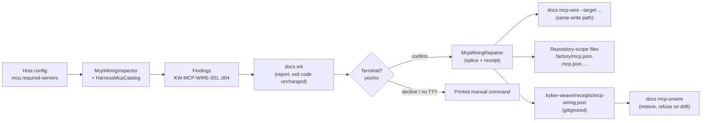

# Design Document

**Phase status:** Approved — 2026-10-31, conductor `AUTONOMOUS_APPROVAL: design-phase-approval`, provenance `autonomous: recommendation accepted`. Recorded as DD17 in the Decisions table.
**Design amendment (2026-10-31, D19):** §5's Defaults bullet was corrected mid-execution to agree with R5.4 as clarified by the requirements' D19 (a conductor-directed correction): a named `mcp-wire` target is not gated on the in-play heuristic, and an absent target file is created.
**Specification status: Ready — approved for execution 2026-10-31 (`AUTONOMOUS_APPROVAL: approve-and-execute`, provenance `autonomous: recommendation accepted`); recorded in [tasks.md](tasks.md) as TK7 and AP1.** Frontmatter `status` stays `draft` because the ontology's closed vocabulary has no `ready` value; the lifecycle Ready is this body status line and the specification index row.
**Requirements:** [requirements.md](requirements.md) — approved 2026-10-31
(`AUTONOMOUS_APPROVAL: requirements-phase-approval`, provenance `autonomous: recommendation
accepted`; recorded there as D15)
**Autonomy:** autonomous
**Development mode:** test-first
**documentation-impact:** `extends-component`. **impact-components:** DocGraph, Distribution.

## Overview

What ships, stated plainly:

1. **A `mcp:` section in the host configuration.** `.kyber-weave/kyber-weave.yml` gains a
   `mcp.required-servers` map declaring the servers the repository's agent instructions
   rely on: launch argv, provenance class (`first-party` / `third-party`), an optional
   level (`required`, default / `recommended`), and an optional manual install command for
   third-party binaries. `docs init` scaffolds it with exactly the `kyber-weave` server
   (D17, R1.3), appends it to an existing configuration that lacks it, and never touches
   it once present — the same host-owned-after-write contract the `review:` block has.
2. **A wiring check inside `docs init`, after scaffolding.** A new Core component
   (`KyberWeave.Core/Docs/Mcp/`) inspects each harness in play and reports, per declared
   server and harness: wired, wired with a different launch command, wired but the launch
   binary is absent, or not wired. Findings carry new `KW-MCP-WIRE-*` rule ids and a
   copy-ready remedy command, and never change `docs init`'s exit code. `--no-mcp-check`
   opts out, the same symmetry as `--no-skill` and `--no-review-gates`.
3. **A terminal-gated yes/no prompt.** When the check found a fixable gap and stdin is an
   interactive terminal, `docs init` asks one confirmation naming the files and servers it
   would write; confirming performs the repair through the same write path as the wire
   command. Redirected or TTY-less stdin never prompts and never writes — the printed
   manual command stands. `docs init` is prompt-free and consent-flag-free today (verified);
   the change to its contract is additive and narrow: one opt-out flag and one prompt seam
   (§4). The requirements are satisfiable inside `docs init` alone (R4.8) — no new
   interactive mode, no `--yes`.
4. **Two new verbs: `docs mcp-wire` and `docs mcp-unwire`.** The repair is a dedicated
   command (D1); its invocation is the consent. `mcp-wire --target <list>` writes
   repository-scope configuration for the named harnesses, insertion-only, receipted;
   with no target it previews and writes nothing (R5.3). `mcp-unwire` restores what the
   receipt records, refusing on drift. `--dry-run` prints the exact per-file change and
   writes nothing, not even the receipt.
5. **A receipt at `.kyber-weave/receipts/mcp-wiring.json`**, gitignored — the writer's
   local undo record, the `kyber capture enable` precedent carried into the docs branch.
6. **A new ADR 0050** recording the D16 boundary: the docs-branch repair writes
   repository-scope harness MCP configuration under the R5 bounds; ADR 0026 stands
   untouched for Kyber Utilities; D-no-settings stands untouched for Squad.
7. **Squad untouched.** No renderer, receipt, install path, roster, `mcp.json`, or
   `squad doctor` change; no `products/kyber-squad/**` file (R7).

The writable set is honest about what is verified: the remedy writes the five JSON shapes
whose entry bodies the runbook documents (Factory, Claude Code, Cursor, VS Code, opencode).
Codex is report-only in v1 — its repository-scope relative-path semantics are unverified,
and an absolute path in a committed file breaks every other teammate (DD11). ZCode is
report-only in v1 — its config tiers and `mcp.servers` key path are verified (G2 closed),
but the entry body ZCode expects inside `mcp.servers` is not pinned anywhere in this
repository, and inventing it risks a config ZCode cannot load (DD12). The Copilot coding
agent is report-only by nature — its configuration is repository settings, not a file
(R2.5). All three are still checked and reported.



## Architecture

### Current state (verified at `8943b6a`)

- `docs init` (`src/KyberWeave.Cli/Commands/Docs/DocsInitCommand.cs`) scaffolds, deploys
  the skill via APM, warns about retired skills, and returns 0 on every degraded path. It
  prompts nowhere; `DocsInitSettings` has no consent flag (`--no-skill`, `--force`,
  `--kyber-standards`, `--no-review-gates`, `--target`, `--docs-root`, `--owner`, `[path]`).
- Host configuration loads through `KyberWeaveConfigLoader.FromDocument`, which merges one
  config class per section: `OntologyConfigLoader`, `HarnessProfileConfigLoader`,
  `DocsAnalysisConfigLoader`, `SquadConfigLoader`, `ConfigRegConfigLoader`,
  `ReviewConfigLoader` — each a `XConfig` + `XConfigLoader` + `XYamlSection` triple
  (`src/KyberWeave.Core/Configuration/`). A new section follows that pattern.
- `DocsScaffolder.WriteHostConfig` creates the host config or edits the existing one for
  the one key `docs init` owns (docs root); `ReviewBlockWriter` appends the `review:`
  block only when the file has none and never rewrites a host-owned section — the exact
  append-if-absent precedent the `mcp:` section follows (`src/KyberWeave.Core/Docs/Scaffolding/DocsScaffolder.cs`).
- `KyberWeaveConfigLoader.FindConfigPath` is the single resolver for the host config file
  (default and legacy locations); writers use it so a writer and the readers agree.
- ZCode's repository-scope shape is verified in
  `src/KyberWeave.Core/Squad/Deployment/ZCodeMcpConfiguration.cs` (against zai-org/ZCode
  3.14.0, 2026-09-21): user file `<storage>/cli/config.json`, project files `<dir>/zcode.json`
  and `<dir>/.zcode/config.json` for every directory from the working directory up to the
  git worktree root, servers under `mcp.servers`. Only server names are read there — the
  entry body is not pinned. **This closes the requirements' G2 with a source.**
- `squad doctor`'s `ReportZCodeMcpConfiguration` keys on the `.zcode/` marker, reports
  non-users as `info`, and reads the toolchain roster — the read-side precedent, in Squad.
  This design takes the shape of that precedent but implements its own catalog in
  `Docs/Mcp`, because the truth source is the host configuration's declaration, not Squad's
  roster (R1.5), and the docs branch does not depend on Squad internals.
- `kyberdash kyber capture enable` (`dash/src/capture/index.ts`) is the safe-writer
  precedent: per-file receipts with digests, byte-for-byte restore on disable, drift
  refusal (`drift` / `conflict` / `unparseable` / `unreadable`), dry-run writing nothing,
  and insertion-only `ensure-if-absent` keys.
- `.kyber-weave/.gitignore` holds `cache/` today, written by the scaffold's
  `WriteAnalysisCacheIgnore` — the merge idiom the receipt directory joins.
- Rule-id families in use: `KW-CONFIG-001/002`, `KW-DOC-*`, `KW-DOC-LIFECYCLE-*`,
  `KW-PARSE-000`, `KW-REVIEW-*`, `KW-SKILL-*`, `KW-SQUAD-*`, and `KW-MCP-ROOT-001/002` (MCP
  server stderr startup diagnostics, `src/KyberWeave.Mcp/Program.cs`). `KW-MCP-WIRE-*` is
  unused and non-colliding.
- Core takes only Markdig and YamlDotNet; JSON uses `System.Text.Json` (in the BCL) — the
  ZCode reader already parses JSON with it. No new dependency is introduced by this design.
- ADR 0026 is scoped to Kyber Utilities and states its rule "for any harness and any
  command" (D13/D16); D-no-settings (archived 2026-09-16 factory-renderer plan) keeps
  Squad out of harness settings; D10 of the in-flight factory-mcp-server-visibility plan
  keeps `squad doctor` out of Factory MCP checks (D18).

### New components

| Component | Location | Responsibility | Requirements |
|---|---|---|---|
| `McpConfig`, `McpConfigLoader`, `McpYamlSection` | `src/KyberWeave.Core/Configuration/` | The `mcp:` section: declaration model, merge, product defaults (empty) | R1 |
| `McpDeclarationBlockWriter` | `src/KyberWeave.Core/Docs/Scaffolding/` | Renders the scaffolded declaration block; appends it to an existing host config only when the section is absent | R1.3 |
| `HarnessMcpCatalog` | `src/KyberWeave.Core/Docs/Mcp/HarnessMcpCatalog.cs` | The eight harnesses: repository-scope path(s), document shape, server key path, in-play signal, writability, entry template | R2, R5.11 |
| `McpWiringInspector` | `src/KyberWeave.Core/Docs/Mcp/McpWiringInspector.cs` | Produces findings: per harness in play, per declared server; launch-command comparison; binary resolution | R2, R3 |
| `LaunchCommandResolver` | `src/KyberWeave.Core/Docs/Mcp/LaunchCommandResolver.cs` | Resolves a command name on `PATH` (and `PATHEXT` on Windows); no process launch | R2.7, R6 |
| `TomlTableScanner` | `src/KyberWeave.Core/Docs/Mcp/TomlTableScanner.cs` | String-region-aware, line-oriented classification of a TOML document; finds `[mcp_servers.<name>]` headers; fails toward refusal | R2 (Codex read), R5.7 |
| `JsonServerSplice` | `src/KyberWeave.Core/Docs/Mcp/JsonServerSplice.cs` | Locates a server entry's byte offset in JSON without re-serializing; computes the insertion plan | R5.4–R5.7 |
| `McpWiringRepairer` | `src/KyberWeave.Core/Docs/Mcp/McpWiringRepairer.cs` | Plans and applies inserts per harness; refuses malformed/foreign/existing; writes the receipt | R5, R6 |
| `McpWiringReceipt` | `src/KyberWeave.Core/Docs/Mcp/McpWiringReceipt.cs` | Receipt load/save/query at `.kyber-weave/receipts/mcp-wiring.json`; drift check | R5.8–R5.10 |
| `DocsMcpWireCommand`, `DocsMcpUnwireCommand` | `src/KyberWeave.Cli/Commands/Docs/` | The two verbs: preview/wire/unwire, exit codes | R5 |
| `DocsInitCommand` + `DocsInitSettings` changes | `src/KyberWeave.Cli/Commands/Docs/` | The check step, the terminal-gated prompt seam, `--no-mcp-check` | R2, R3, R4 |

## Components and interfaces

### 1. The declaration section (R1)

```yaml
mcp:
  # The MCP servers this repository's agent instructions rely on. `docs init` wires these
  # into the harnesses it detects; the declaration is host-owned from the moment it exists
  # and docs init never edits it again. This file is on the review.policy.always-human
  # list in this repository, so every change here escalates for human review by path alone.
  required-servers:
    kyber-weave:
      command: [kyber-weave-mcp, --repo-root, .]
      provenance: first-party
      level: required
    # A third-party server is declared the same way; its binary is never installed by
    # Kyber-Weave. Uncomment when the repository's instructions require it:
    # codegraph:
    #   command: [codegraph, serve, --mcp]
    #   provenance: third-party
    #   level: recommended
    #   install: codegraph init .   # printed verbatim when the binary is absent
```

- `command` is argv (`IReadOnlyList<string>`), never a shell line — the same contract as
  `review.gates`. `provenance` is `first-party` | `third-party` (enum, misspelling refused
  by the loader as a configuration error). `level` is `required` (default) | `recommended`.
  `install` is an optional free-text manual command, printed verbatim on the absent-binary
  path (R6.4).
- `McpConfig.ProductDefaults` is empty (no servers) so an absent section behaves exactly
  as today (R1.4) and an upgrade changes nothing for a host that did not edit its file.
- `McpConfigLoader.Merge` follows the repository rule: lists and maps replace, null
  falls back; unknown keys are ignored by the shared YAML parser, as everywhere else.
- Scaffolding: `DocsScaffolder.HostConfig` gains the `mcp:` block when creating the file;
  when the file exists without an `mcp:` section, `McpDeclarationBlockWriter` appends it
  textually, leaving every other byte unchanged (the `ReviewBlockWriter` idiom). An
  existing `mcp:` section is never rewritten — host-owned from then on (D3 in the
  requirements' lineage: re-running `docs init` never edits host config sections).
- The always-human consequence (D17, R1.6) is stated in the scaffold comment itself (above)
  and in the onboarding page (§9): in this repository, and any host that copies the
  always-human policy, a change to the declaration escalates for human review by path
  alone, before any finding is weighed.

### 2. The harness catalog and the detection model (R2)

`HarnessMcpCatalog` holds one row per harness. Detection is **presence-based and honest
about being a heuristic**: a marker says "worth reporting on", not "this person runs agents
in this harness" — `.vscode/` exists for every VS Code user regardless of MCP. No false
certainty is claimed anywhere in the output.

| Harness | Repository-scope file(s) | Shape / server key | In-play signal | What the check reads | Cannot-detect report |
|---|---|---|---|---|---|
| Factory | `.factory/mcp.json` | JSON, `mcpServers` | `.factory/` directory or the file | the file | `info`, marker named |
| Claude Code | `.mcp.json` | JSON, `mcpServers` | the file only — **no other marker exists** | the file | `info`: no marker besides `.mcp.json`; absence means unknown, not "not in play" (2.4) |
| Cursor | `.cursor/mcp.json` | JSON, `mcpServers` | `.cursor/` directory or the file | the file | `info`, marker named |
| VS Code | `.vscode/mcp.json` | JSON, `servers` | `.vscode/` directory or the file | the file | `info`, marker named |
| Copilot coding agent | none — repository settings, not a file | JSON, `mcpServers`, `type` + `tools` required | none | nothing | `info` with the manual snippet and the workflow-step pointer; never fixable (2.5) |
| Codex CLI | `.codex/config.toml` | TOML, `[mcp_servers.<name>]` | `.codex/` directory or the file | the file, via `TomlTableScanner` | `info`, marker named |
| opencode | `opencode.json` | JSON, `mcp`; `command` is one array; `environment`, not `env` | the file | the file | `info`, marker named |
| ZCode | `zcode.json` and `.zcode/config.json`, working directory to worktree root | JSON, `mcp.servers` | `.zcode/` directory or either file | the project-tier files only — the user tier `<storage>/cli/config.json` is never read (R2.6) | `info`, marker named |

Reading rules:

- **Repository-scope only** (R2.6): no file outside the repository tree is opened by the
  check or the remedy. For ZCode this deliberately narrows the verified tier set to the
  project files; a server configured only in ZCode's user tier is reported `not wired`
  for the repository, which is the correct report for a committed configuration anyway.
- **Entry comparison**: a wired server is compared by name and, when the entry body can be
  read, by launch command (`command`/`args` or the single-array form). A difference is
  reported as `KW-MCP-WIRE-002` naming both values — the report informs, it never edits
  (R5.5).
- **Determinism** (R2.8): findings are ordered by harness (catalog order above), then
  server name (ordinal). The same tree yields the same report on every run.
- The ZCode row's file paths and key path are cited from
  `ZCodeMcpConfiguration.cs` (verified against zai-org/ZCode 3.14.0 on 2026-09-21) — this
  is where requirements G2 is closed. The **entry body inside `mcp.servers`** is not
  pinned by that source or anywhere else in this repository; ZCode is therefore
  snippet-only for the remedy until it is (DD12, DG3).

### 3. The check step and the report (R2, R3)

`docs init` runs the check after the skill deploy and retired-skill warnings, before the
`Next:` block. Output contract (exact wording is implementation detail; the shape is the
contract), printed unfolded via the existing `WriteUnfolded` idiom:

```text
MCP wiring:
  ok    factory: kyber-weave wired
  warn  KW-MCP-WIRE-001 cursor: server 'kyber-weave' is not wired (.cursor/mcp.json)
        Fix: kyber-weave docs mcp-wire --target cursor
  warn  KW-MCP-WIRE-003 factory: server 'kyber-weave' is wired but 'kyber-weave-mcp' is not on PATH
        This Kyber-Weave installation is broken; run: kyber-weave update
  info  KW-MCP-WIRE-004 claude-code: not checked (no '.mcp.json' and no marker to detect it)
```

- Rule ids are new, permanent, declared as `public const string` next to the emitting
  class (`McpWiringInspector`), and added to
  [`docs/ci-pipelines/rule-reference.md`](../../ci-pipelines/rule-reference.md) in the same
  change (the rule that every rule id is documented there):
  - `KW-MCP-WIRE-001` — warning: a declared required server is not wired for an in-play
    harness. Hint: the exact `docs mcp-wire --target <harness>` command.
  - `KW-MCP-WIRE-002` — warning: wired but the launch command differs from the
    declaration; names both. Hint: the wire command, noting it refuses an existing entry.
  - `KW-MCP-WIRE-003` — warning: wired but the launch binary is not resolvable on PATH.
    For a first-party server the hint is the install-repair command (`kyber-weave update`);
    for a third-party server it is the declaration's `install` text or the manual pointer
    (never an installation — `src/KyberWeave.Cli/AGENTS.md`, R6.1).
  - `KW-MCP-WIRE-004` — info: harness not in play or not detectable; names the marker.
  - `KW-MCP-WIRE-005` — error (wire command only): target refused — malformed, foreign,
    or an entry with the same server name already exists; names the file and the reason.
  - `KW-MCP-WIRE-006` — error (unwire only): removal refused — no receipt record for the
    file, or the current digest differs from the receipt's post-write digest (drift).
- Severity by declared level (R1.2): `required` missing → the warning above; `recommended`
  missing → the same line at `info`. Undetectable harnesses are always `info` (2.4) and
  never fail anything (3.4).
- **Exit code unchanged** (3.4): `docs init` returns 0 whenever the scaffold succeeded,
  exactly as the APM-missing and retired-skill paths do. Declined, refused, or impossible
  repairs are warnings. A malformed declaration is the one exception — it fails the
  configuration load itself and surfaces as the existing `KW-CONFIG-001` before the check
  runs (3.6).
- A binary that is present but whose server is unconfigured is the ordinary `001` finding,
  and it is **fixable**: the binary resolves, so the repair may write the entry (§5). A
  binary that is absent makes the server non-fixable everywhere (R6.2) — the repair
  refuses to write an entry that cannot launch, per harness, and says so.
- `--no-mcp-check` on `DocsInitSettings` skips the check, the prompt, and any repair, and
  prints one line saying so (4.6). An empty or absent declaration makes the check print
  nothing (R1.4).
- All-verified confirmation (3.5): when every declared server is wired and launchable for
  every in-play harness, the section prints one `ok` line per harness and no warnings.

### 4. The prompt (R4)

`DocsInitCommand` gains an internal seam, defaulting to the real behavior, injectable by
tests (`InternalsVisibleTo` already exposes internals to `KyberWeave.Tests`):

```csharp
internal static Func<IReadOnlyList<McpWiringFix>, bool>? ConfirmFixOverride;
```

where `McpWiringFix` names the target file, harness, and servers that would be written.
The default, when the override is null:

1. If `Console.IsInputRedirected || Console.IsOutputRedirected` — a redirected stdin
   cannot answer and a redirected stdout must not receive interactive markup — the prompt
   is skipped, nothing is written, and the findings' printed manual command stands (4.4).
   CI and piped runs land here by construction; the command never blocks.
2. Otherwise `AnsiConsole.Confirm` renders the question naming every file and server in
   the fix list (4.1). Confirming runs the same repair path as `docs mcp-wire` (4.2);
   declining writes nothing (4.3).

The prompt is offered only after scaffolding succeeded (4.7) — the check and prompt sit
after `TryScaffold` returns 0. `docs init` gains no consent flag (4.5, D5): a script that
wants the repair runs `docs mcp-wire`, whose invocation is the consent. **Satisfiability
answer (R4.8): this is satisfiable inside `docs init` alone.** The change to the command's
contract is additive and narrow — one opt-out flag (`--no-mcp-check`), one terminal-gated
prompt, zero changes to existing flags or exit codes — and the report-only fallback is not
needed.

### 5. The repair commands (R5)

Surface (registered under the `docs` branch, hyphenated verbs matching `export-graph` and
`integrity-check`; D1 keeps them off `docs init`):

```bash
kyber-weave docs mcp-wire [path] [--target <targets>] [--dry-run]
kyber-weave docs mcp-unwire [path] [--target <targets>]
```

- `path` defaults to `.` like `docs init`. `--target` is a comma list, mirroring
  `docs init --target`.
- **Defaults (5.3)**: with no `--target`, `mcp-wire` lists the harnesses in play and the
  fixable gaps and writes nothing (exit 0) — writing requires naming the harnesses; the
  preview also names each writable harness that no marker can detect in this tree (Claude
  Code and opencode when their files are absent), because naming it is the only way to
  write it. With `--target`, only the named harnesses are considered, and a named harness
  is **not** gated on the in-play heuristic: the selection is the operator's consent
  (R5.1, D19), so a named harness whose target file does not exist is created per the
  File-creation bullet below — for Claude Code and opencode, whose only repository-scope
  artefact is the file itself, "not in play" and "file absent" are the same condition,
  and creation is the answer. A named harness that has no fixable gap — its file exists
  and already holds every declared server — is reported and skipped, and is not an error.
- **Scopes (5.2)**: repository-scope files only. User-scope paths are never written, and
  are not read either (D8); where a harness's only fixable location is user scope the
  report says so and prints the runbook snippet.
- **Exit codes (D14)**: `mcp-wire` exits 0 when every requested target was written (or
  there was nothing to write); 1 when any requested target was refused (refusal is an
  error outcome of the requested operation, mirroring `docs validate`'s any-error rule)
  or the configuration could not load. `mcp-unwire` exits 0 when every requested file was
  restored or had no record; 1 on any drift or missing-record refusal. `--dry-run` prints
  the exact per-file change, writes nothing including the receipt (5.10), and exits what
  the real run would have exited.
- **Fixable set**: Factory, Claude Code, Cursor, VS Code, opencode (the five runbook-verified
  JSON entry bodies). Codex and ZCode are reported with snippets in v1 (DD11, DD12);
  Copilot coding agent is snippet-only by nature. The catalog row carries writability, so
  widening later is a catalog edit plus a pinned entry body — not a structural change.

**Insertion without re-serialization.** The invariant behind 5.4–5.6 is that no harness
document is ever parsed into a model and written back out. Every write is a byte splice
computed by reading, never a re-serialization:

- **JSON family** (`JsonServerSplice`): the document is read with `Utf8JsonReader`
  (`JsonReaderOptions` with `CommentHandling.Skip` and `AllowTrailingCommas` — lenient
  read, so a commented or comma-tolerant file is a valid target, while its comments are
  preserved untouched because the write never rewrites them). The reader's position
  tracking locates the byte offset of the target container:
  - if the server key path (`mcpServers` / `servers` / `mcp` → `servers` for ZCode — read
    side) already holds an entry with the server's name → refuse `KW-MCP-WIRE-005`,
    nothing written (5.5);
  - if the container exists and is empty → splice the serialized entry right after its
    opening `{`;
  - if the container exists and is non-empty → splice after the opening `{` a
    pretty-printed entry followed by a comma, so the existing first member keeps its exact
    bytes (5.6);
  - if the container key is absent → splice `"key": { … },` immediately after the root
    object's opening `{` (after any BOM).
  - parse failure or a non-object root → refuse `005` (5.7).
  The inserted text is formatted at 2-space indent matching the runbook examples; the
  bytes around the splice are untouched, byte-for-byte, which R10's tests pin directly.
- **TOML**: `TomlTableScanner` is a read-side classifier, not a parser: line-oriented,
  tracking `"""` / `'''` and single-line string regions so a header-looking line inside a
  string is never mistaken for one; it reports existing `[mcp_servers.<name>]` headers,
  unbalanced delimiters, or unclassifiable content — and every uncertainty resolves toward
  refusal, never toward a write. **No TOML writer ships in v1** (DD11): the scanner serves
  the Codex check (is the server already wired?), and the wire command refuses Codex as
  non-writable with the runbook snippet. This keeps the repository's no-third-dependency
  rule intact and never risk a duplicate-table corruption of a user's TOML.
- **File creation (5.4)**: when the target file does not exist, the repair writes the full
  canonical document from the catalog's template (the runbook example, exactly), creating
  parent directories. Which file: an existing in-play file is preferred; otherwise the
  canonical path (`.factory/mcp.json`, `.mcp.json`, `.cursor/mcp.json`, `.vscode/mcp.json`,
  `opencode.json`).
- **Receipt (5.8–5.10)**: `.kyber-weave/receipts/mcp-wiring.json`, gitignored —
  `docs init` merges `receipts/` into `.kyber-weave/.gitignore` beside `cache/`
  (`WriteAnalysisCacheIgnore` idiom). Schema:

  ```json
  {
    "version": 1,
    "files": [
      {
        "path": ".factory/mcp.json",
        "mode": "inserted",
        "servers": ["kyber-weave"],
        "preSha256": "…",
        "postSha256": "…",
        "writtenAtUtc": "2026-10-31T12:00:00Z"
      }
    ]
  }
  ```

  One record per file, latest write wins. `mcp-unwire` restores the `preSha256` content for
  `inserted` records and deletes the file for `created` records — but only after checking
  the current digest equals `postSha256`; any mismatch is drift and is refused with
  `KW-MCP-WIRE-006` rather than restoring over foreign edits (5.9). The receipt is the
  writer's local undo record, like the capture receipt: teammates receive the committed
  configuration file; they never need the receipt, and `git revert` is their removal path.

### 6. Absent third-party binary (R6)

`LaunchCommandResolver` resolves the first token of the declared `command` against `PATH`
entries (and `PATHEXT` on Windows) — a file-existence check, no process launch, no
cross-branch dependency on Squad's `McpProcessProbe`. Outcomes:

- Present, declared, not wired → `001`, fixable (the repair may write the entry).
- Absent, declared → `003`-class finding degraded: the repair refuses that server for
  every harness (6.2), and the report prints the declaration's `install` text verbatim, or
  the manual pointer when the declaration carries none. Nothing is ever installed (6.1).
- First-party `kyber-weave-mcp` absent → the finding says the Kyber-Weave installation is
  broken and points at `kyber-weave update` or the install script, not at harness
  configuration (6.3). The repair also refuses: writing an entry for a binary the CLI
  cannot see produces a harness-side startup failure that blames the config file.

### 7. Squad is untouched (R7)

No `products/kyber-squad/**` file changes. No change to any renderer, Squad's receipt, or
`squad install`/`update` (D-no-settings stands); `squad doctor` is untouched (D18); the
Factory per-droid `mcpServers` whitelist is Squad's and unrelated — this feature wires the
**session-level** configuration the whitelist draws its names from, and invents no server
names (it wires exactly what the host declared). The check and repair read no Squad state
(7.2). One sentence is added to `docs/kyber-squad/architecture.md` naming the split: Squad
owns droid-level visibility; `docs init` + `docs mcp-wire` own harness-level wiring (H7).

### 8. The ADR boundary (R8)

**ADR 0050** (`docs/adr/0050-docs-branch-writes-repository-scope-mcp-configuration.md`)
records the D16 decision before the remedy ships (R8.3 — the ADR lands in the same pull
request as the write path, before any file outside this repository is written):

- Context: ADR 0026 (Kyber Utilities) and D-no-settings (Squad) both stand; neither is
  amended. The observed `architect` `STATUS: BLOCKED` failures and the runbook's
  seven-recipe, zero-detection state.
- Decision: the docs branch's repair (`docs mcp-wire`, and `docs init`'s confirmed
  prompt) **may write repository-scope harness MCP configuration files** — the committed,
  team-shared documents listed in the catalog — under the R5 bounds: per-target opt-in,
  insertion-only, receipt with drift-refusing removal, refusal on malformed or foreign
  files, dry-run, never a reformat of bytes it did not write.
- The repository-scope versus user-scope distinction ADR 0026 never drew: user-scope
  files (under `$HOME`) are never written or read by these commands; ADR 0026's rule
  remains true without exception for Kyber Utilities, and Squad's without exception for
  Squad.
- Rejected alternatives: snippet-only remedy (the degradation path, recorded as available);
  extending Squad or Kyber Utilities; a general harness-settings writer.

### 9. Documentation (R9)

- [`docs/docgraph/mcp-runbook.md`](../../docgraph/mcp-runbook.md): a ZCode row in the
  wiring table (file paths and `mcp.servers` per the verified source, entry body marked
  unpinned), and a "Checking and wiring" section: the `docs init` check, `--no-mcp-check`,
  the prompt's non-interactive behaviour, `docs mcp-wire`/`mcp-unwire` with flags and
  exit codes, the receipt and its location, and the writable-set boundary (Codex/ZCode/
  Copilot snippet-only).
- [`docs/docgraph/onboarding.md`](../../docgraph/onboarding.md): the check among the
  steps `docs init` performs; the always-human consequence of editing the declaration.
- [`docs/cli-command-surface.md`](../../cli-command-surface.md): both verbs with flags
  and exit codes; `docs init`'s new check step and `--no-mcp-check`.
- [`docs/configuration.md`](../../configuration.md): the `mcp.required-servers` schema.
- [`docs/ci-pipelines/rule-reference.md`](../../ci-pipelines/rule-reference.md): the six
  `KW-MCP-WIRE-*` ids.
- [`docs/adr/0050-…`](../../adr/README.md) and the `docs/adr/README.md` index row; the
  one-sentence Squad split in [`docs/kyber-squad/architecture.md`](../../kyber-squad/architecture.md).
- [`docs/install.md`](../../install.md): one line — what an adopting repository's `docs
  init` now checks and offers.

## Data models

- `RequiredMcpServer(string Name, IReadOnlyList<string> Command, McpProvenance Provenance,
  McpLevel Level, string? Install)`; `McpConfig(IReadOnlyDictionary<string, RequiredMcpServer>
  RequiredServers)`; `McpYamlSection` mirrors the YAML keys hyphenated.
- `McpWiringFinding(McpWiringKind Kind, string Harness, string Server, string? Path,
  string Code, string Message, string Hint, McpWiringFixability Fixable)` — `Kind`:
  `NotWired`, `CommandDiffers`, `BinaryAbsent`, `NotDetectable`.
- `McpWiringFix(string Harness, string Path, IReadOnlyList<string> Servers, bool Create)`.
- Receipt records as the JSON above; digests are SHA-256 over raw bytes.
- Entry templates live in the catalog as the runbook's documented JSON, exactly:

  ```json
  // .factory/mcp.json — also .cursor/mcp.json with "type"; .mcp.json adds "type": "stdio"
  { "mcpServers": { "kyber-weave": { "command": "kyber-weave-mcp", "args": ["--repo-root", "."] } } }
  // .vscode/mcp.json
  { "servers": { "kyber-weave": { "type": "stdio", "command": "kyber-weave-mcp",
      "args": ["--repo-root", "${workspaceFolder}"], "env": { "KYBER_WEAVE_REPO_ROOT": "${workspaceFolder}" } } } }
  // opencode.json
  { "mcp": { "kyber-weave": { "type": "local", "command": ["kyber-weave-mcp", "--repo-root", "."],
      "enabled": true, "environment": { "KYBER_WEAVE_REPO_ROOT": "." } } } }
  ```

## Error handling

| Condition | Outcome |
|---|---|
| Declaration malformed (loader rejects) | Existing `KW-CONFIG-001` path; `docs init` fails as today (3.6) |
| Harness not in play / not detectable | `info` `KW-MCP-WIRE-004`; never a warning, never an exit change (2.4) |
| Target file malformed, foreign, or holds the server name | Refusal `KW-MCP-WIRE-005`; nothing written to that file; other targets proceed; exit 1 |
| Removal without a receipt record, or digest drift | Refusal `KW-MCP-WIRE-006`; exit 1 (5.9) |
| Absent third-party binary | Finding + manual pointer; that server refused everywhere (6.2) |
| Absent first-party binary | Finding pointing at install repair; server refused (6.3) |
| IO failure (read or write) | Reported with the file path; the command exits 1; partial writes do not occur — the splice is computed fully before the first byte is written, and the receipt is written after the file succeeds |
| Unknown declaration keys | Ignored by the shared parser, consistent with every other section |

## Testing strategy (test-first, R10)

Test-first: every class below gets its failing tests before the implementation (10.3).
Core tests drive everything through the pure functions; CLI tests pin the seams.

- `McpConfigLoaderTests` — schema, defaults, replacement merge, level default (R1).
- `McpDeclarationBlockWriterTests` — created-with-section, append-when-absent leaves
  every other byte unchanged, present-section never rewritten (R1.3).
- `HarnessMcpCatalogTests` + `McpWiringInspectorTests` — fixture repositories per shape
  and per marker state: wired, not wired, command differs, binary absent (injectable
  `PATH` via `LaunchCommandResolver` seam), undetectable, no declaration (R2, R3).
- `JsonServerSpliceTests` — byte preservation outside the insert; empty/non-empty/absent
  container; BOM; comments preserved; existing-name refusal; malformed refusal (5.4–5.7).
- `TomlTableScannerTests` — header detection inside and outside string regions; unbalanced
  delimiter refusal; fail-toward-refusal (2, Codex read).
- `McpWiringRepairerTests` + `McpWiringReceiptTests` — creation vs insertion; dry-run
  writes nothing (not even the receipt); receipt digests; unwire restore; drift refusal
  (5.8–5.10).
- `DocsInitMcpCheckTests` — end-to-end over fixture repos: exit code 0 with findings;
  `--no-mcp-check`; the prompt seam confirming, declining, and the redirected-stdin
  no-prompt path (4.1–4.6); the prompt never reached on scaffold failure (4.7).
- `DocsMcpWireCommandTests` — target selection, defaults preview, exit codes, refusals
  (5.1–5.3).
- Live acceptance stays the owner's check and is not automated (10.2, G3): a real
  harness session reaching the server after the repair, `[NOT LIVE-VERIFIED]` until done.

## Requirement traceability

| Requirement | Sections |
|---|---|
| R1 declaration | §1 |
| R2 detection surface | §2, §3 |
| R3 report and exit codes | §3 |
| R4 prompt and non-interactive behaviour | §4 |
| R5 repair command and write bounds | §5 |
| R6 absent third-party binary | §6 |
| R7 Squad untouched | §7 |
| R8 ADR boundary | §8 |
| R9 documentation | §9 |
| R10 testability | Testing strategy |

## Design harvest

| ID | Design item (section) | Target component | Target doc type |
|---|---|---|---|
| H1 | The per-harness shape catalog — files, keys, in-play markers, writability, substitution semantics; ZCode cited from `ZCodeMcpConfiguration.cs`; ZCode row added to the runbook (§2) | DocGraph | runbook |
| H2 | The `mcp.required-servers` declaration schema, scaffold default, and the always-human escalation consequence (§1) | DocGraph | reference |
| H3 | The `docs init` check step: `KW-MCP-WIRE-001..004` ids, severities, unchanged exit code, `--no-mcp-check` (§3) | DocGraph · CI Pipelines | onboarding · reference |
| H4 | The prompt and non-interactive contract: terminal-gated, decline-on-redirect, no consent flag, satisfiable inside `docs init` alone (§4) | DocGraph | reference |
| H5 | `docs mcp-wire` / `docs mcp-unwire`: target selection, insertion-without-re-serialization per shape, receipt and drift-refusing removal, dry-run, exit codes (§5) | DocGraph | runbook · reference |
| H6 | ADR 0050 — the D16 repository-scope write exception versus ADR 0026 (§8) | DocGraph | adr |
| H7 | The docs-init / Squad split: Squad owns droid-level visibility, the docs branch owns harness-level wiring, Squad writes nothing (§7) | KyberSquad | architecture |

## Decisions

| ID | Question | Answer / decision | Mitigating and supporting information | Status / approval provenance |
|---|---|---|---|---|
| DD1 | What is the repair command's surface? | Two `docs`-branch verbs: `docs mcp-wire` and `docs mcp-unwire`, hyphenated like `export-graph` and `integrity-check`, with `[path]`, `--target`, `--dry-run`. | D1 requires diagnosis and repair in separate commands; branch convention keeps verbs flat and hyphenated. Flags on `docs init` were rejected by D1/D5. Cheap to reverse before release. | autonomous: recommendation accepted |
| DD2 | What is the declaration schema? | `mcp.required-servers.<name>` map: `command` (argv), `provenance` (first-party/third-party), `level` (required default/recommended), optional `install` free text. `McpConfig.ProductDefaults` empty; `XConfig/XConfigLoader/XYamlSection` triple. | Mirrors the `SquadConfig` pattern exactly; argv-not-shell matches `review.gates`; empty defaults mean no behavior change on upgrade (R1.4). | autonomous: recommendation accepted |
| DD3 | How does `docs init` place the section? | Creates it in a fresh host config; appends it textually to an existing config lacking it, leaving every other byte unchanged; never rewrites a present section. | The `ReviewBlockWriter` precedent is the verified in-repo idiom for exactly this lifecycle; host-owned-after-write is the standing `docs init` rule. | autonomous: recommendation accepted |
| DD4 | How is "harness in play" decided, honestly? | Presence heuristics per harness (file or marker directory), `info` when undetectable, and the output never claims the heuristic is certainty — Claude Code is called out as the one harness with no marker besides the file itself. | `ReportZCodeMcpConfiguration`'s `.zcode/` marker idiom; the requirements make "cannot detect" a first-class outcome (2.4). | autonomous: recommendation accepted |
| DD5 | How is the launch binary checked? | `LaunchCommandResolver`: PATH/PATHEXT file-existence check in Core. Not Squad's `McpProcessProbe`, no process launch, no cross-branch dependency. | A wiring check needs resolvable-on-PATH, not a version probe; the docs branch does not depend on Squad internals (R1.5). | autonomous: recommendation accepted |
| DD6 | Which rule ids? | New family `KW-MCP-WIRE-001..006`, consts next to emitters, added to `rule-reference.md`. `KW-MCP-ROOT-001/002` are taken by the MCP server's stderr diagnostics; `KW-MCP-WIRE-*` is free. | Rule ids are permanent (repository rule); a fresh family avoids renumbering risk entirely. | autonomous: recommendation accepted |
| DD7 | Does a `recommended` server warn? | No: `info`, same line shape. `required` (the default) warns. | R1.2's two levels need visibly different severities or `level` would be decorative. | autonomous: recommendation accepted |
| DD8 | How is the prompt implemented, given `docs init` is prompt-free today? | An internal static `ConfirmFixOverride` seam plus `Console.IsInputRedirected || IsOutputRedirected` gating; default renders `AnsiConsole.Confirm`. Non-interactive never prompts, never writes. | The contract change to `docs init` is additive: one flag, one seam; no existing flag or exit code moves (R4.8). Tests inject the seam; `InternalsVisibleTo` is already the pattern. Cost of wrong: mechanism choice inside one command, cheap to reverse. | autonomous: low-confidence, no authoritative source |
| DD9 | How is insertion done without re-serializing JSON? | `JsonServerSplice`: `Utf8JsonReader` position tracking locates the container's byte offset; the entry is spliced with a leading comma into non-empty containers, after the root `{` when the key is absent; lenient read (comments, trailing commas); BOM preserved. | Byte-preservation is directly testable (5.6); `dash/src/capture`'s `edit-json.ts` proves the same approach in this repository's other first-party code. No new dependency — `System.Text.Json` is BCL. | autonomous: low-confidence, no authoritative source |
| DD10 | How is TOML handled? | Read side only in v1: `TomlTableScanner`, a string-region-aware classifier that fails toward refusal. No TOML writer ships. | A hand-rolled TOML parser would risk the exact corruption R5 bounds forbid; the no-third-dependency rule blocks a parser package; the one writable TOML harness is report-only anyway (DD11). | autonomous: low-confidence, no authoritative source |
| DD11 | Is Codex writable in v1? | No — report + snippet only. Its repository-scope relative-path semantics (`--repo-root .` resolving against what?) are unverified, and the runbook's verified form (absolute path) cannot go into a committed file without breaking every other teammate. | The check still covers Codex (marker, wired/not-wired via the scanner); widening later needs one verified fact plus a catalog edit. Decided as DD19 under the design-phase approval (2026-10-31): snippet-only v1 confirmed as a deliberate, temporary narrowing. | decided as DD19; autonomous: recommendation accepted |
| DD12 | Is ZCode writable in v1? | No — report + snippet only. The config tiers and `mcp.servers` key path are verified (G2 closed, cited); the entry body inside `mcp.servers` is pinned nowhere in this repository, and inventing it risks a config ZCode cannot load. | Same widening path as DD11: pin the entry body against ZCode's `mcpSchema` (the same source the 2026-09-21 verification used), then flip the catalog row. Decided as DD18 under the design-phase approval (2026-10-31): snippet-only v1 confirmed as a deliberate, temporary narrowing. | decided as DD18; autonomous: recommendation accepted |
| DD13 | Where does the receipt live? | `.kyber-weave/receipts/mcp-wiring.json`, gitignored via the scaffold's `.kyber-weave/.gitignore` merge (`receipts/` beside `cache/`). One record per file, latest write wins, SHA-256 pre/post digests. | The `WriteAnalysisCacheIgnore` precedent for the gitignore; the capture receipt for the record shape and drift refusal. The receipt is the writer's local undo record; teammates' removal path is `git revert`. | autonomous: recommendation accepted |
| DD14 | What are the repair commands' exit codes? | 0 on success or nothing-to-do; 1 on any requested-target refusal or config load failure; `--dry-run` exits what the real run would. `docs init`'s exit code never moves. | Mirrors the `docs validate` any-error rule and the CLI's exit-code contract table; refusal of a requested operation is an error, not a warning, because the invocation is explicit consent. | autonomous: recommendation accepted |
| DD15 | Which ADR records the boundary, and when? | ADR 0050, in the same pull request as the write path — before any file outside this repository is written. It draws the repo-scope/user-scope distinction ADR 0026 lacks and leaves both ADR 0026 and D-no-settings intact. | D16 decided the substance; R8.3 fixes the timing; the corpus validates the ADR's existence at closeout. The number is 0050 by DD20's correction of the original 0046 allocation. | autonomous: recommendation accepted |
| DD16 | Is Squad affected anywhere? | No. No Squad file, renderer, receipt, install path, roster read, or doctor change. The one Squad document touched is a sentence naming the split (H7). | Verified against the Squad tree and required by R7; D18 closed the doctor question; the Factory droid whitelist is session-level wiring's consumer, not its writer. | autonomous: recommendation accepted |
| DD17 | Is this design approved? | Yes: design phase approved; proceed to tasks. | Conductor gate `AUTONOMOUS_APPROVAL: design-phase-approval` (2026-10-31). Gate evidence, from the conductor's run against this checkout (2026-10-31): `docs_status` reported `provenance: root=/Users/dave/git/personal/factory/kyber-weave rev=8943b6a dirty=yes documents=142`, a root identical to `git rev-parse --show-toplevel` for this checkout (branch `feat/squad-response-format`, HEAD `8943b6a`), so the provenance root matches; `docs validate .` (no `--merge-ready`, this specification active) — `result: pass`, 0 errors, 0 warnings; `docs drift .` — `result: pass`, 0 errors, 0 warnings. DG1 is closed by this evidence. | autonomous: recommendation accepted |
| DD18 | DG3: Is ZCode writable in v1, given the entry body inside `mcp.servers` is unpinned? | No — snippet-only for v1: a deliberate, temporary narrowing, not an omission. The remedy writes no ZCode configuration until the entry body is pinned against ZCode's `mcpSchema` — the same source the 2026-09-21 verification used. The check still covers ZCode: a ZCode user is told what is missing and given the snippet, and the remedy writes nothing for that harness. Widening is the declared path: pin the entry body against `mcpSchema`, add the runbook row, flip the catalog's writability — a catalog edit, not a structural change. | Decided on the design's recommendation under the conductor's design-phase approval (2026-10-31). Inventing the entry body risks a config ZCode cannot load — the exact corruption class the R5 bounds exist to prevent. | autonomous: recommendation accepted (conductor, 2026-10-31) |
| DD19 | DG4: Is Codex writable in v1, given its repository-scope relative-path semantics are unverified? | No — snippet-only for v1: a deliberate, temporary narrowing, not an omission. The remedy writes no Codex configuration until its repository-scope relative-path semantics (`--repo-root .` resolving against what?) are verified against Codex's own documentation or source; the runbook's verified absolute-path form cannot go into a committed file without breaking every other teammate. The check still covers Codex: the user is told what is missing and given the snippet, and the remedy writes nothing for that harness. Widening is the declared path: verify the semantics, add the runbook form, flip the catalog's writability. | Decided on the design's recommendation under the conductor's design-phase approval (2026-10-31). | autonomous: recommendation accepted (conductor, 2026-10-31) |
| DD20 | Which ADR number records the D16 boundary, given the tree has moved since the allocation was made? | ADR 0050, `docs/adr/0050-docs-branch-writes-repository-scope-mcp-configuration.md`. The bundle originally allocated 0046; that number is taken on this branch's base by `0046-docs-explore-section-answer.md`, as are 0047 and 0048, and 0049 is claimed by an open pull request (#489). 0050 is the next number that cannot collide with a record about to land. | The original allocation was made against an incomplete view of the tree: the authoring branch predated ADRs 0046–0048, so 0046 looked free when it was not. Executing as written would have put two records on one number and made every "ADR 0046" citation ambiguous. The requirements name "a new ADR" without a number (D13/D16, R8), so no approved requirement text changes; every bundle reference (§8, §9, H6, DD15, the closeout mapping; tasks 5 and 11, TK2) now names 0050 and agrees with this row. | autonomous: recommendation accepted (conductor-directed correction, 2026-10-31) |

## Closeout mapping

_To be completed at closeout: each design decision (DD1–DD16), each harvest item (H1–H7),
and the requirements' D15–D18 mapped to their destination, with the ADR disposition
(ADR 0050, per §8) and the two merge-ready documentation checks recorded._

## Gaps carried forward

- **DG1 (closed 2026-10-31):** `docs validate .` and `docs drift .` could not be run by the
  authoring session — the harness has neither the kyber-weave docs MCP tools nor a shell
  (requirements G1's limitation, still true here). **Closed by the conductor's run against
  this checkout (2026-10-31):** `docs_status` reported
  `provenance: root=/Users/dave/git/personal/factory/kyber-weave rev=8943b6a dirty=yes documents=142`,
  a root identical to `git rev-parse --show-toplevel` for this checkout (branch
  `feat/squad-response-format`, HEAD `8943b6a`), so the provenance root matches;
  `docs validate .` (no `--merge-ready`, this specification active) — `result: pass`,
  0 errors, 0 warnings; `docs drift .` — `result: pass`, 0 errors, 0 warnings. The results
  stand for this checkout and are the gate evidence recorded in DD17.
- **DG2 (closed in this design):** the requirements' G2 — ZCode's repository-scope
  configuration shape — is pinned and cited from
  `src/KyberWeave.Core/Squad/Deployment/ZCodeMcpConfiguration.cs` (verified against
  zai-org/ZCode 3.14.0 on 2026-09-21): project files `zcode.json` and
  `<dir>/.zcode/config.json` from the working directory to the worktree root, servers
  under `mcp.servers`. What that source does **not** pin is the entry body, which is DG3.
- **DG3 (decided 2026-10-31, as DD18):** ZCode's entry body inside `mcp.servers`
  (command/args or other keys) is pinned nowhere in this repository. Until it is pinned
  against ZCode's `mcpSchema` — the same source the 2026-09-21 verification used — ZCode
  is snippet-only (DD12, DD18): a deliberate, temporary narrowing, not an omission. The
  check still covers ZCode. Flipping it later is a catalog edit plus the runbook row, not a
  structural change.
- **DG4 (decided 2026-10-31, as DD19):** Codex's repository-scope relative-path semantics
  are unverified (what does `--repo-root .` resolve against in a Codex-launched MCP
  server?). Codex is snippet-only (DD11, DD19) until that fact is verified against Codex's
  own documentation or source — again a deliberate, temporary narrowing, not an omission.
  The check still covers Codex; widening is the declared path in DD19.
- **DG5:** Live acceptance (a real harness session reaching the server after the repair)
  remains the owner's check, `[NOT LIVE-VERIFIED]` until performed (requirements G3).
- **DG6:** The requirements' G4 (exact spellings deferred) is resolved by this design:
  verbs `docs mcp-wire` / `docs mcp-unwire`, flag `--no-mcp-check`, ids
  `KW-MCP-WIRE-001..006`, section `mcp.required-servers`, receipt
  `.kyber-weave/receipts/mcp-wiring.json`. Design names them; tasks pins them in tests.
