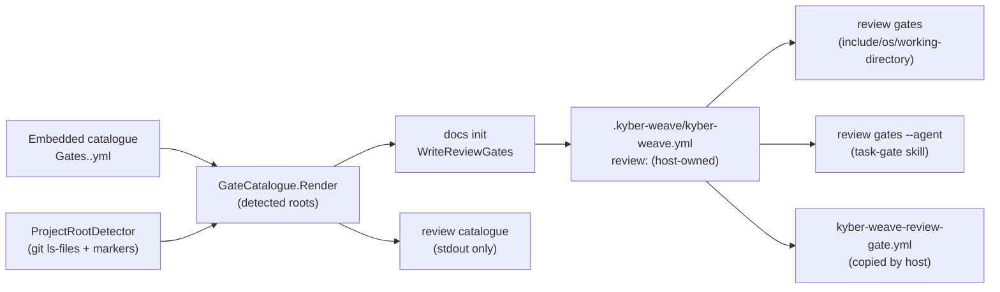

# Design Document

**Phase status:** Approved (autonomous: recommendation accepted (conductor AUTONOMOUS_APPROVAL, 2026-10-27))
**Requirements:** [requirements.md](requirements.md) (approved 2026-10-27)
**documentation-impact:** `extends-component`. **impact-components:** ReviewCouncil, DocGraph,
KyberSquad, CI Pipelines, Distribution.

## Overview

What ships, stated plainly:

1. **A gate catalogue inside the binary.** It has one YAML file per technology family,
   embedded the way the coding standards already are.
2. **`docs init` writes a `review:` block** into the host's `.kyber-weave/kyber-weave.yml`.
   The block holds council gates and per-agent task gates for the declared technologies,
   aimed at the project roots `docs init` finds. After that the host owns the block.
   Re-running `docs init` never edits it.
3. **Two new gate keys.** `include` and `os` on council gates (same as task gates), and an
   optional `working-directory` on both kinds of gate.
4. **`kyber-weave review catalogue`.** It prints the rendered catalogue YAML and writes
   nothing. A host uses it to pick up gates added in later releases.
5. **A copy-ready workflow, `templates/github-actions/kyber-weave-review-gate.yml`.**
   **No command writes into `.github/workflows/`.** The owner said "when it installs its CI
   pipelines", but nothing in Kyber-Weave installs CI today: the three existing workflows are
   samples the host copies (`templates/github-actions/`). This design keeps that model (D6).
   `docs init` prints where to get the workflow when it writes gates.
6. **Squad shows a one-line hint** when it deploys agents into a project that has no task
   gates.

Nothing is applied at load time. `ReviewConfig.ProductDefaults` stays empty
(`src/KyberWeave.Core/Configuration/ReviewConfig.cs:139`), so an upgrade never changes what a
host runs (R3.5, D1).



## Architecture

### Current state (verified at `1d2439ae`)

- `ReviewConfigLoader.Merge` returns the defaults when `review:` is absent
  (`src/KyberWeave.Core/Configuration/ReviewConfigLoader.cs:17-33`).
- `ReviewGateYaml` has only `Id`, `Run`, `Blocking` and `TimeoutSeconds`. `ReviewTaskGateYaml`
  adds `Include`, `Os`, `Fix` and `Timeout` (`src/KyberWeave.Core/Configuration/ReviewYamlSection.cs:28-55`). The shared
  deserializer ignores unmatched keys (`src/KyberWeave.Core/Configuration/KyberWeaveYamlParser.cs:27`, through
  `MarkdownFrontmatterReader.Deserializer`).
- `GateRunner.RunArgv` starts every gate in the repository root
  (`src/KyberWeave.Core/Review/GateRunner.cs:117-170`). A process that cannot start already
  reports `could not start '<program>'`, but under the same outcome id as a failed check,
  `KW-REVIEW-022`. The outcome is chosen at
  `src/KyberWeave.Cli/Commands/Review/ReviewGatesCommand.cs:78` for council gates and `:190`
  for agent gates, and the constant is defined at `:250`.
- Running council gates refuses `--paths` and `--base` without `--agent`
  (`src/KyberWeave.Cli/Commands/Review/ReviewGatesCommand.cs:30-38`).
- `ChangedFiles.ResolveSinceMergeBase` already gives the merge-base changed set that
  `docs validate --merge-ready` uses (`src/KyberWeave.Core/Review/ChangedFiles.cs:93`).
  `TaskGateSelection.Plan` does the `include` and `os` matching for task gates
  (`src/KyberWeave.Core/Review/TaskGateSelection.cs`).
- `docs init` writes the host config through `DocsScaffolder.WriteHostConfig`, which leaves
  an existing file alone except for `docs-root` and `technologies`
  (`src/KyberWeave.Core/Docs/Scaffolding/DocsScaffolder.cs:303-338`, `HostConfigYaml.WithTechnologies`).
- The standards are embedded as `Standards.<tech>.md` from
  `products/kyber-squad/standards/<tech>/README.md` and loaded by
  `KyberStandardsTemplates.LoadEmbeddedTemplates` (`src/KyberWeave.Core/Docs/Scaffolding/KyberStandardsTemplates.cs:173-192`;
  the 14 `EmbeddedResource` entries are at `src/KyberWeave.Core/KyberWeave.Core.csproj:25-38`).
- `squad install` knows whether it is deploying into a project or globally
  (`src/KyberWeave.Cli/Commands/Squad/SquadInstallCommand.cs:66`, `SquadDeploymentScope.Project`).

### New components

| Component | Location | Responsibility | Requirements |
|---|---|---|---|
| Catalogue files | `products/kyber-squad/standards/<family>/gates.yml`, embedded as `Gates.<family>.yml` | Per-family gate templates | R1 |
| `GateCatalogue` | `src/KyberWeave.Core/Review/Catalogue/GateCatalogue.cs` | Loads embedded files, maps technology to family, renders YAML for a set of roots | R1, R2, R4, R6 |
| `ProjectRootDetector` | `src/KyberWeave.Core/Review/Catalogue/ProjectRootDetector.cs` | Finds marker files, applies the nesting rule, orders by ordinal path | R4 |
| `ReviewBlockWriter` | `src/KyberWeave.Core/Docs/Scaffolding/ReviewBlockWriter.cs` | Appends the rendered `review:` block to the host config when none exists; reports missing ids | R2, R3 |
| `ReviewCatalogueCommand` | `src/KyberWeave.Cli/Commands/Review/ReviewCatalogueCommand.cs` | `kyber-weave review catalogue`, which prints to stdout | R3.4 |
| Loader changes | `ReviewYamlSection.cs`, `ReviewConfig.cs`, `ReviewConfigLoader.cs` | `include`, `os`, `working-directory`, unknown-key warnings | R4.7, R5 |
| Runner changes | `GateRunner.cs`, `ReviewGatesCommand.cs`, `ReviewSettings.cs` | Council selection, working directory, not-started outcome | R5, R8 |
| Squad hint | `SquadInstallCommand.cs`, `SquadUpdateCommand.cs` | One-line hint in project scope | R6.6 |
| Workflow template | `templates/github-actions/kyber-weave-review-gate.yml` | CI | R7 |

## Components and interfaces

### 1. Catalogue storage format (R1)

There are four **families**, each one embedded YAML file next to the coding standard it
belongs to. This mirrors `Standards.<tech>.md`, so the single-file binary and the MCP server
need no filesystem paths.

| Family file | Technologies it serves | Agents supplied (R6.1) |
|---|---|---|
| `standards/csharp/gates.yml` | `csharp` | `csharp-dev`, `dal-dev`, `maui-dev`, `pulumi-dev` |
| `standards/typescript/gates.yml` | `typescript`, `react` | `typescript-dev` (if `typescript` declared), `react-dev` (if `react` declared) |
| `standards/rust/gates.yml` | `rust`, `tauri` | `rust-dev` (roots not under `src-tauri`), `tauri-dev` (roots under a `src-tauri` directory) |
| `standards/go/gates.yml` | `go` | `go-dev` |
| `standards/python/gates.yml` | `python` | `python-dev` |

`test-dev` gets every written family's gates tagged `role: format` or `role: lint` (R6.3).
Typescript and react share one family, and so do rust and tauri, so declaring both of a pair
writes each council gate once (R1.6).

Shape of a family file:

```yaml
schema: 1
family: rust
technologies: [rust, tauri]
roots:
  markers: ["Cargo.toml"]
  nesting: outermost          # outermost | each
gates:                        # council gates, rendered once per root
  - id: fmt
    role: format
    run: [cargo, fmt, --manifest-path, "{{marker}}", --all, --check]
task-gates:                   # rendered per root, per supplied agent
  - id: fmt
    role: format
    agents: [rust-dev, tauri-dev, test-dev]
    include: ["{{root-glob}}**/*.rs"]
    run: [cargo, fmt, --manifest-path, "{{marker}}", --all, --check]
    fix: [cargo, fmt, --manifest-path, "{{marker}}", --all]
sources:
  fmt: https://raw.githubusercontent.com/rust-lang/rustfmt/master/README.md
```

**Render-time placeholders** use double braces, so they cannot collide with the runtime tokens
`{changed}` and `{task}`, which stay literal:

- `{{root}}` is the repository-relative directory of the root, `.` for the repository root.
- `{{marker}}` is the repository-relative path of the marker file.
- `{{root-glob}}` is `{{root}}/`, or empty for the repository root, so globs read `**/*.rs`
  rather than `./**/*.rs`.

**Conditional gates.** A gate may carry `when:` with one of:

- `file: <relative-to-root>`: the gate is written only if that file exists.
- `script: <name>`: the gate is written only if the root's `package.json` defines that npm
  script.
- `optional: true`: the gate is always written commented out, with its `note:`.

An unmet condition writes the gate commented out with the reason (R2.5).

`schema` is an integer. `GateCatalogue` refuses an unknown schema at load time, and a unit
test catches that (R9.1).

### 2. Root detection and id derivation (R4)

- **Enumeration.** `git ls-files -z --cached --others --exclude-standard` through
  `ProcessRunner`, using argv only, in the same way as `ChangedFiles.RunGitPaths`. This skips
  everything git ignores (R4.5). If the directory is not a git work tree, the detector walks
  the filesystem and skips `.git`, `node_modules`, `bin`, `obj`, `target`, `vendor`, `dist`,
  `build`, `.venv`, `venv`, `__pycache__`, `.agent_scratchpad` and `.kyber-weave`. That
  directory list also applies on top of the git listing, so a committed `vendor/` tree is
  never a root.
- **Markers per family:**
  - csharp: `*.slnx`, `*.sln`, nesting `each`. Fallback: exactly one `*.csproj` and no
    solution.
  - typescript: a directory holding both `tsconfig.json` and `package.json`, nesting `each`.
  - rust: `Cargo.toml`, `outermost`, so workspace members are covered by their workspace
    root.
  - go: `go.mod`, nesting `each`, because nested modules are excluded from a parent's `./...`.
  - python: `pyproject.toml`, `outermost`.
- **Ordering.** Roots are sorted by ordinal path (R4.5).
- **Cap.** At most 8 roots per family. Past that, every root-bound gate of the family is
  written commented out, with the list of roots and an instruction to pick some. Two hundred
  near-identical gates would be noise, not checks.
- **Ids** take the form `<family>-<gate-id>` for a single root, for example `rust-fmt` or
  `csharp-build`. With several roots the form is `<family>-<gate-id>-<root-slug>`:
  - The root slug is the root path lowercased, with each run of characters outside `[a-z0-9]`
    turned into `-`, trimmed, and cut to 40 characters.
  - The repository root's slug is `root`.
  - On a collision, `-2`, `-3` and so on are appended in ordinal order.
  - Every id passes `ConfigSlug.IsValid` (R1.6). Task-gate ids follow the same rule within
    each agent.
- **No root found.** The family's root-bound gates are written commented out with
  `# no <marker> found; point this at your project and uncomment` (R4.4).
- **Include scoping.** Task-gate `include` globs are prefixed with `{{root-glob}}` (R4.6).
  Nothing from this repository's layout appears in any catalogue file (R4.8). A test greps
  the embedded files for `KyberWeave.sln`, `dash/` and `src-tauri/Cargo.toml` literals.

### 3. `working-directory` key (R4.7)

**It is needed.** Three catalogue tools read configuration or binaries from the current
directory and take no root argument:

- `npx` finds `tsc` in the cwd's `node_modules`.
- mypy reads `mypy.ini`, `pyproject.toml` and similar from the current directory (mypy
  command-line docs).
- `golangci-lint` has no `-C` or working-directory flag; `--path-mode` only changes how paths
  are displayed (golangci-lint CLI reference).

Go could use `go -C` (Go 1.20+), but one mechanism is easier to read than two, so Go uses
`working-directory` too.

- **Schema.** `working-directory: <repo-relative dir>` is optional on `review.gates` and
  `review.task-gates` entries. Absent means the repository root, as today.
- **Load-time checks** in `ReviewConfigLoader`, with the repository root taken as the parent
  of the `.kyber-weave/` directory holding the config. The loader refuses:
  - absolute paths,
  - `..` segments,
  - paths that resolve outside the root, or leave it through a symlink (reusing
    `TaskGateSelection.IsWithin` and `LeadsOutsideThroughSymlink`),
  - directories that do not exist,
  - `{changed}` anywhere in a gate that sets `working-directory`. Changed paths are
    repository-relative, so they would be wrong from another directory. Refusing this beats
    rebasing paths silently.

  Every refusal is a `YamlException` and therefore `KW-CONFIG-001`.
- **Run time.** `GateRunner.RunArgv` takes the gate's resolved directory instead of the root.
  The `{task}` token may still appear, and so may the artifact paths relative to the root
  (`.agent_scratchpad/{task}/...`). The catalogue never combines those with
  `working-directory`.

### 4. Council `include`, `os` and changed set (R5)

- **Loader.** `ReviewGateYaml` gains `Include`, `Os` and `WorkingDirectory`. `ReviewGate`
  gains the same, with defaults `[]`, `null` and `null`. `include` is validated and matched
  with the same code as task gates (`PathGlob`).
- **Command-line options.** In `ReviewGatesCommand`, `--base` and `--paths` become valid
  without `--agent`. `--task` and `--fix` stay agent-only. `HasAgentOnlyOptions` narrows to
  match. Exit code 2 for the remaining misuse is unchanged (R8.2).
- **Building the changed set.** This happens only when at least one council gate declares
  `include`:
  - If `--paths` was given, use it. Otherwise call
    `ChangedFiles.ResolveSinceMergeBase(root, --base ?? "origin/HEAD")`, the same default as
    `docs validate --merge-ready` (R5.4).
  - Every path goes through `TaskGateSelection.ValidatePath`. A refused path keeps today's
    `KW-REVIEW-028` behaviour.
- **Selection.** A new `CouncilGateSelection.Plan(gates, changed?, os)` returns run and
  skipped lists:
  - An `os` mismatch skips the gate with `KW-REVIEW-026` (R5.2).
  - An `include` that matches nothing skips it with `KW-REVIEW-026` (R5.3).
  - A gate with no `include` always runs (R5.6).
- **Unknown changed set (R5.5).** If git fails, which raises `InvalidOperationException`,
  `Win32Exception` or `TimeoutException` (the same set `ExecuteAgentGates` catches), the run
  does not refuse. Every gate runs, and one Info diagnostic, **`KW-REVIEW-034`**, says:
  "changed set unknown (<reason>); gates with include ran unscoped".
- **Fail closed.** No gate is ever skipped because the changed set could not be computed.

### 5. Unknown-key warnings (R5.7)

The typed deserializer keeps ignoring unknown keys, so no host breaks. `ReviewConfigLoader`
adds a second pass over the raw `YamlStream` for `review.gates[*]` and
`review.task-gates.<agent>[*]` mappings. It compares each mapping's keys with the known set
for that gate kind and collects warnings into a new `ReviewConfig.Warnings` list.
`CommandHelpers.TryLoadConfig` turns each one into **`KW-CONFIG-002`** at Warning severity:
"review.gates 'build' has unknown key 'includes'; it is ignored". `KW-CONFIG-002` is unused
today; only `KW-CONFIG-001` exists (`src/KyberWeave.Core/Configuration/KyberWeaveConfigLoader.cs:13`).

### 6. Program not found (R8.1)

`GateResult` gains `Outcome: Completed | TimedOut | NotStarted`. `RunArgv` already
distinguishes those three paths (`src/KyberWeave.Core/Review/GateRunner.cs:139-169`). `ReviewGatesCommand` reports
`NotStarted` as **`KW-REVIEW-033`**, "could not start '<program>'", with Error or Warning
severity by `blocking`, in place of `KW-REVIEW-022`. Exit codes are unchanged (R8.2).
`ReviewJson` writes `outcome` as an added field, and the gate report schema stays the same
version because readers ignore unknown fields.

### 7. `docs init` integration (R2, R3)

- **Command line.** `DocsInitSettings` gains `--no-review-gates`, which mirrors `--no-skill`
  (R2.7). `DocsScaffolder.Scaffold` gains `bool reviewGates = true`. Its only caller is
  `src/KyberWeave.Cli/Commands/Docs/DocsInitCommand.cs:75`.
- **Order.** `WriteReviewGates` runs after `WriteHostConfig`, so it sees the technologies
  that `--kyber-standards` merged in (R2.3). It does this:
  1. Read the host config text. Find a top-level `review` key with the regex
     `^review[ \t]*:` (column 0, so a commented `# review:` does not count).
  2. **If present**, change nothing, `--force` included (R3.1). Render the catalogue for the
     declared technologies and diff its ids against the host's council and task-gate ids.
     Print the missing ones as Info lines, and keep the exit code (R3.2).
  3. **If absent**, and at least one declared technology maps to a family, render the block
     and append it to the end of the file. It is separated by one blank line, uses the
     file's existing newline style, and leaves every other byte alone (R2.2). If the file
     was just created, the block goes in at creation instead.
  4. **If no declared technology maps to a family**, write nothing (R2.6). For each declared
     technology without a family (`azure`, `data-access-layer` and the rest), print one Info
     line: "no gates shipped for <tech>" (R1.8).
- **Rendered block.**
  - A header comment names the Kyber-Weave version and states that the block is
    host-owned, that `kyber-weave review catalogue` prints newer gates, and where the CI
    workflow lives.
  - Each gate is preceded by `# <technology>: <role> (<root>)` (R2.4).
  - Task gates are grouped per agent. An agent served by several families gets all of their
    gates in family order (R6.2).
  - YAML anchors are not used, so each entry can be edited on its own. That costs some
    repetition, but generated text with aliases is harder to edit safely.
- **Validation before writing.** The final text is parsed through
  `KyberWeaveConfigLoader.TryLoad` in memory. If it fails, nothing is written and init
  fails with `KW-CONFIG-001` naming the gate (R2.8). Shipping a catalogue that cannot load is
  a bug that tests catch first.
- **Output.** One line per technology listing the gate ids written, then one line per gate
  written commented out, with its reason (R2.5).
- **Idempotency (R3.3).** The second run finds `review:` and writes nothing.

### 8. `kyber-weave review catalogue` (R3.4)

`kyber-weave review catalogue [PATH] [--technology <slug>]...` renders the same block that
`docs init` would write, using the declared technologies or the `--technology` list and
detecting roots in PATH. It prints the block to stdout and writes no file. Exit codes:

- `0` when it rendered.
- `2` when given an unknown `--technology` (with a nearest-match hint, as
  `KyberStandardsTemplates.Render` gives).
- `1` on a config load error.

### 9. Squad hint (R6.6)

When `squad install` or `squad update` runs in `SquadDeploymentScope.Project`, it loads the
project's config through `KyberWeaveConfigLoader`, without failing the install if that load
fails. If `Review.TaskGates` is empty, it prints one line: "No task gates are declared for
this project's developer agents; run `kyber-weave docs init` to write them for your declared
technologies." Global scope prints nothing, because there is no project. Squad writes no
configuration.

The `task-gate` skill needs no change. With gates present, `review gates --agent` returns
results instead of `KW-REVIEW-027`, so the skill stops reporting `NONE_DECLARED` (R6.4).

### 10. CI workflow template (R7)

`templates/github-actions/kyber-weave-review-gate.yml`, modelled on
`kyber-weave-docs-gate.yml`:

- Triggers are `pull_request`, `push` and `workflow_dispatch`. A concurrency group is set,
  and `permissions: contents: read`.
- `actions/checkout` is pinned by SHA, with `fetch-depth: 0`.
- Kyber-Weave is installed by download-then-execute of `scripts/install.sh --no-mcp`, as the
  existing templates do (R7.3).
- **Toolchain steps.** There is one step per family, each guarded by `if: false`, with a
  comment telling the host to set it to `true` for its stack (R7.4):
  - `actions/setup-dotnet`
  - `actions/setup-node` plus `npm ci` in each root
  - a Rust toolchain step with `rustfmt` and `clippy`
  - `actions/setup-go`
  - `actions/setup-python` plus `pip install ruff mypy pytest`

  Every action is pinned to a full commit SHA. The SHAs are looked up when the task is
  implemented (github-devops), not written here, because a guessed SHA is worse than none.
- **Base.** It is computed in a `run:` step from `EVENT_NAME`, `BASE_REF` and `EVENT_BEFORE`,
  passed through `env` (R7.2, R7.6). The gates then run with
  `kyber-weave review gates . --base "$BASE" --out artifacts/review-gates.json --format table`.
  A blocking failure exits 1, which fails the job (R7.5).
- **README.** `templates/github-actions/README.md` gains a row (R7.7).

### 11. Catalogue contents and vendor verification (R1.3, R1.5, R1.7)

Root-bound gates show `{{…}}` placeholders. "WD" means `working-directory: "{{root}}"`.
Every row below was confirmed by `research-agent` on 2026-10-27 against the cited source.
Items marked *probe* had no stated exit behaviour in the docs. Under R1.5 they count as
confirmed only once the R9.6 Linux run (task 13) shows each one passing on clean code and
failing on its seeded defect. Until then they are not shipped defaults. Task 13 therefore
gates the release: a probe row that the run does not confirm is changed and re-run, or
removed from the family file, before the feature is reported complete.

**csharp** (markers `*.slnx`, `*.sln`):

| Id | Kind | argv | Source and notes |
|---|---|---|---|
| `format-whitespace` | council | `dotnet format {{marker}} whitespace --verify-no-changes -v minimal` | [dotnet format](https://learn.microsoft.com/en-us/dotnet/core/tools/dotnet-format): "non zero exit code if any files would have been formatted". Using the flag with a subcommand is undocumented, but this repository has used it since 2026-10-20 (`.kyber-weave/kyber-weave.yml:43-47`). *Probe on Linux.* |
| `format-style` | council | `dotnet format {{marker}} style --verify-no-changes --severity warn -v minimal` | Same as above |
| `format-analyzers` (role `lint`) | council | `dotnet format {{marker}} analyzers --verify-no-changes --severity warn -v minimal` | This is the csharp lint and static-analysis check for R1.3: it runs the Roslyn and third-party analyzers the project references. Same source as above, and the same subcommand form this repository uses in its task gates (`.kyber-weave/kyber-weave.yml:232-236`). *Probe on Linux.* |
| `build` | council | `dotnet build {{marker}} -c Release` | [dotnet build](https://learn.microsoft.com/en-us/dotnet/core/tools/dotnet-build) |
| `test` | council | VSTest: `dotnet test {{marker}} -c Release --no-build`. MTP (when `global.json` has `test.runner: Microsoft.Testing.Platform`): `dotnet test --solution {{marker}} -c Release --no-build` | [dotnet test (VSTest)](https://learn.microsoft.com/en-us/dotnet/core/tools/dotnet-test-vstest) and [dotnet test (MTP)](https://learn.microsoft.com/en-us/dotnet/core/tools/dotnet-test-mtp). VSTest exits 0 when it finds no tests, so the header comment notes `TreatNoTestsAsError`. `docs init` reads `global.json` to choose the form. |
| `format-whitespace`, `format-style`, `format-analyzers` | task (csharp-dev, dal-dev, maui-dev, pulumi-dev, and test-dev, which gets all three: whitespace and style are role `format`, analyzers is role `lint`, matching R6.3 and this repository's own `test-dev` set at `.kyber-weave/kyber-weave.yml:320-323`) | `dotnet format {{marker}} <sub> --verify-no-changes [--severity warn] --include {changed}`, with fix being the same command without `--verify-no-changes` | Include globs: `{{root-glob}}**/*.cs`, `*.csproj`, `*.props`, `*.targets` |
| `build` | task | `dotnet build {{marker}} -c Release --artifacts-path .agent_scratchpad/{task}/artifacts` | `--artifacts-path` exists since the .NET 8 SDK (dotnet build page) (R6.5) |

**typescript and react** (root is a directory with both `tsconfig.json` and `package.json`):

| Id | Kind | argv | Source and notes |
|---|---|---|---|
| `typecheck` | council and task | When `script: typecheck` exists: `npm run --prefix {{root}} typecheck`. Otherwise `npx --no tsc --noEmit --project .` with WD | [tsc options](https://www.typescriptlang.org/docs/handbook/compiler-options.html) (`--project`, `--noEmit`); [npx](https://docs.npmjs.com/cli/v10/commands/npx) (`--no-install` is deprecated, use `--no`); [npm `--prefix`](https://docs.npmjs.com/cli/v10/using-npm/config). Exit 1 on type errors comes from TypeScript source, so *probe*. |
| `lint` | council and task | `npm run --prefix {{root}} lint`, written only when `script: lint` exists | The exit code for a missing script is undocumented, so the gate is written only when the script exists |
| `format` | council and task | `npm run --prefix {{root}} format:check`, written only when `script: format:check` exists | Same as above |
| `test` | council | `npm run --prefix {{root}} test`, written only when `script: test` exists | Same as above |

On Windows, `npm` and `npx` are `.cmd` shims, and `Process.Start` without a shell does not
reliably start them. Every Node gate is therefore written with `os: unix` (R1.7). See GAP-1.

**rust and tauri** (marker `Cargo.toml`, outermost):

| Id | Kind | argv | Source and notes |
|---|---|---|---|
| `fmt` | council and task | `cargo fmt --manifest-path {{marker}} --all --check`, fix without `--check` | [rustfmt README](https://raw.githubusercontent.com/rust-lang/rustfmt/master/README.md) (exits 1 when formatting would change). The flags are confirmed in the [cargo-fmt source](https://raw.githubusercontent.com/rust-lang/rustfmt/master/src/cargo-fmt/main.rs). |
| `clippy` | council and task | `cargo clippy --manifest-path {{marker}} -- -D warnings`. The task form adds `--target-dir .agent_scratchpad/{task}/target` | [clippy usage](https://doc.rust-lang.org/clippy/usage.html) documents `-D warnings`. `--manifest-path` and `--target-dir` are documented on [cargo check](https://doc.rust-lang.org/cargo/commands/cargo-check.html), whose machinery clippy shares. Medium confidence, so *probe*. |
| `test` | council | `cargo test --manifest-path {{marker}}` | [cargo test](https://doc.rust-lang.org/cargo/commands/cargo-test.html). Exits 101 on failure. |

**go** (marker `go.mod`, nesting `each`; all gates run with WD except the task fmt gate):

| Id | Kind | argv | Source and notes |
|---|---|---|---|
| `fmt` | council | `gofmt -d .` with WD | `gofmt -l` exits 0 even when it lists files, so it cannot gate. `-d` exits 1 when any file differs ([gofmt.go source](https://raw.githubusercontent.com/golang/go/master/src/cmd/gofmt/gofmt.go)). *Probe.* |
| `fmt` | task (go-dev, test-dev) | `gofmt -d {changed}` from the repository root, fix `gofmt -w {changed}` | Include glob: `{{root-glob}}**/*.go` |
| `vet` | council and task | `go vet ./...` with WD | [cmd/vet](https://pkg.go.dev/cmd/vet): "exit code is non-zero … if a problem was reported" |
| `build` | council | `go build ./...` with WD | [cmd/go](https://pkg.go.dev/cmd/go) |
| `test` | council | `go test ./...` with WD | [cmd/go](https://pkg.go.dev/cmd/go). `go test` runs a vet subset first. |
| `lint` | council | `golangci-lint run ./...` with WD, `when: optional` (always written commented out) | Third-party: install and pin it yourself ([install](https://golangci-lint.run/docs/welcome/install/local/), [CLI](https://golangci-lint.run/docs/configuration/cli/), `--issues-exit-code` default 1) |

**python** (marker `pyproject.toml`, outermost):

| Id | Kind | argv | Source and notes |
|---|---|---|---|
| `format` | council | `ruff format --check {{root}}` | [ruff formatter](https://docs.astral.sh/ruff/formatter/): exits 1 when it would reformat |
| `lint` | council | `ruff check {{root}}` | [ruff linter](https://docs.astral.sh/ruff/linter/): 0 clean, 1 violations, 2 config or internal error. Config is discovered per file ([configuration](https://docs.astral.sh/ruff/configuration/)), so running from the repository root is correct. |
| `format`, `lint` | task (python-dev; test-dev) | `ruff format --check {changed}` (fix `ruff format {changed}`); `ruff check {changed}` (fix `ruff check --fix {changed}`) | Include globs: `{{root-glob}}**/*.py`, `**/*.pyi` |
| `typecheck` | council and task | `mypy .` with WD | [mypy CLI](https://mypy.readthedocs.io/en/stable/command_line.html): config is read from the current directory. Exit codes 0, 1 and 2 come from [mypy source](https://raw.githubusercontent.com/python/mypy/master/mypy/main.py). mypy was chosen over pyright because pyright needs Node (D11). |
| `test` | council | `pytest` with WD | [pytest exit codes](https://docs.pytest.org/en/stable/reference/exit-codes.html). Exit 5 (no tests collected) fails the gate on purpose; the header comment says so. |

The catalogue does not install any third-party tool (`ruff`, `mypy`, `pytest`,
`golangci-lint`). If one is missing, the gate reports `KW-REVIEW-033` (R8.1).

## Data models

- `ReviewGate(Id, Run, Blocking, TimeoutSeconds, Include = [], Os = null, WorkingDirectory = null)`
- `ReviewTaskGate(..., WorkingDirectory = null)`
- `ReviewConfig.Warnings: IReadOnlyList<string>`, empty by default
- `GateResult.Outcome: GateOutcome { Completed, TimedOut, NotStarted }`
- `GateCatalogueFamily(Family, Technologies, Markers, Nesting, Gates, TaskGates, Sources)`
- `ProjectRoot(RootDirectory, MarkerPath, Slug)`
- `RenderedReviewBlock(Yaml, Written: IReadOnlyList<(Technology, GateId)>, CommentedOut: IReadOnlyList<(GateId, Reason)>)`

## Error handling

| Situation | Behaviour | Diagnostic |
|---|---|---|
| Rendered block fails to load | Nothing is written; init fails | `KW-CONFIG-001` |
| `working-directory` is absolute, escapes, is missing, or is combined with `{changed}` | Config load fails | `KW-CONFIG-001` |
| Unknown key on a gate | Warning; the key is ignored | `KW-CONFIG-002` (new) |
| Council `include` matches nothing, or `os` mismatch | Gate skipped | `KW-REVIEW-026` |
| Changed set unknown | All gates run | `KW-REVIEW-034` (new, Info) |
| Gate program missing | Gate fails, distinguishably | `KW-REVIEW-033` (new) |
| Existing `review:` lacks catalogue ids | Info lines; exit code unchanged | none (init output) |
| Root detection: git unavailable | Filesystem walk with the skip list | none |

The new ids are added to `docs/ci-pipelines/rule-reference.md`.

## Testing strategy (test-first, R9)

Each test is written failing first (R9.7). The fixtures are minimal projects under
`tests/KyberWeave.Tests/Fixtures/GateCatalogue/<family>/`.

1. **Catalogue integrity (R9.1).** Every family is rendered against one synthetic root at
   `.`, then loaded through `ReviewConfigLoader`. The test also checks:
   - ids are unique across all families rendered together (R1.6),
   - no literal from this repository's layout appears (R4.8),
   - every gate has a `sources` entry (R1.5),
   - the schema is known.
2. **Approved-file tests per family (R9.2).** `docs init` runs over each fixture, and the
   written `review:` section is compared with `expected-review.yml`.
3. **Root detection:** none found (R4.4), several found with distinct ids (R4.3), outermost
   nesting for Cargo workspaces, `node_modules` and `target` skipped, ordering stable, and the
   cap of 8.
4. **Idempotency and ownership (R9.3).** An existing `review:` is byte-identical after
   `docs init` and after `docs init --force`. A second run is byte-identical. An existing
   file with no `review:` keeps every other byte. `--no-review-gates` writes nothing. A host
   with no families writes nothing.
5. **Council selection (R9.4):** include matched, include unmatched (`KW-REVIEW-026`), no
   include always runs, `os` skip, and git failure (`KW-REVIEW-034` with all gates run).
   `--base` and `--paths` are now accepted without `--agent`, while `--task` and `--fix`
   without it still exit 2.
6. **Loader (R9.5):** `working-directory` refusals, `KW-CONFIG-002` for an unknown key, and
   `KW-REVIEW-033` for a missing program.
7. **Squad hint:** shown in project scope with no task gates; not shown in global scope.
8. **`review catalogue`:** prints the block, writes nothing, exits 2 on an unknown
   technology.
9. **Real-toolchain run (R9.6).** On Linux, each family's rendered gates run against its
   fixture: once clean, which must pass, and once with a seeded defect (bad formatting, a
   lint hit, a type error, a failing test), which must fail. The *probe* rows in section 11
   are confirmed here. Results are recorded in the tasks closeout. This runs in a
   CI job that installs the five toolchains. It does not run in the default unit-test run,
   because it would add minutes.

## Requirement traceability

| Requirement | Design sections |
|---|---|
| R1 | 1, 11 |
| R2 | 7 |
| R3 | 7, 8 |
| R4 | 2, 3 |
| R5 | 4, 5 |
| R6 | 1, 9, 11 |
| R7 | 10 |
| R8 | 6 |
| R9 | Testing strategy |
| R10 | Design harvest |

## Design harvest

| ID | Design item (section) | Target component | Target doc type |
|---|---|---|---|
| H1 | Catalogue format, families, placeholders (1, 11) | ReviewCouncil | architecture (`docs/code-review/architecture.md`) |
| H2 | Root detection and id derivation (2) | ReviewCouncil | architecture (`docs/code-review/architecture.md`) |
| H3 | `working-directory`, council `include` and `os`, changed set (3, 4) | ReviewCouncil | architecture (`docs/code-review/architecture.md`) |
| H4 | New rule ids `KW-CONFIG-002`, `KW-REVIEW-033`, `KW-REVIEW-034` (5, 6) | CI Pipelines | reference (`docs/ci-pipelines/rule-reference.md`) |
| H5 | `docs init` review block, `--no-review-gates`, re-run rule (7) | DocGraph | onboarding (`docs/docgraph/onboarding.md`) |
| H6 | `review catalogue` command (8) | ReviewCouncil | reference (`docs/cli-command-surface.md`) |
| H7 | Squad hint (9) | KyberSquad | architecture (`docs/kyber-squad/architecture.md`) |
| H8 | Review-gate workflow (10) | CI Pipelines | runbook (`docs/ci-pipelines/workflows-runbook.md`) |
| H9 | What an installing repository gets (Overview) | Distribution | onboarding (`docs/install.md`) |
| H10 | Answer to the .NET agent-mapping question (1) | KyberSquad | todo update (`docs/todo/task-gate-config-review.md`) |

## Decisions

| ID | Question | Answer / decision | Mitigating and supporting information | Status / approval provenance |
|---|---|---|---|---|
| D1 | Load-time defaults or written config? | Written, editable `review:` block; `ProductDefaults` stays empty | Kept from requirements; no contradicting source was found | autonomous: recommendation accepted (conductor AUTONOMOUS_APPROVAL, 2026-10-27) |
| D6 | Does any command write `.github/workflows/`? | No. A copy-ready template ships, and `docs init` prints where to find it | No Kyber-Weave command writes workflows today (`templates/github-actions/` are samples; no `src/` reference to `.github/workflows`). The owner's "installs its CI pipelines" is met by copying one file. | autonomous: low-confidence, no authoritative source |
| D10 | Catalogue storage | Embedded YAML `Gates.<family>.yml` from `products/kyber-squad/standards/<family>/gates.yml` | Mirrors `KyberStandardsTemplates` (`src/KyberWeave.Core/Docs/Scaffolding/KyberStandardsTemplates.cs:173`); one file per family keeps the standard and its checks together | autonomous: recommendation accepted (conductor direction) |
| D11 | mypy or pyright | mypy | Needs no Node; reads config from the cwd (mypy docs); pyright needs Node or a wrapper that downloads it ([PyPI pyright](https://pypi.org/project/pyright/)) | autonomous: low-confidence, no authoritative source |
| D12 | Is a `working-directory` key needed? | Yes, on both gate kinds; refused alongside `{changed}` | npx, mypy and golangci-lint resolve from the cwd and take no root argument (sources in section 11) | autonomous: low-confidence, no authoritative source. Expensive to reverse (config contract). |
| D13 | Root nesting and cap | Per family `outermost` or `each`; at most 8 roots, past which gates are written commented out | A Cargo workspace covers its members; Go nested modules are separate. The cap is a judgement call. | autonomous: low-confidence, no authoritative source |
| D14 | Opt-out and print command names | `docs init --no-review-gates`; `kyber-weave review catalogue` | Mirrors `--no-skill`; a `review` subcommand keeps `review gates` options unchanged | autonomous: low-confidence, no authoritative source. Cheap before release. |
| D15 | Node gates on Windows | Written with `os: unix` in version 1 | `npm` and `npx` are `.cmd` shims; `ProcessRunner` starts without a shell. Not verified on Windows. | autonomous: low-confidence, no authoritative source |
| D16 | Changed-set failure for council gates | Run every gate, plus Info `KW-REVIEW-034` | Fail closed (R5.5); unlike the agent path, which refuses the run | autonomous: recommendation accepted (requirement 5.5) |
| D17 | Missing program | New outcome `NotStarted`, reported as `KW-REVIEW-033` | `GateRunner` already separates this path (`src/KyberWeave.Core/Review/GateRunner.cs:158-169`) | autonomous: low-confidence, no authoritative source |
| D18 | Gate whose config is written but whose condition (`script:` or `file:`) is unmet | Written commented out with the reason | Shows the host what exists without running a command that would fail for the wrong reason (npm exit code for a missing script is undocumented) | autonomous: low-confidence, no authoritative source |
| D21 | Does the csharp family have a council lint or static-analysis check (R1.3)? | Yes: add a council `format-analyzers` gate (role `lint`) rather than weakening R1.3 | `dotnet format analyzers --verify-no-changes` is already this repository's per-task analyzer check (`.kyber-weave/kyber-weave.yml:232-236`). It needs no extra tool, unlike ReSharper `inspectcode`. Raised by the docs-dev spec review. | autonomous: recommendation accepted |
| D22 | Which csharp task gates does `test-dev` get? | All three format gates: whitespace and style (role `format`) and analyzers (role `lint`), consistent with §1 and R6.3 | This repository's `test-dev` set includes `format-analyzers` (`.kyber-weave/kyber-weave.yml:320-323`). The earlier table row was inconsistent. | autonomous: recommendation accepted |
| D23 | When do *probe* rows ship? | Only after the task-13 Linux run confirms them; task 13 gates the release (requirements D20, reworded R1.5) | Resolves the conflict between R1.5 and §11 | autonomous: recommendation accepted |
| D19 | Is the design approved, with its recommended options? | Yes. Design approved. The recommended options for GAP-1 (Node gates `os: unix` in v1 plus a Windows probe todo), GAP-2 (confirm probe exit codes in the R9.6 Linux run; drop or change any that fail) and GAP-3 (github-devops resolves real action SHAs at implementation) are accepted, and so are the D11–D15 and D18 calls | Conductor relayed acceptance | autonomous: recommendation accepted (conductor AUTONOMOUS_APPROVAL, 2026-10-27) |

## Gaps carried forward

- **GAP-1 (non-blocking).** Node gates on Windows: `os: unix` in version 1. A Windows
  probe of `npm.cmd` from `ProcessRunner` is a follow-up todo raised at closeout.
- **GAP-2 (non-blocking).** The exit numbers marked *probe* in section 11 must be confirmed
  by the R9.6 Linux run. Any that fail are dropped or changed before release (R1.5).
- **GAP-3 (non-blocking).** The action SHAs in the workflow template are resolved when that
  task is implemented.
