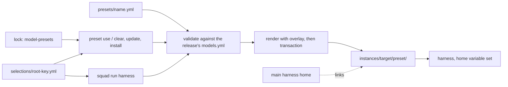

# Design Document

**Phase status:** Draft

## Overview

- **Slice 1 (R1–R6).** A preset is an overlay on `SquadModelProfiles`. It is applied to the source
  each renderer loads, so it runs inside the existing install and update transaction. The lock
  records which preset was applied. `squad preset use` is `squad update` with a new preset map.
- **Slice 2 (R7).** Each harness and preset pair gets one instance folder under
  `~/.kyber-weave/squad/instances/`. Squad renders the preset into it through the normal
  transaction and links everything else back to the harness's main home.
  `kyber-weave squad run <harness>` then starts the harness with its home or config variable
  pointing at that instance. Nothing is written into the project.
- Requirement 7 was revised at the owner's direction and has no open questions. Claude's
  `--agents` flag and a content-addressed cache were dropped (D6).



## Components and interfaces

### Slice 1

- **Preset store (R1.1, R4.2).** `SquadModelPresetStore` sits over `ISquadUserPaths`, so tests can
  use a fake home. It reads `~/.kyber-weave/squad/presets/<name>.yml`. The name is the file stem
  and must match `^[a-z0-9][a-z0-9-]{0,63}$`. Parsing reuses `SquadSourceLoader`'s YAML helpers,
  so errors carry the path and line.
- **Validation (R4.1).** It runs against the `SquadSource` of the release being rendered, after
  extraction and before render. Each category must be a key of that release's
  `ModelProfiles.Profiles`. Each harness must be in `ModelProfileFields`, which becomes `internal`
  as `TargetScopedProfileTargets` already is. A category that a new release removed fails the
  same way, before anything is written.
- **Render seam (R2.3).**
  - `SquadRenderRequest` gains `IReadOnlyDictionary<SquadTarget, SquadModelPreset>? ModelPresets`.
  - The 13 renderer calls to `SquadSourceLoader.Load(request.SourceDirectory)` become
    `SquadRenderSource.Load(request, <own target>)`, which returns
    `source with { ModelProfiles = preset.ApplyTo(source.ModelProfiles) }`.
  - Model resolution (for example `ClaudeRenderer.ResolveClaudeModel`) is unchanged, so only
    `model` can differ.
- **Lifecycle (R2.1, R2.2, R3.2).** `SquadUpdateRequest` and `SquadInstallRequest` gain
  `ModelPresets` (target to preset name; `null` keeps the lock's map).
  - `UpdateAsync` reads the previous lock with `ReadLock`, then validates the presets and passes
    them to the render.
  - It writes the map into the new lock in the same `transaction.Execute(plan)`.
  - `squad update --global --projects` re-applies each project's own map.
- **`squad preset` verbs** (a Spectre branch in `Program.cs`):
  - `use <name> --target <t,...> [--global] [--dry-run]` (R2.1, R2.4) calls `UpdateAsync`:
    - with `Version` set to the locked `SquadVersion`, so a switch never upgrades the release;
    - with `Targets = null`, which keeps the receipt's targets (an explicit list replaces them);
    - with the lock's map, the named targets changed.

    For a target not deployed in that scope, `--global` fails, and a project only records its
    selection (R6).
  - `clear --target <t,...> [--global]` (R3.3): same path, those targets removed from the map.
  - `list` (R5.1): each preset file and which targets use it, read from the global lock, the
    registered project locks (`ListProjectsWithoutRebuild`) and the selections.
  - `show <name> --target <t>` (R5.2): the resolved token for each category, with values taken
    from the bundled map marked. It notes that Warp renders no model.
- **Dry run (R2.4):** prints `agent: old -> new` for each agent whose resolved token
  (`HarnessModels[target] ?? Default`) changes, and writes nothing.
- **Status (R5.3):** each target's preset, or `none`. `(changed since applied)`, meaning the
  file's digest differs from the lock's, is a warning. `(missing)` exits 1, because the next
  update will fail (R3.4).
- **Doctor:** passes the lock's map into its comparison render, as it already passes `GlobalRoots`.
  Otherwise every agent the preset changed would show as a collision.

### Slice 2

- **Instance catalog (R7.6, R7.7).** `SquadInstanceCatalog` holds one row per `SquadTarget`: the
  executable, kind, variable, extra links and status (`Ready`, `SpikePending` or `Unsupported`).
  - `HomeReplace`: the variable replaces the whole home. The instance holds the rendered files and
    links back to everything else.
  - `ConfigLayer`: the variable adds a config folder over the normal one, and sign-in lives
    elsewhere. The instance holds only the rendered files.
  - `SpikePending` acts as `Unsupported` until its spike passes, so adding a harness changes one
    row.
- **Instance (R7.3, R7.8).** A new scope, `SquadDeploymentScope.Instance`.
  - Root and layout: the root is `~/.kyber-weave/squad/instances/<target>/<preset>/`. It renders in
    the global layout through a root resolver that returns the instance, so Copilot-style absolute
    links point inside it.
  - State: its lock, which records the preset, and its receipt live in
    `instance-state/<target>/<preset>/`. Its mutex is keyed by its root key.
  - Lifecycle: `squad run` creates it on first use, and refreshes it when the CLI version or the
    preset digest changes. `squad update --global` refreshes every instance on a new release.
  - The path never changes, so a keychain sign-in survives a refresh.
  - `squad instance remove --target <t> --preset <name>` deletes one, and `squad status --global`
    lists them.
- **Links (R7.4, R7.5).**
  - macOS uses symlinks. Windows uses hard links for files and junctions for folders, which need
    neither admin rights nor Developer Mode; hard links stay on one volume.
  - **What is linked:** every top-level entry of the main home except paths Squad renders. A folder
    that holds rendered files, such as `agents/`, is a real folder, and its other entries are
    linked one by one, so personal agents still show. The row's extra links are added too.
  - **At each launch:** Squad adds missing links and drops links to vanished entries.
  - It also checks that each linked file is still its target: on macOS the symlink is still there,
    and on Windows the file ID is the same. A rewrite by rename splits the link. Squad re-links
    copies that match, and keeps and names copies that differ.
  - **Removal:** every link is recorded in `links.json`. Removal and refresh delete the link entries
    without following them (R7.8).
- **`squad run <harness> [-- <args>]` (R7.1, R7.2, R7.6):**
  1. Resolve the project root as project scope does.
  2. Read that target's selection. With none, exit 2 with the fix.
  3. Look up the catalog row. If it is not `Ready`, exit 2 naming the harness and the reason (R7.7).
  4. Create or refresh the instance through the transaction (this validates the preset). Then
     re-sync and check the links.
  5. Start the harness through `ProcessStartInfo.ArgumentList` with the console inherited, the
     row's variable set to the instance, then `<args>`. On Windows, an npm-installed `.cmd` shim
     is found through `PATHEXT` and runs under `cmd.exe`, so `<args>` are escaped for `cmd.exe`.
  6. Return the harness's exit code.
- **Harness rows:**
  - **`claude`: HomeReplace, `CLAUDE_CONFIG_DIR`, Ready.** Settings, history and plugins live under
    it.
    - Sign-in on macOS is a Keychain entry keyed to the folder, so it happens once per instance.
    - On Windows, `.credentials.json` sits in the folder and is linked, so sign-in is shared.
    - Spikes: where `.claude.json` lives (if it is inside the folder, it becomes an extra link),
      and whether credentials are written in place.
  - **`codex`: HomeReplace, `CODEX_HOME`, Ready.** File mode links `auth.json`, so sign-in is shared.
    Keyring mode keys the entry by a SHA-256 of the home path, so sign-in happens once per instance.
  - **`copilot`: HomeReplace, `COPILOT_HOME`, Ready.** The variable "replaces the entire ~/.copilot
    path". The token is in keychain service `copilot-cli`, probably shared. A spike confirms it;
    either outcome meets R7.4.
  - **`pi`: HomeReplace, `PI_CODING_AGENT_DIR`, Ready.** Auth, settings, sessions, models, prompts and
    `agents/<name>.md` all live under it. `auth.json` is written in place under a file lock, so a
    link survives. Windows spike: whether that lock is shared through a hard link.
  - **`opencode`: ConfigLayer, `OPENCODE_CONFIG_DIR`, SpikePending.** The folder is loaded after the
    global config and "can override their settings"; sign-in stays in `~/.local/share/opencode`.
    - macOS spike: does a same-name agent there override a global one?
    - Last-resort fallback: `XDG_CONFIG_HOME` pointed at the instance, as HomeReplace. It carries
      the same side effect that rules out Devin.
  - **`kilo`: ConfigLayer, `KILO_CONFIG_DIR`, SpikePending.** It is known only from source and needs
    the same override check. Sign-in stays in `$XDG_DATA_HOME/kilo`.
  - **`cursor` and `zcode`: SpikePending.**
    - `CURSOR_CONFIG_DIR` is documented only for `cli-config.json`.
    - ZCode's renderer uses `ZCODE_STORAGE_DIR`, but its README says `ZCODE_DATA_BASE_DIR`.
  - **Unsupported (exit 2, named, never a project deploy; R7.7):**
    - `antigravity` and `factory` have no home variable.
    - `commandcode` has only `HOME`, which changes every tool in the process tree.
    - `devin` relies on `XDG_CONFIG_HOME` or `%APPDATA%`, which every tool shares.
    - `warp` has skills only.

## Data model

- **Preset file (R1.2, R4.3).** It has the `models.yml` profile shape, with `default` optional:

  ```yaml
  schema: kyber-squad.model-preset/v1
  profiles:
    fast: { claude: claude-haiku-5-5, opencode: zai-coding-plan/glm-5.3-flash }
    architect: { claude: inherit }
  ```

- **Merge (R1.3).** Key by key, for each category in the preset:
  `Default = preset.default ?? bundled.Default` and `HarnessModels[h] = preset[h] ?? bundled[h]`.
  Renderers are unchanged and `inherit` still omits `model`. A preset `default` therefore reaches
  only harnesses that neither file names.
- **Lock (R3.1).** `kyber-squad.lock/v2` adds
  `model-presets: { claude: { name: zai, digest: <sha256 of the file> } }`.
  - v2 is written only when the map is non-empty; otherwise the lock stays byte-identical v1.
  - `DeserializeLock` reads both. An older CLI refuses v2 rather than drop the preset.
- **Project selection (R6.1–R6.3).** `~/.kyber-weave/squad/selections/<root-key>.yml` holds
  `schema`, `root` and `model-presets: { claude: zai }`, under the same key as `projects/<root-key>/`.
  - `preset use` and `preset clear` without `--global` write it after the commit (temporary file,
    then rename).
  - Project install applies it and `squad run` reads it. It never touches global state.
- **Instance (R7.3, R7.8).** The folder `~/.kyber-weave/squad/instances/<target>/<preset>/` has a
  stable path and is not content-addressed.
  - Its state, in `instance-state/<target>/<preset>/`, is `squad.lock.yml` (v2, recording the
    preset), `squad.receipt.json` and `links.json` (each link's path, kind and target).
  - Everything in the folder belongs to the instance: the rendered files (tracked by the receipt),
    the links (tracked by `links.json`), and whatever the harness writes there.

## Error handling

- **Exit 2 (bad input):** an unknown preset name (the message lists the existing ones), an unknown
  `--target`, `run` with no selection, or a harness that is unsupported or spike-pending (named,
  with the reason; R7.7).
- **Exit 1, nothing written (R3.4, R4.1, R4.2):** a parse error, reported as `file:line`; an
  unknown key, reported as `profiles.<category>.<harness>`; a recorded preset that is gone (its
  file is checked before download, its contents before render).
- **A hand-edited managed agent file** is kept, with a warning that names it, as update does today.
  The preset therefore skips that file (R2.2).
- **Overrides into instances are refused.** `SquadGlobalRoots` rejects any override variable that
  points under `instances/`. Otherwise a `--global` command run inside a launched session would
  deploy into the instance.
- **`run` exits 1 naming the cause** when the harness is not on `PATH`, or when a link cannot be
  made. For a Windows hard link across volumes, the message names the file and both paths. Squad
  never copies a file instead.
- **A sign-in file rewritten by rename (R7.4a).** When a spike shows this, the harness row lists
  that file as never linked, and the user signs in once per instance. Sharing it would let a
  token refresh in one home sign the other out.
- **A split link** is re-linked if both copies match. If they differ, Squad warns and keeps both
  copies.

## Testing strategy

- **Unit and contract tests (Linux CI, as today):**
  - parsing: optional `default`, `inherit`, a duplicate key, a YAML error's line, a bad name;
  - the key-by-key merge (R1.3);
  - validation, including a category a newer release removed;
  - link planning as a pure function, from a main-home listing and the rendered paths to links to
    add, replace or remove;
  - catalog row to `ProcessStartInfo`;
  - `cmd.exe` escaping.
- **Golden render (R2.3):** every target, rendered with and without a preset. Only `model` lines
  may differ. A parity test ties the dry-run resolver to each renderer.
- **Lifecycle (R2, R3):**
  - `use` writes a v2 lock whose receipt hashes match the files, and the other targets survive;
  - an update to a newer fake release re-applies the preset;
  - `clear` restores v1;
  - a missing preset and `--dry-run` write nothing;
  - an instance refresh keeps its path and its `links.json`.
- **State and CLI:**
  - locks v1 and v2 round-trip, and an old reader refuses v2;
  - the selection never touches global state (R6.3);
  - doctor shows no false collision;
  - exit codes and output for every verb;
  - two launches of one instance are serialized;
  - the project's `git status` stays clean.
- **On macOS and Windows (tasks phase, with recorded evidence):**
  - links are created without admin rights;
  - link-safe removal and refresh never touch a target (symlink, junction, hard link);
  - a split link is detected;
  - per-harness spikes: Claude `.claude.json` and credential writes; Codex keyring; Copilot
    keychain; the Pi lock on Windows; OpenCode and Kilo override; the Cursor and ZCode variables.

  Each spike settles one catalog row.

## Decisions

- **D1. The overlay goes into the render request, through one loader helper.** Rejected:
  rewriting frontmatter after render or outside the transaction (breaks receipt hashes, R2.2);
  editing `models.yml` in the extracted release (changes the folder `BuildLock` hashes for
  `bundle-digest`, and hides the overlay from validation and doctor); preset code in 13 renderers.
- **D2. The applied preset goes in lock v2.** Rejected: a separate state file (outside the
  transaction, and an older CLI would silently drop it, the failure R3 forbids); the receipt (it
  records ownership, not intent); a new key in v1 (`RequireExactYamlFields` rejects it unclearly).
- **D3. `preset use` is `update`, pinned to the locked version and target list.** Rejected: a second
  apply path; the latest version (a silent upgrade); an explicit `--target` roster (it shrinks).
- **D4. One file per preset, in `~/.kyber-weave/squad/presets/`.** Rejected: one shared file (a
  single typo blocks every preset); files in the project (R6.2, ADR 0037).
- **D5. The project selection is its own file, outside `projects/<root-key>/`.** A project with no
  deployment has no lock, which is slice 2's case. The transaction-owned folder keeps only files
  the transaction writes.
- **D6. One stable instance per harness and preset, with links, and harness kinds as catalog
  data.** Rejected:
  - Claude `--agents`: interactive sessions take only inline JSON, and Windows caps the whole
    command line at 32,767 characters;
  - a content-addressed cache: the path changes every release, so a keychain sign-in would be lost
    (R7.3);
  - moving the home without links: settings and history split off (R7.4);
  - overriding `HOME`, or `XDG_CONFIG_HOME` beyond the OpenCode fallback: it changes every tool;
  - project shadow copies (R6.2, R7.2);
  - rewriting deployed frontmatter outside the transaction;
  - a Claude-only alias remap (R7.6);
  - a shell hook, which cannot create or refresh an instance.
- **D7. Links are symlinks on macOS, and hard links plus junctions on Windows.** Rejected: Windows
  symbolic links (they need admin rights or Developer Mode, R7.5); copying files (copies drift
  apart, R7.4).
- **D8. Squad records every link it makes, and deletes links without following them (R7.8).**
  Rejected: a plain recursive delete of the instance folder, which can follow a junction or a
  folder link into its target.

## Sources

- Windows command-line limit (32,767 characters): https://learn.microsoft.com/windows/win32/api/processthreadsapi/nf-processthreadsapi-createprocessw
- Windows symbolic links need admin or Developer Mode: https://learn.microsoft.com/windows/win32/api/winbase/nf-winbase-createsymboliclinkw
- Windows hard links and junctions: https://learn.microsoft.com/windows/win32/fileio/hard-links-and-junctions
- Claude Code `--agents` (inline only, except with `--print`): https://code.claude.com/docs/en/cli-reference
- Claude Code `CLAUDE_CONFIG_DIR` and credential storage: https://code.claude.com/docs/en/env-vars, https://code.claude.com/docs/en/authentication
- Codex sign-in storage: https://learn.chatgpt.com/docs/auth
- Copilot CLI config dir: https://docs.github.com/en/copilot/reference/copilot-cli-reference/cli-config-dir-reference
- Pi `getAgentDir` (`packages/coding-agent/src/config.ts`): https://github.com/earendil-works/pi
- Pi subagents (global agents in `$PI_CODING_AGENT_DIR/agents/`): https://pi.dev/packages/@gotgenes/pi-subagents
- OpenCode: https://opencode.ai/docs/config/, https://opencode.ai/docs/agents/
- Kilo source (`packages/core/src/flag/flag.ts`, `packages/opencode/src/config/config.ts`): https://github.com/Kilo-Org/kilocode
